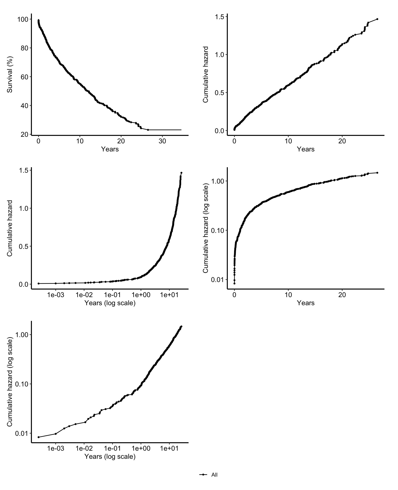
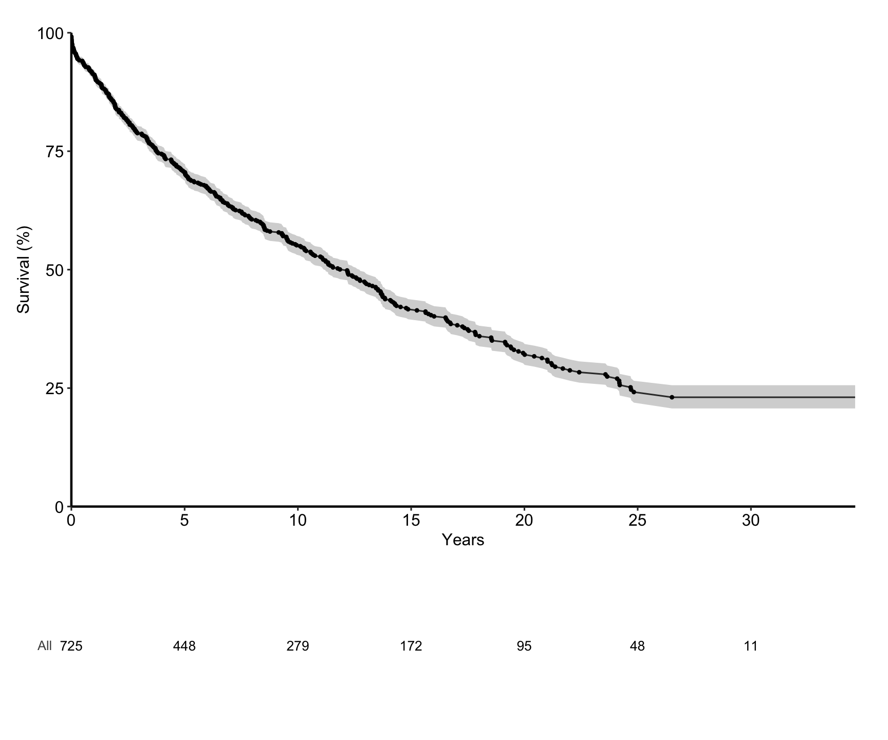
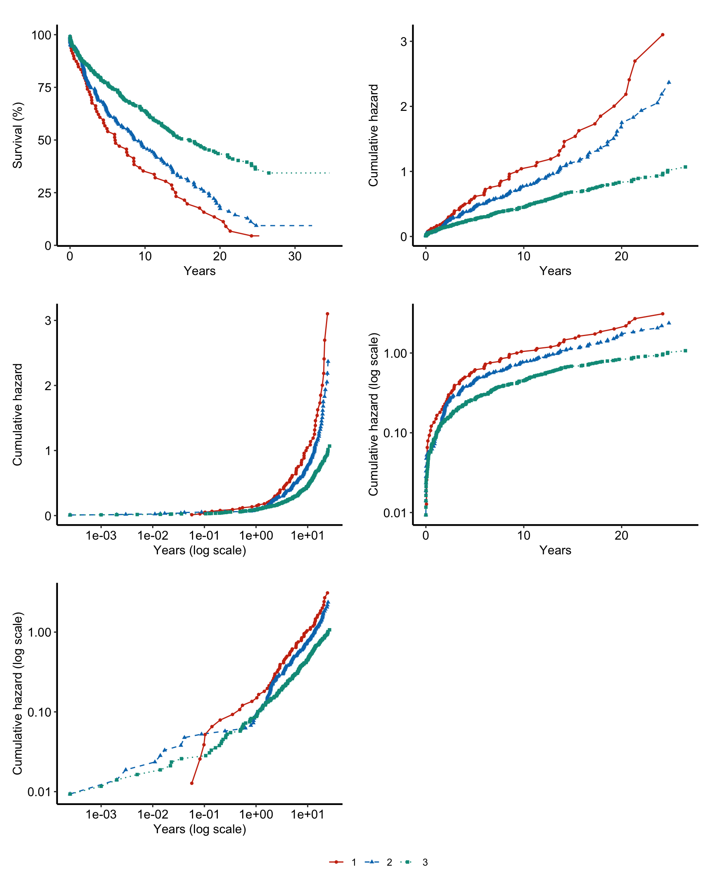
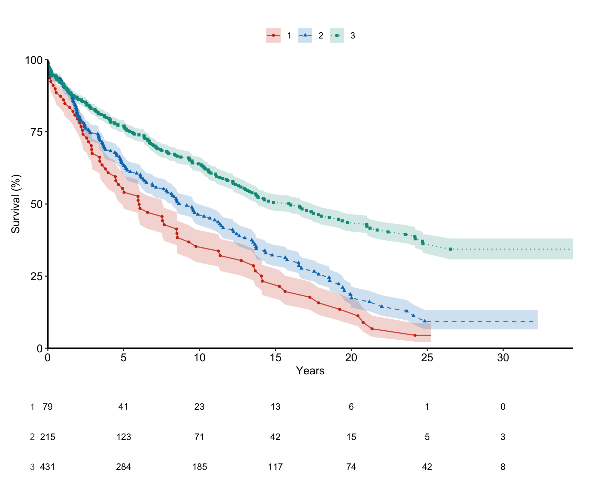
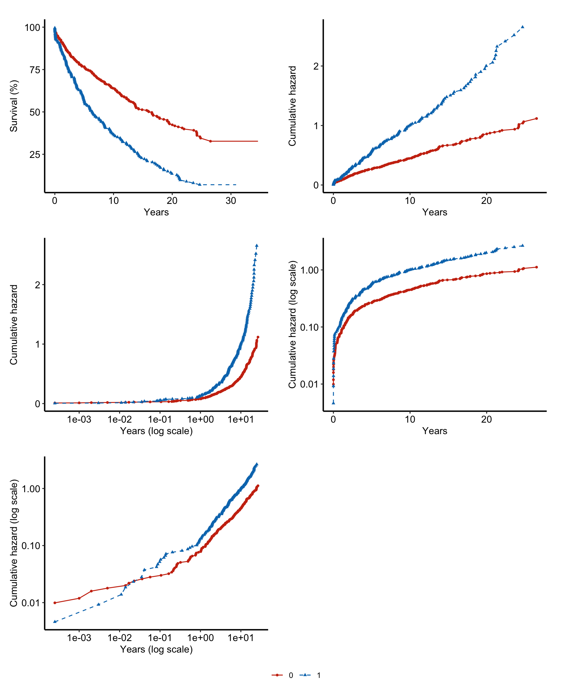
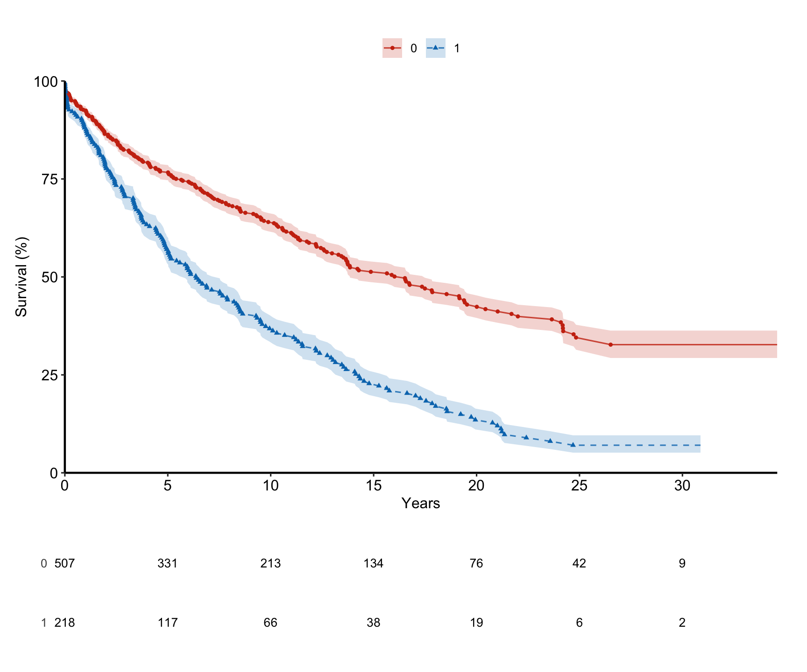

# Actuarial life table

# Actuarial life table

Published

2026-11-25 13:07

An `ac` job is the first look at an outcome: the Kaplan-Meier life
table, survival and patients at risk at the reporting horizons, the
follow-up, the strata compared, and the figures read before any hazard
model. Those are the survival curve, the cumulative-hazard views that
suggest the phases an `hz` job fits, and a manuscript figure with the
numbers at risk beneath it. The parametric fit is `hz`, and the figures
that lay that fit over these estimates are `hp`.

Code

``` r
SUBJECT <- "dead"
TYPE    <- "hz"
.in <- knitr::current_input(dir = TRUE)
suppressPackageStartupMessages(library(hvtiRutilities))
if (utils::packageVersion("TemporalHazard") < "1.2.12") {
  stop("This job needs TemporalHazard >= 1.2.12 for hzr_kaplan(); ",
       utils::packageVersion("TemporalHazard"), " is installed.", call. = FALSE)
}
if (utils::packageVersion("hvtiPlotR") < "2.8.20") {
  stop("This job needs hvtiPlotR >= 2.8.20 for hv_atrisk_compose() and hv_group_palette(); ",
       utils::packageVersion("hvtiPlotR"), " is installed.", call. = FALSE)
}
if (!requireNamespace("patchwork", quietly = TRUE)) {
  stop("This job needs the patchwork package for its page of cumulative-hazard views.", call. = FALSE)
}
# The study root is the nearest directory above this file holding _study.yml,
# so the job renders the same from the Render button, quarto render, or
# render_job(), at any depth, with no path in this document to edit.
# To render a job you have not finished, leave a chunk out with the chunk
# option skip, giving the reason in quotes, or call hvtiRtemplates::stop_here()
# in a chunk to leave out everything below it. A draft lists each one in a
# callout; a final render refuses them, as it refuses an unresolved marker.
# ?stop_here has more.
.job <- hvtiRtemplates:::.job_setup(SUBJECT, TYPE, envir = environment())
.root <- .job$root
set_path <- .job$set_path
.provenance_data <- list()
# Saves a figure as <name>.png, .pdf and .tiff in this set's graphs/ folder (or `kind`'s),
# under the SAVE_FIGURES and FIGURES study choices.
save_figure <- function(plot, name, width = 6, height = 4, kind = "graphs", linked = FALSE) {
  hvtiRtemplates:::.save_figure(plot, set_path(kind, paste0(name, ".png")), width, height,
                                SAVE_FIGURES, FIGURES, linked)
}
# The overall life table is saved after it is fitted. `hp` reads that exact
# handoff by set and refuses an older lineage-free artifact.
# The draft banners, if any, and the box under the title, after all the code above.
.job$notice
```

**final** · data `built` `built_20261125.parquet`, dated 2026-11-25 ·
rendered by gallery on gallery · hvtiRtemplates 1.6.3

## Study choices

Edit these values for this study before rendering. The life table, the
horizons, the tests and the figures are computed by
`hvtiRtemplates::life_table()` and its companions, the counterpart of
the SAS `%KAPLAN` macro; `?life_table` lists what each one does.

Code

``` r
# Demo: the registered dataset this job reads ("built" is the study dataset).
# A file name, such as "match_set.rds", reads an unregistered file in the datasets folder, as a draft.
DATASET <- "built"

# Demo: an hvtiRdatabuild analysis set, or NULL to read the whole dataset.
ANALYSIS_SET <- NULL

# Demo: rows to keep, dplyr::filter() style, or NULL to keep every row:
#   WHERE <- quote(age >= 18)
#   WHERE <- rlang::exprs(age >= 18, hx_chf == 1)
WHERE <- quote(!is.na(creat_pr))

# Demo: the patient identifier. If the data has no "ccfid" column, the job uses MRN, then eMRN;
# name another column if the study uses one, such as "ccfidu" where a patient
# enters the study once for each operation.
ID <- "patient_id"

# Demo: what makes a row unique; one row per patient unless repeated measures
# add their visit time or date, for example KEY <- c(ID, "iv_echo").
KEY <- ID

# Optional, and needs no edit: NULL reads the cohort alone. To join one
# registered ancillary dataset (echoes, labs, the match assignments a
# propensity job saved), name it in JOIN. The cohort above decides the
# patients, one row each; the joined records of other patients are dropped and
# counted in the data table.
#   JOIN_VARS: the cohort columns each joined row carries; NULL carries all,
#     and a column both datasets have stops, so list only those the job needs.
#   REDUCE: NULL keeps a row per joined record, keyed on that dataset's key;
#     list(rule = "first", by = "echo_date") keeps one row per patient ("last",
#     or "nearest" with to = a cohort date column). WHERE on a joined column
#     filters the records first, so "last" with WHERE echo_type == "TTE"
#     keeps each patient's last TTE. A tie stops: picking one record
#     silently would be a hidden choice; by = c("echo_date", "echo_seq")
#     breaks it. This job models one row per
#     patient, so a long JOIN without REDUCE stops here.
#   JOIN_KEY: overrides the joined dataset's registered key.
JOIN <- NULL
JOIN_VARS <- NULL
REDUCE <- NULL
JOIN_KEY <- NULL

# Demo: time and event variables.
TIME   <- "iv_dead"

EVENT  <- "dead"

# Demo: the stratification variables, or NULL for the whole cohort only. Each
# is analyzed on its own: c("female", "tr_strat") gives a table, tests and
# figures by sex, then another set by treatment, not a cross-tab of the two.
# The whole cohort is always reported first. A grouping the dataset lacks is
# made in "Derived strata" below.
STRATA <- c("lvef_grp", "hx_chf")

# Optional: each grouping made in "Derived strata" below, named by its source,
# e.g. DERIVED <- c(lvef_grp = "lvef"), so the job can read one against the other.
DERIVED <- c(lvef_grp = "lvef")

# Optional: the counts of the SAS reference, to have the job stop when the rows
# it reads differ, e.g. list(n = 69L, n_events = 50L, n_censored = 19L).
# NULL reports the counts the job finds and checks them against nothing.
EXPECTED <- list(n = 725L, n_events = 406L, n_censored = 319L)

# Reporting horizons, in the unit of TIME (years here), and their labels.
# NULL labels each horizon with its value; labs <- c("30 days", "6 months",
# "1 year", paste(2:10, "years")) names them. Another grid: c(1, seq(2, 20, by = 2)).
grid <- c(30 / 365.2425, 0.5, 1:10)
labs <- NULL

# The life table's rows: TRUE prints a row for each death (SAS PEVENT=1);
# FALSE adds a row for each censored patient as well (PEVENT=0).
EVENT_ONLY <- TRUE

# %KAPLAN's CLEVEL default: one standard error, NOT 95%. This is a SAS
# convention rather than a study choice; change it only if your SAS job
# overrides CLEVEL, and say so in the report if you do.
CLEVEL <- 0.68268948

# The figures' last time. NULL draws to the end of follow-up; a manuscript
# figure usually stops where enough patients remain at risk, e.g. PLOT_MAX <- 15.
PLOT_MAX <- NULL

# The times the manuscript figure counts patients at risk, e.g. 0:10; NULL
# takes evenly spaced times across the axis. The figure's x-axis ticks at these
# times, so each count stands under its tick; times closer together than about a
# twentieth of the axis, such as 30 days beside 0, print over each other.
RISK_TIMES <- NULL

# How the manuscript figure shows the CLEVEL limits. CI_BAND draws them as a
# continuous band. CI_TIMES draws a bar at each of the times given, e.g.
# c(30 / 365.2425, 1, 5), as the SAS jobs mark chosen points; each bar spans the
# limits the horizon tables report at that time, and a time before the first
# event or past the end of follow-up has none and draws no bar. Either, both or
# neither: CI_BAND <- FALSE with CI_TIMES set gives the SAS figure's bars alone.
# Under the straight lines below (STEPS <- FALSE) a bar is drawn at the last
# event at or before its time: the table's limits hold from that event on, and
# only there does the line pass through the estimate they bracket. With sparse
# events a bar can therefore stand well left of the time asked for.
CI_BAND <- TRUE
CI_TIMES <- NULL

# How the figures join one event to the next. Each event is drawn as a point;
# FALSE joins the points with straight lines, as the SAS %KAPLAN figures do;
# TRUE draws the Kaplan-Meier steps, flat between events and dropping at each one.
STEPS <- FALSE

# What the manuscript figure's curve shows. FALSE draws survival, falling from
# 100%. TRUE draws its complement, 1 minus Kaplan-Meier, rising from 0; its
# limits and bars flip with it. "both" draws the two on one figure, each stratum
# in its own color and line type, the survival curve falling to meet its
# complement rising. The tables report survival either way.
# For all-cause death, 1 minus Kaplan-Meier IS the cumulative mortality. For an
# event death can pre-empt (reoperation, readmission), a death here is a
# censoring, and 1 minus Kaplan-Meier then overstates the event's cumulative
# incidence: it estimates the risk in a world where nobody dies. Report such an
# event with a competing-risk estimate, not with this curve under that name.
COMPLEMENT <- FALSE

# The manuscript figure's y-axis title. NULL gives "Survival (%)", or
# "1 - Kaplan-Meier (%)" under COMPLEMENT, or "Survival and 1 - Kaplan-Meier (%)"
# under COMPLEMENT <- "both"; name the event for a reader,
# e.g. Y_LABEL <- "Mortality (%)" when EVENT is all-cause death.
Y_LABEL <- NULL

# Each figure is saved to graphs/ as a PNG (for Word) and a PDF (for the publisher), and as a TIFF when ragg is installed.
# SAVE_FIGURES <- FALSE saves none; FIGURES keeps only the figures whose names
# start with one of its entries, e.g. FIGURES <- c("ac-survival"). The names are the
# file names, listed for each template in the templates README.
SAVE_FIGURES <- TRUE
FIGURES <- NULL
```

## Cohort

Code

``` r
# The checksum of every dataset in manifest.yaml is checked before anything is
# read, so a result can name the data that produced it. It stops on a mismatch.
hvtiRutilities::verify_manifest(file.path(.root, "manifest.yaml"))
.cfg <- study_config(start = .root)
job_data <- hvtiRtemplates::read_job_data(.cfg, dataset = DATASET, analysis_set = ANALYSIS_SET,
                                          where = WHERE, id_col = ID, key_cols = KEY, join = JOIN, join_cols = JOIN_VARS,
                                          reduce = REDUCE, join_key_cols = JOIN_KEY, one_row_per_patient = TRUE)
d <- job_data$data
.provenance_data <- c(if (exists(".provenance_data")) .provenance_data else list(), list(job_data$provenance),
                      if (!is.null(job_data$provenance_join)) list(job_data$provenance_join))
knitr::kable(job_data$record, col.names = c("Data", ""))
```

| Data                |                                          |
|:--------------------|:-----------------------------------------|
| Source              | dataset `built` (built_20261125.parquet) |
| Rows read           | 800                                      |
| ID                  | `patient_id`                             |
| Identifiers dropped | none                                     |
| `!is.na(creat_pr)`  | removed 75                               |
| Rows kept           | 725 rows on 725 patients                 |

Table 1: The data this job read

Code

``` r
# unnumbered: its child chunk carries its own label and caption
if (!is.null(job_data$attrition)) {
  .fence <- strrep("`", 3)
  cat(knitr::knit_child(text = c(
    paste0(.fence, "{r}"), "#| label: tbl-data-attrition",
    paste0("#| tbl-cap: ", encodeString(paste0("Analysis set `", ANALYSIS_SET, "`: exclusions, in order"), quote = "\"")),
    "knitr::kable(job_data$attrition)", .fence
  ), envir = environment(), quiet = TRUE), sep = "\n")
}
```

Code

``` r
cc <- cohort_counts(d, time_col = TIME, event_col = EVENT)
if (!is.null(EXPECTED)) assert_cohort(d, expected = EXPECTED, time_col = TIME, event_col = EVENT)

# A time of zero, a death on the day of operation, leaves the hazard likelihood
# undefined, and hz would stop on an optimizer error that names neither the
# time nor the patient. ac checks too, so the first job in the chain says so.
# The fix belongs in the dataset build, not here: a job reshapes data and never
# corrects it, and every job reading the cohort must see the same follow-up.
# Only rows the cohort counts are checked: a row with no EVENT is not analyzed.
.t <- as.numeric(d[[TIME]])[!is.na(d[[EVENT]])]
.n_zero <- sum(.t == 0, na.rm = TRUE)
.n_neg  <- sum(.t < 0, na.rm = TRUE)
if (.n_zero + .n_neg > 0) {
  stop(TIME, " has ", .n_zero, " time(s) of exactly zero and ", .n_neg, " negative time(s). ",
       "Correct them in the dataset build, not in this job. Move only the zeros to a small positive ",
       "value, such as 0.00025 years as the template gallery does; moving every time up to one day ",
       "ties the early deaths together. A negative time is an error in the data: trace it to its source.",
       call. = FALSE)
}

knitr::kable(data.frame(
  quantity = c("n_analysable", "n_events", "n_censored"),
  n        = c(cc$n, cc$n_events, cc$n_censored),
  percent  = round(100 * c(cc$n, cc$n_events, cc$n_censored) / cc$n, 1)
))
```

| quantity     |   n | percent |
|:-------------|----:|--------:|
| n_analysable | 725 |     100 |
| n_events     | 406 |      56 |
| n_censored   | 319 |      44 |

Table 2: Analysable patients, events and censored patients

Code

``` r
# A row whose event is missing is not analyzed, and is counted here so it is seen.
.ev <- as.character(as.numeric(d[[EVENT]]))
.ev[is.na(.ev)] <- "missing"
.freq <- as.data.frame(table(value = factor(.ev, levels = intersect(c("0", "1", "missing"), unique(.ev)))),
                       stringsAsFactors = FALSE)
names(.freq)[1] <- EVENT
.freq$percent <- round(100 * .freq$Freq / sum(.freq$Freq), 1)
.freq$cumulative <- cumsum(.freq$Freq)
knitr::kable(.freq, row.names = FALSE)
```

| dead | Freq | percent | cumulative |
|:-----|-----:|--------:|-----------:|
| 0    |  319 |      44 |        319 |
| 1    |  406 |      56 |        725 |

Table 3: The event over every row read, missing included (PROC FREQ with
MISSING)

These are the counts the job found, the `PROC FREQ` of the event over
every row read, missing included. With `EXPECTED` set, a rendered report
is also evidence that the analysable cohort’s counts in the table above
matched the SAS reference. A row whose event is missing is counted here
but is not part of that check.

Code

``` r
# Percentiles are SAS's PROC UNIVARIATE default definition (PCTLDEF=5), which is
# R's quantile type 2, so the median follow-up quoted in a manuscript matches.
fu_row <- function(who, t) {
  q <- stats::quantile(t, c(0.10, 0.25, 0.50, 0.75, 0.90), type = 2, names = FALSE)
  data.frame(patients = who, n = length(t), mean = mean(t), sd = stats::sd(t), min = min(t),
             p10 = q[1], p25 = q[2], median = q[3], p75 = q[4], p90 = q[5], max = max(t))
}
.fu <- d[!is.na(d[[TIME]]) & !is.na(d[[EVENT]]), , drop = FALSE]
.fu_t <- as.numeric(.fu[[TIME]])
.censored <- as.numeric(.fu[[EVENT]]) == 0
knitr::kable(rbind(fu_row("all", .fu_t), if (any(.censored)) fu_row("censored", .fu_t[.censored])),
             row.names = FALSE, digits = 2)
```

| patients |   n |  mean |   sd | min |  p10 |  p25 | median |   p75 |   p90 |  max |
|:---------|----:|------:|-----:|----:|-----:|-----:|-------:|------:|------:|-----:|
| all      | 725 |  9.47 | 8.11 |   0 | 0.93 | 2.71 |   7.13 | 14.29 | 22.28 | 34.6 |
| censored | 319 | 12.60 | 8.93 |   0 | 1.82 | 5.31 |  10.38 | 19.00 | 25.91 | 34.6 |

Table 4: Follow-up, in the unit of TIME: all patients, and those
censored (event-free)

Goodness of follow-up, for a study whose patients die early or whose
follow-up is in doubt, is the `dc-gfup` job.

## Derived strata

A grouping the dataset lacks, such as ejection fraction cut into three
groups, is made here and named in `DERIVED`. A grouping that more than
one job needs belongs in the dataset build instead.

Code

``` r
# Optional: derive a grouping STRATA names that the dataset lacks, then name it
# and its source in DERIVED in the study choices, so the table below reads one
# against the other.
# The example makes three ejection-fraction groups from lvef; uncomment and
# adapt it. SAS derives categories by cumulative overwrites, each later line
# overwriting the ones before, so transcribe the ORDER from the SAS as well as
# the cutpoints. Keep a missing source missing: the patient is then dropped from
# the stratified tables, as %KAPLAN drops them, instead of joining a group.
d$lvef_grp <- 3L
d$lvef_grp[which(d$lvef < 50)] <- 2L
d$lvef_grp[which(d$lvef < 40)] <- 1L
d$lvef_grp[is.na(d$lvef)] <- NA
```

Code

``` r
# A cumulative-overwrite derivation fails QUIETLY: reorder the conditions and
# every patient still lands in some category, the counts still sum to the
# cohort, and every stratified estimate below is wrong while looking entirely
# plausible. So the derivation is checked against the data it came from: the
# source RANGE within each category. Correctly ordered, the ranges are disjoint
# and ascend with the category; overlapping or inverted ranges mean the
# overwrites ran in the wrong order.
if (length(DERIVED)) {
  .miss <- setdiff(c(names(DERIVED), unname(DERIVED)), names(d))
  if (length(.miss)) {
    stop("DERIVED names column(s) not in the data: ", paste(.miss, collapse = ", "),
         ". Name each derived column and its source as the derive chunk made them.", call. = FALSE)
  }
  derived_rows <- function(cat) {
    src <- DERIVED[[cat]]
    lv <- d[[cat]]
    do.call(rbind, lapply(c(sort(unique(lv[!is.na(lv)])), if (anyNA(lv)) NA), function(k) {
      v <- d[[src]][if (is.na(k)) is.na(lv) else which(lv == k)]
      r <- if (any(!is.na(v))) range(v, na.rm = TRUE) else c(NA_real_, NA_real_)
      data.frame(category = cat, level = k, n = length(v), source = src,
                 src_min = r[1], src_max = r[2], src_missing = sum(is.na(v)))
    }))
  }
  knitr::kable(do.call(rbind, lapply(names(DERIVED), derived_rows)), row.names = FALSE, digits = 4)
}
```

| category | level |   n | source | src_min | src_max | src_missing |
|:---------|------:|----:|:-------|--------:|--------:|------------:|
| lvef_grp |     1 |  79 | lvef   |      20 |      39 |           0 |
| lvef_grp |     2 | 215 | lvef   |      40 |      49 |           0 |
| lvef_grp |     3 | 431 | lvef   |      50 |      75 |           0 |

Table 5: Each derived category against the variable it came from

When this job derives a grouping, read the ranges before reading
anything below. They must not overlap between levels of the same
category, and they must ascend with the level.

## Estimation

Code

``` r
# unnumbered: defines helpers only
# The times the manuscript figure counts patients at risk.
risk_times <- function(plot_max) {
  at <- if (is.null(RISK_TIMES)) pretty(c(0, plot_max)) else RISK_TIMES
  at[at <= plot_max]
}
.fence <- strrep("`", 3)
.seen <- new.env()
# Prints `code` as a child chunk with its own label and caption, so each table
# and figure the loops below make is numbered and can be cited.
.child <- function(label, caption, code, opts = character()) {
  label <- gsub("(^-+|-+$)", "", gsub("[^a-z0-9]+", "-", tolower(label)))
  if (!is.null(.seen[[label]])) stop("Two outputs would share the label ", label, ".", call. = FALSE)
  .seen[[label]] <- TRUE
  .opt <- paste0("#| ", sub("-.*$", "", label), "-cap: ", encodeString(caption, quote = "\""))
  cat(knitr::knit_child(text = c(paste0(.fence, "{r}"), paste0("#| label: ", label), .opt, opts, code, .fence),
                        envir = parent.frame(), quiet = TRUE), sep = "\n")
  cat("\n")
}

# Survival and its limits as percentages, the way the tables report them.
as_percent <- function(x) {
  for (col in intersect(c("survival", "cl_lower", "cl_upper"), names(x))) x[[col]] <- round(100 * x[[col]], 1)
  x
}

# A life table for print, each stratum's rows ending on a row that totals its
# events, so the sum can be checked against the counts above. Only the events are
# totalled: a total of n_censor would not match the censored count on a PEVENT=1
# table, which leaves out patients censored after the last event. Cells become
# text so the total row can say "Total"; kable() takes the "align" attribute.
with_event_totals <- function(x) {
  num <- vapply(x, is.numeric, logical(1))
  shown <- x
  shown[] <- lapply(x, function(col) {
    if (!is.numeric(col)) return(as.character(col))
    # Four decimals, as kable(digits = 4) printed them; digits = 15 keeps format()'s
    # default of seven significant digits from cutting a time in days short.
    vapply(round(col, 4), function(v) format(v, digits = 15, scientific = FALSE, drop0trailing = TRUE, trim = TRUE), "")
  })
  # Groups come from the strata counts, not the rows, so a stratum with no events
  # (no event rows) still ends on a total of 0; unstratified, the one group is "".
  by <- if ("stratum" %in% names(x)) x$stratum else rep("", nrow(x))
  groups <- if ("stratum" %in% names(x)) attr(x, "counts")$stratum %||% unique(by) else ""
  out <- do.call(rbind, lapply(groups, function(s) {
    total <- shown[1, , drop = FALSE]
    total[] <- ""
    if ("stratum" %in% names(x)) total$stratum <- s
    total$time <- "Total"
    total$n_event <- as.character(sum(x$n_event[by == s]))
    rbind(shown[by == s, , drop = FALSE], total)
  }))
  rownames(out) <- NULL
  attr(out, "align") <- ifelse(num, "r", "l")
  out
}
```

Code

``` r
# Flags what a reader could learn about one patient, by column and count. It changes no number.
# The follow-up table shows the longest follow-up, and a stratum's curve is its few patients' events.
# The life tables leave out a row missing its time or its event, so the counts here do too.
# Numbers at risk are counted where the report states them as the deliverable, the horizon tables
# and the figure's row. A life table's own rows are not: every table runs out to its last patient.
.fu_rows <- !is.na(d[[TIME]]) & !is.na(d[[EVENT]])
.fu_end <- max(as.numeric(d[[TIME]][.fu_rows]), 0)
.at_risk <- function(strata, column) {
  .times <- sort(unique(c(grid, risk_times(if (is.null(PLOT_MAX)) .fu_end else PLOT_MAX))))
  hvtiRtemplates:::.identifiability_counts(
    hvtiRtemplates::life_table_at(d, TIME, EVENT, times = .times, strata_col = strata, conf_level = CLEVEL)$n_risk,
    column, check = "at_risk"
  )
}
cat(hvtiRtemplates:::.identifiability_notice(do.call(rbind, c(
  list(hvtiRtemplates:::.identifiability_check(d[.fu_rows, , drop = FALSE], STRATA, cells = STRATA, extremes = TIME, within = STRATA),
       .at_risk(NULL, "all patients")),
  lapply(STRATA, function(v) .at_risk(v, v))
))))
```

WarningBefore this goes in a manuscript

- 2 of the numbers at risk shown for `lvef_grp` are under 5 patients.
  End the table or figure sooner, or decide that the count can be shown.
- 1 of the numbers at risk shown for `hx_chf` are under 5 patients. End
  the table or figure sooner, or decide that the count can be shown.

## Overall

Code

``` r
km <- hvtiRtemplates::life_table(d, TIME, EVENT, conf_level = CLEVEL)
ac_art <- hvtiRtemplates:::.attach_handoff_lineage(
  list(overall = km),
  data = .provenance_data,
  analysis = list(
    time = list(variable = TIME),
    event = list(variable = EVENT, event = 1L, censored = 0L)
  ),
  cohort = cc,
  # hp checks that ac and hz read the same rows with the same TIME and EVENT.
  selection = c(attr(job_data$record, "selection"), list(time = TIME, event = EVENT))
)
saveRDS(ac_art, set_path("estimates", "ac.rds"))
# The saved life table is always the event rows, the table hp draws over.
.km_rows <- if (EVENT_ONLY) km else hvtiRtemplates::life_table(d, TIME, EVENT, conf_level = CLEVEL, event_only = FALSE)
.km_print <- with_event_totals(as_percent(.km_rows))
knitr::kable(.km_print, row.names = FALSE, align = attr(.km_print, "align"))
```

| time | n_risk | n_event | n_censor | survival | std_err | cl_lower | cl_upper | cumhaz | hazard | density | life |
|---:|---:|---:|---:|---:|---:|---:|---:|---:|---:|---:|---:|
| 0.0003 | 725 | 6 | 1 | 99.2 | 0.0034 | 98.8 | 99.4 | 0.0083 | 33.2412 | 33.1034 | 0.0003 |
| 0.001 | 718 | 1 | 0 | 99 | 0.0036 | 98.6 | 99.3 | 0.0097 | 1.8583 | 1.8416 | 0.001 |
| 0.002 | 717 | 2 | 0 | 98.8 | 0.0041 | 98.3 | 99.1 | 0.0125 | 2.7933 | 2.7625 | 0.002 |
| 0.003 | 715 | 1 | 0 | 98.6 | 0.0043 | 98.1 | 99 | 0.0139 | 1.3996 | 1.3812 | 0.003 |
| 0.005 | 714 | 1 | 0 | 98.5 | 0.0045 | 98 | 98.9 | 0.0153 | 0.7008 | 0.6906 | 0.0049 |
| 0.011 | 713 | 1 | 0 | 98.3 | 0.0047 | 97.8 | 98.8 | 0.0167 | 0.2339 | 0.2302 | 0.0109 |
| 0.014 | 712 | 2 | 0 | 98.1 | 0.0051 | 97.5 | 98.5 | 0.0195 | 0.9376 | 0.9208 | 0.0138 |
| 0.017 | 710 | 1 | 0 | 97.9 | 0.0053 | 97.3 | 98.4 | 0.0209 | 0.4698 | 0.4604 | 0.0167 |
| 0.022 | 709 | 1 | 0 | 97.8 | 0.0055 | 97.2 | 98.3 | 0.0223 | 0.2823 | 0.2762 | 0.0216 |
| 0.023 | 708 | 1 | 0 | 97.7 | 0.0056 | 97 | 98.2 | 0.0237 | 1.4134 | 1.3812 | 0.0226 |
| 0.035 | 707 | 1 | 0 | 97.5 | 0.0058 | 96.9 | 98 | 0.0252 | 0.118 | 0.1151 | 0.0343 |
| 0.036 | 706 | 1 | 0 | 97.4 | 0.0059 | 96.7 | 97.9 | 0.0266 | 1.4174 | 1.3812 | 0.0353 |
| 0.041 | 705 | 2 | 0 | 97.1 | 0.0062 | 96.4 | 97.7 | 0.0294 | 0.5682 | 0.5525 | 0.0402 |
| 0.057 | 703 | 1 | 0 | 97 | 0.0064 | 96.3 | 97.5 | 0.0308 | 0.089 | 0.0863 | 0.0557 |
| 0.082 | 702 | 1 | 0 | 96.8 | 0.0065 | 96.1 | 97.4 | 0.0323 | 0.057 | 0.0552 | 0.08 |
| 0.088 | 701 | 1 | 0 | 96.7 | 0.0067 | 96 | 97.3 | 0.0337 | 0.2379 | 0.2302 | 0.0858 |
| 0.098 | 700 | 1 | 0 | 96.5 | 0.0068 | 95.8 | 97.2 | 0.0351 | 0.143 | 0.1381 | 0.0954 |
| 0.103 | 699 | 1 | 0 | 96.4 | 0.0069 | 95.7 | 97 | 0.0366 | 0.2863 | 0.2762 | 0.1003 |
| 0.106 | 698 | 1 | 0 | 96.3 | 0.007 | 95.5 | 96.9 | 0.038 | 0.4779 | 0.4604 | 0.1032 |
| 0.125 | 696 | 1 | 0 | 96.1 | 0.0072 | 95.3 | 96.8 | 0.0394 | 0.1438 | 0.1383 | 0.1214 |
| 0.136 | 695 | 1 | 0 | 96 | 0.0073 | 95.2 | 96.7 | 0.0409 | 0.1309 | 0.1257 | 0.132 |
| 0.14 | 694 | 1 | 0 | 95.9 | 0.0074 | 95 | 96.5 | 0.0423 | 0.3605 | 0.3458 | 0.1359 |
| 0.164 | 693 | 1 | 0 | 95.7 | 0.0075 | 94.9 | 96.4 | 0.0438 | 0.0602 | 0.0576 | 0.1589 |
| 0.195 | 692 | 1 | 0 | 95.6 | 0.0076 | 94.8 | 96.3 | 0.0452 | 0.0466 | 0.0446 | 0.1885 |
| 0.202 | 691 | 1 | 0 | 95.4 | 0.0078 | 94.6 | 96.2 | 0.0467 | 0.2069 | 0.1976 | 0.1952 |
| 0.211 | 690 | 1 | 0 | 95.3 | 0.0079 | 94.5 | 96 | 0.0481 | 0.1611 | 0.1537 | 0.2038 |
| 0.217 | 689 | 1 | 0 | 95.2 | 0.008 | 94.3 | 95.9 | 0.0496 | 0.2421 | 0.2305 | 0.2095 |
| 0.23 | 688 | 1 | 0 | 95 | 0.0081 | 94.2 | 95.8 | 0.051 | 0.1119 | 0.1064 | 0.2219 |
| 0.251 | 686 | 1 | 0 | 94.9 | 0.0082 | 94 | 95.6 | 0.0525 | 0.0858 | 0.0815 | 0.2419 |
| 0.258 | 685 | 1 | 0 | 94.7 | 0.0083 | 93.9 | 95.5 | 0.0539 | 0.2087 | 0.1979 | 0.2485 |
| 0.261 | 684 | 1 | 0 | 94.6 | 0.0084 | 93.7 | 95.4 | 0.0554 | 0.4877 | 0.4617 | 0.2514 |
| 0.276 | 683 | 1 | 0 | 94.5 | 0.0085 | 93.6 | 95.3 | 0.0569 | 0.0977 | 0.0923 | 0.2655 |
| 0.321 | 682 | 1 | 0 | 94.3 | 0.0086 | 93.4 | 95.1 | 0.0583 | 0.0326 | 0.0308 | 0.3081 |
| 0.35 | 681 | 1 | 0 | 94.2 | 0.0087 | 93.3 | 95 | 0.0598 | 0.0507 | 0.0478 | 0.3354 |
| 0.483 | 679 | 1 | 0 | 94.1 | 0.0088 | 93.1 | 94.9 | 0.0613 | 0.0398 | 0.0375 | 0.4607 |
| 0.493 | 678 | 1 | 0 | 93.9 | 0.0089 | 93 | 94.7 | 0.0627 | 0.1476 | 0.1387 | 0.4701 |
| 0.505 | 677 | 1 | 0 | 93.8 | 0.009 | 92.8 | 94.6 | 0.0642 | 0.1232 | 0.1156 | 0.4814 |
| 0.534 | 675 | 1 | 0 | 93.6 | 0.0091 | 92.7 | 94.5 | 0.0657 | 0.057 | 0.0534 | 0.5086 |
| 0.547 | 674 | 2 | 0 | 93.4 | 0.0093 | 92.4 | 94.2 | 0.0687 | 0.2286 | 0.2137 | 0.5207 |
| 0.565 | 672 | 1 | 0 | 93.2 | 0.0093 | 92.2 | 94.1 | 0.0702 | 0.0827 | 0.0772 | 0.5375 |
| 0.575 | 671 | 1 | 0 | 93.1 | 0.0094 | 92.1 | 94 | 0.0717 | 0.1491 | 0.1389 | 0.5469 |
| 0.622 | 668 | 1 | 0 | 92.9 | 0.0095 | 91.9 | 93.8 | 0.0732 | 0.1873 | 0.1742 | 0.5906 |
| 0.629 | 667 | 1 | 0 | 92.8 | 0.0096 | 91.8 | 93.7 | 0.0747 | 0.2143 | 0.1991 | 0.5971 |
| 0.752 | 665 | 1 | 0 | 92.7 | 0.0097 | 91.6 | 93.6 | 0.0762 | 0.7524 | 0.6978 | 0.7113 |
| 0.769 | 664 | 1 | 0 | 92.5 | 0.0098 | 91.5 | 93.4 | 0.0777 | 0.0887 | 0.0821 | 0.727 |
| 0.773 | 663 | 1 | 0 | 92.4 | 0.0099 | 91.3 | 93.3 | 0.0792 | 0.3774 | 0.3489 | 0.7307 |
| 0.792 | 662 | 1 | 0 | 92.2 | 0.01 | 91.2 | 93.2 | 0.0807 | 0.0796 | 0.0735 | 0.7483 |
| 0.808 | 661 | 1 | 0 | 92.1 | 0.01 | 91 | 93.1 | 0.0822 | 0.0946 | 0.0872 | 0.763 |
| 0.832 | 659 | 1 | 0 | 92 | 0.0101 | 90.9 | 92.9 | 0.0837 | 0.066 | 0.0608 | 0.7851 |
| 0.885 | 657 | 1 | 0 | 91.8 | 0.0102 | 90.7 | 92.8 | 0.0852 | 0.0293 | 0.0269 | 0.8339 |
| 0.895 | 656 | 1 | 0 | 91.7 | 0.0103 | 90.6 | 92.7 | 0.0868 | 0.1526 | 0.14 | 0.8431 |
| 0.916 | 655 | 1 | 0 | 91.5 | 0.0104 | 90.5 | 92.5 | 0.0883 | 0.0728 | 0.0667 | 0.8623 |
| 0.934 | 653 | 1 | 0 | 91.4 | 0.0104 | 90.3 | 92.4 | 0.0898 | 0.2554 | 0.2337 | 0.8788 |
| 0.957 | 651 | 1 | 0 | 91.3 | 0.0105 | 90.2 | 92.3 | 0.0914 | 1.5373 | 1.4041 | 0.8998 |
| 1.018 | 650 | 1 | 0 | 91.1 | 0.0106 | 90 | 92.1 | 0.0929 | 0.0252 | 0.023 | 0.9555 |
| 1.024 | 649 | 1 | 1 | 91 | 0.0107 | 89.9 | 92 | 0.0945 | 0.257 | 0.234 | 0.961 |
| 1.036 | 647 | 1 | 0 | 90.8 | 0.0107 | 89.7 | 91.9 | 0.096 | 0.1289 | 0.1172 | 0.9719 |
| 1.044 | 646 | 1 | 0 | 90.7 | 0.0108 | 89.6 | 91.7 | 0.0975 | 0.1936 | 0.1758 | 0.9792 |
| 1.056 | 645 | 1 | 0 | 90.6 | 0.0109 | 89.4 | 91.6 | 0.0991 | 0.1293 | 0.1172 | 0.99 |
| 1.067 | 644 | 2 | 0 | 90.3 | 0.011 | 89.1 | 91.3 | 0.1022 | 0.2828 | 0.2557 | 1 |
| 1.08 | 642 | 1 | 0 | 90.1 | 0.0111 | 89 | 91.2 | 0.1038 | 0.1199 | 0.1082 | 1.0117 |
| 1.084 | 641 | 1 | 0 | 90 | 0.0112 | 88.8 | 91.1 | 0.1053 | 0.3903 | 0.3516 | 1.0153 |
| 1.124 | 639 | 1 | 0 | 89.9 | 0.0113 | 88.7 | 90.9 | 0.1069 | 0.058 | 0.0522 | 1.0513 |
| 1.147 | 637 | 1 | 0 | 89.7 | 0.0113 | 88.5 | 90.8 | 0.1085 | 0.3142 | 0.2821 | 1.072 |
| 1.175 | 635 | 1 | 0 | 89.6 | 0.0114 | 88.4 | 90.7 | 0.11 | 0.0876 | 0.0785 | 1.0971 |
| 1.229 | 633 | 1 | 0 | 89.4 | 0.0115 | 88.2 | 90.5 | 0.1116 | 0.7905 | 0.7076 | 1.1455 |
| 1.263 | 630 | 1 | 0 | 89.3 | 0.0115 | 88.1 | 90.4 | 0.1132 | 0.2269 | 0.2028 | 1.1759 |
| 1.316 | 628 | 1 | 0 | 89.2 | 0.0116 | 87.9 | 90.3 | 0.1148 | 0.0531 | 0.0474 | 1.2232 |
| 1.32 | 627 | 1 | 0 | 89 | 0.0117 | 87.8 | 90.1 | 0.1164 | 0.399 | 0.3555 | 1.2268 |
| 1.33 | 626 | 1 | 0 | 88.9 | 0.0117 | 87.6 | 90 | 0.118 | 0.1599 | 0.1422 | 1.2357 |
| 1.338 | 625 | 1 | 0 | 88.7 | 0.0118 | 87.5 | 89.9 | 0.1196 | 0.2002 | 0.1777 | 1.2428 |
| 1.341 | 624 | 1 | 0 | 88.6 | 0.0119 | 87.3 | 89.7 | 0.1212 | 0.5346 | 0.474 | 1.2455 |
| 1.349 | 623 | 1 | 0 | 88.4 | 0.0119 | 87.2 | 89.6 | 0.1228 | 0.2008 | 0.1777 | 1.2526 |
| 1.376 | 621 | 1 | 0 | 88.3 | 0.012 | 87 | 89.4 | 0.1244 | 0.1007 | 0.089 | 1.2765 |
| 1.444 | 619 | 1 | 0 | 88.2 | 0.0121 | 86.9 | 89.3 | 0.126 | 0.1078 | 0.0951 | 1.3365 |
| 1.472 | 618 | 1 | 0 | 88 | 0.0121 | 86.7 | 89.2 | 0.1277 | 0.0578 | 0.0509 | 1.3612 |
| 1.512 | 617 | 1 | 0 | 87.9 | 0.0122 | 86.6 | 89 | 0.1293 | 0.0406 | 0.0357 | 1.3964 |
| 1.522 | 616 | 1 | 0 | 87.7 | 0.0123 | 86.5 | 88.9 | 0.1309 | 0.1625 | 0.1427 | 1.4052 |
| 1.53 | 615 | 1 | 0 | 87.6 | 0.0123 | 86.3 | 88.8 | 0.1325 | 0.2034 | 0.1783 | 1.4122 |
| 1.551 | 613 | 1 | 0 | 87.4 | 0.0124 | 86.2 | 88.6 | 0.1342 | 0.2721 | 0.2381 | 1.4306 |
| 1.559 | 612 | 1 | 0 | 87.3 | 0.0124 | 86 | 88.5 | 0.1358 | 0.2044 | 0.1786 | 1.4376 |
| 1.617 | 609 | 1 | 0 | 87.2 | 0.0125 | 85.9 | 88.4 | 0.1374 | 0.0632 | 0.0551 | 1.4882 |
| 1.651 | 606 | 1 | 0 | 87 | 0.0126 | 85.7 | 88.2 | 0.1391 | 0.2753 | 0.2397 | 1.5179 |
| 1.655 | 605 | 1 | 0 | 86.9 | 0.0126 | 85.6 | 88.1 | 0.1408 | 0.4136 | 0.3596 | 1.5213 |
| 1.656 | 604 | 1 | 0 | 86.7 | 0.0127 | 85.4 | 87.9 | 0.1424 | 1.657 | 1.4383 | 1.5222 |
| 1.659 | 603 | 1 | 0 | 86.6 | 0.0128 | 85.3 | 87.8 | 0.1441 | 0.5533 | 0.4794 | 1.5248 |
| 1.686 | 601 | 1 | 0 | 86.4 | 0.0128 | 85.1 | 87.7 | 0.1457 | 0.2775 | 0.2401 | 1.5482 |
| 1.696 | 600 | 1 | 0 | 86.3 | 0.0129 | 85 | 87.5 | 0.1474 | 0.1668 | 0.1441 | 1.5568 |
| 1.743 | 598 | 1 | 0 | 86.2 | 0.0129 | 84.8 | 87.4 | 0.1491 | 0.1674 | 0.1443 | 1.5974 |
| 1.746 | 597 | 1 | 0 | 86 | 0.013 | 84.7 | 87.3 | 0.1508 | 0.5588 | 0.481 | 1.6 |
| 1.785 | 596 | 1 | 0 | 85.9 | 0.013 | 84.5 | 87.1 | 0.1524 | 0.0431 | 0.037 | 1.6335 |
| 1.8 | 595 | 1 | 0 | 85.7 | 0.0131 | 84.4 | 87 | 0.1541 | 0.1121 | 0.0962 | 1.6464 |
| 1.849 | 590 | 1 | 0 | 85.6 | 0.0132 | 84.2 | 86.8 | 0.1558 | 0.1696 | 0.1453 | 1.6884 |
| 1.861 | 589 | 1 | 0 | 85.4 | 0.0132 | 84.1 | 86.7 | 0.1575 | 0.1416 | 0.1211 | 1.6987 |
| 1.866 | 588 | 1 | 0 | 85.3 | 0.0133 | 83.9 | 86.6 | 0.1592 | 0.3404 | 0.2906 | 1.7029 |
| 1.892 | 586 | 1 | 0 | 85.1 | 0.0133 | 83.8 | 86.4 | 0.1609 | 0.3416 | 0.2911 | 1.7251 |
| 1.912 | 584 | 1 | 0 | 85 | 0.0134 | 83.6 | 86.3 | 0.1626 | 0.1008 | 0.0858 | 1.7421 |
| 1.92 | 583 | 1 | 0 | 84.8 | 0.0134 | 83.5 | 86.1 | 0.1643 | 0.2146 | 0.1822 | 1.7489 |
| 1.924 | 582 | 1 | 0 | 84.7 | 0.0135 | 83.3 | 86 | 0.1661 | 0.4299 | 0.3645 | 1.7523 |
| 1.93 | 581 | 1 | 0 | 84.6 | 0.0136 | 83.1 | 85.9 | 0.1678 | 0.2871 | 0.243 | 1.7574 |
| 1.938 | 580 | 1 | 0 | 84.4 | 0.0136 | 83 | 85.7 | 0.1695 | 0.2157 | 0.1822 | 1.7642 |
| 1.947 | 578 | 1 | 0 | 84.3 | 0.0137 | 82.8 | 85.6 | 0.1712 | 1.7316 | 1.4603 | 1.7718 |
| 1.952 | 577 | 1 | 0 | 84.1 | 0.0137 | 82.7 | 85.4 | 0.173 | 0.3469 | 0.2921 | 1.776 |
| 1.983 | 576 | 1 | 0 | 84 | 0.0138 | 82.5 | 85.3 | 0.1747 | 0.0561 | 0.0471 | 1.8021 |
| 2.008 | 575 | 1 | 0 | 83.8 | 0.0138 | 82.4 | 85.2 | 0.1765 | 0.0696 | 0.0584 | 1.823 |
| 2.097 | 573 | 1 | 0 | 83.7 | 0.0139 | 82.2 | 85 | 0.1782 | 0.1344 | 0.1125 | 1.8977 |
| 2.099 | 572 | 1 | 0 | 83.5 | 0.0139 | 82.1 | 84.9 | 0.18 | 0.8749 | 0.7314 | 1.8993 |
| 2.1 | 571 | 1 | 0 | 83.4 | 0.014 | 81.9 | 84.7 | 0.1817 | 1.7528 | 1.4629 | 1.9002 |
| 2.107 | 569 | 1 | 0 | 83.2 | 0.014 | 81.8 | 84.6 | 0.1835 | 0.4398 | 0.3664 | 1.906 |
| 2.194 | 568 | 1 | 0 | 83.1 | 0.0141 | 81.6 | 84.5 | 0.1852 | 0.0203 | 0.0168 | 1.9784 |
| 2.205 | 567 | 1 | 0 | 82.9 | 0.0141 | 81.5 | 84.3 | 0.187 | 0.1605 | 0.1332 | 1.9876 |
| 2.221 | 566 | 1 | 0 | 82.8 | 0.0142 | 81.3 | 84.2 | 0.1888 | 0.1105 | 0.0916 | 2.0008 |
| 2.237 | 565 | 1 | 0 | 82.7 | 0.0142 | 81.2 | 84 | 0.1905 | 0.1107 | 0.0916 | 2.0141 |
| 2.281 | 563 | 1 | 0 | 82.5 | 0.0143 | 81 | 83.9 | 0.1923 | 0.2222 | 0.1835 | 2.0504 |
| 2.3 | 562 | 1 | 0 | 82.4 | 0.0143 | 80.9 | 83.7 | 0.1941 | 0.0937 | 0.0773 | 2.0661 |
| 2.317 | 561 | 1 | 0 | 82.2 | 0.0144 | 80.7 | 83.6 | 0.1959 | 0.1049 | 0.0864 | 2.0801 |
| 2.332 | 560 | 1 | 0 | 82.1 | 0.0144 | 80.6 | 83.5 | 0.1977 | 0.1192 | 0.0979 | 2.0924 |
| 2.407 | 559 | 1 | 0 | 81.9 | 0.0145 | 80.4 | 83.3 | 0.1995 | 0.0239 | 0.0196 | 2.154 |
| 2.423 | 558 | 1 | 0 | 81.8 | 0.0145 | 80.3 | 83.2 | 0.2013 | 0.1121 | 0.0918 | 2.1671 |
| 2.429 | 557 | 1 | 0 | 81.6 | 0.0146 | 80.1 | 83 | 0.203 | 0.2995 | 0.2447 | 2.172 |
| 2.484 | 556 | 1 | 0 | 81.5 | 0.0146 | 80 | 82.9 | 0.2048 | 0.0327 | 0.0267 | 2.2169 |
| 2.489 | 554 | 1 | 0 | 81.3 | 0.0147 | 79.8 | 82.8 | 0.2067 | 0.9033 | 0.7354 | 2.221 |
| 2.503 | 553 | 1 | 0 | 81.2 | 0.0147 | 79.7 | 82.6 | 0.2085 | 0.1293 | 0.1051 | 2.2324 |
| 2.565 | 550 | 1 | 0 | 81 | 0.0148 | 79.5 | 82.5 | 0.2103 | 0.0958 | 0.0777 | 2.2827 |
| 2.567 | 549 | 1 | 0 | 80.9 | 0.0148 | 79.4 | 82.3 | 0.2121 | 0.9116 | 0.738 | 2.2843 |
| 2.571 | 548 | 1 | 0 | 80.7 | 0.0149 | 79.2 | 82.2 | 0.2139 | 0.4566 | 0.369 | 2.2876 |
| 2.58 | 547 | 1 | 0 | 80.6 | 0.0149 | 79.1 | 82 | 0.2158 | 0.2033 | 0.164 | 2.2948 |
| 2.666 | 546 | 1 | 0 | 80.4 | 0.015 | 78.9 | 81.9 | 0.2176 | 0.0213 | 0.0172 | 2.3641 |
| 2.682 | 545 | 1 | 0 | 80.3 | 0.015 | 78.8 | 81.8 | 0.2194 | 0.1148 | 0.0923 | 2.377 |
| 2.714 | 544 | 1 | 0 | 80.1 | 0.015 | 78.6 | 81.6 | 0.2213 | 0.0575 | 0.0461 | 2.4027 |
| 2.727 | 543 | 1 | 0 | 80 | 0.0151 | 78.5 | 81.5 | 0.2231 | 0.1418 | 0.1135 | 2.4131 |
| 2.744 | 542 | 1 | 0 | 79.9 | 0.0151 | 78.3 | 81.3 | 0.225 | 0.1086 | 0.0868 | 2.4267 |
| 2.79 | 541 | 1 | 0 | 79.7 | 0.0152 | 78.1 | 81.2 | 0.2268 | 0.0402 | 0.0321 | 2.4634 |
| 2.802 | 539 | 1 | 0 | 79.6 | 0.0152 | 78 | 81 | 0.2287 | 0.2321 | 0.1848 | 2.473 |
| 2.81 | 538 | 1 | 0 | 79.4 | 0.0153 | 77.8 | 80.9 | 0.2305 | 0.2326 | 0.1848 | 2.4794 |
| 2.852 | 536 | 1 | 0 | 79.3 | 0.0153 | 77.7 | 80.8 | 0.2324 | 0.0934 | 0.0741 | 2.5127 |
| 2.863 | 535 | 1 | 0 | 79.1 | 0.0154 | 77.5 | 80.6 | 0.2343 | 0.1701 | 0.1347 | 2.5214 |
| 2.889 | 533 | 1 | 0 | 79 | 0.0154 | 77.4 | 80.5 | 0.2361 | 0.0854 | 0.0675 | 2.542 |
| 2.921 | 532 | 1 | 0 | 78.8 | 0.0154 | 77.2 | 80.3 | 0.238 | 0.0588 | 0.0464 | 2.5673 |
| 3.103 | 527 | 1 | 0 | 78.7 | 0.0155 | 77.1 | 80.2 | 0.2399 | 0.0655 | 0.0516 | 2.7107 |
| 3.111 | 525 | 1 | 0 | 78.5 | 0.0155 | 76.9 | 80 | 0.2418 | 0.3178 | 0.2497 | 2.717 |
| 3.15 | 524 | 1 | 0 | 78.4 | 0.0156 | 76.8 | 79.9 | 0.2437 | 0.049 | 0.0384 | 2.7477 |
| 3.213 | 522 | 1 | 0 | 78.2 | 0.0156 | 76.6 | 79.7 | 0.2457 | 0.0369 | 0.0289 | 2.797 |
| 3.285 | 520 | 1 | 0 | 78.1 | 0.0157 | 76.5 | 79.6 | 0.2476 | 0.1375 | 0.1074 | 2.8533 |
| 3.316 | 519 | 1 | 0 | 77.9 | 0.0157 | 76.3 | 79.4 | 0.2495 | 0.0622 | 0.0485 | 2.8775 |
| 3.318 | 518 | 1 | 0 | 77.8 | 0.0157 | 76.2 | 79.3 | 0.2514 | 0.9662 | 0.7521 | 2.8791 |
| 3.351 | 516 | 1 | 0 | 77.6 | 0.0158 | 76 | 79.2 | 0.2534 | 0.6466 | 0.5024 | 2.9048 |
| 3.356 | 515 | 1 | 1 | 77.5 | 0.0158 | 75.8 | 79 | 0.2553 | 0.3887 | 0.3014 | 2.9086 |
| 3.359 | 513 | 1 | 0 | 77.3 | 0.0159 | 75.7 | 78.9 | 0.2573 | 0.6504 | 0.5034 | 2.911 |
| 3.373 | 512 | 1 | 0 | 77.2 | 0.0159 | 75.5 | 78.7 | 0.2592 | 0.1396 | 0.1079 | 2.9218 |
| 3.415 | 511 | 1 | 0 | 77 | 0.0159 | 75.4 | 78.6 | 0.2612 | 0.0466 | 0.036 | 2.9542 |
| 3.422 | 510 | 1 | 0 | 76.9 | 0.016 | 75.2 | 78.4 | 0.2632 | 0.2804 | 0.2157 | 2.9596 |
| 3.426 | 509 | 1 | 0 | 76.7 | 0.016 | 75.1 | 78.3 | 0.2651 | 0.4916 | 0.3775 | 2.9627 |
| 3.478 | 508 | 1 | 0 | 76.6 | 0.0161 | 74.9 | 78.1 | 0.2671 | 0.0379 | 0.029 | 3.0026 |
| 3.522 | 507 | 1 | 0 | 76.4 | 0.0161 | 74.8 | 78 | 0.2691 | 0.0449 | 0.0343 | 3.0362 |
| 3.575 | 504 | 1 | 0 | 76.3 | 0.0161 | 74.6 | 77.8 | 0.2711 | 0.1655 | 0.1263 | 3.0767 |
| 3.587 | 503 | 1 | 0 | 76.1 | 0.0162 | 74.5 | 77.7 | 0.273 | 0.1658 | 0.1263 | 3.0859 |
| 3.623 | 502 | 1 | 0 | 76 | 0.0162 | 74.3 | 77.5 | 0.275 | 0.0554 | 0.0421 | 3.1133 |
| 3.645 | 500 | 1 | 0 | 75.8 | 0.0163 | 74.1 | 77.4 | 0.277 | 0.1054 | 0.08 | 3.13 |
| 3.706 | 498 | 1 | 0 | 75.6 | 0.0163 | 74 | 77.2 | 0.2791 | 0.0467 | 0.0354 | 3.1762 |
| 3.709 | 497 | 1 | 0 | 75.5 | 0.0163 | 73.8 | 77.1 | 0.2811 | 0.6714 | 0.5074 | 3.1785 |
| 3.725 | 496 | 1 | 0 | 75.3 | 0.0164 | 73.7 | 76.9 | 0.2831 | 0.1261 | 0.0951 | 3.1906 |
| 3.728 | 495 | 1 | 0 | 75.2 | 0.0164 | 73.5 | 76.8 | 0.2851 | 0.6741 | 0.5074 | 3.1928 |
| 3.755 | 494 | 1 | 0 | 75 | 0.0164 | 73.4 | 76.6 | 0.2871 | 0.075 | 0.0564 | 3.2132 |
| 3.785 | 493 | 1 | 0 | 74.9 | 0.0165 | 73.2 | 76.5 | 0.2892 | 0.0677 | 0.0507 | 3.2357 |
| 3.803 | 492 | 1 | 0 | 74.7 | 0.0165 | 73 | 76.4 | 0.2912 | 0.113 | 0.0846 | 3.2491 |
| 3.844 | 491 | 1 | 0 | 74.6 | 0.0166 | 72.9 | 76.2 | 0.2932 | 0.0497 | 0.0371 | 3.2798 |
| 3.974 | 488 | 1 | 0 | 74.4 | 0.0166 | 72.7 | 76.1 | 0.2953 | 0.0192 | 0.0143 | 3.3767 |
| 4.027 | 487 | 1 | 0 | 74.3 | 0.0166 | 72.6 | 75.9 | 0.2973 | 0.0388 | 0.0288 | 3.4162 |
| 4.082 | 486 | 1 | 0 | 74.1 | 0.0167 | 72.4 | 75.8 | 0.2994 | 0.0374 | 0.0278 | 3.457 |
| 4.096 | 485 | 1 | 0 | 74 | 0.0167 | 72.3 | 75.6 | 0.3015 | 0.1474 | 0.1092 | 3.4674 |
| 4.114 | 483 | 1 | 0 | 73.8 | 0.0167 | 72.1 | 75.5 | 0.3035 | 0.4145 | 0.3063 | 3.4807 |
| 4.116 | 482 | 1 | 0 | 73.7 | 0.0168 | 72 | 75.3 | 0.3056 | 1.0384 | 0.7658 | 3.4822 |
| 4.138 | 480 | 1 | 0 | 73.5 | 0.0168 | 71.8 | 75.2 | 0.3077 | 0.1896 | 0.1395 | 3.4984 |
| 4.163 | 479 | 1 | 0 | 73.4 | 0.0168 | 71.6 | 75 | 0.3098 | 0.0836 | 0.0614 | 3.5168 |
| 4.403 | 474 | 1 | 0 | 73.2 | 0.0169 | 71.5 | 74.9 | 0.3119 | 0.192 | 0.1407 | 3.6929 |
| 4.413 | 472 | 1 | 0 | 73.1 | 0.0169 | 71.3 | 74.7 | 0.314 | 0.2357 | 0.1723 | 3.7002 |
| 4.424 | 471 | 1 | 0 | 72.9 | 0.0169 | 71.2 | 74.6 | 0.3162 | 0.1932 | 0.141 | 3.7082 |
| 4.444 | 469 | 1 | 0 | 72.7 | 0.017 | 71 | 74.4 | 0.3183 | 0.194 | 0.1413 | 3.7228 |
| 4.481 | 468 | 1 | 0 | 72.6 | 0.017 | 70.9 | 74.3 | 0.3204 | 0.0578 | 0.042 | 3.7497 |
| 4.532 | 467 | 1 | 0 | 72.4 | 0.017 | 70.7 | 74.1 | 0.3226 | 0.042 | 0.0305 | 3.7867 |
| 4.546 | 466 | 1 | 0 | 72.3 | 0.0171 | 70.5 | 73.9 | 0.3247 | 0.1534 | 0.111 | 3.7969 |
| 4.622 | 464 | 1 | 0 | 72.1 | 0.0171 | 70.4 | 73.8 | 0.3269 | 0.0635 | 0.0458 | 3.8518 |
| 4.624 | 463 | 1 | 0 | 72 | 0.0172 | 70.2 | 73.6 | 0.329 | 1.0811 | 0.7788 | 3.8532 |
| 4.647 | 461 | 1 | 0 | 71.8 | 0.0172 | 70.1 | 73.5 | 0.3312 | 0.167 | 0.1201 | 3.8698 |
| 4.711 | 458 | 1 | 0 | 71.6 | 0.0172 | 69.9 | 73.3 | 0.3334 | 0.095 | 0.0682 | 3.9157 |
| 4.768 | 457 | 1 | 0 | 71.5 | 0.0173 | 69.7 | 73.2 | 0.3356 | 0.0384 | 0.0275 | 3.9566 |
| 4.808 | 456 | 1 | 0 | 71.3 | 0.0173 | 69.6 | 73 | 0.3378 | 0.0549 | 0.0392 | 3.9852 |
| 4.833 | 454 | 1 | 0 | 71.2 | 0.0173 | 69.4 | 72.9 | 0.34 | 0.245 | 0.1746 | 4.003 |
| 4.863 | 453 | 1 | 0 | 71 | 0.0174 | 69.3 | 72.7 | 0.3422 | 0.0737 | 0.0524 | 4.0244 |
| 4.92 | 451 | 1 | 0 | 70.9 | 0.0174 | 69.1 | 72.6 | 0.3444 | 0.0555 | 0.0394 | 4.0649 |
| 4.949 | 450 | 1 | 1 | 70.7 | 0.0174 | 68.9 | 72.4 | 0.3466 | 0.0767 | 0.0543 | 4.0854 |
| 5.012 | 448 | 1 | 0 | 70.5 | 0.0175 | 68.8 | 72.3 | 0.3489 | 0.0355 | 0.0251 | 4.1299 |
| 5.022 | 447 | 1 | 0 | 70.4 | 0.0175 | 68.6 | 72.1 | 0.3511 | 0.224 | 0.1578 | 4.137 |
| 5.025 | 446 | 1 | 0 | 70.2 | 0.0175 | 68.5 | 72 | 0.3534 | 0.7482 | 0.5261 | 4.1391 |
| 5.032 | 445 | 1 | 0 | 70.1 | 0.0175 | 68.3 | 71.8 | 0.3556 | 0.3214 | 0.2255 | 4.144 |
| 5.057 | 444 | 1 | 0 | 69.9 | 0.0176 | 68.1 | 71.6 | 0.3579 | 0.0902 | 0.0631 | 4.1616 |
| 5.089 | 441 | 1 | 0 | 69.8 | 0.0176 | 68 | 71.5 | 0.3601 | 0.2838 | 0.1982 | 4.1839 |
| 5.125 | 440 | 1 | 0 | 69.6 | 0.0176 | 67.8 | 71.3 | 0.3624 | 0.0632 | 0.044 | 4.209 |
| 5.153 | 439 | 1 | 0 | 69.4 | 0.0177 | 67.6 | 71.2 | 0.3647 | 0.0814 | 0.0566 | 4.2285 |
| 5.161 | 438 | 1 | 0 | 69.3 | 0.0177 | 67.5 | 71 | 0.367 | 0.2857 | 0.1982 | 4.2341 |
| 5.178 | 437 | 1 | 0 | 69.1 | 0.0177 | 67.3 | 70.9 | 0.3693 | 0.1348 | 0.0933 | 4.2459 |
| 5.245 | 435 | 1 | 0 | 69 | 0.0178 | 67.2 | 70.7 | 0.3716 | 0.0639 | 0.0441 | 4.2922 |
| 5.285 | 433 | 1 | 0 | 68.8 | 0.0178 | 67 | 70.6 | 0.3739 | 0.1927 | 0.1327 | 4.3198 |
| 5.402 | 426 | 1 | 0 | 68.6 | 0.0178 | 66.8 | 70.4 | 0.3762 | 1.1751 | 0.8076 | 4.4003 |
| 5.427 | 424 | 1 | 0 | 68.5 | 0.0179 | 66.7 | 70.2 | 0.3786 | 0.5903 | 0.4047 | 4.4174 |
| 5.586 | 420 | 1 | 0 | 68.3 | 0.0179 | 66.5 | 70.1 | 0.381 | 0.2384 | 0.1631 | 4.5263 |
| 5.655 | 417 | 1 | 0 | 68.2 | 0.0179 | 66.3 | 69.9 | 0.3834 | 0.6002 | 0.4096 | 4.5735 |
| 5.728 | 416 | 1 | 0 | 68 | 0.018 | 66.2 | 69.8 | 0.3858 | 0.033 | 0.0224 | 4.6232 |
| 5.853 | 413 | 1 | 0 | 67.8 | 0.018 | 66 | 69.6 | 0.3882 | 0.0782 | 0.0531 | 4.7082 |
| 5.945 | 410 | 1 | 0 | 67.7 | 0.018 | 65.8 | 69.4 | 0.3906 | 0.4884 | 0.3309 | 4.7706 |
| 5.947 | 409 | 1 | 0 | 67.5 | 0.018 | 65.7 | 69.3 | 0.3931 | 1.224 | 0.8272 | 4.7719 |
| 6.007 | 405 | 1 | 0 | 67.3 | 0.0181 | 65.5 | 69.1 | 0.3956 | 1.2361 | 0.8333 | 4.8124 |
| 6.016 | 404 | 1 | 0 | 67.2 | 0.0181 | 65.3 | 68.9 | 0.398 | 0.2754 | 0.1852 | 4.8185 |
| 6.071 | 403 | 1 | 0 | 67 | 0.0181 | 65.2 | 68.8 | 0.4005 | 0.0452 | 0.0303 | 4.8554 |
| 6.095 | 402 | 1 | 0 | 66.8 | 0.0182 | 65 | 68.6 | 0.403 | 0.1038 | 0.0694 | 4.8715 |
| 6.114 | 400 | 1 | 0 | 66.7 | 0.0182 | 64.8 | 68.5 | 0.4055 | 0.6258 | 0.4177 | 4.8842 |
| 6.166 | 398 | 1 | 0 | 66.5 | 0.0182 | 64.6 | 68.3 | 0.408 | 0.1048 | 0.0698 | 4.9189 |
| 6.3 | 395 | 1 | 0 | 66.3 | 0.0183 | 64.5 | 68.1 | 0.4106 | 0.6337 | 0.4209 | 5.008 |
| 6.333 | 393 | 1 | 0 | 66.2 | 0.0183 | 64.3 | 68 | 0.4131 | 0.0796 | 0.0527 | 5.0299 |
| 6.344 | 392 | 1 | 0 | 66 | 0.0183 | 64.1 | 67.8 | 0.4157 | 0.2322 | 0.1534 | 5.0372 |
| 6.362 | 391 | 1 | 0 | 65.8 | 0.0184 | 64 | 67.6 | 0.4182 | 0.1423 | 0.0938 | 5.049 |
| 6.393 | 389 | 1 | 0 | 65.7 | 0.0184 | 63.8 | 67.5 | 0.4208 | 2.574 | 1.692 | 5.0694 |
| 6.4 | 388 | 1 | 0 | 65.5 | 0.0184 | 63.6 | 67.3 | 0.4234 | 0.3687 | 0.2417 | 5.074 |
| 6.496 | 386 | 1 | 0 | 65.3 | 0.0185 | 63.4 | 67.1 | 0.426 | 0.0276 | 0.018 | 5.1369 |
| 6.574 | 384 | 1 | 0 | 65.1 | 0.0185 | 63.3 | 67 | 0.4286 | 0.1449 | 0.0945 | 5.1878 |
| 6.575 | 383 | 1 | 0 | 65 | 0.0185 | 63.1 | 66.8 | 0.4312 | 2.6144 | 1.7008 | 5.1885 |
| 6.594 | 382 | 1 | 0 | 64.8 | 0.0185 | 62.9 | 66.6 | 0.4338 | 0.138 | 0.0895 | 5.2008 |
| 6.66 | 381 | 1 | 0 | 64.6 | 0.0186 | 62.8 | 66.5 | 0.4365 | 0.0398 | 0.0258 | 5.2436 |
| 6.684 | 379 | 1 | 0 | 64.5 | 0.0186 | 62.6 | 66.3 | 0.4391 | 0.4403 | 0.2842 | 5.2591 |
| 6.695 | 378 | 1 | 0 | 64.3 | 0.0186 | 62.4 | 66.1 | 0.4417 | 0.2408 | 0.155 | 5.2662 |
| 6.772 | 376 | 1 | 0 | 64.1 | 0.0187 | 62.2 | 66 | 0.4444 | 0.043 | 0.0276 | 5.3157 |
| 6.881 | 374 | 1 | 0 | 63.9 | 0.0187 | 62.1 | 65.8 | 0.4471 | 0.0623 | 0.0399 | 5.3856 |
| 6.903 | 373 | 1 | 0 | 63.8 | 0.0187 | 61.9 | 65.6 | 0.4498 | 0.122 | 0.0779 | 5.3997 |
| 6.921 | 371 | 1 | 0 | 63.6 | 0.0187 | 61.7 | 65.5 | 0.4525 | 0.1799 | 0.1146 | 5.4112 |
| 6.97 | 370 | 1 | 0 | 63.4 | 0.0188 | 61.5 | 65.3 | 0.4552 | 0.0552 | 0.0351 | 5.4423 |
| 7.061 | 366 | 1 | 0 | 63.3 | 0.0188 | 61.4 | 65.1 | 0.4579 | 0.0943 | 0.0598 | 5.5 |
| 7.124 | 365 | 1 | 0 | 63.1 | 0.0188 | 61.2 | 64.9 | 0.4607 | 0.0435 | 0.0275 | 5.5399 |
| 7.132 | 364 | 1 | 1 | 62.9 | 0.0189 | 61 | 64.8 | 0.4634 | 0.3439 | 0.2166 | 5.5449 |
| 7.175 | 361 | 1 | 0 | 62.7 | 0.0189 | 60.8 | 64.6 | 0.4662 | 0.0841 | 0.0528 | 5.572 |
| 7.252 | 360 | 1 | 0 | 62.6 | 0.0189 | 60.7 | 64.4 | 0.469 | 0.0361 | 0.0226 | 5.6203 |
| 7.419 | 356 | 1 | 0 | 62.4 | 0.0189 | 60.5 | 64.3 | 0.4718 | 0.1125 | 0.0703 | 5.7248 |
| 7.51 | 354 | 1 | 0 | 62.2 | 0.019 | 60.3 | 64.1 | 0.4746 | 0.0333 | 0.0207 | 5.7816 |
| 7.524 | 353 | 1 | 0 | 62 | 0.019 | 60.1 | 63.9 | 0.4774 | 0.2026 | 0.1259 | 5.7903 |
| 7.553 | 352 | 1 | 0 | 61.9 | 0.019 | 59.9 | 63.7 | 0.4803 | 0.0981 | 0.0608 | 5.8083 |
| 7.635 | 351 | 1 | 0 | 61.7 | 0.0191 | 59.8 | 63.6 | 0.4831 | 0.0348 | 0.0215 | 5.859 |
| 7.671 | 350 | 1 | 1 | 61.5 | 0.0191 | 59.6 | 63.4 | 0.486 | 0.0795 | 0.049 | 5.8812 |
| 7.815 | 346 | 1 | 0 | 61.3 | 0.0191 | 59.4 | 63.2 | 0.4889 | 0.0308 | 0.0189 | 5.9698 |
| 7.839 | 345 | 1 | 0 | 61.2 | 0.0191 | 59.2 | 63 | 0.4918 | 0.1209 | 0.0741 | 5.9845 |
| 7.878 | 344 | 1 | 0 | 61 | 0.0192 | 59 | 62.9 | 0.4947 | 0.0746 | 0.0456 | 6.0083 |
| 7.906 | 343 | 1 | 0 | 60.8 | 0.0192 | 58.9 | 62.7 | 0.4976 | 0.1043 | 0.0635 | 6.0254 |
| 7.965 | 341 | 1 | 0 | 60.6 | 0.0192 | 58.7 | 62.5 | 0.5006 | 0.1958 | 0.1189 | 6.0613 |
| 8.139 | 333 | 1 | 0 | 60.4 | 0.0192 | 58.5 | 62.3 | 0.5036 | 0.6015 | 0.3641 | 6.1668 |
| 8.216 | 331 | 1 | 0 | 60.3 | 0.0193 | 58.3 | 62.2 | 0.5066 | 0.6051 | 0.3652 | 6.2133 |
| 8.328 | 329 | 1 | 0 | 60.1 | 0.0193 | 58.1 | 62 | 0.5096 | 0.0461 | 0.0277 | 6.2808 |
| 8.358 | 328 | 1 | 0 | 59.9 | 0.0193 | 57.9 | 61.8 | 0.5127 | 0.1018 | 0.061 | 6.2988 |
| 8.412 | 327 | 1 | 0 | 59.7 | 0.0194 | 57.8 | 61.6 | 0.5158 | 0.0567 | 0.0339 | 6.3311 |
| 8.457 | 325 | 1 | 0 | 59.5 | 0.0194 | 57.6 | 61.4 | 0.5188 | 0.0906 | 0.054 | 6.358 |
| 8.486 | 324 | 1 | 0 | 59.3 | 0.0194 | 57.4 | 61.3 | 0.5219 | 0.1066 | 0.0633 | 6.3753 |
| 8.487 | 323 | 1 | 0 | 59.2 | 0.0194 | 57.2 | 61.1 | 0.525 | 3.1008 | 1.8371 | 6.3759 |
| 8.507 | 322 | 1 | 0 | 59 | 0.0195 | 57 | 60.9 | 0.5281 | 0.1555 | 0.0919 | 6.3877 |
| 8.527 | 321 | 1 | 0 | 58.8 | 0.0195 | 56.8 | 60.7 | 0.5313 | 0.156 | 0.0919 | 6.3995 |
| 8.532 | 320 | 1 | 0 | 58.6 | 0.0195 | 56.6 | 60.5 | 0.5344 | 0.626 | 0.3674 | 6.4024 |
| 8.545 | 318 | 1 | 0 | 58.4 | 0.0195 | 56.5 | 60.4 | 0.5375 | 0.2625 | 0.1536 | 6.41 |
| 8.639 | 315 | 1 | 0 | 58.2 | 0.0196 | 56.3 | 60.2 | 0.5407 | 0.0448 | 0.0261 | 6.465 |
| 8.767 | 312 | 1 | 0 | 58 | 0.0196 | 56.1 | 60 | 0.5439 | 0.4586 | 0.2666 | 6.5395 |
| 9.153 | 306 | 1 | 0 | 57.9 | 0.0196 | 55.9 | 59.8 | 0.5472 | 0.0331 | 0.0192 | 6.7635 |
| 9.289 | 304 | 1 | 0 | 57.7 | 0.0196 | 55.7 | 59.6 | 0.5505 | 0.0268 | 0.0155 | 6.8422 |
| 9.291 | 303 | 1 | 0 | 57.5 | 0.0197 | 55.5 | 59.4 | 0.5538 | 1.6529 | 0.9516 | 6.8434 |
| 9.342 | 300 | 1 | 0 | 57.3 | 0.0197 | 55.3 | 59.2 | 0.5571 | 0.1855 | 0.1064 | 6.8727 |
| 9.344 | 299 | 1 | 0 | 57.1 | 0.0197 | 55.1 | 59.1 | 0.5605 | 1.675 | 0.9579 | 6.8738 |
| 9.489 | 296 | 1 | 0 | 56.9 | 0.0198 | 54.9 | 58.9 | 0.5639 | 0.2256 | 0.1286 | 6.9566 |
| 9.496 | 295 | 1 | 0 | 56.7 | 0.0198 | 54.7 | 58.7 | 0.5673 | 0.4851 | 0.2755 | 6.9606 |
| 9.51 | 294 | 1 | 0 | 56.5 | 0.0198 | 54.5 | 58.5 | 0.5707 | 0.2434 | 0.1378 | 6.9685 |
| 9.544 | 293 | 1 | 0 | 56.3 | 0.0198 | 54.3 | 58.3 | 0.5741 | 0.1006 | 0.0567 | 6.9878 |
| 9.547 | 292 | 1 | 0 | 56.1 | 0.0199 | 54.1 | 58.1 | 0.5775 | 1.1435 | 0.6429 | 6.9895 |
| 9.588 | 291 | 1 | 0 | 55.9 | 0.0199 | 53.9 | 57.9 | 0.581 | 0.084 | 0.047 | 7.0125 |
| 9.669 | 288 | 1 | 0 | 55.7 | 0.0199 | 53.7 | 57.7 | 0.5845 | 0.4969 | 0.2775 | 7.0578 |
| 9.756 | 286 | 1 | 0 | 55.5 | 0.0199 | 53.5 | 57.5 | 0.588 | 0.1401 | 0.078 | 7.1063 |
| 9.881 | 284 | 1 | 0 | 55.4 | 0.02 | 53.3 | 57.3 | 0.5915 | 0.0327 | 0.0181 | 7.1757 |
| 9.946 | 281 | 1 | 0 | 55.2 | 0.02 | 53.1 | 57.1 | 0.5951 | 0.3241 | 0.1791 | 7.2117 |
| 10.101 | 277 | 1 | 0 | 55 | 0.02 | 52.9 | 56.9 | 0.5987 | 0.1096 | 0.0603 | 7.2972 |
| 10.157 | 276 | 1 | 0 | 54.8 | 0.02 | 52.7 | 56.8 | 0.6023 | 0.0648 | 0.0356 | 7.3279 |
| 10.261 | 274 | 1 | 0 | 54.6 | 0.0201 | 52.5 | 56.6 | 0.606 | 0.0914 | 0.05 | 7.3849 |
| 10.295 | 273 | 1 | 0 | 54.4 | 0.0201 | 52.3 | 56.4 | 0.6096 | 0.1079 | 0.0588 | 7.4034 |
| 10.306 | 272 | 1 | 0 | 54.2 | 0.0201 | 52.1 | 56.2 | 0.6133 | 0.3348 | 0.1817 | 7.4094 |
| 10.366 | 271 | 1 | 0 | 54 | 0.0201 | 51.9 | 56 | 0.617 | 0.0616 | 0.0333 | 7.4419 |
| 10.556 | 266 | 1 | 0 | 53.8 | 0.0202 | 51.7 | 55.8 | 0.6208 | 0.0598 | 0.0322 | 7.5444 |
| 10.572 | 265 | 1 | 0 | 53.6 | 0.0202 | 51.5 | 55.6 | 0.6246 | 0.2363 | 0.1268 | 7.553 |
| 10.626 | 263 | 1 | 0 | 53.3 | 0.0202 | 51.3 | 55.4 | 0.6284 | 0.0952 | 0.0509 | 7.5819 |
| 10.677 | 262 | 1 | 0 | 53.1 | 0.0202 | 51.1 | 55.2 | 0.6322 | 0.075 | 0.0399 | 7.6091 |
| 10.755 | 261 | 1 | 0 | 52.9 | 0.0203 | 50.9 | 55 | 0.636 | 0.0492 | 0.0261 | 7.6506 |
| 10.992 | 258 | 1 | 0 | 52.7 | 0.0203 | 50.7 | 54.8 | 0.6399 | 0.1618 | 0.0855 | 7.7761 |
| 11.06 | 257 | 1 | 0 | 52.5 | 0.0203 | 50.5 | 54.6 | 0.6438 | 0.0573 | 0.0302 | 7.8119 |
| 11.12 | 256 | 2 | 0 | 52.1 | 0.0204 | 50.1 | 54.2 | 0.6516 | 0.1307 | 0.0684 | 7.8434 |
| 11.217 | 254 | 1 | 0 | 51.9 | 0.0204 | 49.9 | 53.9 | 0.6556 | 0.0407 | 0.0212 | 7.894 |
| 11.231 | 253 | 1 | 0 | 51.7 | 0.0204 | 49.7 | 53.7 | 0.6596 | 0.2829 | 0.1466 | 7.9013 |
| 11.329 | 251 | 1 | 0 | 51.5 | 0.0204 | 49.5 | 53.5 | 0.6635 | 0.1024 | 0.0528 | 7.9519 |
| 11.331 | 250 | 1 | 0 | 51.3 | 0.0205 | 49.2 | 53.3 | 0.6676 | 2.004 | 1.03 | 7.953 |
| 11.351 | 249 | 1 | 0 | 51.1 | 0.0205 | 49 | 53.1 | 0.6716 | 0.2012 | 0.103 | 7.9632 |
| 11.425 | 247 | 1 | 0 | 50.9 | 0.0205 | 48.8 | 52.9 | 0.6756 | 0.1449 | 0.0739 | 8.001 |
| 11.523 | 244 | 1 | 0 | 50.7 | 0.0205 | 48.6 | 52.7 | 0.6797 | 0.2161 | 0.1098 | 8.0509 |
| 11.551 | 243 | 1 | 0 | 50.5 | 0.0205 | 48.4 | 52.5 | 0.6839 | 0.1473 | 0.0745 | 8.0651 |
| 11.756 | 240 | 1 | 0 | 50.3 | 0.0206 | 48.2 | 52.3 | 0.688 | 0.0282 | 0.0142 | 8.1685 |
| 11.856 | 239 | 1 | 0 | 50 | 0.0206 | 48 | 52.1 | 0.6922 | 0.0419 | 0.021 | 8.2188 |
| 12.174 | 235 | 1 | 0 | 49.8 | 0.0206 | 47.8 | 51.9 | 0.6965 | 2.1322 | 1.0648 | 8.3779 |
| 12.189 | 234 | 1 | 0 | 49.6 | 0.0206 | 47.6 | 51.7 | 0.7008 | 0.2855 | 0.142 | 8.3854 |
| 12.204 | 233 | 1 | 0 | 49.4 | 0.0207 | 47.3 | 51.5 | 0.7051 | 0.2867 | 0.142 | 8.3929 |
| 12.212 | 232 | 1 | 0 | 49.2 | 0.0207 | 47.1 | 51.3 | 0.7094 | 0.54 | 0.2662 | 8.3968 |
| 12.232 | 231 | 1 | 0 | 49 | 0.0207 | 46.9 | 51.1 | 0.7137 | 0.2169 | 0.1065 | 8.4067 |
| 12.378 | 227 | 1 | 0 | 48.8 | 0.0207 | 46.7 | 50.8 | 0.7182 | 0.5519 | 0.2697 | 8.4782 |
| 12.434 | 224 | 1 | 0 | 48.5 | 0.0207 | 46.5 | 50.6 | 0.7226 | 0.1945 | 0.0947 | 8.5055 |
| 12.559 | 223 | 1 | 0 | 48.3 | 0.0208 | 46.3 | 50.4 | 0.7271 | 0.036 | 0.0174 | 8.5662 |
| 12.608 | 219 | 1 | 0 | 48.1 | 0.0208 | 46 | 50.2 | 0.7317 | 0.176 | 0.0849 | 8.5898 |
| 12.722 | 218 | 1 | 0 | 47.9 | 0.0208 | 45.8 | 50 | 0.7363 | 0.0403 | 0.0194 | 8.6447 |
| 12.747 | 216 | 1 | 0 | 47.7 | 0.0208 | 45.6 | 49.8 | 0.7409 | 0.58 | 0.2771 | 8.6567 |
| 12.933 | 213 | 1 | 1 | 47.4 | 0.0208 | 45.4 | 49.5 | 0.7456 | 0.2768 | 0.1316 | 8.7453 |
| 12.977 | 211 | 1 | 0 | 47.2 | 0.0209 | 45.1 | 49.3 | 0.7504 | 0.108 | 0.0511 | 8.7662 |
| 13.028 | 210 | 1 | 0 | 47 | 0.0209 | 44.9 | 49.1 | 0.7552 | 0.0936 | 0.0441 | 8.7903 |
| 13.146 | 208 | 1 | 0 | 46.8 | 0.0209 | 44.7 | 48.9 | 0.76 | 0.0964 | 0.0452 | 8.8457 |
| 13.29 | 206 | 1 | 0 | 46.5 | 0.0209 | 44.5 | 48.6 | 0.7649 | 1.6221 | 0.7568 | 8.9131 |
| 13.432 | 205 | 1 | 0 | 46.3 | 0.021 | 44.2 | 48.4 | 0.7697 | 0.0344 | 0.016 | 8.9792 |
| 13.453 | 204 | 1 | 0 | 46.1 | 0.021 | 44 | 48.2 | 0.7747 | 0.234 | 0.1081 | 8.9889 |
| 13.53 | 201 | 1 | 0 | 45.9 | 0.021 | 43.8 | 48 | 0.7796 | 1.6625 | 0.7643 | 9.0244 |
| 13.545 | 200 | 1 | 0 | 45.6 | 0.021 | 43.5 | 47.7 | 0.7847 | 0.3342 | 0.1529 | 9.0313 |
| 13.644 | 199 | 1 | 0 | 45.4 | 0.021 | 43.3 | 47.5 | 0.7897 | 0.0509 | 0.0232 | 9.0764 |
| 13.665 | 198 | 1 | 0 | 45.2 | 0.0211 | 43.1 | 47.3 | 0.7948 | 0.2411 | 0.1092 | 9.086 |
| 13.668 | 197 | 1 | 0 | 44.9 | 0.0211 | 42.8 | 47.1 | 0.7998 | 1.6964 | 0.7643 | 9.0873 |
| 13.72 | 195 | 1 | 0 | 44.7 | 0.0211 | 42.6 | 46.8 | 0.805 | 0.2235 | 0.1002 | 9.1107 |
| 13.729 | 194 | 1 | 0 | 44.5 | 0.0211 | 42.4 | 46.6 | 0.8102 | 0.5742 | 0.2561 | 9.1147 |
| 13.752 | 192 | 1 | 0 | 44.2 | 0.0211 | 42.1 | 46.4 | 0.8154 | 0.4017 | 0.1782 | 9.1249 |
| 13.837 | 189 | 1 | 0 | 44 | 0.0211 | 41.9 | 46.1 | 0.8207 | 0.1294 | 0.0571 | 9.1625 |
| 13.852 | 188 | 1 | 0 | 43.8 | 0.0212 | 41.7 | 45.9 | 0.826 | 0.3556 | 0.1561 | 9.1691 |
| 14.079 | 187 | 1 | 0 | 43.5 | 0.0212 | 41.4 | 45.7 | 0.8314 | 0.0236 | 0.0103 | 9.2685 |
| 14.135 | 185 | 1 | 0 | 43.3 | 0.0212 | 41.2 | 45.4 | 0.8368 | 0.2357 | 0.1023 | 9.2929 |
| 14.214 | 184 | 1 | 0 | 43.1 | 0.0212 | 41 | 45.2 | 0.8422 | 0.069 | 0.0298 | 9.3271 |
| 14.278 | 183 | 1 | 0 | 42.8 | 0.0212 | 40.7 | 45 | 0.8477 | 0.0856 | 0.0368 | 9.3547 |
| 14.294 | 182 | 1 | 0 | 42.6 | 0.0212 | 40.5 | 44.7 | 0.8532 | 0.3444 | 0.1471 | 9.3615 |
| 14.353 | 180 | 1 | 0 | 42.4 | 0.0213 | 40.3 | 44.5 | 0.8588 | 0.1639 | 0.0696 | 9.3867 |
| 14.531 | 177 | 1 | 0 | 42.1 | 0.0213 | 40 | 44.3 | 0.8645 | 0.0885 | 0.0374 | 9.4621 |
| 14.78 | 174 | 1 | 0 | 41.9 | 0.0213 | 39.8 | 44 | 0.8702 | 0.0945 | 0.0397 | 9.567 |
| 14.863 | 173 | 1 | 0 | 41.6 | 0.0213 | 39.5 | 43.8 | 0.876 | 0.0698 | 0.0292 | 9.6018 |
| 15.255 | 172 | 1 | 0 | 41.4 | 0.0213 | 39.3 | 43.5 | 0.8819 | 0.0149 | 0.0062 | 9.765 |
| 15.633 | 166 | 1 | 0 | 41.2 | 0.0213 | 39 | 43.3 | 0.8879 | 0.0408 | 0.0169 | 9.9215 |
| 15.645 | 165 | 1 | 0 | 40.9 | 0.0213 | 38.8 | 43.1 | 0.894 | 0.5066 | 0.2078 | 9.9264 |
| 15.762 | 162 | 1 | 1 | 40.6 | 0.0214 | 38.5 | 42.8 | 0.9002 | 0.1935 | 0.0789 | 9.9743 |
| 15.877 | 160 | 1 | 0 | 40.4 | 0.0214 | 38.3 | 42.6 | 0.9064 | 0.0545 | 0.0221 | 10.021 |
| 16.013 | 158 | 1 | 0 | 40.1 | 0.0214 | 38 | 42.3 | 0.9128 | 3.1746 | 1.2783 | 10.076 |
| 16.519 | 152 | 1 | 0 | 39.9 | 0.0214 | 37.8 | 42 | 0.9194 | 0.12 | 0.048 | 10.2791 |
| 16.542 | 151 | 1 | 0 | 39.6 | 0.0214 | 37.5 | 41.8 | 0.926 | 0.2889 | 0.1148 | 10.2883 |
| 16.578 | 149 | 1 | 0 | 39.3 | 0.0215 | 37.2 | 41.5 | 0.9328 | 0.3961 | 0.1564 | 10.3025 |
| 16.621 | 148 | 1 | 0 | 39.1 | 0.0215 | 37 | 41.2 | 0.9396 | 0.1577 | 0.0618 | 10.3194 |
| 16.717 | 145 | 1 | 0 | 38.8 | 0.0215 | 36.7 | 41 | 0.9465 | 0.1357 | 0.0528 | 10.3569 |
| 16.75 | 144 | 1 | 0 | 38.5 | 0.0215 | 36.4 | 40.7 | 0.9534 | 0.2112 | 0.0817 | 10.3698 |
| 17.036 | 137 | 1 | 0 | 38.3 | 0.0215 | 36.1 | 40.4 | 0.9608 | 0.1704 | 0.0654 | 10.48 |
| 17.266 | 134 | 1 | 0 | 38 | 0.0216 | 35.8 | 40.2 | 0.9683 | 0.3745 | 0.1428 | 10.568 |
| 17.349 | 132 | 1 | 0 | 37.7 | 0.0216 | 35.6 | 39.9 | 0.9759 | 0.1653 | 0.0625 | 10.5995 |
| 17.49 | 131 | 1 | 0 | 37.4 | 0.0216 | 35.3 | 39.6 | 0.9835 | 0.0543 | 0.0204 | 10.6526 |
| 17.544 | 130 | 1 | 0 | 37.1 | 0.0217 | 35 | 39.3 | 0.9913 | 0.143 | 0.0533 | 10.6728 |
| 17.819 | 129 | 1 | 0 | 36.8 | 0.0217 | 34.7 | 39 | 0.999 | 0.0283 | 0.0105 | 10.7749 |
| 17.841 | 128 | 1 | 0 | 36.5 | 0.0217 | 34.4 | 38.7 | 1.0069 | 0.3565 | 0.1308 | 10.783 |
| 17.85 | 127 | 1 | 0 | 36.2 | 0.0217 | 34.1 | 38.4 | 1.0148 | 0.8784 | 0.3196 | 10.7863 |
| 18.012 | 123 | 1 | 0 | 36 | 0.0217 | 33.8 | 38.2 | 1.0229 | 0.154 | 0.0556 | 10.845 |
| 18.532 | 118 | 1 | 0 | 35.6 | 0.0218 | 33.5 | 37.9 | 1.0315 | 0.6547 | 0.2344 | 11.032 |
| 18.543 | 117 | 1 | 0 | 35.3 | 0.0218 | 33.2 | 37.6 | 1.04 | 0.7803 | 0.277 | 11.0359 |
| 18.566 | 116 | 1 | 0 | 35 | 0.0218 | 32.9 | 37.3 | 1.0487 | 0.3764 | 0.1325 | 11.044 |
| 19.146 | 108 | 1 | 0 | 34.7 | 0.0219 | 32.6 | 36.9 | 1.058 | 0.0646 | 0.0225 | 11.2472 |
| 19.168 | 107 | 1 | 0 | 34.4 | 0.0219 | 32.2 | 36.6 | 1.0674 | 0.4268 | 0.1475 | 11.2549 |
| 19.23 | 106 | 1 | 0 | 34.1 | 0.0219 | 31.9 | 36.3 | 1.0769 | 0.1529 | 0.0523 | 11.2762 |
| 19.39 | 104 | 1 | 0 | 33.7 | 0.022 | 31.6 | 36 | 1.0865 | 0.0938 | 0.0318 | 11.3307 |
| 19.428 | 103 | 1 | 0 | 33.4 | 0.022 | 31.2 | 35.6 | 1.0963 | 0.2567 | 0.0862 | 11.3435 |
| 19.536 | 101 | 1 | 0 | 33.1 | 0.022 | 30.9 | 35.3 | 1.1062 | 0.1555 | 0.0517 | 11.3796 |
| 19.738 | 98 | 1 | 0 | 32.7 | 0.0221 | 30.6 | 35 | 1.1165 | 0.0977 | 0.0321 | 11.4464 |
| 19.942 | 96 | 1 | 0 | 32.4 | 0.0221 | 30.2 | 34.6 | 1.127 | 0.2137 | 0.0696 | 11.5132 |
| 20.011 | 95 | 1 | 0 | 32.1 | 0.0221 | 29.9 | 34.3 | 1.1375 | 0.1534 | 0.0494 | 11.5356 |
| 20.431 | 90 | 1 | 0 | 31.7 | 0.0222 | 29.5 | 34 | 1.1487 | 0.5587 | 0.1781 | 11.6702 |
| 20.773 | 87 | 1 | 0 | 31.3 | 0.0222 | 29.2 | 33.6 | 1.1603 | 0.1606 | 0.0506 | 11.7787 |
| 21.012 | 86 | 1 | 0 | 31 | 0.0222 | 28.8 | 33.2 | 1.172 | 0.0489 | 0.0152 | 11.8536 |
| 21.026 | 85 | 1 | 0 | 30.6 | 0.0223 | 28.4 | 32.9 | 1.1838 | 0.8453 | 0.2603 | 11.8579 |
| 21.185 | 83 | 1 | 0 | 30.2 | 0.0223 | 28.1 | 32.5 | 1.1959 | 0.319 | 0.0971 | 11.9066 |
| 21.228 | 82 | 1 | 0 | 29.9 | 0.0224 | 27.7 | 32.2 | 1.2082 | 0.2854 | 0.0858 | 11.9196 |
| 21.358 | 81 | 1 | 0 | 29.5 | 0.0224 | 27.3 | 31.8 | 1.2206 | 0.0956 | 0.0284 | 11.9584 |
| 21.696 | 78 | 1 | 0 | 29.1 | 0.0224 | 26.9 | 31.4 | 1.2335 | 0.0896 | 0.0263 | 12.0581 |
| 22.006 | 76 | 1 | 0 | 28.7 | 0.0224 | 26.6 | 31 | 1.2468 | 0.064 | 0.0185 | 12.1484 |
| 22.418 | 72 | 1 | 0 | 28.3 | 0.0225 | 26.1 | 30.6 | 1.2608 | 0.1044 | 0.0298 | 12.2668 |
| 23.578 | 63 | 1 | 0 | 27.9 | 0.0226 | 25.7 | 30.2 | 1.2768 | 1.1429 | 0.3214 | 12.5956 |
| 23.654 | 62 | 1 | 0 | 27.4 | 0.0227 | 25.2 | 29.8 | 1.293 | 0.214 | 0.0592 | 12.6168 |
| 24.094 | 61 | 1 | 0 | 27 | 0.0227 | 24.8 | 29.3 | 1.3096 | 0.0376 | 0.0102 | 12.7376 |
| 24.181 | 60 | 1 | 0 | 26.5 | 0.0228 | 24.3 | 28.9 | 1.3264 | 0.1932 | 0.0517 | 12.7611 |
| 24.193 | 59 | 1 | 0 | 26.1 | 0.0229 | 23.9 | 28.4 | 1.3435 | 1.4245 | 0.3749 | 12.7643 |
| 24.208 | 58 | 1 | 0 | 25.6 | 0.0229 | 23.4 | 28 | 1.3608 | 1.1594 | 0.2999 | 12.7682 |
| 24.686 | 53 | 1 | 0 | 25.2 | 0.023 | 22.9 | 27.5 | 1.3799 | 0.5602 | 0.1423 | 12.8908 |
| 24.712 | 51 | 1 | 0 | 24.7 | 0.0231 | 22.4 | 27 | 1.3997 | 1.1001 | 0.2741 | 12.8973 |
| 24.831 | 49 | 1 | 0 | 24.2 | 0.0231 | 21.9 | 26.6 | 1.4203 | 0.3222 | 0.0787 | 12.9266 |
| 26.513 | 22 | 1 | 0 | 23.1 | 0.0246 | 20.7 | 25.6 | 1.4668 | 0.2398 | 0.0566 | 13.3331 |
| Total |  | 406 |  |  |  |  |  |  |  |  |  |

Table 6: Overall life table

Survival at each horizon is the last estimate at or before it. The
number at risk is the number of patients followed beyond the horizon,
the count on the first row of a `PEVENT=0` life table after it: the
estimate comes from the row before, the count from the row after. Past
the end of follow-up survival is not defined and is left blank.

Code

``` r
.horizons <- as_percent(hvtiRtemplates::life_table_at(d, TIME, EVENT, times = grid, labels = labs,
                                                      conf_level = CLEVEL))
# Saved as a data frame for an ar analysis report; the report formats it.
hvtiRtemplates:::.save_exhibit(as.data.frame(.horizons), "table", set_path("documents", "tbl-horizons.rds"))
knitr::kable(.horizons, row.names = FALSE, digits = 4)
```

| horizon |    time | n_risk | survival | cl_lower | cl_upper |
|:--------|--------:|-------:|---------:|---------:|---------:|
| 0.08214 |  0.0821 |    701 |     96.8 |     96.1 |     97.4 |
| 0.5     |  0.5000 |    677 |     93.9 |     93.0 |     94.7 |
| 1       |  1.0000 |    650 |     91.3 |     90.2 |     92.3 |
| 2       |  2.0000 |    575 |     84.0 |     82.5 |     85.3 |
| 3       |  3.0000 |    528 |     78.8 |     77.2 |     80.3 |
| 4       |  4.0000 |    487 |     74.4 |     72.7 |     76.1 |
| 5       |  5.0000 |    448 |     70.7 |     68.9 |     72.4 |
| 6       |  6.0000 |    406 |     67.5 |     65.7 |     69.3 |
| 7       |  7.0000 |    367 |     63.4 |     61.5 |     65.3 |
| 8       |  8.0000 |    338 |     60.6 |     58.7 |     62.5 |
| 9       |  9.0000 |    308 |     58.0 |     56.1 |     60.0 |
| 10      | 10.0000 |    279 |     55.2 |     53.1 |     57.1 |

Table 7: Overall survival (%) and patients at risk at the reporting
horizons

## Stratified

A patient whose stratum is missing, or is a mean-imputed value rather
than an observed one, is left out of that stratification, as SAS
`%KAPLAN` leaves them out, and a table under the stratum counts says how
many.

The tests compare the strata over all follow-up: the log-rank, the
Wilcoxon, which weighs the early differences, and `-2Log(LR)`, as
`PROC LIFETEST` prints them. Where the curves cross late, on few
patients, censor the data at a horizon in this job before the tests, and
say so in the report.

Code

``` r
# unnumbered: each child chunk below carries its own label and caption
strata_fits <- list()
.selection <- attr(job_data$record, "selection")
hvtiRtemplates:::.refuse_display(STRATA, hvtiRtemplates:::.no_values(d, .selection$id, .selection$key), "STRATA")
for (v in STRATA) {
  .lt <- hvtiRtemplates::life_table(d, TIME, EVENT, strata_col = v, conf_level = CLEVEL)
  strata_fits[[v]] <- .lt
  .counts <- attr(.lt, "counts")
  .child(paste("tbl km counts", v), paste0("Patients, events and end of follow-up by ", v),
         "knitr::kable(.counts, row.names = FALSE, digits = 2)")
  .dropped <- attr(.lt, "dropped")
  if (!is.null(.dropped)) {
    .child(paste("tbl km dropped", v), paste0("Patients left out of the ", v, " strata, as %KAPLAN leaves them out"),
           "knitr::kable(.dropped, row.names = FALSE)")
  }
  .at <- as_percent(hvtiRtemplates::life_table_at(d, TIME, EVENT, times = grid, labels = labs, strata_col = v,
                                                  conf_level = CLEVEL))
  .child(paste("tbl km horizons", v), paste0("Survival (%) and patients at risk at the reporting horizons, by ", v),
         "knitr::kable(.at, row.names = FALSE, digits = 4)")
  if (nrow(.counts) > 1L) {
    .tests <- hvtiRtemplates::life_table_tests(d, TIME, EVENT, strata_col = v)
    .child(paste("tbl km tests", v), paste0("Tests of equal survival across ", v),
           "knitr::kable(.tests, row.names = FALSE, digits = 4)")
  }
  .rows <- .lt
  if (!EVENT_ONLY) .rows <- hvtiRtemplates::life_table(d, TIME, EVENT, strata_col = v, conf_level = CLEVEL, event_only = FALSE)
  .rows <- with_event_totals(as_percent(.rows))
  .child(paste("tbl km life table", v), paste0("Life table by ", v),
         "knitr::kable(.rows, row.names = FALSE, align = attr(.rows, \"align\"))")
}
```

Code

``` r
knitr::kable(.counts, row.names = FALSE, digits = 2)
```

| stratum |   n | n_events | n_censored | max_fup |
|:--------|----:|---------:|-----------:|--------:|
| 1       |  79 |       64 |         15 |   25.24 |
| 2       | 215 |      145 |         70 |   32.28 |
| 3       | 431 |      197 |        234 |   34.60 |

Table 8: Patients, events and end of follow-up by lvef_grp

Code

``` r
knitr::kable(.at, row.names = FALSE, digits = 4)
```

| stratum | horizon |    time | n_risk | survival | cl_lower | cl_upper |
|:--------|:--------|--------:|-------:|---------:|---------:|---------:|
| 1       | 0.08214 |  0.0821 |     77 |     97.5 |     95.0 |     98.7 |
| 1       | 0.5     |  0.5000 |     71 |     89.9 |     85.9 |     92.8 |
| 1       | 1       |  1.0000 |     68 |     87.3 |     83.1 |     90.6 |
| 1       | 2       |  2.0000 |     60 |     79.5 |     74.5 |     83.7 |
| 1       | 3       |  3.0000 |     51 |     67.6 |     62.0 |     72.7 |
| 1       | 4       |  4.0000 |     45 |     60.8 |     55.1 |     66.2 |
| 1       | 5       |  5.0000 |     41 |     55.4 |     49.6 |     61.0 |
| 1       | 6       |  6.0000 |     37 |     51.3 |     45.5 |     57.0 |
| 1       | 7       |  7.0000 |     33 |     47.1 |     41.3 |     52.9 |
| 1       | 8       |  8.0000 |     30 |     42.8 |     37.1 |     48.7 |
| 1       | 9       |  9.0000 |     25 |     38.4 |     32.8 |     44.2 |
| 1       | 10      | 10.0000 |     23 |     35.3 |     29.8 |     41.2 |
| 2       | 0.08214 |  0.0821 |    205 |     95.3 |     93.7 |     96.6 |
| 2       | 0.5     |  0.5000 |    202 |     94.4 |     92.6 |     95.8 |
| 2       | 1       |  1.0000 |    192 |     91.6 |     89.5 |     93.3 |
| 2       | 2       |  2.0000 |    167 |     80.6 |     77.7 |     83.2 |
| 2       | 3       |  3.0000 |    152 |     74.7 |     71.6 |     77.6 |
| 2       | 4       |  4.0000 |    138 |     68.8 |     65.5 |     71.9 |
| 2       | 5       |  5.0000 |    123 |     63.7 |     60.3 |     67.0 |
| 2       | 6       |  6.0000 |    114 |     60.6 |     57.1 |     64.0 |
| 2       | 7       |  7.0000 |    102 |     56.3 |     52.8 |     59.8 |
| 2       | 8       |  8.0000 |     96 |     54.1 |     50.5 |     57.6 |
| 2       | 9       |  9.0000 |     84 |     50.1 |     46.5 |     53.6 |
| 2       | 10      | 10.0000 |     71 |     46.3 |     42.7 |     50.0 |
| 3       | 0.08214 |  0.0821 |    419 |     97.4 |     96.6 |     98.1 |
| 3       | 0.5     |  0.5000 |    404 |     94.4 |     93.2 |     95.4 |
| 3       | 1       |  1.0000 |    390 |     91.8 |     90.4 |     93.1 |
| 3       | 2       |  2.0000 |    348 |     86.6 |     84.8 |     88.1 |
| 3       | 3       |  3.0000 |    325 |     83.0 |     81.1 |     84.8 |
| 3       | 4       |  4.0000 |    304 |     79.9 |     77.9 |     81.8 |
| 3       | 5       |  5.0000 |    284 |     77.3 |     75.1 |     79.3 |
| 3       | 6       |  6.0000 |    255 |     74.2 |     72.0 |     76.4 |
| 3       | 7       |  7.0000 |    232 |     70.4 |     68.0 |     72.6 |
| 3       | 8       |  8.0000 |    212 |     67.6 |     65.1 |     69.9 |
| 3       | 9       |  9.0000 |    199 |     66.3 |     63.8 |     68.7 |
| 3       | 10      | 10.0000 |    185 |     63.9 |     61.3 |     66.4 |

Table 9: Survival (%) and patients at risk at the reporting horizons, by
lvef_grp

Code

``` r
knitr::kable(.tests, row.names = FALSE, digits = 4)
```

| test      |   chisq |  df | p_value |
|:----------|--------:|----:|--------:|
| Log-rank  | 48.6316 |   2 |       0 |
| Wilcoxon  | 29.2485 |   2 |       0 |
| -2Log(LR) | 50.2323 |   2 |       0 |

Table 10: Tests of equal survival across lvef_grp

Code

``` r
knitr::kable(.rows, row.names = FALSE, align = attr(.rows, "align"))
```

| stratum | time | n_risk | n_event | n_censor | survival | std_err | cl_lower | cl_upper | cumhaz | hazard | density | life |
|:---|---:|---:|---:|---:|---:|---:|---:|---:|---:|---:|---:|---:|
| 1 | 0.057 | 79 | 1 | 0 | 98.7 | 0.0126 | 96.6 | 99.5 | 0.0127 | 0.2235 | 0.2221 | 0.057 |
| 1 | 0.082 | 78 | 1 | 0 | 97.5 | 0.0177 | 95 | 98.7 | 0.0256 | 0.5161 | 0.5063 | 0.0817 |
| 1 | 0.098 | 77 | 1 | 0 | 96.2 | 0.0215 | 93.4 | 97.9 | 0.0387 | 0.817 | 0.7911 | 0.0973 |
| 1 | 0.103 | 76 | 1 | 0 | 94.9 | 0.0247 | 91.8 | 96.9 | 0.052 | 2.649 | 2.5316 | 0.1021 |
| 1 | 0.14 | 75 | 1 | 0 | 93.7 | 0.0274 | 90.3 | 95.9 | 0.0654 | 0.3628 | 0.3421 | 0.1372 |
| 1 | 0.202 | 74 | 1 | 0 | 92.4 | 0.0298 | 88.8 | 94.9 | 0.079 | 0.2194 | 0.2042 | 0.1953 |
| 1 | 0.35 | 73 | 1 | 0 | 91.1 | 0.032 | 87.4 | 93.9 | 0.0928 | 0.0932 | 0.0855 | 0.3321 |
| 1 | 0.483 | 72 | 1 | 0 | 89.9 | 0.034 | 85.9 | 92.8 | 0.1068 | 0.1052 | 0.0952 | 0.4533 |
| 1 | 0.547 | 71 | 1 | 0 | 88.6 | 0.0358 | 84.5 | 91.7 | 0.121 | 0.2216 | 0.1978 | 0.5108 |
| 1 | 0.832 | 70 | 1 | 0 | 87.3 | 0.0374 | 83.1 | 90.6 | 0.1353 | 0.0505 | 0.0444 | 0.7633 |
| 1 | 1.036 | 68 | 1 | 0 | 86.1 | 0.039 | 81.7 | 89.5 | 0.1502 | 0.1852 | 0.1606 | 0.9415 |
| 1 | 1.124 | 67 | 1 | 0 | 84.8 | 0.0405 | 80.3 | 88.4 | 0.1652 | 0.1709 | 0.146 | 1.0172 |
| 1 | 1.444 | 64 | 1 | 0 | 83.4 | 0.042 | 78.8 | 87.2 | 0.1809 | 0.0997 | 0.0838 | 1.2885 |
| 1 | 1.656 | 63 | 1 | 0 | 82.1 | 0.0434 | 77.4 | 86.1 | 0.1969 | 0.0755 | 0.0625 | 1.4654 |
| 1 | 1.785 | 62 | 1 | 0 | 80.8 | 0.0446 | 75.9 | 84.9 | 0.2132 | 0.1261 | 0.1027 | 1.5713 |
| 1 | 1.947 | 61 | 1 | 0 | 79.5 | 0.0458 | 74.5 | 83.7 | 0.2297 | 0.102 | 0.0818 | 1.7022 |
| 1 | 2.099 | 60 | 1 | 0 | 78.2 | 0.047 | 73.1 | 82.5 | 0.2465 | 0.1106 | 0.0871 | 1.823 |
| 1 | 2.194 | 59 | 1 | 0 | 76.8 | 0.048 | 71.7 | 81.3 | 0.2636 | 0.1799 | 0.1394 | 1.8973 |
| 1 | 2.281 | 58 | 1 | 0 | 75.5 | 0.049 | 70.3 | 80.1 | 0.281 | 0.1999 | 0.1523 | 1.9641 |
| 1 | 2.317 | 57 | 1 | 0 | 74.2 | 0.0499 | 68.9 | 78.8 | 0.2987 | 0.4917 | 0.3679 | 1.9913 |
| 1 | 2.567 | 56 | 1 | 0 | 72.9 | 0.0507 | 67.5 | 77.6 | 0.3167 | 0.0721 | 0.053 | 2.1767 |
| 1 | 2.682 | 55 | 1 | 0 | 71.5 | 0.0515 | 66.1 | 76.4 | 0.3351 | 0.1596 | 0.1152 | 2.2605 |
| 1 | 2.863 | 54 | 1 | 0 | 70.2 | 0.0522 | 64.7 | 75.2 | 0.3538 | 0.1033 | 0.0732 | 2.39 |
| 1 | 2.889 | 53 | 1 | 0 | 68.9 | 0.0529 | 63.4 | 73.9 | 0.3728 | 0.7326 | 0.5095 | 2.4082 |
| 1 | 2.921 | 52 | 1 | 0 | 67.6 | 0.0535 | 62 | 72.7 | 0.3923 | 0.6068 | 0.4139 | 2.4303 |
| 1 | 3.415 | 50 | 1 | 0 | 66.2 | 0.0542 | 60.6 | 71.4 | 0.4125 | 0.0652 | 0.0436 | 2.764 |
| 1 | 3.426 | 49 | 1 | 0 | 64.9 | 0.0547 | 59.2 | 70.1 | 0.4331 | 1.8745 | 1.2282 | 2.7713 |
| 1 | 3.575 | 48 | 1 | 0 | 63.5 | 0.0552 | 57.8 | 68.8 | 0.4541 | 0.1413 | 0.0907 | 2.8679 |
| 1 | 3.785 | 47 | 1 | 0 | 62.1 | 0.0557 | 56.4 | 67.5 | 0.4756 | 0.1024 | 0.0643 | 3.0013 |
| 1 | 3.974 | 46 | 1 | 0 | 60.8 | 0.0561 | 55.1 | 66.2 | 0.4976 | 0.1163 | 0.0715 | 3.1187 |
| 1 | 4.444 | 45 | 1 | 0 | 59.4 | 0.0565 | 53.7 | 64.9 | 0.5201 | 0.0478 | 0.0287 | 3.4045 |
| 1 | 4.481 | 44 | 1 | 0 | 58.1 | 0.0568 | 52.3 | 63.6 | 0.5431 | 0.6213 | 0.3652 | 3.4265 |
| 1 | 4.647 | 43 | 1 | 0 | 56.7 | 0.0571 | 51 | 62.3 | 0.5666 | 0.1417 | 0.0814 | 3.5229 |
| 1 | 4.92 | 42 | 1 | 0 | 55.4 | 0.0573 | 49.6 | 61 | 0.5907 | 0.0883 | 0.0495 | 3.6778 |
| 1 | 5.022 | 41 | 1 | 0 | 54 | 0.0575 | 48.3 | 59.7 | 0.6154 | 0.2421 | 0.1325 | 3.7343 |
| 1 | 5.945 | 39 | 1 | 0 | 52.7 | 0.0577 | 46.9 | 58.4 | 0.6414 | 0.042 | 0.0224 | 4.2331 |
| 1 | 5.947 | 38 | 1 | 0 | 51.3 | 0.0578 | 45.5 | 57 | 0.668 | 13.3341 | 6.9286 | 4.2342 |
| 1 | 6.016 | 37 | 1 | 0 | 49.9 | 0.0579 | 44.1 | 55.7 | 0.6954 | 0.3971 | 0.2008 | 4.2696 |
| 1 | 6.071 | 36 | 1 | 0 | 48.5 | 0.058 | 42.7 | 54.3 | 0.7236 | 0.5122 | 0.2519 | 4.297 |
| 1 | 6.574 | 34 | 1 | 0 | 47.1 | 0.058 | 41.3 | 52.9 | 0.7535 | 1.6585 | 0.7925 | 4.541 |
| 1 | 7.524 | 33 | 1 | 0 | 45.6 | 0.058 | 39.9 | 51.5 | 0.7842 | 0.0324 | 0.015 | 4.9882 |
| 1 | 7.553 | 32 | 1 | 0 | 44.2 | 0.058 | 38.5 | 50.1 | 0.816 | 1.0948 | 0.4919 | 5.0014 |
| 1 | 7.671 | 31 | 1 | 0 | 42.8 | 0.0579 | 37.1 | 48.7 | 0.8488 | 0.2779 | 0.1209 | 5.0536 |
| 1 | 8.486 | 29 | 1 | 0 | 41.3 | 0.0577 | 35.7 | 47.2 | 0.8839 | 0.0969 | 0.0408 | 5.4023 |
| 1 | 8.507 | 28 | 1 | 0 | 39.8 | 0.0576 | 34.2 | 45.7 | 0.9202 | 1.7318 | 0.7027 | 5.411 |
| 1 | 8.532 | 27 | 1 | 0 | 38.4 | 0.0573 | 32.8 | 44.2 | 0.958 | 1.5096 | 0.5903 | 5.421 |
| 1 | 9.289 | 25 | 1 | 0 | 36.8 | 0.0571 | 31.3 | 42.7 | 0.9988 | 0.0566 | 0.0213 | 5.7114 |
| 1 | 9.756 | 24 | 1 | 0 | 35.3 | 0.0568 | 29.8 | 41.2 | 1.0414 | 0.0911 | 0.0329 | 5.8834 |
| 1 | 11.231 | 22 | 1 | 0 | 33.7 | 0.0565 | 28.3 | 39.6 | 1.0879 | 0.0385 | 0.0133 | 6.4041 |
| 1 | 11.351 | 21 | 1 | 0 | 32.1 | 0.0561 | 26.8 | 37.9 | 1.1367 | 0.4066 | 0.1337 | 6.4445 |
| 1 | 12.747 | 19 | 1 | 0 | 30.4 | 0.0557 | 25.1 | 36.2 | 1.1907 | 6.7584 | 2.1111 | 6.8925 |
| 1 | 13.545 | 17 | 1 | 0 | 28.6 | 0.0553 | 23.4 | 34.4 | 1.2514 | 1.9556 | 0.5768 | 7.135 |
| 1 | 13.665 | 16 | 1 | 0 | 26.8 | 0.0548 | 21.7 | 32.6 | 1.3159 | 0.5378 | 0.149 | 7.1694 |
| 1 | 14.079 | 15 | 1 | 0 | 25 | 0.0541 | 20 | 30.8 | 1.3849 | 0.1666 | 0.0432 | 7.2804 |
| 1 | 14.135 | 14 | 1 | 0 | 23.2 | 0.0532 | 18.4 | 29 | 1.459 | 1.3234 | 0.3193 | 7.2945 |
| 1 | 15.255 | 13 | 1 | 0 | 21.5 | 0.0522 | 16.7 | 27.1 | 1.539 | 0.0715 | 0.016 | 7.5548 |
| 1 | 15.633 | 12 | 1 | 0 | 19.7 | 0.051 | 15.1 | 25.3 | 1.626 | 0.2302 | 0.0473 | 7.6359 |
| 1 | 17.266 | 10 | 1 | 0 | 17.7 | 0.0498 | 13.3 | 23.2 | 1.7314 | 5.268 | 0.9835 | 7.9572 |
| 1 | 17.841 | 9 | 1 | 0 | 15.7 | 0.0483 | 11.5 | 21.2 | 1.8492 | 0.2048 | 0.0342 | 8.0589 |
| 1 | 19.23 | 7 | 1 | 0 | 13.5 | 0.0467 | 9.5 | 18.9 | 2.0033 | 0.6761 | 0.0986 | 8.2775 |
| 1 | 20.431 | 6 | 1 | 0 | 11.2 | 0.0446 | 7.5 | 16.5 | 2.1857 | 0.1518 | 0.0187 | 8.4395 |
| 1 | 20.773 | 5 | 1 | 0 | 9 | 0.0417 | 5.6 | 14.1 | 2.4088 | 0.6525 | 0.0657 | 8.478 |
| 1 | 21.358 | 4 | 1 | 0 | 6.7 | 0.0379 | 3.8 | 11.7 | 2.6965 | 0.4918 | 0.0384 | 8.5306 |
| 1 | 24.193 | 3 | 1 | 0 | 4.5 | 0.0329 | 2.1 | 9.2 | 3.102 | 0.143 | 0.0079 | 8.7218 |
| 1 | Total |  | 64 |  |  |  |  |  |  |  |  |  |
| 2 | 0.0003 | 215 | 2 | 0 | 99.1 | 0.0065 | 98.1 | 99.5 | 0.0093 | 37.3834 | 37.2093 | 0.0003 |
| 2 | 0.002 | 213 | 1 | 0 | 98.6 | 0.008 | 97.5 | 99.2 | 0.0141 | 2.6891 | 2.6578 | 0.002 |
| 2 | 0.003 | 212 | 1 | 0 | 98.1 | 0.0092 | 97 | 98.9 | 0.0188 | 4.7281 | 4.6512 | 0.003 |
| 2 | 0.011 | 211 | 1 | 0 | 97.7 | 0.0103 | 96.4 | 98.5 | 0.0235 | 0.5938 | 0.5814 | 0.0108 |
| 2 | 0.014 | 210 | 1 | 0 | 97.2 | 0.0112 | 95.8 | 98.1 | 0.0283 | 1.5911 | 1.5504 | 0.0138 |
| 2 | 0.017 | 209 | 1 | 0 | 96.7 | 0.0121 | 95.3 | 97.8 | 0.0331 | 1.5987 | 1.5504 | 0.0167 |
| 2 | 0.035 | 208 | 1 | 0 | 96.3 | 0.0129 | 94.7 | 97.4 | 0.0379 | 0.2677 | 0.2584 | 0.0341 |
| 2 | 0.041 | 207 | 2 | 0 | 95.3 | 0.0144 | 93.7 | 96.6 | 0.0476 | 1.6181 | 1.5504 | 0.0399 |
| 2 | 0.088 | 205 | 1 | 0 | 94.9 | 0.015 | 93.2 | 96.2 | 0.0525 | 0.104 | 0.099 | 0.0847 |
| 2 | 0.251 | 203 | 1 | 0 | 94.4 | 0.0157 | 92.6 | 95.8 | 0.0575 | 0.0363 | 0.0344 | 0.2393 |
| 2 | 0.622 | 200 | 1 | 0 | 93.9 | 0.0163 | 92.1 | 95.4 | 0.0625 | 0.1139 | 0.1073 | 0.5896 |
| 2 | 0.792 | 199 | 1 | 0 | 93.5 | 0.0169 | 91.6 | 95 | 0.0675 | 0.0296 | 0.0278 | 0.7493 |
| 2 | 0.885 | 197 | 1 | 0 | 93 | 0.0174 | 91 | 94.6 | 0.0726 | 0.0979 | 0.0912 | 0.8363 |
| 2 | 0.895 | 196 | 1 | 0 | 92.5 | 0.018 | 90.5 | 94.1 | 0.0777 | 0.5115 | 0.4745 | 0.8456 |
| 2 | 0.916 | 195 | 1 | 0 | 92 | 0.0185 | 90 | 93.7 | 0.0829 | 0.2448 | 0.2259 | 0.865 |
| 2 | 0.957 | 193 | 1 | 0 | 91.6 | 0.019 | 89.5 | 93.3 | 0.088 | 0.1791 | 0.1645 | 0.9027 |
| 2 | 1.024 | 192 | 1 | 0 | 91.1 | 0.0195 | 88.9 | 92.9 | 0.0933 | 0.0779 | 0.0712 | 0.9641 |
| 2 | 1.056 | 191 | 1 | 0 | 90.6 | 0.02 | 88.4 | 92.4 | 0.0985 | 0.164 | 0.149 | 0.9932 |
| 2 | 1.147 | 190 | 1 | 0 | 90.1 | 0.0204 | 87.9 | 92 | 0.1038 | 0.058 | 0.0524 | 1.0757 |
| 2 | 1.32 | 189 | 1 | 0 | 89.7 | 0.0209 | 87.4 | 91.6 | 0.1091 | 0.0307 | 0.0276 | 1.2316 |
| 2 | 1.338 | 188 | 1 | 0 | 89.2 | 0.0213 | 86.9 | 91.1 | 0.1144 | 0.2963 | 0.265 | 1.2478 |
| 2 | 1.341 | 187 | 1 | 0 | 88.7 | 0.0217 | 86.3 | 90.7 | 0.1198 | 1.7873 | 1.5898 | 1.2504 |
| 2 | 1.472 | 186 | 1 | 0 | 88.2 | 0.0221 | 85.8 | 90.3 | 0.1252 | 0.0412 | 0.0364 | 1.3667 |
| 2 | 1.551 | 185 | 1 | 0 | 87.8 | 0.0225 | 85.3 | 89.8 | 0.1306 | 0.0686 | 0.0604 | 1.4364 |
| 2 | 1.617 | 184 | 1 | 0 | 87.3 | 0.0229 | 84.8 | 89.4 | 0.1361 | 0.0826 | 0.0723 | 1.4943 |
| 2 | 1.651 | 183 | 1 | 0 | 86.8 | 0.0233 | 84.3 | 89 | 0.1415 | 0.1612 | 0.1403 | 1.524 |
| 2 | 1.655 | 182 | 1 | 0 | 86.3 | 0.0236 | 83.8 | 88.5 | 0.147 | 1.3774 | 1.1923 | 1.5274 |
| 2 | 1.659 | 181 | 1 | 0 | 85.8 | 0.024 | 83.3 | 88.1 | 0.1526 | 1.385 | 1.1923 | 1.5309 |
| 2 | 1.686 | 180 | 1 | 0 | 85.4 | 0.0243 | 82.8 | 87.6 | 0.1582 | 0.2063 | 0.1766 | 1.5541 |
| 2 | 1.746 | 179 | 1 | 0 | 84.9 | 0.0246 | 82.3 | 87.2 | 0.1638 | 0.0934 | 0.0795 | 1.6053 |
| 2 | 1.8 | 178 | 1 | 0 | 84.4 | 0.0249 | 81.8 | 86.8 | 0.1694 | 0.1043 | 0.0883 | 1.6511 |
| 2 | 1.849 | 176 | 1 | 0 | 83.9 | 0.0253 | 81.2 | 86.3 | 0.1751 | 0.5698 | 0.4796 | 1.6925 |
| 2 | 1.861 | 175 | 1 | 0 | 83.5 | 0.0256 | 80.7 | 85.9 | 0.1808 | 0.4776 | 0.3997 | 1.7026 |
| 2 | 1.892 | 174 | 1 | 0 | 83 | 0.0259 | 80.2 | 85.4 | 0.1866 | 0.1859 | 0.1547 | 1.7284 |
| 2 | 1.912 | 173 | 1 | 0 | 82.5 | 0.0262 | 79.7 | 85 | 0.1924 | 0.2899 | 0.2398 | 1.745 |
| 2 | 1.92 | 172 | 1 | 0 | 82 | 0.0264 | 79.2 | 84.5 | 0.1982 | 0.7289 | 0.5996 | 1.7516 |
| 2 | 1.924 | 171 | 1 | 0 | 81.5 | 0.0267 | 78.7 | 84.1 | 0.2041 | 1.4663 | 1.1991 | 1.7549 |
| 2 | 1.952 | 169 | 1 | 0 | 81.1 | 0.027 | 78.2 | 83.6 | 0.21 | 0.9891 | 0.8041 | 1.7777 |
| 2 | 1.983 | 168 | 1 | 0 | 80.6 | 0.0273 | 77.7 | 83.2 | 0.216 | 0.1926 | 0.1556 | 1.8029 |
| 2 | 2.097 | 167 | 1 | 0 | 80.1 | 0.0275 | 77.2 | 82.7 | 0.222 | 0.0527 | 0.0423 | 1.8947 |
| 2 | 2.1 | 166 | 1 | 0 | 79.6 | 0.0278 | 76.7 | 82.2 | 0.228 | 2.0141 | 1.6083 | 1.8971 |
| 2 | 2.107 | 164 | 1 | 0 | 79.1 | 0.028 | 76.2 | 81.8 | 0.2341 | 1.5291 | 1.2136 | 1.9027 |
| 2 | 2.221 | 163 | 1 | 0 | 78.6 | 0.0283 | 75.7 | 81.3 | 0.2403 | 0.054 | 0.0426 | 1.9929 |
| 2 | 2.332 | 161 | 1 | 0 | 78.2 | 0.0285 | 75.2 | 80.9 | 0.2465 | 0.1056 | 0.0828 | 2.0802 |
| 2 | 2.407 | 160 | 1 | 0 | 77.7 | 0.0288 | 74.7 | 80.4 | 0.2528 | 0.0836 | 0.0651 | 2.1388 |
| 2 | 2.423 | 159 | 1 | 0 | 77.2 | 0.029 | 74.1 | 79.9 | 0.2591 | 0.3943 | 0.3053 | 2.1512 |
| 2 | 2.429 | 158 | 1 | 0 | 76.7 | 0.0292 | 73.6 | 79.5 | 0.2655 | 1.0582 | 0.8141 | 2.1559 |
| 2 | 2.503 | 157 | 1 | 0 | 76.2 | 0.0294 | 73.1 | 79 | 0.2718 | 0.0863 | 0.066 | 2.2126 |
| 2 | 2.666 | 156 | 1 | 0 | 75.7 | 0.0296 | 72.6 | 78.5 | 0.2783 | 0.0395 | 0.03 | 2.3368 |
| 2 | 2.727 | 155 | 1 | 0 | 75.2 | 0.0299 | 72.1 | 78.1 | 0.2848 | 0.1061 | 0.0801 | 2.383 |
| 2 | 2.802 | 154 | 1 | 0 | 74.7 | 0.0301 | 71.6 | 77.6 | 0.2913 | 0.0869 | 0.0651 | 2.4394 |
| 2 | 3.285 | 152 | 1 | 0 | 74.2 | 0.0303 | 71.1 | 77.1 | 0.2979 | 0.0158 | 0.0118 | 2.8004 |
| 2 | 3.351 | 151 | 1 | 0 | 73.7 | 0.0305 | 70.6 | 76.7 | 0.3045 | 0.1007 | 0.0745 | 2.8494 |
| 2 | 3.359 | 150 | 1 | 0 | 73.3 | 0.0307 | 70.1 | 76.2 | 0.3112 | 0.8361 | 0.6146 | 2.8553 |
| 2 | 3.373 | 149 | 1 | 0 | 72.8 | 0.0308 | 69.6 | 75.7 | 0.3179 | 0.481 | 0.3512 | 2.8655 |
| 2 | 3.422 | 148 | 1 | 0 | 72.3 | 0.031 | 69.1 | 75.3 | 0.3247 | 0.1384 | 0.1003 | 2.9012 |
| 2 | 3.478 | 147 | 1 | 0 | 71.8 | 0.0312 | 68.6 | 74.8 | 0.3315 | 0.1219 | 0.0878 | 2.9416 |
| 2 | 3.587 | 145 | 1 | 0 | 71.3 | 0.0314 | 68.1 | 74.3 | 0.3385 | 0.2884 | 0.2063 | 3.0199 |
| 2 | 3.623 | 144 | 1 | 0 | 70.8 | 0.0315 | 67.5 | 73.8 | 0.3454 | 0.1936 | 0.1375 | 3.0455 |
| 2 | 3.645 | 143 | 1 | 0 | 70.3 | 0.0317 | 67 | 73.4 | 0.3524 | 0.319 | 0.225 | 3.0611 |
| 2 | 3.706 | 142 | 1 | 0 | 69.8 | 0.0319 | 66.5 | 72.9 | 0.3595 | 0.1159 | 0.0812 | 3.104 |
| 2 | 3.728 | 141 | 1 | 0 | 69.3 | 0.032 | 66 | 72.4 | 0.3666 | 0.3235 | 0.225 | 3.1194 |
| 2 | 3.803 | 140 | 1 | 0 | 68.8 | 0.0322 | 65.5 | 71.9 | 0.3738 | 0.0956 | 0.066 | 3.1713 |
| 2 | 4.138 | 138 | 1 | 0 | 68.3 | 0.0323 | 65 | 71.5 | 0.3811 | 0.0268 | 0.0184 | 3.4019 |
| 2 | 4.413 | 135 | 1 | 0 | 67.8 | 0.0325 | 64.5 | 71 | 0.3885 | 0.0652 | 0.0444 | 3.5897 |
| 2 | 4.532 | 134 | 1 | 0 | 67.3 | 0.0326 | 64 | 70.5 | 0.396 | 0.0629 | 0.0425 | 3.6704 |
| 2 | 4.546 | 133 | 1 | 0 | 66.8 | 0.0328 | 63.4 | 70 | 0.4035 | 0.5391 | 0.3614 | 3.6798 |
| 2 | 4.711 | 132 | 1 | 0 | 66.3 | 0.0329 | 62.9 | 69.5 | 0.4112 | 0.0461 | 0.0307 | 3.79 |
| 2 | 4.768 | 131 | 1 | 0 | 65.8 | 0.0331 | 62.4 | 69 | 0.4188 | 0.1344 | 0.0888 | 3.8278 |
| 2 | 4.808 | 130 | 1 | 0 | 65.3 | 0.0332 | 61.9 | 68.5 | 0.4265 | 0.1931 | 0.1265 | 3.8541 |
| 2 | 4.833 | 128 | 1 | 0 | 64.8 | 0.0333 | 61.4 | 68 | 0.4344 | 0.8715 | 0.5666 | 3.8705 |
| 2 | 4.863 | 127 | 1 | 0 | 64.3 | 0.0334 | 60.8 | 67.5 | 0.4423 | 0.2635 | 0.17 | 3.8899 |
| 2 | 4.949 | 125 | 1 | 1 | 63.7 | 0.0336 | 60.3 | 67 | 0.4503 | 0.1164 | 0.0745 | 3.9451 |
| 2 | 5.025 | 123 | 1 | 0 | 63.2 | 0.0337 | 59.8 | 66.5 | 0.4585 | 0.1074 | 0.0682 | 3.9936 |
| 2 | 5.125 | 122 | 1 | 0 | 62.7 | 0.0338 | 59.3 | 66 | 0.4667 | 0.0823 | 0.0518 | 4.0568 |
| 2 | 5.153 | 121 | 1 | 0 | 62.2 | 0.0339 | 58.7 | 65.5 | 0.475 | 0.2964 | 0.1851 | 4.0744 |
| 2 | 5.245 | 120 | 1 | 0 | 61.7 | 0.034 | 58.2 | 65 | 0.4834 | 0.091 | 0.0563 | 4.1316 |
| 2 | 5.427 | 118 | 1 | 0 | 61.1 | 0.0342 | 57.7 | 64.5 | 0.4919 | 0.1811 | 0.1112 | 4.2438 |
| 2 | 5.853 | 116 | 1 | 0 | 60.6 | 0.0343 | 57.1 | 64 | 0.5005 | 0.0893 | 0.0543 | 4.5043 |
| 2 | 6.095 | 113 | 1 | 0 | 60.1 | 0.0344 | 56.6 | 63.5 | 0.5094 | 0.0988 | 0.0596 | 4.651 |
| 2 | 6.114 | 112 | 1 | 0 | 59.5 | 0.0345 | 56.1 | 62.9 | 0.5184 | 0.472 | 0.2823 | 4.6624 |
| 2 | 6.166 | 111 | 1 | 0 | 59 | 0.0346 | 55.5 | 62.4 | 0.5275 | 0.174 | 0.1032 | 4.6934 |
| 2 | 6.3 | 110 | 1 | 0 | 58.5 | 0.0347 | 55 | 61.9 | 0.5366 | 0.0682 | 0.04 | 4.7725 |
| 2 | 6.393 | 108 | 1 | 0 | 57.9 | 0.0348 | 54.4 | 61.4 | 0.5459 | 9.3024 | 5.4143 | 4.8268 |
| 2 | 6.496 | 106 | 1 | 0 | 57.4 | 0.0349 | 53.9 | 60.8 | 0.5554 | 0.1008 | 0.0581 | 4.8865 |
| 2 | 6.881 | 105 | 1 | 0 | 56.8 | 0.035 | 53.3 | 60.3 | 0.5649 | 0.0249 | 0.0142 | 5.1075 |
| 2 | 6.921 | 104 | 1 | 0 | 56.3 | 0.0351 | 52.8 | 59.8 | 0.5746 | 0.2415 | 0.1366 | 5.1302 |
| 2 | 7.132 | 102 | 1 | 0 | 55.7 | 0.0352 | 52.2 | 59.2 | 0.5845 | 0.0624 | 0.0349 | 5.249 |
| 2 | 7.635 | 100 | 1 | 0 | 55.2 | 0.0353 | 51.6 | 58.7 | 0.5945 | 0.0391 | 0.0217 | 5.5293 |
| 2 | 7.815 | 99 | 1 | 0 | 54.6 | 0.0353 | 51.1 | 58.1 | 0.6047 | 0.0564 | 0.031 | 5.6287 |
| 2 | 7.878 | 98 | 1 | 0 | 54.1 | 0.0354 | 50.5 | 57.6 | 0.6149 | 0.1628 | 0.0885 | 5.6631 |
| 2 | 8.139 | 96 | 1 | 0 | 53.5 | 0.0355 | 49.9 | 57 | 0.6254 | 0.0722 | 0.0388 | 5.8042 |
| 2 | 8.216 | 94 | 1 | 0 | 52.9 | 0.0356 | 49.4 | 56.5 | 0.6361 | 2.1391 | 1.1384 | 5.8454 |
| 2 | 8.328 | 93 | 1 | 0 | 52.4 | 0.0357 | 48.8 | 55.9 | 0.6469 | 0.0965 | 0.0508 | 5.9047 |
| 2 | 8.457 | 91 | 1 | 0 | 51.8 | 0.0357 | 48.2 | 55.3 | 0.6579 | 0.325 | 0.1693 | 5.9723 |
| 2 | 8.487 | 90 | 1 | 0 | 51.2 | 0.0358 | 47.6 | 54.8 | 0.6691 | 0.3724 | 0.1918 | 5.9878 |
| 2 | 8.527 | 89 | 1 | 0 | 50.6 | 0.0358 | 47.1 | 54.2 | 0.6804 | 0.2825 | 0.1439 | 6.0083 |
| 2 | 8.639 | 88 | 1 | 0 | 50.1 | 0.0359 | 46.5 | 53.6 | 0.6918 | 0.102 | 0.0514 | 6.065 |
| 2 | 9.153 | 84 | 1 | 0 | 49.5 | 0.036 | 45.9 | 53.1 | 0.7038 | 0.0331 | 0.0165 | 6.3223 |
| 2 | 9.489 | 80 | 1 | 0 | 48.9 | 0.0361 | 45.3 | 52.5 | 0.7164 | 0.0762 | 0.0375 | 6.4885 |
| 2 | 9.544 | 79 | 1 | 0 | 48.2 | 0.0361 | 44.6 | 51.8 | 0.7291 | 0.2316 | 0.1124 | 6.5154 |
| 2 | 9.588 | 78 | 1 | 0 | 47.6 | 0.0362 | 44 | 51.2 | 0.742 | 0.2933 | 0.1405 | 6.5366 |
| 2 | 9.669 | 76 | 1 | 0 | 47 | 0.0363 | 43.4 | 50.6 | 0.7553 | 0.2171 | 0.1027 | 6.5752 |
| 2 | 9.881 | 73 | 1 | 0 | 46.3 | 0.0363 | 42.7 | 50 | 0.7691 | 0.1277 | 0.0596 | 6.6748 |
| 2 | 10.295 | 71 | 1 | 0 | 45.7 | 0.0364 | 42.1 | 49.3 | 0.7833 | 0.0373 | 0.0172 | 6.8667 |
| 2 | 10.677 | 69 | 1 | 0 | 45 | 0.0365 | 41.4 | 48.7 | 0.7979 | 0.0793 | 0.036 | 7.0412 |
| 2 | 10.992 | 68 | 1 | 0 | 44.4 | 0.0365 | 40.7 | 48 | 0.8127 | 0.047 | 0.021 | 7.1831 |
| 2 | 11.217 | 67 | 1 | 0 | 43.7 | 0.0366 | 40.1 | 47.4 | 0.8277 | 0.0668 | 0.0294 | 7.2829 |
| 2 | 11.331 | 66 | 1 | 0 | 43 | 0.0366 | 39.4 | 46.7 | 0.843 | 0.1339 | 0.0581 | 7.3327 |
| 2 | 11.425 | 65 | 1 | 0 | 42.4 | 0.0367 | 38.8 | 46.1 | 0.8585 | 0.1649 | 0.0704 | 7.3732 |
| 2 | 11.551 | 63 | 1 | 0 | 41.7 | 0.0367 | 38.1 | 45.4 | 0.8745 | 0.3404 | 0.1431 | 7.4266 |
| 2 | 12.174 | 60 | 1 | 0 | 41 | 0.0368 | 37.4 | 44.7 | 0.8913 | 0.0297 | 0.0123 | 7.6864 |
| 2 | 12.232 | 59 | 1 | 0 | 40.3 | 0.0368 | 36.7 | 44 | 0.9084 | 0.2947 | 0.1198 | 7.7102 |
| 2 | 12.434 | 57 | 1 | 0 | 39.6 | 0.0368 | 36 | 43.3 | 0.9261 | 0.0936 | 0.0374 | 7.7916 |
| 2 | 12.608 | 56 | 1 | 0 | 38.9 | 0.0368 | 35.3 | 42.6 | 0.9441 | 0.1036 | 0.0407 | 7.8606 |
| 2 | 12.977 | 53 | 1 | 0 | 38.2 | 0.0369 | 34.6 | 41.9 | 0.9632 | 0.4329 | 0.1668 | 8.0041 |
| 2 | 13.432 | 52 | 1 | 0 | 37.4 | 0.0369 | 33.8 | 41.2 | 0.9826 | 0.0427 | 0.0161 | 8.1778 |
| 2 | 13.53 | 51 | 1 | 0 | 36.7 | 0.0369 | 33.1 | 40.5 | 1.0024 | 0.2021 | 0.0749 | 8.2145 |
| 2 | 13.644 | 50 | 1 | 0 | 36 | 0.0369 | 32.4 | 39.7 | 1.0226 | 0.1772 | 0.0644 | 8.2563 |
| 2 | 13.72 | 49 | 1 | 0 | 35.2 | 0.0369 | 31.6 | 39 | 1.0432 | 0.2713 | 0.0966 | 8.2836 |
| 2 | 13.729 | 48 | 1 | 0 | 34.5 | 0.0368 | 30.9 | 38.3 | 1.0642 | 2.3393 | 0.8156 | 8.2868 |
| 2 | 14.294 | 46 | 1 | 0 | 33.7 | 0.0368 | 30.2 | 37.5 | 1.0862 | 0.0441 | 0.0151 | 8.4817 |
| 2 | 14.353 | 45 | 1 | 0 | 33 | 0.0367 | 29.4 | 36.8 | 1.1087 | 0.3809 | 0.1271 | 8.5016 |
| 2 | 14.78 | 43 | 1 | 0 | 32.2 | 0.0367 | 28.7 | 36 | 1.1322 | 0.0752 | 0.0245 | 8.6425 |
| 2 | 15.645 | 39 | 1 | 0 | 31.4 | 0.0367 | 27.9 | 35.2 | 1.1582 | 0.1623 | 0.0517 | 8.9214 |
| 2 | 15.762 | 37 | 1 | 1 | 30.6 | 0.0367 | 27 | 34.3 | 1.1856 | 0.8562 | 0.2652 | 8.9581 |
| 2 | 16.519 | 32 | 1 | 0 | 29.6 | 0.0368 | 26.1 | 33.4 | 1.2174 | 0.5772 | 0.1736 | 9.1894 |
| 2 | 16.542 | 31 | 1 | 0 | 28.6 | 0.0368 | 25.1 | 32.5 | 1.2501 | 1.4256 | 0.4152 | 9.1962 |
| 2 | 16.717 | 29 | 1 | 0 | 27.7 | 0.0369 | 24.1 | 31.5 | 1.2852 | 0.6881 | 0.1937 | 9.2463 |
| 2 | 17.544 | 27 | 1 | 0 | 26.6 | 0.0369 | 23.1 | 30.5 | 1.323 | 0.1566 | 0.0425 | 9.4751 |
| 2 | 17.85 | 26 | 1 | 0 | 25.6 | 0.0369 | 22.1 | 29.5 | 1.3622 | 0.1282 | 0.0335 | 9.5566 |
| 2 | 18.532 | 23 | 1 | 0 | 24.5 | 0.037 | 21 | 28.4 | 1.4066 | 0.0776 | 0.0194 | 9.7312 |
| 2 | 18.566 | 22 | 1 | 0 | 23.4 | 0.037 | 19.9 | 27.3 | 1.4532 | 1.3682 | 0.3275 | 9.7396 |
| 2 | 19.168 | 20 | 1 | 0 | 22.2 | 0.037 | 18.7 | 26.1 | 1.5045 | 0.2094 | 0.0477 | 9.8803 |
| 2 | 19.428 | 19 | 1 | 0 | 21 | 0.0369 | 17.6 | 25 | 1.5585 | 0.208 | 0.045 | 9.9381 |
| 2 | 19.536 | 18 | 1 | 0 | 19.9 | 0.0367 | 16.5 | 23.8 | 1.6157 | 0.5292 | 0.1083 | 9.9608 |
| 2 | 19.942 | 16 | 1 | 0 | 18.6 | 0.0365 | 15.3 | 22.6 | 1.6802 | 0.1605 | 0.0309 | 10.0415 |
| 2 | 20.011 | 15 | 1 | 0 | 17.4 | 0.0362 | 14.1 | 21.3 | 1.7492 | 0.9999 | 0.18 | 10.0544 |
| 2 | 21.185 | 13 | 1 | 0 | 16.1 | 0.0359 | 12.8 | 20 | 1.8293 | 2.1064 | 0.352 | 10.2585 |
| 2 | 22.006 | 10 | 1 | 0 | 14.4 | 0.0359 | 11.2 | 18.4 | 1.9346 | 0.509 | 0.0776 | 10.3903 |
| 2 | 23.654 | 9 | 1 | 0 | 12.8 | 0.0355 | 9.7 | 16.8 | 2.0524 | 0.0715 | 0.0097 | 10.6284 |
| 2 | 24.094 | 8 | 1 | 0 | 11.2 | 0.0348 | 8.2 | 15.2 | 2.1859 | 0.3035 | 0.0365 | 10.6849 |
| 2 | 24.831 | 6 | 1 | 0 | 9.4 | 0.034 | 6.5 | 13.4 | 2.3683 | 0.3111 | 0.032 | 10.7678 |
| 2 | Total |  | 145 |  |  |  |  |  |  |  |  |  |
| 3 | 0.0003 | 431 | 4 | 1 | 99.1 | 0.0046 | 98.5 | 99.4 | 0.0093 | 37.2963 | 37.123 | 0.0003 |
| 3 | 0.001 | 426 | 1 | 0 | 98.8 | 0.0052 | 98.2 | 99.3 | 0.0117 | 3.1336 | 3.1008 | 0.001 |
| 3 | 0.002 | 425 | 1 | 0 | 98.6 | 0.0056 | 97.9 | 99.1 | 0.014 | 2.3557 | 2.3256 | 0.002 |
| 3 | 0.005 | 424 | 1 | 0 | 98.4 | 0.0061 | 97.6 | 98.9 | 0.0164 | 0.7871 | 0.7752 | 0.0049 |
| 3 | 0.014 | 423 | 1 | 0 | 98.1 | 0.0065 | 97.4 | 98.7 | 0.0188 | 0.263 | 0.2584 | 0.0138 |
| 3 | 0.022 | 422 | 1 | 0 | 97.9 | 0.0069 | 97.1 | 98.5 | 0.0211 | 0.2966 | 0.2907 | 0.0216 |
| 3 | 0.023 | 421 | 1 | 0 | 97.7 | 0.0073 | 96.8 | 98.3 | 0.0235 | 2.3781 | 2.3256 | 0.0226 |
| 3 | 0.036 | 420 | 1 | 0 | 97.4 | 0.0076 | 96.6 | 98.1 | 0.0259 | 0.1834 | 0.1789 | 0.0353 |
| 3 | 0.106 | 419 | 1 | 0 | 97.2 | 0.0079 | 96.3 | 97.9 | 0.0283 | 0.0341 | 0.0332 | 0.1035 |
| 3 | 0.125 | 418 | 1 | 0 | 97 | 0.0083 | 96 | 97.7 | 0.0307 | 0.1261 | 0.1224 | 0.122 |
| 3 | 0.136 | 417 | 1 | 0 | 96.7 | 0.0086 | 95.8 | 97.5 | 0.0331 | 0.2183 | 0.2114 | 0.1327 |
| 3 | 0.164 | 416 | 1 | 0 | 96.5 | 0.0088 | 95.5 | 97.3 | 0.0355 | 0.086 | 0.0831 | 0.1598 |
| 3 | 0.195 | 415 | 1 | 0 | 96.3 | 0.0091 | 95.3 | 97.1 | 0.0379 | 0.0778 | 0.075 | 0.1897 |
| 3 | 0.211 | 414 | 1 | 0 | 96 | 0.0094 | 95 | 96.9 | 0.0403 | 0.1511 | 0.1454 | 0.2051 |
| 3 | 0.217 | 413 | 1 | 0 | 95.8 | 0.0097 | 94.7 | 96.7 | 0.0427 | 0.404 | 0.3876 | 0.2108 |
| 3 | 0.23 | 412 | 1 | 0 | 95.6 | 0.0099 | 94.5 | 96.5 | 0.0452 | 0.1869 | 0.1789 | 0.2233 |
| 3 | 0.258 | 410 | 1 | 0 | 95.4 | 0.0102 | 94.2 | 96.3 | 0.0476 | 0.1018 | 0.0971 | 0.2501 |
| 3 | 0.261 | 409 | 1 | 0 | 95.1 | 0.0104 | 94 | 96.1 | 0.0501 | 0.816 | 0.7771 | 0.2529 |
| 3 | 0.276 | 408 | 1 | 0 | 94.9 | 0.0106 | 93.7 | 95.8 | 0.0525 | 0.1636 | 0.1554 | 0.2672 |
| 3 | 0.321 | 407 | 1 | 0 | 94.7 | 0.0109 | 93.5 | 95.6 | 0.055 | 0.0547 | 0.0518 | 0.3099 |
| 3 | 0.493 | 405 | 1 | 0 | 94.4 | 0.0111 | 93.2 | 95.4 | 0.0574 | 0.0526 | 0.0497 | 0.4727 |
| 3 | 0.505 | 404 | 1 | 0 | 94.2 | 0.0113 | 92.9 | 95.2 | 0.0599 | 0.2065 | 0.1948 | 0.484 |
| 3 | 0.534 | 403 | 1 | 0 | 93.9 | 0.0115 | 92.7 | 95 | 0.0624 | 0.0857 | 0.0806 | 0.5113 |
| 3 | 0.547 | 402 | 1 | 0 | 93.7 | 0.0117 | 92.4 | 94.8 | 0.0649 | 0.1916 | 0.1798 | 0.5235 |
| 3 | 0.565 | 401 | 1 | 0 | 93.5 | 0.0119 | 92.2 | 94.6 | 0.0674 | 0.1387 | 0.1298 | 0.5404 |
| 3 | 0.575 | 400 | 1 | 0 | 93.2 | 0.0121 | 91.9 | 94.4 | 0.0699 | 0.2503 | 0.2337 | 0.5498 |
| 3 | 0.629 | 398 | 1 | 0 | 93 | 0.0123 | 91.7 | 94.1 | 0.0724 | 0.1677 | 0.1562 | 0.6001 |
| 3 | 0.752 | 396 | 1 | 0 | 92.8 | 0.0125 | 91.4 | 93.9 | 0.0749 | 1.2642 | 1.1744 | 0.7145 |
| 3 | 0.769 | 395 | 1 | 0 | 92.5 | 0.0127 | 91.2 | 93.7 | 0.0775 | 0.1491 | 0.1382 | 0.7303 |
| 3 | 0.773 | 394 | 1 | 0 | 92.3 | 0.0129 | 90.9 | 93.5 | 0.08 | 0.6353 | 0.5872 | 0.734 |
| 3 | 0.808 | 393 | 1 | 0 | 92.1 | 0.013 | 90.7 | 93.3 | 0.0826 | 0.0728 | 0.0671 | 0.7663 |
| 3 | 0.934 | 391 | 1 | 0 | 91.8 | 0.0132 | 90.4 | 93.1 | 0.0851 | 0.0205 | 0.0188 | 0.8823 |
| 3 | 1.018 | 390 | 1 | 0 | 91.6 | 0.0134 | 90.2 | 92.9 | 0.0877 | 0.0306 | 0.028 | 0.9595 |
| 3 | 1.044 | 388 | 1 | 0 | 91.4 | 0.0136 | 89.9 | 92.6 | 0.0903 | 0.129 | 0.118 | 0.9833 |
| 3 | 1.067 | 387 | 2 | 0 | 90.9 | 0.0139 | 89.4 | 92.2 | 0.0955 | 0.2253 | 0.2053 | 1.0043 |
| 3 | 1.08 | 385 | 1 | 0 | 90.7 | 0.0141 | 89.2 | 92 | 0.0981 | 0.2001 | 0.1816 | 1.0161 |
| 3 | 1.084 | 384 | 1 | 0 | 90.4 | 0.0142 | 88.9 | 91.8 | 0.1007 | 0.6519 | 0.5902 | 1.0197 |
| 3 | 1.175 | 381 | 1 | 0 | 90.2 | 0.0144 | 88.7 | 91.5 | 0.1033 | 0.146 | 0.1319 | 1.102 |
| 3 | 1.229 | 379 | 1 | 0 | 89.9 | 0.0145 | 88.4 | 91.3 | 0.1059 | 1.321 | 1.1898 | 1.1507 |
| 3 | 1.263 | 376 | 1 | 0 | 89.7 | 0.0147 | 88.1 | 91.1 | 0.1086 | 0.3804 | 0.3417 | 1.1813 |
| 3 | 1.316 | 375 | 1 | 0 | 89.5 | 0.0149 | 87.9 | 90.9 | 0.1113 | 0.0504 | 0.0451 | 1.2289 |
| 3 | 1.33 | 374 | 1 | 0 | 89.2 | 0.015 | 87.6 | 90.6 | 0.1139 | 0.1912 | 0.1709 | 1.2414 |
| 3 | 1.349 | 373 | 1 | 0 | 89 | 0.0152 | 87.4 | 90.4 | 0.1166 | 0.1413 | 0.1259 | 1.2583 |
| 3 | 1.376 | 371 | 1 | 0 | 88.8 | 0.0153 | 87.1 | 90.2 | 0.1193 | 0.1687 | 0.1499 | 1.2824 |
| 3 | 1.512 | 369 | 1 | 0 | 88.5 | 0.0154 | 86.9 | 90 | 0.122 | 0.0327 | 0.029 | 1.4031 |
| 3 | 1.522 | 368 | 1 | 0 | 88.3 | 0.0156 | 86.6 | 89.7 | 0.1248 | 0.2721 | 0.2405 | 1.4119 |
| 3 | 1.53 | 367 | 1 | 0 | 88 | 0.0157 | 86.4 | 89.5 | 0.1275 | 0.3411 | 0.3006 | 1.419 |
| 3 | 1.559 | 365 | 1 | 0 | 87.8 | 0.0159 | 86.1 | 89.3 | 0.1302 | 0.196 | 0.1723 | 1.4445 |
| 3 | 1.696 | 359 | 1 | 0 | 87.5 | 0.016 | 85.9 | 89.1 | 0.133 | 0.1743 | 0.1528 | 1.5648 |
| 3 | 1.743 | 357 | 1 | 0 | 87.3 | 0.0162 | 85.6 | 88.8 | 0.1358 | 0.2805 | 0.2452 | 1.6059 |
| 3 | 1.866 | 353 | 1 | 0 | 87.1 | 0.0163 | 85.3 | 88.6 | 0.1387 | 0.0675 | 0.0589 | 1.7133 |
| 3 | 1.93 | 350 | 1 | 0 | 86.8 | 0.0164 | 85.1 | 88.4 | 0.1415 | 0.0817 | 0.0711 | 1.769 |
| 3 | 1.938 | 349 | 1 | 0 | 86.6 | 0.0166 | 84.8 | 88.1 | 0.1444 | 0.3587 | 0.3109 | 1.776 |
| 3 | 2.008 | 348 | 1 | 0 | 86.3 | 0.0167 | 84.5 | 87.9 | 0.1473 | 0.0411 | 0.0355 | 1.8365 |
| 3 | 2.205 | 346 | 1 | 0 | 86.1 | 0.0169 | 84.3 | 87.7 | 0.1502 | 0.0239 | 0.0206 | 2.0066 |
| 3 | 2.237 | 345 | 1 | 0 | 85.8 | 0.017 | 84 | 87.4 | 0.1531 | 0.0907 | 0.0779 | 2.0341 |
| 3 | 2.3 | 344 | 1 | 0 | 85.6 | 0.0171 | 83.8 | 87.2 | 0.156 | 0.0462 | 0.0396 | 2.0882 |
| 3 | 2.484 | 343 | 1 | 0 | 85.3 | 0.0173 | 83.5 | 87 | 0.1589 | 0.0159 | 0.0136 | 2.2456 |
| 3 | 2.489 | 341 | 1 | 0 | 85.1 | 0.0174 | 83.2 | 86.7 | 0.1618 | 1.4684 | 1.2508 | 2.2499 |
| 3 | 2.565 | 338 | 1 | 0 | 84.8 | 0.0175 | 83 | 86.5 | 0.1648 | 0.1559 | 0.1324 | 2.3145 |
| 3 | 2.571 | 337 | 1 | 0 | 84.6 | 0.0176 | 82.7 | 86.2 | 0.1678 | 0.4953 | 0.4194 | 2.3196 |
| 3 | 2.58 | 336 | 1 | 0 | 84.3 | 0.0178 | 82.4 | 86 | 0.1708 | 0.3312 | 0.2796 | 2.3272 |
| 3 | 2.714 | 335 | 1 | 0 | 84.1 | 0.0179 | 82.2 | 85.8 | 0.1737 | 0.0223 | 0.0188 | 2.4402 |
| 3 | 2.744 | 334 | 1 | 0 | 83.8 | 0.018 | 81.9 | 85.5 | 0.1767 | 0.1 | 0.0839 | 2.4654 |
| 3 | 2.79 | 333 | 1 | 0 | 83.5 | 0.0181 | 81.7 | 85.3 | 0.1798 | 0.0654 | 0.0547 | 2.5039 |
| 3 | 2.81 | 331 | 1 | 0 | 83.3 | 0.0183 | 81.4 | 85 | 0.1828 | 0.1891 | 0.1578 | 2.5206 |
| 3 | 2.852 | 329 | 1 | 0 | 83 | 0.0184 | 81.1 | 84.8 | 0.1858 | 0.1522 | 0.1266 | 2.5556 |
| 3 | 3.103 | 324 | 1 | 0 | 82.8 | 0.0185 | 80.9 | 84.6 | 0.1889 | 0.1066 | 0.0884 | 2.7641 |
| 3 | 3.111 | 323 | 1 | 0 | 82.5 | 0.0186 | 80.6 | 84.3 | 0.192 | 0.3876 | 0.3204 | 2.7707 |
| 3 | 3.15 | 322 | 1 | 0 | 82.3 | 0.0187 | 80.3 | 84.1 | 0.1951 | 0.0798 | 0.0657 | 2.8029 |
| 3 | 3.213 | 320 | 1 | 0 | 82 | 0.0189 | 80.1 | 83.8 | 0.1983 | 0.0602 | 0.0494 | 2.8547 |
| 3 | 3.316 | 318 | 1 | 0 | 81.8 | 0.019 | 79.8 | 83.6 | 0.2014 | 0.07 | 0.0573 | 2.9392 |
| 3 | 3.318 | 317 | 1 | 0 | 81.5 | 0.0191 | 79.5 | 83.3 | 0.2046 | 1.5798 | 1.2896 | 2.9408 |
| 3 | 3.356 | 315 | 1 | 1 | 81.2 | 0.0192 | 79.2 | 83.1 | 0.2077 | 0.3975 | 0.3234 | 2.9718 |
| 3 | 3.522 | 313 | 1 | 0 | 81 | 0.0193 | 79 | 82.8 | 0.2109 | 0.0193 | 0.0156 | 3.1066 |
| 3 | 3.709 | 309 | 1 | 0 | 80.7 | 0.0194 | 78.7 | 82.6 | 0.2142 | 0.0705 | 0.057 | 3.2581 |
| 3 | 3.725 | 308 | 1 | 0 | 80.5 | 0.0195 | 78.4 | 82.3 | 0.2174 | 0.2033 | 0.1638 | 3.271 |
| 3 | 3.755 | 307 | 1 | 0 | 80.2 | 0.0197 | 78.2 | 82.1 | 0.2207 | 0.1088 | 0.0874 | 3.2951 |
| 3 | 3.844 | 306 | 1 | 0 | 79.9 | 0.0198 | 77.9 | 81.8 | 0.224 | 0.0368 | 0.0294 | 3.3665 |
| 3 | 4.027 | 304 | 1 | 0 | 79.7 | 0.0199 | 77.6 | 81.6 | 0.2273 | 0.0195 | 0.0156 | 3.5128 |
| 3 | 4.082 | 303 | 1 | 0 | 79.4 | 0.02 | 77.3 | 81.3 | 0.2306 | 0.0601 | 0.0478 | 3.5566 |
| 3 | 4.096 | 302 | 1 | 0 | 79.1 | 0.0201 | 77.1 | 81.1 | 0.2339 | 0.2369 | 0.1878 | 3.5677 |
| 3 | 4.114 | 300 | 1 | 0 | 78.9 | 0.0202 | 76.8 | 80.8 | 0.2372 | 0.6678 | 0.5276 | 3.582 |
| 3 | 4.116 | 299 | 1 | 0 | 78.6 | 0.0203 | 76.5 | 80.6 | 0.2406 | 1.675 | 1.3191 | 3.5835 |
| 3 | 4.163 | 297 | 1 | 0 | 78.4 | 0.0204 | 76.2 | 80.3 | 0.244 | 0.0937 | 0.0735 | 3.6205 |
| 3 | 4.403 | 294 | 1 | 0 | 78.1 | 0.0205 | 76 | 80.1 | 0.2474 | 0.3097 | 0.2423 | 3.8085 |
| 3 | 4.424 | 292 | 1 | 0 | 77.8 | 0.0206 | 75.7 | 79.8 | 0.2508 | 0.1715 | 0.1337 | 3.8249 |
| 3 | 4.622 | 289 | 1 | 0 | 77.5 | 0.0207 | 75.4 | 79.6 | 0.2543 | 0.1019 | 0.0792 | 3.979 |
| 3 | 4.624 | 288 | 1 | 0 | 77.3 | 0.0208 | 75.1 | 79.3 | 0.2577 | 1.7391 | 1.3463 | 3.9806 |
| 3 | 5.012 | 284 | 1 | 0 | 77 | 0.0209 | 74.8 | 79 | 0.2613 | 0.0109 | 0.0084 | 4.2804 |
| 3 | 5.032 | 283 | 1 | 0 | 76.7 | 0.021 | 74.6 | 78.8 | 0.2648 | 0.177 | 0.1361 | 4.2958 |
| 3 | 5.057 | 282 | 1 | 0 | 76.5 | 0.0211 | 74.3 | 78.5 | 0.2684 | 0.1421 | 0.1088 | 4.315 |
| 3 | 5.089 | 279 | 1 | 0 | 76.2 | 0.0212 | 74 | 78.2 | 0.2719 | 0.4488 | 0.3426 | 4.3395 |
| 3 | 5.161 | 278 | 1 | 0 | 75.9 | 0.0213 | 73.7 | 78 | 0.2755 | 0.0501 | 0.0381 | 4.3943 |
| 3 | 5.178 | 277 | 1 | 0 | 75.6 | 0.0214 | 73.4 | 77.7 | 0.2792 | 0.2127 | 0.1612 | 4.4072 |
| 3 | 5.285 | 274 | 1 | 0 | 75.4 | 0.0215 | 73.2 | 77.5 | 0.2828 | 0.3047 | 0.2301 | 4.4882 |
| 3 | 5.402 | 269 | 1 | 0 | 75.1 | 0.0216 | 72.9 | 77.2 | 0.2865 | 1.8622 | 1.4008 | 4.5763 |
| 3 | 5.586 | 264 | 1 | 0 | 74.8 | 0.0217 | 72.6 | 76.9 | 0.2903 | 0.3795 | 0.2844 | 4.7145 |
| 3 | 5.655 | 261 | 1 | 0 | 74.5 | 0.0218 | 72.3 | 76.6 | 0.2942 | 0.9597 | 0.7165 | 4.7661 |
| 3 | 5.728 | 260 | 1 | 0 | 74.2 | 0.0219 | 72 | 76.4 | 0.298 | 0.0528 | 0.0393 | 4.8205 |
| 3 | 6.007 | 255 | 1 | 0 | 73.9 | 0.022 | 71.7 | 76.1 | 0.302 | 0.1572 | 0.1164 | 5.0276 |
| 3 | 6.333 | 249 | 1 | 0 | 73.6 | 0.0222 | 71.4 | 75.8 | 0.306 | 0.1258 | 0.0928 | 5.2686 |
| 3 | 6.344 | 248 | 1 | 0 | 73.3 | 0.0223 | 71.1 | 75.5 | 0.31 | 0.3673 | 0.2699 | 5.2767 |
| 3 | 6.362 | 247 | 1 | 0 | 73 | 0.0224 | 70.8 | 75.2 | 0.3141 | 0.2254 | 0.165 | 5.2899 |
| 3 | 6.4 | 246 | 1 | 0 | 72.7 | 0.0225 | 70.4 | 74.9 | 0.3182 | 0.1072 | 0.0781 | 5.3177 |
| 3 | 6.575 | 245 | 1 | 0 | 72.5 | 0.0226 | 70.1 | 74.7 | 0.3222 | 0.0234 | 0.017 | 5.445 |
| 3 | 6.594 | 244 | 1 | 0 | 72.2 | 0.0227 | 69.8 | 74.4 | 0.3264 | 0.2161 | 0.1563 | 5.4588 |
| 3 | 6.66 | 243 | 1 | 0 | 71.9 | 0.0228 | 69.5 | 74.1 | 0.3305 | 0.0625 | 0.045 | 5.5064 |
| 3 | 6.684 | 241 | 1 | 0 | 71.6 | 0.0229 | 69.2 | 73.8 | 0.3346 | 0.693 | 0.4969 | 5.5236 |
| 3 | 6.695 | 240 | 1 | 0 | 71.3 | 0.023 | 68.9 | 73.5 | 0.3388 | 0.3796 | 0.2711 | 5.5315 |
| 3 | 6.772 | 238 | 1 | 0 | 71 | 0.0231 | 68.6 | 73.2 | 0.343 | 0.0679 | 0.0483 | 5.5864 |
| 3 | 6.903 | 236 | 1 | 0 | 70.7 | 0.0232 | 68.3 | 72.9 | 0.3473 | 0.0653 | 0.0463 | 5.6793 |
| 3 | 6.97 | 234 | 1 | 0 | 70.4 | 0.0233 | 68 | 72.6 | 0.3516 | 0.0669 | 0.0472 | 5.7267 |
| 3 | 7.061 | 231 | 1 | 0 | 70.1 | 0.0234 | 67.7 | 72.3 | 0.3559 | 0.1496 | 0.105 | 5.7907 |
| 3 | 7.124 | 230 | 1 | 0 | 69.8 | 0.0235 | 67.4 | 72 | 0.3602 | 0.0692 | 0.0483 | 5.8348 |
| 3 | 7.175 | 227 | 1 | 0 | 69.4 | 0.0236 | 67 | 71.7 | 0.3647 | 0.1338 | 0.0931 | 5.8704 |
| 3 | 7.252 | 226 | 1 | 0 | 69.1 | 0.0237 | 66.7 | 71.5 | 0.3691 | 0.0576 | 0.0399 | 5.9239 |
| 3 | 7.419 | 223 | 1 | 0 | 68.8 | 0.0238 | 66.4 | 71.2 | 0.3736 | 0.1798 | 0.124 | 6.0393 |
| 3 | 7.51 | 221 | 1 | 0 | 68.5 | 0.0238 | 66.1 | 70.8 | 0.3781 | 0.0534 | 0.0366 | 6.102 |
| 3 | 7.839 | 217 | 1 | 0 | 68.2 | 0.0239 | 65.8 | 70.5 | 0.3827 | 0.0391 | 0.0268 | 6.3274 |
| 3 | 7.906 | 216 | 1 | 0 | 67.9 | 0.024 | 65.4 | 70.2 | 0.3874 | 0.0693 | 0.0471 | 6.3731 |
| 3 | 7.965 | 214 | 1 | 0 | 67.6 | 0.0241 | 65.1 | 69.9 | 0.3921 | 0.3123 | 0.2115 | 6.4131 |
| 3 | 8.358 | 207 | 1 | 0 | 67.2 | 0.0242 | 64.8 | 69.6 | 0.3969 | 0.0504 | 0.034 | 6.6787 |
| 3 | 8.412 | 206 | 1 | 0 | 66.9 | 0.0243 | 64.4 | 69.3 | 0.4018 | 0.0901 | 0.0604 | 6.715 |
| 3 | 8.545 | 204 | 1 | 0 | 66.6 | 0.0244 | 64.1 | 69 | 0.4067 | 0.4095 | 0.2733 | 6.804 |
| 3 | 8.767 | 202 | 1 | 0 | 66.3 | 0.0245 | 63.8 | 68.7 | 0.4117 | 0.0225 | 0.0149 | 6.9518 |
| 3 | 9.291 | 197 | 1 | 0 | 65.9 | 0.0247 | 63.4 | 68.3 | 0.4167 | 0.0215 | 0.0142 | 7.299 |
| 3 | 9.342 | 196 | 1 | 0 | 65.6 | 0.0248 | 63.1 | 68 | 0.4219 | 0.1003 | 0.0659 | 7.3326 |
| 3 | 9.344 | 195 | 1 | 0 | 65.2 | 0.0249 | 62.7 | 67.7 | 0.427 | 2.5707 | 1.6816 | 7.3339 |
| 3 | 9.496 | 192 | 1 | 0 | 64.9 | 0.025 | 62.4 | 67.4 | 0.4322 | 0.2374 | 0.1545 | 7.4331 |
| 3 | 9.51 | 191 | 1 | 0 | 64.6 | 0.0251 | 62 | 67 | 0.4375 | 0.375 | 0.2427 | 7.4422 |
| 3 | 9.547 | 190 | 1 | 0 | 64.2 | 0.0252 | 61.7 | 66.7 | 0.4427 | 0.1426 | 0.0918 | 7.4661 |
| 3 | 9.946 | 187 | 1 | 0 | 63.9 | 0.0253 | 61.3 | 66.4 | 0.4481 | 0.4874 | 0.3122 | 7.7223 |
| 3 | 10.101 | 184 | 1 | 0 | 63.5 | 0.0254 | 61 | 66 | 0.4536 | 0.1651 | 0.1052 | 7.8213 |
| 3 | 10.157 | 183 | 1 | 0 | 63.2 | 0.0255 | 60.6 | 65.7 | 0.459 | 0.0978 | 0.062 | 7.8569 |
| 3 | 10.261 | 181 | 1 | 0 | 62.8 | 0.0256 | 60.3 | 65.4 | 0.4646 | 0.1385 | 0.0873 | 7.9226 |
| 3 | 10.306 | 180 | 1 | 0 | 62.5 | 0.0256 | 59.9 | 65 | 0.4702 | 0.1238 | 0.0776 | 7.9509 |
| 3 | 10.366 | 179 | 1 | 0 | 62.1 | 0.0257 | 59.5 | 64.7 | 0.4758 | 0.0934 | 0.0582 | 7.9884 |
| 3 | 10.556 | 175 | 1 | 0 | 61.8 | 0.0258 | 59.2 | 64.3 | 0.4815 | 0.0375 | 0.0232 | 8.1065 |
| 3 | 10.572 | 174 | 1 | 0 | 61.4 | 0.0259 | 58.8 | 64 | 0.4872 | 0.3602 | 0.2219 | 8.1164 |
| 3 | 10.626 | 172 | 1 | 0 | 61.1 | 0.026 | 58.4 | 63.6 | 0.4931 | 0.1458 | 0.0893 | 8.1495 |
| 3 | 10.755 | 171 | 1 | 0 | 60.7 | 0.0261 | 58.1 | 63.3 | 0.4989 | 0.0455 | 0.0277 | 8.2283 |
| 3 | 11.06 | 168 | 1 | 0 | 60.4 | 0.0262 | 57.7 | 62.9 | 0.5049 | 0.0649 | 0.0393 | 8.4135 |
| 3 | 11.12 | 167 | 2 | 0 | 59.6 | 0.0264 | 57 | 62.2 | 0.517 | 0.2008 | 0.1205 | 8.4497 |
| 3 | 11.329 | 164 | 1 | 0 | 59.3 | 0.0265 | 56.6 | 61.9 | 0.5231 | 0.1568 | 0.0932 | 8.5744 |
| 3 | 11.523 | 161 | 1 | 0 | 58.9 | 0.0266 | 56.2 | 61.5 | 0.5293 | 0.0742 | 0.0438 | 8.6893 |
| 3 | 11.756 | 160 | 1 | 0 | 58.5 | 0.0267 | 55.8 | 61.2 | 0.5356 | 0.0269 | 0.0158 | 8.8266 |
| 3 | 11.856 | 159 | 1 | 0 | 58.2 | 0.0267 | 55.5 | 60.8 | 0.5419 | 0.0631 | 0.0368 | 8.8851 |
| 3 | 12.189 | 155 | 1 | 0 | 57.8 | 0.0268 | 55.1 | 60.4 | 0.5484 | 0.3807 | 0.2207 | 9.0788 |
| 3 | 12.204 | 154 | 1 | 0 | 57.4 | 0.0269 | 54.7 | 60.1 | 0.5549 | 0.4343 | 0.2502 | 9.0875 |
| 3 | 12.212 | 153 | 1 | 0 | 57 | 0.027 | 54.3 | 59.7 | 0.5614 | 0.8197 | 0.4691 | 9.0921 |
| 3 | 12.378 | 150 | 1 | 0 | 56.7 | 0.0271 | 53.9 | 59.3 | 0.5681 | 0.8361 | 0.4753 | 9.1867 |
| 3 | 12.559 | 147 | 1 | 0 | 56.3 | 0.0272 | 53.5 | 59 | 0.5749 | 0.0461 | 0.026 | 9.2893 |
| 3 | 12.722 | 143 | 1 | 0 | 55.9 | 0.0273 | 53.1 | 58.6 | 0.582 | 0.0501 | 0.0281 | 9.381 |
| 3 | 12.933 | 141 | 1 | 0 | 55.5 | 0.0274 | 52.7 | 58.2 | 0.5891 | 0.4187 | 0.2331 | 9.4989 |
| 3 | 13.028 | 140 | 1 | 0 | 55.1 | 0.0275 | 52.3 | 57.8 | 0.5963 | 0.0755 | 0.0417 | 9.5516 |
| 3 | 13.146 | 138 | 1 | 0 | 54.7 | 0.0276 | 51.9 | 57.4 | 0.6035 | 0.1455 | 0.0798 | 9.6166 |
| 3 | 13.29 | 136 | 1 | 0 | 54.3 | 0.0276 | 51.5 | 57 | 0.6109 | 2.46 | 1.3404 | 9.6954 |
| 3 | 13.453 | 135 | 1 | 0 | 53.9 | 0.0277 | 51.1 | 56.6 | 0.6183 | 0.0456 | 0.0247 | 9.7839 |
| 3 | 13.668 | 133 | 1 | 0 | 53.5 | 0.0278 | 50.7 | 56.2 | 0.6259 | 0.0535 | 0.0287 | 9.8997 |
| 3 | 13.752 | 130 | 1 | 0 | 53.1 | 0.0279 | 50.3 | 55.8 | 0.6336 | 0.594 | 0.3164 | 9.9447 |
| 3 | 13.837 | 128 | 1 | 0 | 52.7 | 0.028 | 49.8 | 55.4 | 0.6415 | 0.1669 | 0.0882 | 9.9898 |
| 3 | 13.852 | 127 | 1 | 0 | 52.2 | 0.0281 | 49.4 | 55 | 0.6494 | 0.527 | 0.2764 | 9.9977 |
| 3 | 14.214 | 125 | 1 | 0 | 51.8 | 0.0282 | 49 | 54.6 | 0.6574 | 0.0787 | 0.041 | 10.1868 |
| 3 | 14.278 | 124 | 1 | 0 | 51.4 | 0.0282 | 48.6 | 54.2 | 0.6655 | 0.1265 | 0.0653 | 10.2199 |
| 3 | 14.531 | 121 | 1 | 0 | 51 | 0.0283 | 48.1 | 53.8 | 0.6738 | 0.1203 | 0.0616 | 10.35 |
| 3 | 14.863 | 118 | 1 | 0 | 50.5 | 0.0284 | 47.7 | 53.4 | 0.6823 | 0.0591 | 0.03 | 10.5192 |
| 3 | 15.877 | 114 | 1 | 0 | 50.1 | 0.0285 | 47.3 | 53 | 0.6911 | 0.0466 | 0.0235 | 11.0317 |
| 3 | 16.013 | 112 | 1 | 0 | 49.7 | 0.0286 | 46.8 | 52.5 | 0.7001 | 4.4843 | 2.2367 | 11.0999 |
| 3 | 16.578 | 108 | 1 | 0 | 49.2 | 0.0287 | 46.3 | 52.1 | 0.7094 | 0.5472 | 0.2705 | 11.3804 |
| 3 | 16.621 | 107 | 1 | 0 | 48.7 | 0.0288 | 45.9 | 51.6 | 0.7188 | 0.2184 | 0.1069 | 11.4016 |
| 3 | 16.75 | 105 | 1 | 0 | 48.3 | 0.0289 | 45.4 | 51.2 | 0.7283 | 0.0886 | 0.043 | 11.4645 |
| 3 | 17.036 | 98 | 1 | 0 | 47.8 | 0.029 | 44.9 | 50.7 | 0.7386 | 0.2385 | 0.1145 | 11.6025 |
| 3 | 17.349 | 96 | 1 | 0 | 47.3 | 0.0292 | 44.4 | 50.2 | 0.7491 | 0.0355 | 0.0169 | 11.7521 |
| 3 | 17.49 | 95 | 1 | 0 | 46.8 | 0.0293 | 43.9 | 49.7 | 0.7596 | 0.0751 | 0.0353 | 11.8187 |
| 3 | 17.819 | 94 | 1 | 0 | 46.3 | 0.0294 | 43.4 | 49.2 | 0.7703 | 0.0325 | 0.0151 | 11.9726 |
| 3 | 18.012 | 92 | 1 | 0 | 45.8 | 0.0295 | 42.9 | 48.7 | 0.7813 | 0.0822 | 0.0378 | 12.062 |
| 3 | 18.543 | 87 | 1 | 0 | 45.3 | 0.0296 | 42.3 | 48.2 | 0.7928 | 0.4817 | 0.2193 | 12.3051 |
| 3 | 19.146 | 81 | 1 | 0 | 44.7 | 0.0298 | 41.7 | 47.7 | 0.8053 | 0.0562 | 0.0253 | 12.578 |
| 3 | 19.39 | 79 | 1 | 0 | 44.1 | 0.0299 | 41.2 | 47.1 | 0.818 | 0.1237 | 0.0549 | 12.687 |
| 3 | 19.738 | 76 | 1 | 0 | 43.6 | 0.0301 | 40.6 | 46.6 | 0.8312 | 0.1261 | 0.0553 | 12.8406 |
| 3 | 21.012 | 68 | 1 | 0 | 42.9 | 0.0303 | 39.9 | 46 | 0.8461 | 0.0476 | 0.0206 | 13.3955 |
| 3 | 21.026 | 67 | 1 | 0 | 42.3 | 0.0306 | 39.2 | 45.4 | 0.8611 | 1.0741 | 0.4575 | 13.4015 |
| 3 | 21.228 | 66 | 1 | 0 | 41.6 | 0.0308 | 38.6 | 44.7 | 0.8764 | 0.0756 | 0.0317 | 13.4868 |
| 3 | 21.696 | 64 | 1 | 0 | 41 | 0.031 | 37.9 | 44.1 | 0.8921 | 0.1094 | 0.0452 | 13.6817 |
| 3 | 22.418 | 60 | 1 | 0 | 40.3 | 0.0312 | 37.2 | 43.5 | 0.9089 | 0.1254 | 0.051 | 13.9775 |
| 3 | 23.578 | 51 | 1 | 0 | 39.5 | 0.0316 | 36.4 | 42.7 | 0.9287 | 1.4145 | 0.5644 | 14.445 |
| 3 | 24.181 | 50 | 1 | 0 | 38.7 | 0.0319 | 35.6 | 42 | 0.9489 | 0.0335 | 0.0131 | 14.6832 |
| 3 | 24.208 | 49 | 1 | 0 | 37.9 | 0.0322 | 34.8 | 41.2 | 0.9695 | 0.7637 | 0.2926 | 14.6937 |
| 3 | 24.686 | 46 | 1 | 0 | 37.1 | 0.0326 | 33.9 | 40.4 | 0.9915 | 0.6464 | 0.2425 | 14.8749 |
| 3 | 24.712 | 44 | 1 | 0 | 36.3 | 0.0329 | 33 | 39.6 | 1.0145 | 1.2772 | 0.4685 | 14.8846 |
| 3 | 26.513 | 19 | 1 | 0 | 34.3 | 0.0363 | 30.8 | 38.1 | 1.0686 | 0.2787 | 0.0984 | 15.5376 |
| 3 | Total |  | 197 |  |  |  |  |  |  |  |  |  |

Table 11: Life table by lvef_grp

Code

``` r
knitr::kable(.counts, row.names = FALSE, digits = 2)
```

| stratum |   n | n_events | n_censored | max_fup |
|:--------|----:|---------:|-----------:|--------:|
| 0       | 507 |      229 |        278 |   34.60 |
| 1       | 218 |      177 |         41 |   30.88 |

Table 12: Patients, events and end of follow-up by hx_chf

Code

``` r
knitr::kable(.at, row.names = FALSE, digits = 4)
```

| stratum | horizon |    time | n_risk | survival | cl_lower | cl_upper |
|:--------|:--------|--------:|-------:|---------:|---------:|---------:|
| 0       | 0.08214 |  0.0821 |    492 |     97.2 |     96.4 |     97.9 |
| 0       | 0.5     |  0.5000 |    477 |     94.9 |     93.8 |     95.8 |
| 0       | 1       |  1.0000 |    461 |     92.7 |     91.4 |     93.7 |
| 0       | 2       |  2.0000 |    411 |     86.5 |     84.9 |     88.0 |
| 0       | 3       |  3.0000 |    380 |     82.5 |     80.7 |     84.1 |
| 0       | 4       |  4.0000 |    356 |     79.4 |     77.5 |     81.2 |
| 0       | 5       |  5.0000 |    331 |     76.9 |     74.9 |     78.8 |
| 0       | 6       |  6.0000 |    300 |     74.5 |     72.5 |     76.5 |
| 0       | 7       |  7.0000 |    273 |     71.0 |     68.8 |     73.1 |
| 0       | 8       |  8.0000 |    252 |     68.3 |     66.1 |     70.5 |
| 0       | 9       |  9.0000 |    230 |     66.4 |     64.1 |     68.6 |
| 0       | 10      | 10.0000 |    213 |     64.0 |     61.6 |     66.3 |
| 1       | 0.08214 |  0.0821 |    209 |     95.9 |     94.3 |     97.0 |
| 1       | 0.5     |  0.5000 |    200 |     91.7 |     89.7 |     93.4 |
| 1       | 1       |  1.0000 |    189 |     88.1 |     85.7 |     90.1 |
| 1       | 2       |  2.0000 |    164 |     78.1 |     75.2 |     80.8 |
| 1       | 3       |  3.0000 |    148 |     70.5 |     67.3 |     73.5 |
| 1       | 4       |  4.0000 |    131 |     63.4 |     60.0 |     66.6 |
| 1       | 5       |  5.0000 |    117 |     57.0 |     53.6 |     60.4 |
| 1       | 6       |  6.0000 |    106 |     52.1 |     48.7 |     55.6 |
| 1       | 7       |  7.0000 |     94 |     47.2 |     43.7 |     50.7 |
| 1       | 8       |  8.0000 |     86 |     44.1 |     40.7 |     47.6 |
| 1       | 9       |  9.0000 |     78 |     40.5 |     37.2 |     44.0 |
| 1       | 10      | 10.0000 |     66 |     36.8 |     33.5 |     40.3 |

Table 13: Survival (%) and patients at risk at the reporting horizons,
by hx_chf

Code

``` r
knitr::kable(.tests, row.names = FALSE, digits = 4)
```

| test      |   chisq |  df | p_value |
|:----------|--------:|----:|--------:|
| Log-rank  | 65.6261 |   1 |       0 |
| Wilcoxon  | 43.8616 |   1 |       0 |
| -2Log(LR) | 64.2017 |   1 |       0 |

Table 14: Tests of equal survival across hx_chf

Code

``` r
knitr::kable(.rows, row.names = FALSE, align = attr(.rows, "align"))
```

| stratum | time | n_risk | n_event | n_censor | survival | std_err | cl_lower | cl_upper | cumhaz | hazard | density | life |
|:---|---:|---:|---:|---:|---:|---:|---:|---:|---:|---:|---:|---:|
| 0 | 0.0003 | 507 | 5 | 1 | 99 | 0.0044 | 98.5 | 99.4 | 0.0099 | 39.6435 | 39.4477 | 0.0003 |
| 0 | 0.001 | 501 | 1 | 0 | 98.8 | 0.0048 | 98.2 | 99.2 | 0.0119 | 2.664 | 2.6351 | 0.001 |
| 0 | 0.002 | 500 | 2 | 0 | 98.4 | 0.0055 | 97.8 | 98.9 | 0.0159 | 4.008 | 3.9526 | 0.002 |
| 0 | 0.005 | 498 | 1 | 0 | 98.2 | 0.0059 | 97.5 | 98.7 | 0.0179 | 0.67 | 0.6588 | 0.0049 |
| 0 | 0.014 | 497 | 1 | 0 | 98 | 0.0062 | 97.3 | 98.6 | 0.0199 | 0.2238 | 0.2196 | 0.0138 |
| 0 | 0.017 | 496 | 1 | 0 | 97.8 | 0.0065 | 97.1 | 98.4 | 0.022 | 0.6727 | 0.6588 | 0.0167 |
| 0 | 0.023 | 495 | 1 | 0 | 97.6 | 0.0068 | 96.9 | 98.2 | 0.024 | 0.337 | 0.3294 | 0.0226 |
| 0 | 0.036 | 494 | 1 | 0 | 97.4 | 0.007 | 96.6 | 98 | 0.026 | 0.1559 | 0.152 | 0.0353 |
| 0 | 0.057 | 493 | 1 | 0 | 97.2 | 0.0073 | 96.4 | 97.9 | 0.028 | 0.0967 | 0.0941 | 0.0557 |
| 0 | 0.106 | 492 | 1 | 0 | 97 | 0.0075 | 96.2 | 97.7 | 0.0301 | 0.0415 | 0.0403 | 0.1034 |
| 0 | 0.164 | 490 | 1 | 0 | 96.8 | 0.0078 | 96 | 97.5 | 0.0321 | 0.0417 | 0.0404 | 0.1597 |
| 0 | 0.195 | 489 | 1 | 0 | 96.6 | 0.008 | 95.7 | 97.4 | 0.0342 | 0.066 | 0.0639 | 0.1897 |
| 0 | 0.211 | 488 | 1 | 0 | 96.4 | 0.0082 | 95.5 | 97.2 | 0.0362 | 0.1282 | 0.1238 | 0.2051 |
| 0 | 0.217 | 487 | 1 | 0 | 96.2 | 0.0085 | 95.3 | 97 | 0.0383 | 0.3426 | 0.3301 | 0.2109 |
| 0 | 0.23 | 486 | 1 | 0 | 96 | 0.0087 | 95.1 | 96.8 | 0.0403 | 0.1584 | 0.1523 | 0.2234 |
| 0 | 0.251 | 484 | 1 | 0 | 95.8 | 0.0089 | 94.9 | 96.7 | 0.0424 | 0.1217 | 0.1167 | 0.2436 |
| 0 | 0.258 | 483 | 1 | 0 | 95.7 | 0.0091 | 94.6 | 96.5 | 0.0445 | 0.2961 | 0.2835 | 0.2503 |
| 0 | 0.261 | 482 | 1 | 0 | 95.5 | 0.0093 | 94.4 | 96.3 | 0.0465 | 0.6923 | 0.6615 | 0.2532 |
| 0 | 0.276 | 481 | 1 | 0 | 95.3 | 0.0095 | 94.2 | 96.1 | 0.0486 | 0.1387 | 0.1323 | 0.2675 |
| 0 | 0.321 | 480 | 1 | 0 | 95.1 | 0.0096 | 94 | 95.9 | 0.0507 | 0.0463 | 0.0441 | 0.3104 |
| 0 | 0.493 | 478 | 1 | 0 | 94.9 | 0.0098 | 93.8 | 95.8 | 0.0528 | 0.0446 | 0.0423 | 0.4739 |
| 0 | 0.505 | 477 | 1 | 0 | 94.7 | 0.01 | 93.6 | 95.6 | 0.0549 | 0.1749 | 0.1657 | 0.4853 |
| 0 | 0.534 | 475 | 1 | 0 | 94.5 | 0.0102 | 93.3 | 95.4 | 0.057 | 0.0811 | 0.0766 | 0.5127 |
| 0 | 0.547 | 474 | 1 | 0 | 94.3 | 0.0104 | 93.1 | 95.2 | 0.0591 | 0.1625 | 0.1533 | 0.525 |
| 0 | 0.565 | 473 | 1 | 0 | 94.1 | 0.0105 | 92.9 | 95 | 0.0612 | 0.1176 | 0.1107 | 0.542 |
| 0 | 0.575 | 472 | 1 | 0 | 93.9 | 0.0107 | 92.7 | 94.8 | 0.0634 | 0.2121 | 0.1993 | 0.5514 |
| 0 | 0.629 | 469 | 1 | 0 | 93.7 | 0.0108 | 92.5 | 94.7 | 0.0655 | 0.1423 | 0.1334 | 0.602 |
| 0 | 0.752 | 467 | 1 | 0 | 93.5 | 0.011 | 92.3 | 94.5 | 0.0676 | 1.0718 | 1.0028 | 0.7172 |
| 0 | 0.769 | 466 | 1 | 0 | 93.3 | 0.0112 | 92.1 | 94.3 | 0.0698 | 0.1264 | 0.118 | 0.7331 |
| 0 | 0.773 | 465 | 1 | 0 | 93.1 | 0.0113 | 91.8 | 94.1 | 0.0719 | 0.5382 | 0.5014 | 0.7369 |
| 0 | 0.792 | 464 | 1 | 0 | 92.9 | 0.0115 | 91.6 | 93.9 | 0.0741 | 0.1136 | 0.1056 | 0.7545 |
| 0 | 0.895 | 462 | 1 | 0 | 92.7 | 0.0116 | 91.4 | 93.7 | 0.0763 | 0.0252 | 0.0234 | 0.8502 |
| 0 | 1.018 | 461 | 1 | 0 | 92.5 | 0.0118 | 91.2 | 93.6 | 0.0784 | 0.0177 | 0.0163 | 0.9642 |
| 0 | 1.024 | 460 | 1 | 1 | 92.3 | 0.0119 | 91 | 93.4 | 0.0806 | 0.3627 | 0.335 | 0.9697 |
| 0 | 1.044 | 458 | 1 | 0 | 92.1 | 0.0121 | 90.8 | 93.2 | 0.0828 | 0.1093 | 0.1007 | 0.9882 |
| 0 | 1.067 | 457 | 2 | 0 | 91.7 | 0.0123 | 90.3 | 92.8 | 0.0872 | 0.1907 | 0.1752 | 1.0093 |
| 0 | 1.08 | 455 | 1 | 0 | 91.4 | 0.0125 | 90.1 | 92.6 | 0.0894 | 0.1692 | 0.1549 | 1.0212 |
| 0 | 1.147 | 453 | 1 | 0 | 91.2 | 0.0126 | 89.9 | 92.4 | 0.0916 | 0.0442 | 0.0404 | 1.0825 |
| 0 | 1.175 | 451 | 1 | 0 | 91 | 0.0127 | 89.7 | 92.2 | 0.0938 | 0.1233 | 0.1124 | 1.1081 |
| 0 | 1.316 | 447 | 1 | 0 | 90.8 | 0.0129 | 89.5 | 92 | 0.0961 | 0.0373 | 0.0339 | 1.2364 |
| 0 | 1.33 | 446 | 1 | 0 | 90.6 | 0.013 | 89.3 | 91.9 | 0.0983 | 0.1603 | 0.1455 | 1.2492 |
| 0 | 1.338 | 445 | 1 | 0 | 90.4 | 0.0131 | 89 | 91.7 | 0.1006 | 0.2812 | 0.2546 | 1.2564 |
| 0 | 1.349 | 444 | 1 | 0 | 90.2 | 0.0133 | 88.8 | 91.5 | 0.1028 | 0.205 | 0.1852 | 1.2663 |
| 0 | 1.376 | 442 | 1 | 0 | 90 | 0.0134 | 88.6 | 91.3 | 0.1051 | 0.1416 | 0.1276 | 1.2907 |
| 0 | 1.472 | 440 | 1 | 0 | 89.8 | 0.0135 | 88.4 | 91.1 | 0.1073 | 0.0529 | 0.0476 | 1.3771 |
| 0 | 1.512 | 439 | 1 | 0 | 89.6 | 0.0136 | 88.2 | 90.9 | 0.1096 | 0.057 | 0.0512 | 1.4131 |
| 0 | 1.522 | 438 | 1 | 0 | 89.4 | 0.0138 | 88 | 90.7 | 0.1119 | 0.2286 | 0.2046 | 1.422 |
| 0 | 1.551 | 436 | 1 | 0 | 89.2 | 0.0139 | 87.7 | 90.5 | 0.1142 | 0.3827 | 0.3418 | 1.448 |
| 0 | 1.559 | 435 | 1 | 0 | 89 | 0.014 | 87.5 | 90.3 | 0.1165 | 0.2877 | 0.2563 | 1.4551 |
| 0 | 1.656 | 431 | 1 | 0 | 88.8 | 0.0141 | 87.3 | 90.1 | 0.1188 | 0.2112 | 0.1877 | 1.5414 |
| 0 | 1.686 | 430 | 1 | 0 | 88.6 | 0.0142 | 87.1 | 89.9 | 0.1212 | 0.0776 | 0.0688 | 1.5681 |
| 0 | 1.696 | 429 | 1 | 0 | 88.4 | 0.0144 | 86.9 | 89.7 | 0.1235 | 0.2334 | 0.2065 | 1.5769 |
| 0 | 1.743 | 427 | 1 | 0 | 88.2 | 0.0145 | 86.7 | 89.5 | 0.1258 | 0.2345 | 0.207 | 1.6185 |
| 0 | 1.785 | 426 | 1 | 0 | 88 | 0.0146 | 86.4 | 89.4 | 0.1282 | 0.056 | 0.0493 | 1.6555 |
| 0 | 1.8 | 425 | 1 | 0 | 87.8 | 0.0147 | 86.2 | 89.2 | 0.1305 | 0.157 | 0.138 | 1.6687 |
| 0 | 1.849 | 420 | 1 | 0 | 87.6 | 0.0148 | 86 | 89 | 0.1329 | 0.2384 | 0.209 | 1.7117 |
| 0 | 1.866 | 419 | 1 | 0 | 87.3 | 0.0149 | 85.8 | 88.8 | 0.1353 | 0.1406 | 0.1229 | 1.7266 |
| 0 | 1.912 | 416 | 1 | 0 | 87.1 | 0.015 | 85.6 | 88.6 | 0.1377 | 0.1416 | 0.1235 | 1.7668 |
| 0 | 1.92 | 415 | 1 | 0 | 86.9 | 0.0151 | 85.3 | 88.4 | 0.1401 | 0.3016 | 0.2625 | 1.7737 |
| 0 | 1.93 | 414 | 1 | 0 | 86.7 | 0.0152 | 85.1 | 88.2 | 0.1426 | 0.2418 | 0.21 | 1.7824 |
| 0 | 1.938 | 413 | 1 | 0 | 86.5 | 0.0154 | 84.9 | 88 | 0.145 | 0.303 | 0.2625 | 1.7894 |
| 0 | 2.097 | 410 | 1 | 0 | 86.3 | 0.0155 | 84.7 | 87.8 | 0.1474 | 0.1878 | 0.1623 | 1.9269 |
| 0 | 2.1 | 409 | 1 | 0 | 86.1 | 0.0156 | 84.5 | 87.6 | 0.1499 | 0.816 | 0.7033 | 1.9295 |
| 0 | 2.107 | 407 | 1 | 0 | 85.9 | 0.0157 | 84.2 | 87.4 | 0.1523 | 0.615 | 0.5288 | 1.9355 |
| 0 | 2.205 | 406 | 1 | 0 | 85.7 | 0.0158 | 84 | 87.2 | 0.1548 | 0.0252 | 0.0216 | 2.0197 |
| 0 | 2.221 | 405 | 1 | 0 | 85.4 | 0.0159 | 83.8 | 87 | 0.1573 | 0.1545 | 0.1322 | 2.0334 |
| 0 | 2.3 | 403 | 1 | 0 | 85.2 | 0.016 | 83.6 | 86.8 | 0.1598 | 0.092 | 0.0785 | 2.1009 |
| 0 | 2.332 | 402 | 1 | 0 | 85 | 0.0161 | 83.3 | 86.6 | 0.1622 | 0.0778 | 0.0663 | 2.1282 |
| 0 | 2.484 | 401 | 1 | 0 | 84.8 | 0.0162 | 83.1 | 86.4 | 0.1647 | 0.0164 | 0.0139 | 2.2574 |
| 0 | 2.503 | 399 | 1 | 0 | 84.6 | 0.0163 | 82.9 | 86.2 | 0.1672 | 0.1568 | 0.1328 | 2.2735 |
| 0 | 2.565 | 396 | 1 | 0 | 84.4 | 0.0164 | 82.7 | 86 | 0.1698 | 0.1331 | 0.1124 | 2.326 |
| 0 | 2.567 | 395 | 1 | 0 | 84.2 | 0.0165 | 82.5 | 85.7 | 0.1723 | 1.2674 | 1.0682 | 2.3276 |
| 0 | 2.571 | 394 | 1 | 0 | 84 | 0.0166 | 82.2 | 85.5 | 0.1749 | 0.6353 | 0.5341 | 2.331 |
| 0 | 2.58 | 393 | 1 | 0 | 83.7 | 0.0167 | 82 | 85.3 | 0.1774 | 0.2831 | 0.2374 | 2.3386 |
| 0 | 2.666 | 392 | 1 | 0 | 83.5 | 0.0168 | 81.8 | 85.1 | 0.18 | 0.0297 | 0.0248 | 2.4106 |
| 0 | 2.682 | 391 | 1 | 0 | 83.3 | 0.0168 | 81.6 | 84.9 | 0.1825 | 0.1601 | 0.1335 | 2.4239 |
| 0 | 2.714 | 390 | 1 | 0 | 83.1 | 0.0169 | 81.3 | 84.7 | 0.1851 | 0.0802 | 0.0668 | 2.4506 |
| 0 | 2.727 | 389 | 1 | 0 | 82.9 | 0.017 | 81.1 | 84.5 | 0.1877 | 0.198 | 0.1643 | 2.4614 |
| 0 | 2.81 | 387 | 1 | 0 | 82.7 | 0.0171 | 80.9 | 84.3 | 0.1902 | 0.1617 | 0.1339 | 2.5302 |
| 0 | 2.852 | 385 | 1 | 0 | 82.5 | 0.0172 | 80.7 | 84.1 | 0.1928 | 0.13 | 0.1074 | 2.5649 |
| 0 | 3.103 | 379 | 1 | 0 | 82.2 | 0.0173 | 80.4 | 83.9 | 0.1955 | 0.0911 | 0.075 | 2.7719 |
| 0 | 3.111 | 377 | 1 | 0 | 82 | 0.0174 | 80.2 | 83.7 | 0.1981 | 0.4427 | 0.3636 | 2.7785 |
| 0 | 3.15 | 376 | 1 | 0 | 81.8 | 0.0175 | 80 | 83.5 | 0.2008 | 0.0683 | 0.0559 | 2.8105 |
| 0 | 3.213 | 374 | 1 | 0 | 81.6 | 0.0176 | 79.8 | 83.3 | 0.2035 | 0.0515 | 0.0421 | 2.862 |
| 0 | 3.285 | 372 | 1 | 0 | 81.4 | 0.0177 | 79.5 | 83.1 | 0.2062 | 0.1923 | 0.1567 | 2.9208 |
| 0 | 3.356 | 370 | 1 | 1 | 81.1 | 0.0178 | 79.3 | 82.9 | 0.2089 | 0.3383 | 0.2749 | 2.9785 |
| 0 | 3.359 | 368 | 1 | 0 | 80.9 | 0.0178 | 79.1 | 82.6 | 0.2116 | 0.907 | 0.735 | 2.981 |
| 0 | 3.426 | 367 | 1 | 0 | 80.7 | 0.0179 | 78.9 | 82.4 | 0.2143 | 0.0407 | 0.0329 | 3.0352 |
| 0 | 3.522 | 366 | 1 | 0 | 80.5 | 0.018 | 78.6 | 82.2 | 0.2171 | 0.0285 | 0.023 | 3.1127 |
| 0 | 3.575 | 363 | 1 | 0 | 80.3 | 0.0181 | 78.4 | 82 | 0.2198 | 0.2299 | 0.1848 | 3.1553 |
| 0 | 3.623 | 362 | 1 | 0 | 80 | 0.0182 | 78.2 | 81.8 | 0.2226 | 0.0576 | 0.0462 | 3.1939 |
| 0 | 3.725 | 359 | 1 | 0 | 79.8 | 0.0183 | 77.9 | 81.6 | 0.2254 | 0.045 | 0.036 | 3.2755 |
| 0 | 3.755 | 358 | 1 | 0 | 79.6 | 0.0184 | 77.7 | 81.4 | 0.2282 | 0.0932 | 0.0743 | 3.2994 |
| 0 | 3.803 | 357 | 1 | 0 | 79.4 | 0.0184 | 77.5 | 81.2 | 0.231 | 0.0584 | 0.0465 | 3.3377 |
| 0 | 4.027 | 356 | 1 | 0 | 79.2 | 0.0185 | 77.2 | 80.9 | 0.2338 | 0.0126 | 0.01 | 3.5155 |
| 0 | 4.082 | 355 | 1 | 0 | 78.9 | 0.0186 | 77 | 80.7 | 0.2366 | 0.0513 | 0.0405 | 3.559 |
| 0 | 4.096 | 354 | 1 | 0 | 78.7 | 0.0187 | 76.8 | 80.5 | 0.2394 | 0.2021 | 0.1593 | 3.57 |
| 0 | 4.114 | 352 | 1 | 0 | 78.5 | 0.0188 | 76.5 | 80.3 | 0.2423 | 0.569 | 0.4472 | 3.5842 |
| 0 | 4.138 | 350 | 1 | 0 | 78.3 | 0.0188 | 76.3 | 80.1 | 0.2452 | 0.2601 | 0.2039 | 3.603 |
| 0 | 4.163 | 349 | 1 | 0 | 78 | 0.0189 | 76.1 | 79.9 | 0.248 | 0.1148 | 0.0897 | 3.6226 |
| 0 | 4.403 | 344 | 1 | 0 | 77.8 | 0.019 | 75.8 | 79.6 | 0.2509 | 0.2647 | 0.2062 | 3.8099 |
| 0 | 4.424 | 343 | 1 | 0 | 77.6 | 0.0191 | 75.6 | 79.4 | 0.2539 | 0.139 | 0.108 | 3.8262 |
| 0 | 4.546 | 341 | 1 | 0 | 77.4 | 0.0192 | 75.4 | 79.2 | 0.2568 | 0.026 | 0.0201 | 3.9209 |
| 0 | 4.622 | 339 | 1 | 0 | 77.1 | 0.0192 | 75.1 | 79 | 0.2597 | 0.0869 | 0.0671 | 3.9797 |
| 0 | 4.624 | 338 | 1 | 0 | 76.9 | 0.0193 | 74.9 | 78.8 | 0.2627 | 1.4815 | 1.1409 | 3.9812 |
| 0 | 5.012 | 331 | 1 | 0 | 76.7 | 0.0194 | 74.7 | 78.5 | 0.2657 | 0.048 | 0.0369 | 4.2796 |
| 0 | 5.032 | 330 | 1 | 0 | 76.4 | 0.0195 | 74.4 | 78.3 | 0.2688 | 0.1517 | 0.1162 | 4.2949 |
| 0 | 5.057 | 329 | 1 | 0 | 76.2 | 0.0196 | 74.2 | 78.1 | 0.2718 | 0.1218 | 0.0929 | 4.314 |
| 0 | 5.153 | 326 | 1 | 0 | 76 | 0.0196 | 73.9 | 77.9 | 0.2749 | 0.0427 | 0.0325 | 4.3872 |
| 0 | 5.178 | 325 | 1 | 0 | 75.7 | 0.0197 | 73.7 | 77.6 | 0.278 | 0.1233 | 0.0935 | 4.4061 |
| 0 | 5.245 | 323 | 1 | 0 | 75.5 | 0.0198 | 73.5 | 77.4 | 0.2811 | 0.0861 | 0.0651 | 4.4569 |
| 0 | 5.285 | 321 | 1 | 0 | 75.3 | 0.0199 | 73.2 | 77.2 | 0.2842 | 0.26 | 0.196 | 4.4871 |
| 0 | 5.402 | 315 | 1 | 0 | 75 | 0.02 | 73 | 77 | 0.2874 | 1.5898 | 1.1946 | 4.5751 |
| 0 | 5.655 | 308 | 1 | 0 | 74.8 | 0.02 | 72.7 | 76.7 | 0.2906 | 0.813 | 0.609 | 4.765 |
| 0 | 5.728 | 307 | 1 | 0 | 74.5 | 0.0201 | 72.5 | 76.5 | 0.2939 | 0.0447 | 0.0334 | 4.8195 |
| 0 | 6.007 | 299 | 1 | 0 | 74.3 | 0.0202 | 72.2 | 76.3 | 0.2972 | 1.675 | 1.2464 | 5.0275 |
| 0 | 6.071 | 298 | 1 | 0 | 74 | 0.0203 | 72 | 76 | 0.3006 | 0.0525 | 0.039 | 5.075 |
| 0 | 6.166 | 295 | 1 | 0 | 73.8 | 0.0204 | 71.7 | 75.8 | 0.304 | 0.1415 | 0.1046 | 5.1454 |
| 0 | 6.3 | 292 | 1 | 0 | 73.5 | 0.0205 | 71.4 | 75.5 | 0.3074 | 0.8576 | 0.6317 | 5.2443 |
| 0 | 6.333 | 290 | 1 | 0 | 73.3 | 0.0205 | 71.2 | 75.3 | 0.3109 | 0.1079 | 0.0792 | 5.2685 |
| 0 | 6.344 | 289 | 1 | 0 | 73 | 0.0206 | 70.9 | 75 | 0.3143 | 0.3151 | 0.2305 | 5.2766 |
| 0 | 6.4 | 287 | 1 | 0 | 72.8 | 0.0207 | 70.7 | 74.8 | 0.3178 | 0.4363 | 0.3181 | 5.3175 |
| 0 | 6.575 | 285 | 1 | 0 | 72.5 | 0.0208 | 70.4 | 74.5 | 0.3213 | 0.185 | 0.1344 | 5.4448 |
| 0 | 6.594 | 284 | 1 | 0 | 72.3 | 0.0209 | 70.1 | 74.3 | 0.3249 | 0.1856 | 0.1344 | 5.4586 |
| 0 | 6.66 | 283 | 1 | 0 | 72 | 0.021 | 69.9 | 74.1 | 0.3284 | 0.0536 | 0.0387 | 5.5063 |
| 0 | 6.695 | 282 | 1 | 0 | 71.8 | 0.021 | 69.6 | 73.8 | 0.332 | 0.1015 | 0.073 | 5.5315 |
| 0 | 6.772 | 280 | 1 | 0 | 71.5 | 0.0211 | 69.3 | 73.6 | 0.3355 | 0.0577 | 0.0413 | 5.5868 |
| 0 | 6.921 | 277 | 1 | 0 | 71.2 | 0.0212 | 69.1 | 73.3 | 0.3392 | 0.2411 | 0.1721 | 5.6933 |
| 0 | 6.97 | 276 | 1 | 0 | 71 | 0.0213 | 68.8 | 73.1 | 0.3428 | 0.0741 | 0.0527 | 5.7282 |
| 0 | 7.061 | 272 | 1 | 0 | 70.7 | 0.0214 | 68.5 | 72.8 | 0.3465 | 0.127 | 0.09 | 5.7928 |
| 0 | 7.124 | 271 | 1 | 0 | 70.5 | 0.0214 | 68.3 | 72.6 | 0.3502 | 0.0587 | 0.0414 | 5.8373 |
| 0 | 7.175 | 268 | 1 | 0 | 70.2 | 0.0215 | 68 | 72.3 | 0.3539 | 0.1133 | 0.0797 | 5.8733 |
| 0 | 7.252 | 267 | 1 | 0 | 69.9 | 0.0216 | 67.7 | 72 | 0.3577 | 0.0487 | 0.0341 | 5.9273 |
| 0 | 7.419 | 264 | 1 | 0 | 69.7 | 0.0217 | 67.5 | 71.8 | 0.3615 | 0.1518 | 0.106 | 6.0441 |
| 0 | 7.51 | 262 | 1 | 0 | 69.4 | 0.0218 | 67.2 | 71.5 | 0.3653 | 0.045 | 0.0313 | 6.1075 |
| 0 | 7.635 | 261 | 1 | 0 | 69.1 | 0.0218 | 66.9 | 71.3 | 0.3691 | 0.0307 | 0.0213 | 6.1942 |
| 0 | 7.815 | 257 | 1 | 0 | 68.9 | 0.0219 | 66.6 | 71 | 0.373 | 0.0415 | 0.0286 | 6.3187 |
| 0 | 7.839 | 256 | 1 | 0 | 68.6 | 0.022 | 66.4 | 70.8 | 0.3769 | 0.1631 | 0.1121 | 6.3352 |
| 0 | 7.965 | 254 | 1 | 0 | 68.3 | 0.0221 | 66.1 | 70.5 | 0.3809 | 0.263 | 0.18 | 6.4216 |
| 0 | 8.139 | 247 | 1 | 0 | 68 | 0.0222 | 65.8 | 70.2 | 0.3849 | 0.8114 | 0.5532 | 6.5405 |
| 0 | 8.358 | 244 | 1 | 0 | 67.8 | 0.0223 | 65.5 | 70 | 0.389 | 0.0428 | 0.0291 | 6.6896 |
| 0 | 8.486 | 242 | 1 | 0 | 67.5 | 0.0223 | 65.2 | 69.7 | 0.3932 | 0.0657 | 0.0445 | 6.7763 |
| 0 | 8.487 | 241 | 1 | 0 | 67.2 | 0.0224 | 64.9 | 69.4 | 0.3973 | 4.158 | 2.8004 | 6.777 |
| 0 | 8.527 | 240 | 1 | 0 | 66.9 | 0.0225 | 64.6 | 69.1 | 0.4015 | 0.1044 | 0.07 | 6.8039 |
| 0 | 8.545 | 238 | 1 | 0 | 66.6 | 0.0226 | 64.4 | 68.9 | 0.4057 | 0.3509 | 0.2344 | 6.8159 |
| 0 | 8.767 | 234 | 1 | 0 | 66.4 | 0.0227 | 64.1 | 68.6 | 0.41 | 0.0428 | 0.0285 | 6.9639 |
| 0 | 9.153 | 228 | 1 | 0 | 66.1 | 0.0228 | 63.8 | 68.3 | 0.4144 | 0.0444 | 0.0294 | 7.22 |
| 0 | 9.291 | 226 | 1 | 0 | 65.8 | 0.0228 | 63.5 | 68 | 0.4188 | 0.0355 | 0.0234 | 7.3112 |
| 0 | 9.344 | 224 | 1 | 0 | 65.5 | 0.0229 | 63.2 | 67.7 | 0.4233 | 0.2237 | 0.1468 | 7.3461 |
| 0 | 9.489 | 222 | 1 | 0 | 65.2 | 0.023 | 62.9 | 67.5 | 0.4278 | 0.301 | 0.1967 | 7.441 |
| 0 | 9.544 | 221 | 1 | 0 | 64.9 | 0.0231 | 62.6 | 67.2 | 0.4324 | 0.0825 | 0.0536 | 7.4769 |
| 0 | 9.547 | 220 | 1 | 0 | 64.6 | 0.0232 | 62.3 | 66.9 | 0.4369 | 1.5186 | 0.9833 | 7.4788 |
| 0 | 9.669 | 217 | 1 | 0 | 64.3 | 0.0233 | 61.9 | 66.6 | 0.4415 | 0.6598 | 0.4253 | 7.5577 |
| 0 | 9.881 | 216 | 1 | 0 | 64 | 0.0233 | 61.6 | 66.3 | 0.4462 | 0.0219 | 0.014 | 7.694 |
| 0 | 10.157 | 211 | 1 | 0 | 63.7 | 0.0234 | 61.3 | 66 | 0.4509 | 0.0534 | 0.0341 | 7.8706 |
| 0 | 10.261 | 210 | 1 | 0 | 63.4 | 0.0235 | 61 | 65.7 | 0.4557 | 0.0459 | 0.0292 | 7.9369 |
| 0 | 10.306 | 209 | 1 | 0 | 63.1 | 0.0236 | 60.7 | 65.4 | 0.4605 | 0.1066 | 0.0674 | 7.9654 |
| 0 | 10.366 | 208 | 1 | 0 | 62.8 | 0.0237 | 60.4 | 65.1 | 0.4653 | 0.0803 | 0.0506 | 8.0033 |
| 0 | 10.556 | 203 | 1 | 0 | 62.5 | 0.0238 | 60.1 | 64.8 | 0.4703 | 0.0784 | 0.0491 | 8.1226 |
| 0 | 10.572 | 202 | 1 | 0 | 62.2 | 0.0238 | 59.8 | 64.5 | 0.4752 | 0.3102 | 0.1933 | 8.1326 |
| 0 | 10.626 | 200 | 1 | 0 | 61.9 | 0.0239 | 59.4 | 64.2 | 0.4802 | 0.1253 | 0.0777 | 8.1662 |
| 0 | 10.755 | 199 | 1 | 0 | 61.6 | 0.024 | 59.1 | 63.9 | 0.4853 | 0.0391 | 0.0241 | 8.246 |
| 0 | 10.992 | 196 | 1 | 0 | 61.2 | 0.0241 | 58.8 | 63.6 | 0.4904 | 0.2131 | 0.1309 | 8.3919 |
| 0 | 11.06 | 195 | 1 | 0 | 60.9 | 0.0242 | 58.5 | 63.3 | 0.4955 | 0.0756 | 0.0462 | 8.4335 |
| 0 | 11.12 | 194 | 1 | 0 | 60.6 | 0.0243 | 58.2 | 63 | 0.5007 | 0.0861 | 0.0523 | 8.4701 |
| 0 | 11.217 | 193 | 1 | 0 | 60.3 | 0.0243 | 57.8 | 62.7 | 0.5059 | 0.0536 | 0.0324 | 8.5288 |
| 0 | 11.329 | 191 | 1 | 0 | 60 | 0.0244 | 57.5 | 62.4 | 0.5111 | 0.1346 | 0.0809 | 8.5964 |
| 0 | 11.331 | 190 | 1 | 0 | 59.7 | 0.0245 | 57.2 | 62.1 | 0.5164 | 2.6385 | 1.5785 | 8.5976 |
| 0 | 11.425 | 188 | 1 | 0 | 59.3 | 0.0246 | 56.9 | 61.8 | 0.5217 | 0.1905 | 0.1133 | 8.6537 |
| 0 | 11.756 | 184 | 1 | 0 | 59 | 0.0246 | 56.5 | 61.5 | 0.5272 | 0.0368 | 0.0218 | 8.8501 |
| 0 | 11.856 | 183 | 1 | 0 | 58.7 | 0.0247 | 56.2 | 61.2 | 0.5327 | 0.0548 | 0.0323 | 8.9091 |
| 0 | 12.189 | 179 | 1 | 0 | 58.4 | 0.0248 | 55.9 | 60.8 | 0.5383 | 0.3295 | 0.1929 | 9.1046 |
| 0 | 12.204 | 178 | 1 | 0 | 58 | 0.0249 | 55.5 | 60.5 | 0.5439 | 0.3756 | 0.2186 | 9.1134 |
| 0 | 12.232 | 177 | 1 | 0 | 57.7 | 0.0249 | 55.2 | 60.2 | 0.5496 | 0.2023 | 0.1171 | 9.1296 |
| 0 | 12.434 | 172 | 1 | 0 | 57.4 | 0.025 | 54.9 | 59.9 | 0.5554 | 0.2535 | 0.1459 | 9.2462 |
| 0 | 12.559 | 171 | 1 | 0 | 57 | 0.0251 | 54.5 | 59.5 | 0.5613 | 0.0469 | 0.0268 | 9.3179 |
| 0 | 12.608 | 167 | 1 | 0 | 56.7 | 0.0252 | 54.2 | 59.2 | 0.5673 | 0.231 | 0.1314 | 9.3459 |
| 0 | 12.722 | 166 | 1 | 0 | 56.4 | 0.0253 | 53.8 | 58.9 | 0.5733 | 0.053 | 0.03 | 9.4105 |
| 0 | 12.977 | 161 | 1 | 0 | 56 | 0.0253 | 53.5 | 58.5 | 0.5796 | 0.1416 | 0.0796 | 9.5543 |
| 0 | 13.29 | 158 | 1 | 0 | 55.7 | 0.0254 | 53.1 | 58.2 | 0.5859 | 2.1164 | 1.1817 | 9.7296 |
| 0 | 13.432 | 157 | 1 | 0 | 55.3 | 0.0255 | 52.7 | 57.8 | 0.5923 | 0.045 | 0.025 | 9.8086 |
| 0 | 13.53 | 155 | 1 | 0 | 54.9 | 0.0256 | 52.4 | 57.5 | 0.5988 | 2.1575 | 1.1894 | 9.8628 |
| 0 | 13.644 | 154 | 1 | 0 | 54.6 | 0.0257 | 52 | 57.1 | 0.6053 | 0.0571 | 0.0313 | 9.9255 |
| 0 | 13.668 | 153 | 1 | 0 | 54.2 | 0.0258 | 51.7 | 56.8 | 0.6118 | 0.2732 | 0.1487 | 9.9386 |
| 0 | 13.72 | 151 | 1 | 0 | 53.9 | 0.0258 | 51.3 | 56.4 | 0.6185 | 0.2889 | 0.1562 | 9.9668 |
| 0 | 13.729 | 150 | 1 | 0 | 53.5 | 0.0259 | 50.9 | 56.1 | 0.6252 | 0.7432 | 0.3991 | 9.9716 |
| 0 | 13.752 | 148 | 1 | 0 | 53.2 | 0.026 | 50.5 | 55.7 | 0.6319 | 0.5215 | 0.2782 | 9.9839 |
| 0 | 13.837 | 145 | 1 | 0 | 52.8 | 0.0261 | 50.2 | 55.4 | 0.6389 | 0.1688 | 0.0894 | 10.0291 |
| 0 | 13.852 | 144 | 1 | 0 | 52.4 | 0.0261 | 49.8 | 55 | 0.6458 | 0.4646 | 0.2444 | 10.037 |
| 0 | 14.214 | 142 | 1 | 0 | 52.1 | 0.0262 | 49.4 | 54.7 | 0.6529 | 0.0693 | 0.0362 | 10.2268 |
| 0 | 14.278 | 141 | 1 | 0 | 51.7 | 0.0263 | 49.1 | 54.3 | 0.66 | 0.1112 | 0.0577 | 10.2601 |
| 0 | 14.863 | 135 | 1 | 0 | 51.3 | 0.0264 | 48.7 | 53.9 | 0.6675 | 0.0516 | 0.0266 | 10.5625 |
| 0 | 15.645 | 130 | 1 | 0 | 50.9 | 0.0265 | 48.3 | 53.5 | 0.6752 | 0.0379 | 0.0193 | 10.9637 |
| 0 | 15.877 | 127 | 1 | 0 | 50.5 | 0.0266 | 47.9 | 53.2 | 0.6831 | 0.0687 | 0.0349 | 11.0818 |
| 0 | 16.013 | 125 | 1 | 0 | 50.1 | 0.0267 | 47.4 | 52.8 | 0.6911 | 4.0161 | 2.0202 | 11.1504 |
| 0 | 16.519 | 119 | 1 | 0 | 49.7 | 0.0268 | 47 | 52.4 | 0.6996 | 0.1534 | 0.0765 | 11.404 |
| 0 | 16.542 | 118 | 1 | 0 | 49.3 | 0.0269 | 46.6 | 51.9 | 0.7081 | 0.37 | 0.1831 | 11.4154 |
| 0 | 16.578 | 116 | 1 | 0 | 48.8 | 0.027 | 46.1 | 51.5 | 0.7167 | 0.5093 | 0.2498 | 11.4331 |
| 0 | 16.717 | 113 | 1 | 0 | 48.4 | 0.0271 | 45.7 | 51.1 | 0.7256 | 0.1743 | 0.0847 | 11.501 |
| 0 | 16.75 | 112 | 1 | 0 | 48 | 0.0272 | 45.3 | 50.7 | 0.7346 | 0.2718 | 0.131 | 11.517 |
| 0 | 17.349 | 103 | 1 | 0 | 47.5 | 0.0273 | 44.8 | 50.2 | 0.7443 | 0.2121 | 0.1012 | 11.8043 |
| 0 | 17.49 | 102 | 1 | 0 | 47 | 0.0274 | 44.3 | 49.8 | 0.7542 | 0.0699 | 0.033 | 11.8713 |
| 0 | 17.819 | 101 | 1 | 0 | 46.6 | 0.0276 | 43.8 | 49.3 | 0.7641 | 0.0302 | 0.0142 | 12.0261 |
| 0 | 17.85 | 100 | 1 | 0 | 46.1 | 0.0277 | 43.4 | 48.9 | 0.7742 | 0.3242 | 0.1502 | 12.0405 |
| 0 | 18.543 | 93 | 1 | 0 | 45.6 | 0.0278 | 42.8 | 48.4 | 0.785 | 0.4505 | 0.2066 | 12.36 |
| 0 | 19.146 | 86 | 1 | 0 | 45.1 | 0.028 | 42.3 | 47.9 | 0.7967 | 0.0529 | 0.024 | 12.6351 |
| 0 | 19.168 | 85 | 1 | 0 | 44.6 | 0.0282 | 41.8 | 47.4 | 0.8085 | 0.5379 | 0.2411 | 12.645 |
| 0 | 19.39 | 83 | 1 | 0 | 44 | 0.0283 | 41.2 | 46.9 | 0.8207 | 0.1177 | 0.0521 | 12.7439 |
| 0 | 19.428 | 82 | 1 | 0 | 43.5 | 0.0285 | 40.7 | 46.3 | 0.8329 | 0.3229 | 0.1413 | 12.7606 |
| 0 | 19.536 | 80 | 1 | 0 | 42.9 | 0.0287 | 40.1 | 45.8 | 0.8455 | 0.1965 | 0.0849 | 12.8076 |
| 0 | 20.011 | 76 | 1 | 0 | 42.4 | 0.0288 | 39.5 | 45.3 | 0.8587 | 0.1122 | 0.0479 | 13.0115 |
| 0 | 20.431 | 72 | 1 | 0 | 41.8 | 0.029 | 38.9 | 44.7 | 0.8727 | 0.6993 | 0.2942 | 13.1894 |
| 0 | 21.026 | 69 | 1 | 0 | 41.2 | 0.0292 | 38.3 | 44.1 | 0.8873 | 0.0449 | 0.0186 | 13.438 |
| 0 | 21.696 | 66 | 1 | 0 | 40.6 | 0.0295 | 37.6 | 43.5 | 0.9026 | 0.0525 | 0.0214 | 13.7139 |
| 0 | 22.006 | 64 | 1 | 0 | 39.9 | 0.0297 | 37 | 42.9 | 0.9183 | 0.0761 | 0.0306 | 13.8396 |
| 0 | 23.654 | 53 | 1 | 0 | 39.2 | 0.0301 | 36.2 | 42.2 | 0.9374 | 0.2116 | 0.0837 | 14.4975 |
| 0 | 24.094 | 52 | 1 | 0 | 38.4 | 0.0304 | 35.4 | 41.5 | 0.9568 | 0.0441 | 0.0171 | 14.6698 |
| 0 | 24.181 | 51 | 1 | 0 | 37.7 | 0.0307 | 34.6 | 40.8 | 0.9766 | 0.2276 | 0.0866 | 14.7032 |
| 0 | 24.193 | 50 | 1 | 0 | 36.9 | 0.031 | 33.9 | 40.1 | 0.9968 | 1.6836 | 0.6276 | 14.7077 |
| 0 | 24.208 | 49 | 1 | 0 | 36.2 | 0.0313 | 33.1 | 39.3 | 1.0174 | 1.3746 | 0.5021 | 14.7133 |
| 0 | 24.712 | 45 | 1 | 0 | 35.3 | 0.0316 | 32.3 | 38.6 | 1.0399 | 0.3745 | 0.1339 | 14.8955 |
| 0 | 24.831 | 43 | 1 | 0 | 34.5 | 0.032 | 31.4 | 37.8 | 1.0634 | 0.3677 | 0.1284 | 14.9375 |
| 0 | 26.513 | 19 | 1 | 0 | 32.7 | 0.0351 | 29.3 | 36.3 | 1.1175 | 0.2787 | 0.0937 | 15.5183 |
| 0 | Total |  | 229 |  |  |  |  |  |  |  |  |  |
| 1 | 0.0003 | 218 | 1 | 0 | 99.5 | 0.0046 | 98.8 | 99.8 | 0.0046 | 18.3908 | 18.3486 | 0.0003 |
| 1 | 0.003 | 217 | 1 | 0 | 99.1 | 0.0065 | 98.2 | 99.5 | 0.0092 | 1.6796 | 1.6681 | 0.003 |
| 1 | 0.011 | 216 | 1 | 0 | 98.6 | 0.0079 | 97.6 | 99.2 | 0.0139 | 0.58 | 0.5734 | 0.0109 |
| 1 | 0.014 | 215 | 1 | 0 | 98.2 | 0.0091 | 97 | 98.9 | 0.0185 | 1.554 | 1.5291 | 0.0139 |
| 1 | 0.022 | 214 | 1 | 0 | 97.7 | 0.0101 | 96.4 | 98.5 | 0.0232 | 0.5855 | 0.5734 | 0.0217 |
| 1 | 0.035 | 213 | 1 | 0 | 97.2 | 0.0111 | 95.9 | 98.2 | 0.0279 | 0.362 | 0.3529 | 0.0344 |
| 1 | 0.041 | 212 | 2 | 0 | 96.3 | 0.0127 | 94.8 | 97.4 | 0.0374 | 1.5798 | 1.5291 | 0.0403 |
| 1 | 0.082 | 210 | 1 | 0 | 95.9 | 0.0135 | 94.3 | 97 | 0.0422 | 0.1164 | 0.1119 | 0.0798 |
| 1 | 0.088 | 209 | 1 | 0 | 95.4 | 0.0142 | 93.8 | 96.6 | 0.047 | 0.7994 | 0.7645 | 0.0855 |
| 1 | 0.098 | 208 | 1 | 0 | 95 | 0.0148 | 93.2 | 96.2 | 0.0518 | 0.4819 | 0.4587 | 0.0951 |
| 1 | 0.103 | 207 | 1 | 0 | 94.5 | 0.0154 | 92.7 | 95.9 | 0.0566 | 0.9685 | 0.9174 | 0.0998 |
| 1 | 0.125 | 206 | 1 | 0 | 94 | 0.016 | 92.2 | 95.5 | 0.0615 | 0.2212 | 0.2085 | 0.1206 |
| 1 | 0.136 | 205 | 1 | 0 | 93.6 | 0.0166 | 91.7 | 95.1 | 0.0664 | 0.4445 | 0.417 | 0.1309 |
| 1 | 0.14 | 204 | 1 | 0 | 93.1 | 0.0171 | 91.2 | 94.6 | 0.0713 | 1.2285 | 1.1468 | 0.1347 |
| 1 | 0.202 | 203 | 1 | 0 | 92.7 | 0.0177 | 90.7 | 94.2 | 0.0762 | 0.0796 | 0.074 | 0.1924 |
| 1 | 0.35 | 202 | 1 | 0 | 92.2 | 0.0182 | 90.2 | 93.8 | 0.0812 | 0.0335 | 0.031 | 0.3295 |
| 1 | 0.483 | 201 | 1 | 0 | 91.7 | 0.0186 | 89.7 | 93.4 | 0.0862 | 0.0375 | 0.0345 | 0.4522 |
| 1 | 0.547 | 200 | 1 | 0 | 91.3 | 0.0191 | 89.2 | 93 | 0.0912 | 0.0783 | 0.0717 | 0.5109 |
| 1 | 0.622 | 199 | 1 | 0 | 90.8 | 0.0196 | 88.7 | 92.6 | 0.0962 | 0.0672 | 0.0612 | 0.5794 |
| 1 | 0.808 | 198 | 1 | 0 | 90.4 | 0.02 | 88.2 | 92.2 | 0.1013 | 0.0272 | 0.0247 | 0.7483 |
| 1 | 0.832 | 197 | 1 | 0 | 89.9 | 0.0204 | 87.7 | 91.8 | 0.1064 | 0.212 | 0.1911 | 0.77 |
| 1 | 0.885 | 195 | 1 | 0 | 89.4 | 0.0208 | 87.2 | 91.4 | 0.1115 | 0.0989 | 0.0887 | 0.8176 |
| 1 | 0.916 | 194 | 1 | 0 | 89 | 0.0212 | 86.7 | 90.9 | 0.1167 | 0.1667 | 0.1487 | 0.8454 |
| 1 | 0.934 | 192 | 1 | 0 | 88.5 | 0.0216 | 86.2 | 90.5 | 0.1219 | 0.8703 | 0.7724 | 0.8614 |
| 1 | 0.957 | 190 | 1 | 0 | 88.1 | 0.022 | 85.7 | 90.1 | 0.1272 | 5.2771 | 4.6591 | 0.8817 |
| 1 | 1.036 | 189 | 1 | 0 | 87.6 | 0.0224 | 85.2 | 89.7 | 0.1325 | 0.0672 | 0.059 | 0.9513 |
| 1 | 1.056 | 188 | 1 | 0 | 87.1 | 0.0227 | 84.7 | 89.2 | 0.1378 | 0.2667 | 0.233 | 0.9688 |
| 1 | 1.084 | 187 | 1 | 0 | 86.7 | 0.0231 | 84.2 | 88.8 | 0.1432 | 0.1915 | 0.1664 | 0.9932 |
| 1 | 1.124 | 186 | 1 | 0 | 86.2 | 0.0234 | 83.7 | 88.4 | 0.1486 | 0.1348 | 0.1165 | 1.0279 |
| 1 | 1.229 | 184 | 1 | 0 | 85.7 | 0.0237 | 83.2 | 87.9 | 0.154 | 0.0626 | 0.0538 | 1.1184 |
| 1 | 1.263 | 183 | 1 | 0 | 85.3 | 0.0241 | 82.7 | 87.5 | 0.1595 | 0.1612 | 0.1378 | 1.1475 |
| 1 | 1.32 | 181 | 1 | 0 | 84.8 | 0.0244 | 82.2 | 87.1 | 0.165 | 0.1629 | 0.1385 | 1.1961 |
| 1 | 1.341 | 180 | 1 | 0 | 84.3 | 0.0247 | 81.7 | 86.6 | 0.1706 | 0.2653 | 0.2243 | 1.2139 |
| 1 | 1.444 | 179 | 1 | 0 | 83.8 | 0.025 | 81.2 | 86.2 | 0.1762 | 0.0544 | 0.0457 | 1.3008 |
| 1 | 1.53 | 178 | 1 | 0 | 83.4 | 0.0253 | 80.7 | 85.8 | 0.1819 | 0.0655 | 0.0548 | 1.3729 |
| 1 | 1.617 | 177 | 1 | 0 | 82.9 | 0.0256 | 80.2 | 85.3 | 0.1875 | 0.0651 | 0.0541 | 1.4454 |
| 1 | 1.651 | 175 | 1 | 0 | 82.4 | 0.0259 | 79.7 | 84.9 | 0.1933 | 0.2292 | 0.1895 | 1.4736 |
| 1 | 1.655 | 174 | 1 | 0 | 82 | 0.0262 | 79.2 | 84.4 | 0.199 | 1.4409 | 1.1843 | 1.4769 |
| 1 | 1.659 | 173 | 1 | 0 | 81.5 | 0.0265 | 78.7 | 84 | 0.2048 | 1.4493 | 1.1843 | 1.4802 |
| 1 | 1.746 | 171 | 1 | 0 | 81 | 0.0267 | 78.2 | 83.5 | 0.2107 | 0.0889 | 0.0722 | 1.5511 |
| 1 | 1.861 | 170 | 1 | 0 | 80.5 | 0.027 | 77.7 | 83.1 | 0.2166 | 0.0513 | 0.0414 | 1.6442 |
| 1 | 1.892 | 169 | 1 | 0 | 80.1 | 0.0273 | 77.2 | 82.6 | 0.2225 | 0.1914 | 0.1537 | 1.6692 |
| 1 | 1.924 | 168 | 1 | 0 | 79.6 | 0.0275 | 76.7 | 82.2 | 0.2285 | 0.1866 | 0.1489 | 1.6948 |
| 1 | 1.947 | 167 | 1 | 0 | 79.1 | 0.0277 | 76.2 | 81.7 | 0.2345 | 0.2611 | 0.2072 | 1.7131 |
| 1 | 1.952 | 166 | 1 | 0 | 78.6 | 0.028 | 75.7 | 81.3 | 0.2405 | 1.2085 | 0.953 | 1.717 |
| 1 | 1.983 | 165 | 1 | 0 | 78.1 | 0.0282 | 75.2 | 80.8 | 0.2466 | 0.1961 | 0.1537 | 1.7414 |
| 1 | 2.008 | 164 | 1 | 0 | 77.7 | 0.0285 | 74.7 | 80.4 | 0.2527 | 0.2446 | 0.1906 | 1.761 |
| 1 | 2.099 | 163 | 1 | 0 | 77.2 | 0.0287 | 74.2 | 79.9 | 0.2589 | 0.0676 | 0.0524 | 1.8316 |
| 1 | 2.194 | 162 | 1 | 0 | 76.7 | 0.0289 | 73.7 | 79.5 | 0.2651 | 0.0652 | 0.0502 | 1.905 |
| 1 | 2.237 | 161 | 1 | 0 | 76.2 | 0.0291 | 73.2 | 79 | 0.2713 | 0.1449 | 0.1108 | 1.938 |
| 1 | 2.281 | 160 | 1 | 0 | 75.8 | 0.0293 | 72.7 | 78.6 | 0.2776 | 0.1425 | 0.1083 | 1.9715 |
| 1 | 2.317 | 159 | 1 | 0 | 75.3 | 0.0295 | 72.2 | 78.1 | 0.2839 | 0.1753 | 0.1324 | 1.9988 |
| 1 | 2.407 | 158 | 1 | 0 | 74.8 | 0.0297 | 71.7 | 77.7 | 0.2902 | 0.0705 | 0.0529 | 2.0665 |
| 1 | 2.423 | 157 | 1 | 0 | 74.3 | 0.0299 | 71.2 | 77.2 | 0.2966 | 0.3994 | 0.2978 | 2.0785 |
| 1 | 2.429 | 156 | 1 | 0 | 73.9 | 0.0301 | 70.7 | 76.8 | 0.3031 | 1.0718 | 0.7942 | 2.083 |
| 1 | 2.489 | 155 | 1 | 0 | 73.4 | 0.0303 | 70.2 | 76.3 | 0.3095 | 0.1079 | 0.0794 | 2.1273 |
| 1 | 2.744 | 154 | 1 | 0 | 72.9 | 0.0304 | 69.8 | 75.8 | 0.316 | 0.0255 | 0.0187 | 2.3144 |
| 1 | 2.79 | 153 | 1 | 0 | 72.4 | 0.0306 | 69.3 | 75.4 | 0.3226 | 0.1426 | 0.1036 | 2.3479 |
| 1 | 2.802 | 152 | 1 | 0 | 72 | 0.0308 | 68.8 | 74.9 | 0.3292 | 0.5501 | 0.3971 | 2.3566 |
| 1 | 2.863 | 151 | 1 | 0 | 71.5 | 0.0309 | 68.3 | 74.5 | 0.3358 | 0.1089 | 0.0781 | 2.4005 |
| 1 | 2.889 | 150 | 1 | 0 | 71 | 0.0311 | 67.8 | 74 | 0.3425 | 0.2573 | 0.1833 | 2.4191 |
| 1 | 2.921 | 149 | 1 | 0 | 70.5 | 0.0313 | 67.3 | 73.5 | 0.3493 | 0.2104 | 0.1489 | 2.4418 |
| 1 | 3.316 | 148 | 1 | 0 | 70 | 0.0314 | 66.8 | 73.1 | 0.356 | 0.0172 | 0.0121 | 2.7204 |
| 1 | 3.318 | 147 | 1 | 0 | 69.6 | 0.0316 | 66.3 | 72.6 | 0.3629 | 3.413 | 2.3825 | 2.7218 |
| 1 | 3.351 | 146 | 1 | 0 | 69.1 | 0.0317 | 65.8 | 72.2 | 0.3697 | 0.2083 | 0.1444 | 2.7447 |
| 1 | 3.373 | 145 | 1 | 0 | 68.6 | 0.0318 | 65.3 | 71.7 | 0.3767 | 0.3146 | 0.2166 | 2.7599 |
| 1 | 3.415 | 144 | 1 | 0 | 68.1 | 0.032 | 64.9 | 71.2 | 0.3836 | 0.1659 | 0.1135 | 2.7887 |
| 1 | 3.422 | 143 | 1 | 0 | 67.7 | 0.0321 | 64.4 | 70.8 | 0.3907 | 1.0025 | 0.6807 | 2.7935 |
| 1 | 3.478 | 142 | 1 | 0 | 67.2 | 0.0322 | 63.9 | 70.3 | 0.3977 | 0.1262 | 0.0851 | 2.8314 |
| 1 | 3.587 | 141 | 1 | 0 | 66.7 | 0.0323 | 63.4 | 69.9 | 0.4048 | 0.0653 | 0.0437 | 2.9046 |
| 1 | 3.645 | 140 | 1 | 0 | 66.2 | 0.0325 | 62.9 | 69.4 | 0.412 | 0.1236 | 0.0822 | 2.9433 |
| 1 | 3.706 | 139 | 1 | 0 | 65.8 | 0.0326 | 62.4 | 68.9 | 0.4192 | 0.1184 | 0.0781 | 2.9837 |
| 1 | 3.709 | 138 | 1 | 0 | 65.3 | 0.0327 | 61.9 | 68.5 | 0.4265 | 2.4243 | 1.5883 | 2.9857 |
| 1 | 3.728 | 137 | 1 | 0 | 64.8 | 0.0328 | 61.5 | 68 | 0.4338 | 0.3856 | 0.2508 | 2.9981 |
| 1 | 3.785 | 136 | 1 | 0 | 64.3 | 0.0329 | 61 | 67.5 | 0.4412 | 0.1295 | 0.0836 | 3.035 |
| 1 | 3.844 | 135 | 1 | 0 | 63.8 | 0.033 | 60.5 | 67.1 | 0.4486 | 0.126 | 0.0808 | 3.073 |
| 1 | 3.974 | 132 | 1 | 0 | 63.4 | 0.0331 | 60 | 66.6 | 0.4562 | 0.0711 | 0.0452 | 3.156 |
| 1 | 4.116 | 131 | 1 | 0 | 62.9 | 0.0332 | 59.5 | 66.1 | 0.4639 | 0.054 | 0.0341 | 3.246 |
| 1 | 4.413 | 129 | 1 | 0 | 62.4 | 0.0333 | 59 | 65.7 | 0.4717 | 0.8647 | 0.5416 | 3.4327 |
| 1 | 4.444 | 128 | 1 | 0 | 61.9 | 0.0334 | 58.5 | 65.2 | 0.4795 | 0.253 | 0.1572 | 3.4521 |
| 1 | 4.481 | 127 | 1 | 0 | 61.4 | 0.0335 | 58 | 64.7 | 0.4874 | 0.2137 | 0.1317 | 3.475 |
| 1 | 4.532 | 126 | 1 | 0 | 60.9 | 0.0336 | 57.5 | 64.2 | 0.4954 | 0.1562 | 0.0956 | 3.5063 |
| 1 | 4.647 | 125 | 1 | 0 | 60.4 | 0.0337 | 57 | 63.8 | 0.5034 | 0.0698 | 0.0424 | 3.5764 |
| 1 | 4.711 | 124 | 1 | 0 | 60 | 0.0337 | 56.5 | 63.3 | 0.5115 | 0.1265 | 0.0762 | 3.6151 |
| 1 | 4.768 | 123 | 1 | 0 | 59.5 | 0.0338 | 56 | 62.8 | 0.5197 | 0.1432 | 0.0855 | 3.6492 |
| 1 | 4.808 | 122 | 1 | 0 | 59 | 0.0339 | 55.6 | 62.3 | 0.5279 | 0.2058 | 0.1219 | 3.673 |
| 1 | 4.833 | 121 | 1 | 0 | 58.5 | 0.034 | 55.1 | 61.8 | 0.5362 | 0.332 | 0.195 | 3.6878 |
| 1 | 4.863 | 120 | 1 | 0 | 58 | 0.034 | 54.6 | 61.4 | 0.5446 | 0.2789 | 0.1625 | 3.7053 |
| 1 | 4.92 | 119 | 1 | 0 | 57.5 | 0.0341 | 54.1 | 60.9 | 0.553 | 0.1481 | 0.0855 | 3.7384 |
| 1 | 4.949 | 118 | 1 | 0 | 57 | 0.0342 | 53.6 | 60.4 | 0.5615 | 0.2935 | 0.1681 | 3.7551 |
| 1 | 5.022 | 117 | 1 | 0 | 56.5 | 0.0342 | 53.1 | 59.9 | 0.5701 | 0.1176 | 0.0668 | 3.7967 |
| 1 | 5.025 | 116 | 1 | 0 | 56.1 | 0.0343 | 52.6 | 59.5 | 0.5788 | 2.886 | 1.6249 | 3.7984 |
| 1 | 5.089 | 115 | 1 | 0 | 55.6 | 0.0343 | 52.1 | 59 | 0.5875 | 0.1365 | 0.0762 | 3.8343 |
| 1 | 5.125 | 114 | 1 | 0 | 55.1 | 0.0344 | 51.6 | 58.5 | 0.5963 | 0.2447 | 0.1354 | 3.8543 |
| 1 | 5.161 | 113 | 1 | 0 | 54.6 | 0.0344 | 51.1 | 58 | 0.6052 | 0.2469 | 0.1354 | 3.8741 |
| 1 | 5.427 | 111 | 1 | 0 | 54.1 | 0.0344 | 50.6 | 57.5 | 0.6143 | 0.0905 | 0.0492 | 4.0193 |
| 1 | 5.586 | 110 | 1 | 0 | 53.6 | 0.0345 | 50.2 | 57 | 0.6234 | 0.0574 | 0.0309 | 4.1054 |
| 1 | 5.853 | 109 | 1 | 0 | 53.1 | 0.0345 | 49.7 | 56.6 | 0.6326 | 0.0345 | 0.0184 | 4.2485 |
| 1 | 5.945 | 108 | 1 | 0 | 52.6 | 0.0345 | 49.2 | 56.1 | 0.6419 | 0.1011 | 0.0535 | 4.2974 |
| 1 | 5.947 | 107 | 1 | 0 | 52.1 | 0.0346 | 48.7 | 55.6 | 0.6513 | 4.6949 | 2.4593 | 4.2984 |
| 1 | 6.016 | 106 | 1 | 0 | 51.6 | 0.0346 | 48.2 | 55.1 | 0.6608 | 0.1374 | 0.0713 | 4.3344 |
| 1 | 6.095 | 105 | 1 | 0 | 51.2 | 0.0346 | 47.7 | 54.6 | 0.6704 | 0.1211 | 0.0623 | 4.3752 |
| 1 | 6.114 | 104 | 1 | 0 | 50.7 | 0.0346 | 47.2 | 54.1 | 0.68 | 0.5085 | 0.2589 | 4.3849 |
| 1 | 6.362 | 103 | 1 | 0 | 50.2 | 0.0346 | 46.7 | 53.6 | 0.6898 | 0.0393 | 0.0198 | 4.5106 |
| 1 | 6.393 | 102 | 1 | 0 | 49.7 | 0.0347 | 46.2 | 53.1 | 0.6996 | 0.3178 | 0.1587 | 4.5261 |
| 1 | 6.496 | 100 | 1 | 0 | 49.2 | 0.0347 | 45.7 | 52.6 | 0.7097 | 0.1069 | 0.0528 | 4.5773 |
| 1 | 6.574 | 99 | 1 | 0 | 48.7 | 0.0347 | 45.2 | 52.2 | 0.7198 | 0.1302 | 0.0637 | 4.6156 |
| 1 | 6.684 | 97 | 1 | 0 | 48.2 | 0.0347 | 44.7 | 51.7 | 0.7302 | 1.7271 | 0.8365 | 4.6692 |
| 1 | 6.881 | 96 | 1 | 0 | 47.7 | 0.0347 | 44.2 | 51.2 | 0.7407 | 0.0532 | 0.0255 | 4.7641 |
| 1 | 6.903 | 95 | 1 | 0 | 47.2 | 0.0347 | 43.7 | 50.7 | 0.7512 | 0.481 | 0.2281 | 4.7746 |
| 1 | 7.132 | 94 | 1 | 0 | 46.7 | 0.0347 | 43.2 | 50.2 | 0.7619 | 0.0467 | 0.0219 | 4.8826 |
| 1 | 7.524 | 92 | 1 | 0 | 46.2 | 0.0347 | 42.7 | 49.6 | 0.7729 | 0.0469 | 0.0218 | 5.0656 |
| 1 | 7.553 | 91 | 1 | 0 | 45.7 | 0.0347 | 42.2 | 49.1 | 0.7839 | 0.381 | 0.1749 | 5.079 |
| 1 | 7.671 | 90 | 1 | 0 | 45.2 | 0.0346 | 41.7 | 48.6 | 0.7951 | 0.0947 | 0.043 | 5.1329 |
| 1 | 7.878 | 89 | 1 | 0 | 44.6 | 0.0346 | 41.2 | 48.1 | 0.8064 | 0.0546 | 0.0245 | 5.2263 |
| 1 | 7.906 | 88 | 1 | 0 | 44.1 | 0.0346 | 40.7 | 47.6 | 0.8178 | 0.4082 | 0.1812 | 5.2388 |
| 1 | 8.216 | 86 | 1 | 0 | 43.6 | 0.0346 | 40.2 | 47.1 | 0.8295 | 0.0527 | 0.0231 | 5.3757 |
| 1 | 8.328 | 85 | 1 | 0 | 43.1 | 0.0346 | 39.7 | 46.6 | 0.8414 | 0.1057 | 0.0458 | 5.4245 |
| 1 | 8.412 | 84 | 1 | 0 | 42.6 | 0.0345 | 39.2 | 46.1 | 0.8533 | 0.1426 | 0.0611 | 5.4608 |
| 1 | 8.457 | 83 | 1 | 0 | 42.1 | 0.0345 | 38.7 | 45.6 | 0.8655 | 0.2694 | 0.1141 | 5.4799 |
| 1 | 8.507 | 82 | 1 | 0 | 41.6 | 0.0345 | 38.2 | 45.1 | 0.8777 | 0.2454 | 0.1026 | 5.501 |
| 1 | 8.532 | 81 | 1 | 0 | 41.1 | 0.0344 | 37.7 | 44.5 | 0.8901 | 0.4969 | 0.2053 | 5.5114 |
| 1 | 8.639 | 80 | 1 | 0 | 40.5 | 0.0344 | 37.2 | 44 | 0.9027 | 0.1176 | 0.048 | 5.5553 |
| 1 | 9.289 | 78 | 1 | 0 | 40 | 0.0343 | 36.6 | 43.5 | 0.9156 | 0.0244 | 0.0098 | 5.8188 |
| 1 | 9.342 | 76 | 1 | 0 | 39.5 | 0.0343 | 36.1 | 43 | 0.9289 | 0.4415 | 0.1756 | 5.8401 |
| 1 | 9.496 | 74 | 1 | 0 | 39 | 0.0342 | 35.6 | 42.4 | 0.9425 | 0.3677 | 0.1443 | 5.9009 |
| 1 | 9.51 | 73 | 1 | 0 | 38.4 | 0.0342 | 35.1 | 41.9 | 0.9563 | 0.9852 | 0.3813 | 5.9063 |
| 1 | 9.588 | 72 | 1 | 0 | 37.9 | 0.0341 | 34.6 | 41.4 | 0.9703 | 0.1793 | 0.0684 | 5.9363 |
| 1 | 9.756 | 70 | 1 | 0 | 37.4 | 0.0341 | 34 | 40.8 | 0.9846 | 0.5755 | 0.2166 | 6 |
| 1 | 9.946 | 67 | 1 | 0 | 36.8 | 0.034 | 33.5 | 40.3 | 0.9997 | 0.4851 | 0.1799 | 6.071 |
| 1 | 10.101 | 66 | 1 | 0 | 36.2 | 0.0339 | 32.9 | 39.7 | 1.015 | 0.0985 | 0.036 | 6.128 |
| 1 | 10.295 | 64 | 1 | 0 | 35.7 | 0.0339 | 32.4 | 39.1 | 1.0307 | 0.2128 | 0.0765 | 6.1983 |
| 1 | 10.677 | 63 | 1 | 0 | 35.1 | 0.0338 | 31.8 | 38.6 | 1.0467 | 0.0419 | 0.0148 | 6.3346 |
| 1 | 11.12 | 62 | 1 | 0 | 34.5 | 0.0338 | 31.2 | 38 | 1.063 | 0.0367 | 0.0128 | 6.4901 |
| 1 | 11.231 | 61 | 1 | 0 | 34 | 0.0337 | 30.7 | 37.4 | 1.0795 | 0.1489 | 0.051 | 6.5285 |
| 1 | 11.351 | 60 | 1 | 0 | 33.4 | 0.0336 | 30.1 | 36.8 | 1.0963 | 0.1401 | 0.0472 | 6.5693 |
| 1 | 11.523 | 58 | 1 | 0 | 32.8 | 0.0335 | 29.6 | 36.3 | 1.1137 | 0.9154 | 0.3032 | 6.6267 |
| 1 | 11.551 | 57 | 1 | 0 | 32.3 | 0.0334 | 29 | 35.7 | 1.1314 | 0.6321 | 0.2057 | 6.6359 |
| 1 | 12.174 | 56 | 1 | 0 | 31.7 | 0.0333 | 28.4 | 35.1 | 1.1494 | 0.0289 | 0.0092 | 6.8369 |
| 1 | 12.212 | 55 | 1 | 0 | 31.1 | 0.0332 | 27.9 | 34.5 | 1.1678 | 0.4829 | 0.1516 | 6.8489 |
| 1 | 12.378 | 53 | 1 | 0 | 30.5 | 0.0331 | 27.3 | 33.9 | 1.1868 | 0.9071 | 0.2795 | 6.9006 |
| 1 | 12.747 | 52 | 1 | 0 | 29.9 | 0.033 | 26.7 | 33.3 | 1.2062 | 0.0526 | 0.0159 | 7.0132 |
| 1 | 12.933 | 51 | 1 | 0 | 29.3 | 0.0329 | 26.2 | 32.7 | 1.226 | 0.1065 | 0.0316 | 7.0688 |
| 1 | 13.028 | 50 | 1 | 0 | 28.8 | 0.0327 | 25.6 | 32.1 | 1.2462 | 0.2127 | 0.0618 | 7.0967 |
| 1 | 13.146 | 49 | 1 | 0 | 28.2 | 0.0326 | 25 | 31.5 | 1.2668 | 0.1747 | 0.0497 | 7.1307 |
| 1 | 13.453 | 48 | 1 | 0 | 27.6 | 0.0325 | 24.5 | 30.9 | 1.2879 | 0.0686 | 0.0191 | 7.2172 |
| 1 | 13.545 | 46 | 1 | 0 | 27 | 0.0323 | 23.9 | 30.3 | 1.3099 | 0.709 | 0.1934 | 7.2425 |
| 1 | 13.665 | 45 | 1 | 0 | 26.4 | 0.0321 | 23.3 | 29.7 | 1.3324 | 0.1873 | 0.05 | 7.2749 |
| 1 | 14.079 | 44 | 1 | 0 | 25.8 | 0.032 | 22.7 | 29.1 | 1.3553 | 0.0555 | 0.0145 | 7.3841 |
| 1 | 14.135 | 43 | 1 | 0 | 25.2 | 0.0318 | 22.1 | 28.5 | 1.3789 | 0.4202 | 0.1071 | 7.3986 |
| 1 | 14.294 | 42 | 1 | 0 | 24.6 | 0.0316 | 21.6 | 27.9 | 1.403 | 0.1516 | 0.0377 | 7.4386 |
| 1 | 14.353 | 41 | 1 | 0 | 24 | 0.0314 | 21 | 27.3 | 1.4277 | 0.4185 | 0.1016 | 7.4531 |
| 1 | 14.531 | 40 | 1 | 0 | 23.4 | 0.0312 | 20.4 | 26.7 | 1.453 | 0.1422 | 0.0337 | 7.4958 |
| 1 | 14.78 | 39 | 1 | 0 | 22.8 | 0.031 | 19.8 | 26 | 1.479 | 0.1043 | 0.0241 | 7.5541 |
| 1 | 15.255 | 38 | 1 | 0 | 22.2 | 0.0308 | 19.3 | 25.4 | 1.5056 | 0.0561 | 0.0126 | 7.6623 |
| 1 | 15.633 | 36 | 1 | 0 | 21.6 | 0.0305 | 18.7 | 24.8 | 1.5338 | 0.1903 | 0.0416 | 7.7462 |
| 1 | 15.762 | 34 | 1 | 0 | 20.9 | 0.0303 | 18.1 | 24.1 | 1.5636 | 0.9329 | 0.1983 | 7.774 |
| 1 | 16.621 | 33 | 1 | 0 | 20.3 | 0.03 | 17.5 | 23.5 | 1.5944 | 0.0358 | 0.0074 | 7.9539 |
| 1 | 17.036 | 31 | 1 | 0 | 19.6 | 0.0298 | 16.8 | 22.8 | 1.6272 | 0.1395 | 0.0279 | 8.0381 |
| 1 | 17.266 | 30 | 1 | 0 | 19 | 0.0295 | 16.2 | 22.1 | 1.6611 | 0.1474 | 0.0285 | 8.0833 |
| 1 | 17.544 | 29 | 1 | 0 | 18.3 | 0.0292 | 15.6 | 21.4 | 1.6962 | 0.1262 | 0.0236 | 8.1361 |
| 1 | 17.841 | 28 | 1 | 0 | 17.7 | 0.0289 | 15 | 20.8 | 1.7326 | 0.1224 | 0.0221 | 8.1906 |
| 1 | 18.012 | 26 | 1 | 0 | 17 | 0.0286 | 14.3 | 20.1 | 1.7718 | 0.74 | 0.1283 | 8.2208 |
| 1 | 18.532 | 25 | 1 | 0 | 16.3 | 0.0283 | 13.7 | 19.4 | 1.8126 | 0.0785 | 0.0131 | 8.3092 |
| 1 | 18.566 | 24 | 1 | 0 | 15.6 | 0.028 | 13 | 18.6 | 1.8552 | 1.2518 | 0.2 | 8.3148 |
| 1 | 19.23 | 22 | 1 | 0 | 14.9 | 0.0276 | 12.4 | 17.9 | 1.9017 | 0.204 | 0.0312 | 8.4186 |
| 1 | 19.738 | 21 | 1 | 0 | 14.2 | 0.0272 | 11.7 | 17.2 | 1.9505 | 0.096 | 0.014 | 8.4945 |
| 1 | 19.942 | 20 | 1 | 0 | 13.5 | 0.0268 | 11 | 16.4 | 2.0018 | 0.2514 | 0.0349 | 8.5235 |
| 1 | 20.773 | 18 | 1 | 0 | 12.8 | 0.0264 | 10.3 | 15.6 | 2.0589 | 0.0834 | 0.011 | 8.6358 |
| 1 | 21.012 | 17 | 1 | 0 | 12 | 0.0259 | 9.6 | 14.9 | 2.1196 | 0.2537 | 0.0314 | 8.6663 |
| 1 | 21.185 | 16 | 1 | 0 | 11.3 | 0.0254 | 9 | 14.1 | 2.1841 | 0.3731 | 0.0434 | 8.687 |
| 1 | 21.228 | 15 | 1 | 0 | 10.5 | 0.0249 | 8.3 | 13.3 | 2.2531 | 1.6045 | 0.1745 | 8.6919 |
| 1 | 21.358 | 14 | 1 | 0 | 9.8 | 0.0242 | 7.6 | 12.5 | 2.3272 | 0.5701 | 0.0577 | 8.7055 |
| 1 | 22.418 | 12 | 1 | 0 | 8.9 | 0.0236 | 6.8 | 11.6 | 2.4142 | 0.1005 | 0.0094 | 8.809 |
| 1 | 23.578 | 10 | 1 | 0 | 8 | 0.023 | 6 | 10.7 | 2.5196 | 0.1088 | 0.0092 | 8.9127 |
| 1 | 24.686 | 8 | 1 | 0 | 7 | 0.0224 | 5.1 | 9.6 | 2.6531 | 2.1195 | 0.1597 | 9.0019 |
| 1 | Total |  | 177 |  |  |  |  |  |  |  |  |  |

Table 15: Life table by hx_chf

For one stratification within the levels of another, run a second `ac`
job, in a set of its own, whose `WHERE` keeps one level of the outer
variable.

## Figures

Each figure below is drawn from the life tables above, so it shows
exactly the patients they count. The first page is for reading, not for
publication: the survival curve and four views of the cumulative hazard.
A straight line in a view says the hazard has that shape there; a bend
between an early and a late stretch is where an `hz` job’s early and
late phases meet. The last figure is the manuscript copy, in the house
theme with the numbers at risk, and is saved to `graphs/`.

Code

``` r
# unnumbered: defines the figures; the chunks below draw them
plot_max <- if (is.null(PLOT_MAX)) max(attr(km, "counts")$max_fup) else PLOT_MAX
# The manuscript figures' captions name what their curves show. The reading page
# and the tables stay survival under COMPLEMENT, and so do their captions.
if (!(isFALSE(COMPLEMENT) || isTRUE(COMPLEMENT) || identical(COMPLEMENT, "both"))) {
  stop('COMPLEMENT must be FALSE, TRUE or "both".', call. = FALSE)
}
.both <- identical(COMPLEMENT, "both")
.curve_name <- if (.both) "survival and 1 - Kaplan-Meier" else if (isTRUE(COMPLEMENT)) "1 - Kaplan-Meier" else "survival"
.cap_km_survival <- paste0("Overall ", .curve_name, ", with patients at risk")
.cap_km_survival_by <- function(v) {
  paste0(toupper(substring(.curve_name, 1, 1)), substring(.curve_name, 2), " by ", v, ", with patients at risk")
}
# The complement flips the curve and swaps its limits, so the band reads the
# same limits from the other side.
.flip_km <- function(x) {
  .upper <- x$upper
  x$surv <- 1 - x$surv
  x$upper <- 1 - x$lower
  x$lower <- 1 - .upper
  x
}

# The survival curve and the four cumulative-hazard views SAS's %KAPLAN plots
# (PLOTS, PLOTC and their log scales), one page, colored by stratum.
km_views <- function(fit) {
  # The strata come from the counts, not the event rows: a stratum with no event,
  # or a cohort with none, has no rows, and would otherwise vanish from the page.
  counts <- attr(fit, "counts")
  if (is.null(fit$stratum)) fit$stratum <- rep("All", nrow(fit))
  fit <- fit[fit$time <= plot_max, , drop = FALSE]
  # Each stratum runs from 100% at time 0 to the end of its own follow-up.
  last <- vapply(counts$stratum, function(s) {
    v <- fit$survival[fit$stratum == s]
    if (length(v)) v[length(v)] else 1
  }, numeric(1))
  # Only the event rows carry a point; time zero and the end of follow-up do not.
  surv <- rbind(data.frame(stratum = counts$stratum, time = 0, survival = 1, event = FALSE),
                data.frame(fit[, c("stratum", "time", "survival")], event = rep(TRUE, nrow(fit))),
                data.frame(stratum = counts$stratum, time = pmin(counts$max_fup, plot_max), survival = last, event = FALSE))
  surv$stratum <- factor(surv$stratum, levels = counts$stratum)
  # The cumulative hazard is infinite once survival reaches zero; it is left off a figure.
  haz <- fit[is.finite(fit$cumhaz) & fit$cumhaz > 0, , drop = FALSE]
  haz$event <- rep(TRUE, nrow(haz))
  haz$stratum <- factor(haz$stratum, levels = counts$stratum)
  # One curve is black; two to five strata take red, blue, teal, magenta and cyan, in level
  # order, and six or seven all take Paul Tol's muted colors.
  # Red and blue mean the event and censored only in figures that color by outcome.
  cols <- hvtiRtemplates:::.group_colors(counts$stratum)
  # Color is never the only channel: each stratum also has its own line type and
  # point shape, so the curves still read apart printed in grayscale.
  ltys <- hvtiRtemplates:::.group_linetypes(counts$stratum)
  shps <- hvtiRtemplates:::.group_shapes(counts$stratum)
  view <- function(data, y, ylab) {
    ggplot2::ggplot(data, ggplot2::aes(x = .data$time, y = .data[[y]], color = .data$stratum,
                                       linetype = .data$stratum, shape = .data$stratum)) +
      (if (isTRUE(STEPS)) ggplot2::geom_step() else ggplot2::geom_line()) +
      ggplot2::geom_point(data = data[data$event, , drop = FALSE], size = 1.2) +
      # The limits keep an empty panel (no events, so no cumulative hazard) from warning.
      ggplot2::scale_color_manual(values = cols, limits = names(cols)) +
      ggplot2::scale_linetype_manual(values = ltys, limits = names(ltys)) +
      ggplot2::scale_shape_manual(values = shps, limits = names(shps)) +
      ggplot2::labs(x = "Years", y = ylab, color = NULL, linetype = NULL, shape = NULL) +
      hvtiPlotR::theme_hv_manuscript(base_size = 12)
  }
  log_x <- ggplot2::scale_x_log10()
  log_y <- ggplot2::scale_y_log10()
  patchwork::wrap_plots(
    view(surv, "survival", "Survival (%)") + ggplot2::scale_y_continuous(labels = function(p) 100 * p),
    view(haz, "cumhaz", "Cumulative hazard"),
    view(haz, "cumhaz", "Cumulative hazard") + log_x + ggplot2::labs(x = "Years (log scale)"),
    view(haz, "cumhaz", "Cumulative hazard (log scale)") + log_y,
    view(haz, "cumhaz", "Cumulative hazard (log scale)") + log_x + log_y + ggplot2::labs(x = "Years (log scale)"),
    ncol = 2, guides = "collect"
  ) & ggplot2::theme(legend.position = "bottom")
}

# The manuscript figure: the curve in the house theme, with patients at risk beneath it.
km_figure <- function(strata = NULL) {
  dd <- d[hvtiRtemplates::life_table_keep(d, TIME, EVENT, strata), , drop = FALSE]
  dd[[EVENT]] <- as.numeric(dd[[EVENT]])
  # The strata in the order the tables list them.
  if (!is.null(strata)) dd[[strata]] <- factor(as.character(dd[[strata]]), levels = attr(strata_fits[[strata]], "counts")$stratum)
  at <- risk_times(plot_max)
  # The numbers at risk are the tables' own, counted after each time, so the
  # figure and the tables agree where a patient is followed to exactly that time.
  risk <- hvtiRtemplates::life_table_at(d, TIME, EVENT, times = at, strata_col = strata, conf_level = CLEVEL)
  risk <- data.frame(strata = if (is.null(strata)) "All" else factor(risk$stratum, levels = levels(dd[[strata]])),
                     report_time = risk$time, n.risk = risk$n_risk)
  hv <- hvtiPlotR::hv_survival(dd, time_col = TIME, event_col = EVENT, group_col = strata,
                               conf_level = CLEVEL, report_times = at)
  # The logit limits are undefined where survival reaches zero, and the band would
  # warn and drop that row; zero is known there, so the band closes on it.
  .zero <- hv$data$surv == 0
  hv$data$lower[.zero] <- 0
  hv$data$upper[.zero] <- 0
  # Under COMPLEMENT every layer drawn from hv$data, the line, the band and the
  # event points, follows the flipped curve.
  if (isTRUE(COMPLEMENT)) hv$data <- .flip_km(hv$data)
  # Straight lines join the events alone, from time zero to the end of follow-up:
  # a censored row between two events would put a corner where survival did not change.
  if (!isTRUE(STEPS)) {
    .last <- !duplicated(hv$data$strata, fromLast = TRUE)
    hv$data <- hv$data[hv$data$time == 0 | hv$data$n.event > 0 | .last, , drop = FALSE]
  }
  # hv_survival() returns the strata as text, which the color and fill scales would
  # sort as text ("1", "10", "2"). The curve, band, bars and at-risk rows all use the
  # tables' order instead, so each stratum keeps one color throughout.
  if (!is.null(strata)) hv$data$strata <- factor(as.character(hv$data$strata), levels = levels(dd[[strata]]))
  # Under "both", the complement is drawn from its own copy, in layers of its own.
  comp <- if (.both) .flip_km(hv$data)
  # The same colors as the page above: black for one curve, red and blue for the first two strata.
  cols <- hvtiRtemplates:::.group_colors(if (is.null(strata)) "All" else levels(dd[[strata]]))
  ltys <- hvtiRtemplates:::.group_linetypes(names(cols))
  shps <- hvtiRtemplates:::.group_shapes(names(cols))
  # The stratum is mapped to line type at the plot, so hv_survival()'s own curve layer
  # takes it too, and to shape on the event points below: the curves read apart in grayscale.
  curve <- plot(hv, conf_int = isTRUE(CI_BAND)) +
    ggplot2::aes(linetype = .data$strata) +
    ggplot2::scale_color_manual(values = cols) +
    ggplot2::scale_fill_manual(values = cols) +
    # The limits keep a cohort with no event, so no event points, from warning.
    ggplot2::scale_linetype_manual(values = ltys, limits = names(ltys)) +
    ggplot2::scale_shape_manual(values = shps, limits = names(shps)) +
    # A tick at each time the row beneath counts patients at risk, so every count
    # stands under a tick of its own.
    ggplot2::scale_x_continuous(breaks = at) +
    # The axes meet at (0, 0) and stop at PLOT_MAX and 100%, with no padding past
    # them. The panel stays clipped: the curve runs on past a PLOT_MAX shorter than
    # follow-up, and only the clip stops it there, at the cost of halving a point
    # that sits on an axis.
    ggplot2::coord_cartesian(xlim = c(0, plot_max), ylim = c(0, 100), expand = FALSE) +
    ggplot2::labs(x = "Years", y = Y_LABEL %||% paste0(toupper(substring(.curve_name, 1, 1)), substring(.curve_name, 2), " (%)")) +
    hvtiPlotR::theme_hv_manuscript(base_size = 12)
  # hv_survival()'s plot draws steps; its curve is redrawn as a line. A layer is
  # changed in place, and an hvtiPlotR that draws no step layer is left as it draws.
  if (!isTRUE(STEPS)) for (.l in curve$layers) if (inherits(.l$geom, "GeomStep")) .l$geom <- ggplot2::GeomLine
  # A point at each event, so a reader sees where the estimate moves and how often.
  curve <- curve + ggplot2::geom_point(ggplot2::aes(shape = .data$strata), data = hv$data[hv$data$n.event > 0, , drop = FALSE],
                                       size = 1.2)
  # The complement's band, curve and event points, drawn as the survival's are. A
  # layer of its own keeps the two curves from being joined into one path.
  if (.both) {
    if (isTRUE(CI_BAND)) {
      curve <- curve + ggplot2::geom_ribbon(data = comp, ggplot2::aes(ymin = .data$lower * 100, ymax = .data$upper * 100),
                                            alpha = 0.2, color = NA)
    }
    curve <- curve + (if (isTRUE(STEPS)) ggplot2::geom_step else ggplot2::geom_line)(data = comp, alpha = 0.8) +
      ggplot2::geom_point(ggplot2::aes(shape = .data$strata), data = comp[comp$n.event > 0, , drop = FALSE], size = 1.2)
  }
  # Bars at the chosen times, from the same life table as the horizon tables, so a
  # bar and the table row for its time give the same limits.
  if (!is.null(CI_TIMES) && (!is.numeric(CI_TIMES) || anyNA(CI_TIMES) || any(CI_TIMES < 0))) {
    stop("CI_TIMES must be NULL or nonnegative times, in the unit of TIME.", call. = FALSE)
  }
  bars <- CI_TIMES[CI_TIMES <= plot_max]
  if (length(bars)) {
    ci <- hvtiRtemplates::life_table_at(d, TIME, EVENT, times = bars, strata_col = strata, conf_level = CLEVEL)
    ci <- ci[!is.na(ci$cl_lower), , drop = FALSE]
    ci$strata <- if (is.null(strata)) rep("All", nrow(ci)) else factor(ci$stratum, levels = levels(dd[[strata]]))
    # The time asked for, which sets the bars' width below.
    ci$at <- ci$time
    # A straight line between two events leaves the estimate the bar brackets, so
    # the bar moves back to the last event at or before its time, where the line
    # passes through that estimate. Its limits are unchanged: the table's.
    if (!isTRUE(STEPS) && nrow(ci)) {
      ev <- hv$data[hv$data$n.event > 0, , drop = FALSE]
      ci$time <- mapply(function(t, s) {
        v <- ev$time[as.character(ev$strata) == s & ev$time <= t]
        if (length(v)) max(v) else NA_real_
      }, ci$time, as.character(ci$strata))
      ci <- ci[!is.na(ci$time) & !duplicated(ci[c("strata", "time")]), , drop = FALSE]
    }
  }
  if (length(bars) && nrow(ci)) {
    # The table's limits, flipped with the curve under COMPLEMENT; under "both",
    # each time carries a bar on each curve.
    ci$bar_lower <- if (isTRUE(COMPLEMENT)) 1 - ci$cl_upper else ci$cl_lower
    ci$bar_upper <- if (isTRUE(COMPLEMENT)) 1 - ci$cl_lower else ci$cl_upper
    if (.both) {
      .flipped <- ci
      .flipped$bar_lower <- 1 - ci$cl_upper
      .flipped$bar_upper <- 1 - ci$cl_lower
      ci <- rbind(ci, .flipped)
    }
    # The strata's bars at one time are dodged apart, across a width that must stay
    # inside the gap to the next chosen time and the distance to zero, or bars for
    # neighboring times interleave and one is drawn before time zero. A fortieth of
    # the axis is the most it takes; close early times take less.
    times <- sort(unique(ci$at))
    span <- min(plot_max / 40, 0.8 * min(c(diff(times), 2 * times[[1]])))
    curve <- curve + ggplot2::geom_errorbar(
      data = ci, ggplot2::aes(x = .data$time, ymin = 100 * .data$bar_lower, ymax = 100 * .data$bar_upper, color = .data$strata),
      # Under straight lines each stratum's bars stand at its own events, not at a
      # shared time, so there is nothing to dodge apart.
      width = span, position = if (isTRUE(STEPS)) ggplot2::position_dodge(width = span) else "identity",
      inherit.aes = FALSE, show.legend = FALSE
    )
  }
  # The house theme drops the legend; a stratified figure needs it to tell the curves apart.
  if (!is.null(strata)) {
    curve <- curve + ggplot2::theme(legend.position = "top") +
      ggplot2::labs(color = strata, fill = strata, linetype = strata, shape = strata)
  }
  out <- hvtiPlotR::hv_atrisk_compose(curve, hvtiPlotR::hv_atrisk(risk))
  # The row ends exactly at 0 and PLOT_MAX, like the curve, so the counts there
  # would be cut in half; it is drawn unclipped, keeping the coordinates the
  # composition set to line it up under the curve. hv_atrisk_compose() makes that
  # coordinate system for this row alone, so setting clip on it touches nothing else.
  out[[2]]$coordinates$clip <- "off"
  # The count at 0 is centered on the axis, so the row's labels stand clear of it.
  out[[2]] <- out[[2]] + ggplot2::theme(axis.text.y.left = ggplot2::element_text(margin = ggplot2::margin(r = 14)))
  out
}
```

Code

``` r
km_views(km)
```



Figure 1: Overall: survival and the cumulative hazard on four scales

Code

``` r
.fig <- km_figure()
save_figure(.fig, "ac-survival", width = 6, height = 5)
hvtiRtemplates:::.record_exhibit(set_path("graphs", "ac-survival.png"), "figure")
.fig
```



Figure 2: Overall survival, with patients at risk

Code

``` r
# unnumbered: each child chunk below carries its own label and caption
for (v in names(strata_fits)) {
  .views <- km_views(strata_fits[[v]])
  .child(paste("fig km views", v), paste0("By ", v, ": survival and the cumulative hazard on four scales"),
         ".views", opts = c("#| fig-width: 9.75", "#| fig-height: 12"))
  .fig <- km_figure(v)
  save_figure(.fig, paste0("ac-survival-", v), width = 6, height = 5)
  .child(paste("fig km survival", v), .cap_km_survival_by(v), ".fig",
         opts = "#| fig-height: 7.5")
}
```

Code

``` r
.views
```



Figure 3: By lvef_grp: survival and the cumulative hazard on four scales

Code

``` r
.fig
```



Figure 4: Survival by lvef_grp, with patients at risk

Code

``` r
.views
```



Figure 5: By hx_chf: survival and the cumulative hazard on four scales

Code

``` r
.fig
```



Figure 6: Survival by hx_chf, with patients at risk

Code

``` r
# The paragraph an ar analysis report pastes into its Methods slot, filled from
# this job's own choices. A report whose pasted copy no longer matches it says so.
# Reword it here when the template's method changes, not in each study.
# Counted over the rows analyzed: a row missing its time or event is not.
.analyzed <- !is.na(d[[TIME]]) & !is.na(d[[EVENT]])
.n <- sum(.analyzed)
.events <- sum(as.numeric(d[[EVENT]][.analyzed]) == 1)
hvtiRtemplates:::.save_exhibit(list(n = .n, events = .events), "value", set_path("estimates", "ac-methods.rds"))
hvtiRtemplates:::.methods_text(sprintf(
  "Survival was estimated by the Kaplan-Meier method, with %s%% confidence limits, from %d patients with %d events.",
  format(round(100 * CLEVEL, 1)), .n, .events
))
```

## About this run

| Group           | Item                | Value                    |
|:----------------|:--------------------|:-------------------------|
| Run             | Started             | 2026-11-25 13:07:44 EST  |
|                 | Ended               | 2026-11-25 13:07:49 EST  |
|                 | Duration            | 5 s                      |
|                 | Status              | final                    |
|                 | Rendered by         | gallery                  |
|                 | Host                | gallery                  |
| Identifiability | at_risk: `lvef_grp` | 2                        |
|                 | at_risk: `hx_chf`   | 1                        |
| Job             | File                | ac.dead.hz.qmd           |
|                 | Template            | ac                       |
|                 | Subject             | dead                     |
|                 | Type                | hz                       |
|                 | hvtiRtemplates      | 1.6.3                    |
| Dataset `built` | Version file        | built_20261125.parquet   |
|                 | Version date        | 2026-11-25               |
|                 | Source file         | built.rds                |
|                 | Rows kept           | 725 rows on 725 patients |
|                 | WHERE               | `!is.na(creat_pr)`       |
|                 | sha256              | d99147a5c095             |
|                 | Manifest            | current                  |
| Reproducibility | renv                | not active               |
