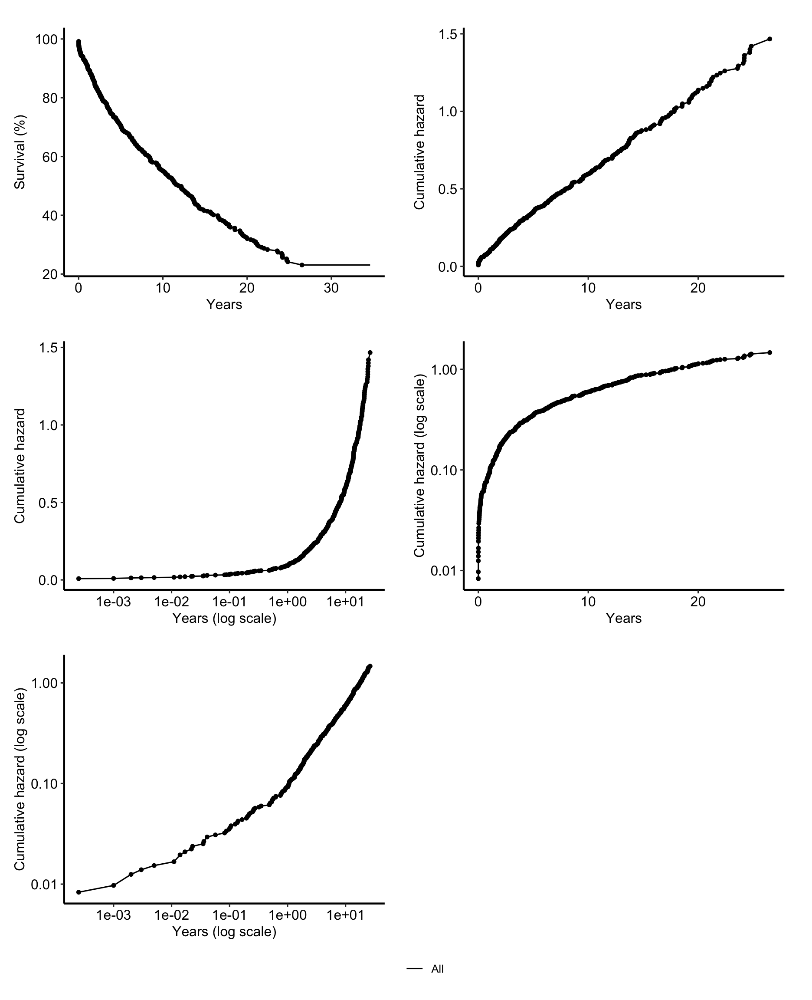
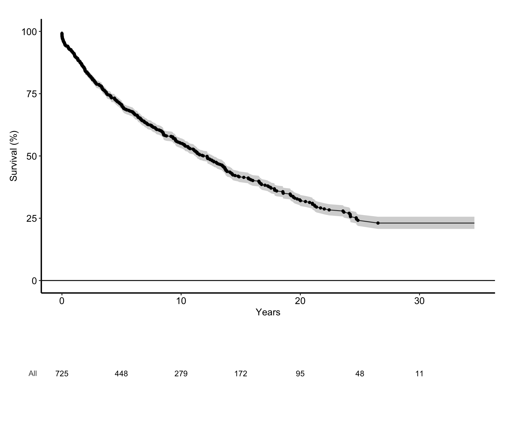
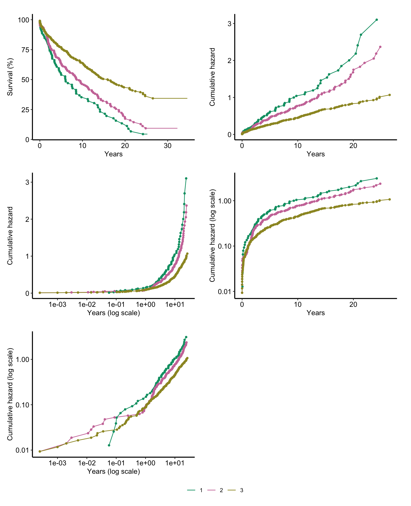
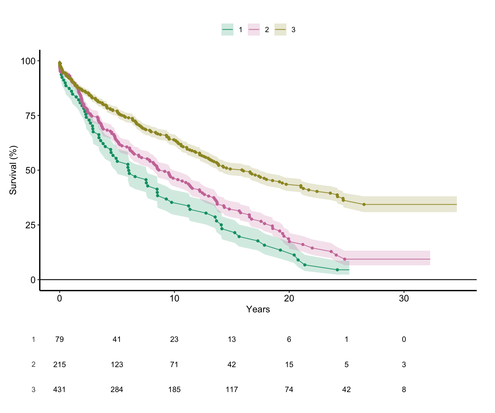
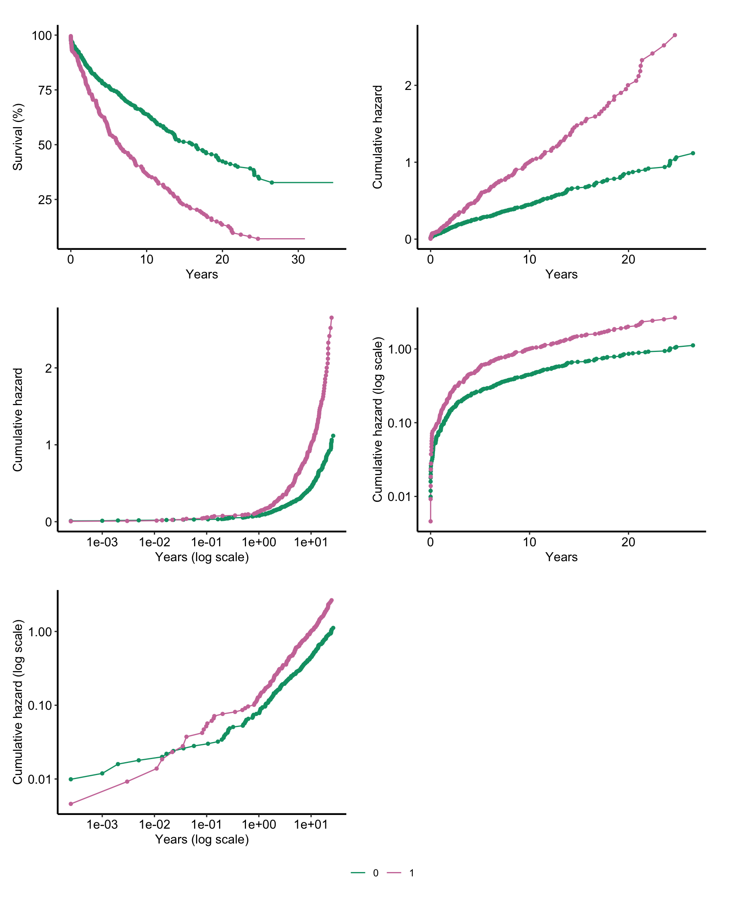
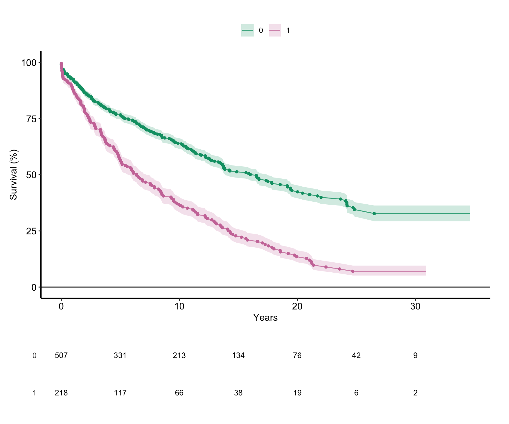

# Actuarial life table

# Actuarial life table

Published

2026-10-27 14:54

An `ac` job is the first look at an outcome: the Kaplan-Meier life
table, survival and patients at risk at the reporting horizons, the
follow-up, the strata compared, and the figures read before any hazard
model. Those are the survival curve, the cumulative-hazard views that
suggest the phases an `hz` job fits, and a manuscript figure with the
numbers at risk beneath it. The parametric fit is `hz`, and the figures
that lay that fit over these estimates are `hp`.

Code

``` r
SUBJECT <- "dead"
TYPE    <- "hz"
.in <- knitr::current_input(dir = TRUE)
suppressPackageStartupMessages(library(hvtiRutilities))
if (utils::packageVersion("TemporalHazard") < "1.2.12") {
  stop("This job needs TemporalHazard >= 1.2.12 for hzr_kaplan(); ",
       utils::packageVersion("TemporalHazard"), " is installed.", call. = FALSE)
}
if (utils::packageVersion("hvtiPlotR") < "2.7.18") {
  stop("This job needs hvtiPlotR >= 2.7.18 for hv_atrisk_compose() and hv_role_palette(); ",
       utils::packageVersion("hvtiPlotR"), " is installed.", call. = FALSE)
}
if (!requireNamespace("patchwork", quietly = TRUE)) {
  stop("This job needs the patchwork package for its page of cumulative-hazard views.", call. = FALSE)
}
# The study root is the nearest directory above this file holding _study.yml,
# so the job renders the same from the Render button, quarto render, or
# render_job(), at any depth, with no path in this document to edit.
# To render a job you have not finished, leave a chunk out with the chunk
# option skip, giving the reason in quotes, or call hvtiRtemplates::stop_here()
# in a chunk to leave out everything below it. A draft lists each one in a
# callout; a final render refuses them, as it refuses an unresolved marker.
# ?stop_here has more.
.job <- hvtiRtemplates:::.job_setup(SUBJECT, TYPE, envir = environment())
.root <- .job$root
set_path <- .job$set_path
.provenance_data <- list()
# Saves a figure as <name>.png, .pdf and .tiff in this set's graphs/ folder (or `kind`'s),
# under the SAVE_FIGURES and FIGURES study choices.
save_figure <- function(plot, name, width = 6, height = 4, kind = "graphs", linked = FALSE) {
  hvtiRtemplates:::.save_figure(plot, set_path(kind, paste0(name, ".png")), width, height,
                                SAVE_FIGURES, FIGURES, linked)
}
# The overall life table is saved after it is fitted. `hp` reads that exact
# handoff by set and refuses an older lineage-free artifact.
# The draft banners, if any, and the box under the title, after all the code above.
.job$notice
```

**final** · data `built` `built_20261027.parquet`, dated 2026-10-27 ·
rendered by gallery on gallery · hvtiRtemplates 1.5.2

## Study choices

Edit these values for this study before rendering. The life table, the
horizons, the tests and the figures are computed by
`hvtiRtemplates::life_table()` and its companions, the counterpart of
the SAS `%KAPLAN` macro; `?life_table` lists what each one does.

Code

``` r
# Demo: the registered dataset this job reads ("built" is the study dataset).
DATASET <- "built"

# Demo: an hvtiRdatabuild analysis set, or NULL to read the whole dataset.
ANALYSIS_SET <- NULL

# Demo: rows to keep, dplyr::filter() style, or NULL to keep every row:
#   WHERE <- quote(age >= 18)
#   WHERE <- rlang::exprs(age >= 18, hx_chf == 1)
WHERE <- quote(!is.na(creat_pr))

# Demo: the patient identifier. Without "ccfid" the job uses MRN, then eMRN;
# name another column if the study uses one, such as "ccfidu" where a patient
# enters the study once for each operation.
ID <- "patient_id"

# Demo: what makes a row unique; one row per patient unless repeated measures
# add their visit time or date, for example KEY <- c(ID, "iv_echo").
KEY <- ID

# Optional, and needs no edit: NULL reads the cohort alone. To join one
# registered ancillary dataset (echoes, labs, the match assignments a
# propensity job saved), name it in JOIN. The cohort above decides the
# patients, one row each; the joined records of other patients are dropped and
# counted in the data table.
#   JOIN_VARS: the cohort columns each joined row carries; NULL carries all,
#     and a column both datasets have stops, so list only those the job needs.
#   REDUCE: NULL keeps a row per joined record, keyed on that dataset's key;
#     list(rule = "first", by = "echo_date") keeps one row per patient ("last",
#     or "nearest" with to = a cohort date column). WHERE on a joined column
#     filters the records first, so "last" with WHERE echo_type == "TTE"
#     keeps each patient's last TTE. A tie stops: picking one record
#     silently would be a hidden choice; by = c("echo_date", "echo_seq")
#     breaks it. This job models one row per
#     patient, so a JOIN without REDUCE stops here.
#   JOIN_KEY: overrides the joined dataset's registered key.
JOIN <- NULL
JOIN_VARS <- NULL
REDUCE <- NULL
JOIN_KEY <- NULL

# Demo: time and event variables.
TIME   <- "iv_dead"

EVENT  <- "dead"

# Demo: the stratification variables, or NULL for the whole cohort only. Each
# is analyzed on its own: c("female", "tr_strat") gives a table, tests and
# figures by sex, then another set by treatment, not a cross-tab of the two.
# The whole cohort is always reported first. A grouping the dataset lacks is
# made in "Derived strata" below.
STRATA <- c("lvef_grp", "hx_chf")

# Optional: each grouping made in "Derived strata" below, named by its source,
# e.g. DERIVED <- c(lvef_grp = "lvef"), so the job can read one against the other.
DERIVED <- c(lvef_grp = "lvef")

# Optional: the counts of the SAS reference, to have the job stop when the rows
# it reads differ, e.g. list(n = 69L, n_events = 50L, n_censored = 19L).
# NULL reports the counts the job finds and checks them against nothing.
EXPECTED <- list(n = 725L, n_events = 406L, n_censored = 319L)

# Reporting horizons, in the unit of TIME (years here), and their labels.
# NULL labels each horizon with its value; labs <- c("30 days", "6 months",
# "1 year", paste(2:10, "years")) names them. Another grid: c(1, seq(2, 20, by = 2)).
grid <- c(30 / 365.2425, 0.5, 1:10)
labs <- NULL

# The life table's rows: TRUE prints a row for each death (SAS PEVENT=1);
# FALSE adds a row for each censored patient as well (PEVENT=0).
EVENT_ONLY <- TRUE

# %KAPLAN's CLEVEL default: one standard error, NOT 95%. This is a SAS
# convention rather than a study choice; change it only if your SAS job
# overrides CLEVEL, and say so in the report if you do.
CLEVEL <- 0.68268948

# The figures' last time. NULL draws to the end of follow-up; a manuscript
# figure usually stops where enough patients remain at risk, e.g. PLOT_MAX <- 15.
PLOT_MAX <- NULL

# The times the manuscript figure counts patients at risk, e.g. 0:10; NULL
# takes evenly spaced times across the axis.
RISK_TIMES <- NULL

# How the manuscript figure shows the CLEVEL limits. CI_BAND draws them as a
# continuous band. CI_TIMES draws a bar at each of the times given, e.g.
# c(30 / 365.2425, 1, 5), as the SAS jobs mark chosen points; each bar spans the
# limits the horizon tables report at that time, and a time before the first
# event or past the end of follow-up has none and draws no bar. Either, both or
# neither: CI_BAND <- FALSE with CI_TIMES set gives the SAS figure's bars alone.
# Under the straight lines below (STEPS <- FALSE) a bar is drawn at the last
# event at or before its time: the table's limits hold from that event on, and
# only there does the line pass through the estimate they bracket. With sparse
# events a bar can therefore stand well left of the time asked for.
CI_BAND <- TRUE
CI_TIMES <- NULL

# How the figures join one event to the next. Each event is drawn as a point;
# FALSE joins the points with straight lines, as the SAS %KAPLAN figures do;
# TRUE draws the Kaplan-Meier steps, flat between events and dropping at each one.
STEPS <- FALSE

# Each figure is saved to graphs/ as a PNG (for Word), and a PDF and a TIFF (for the publisher).
# SAVE_FIGURES <- FALSE saves none; FIGURES keeps only the figures whose names
# start with one of its entries, e.g. FIGURES <- c("ac-survival"). The names are the
# file names, listed for each template in the templates README.
SAVE_FIGURES <- TRUE
FIGURES <- NULL
```

## Cohort

Code

``` r
# The checksum of every dataset in manifest.yaml is checked before anything is
# read, so a result can name the data that produced it. It stops on a mismatch.
hvtiRutilities::verify_manifest(file.path(.root, "manifest.yaml"))
.cfg <- study_config(start = .root)
job_data <- hvtiRtemplates::read_job_data(.cfg, dataset = DATASET, analysis_set = ANALYSIS_SET,
                                          where = WHERE, id = ID, key = KEY, join = JOIN, join_vars = JOIN_VARS,
                                          reduce = REDUCE, join_key = JOIN_KEY, one_row_per_patient = TRUE)
d <- job_data$data
.provenance_data <- c(if (exists(".provenance_data")) .provenance_data else list(), list(job_data$provenance),
                      if (!is.null(job_data$provenance_join)) list(job_data$provenance_join))
knitr::kable(job_data$record, col.names = c("Data", ""))
```

| Data                |                                          |
|:--------------------|:-----------------------------------------|
| Source              | dataset `built` (built_20261027.parquet) |
| Rows read           | 800                                      |
| ID                  | `patient_id`                             |
| Identifiers dropped | none                                     |
| `!is.na(creat_pr)`  | removed 75                               |
| Rows kept           | 725 rows on 725 patients                 |

Table 1: The data this job read

Code

``` r
# unnumbered: its child chunk carries its own label and caption
if (!is.null(job_data$attrition)) {
  .fence <- strrep("`", 3)
  cat(knitr::knit_child(text = c(
    paste0(.fence, "{r}"), "#| label: tbl-data-attrition",
    paste0("#| tbl-cap: ", encodeString(paste0("Analysis set `", ANALYSIS_SET, "`: exclusions, in order"), quote = "\"")),
    "knitr::kable(job_data$attrition)", .fence
  ), envir = environment(), quiet = TRUE), sep = "\n")
}
```

Code

``` r
cc <- cohort_counts(d, event = EVENT, time = TIME)
if (!is.null(EXPECTED)) assert_cohort(d, expected = EXPECTED, event = EVENT, time = TIME)

# A time of zero, a death on the day of operation, leaves the hazard likelihood
# undefined, and hz would stop on an optimizer error that names neither the
# time nor the patient. ac checks too, so the first job in the chain says so.
# The fix belongs in the dataset build, not here: a job reshapes data and never
# corrects it, and every job reading the cohort must see the same follow-up.
# Only rows the cohort counts are checked: a row with no EVENT is not analyzed.
.t <- as.numeric(d[[TIME]])[!is.na(d[[EVENT]])]
.n_zero <- sum(.t == 0, na.rm = TRUE)
.n_neg  <- sum(.t < 0, na.rm = TRUE)
if (.n_zero + .n_neg > 0) {
  stop(TIME, " has ", .n_zero, " time(s) of exactly zero and ", .n_neg, " negative time(s). ",
       "Correct them in the dataset build, not in this job. Move only the zeros to a small positive ",
       "value, such as 0.00025 years as the template gallery does; moving every time up to one day ",
       "ties the early deaths together. A negative time is an error in the data: trace it to its source.",
       call. = FALSE)
}

knitr::kable(data.frame(
  quantity = c("n_analysable", "n_events", "n_censored"),
  n        = c(cc$n, cc$n_events, cc$n_censored),
  percent  = round(100 * c(cc$n, cc$n_events, cc$n_censored) / cc$n, 1)
))
```

| quantity     |   n | percent |
|:-------------|----:|--------:|
| n_analysable | 725 |     100 |
| n_events     | 406 |      56 |
| n_censored   | 319 |      44 |

Table 2: Analysable patients, events and censored patients

Code

``` r
# A row whose event is missing is not analyzed, and is counted here so it is seen.
.ev <- as.character(as.numeric(d[[EVENT]]))
.ev[is.na(.ev)] <- "missing"
.freq <- as.data.frame(table(value = factor(.ev, levels = intersect(c("0", "1", "missing"), unique(.ev)))),
                       stringsAsFactors = FALSE)
names(.freq)[1] <- EVENT
.freq$percent <- round(100 * .freq$Freq / sum(.freq$Freq), 1)
.freq$cumulative <- cumsum(.freq$Freq)
knitr::kable(.freq, row.names = FALSE)
```

| dead | Freq | percent | cumulative |
|:-----|-----:|--------:|-----------:|
| 0    |  319 |      44 |        319 |
| 1    |  406 |      56 |        725 |

Table 3: The event over every row read, missing included (PROC FREQ with
MISSING)

These are the counts the job found, the `PROC FREQ` of the event over
the rows analyzed. With `EXPECTED` set, a rendered report is also
evidence that they matched the SAS reference.

Code

``` r
# Percentiles are SAS's PROC UNIVARIATE default definition (PCTLDEF=5), which is
# R's quantile type 2, so the median follow-up quoted in a manuscript matches.
fu_row <- function(who, t) {
  q <- stats::quantile(t, c(0.10, 0.25, 0.50, 0.75, 0.90), type = 2, names = FALSE)
  data.frame(patients = who, n = length(t), mean = mean(t), sd = stats::sd(t), min = min(t),
             p10 = q[1], p25 = q[2], median = q[3], p75 = q[4], p90 = q[5], max = max(t))
}
.fu <- d[!is.na(d[[TIME]]) & !is.na(d[[EVENT]]), , drop = FALSE]
.fu_t <- as.numeric(.fu[[TIME]])
.censored <- as.numeric(.fu[[EVENT]]) == 0
knitr::kable(rbind(fu_row("all", .fu_t), if (any(.censored)) fu_row("censored", .fu_t[.censored])),
             row.names = FALSE, digits = 2)
```

| patients |   n |  mean |   sd | min |  p10 |  p25 | median |   p75 |   p90 |  max |
|:---------|----:|------:|-----:|----:|-----:|-----:|-------:|------:|------:|-----:|
| all      | 725 |  9.47 | 8.11 |   0 | 0.93 | 2.71 |   7.13 | 14.29 | 22.28 | 34.6 |
| censored | 319 | 12.60 | 8.93 |   0 | 1.82 | 5.31 |  10.38 | 19.00 | 25.91 | 34.6 |

Table 4: Follow-up, in the unit of TIME: all patients, and those
censored (event-free)

Goodness of follow-up, for a study whose patients die early or whose
follow-up is in doubt, is the `dc-gfup` job.

## Derived strata

A grouping the dataset lacks, such as ejection fraction cut into three
groups, is made here and named in `DERIVED`. A grouping that more than
one job needs belongs in the dataset build instead.

Code

``` r
# Optional: derive a grouping STRATA names that the dataset lacks, then name it
# and its source in DERIVED in the study choices, so the table below reads one
# against the other.
# The example makes three ejection-fraction groups from lvef; uncomment and
# adapt it. SAS derives categories by cumulative overwrites, each later line
# overwriting the ones before, so transcribe the ORDER from the SAS as well as
# the cutpoints. Keep a missing source missing: the patient is then dropped from
# the stratified tables, as %KAPLAN drops them, instead of joining a group.
d$lvef_grp <- 3L
d$lvef_grp[which(d$lvef < 50)] <- 2L
d$lvef_grp[which(d$lvef < 40)] <- 1L
d$lvef_grp[is.na(d$lvef)] <- NA
```

Code

``` r
# A cumulative-overwrite derivation fails QUIETLY: reorder the conditions and
# every patient still lands in some category, the counts still sum to the
# cohort, and every stratified estimate below is wrong while looking entirely
# plausible. So the derivation is checked against the data it came from: the
# source RANGE within each category. Correctly ordered, the ranges are disjoint
# and ascend with the category; overlapping or inverted ranges mean the
# overwrites ran in the wrong order.
if (length(DERIVED)) {
  .miss <- setdiff(c(names(DERIVED), unname(DERIVED)), names(d))
  if (length(.miss)) {
    stop("DERIVED names column(s) not in the data: ", paste(.miss, collapse = ", "),
         ". Name each derived column and its source as the derive chunk made them.", call. = FALSE)
  }
  derived_rows <- function(cat) {
    src <- DERIVED[[cat]]
    lv <- d[[cat]]
    do.call(rbind, lapply(c(sort(unique(lv[!is.na(lv)])), if (anyNA(lv)) NA), function(k) {
      v <- d[[src]][if (is.na(k)) is.na(lv) else which(lv == k)]
      r <- if (any(!is.na(v))) range(v, na.rm = TRUE) else c(NA_real_, NA_real_)
      data.frame(category = cat, level = k, n = length(v), source = src,
                 src_min = r[1], src_max = r[2], src_missing = sum(is.na(v)))
    }))
  }
  knitr::kable(do.call(rbind, lapply(names(DERIVED), derived_rows)), row.names = FALSE, digits = 4)
}
```

| category | level |   n | source | src_min | src_max | src_missing |
|:---------|------:|----:|:-------|--------:|--------:|------------:|
| lvef_grp |     1 |  79 | lvef   |      20 |      39 |           0 |
| lvef_grp |     2 | 215 | lvef   |      40 |      49 |           0 |
| lvef_grp |     3 | 431 | lvef   |      50 |      75 |           0 |

Table 5: Each derived category against the variable it came from

When this job derives a grouping, read the ranges before reading
anything below. They must not overlap between levels of the same
category, and they must ascend with the level.

## Estimation

Code

``` r
# unnumbered: defines helpers only
.fence <- strrep("`", 3)
.seen <- new.env()
# Prints `code` as a child chunk with its own label and caption, so each table
# and figure the loops below make is numbered and can be cited.
.child <- function(label, caption, code, opts = character()) {
  label <- gsub("(^-+|-+$)", "", gsub("[^a-z0-9]+", "-", tolower(label)))
  if (!is.null(.seen[[label]])) stop("Two outputs would share the label ", label, ".", call. = FALSE)
  .seen[[label]] <- TRUE
  .opt <- paste0("#| ", sub("-.*$", "", label), "-cap: ", encodeString(caption, quote = "\""))
  cat(knitr::knit_child(text = c(paste0(.fence, "{r}"), paste0("#| label: ", label), .opt, opts, code, .fence),
                        envir = parent.frame(), quiet = TRUE), sep = "\n")
  cat("\n")
}

# Survival and its limits as percentages, the way the tables report them.
as_percent <- function(x) {
  for (col in intersect(c("survival", "cl_lower", "cl_upper"), names(x))) x[[col]] <- round(100 * x[[col]], 1)
  x
}
```

## Overall

Code

``` r
km <- hvtiRtemplates::life_table(d, TIME, EVENT, conf_level = CLEVEL)
ac_art <- hvtiRtemplates:::.attach_handoff_lineage(
  list(overall = km),
  data = .provenance_data,
  analysis = list(
    time = list(variable = TIME),
    event = list(variable = EVENT, event = 1L, censored = 0L)
  ),
  cohort = cc,
  # hp checks that ac and hz read the same rows with the same TIME and EVENT.
  selection = c(attr(job_data$record, "selection"), list(time = TIME, event = EVENT))
)
saveRDS(ac_art, set_path("estimates", "ac.rds"))
# The saved life table is always the event rows, the table hp draws over.
.km_rows <- if (EVENT_ONLY) km else hvtiRtemplates::life_table(d, TIME, EVENT, conf_level = CLEVEL, event_only = FALSE)
knitr::kable(as_percent(.km_rows), row.names = FALSE, digits = 4)
```

| time | n_risk | n_event | n_censor | survival | std_err | cl_lower | cl_upper | cumhaz | hazard | density | life |
|---:|---:|---:|---:|---:|---:|---:|---:|---:|---:|---:|---:|
| 0.0003 | 725 | 6 | 1 | 99.2 | 0.0034 | 98.8 | 99.4 | 0.0083 | 33.2412 | 33.1034 | 0.0003 |
| 0.0010 | 718 | 1 | 0 | 99.0 | 0.0036 | 98.6 | 99.3 | 0.0097 | 1.8583 | 1.8416 | 0.0010 |
| 0.0020 | 717 | 2 | 0 | 98.8 | 0.0041 | 98.3 | 99.1 | 0.0125 | 2.7933 | 2.7625 | 0.0020 |
| 0.0030 | 715 | 1 | 0 | 98.6 | 0.0043 | 98.1 | 99.0 | 0.0139 | 1.3996 | 1.3812 | 0.0030 |
| 0.0050 | 714 | 1 | 0 | 98.5 | 0.0045 | 98.0 | 98.9 | 0.0153 | 0.7008 | 0.6906 | 0.0049 |
| 0.0110 | 713 | 1 | 0 | 98.3 | 0.0047 | 97.8 | 98.8 | 0.0167 | 0.2339 | 0.2302 | 0.0109 |
| 0.0140 | 712 | 2 | 0 | 98.1 | 0.0051 | 97.5 | 98.5 | 0.0195 | 0.9376 | 0.9208 | 0.0138 |
| 0.0170 | 710 | 1 | 0 | 97.9 | 0.0053 | 97.3 | 98.4 | 0.0209 | 0.4698 | 0.4604 | 0.0167 |
| 0.0220 | 709 | 1 | 0 | 97.8 | 0.0055 | 97.2 | 98.3 | 0.0223 | 0.2823 | 0.2762 | 0.0216 |
| 0.0230 | 708 | 1 | 0 | 97.7 | 0.0056 | 97.0 | 98.2 | 0.0237 | 1.4134 | 1.3812 | 0.0226 |
| 0.0350 | 707 | 1 | 0 | 97.5 | 0.0058 | 96.9 | 98.0 | 0.0252 | 0.1180 | 0.1151 | 0.0343 |
| 0.0360 | 706 | 1 | 0 | 97.4 | 0.0059 | 96.7 | 97.9 | 0.0266 | 1.4174 | 1.3812 | 0.0353 |
| 0.0410 | 705 | 2 | 0 | 97.1 | 0.0062 | 96.4 | 97.7 | 0.0294 | 0.5682 | 0.5525 | 0.0402 |
| 0.0570 | 703 | 1 | 0 | 97.0 | 0.0064 | 96.3 | 97.5 | 0.0308 | 0.0890 | 0.0863 | 0.0557 |
| 0.0820 | 702 | 1 | 0 | 96.8 | 0.0065 | 96.1 | 97.4 | 0.0323 | 0.0570 | 0.0552 | 0.0800 |
| 0.0880 | 701 | 1 | 0 | 96.7 | 0.0067 | 96.0 | 97.3 | 0.0337 | 0.2379 | 0.2302 | 0.0858 |
| 0.0980 | 700 | 1 | 0 | 96.5 | 0.0068 | 95.8 | 97.2 | 0.0351 | 0.1430 | 0.1381 | 0.0954 |
| 0.1030 | 699 | 1 | 0 | 96.4 | 0.0069 | 95.7 | 97.0 | 0.0366 | 0.2863 | 0.2762 | 0.1003 |
| 0.1060 | 698 | 1 | 0 | 96.3 | 0.0070 | 95.5 | 96.9 | 0.0380 | 0.4779 | 0.4604 | 0.1032 |
| 0.1250 | 696 | 1 | 0 | 96.1 | 0.0072 | 95.3 | 96.8 | 0.0394 | 0.1438 | 0.1383 | 0.1214 |
| 0.1360 | 695 | 1 | 0 | 96.0 | 0.0073 | 95.2 | 96.7 | 0.0409 | 0.1309 | 0.1257 | 0.1320 |
| 0.1400 | 694 | 1 | 0 | 95.9 | 0.0074 | 95.0 | 96.5 | 0.0423 | 0.3605 | 0.3458 | 0.1359 |
| 0.1640 | 693 | 1 | 0 | 95.7 | 0.0075 | 94.9 | 96.4 | 0.0438 | 0.0602 | 0.0576 | 0.1589 |
| 0.1950 | 692 | 1 | 0 | 95.6 | 0.0076 | 94.8 | 96.3 | 0.0452 | 0.0466 | 0.0446 | 0.1885 |
| 0.2020 | 691 | 1 | 0 | 95.4 | 0.0078 | 94.6 | 96.2 | 0.0467 | 0.2069 | 0.1976 | 0.1952 |
| 0.2110 | 690 | 1 | 0 | 95.3 | 0.0079 | 94.5 | 96.0 | 0.0481 | 0.1611 | 0.1537 | 0.2038 |
| 0.2170 | 689 | 1 | 0 | 95.2 | 0.0080 | 94.3 | 95.9 | 0.0496 | 0.2421 | 0.2305 | 0.2095 |
| 0.2300 | 688 | 1 | 0 | 95.0 | 0.0081 | 94.2 | 95.8 | 0.0510 | 0.1119 | 0.1064 | 0.2219 |
| 0.2510 | 686 | 1 | 0 | 94.9 | 0.0082 | 94.0 | 95.6 | 0.0525 | 0.0858 | 0.0815 | 0.2419 |
| 0.2580 | 685 | 1 | 0 | 94.7 | 0.0083 | 93.9 | 95.5 | 0.0539 | 0.2087 | 0.1979 | 0.2485 |
| 0.2610 | 684 | 1 | 0 | 94.6 | 0.0084 | 93.7 | 95.4 | 0.0554 | 0.4877 | 0.4617 | 0.2514 |
| 0.2760 | 683 | 1 | 0 | 94.5 | 0.0085 | 93.6 | 95.3 | 0.0569 | 0.0977 | 0.0923 | 0.2655 |
| 0.3210 | 682 | 1 | 0 | 94.3 | 0.0086 | 93.4 | 95.1 | 0.0583 | 0.0326 | 0.0308 | 0.3081 |
| 0.3500 | 681 | 1 | 0 | 94.2 | 0.0087 | 93.3 | 95.0 | 0.0598 | 0.0507 | 0.0478 | 0.3354 |
| 0.4830 | 679 | 1 | 0 | 94.1 | 0.0088 | 93.1 | 94.9 | 0.0613 | 0.0398 | 0.0375 | 0.4607 |
| 0.4930 | 678 | 1 | 0 | 93.9 | 0.0089 | 93.0 | 94.7 | 0.0627 | 0.1476 | 0.1387 | 0.4701 |
| 0.5050 | 677 | 1 | 0 | 93.8 | 0.0090 | 92.8 | 94.6 | 0.0642 | 0.1232 | 0.1156 | 0.4814 |
| 0.5340 | 675 | 1 | 0 | 93.6 | 0.0091 | 92.7 | 94.5 | 0.0657 | 0.0570 | 0.0534 | 0.5086 |
| 0.5470 | 674 | 2 | 0 | 93.4 | 0.0093 | 92.4 | 94.2 | 0.0687 | 0.2286 | 0.2137 | 0.5207 |
| 0.5650 | 672 | 1 | 0 | 93.2 | 0.0093 | 92.2 | 94.1 | 0.0702 | 0.0827 | 0.0772 | 0.5375 |
| 0.5750 | 671 | 1 | 0 | 93.1 | 0.0094 | 92.1 | 94.0 | 0.0717 | 0.1491 | 0.1389 | 0.5469 |
| 0.6220 | 668 | 1 | 0 | 92.9 | 0.0095 | 91.9 | 93.8 | 0.0732 | 0.1873 | 0.1742 | 0.5906 |
| 0.6290 | 667 | 1 | 0 | 92.8 | 0.0096 | 91.8 | 93.7 | 0.0747 | 0.2143 | 0.1991 | 0.5971 |
| 0.7520 | 665 | 1 | 0 | 92.7 | 0.0097 | 91.6 | 93.6 | 0.0762 | 0.7524 | 0.6978 | 0.7113 |
| 0.7690 | 664 | 1 | 0 | 92.5 | 0.0098 | 91.5 | 93.4 | 0.0777 | 0.0887 | 0.0821 | 0.7270 |
| 0.7730 | 663 | 1 | 0 | 92.4 | 0.0099 | 91.3 | 93.3 | 0.0792 | 0.3774 | 0.3489 | 0.7307 |
| 0.7920 | 662 | 1 | 0 | 92.2 | 0.0100 | 91.2 | 93.2 | 0.0807 | 0.0796 | 0.0735 | 0.7483 |
| 0.8080 | 661 | 1 | 0 | 92.1 | 0.0100 | 91.0 | 93.1 | 0.0822 | 0.0946 | 0.0872 | 0.7630 |
| 0.8320 | 659 | 1 | 0 | 92.0 | 0.0101 | 90.9 | 92.9 | 0.0837 | 0.0660 | 0.0608 | 0.7851 |
| 0.8850 | 657 | 1 | 0 | 91.8 | 0.0102 | 90.7 | 92.8 | 0.0852 | 0.0293 | 0.0269 | 0.8339 |
| 0.8950 | 656 | 1 | 0 | 91.7 | 0.0103 | 90.6 | 92.7 | 0.0868 | 0.1526 | 0.1400 | 0.8431 |
| 0.9160 | 655 | 1 | 0 | 91.5 | 0.0104 | 90.5 | 92.5 | 0.0883 | 0.0728 | 0.0667 | 0.8623 |
| 0.9340 | 653 | 1 | 0 | 91.4 | 0.0104 | 90.3 | 92.4 | 0.0898 | 0.2554 | 0.2337 | 0.8788 |
| 0.9570 | 651 | 1 | 0 | 91.3 | 0.0105 | 90.2 | 92.3 | 0.0914 | 1.5373 | 1.4041 | 0.8998 |
| 1.0180 | 650 | 1 | 0 | 91.1 | 0.0106 | 90.0 | 92.1 | 0.0929 | 0.0252 | 0.0230 | 0.9555 |
| 1.0240 | 649 | 1 | 1 | 91.0 | 0.0107 | 89.9 | 92.0 | 0.0945 | 0.2570 | 0.2340 | 0.9610 |
| 1.0360 | 647 | 1 | 0 | 90.8 | 0.0107 | 89.7 | 91.9 | 0.0960 | 0.1289 | 0.1172 | 0.9719 |
| 1.0440 | 646 | 1 | 0 | 90.7 | 0.0108 | 89.6 | 91.7 | 0.0975 | 0.1936 | 0.1758 | 0.9792 |
| 1.0560 | 645 | 1 | 0 | 90.6 | 0.0109 | 89.4 | 91.6 | 0.0991 | 0.1293 | 0.1172 | 0.9900 |
| 1.0670 | 644 | 2 | 0 | 90.3 | 0.0110 | 89.1 | 91.3 | 0.1022 | 0.2828 | 0.2557 | 1.0000 |
| 1.0800 | 642 | 1 | 0 | 90.1 | 0.0111 | 89.0 | 91.2 | 0.1038 | 0.1199 | 0.1082 | 1.0117 |
| 1.0840 | 641 | 1 | 0 | 90.0 | 0.0112 | 88.8 | 91.1 | 0.1053 | 0.3903 | 0.3516 | 1.0153 |
| 1.1240 | 639 | 1 | 0 | 89.9 | 0.0113 | 88.7 | 90.9 | 0.1069 | 0.0580 | 0.0522 | 1.0513 |
| 1.1470 | 637 | 1 | 0 | 89.7 | 0.0113 | 88.5 | 90.8 | 0.1085 | 0.3142 | 0.2821 | 1.0720 |
| 1.1750 | 635 | 1 | 0 | 89.6 | 0.0114 | 88.4 | 90.7 | 0.1100 | 0.0876 | 0.0785 | 1.0971 |
| 1.2290 | 633 | 1 | 0 | 89.4 | 0.0115 | 88.2 | 90.5 | 0.1116 | 0.7905 | 0.7076 | 1.1455 |
| 1.2630 | 630 | 1 | 0 | 89.3 | 0.0115 | 88.1 | 90.4 | 0.1132 | 0.2269 | 0.2028 | 1.1759 |
| 1.3160 | 628 | 1 | 0 | 89.2 | 0.0116 | 87.9 | 90.3 | 0.1148 | 0.0531 | 0.0474 | 1.2232 |
| 1.3200 | 627 | 1 | 0 | 89.0 | 0.0117 | 87.8 | 90.1 | 0.1164 | 0.3990 | 0.3555 | 1.2268 |
| 1.3300 | 626 | 1 | 0 | 88.9 | 0.0117 | 87.6 | 90.0 | 0.1180 | 0.1599 | 0.1422 | 1.2357 |
| 1.3380 | 625 | 1 | 0 | 88.7 | 0.0118 | 87.5 | 89.9 | 0.1196 | 0.2002 | 0.1777 | 1.2428 |
| 1.3410 | 624 | 1 | 0 | 88.6 | 0.0119 | 87.3 | 89.7 | 0.1212 | 0.5346 | 0.4740 | 1.2455 |
| 1.3490 | 623 | 1 | 0 | 88.4 | 0.0119 | 87.2 | 89.6 | 0.1228 | 0.2008 | 0.1777 | 1.2526 |
| 1.3760 | 621 | 1 | 0 | 88.3 | 0.0120 | 87.0 | 89.4 | 0.1244 | 0.1007 | 0.0890 | 1.2765 |
| 1.4440 | 619 | 1 | 0 | 88.2 | 0.0121 | 86.9 | 89.3 | 0.1260 | 0.1078 | 0.0951 | 1.3365 |
| 1.4720 | 618 | 1 | 0 | 88.0 | 0.0121 | 86.7 | 89.2 | 0.1277 | 0.0578 | 0.0509 | 1.3612 |
| 1.5120 | 617 | 1 | 0 | 87.9 | 0.0122 | 86.6 | 89.0 | 0.1293 | 0.0406 | 0.0357 | 1.3964 |
| 1.5220 | 616 | 1 | 0 | 87.7 | 0.0123 | 86.5 | 88.9 | 0.1309 | 0.1625 | 0.1427 | 1.4052 |
| 1.5300 | 615 | 1 | 0 | 87.6 | 0.0123 | 86.3 | 88.8 | 0.1325 | 0.2034 | 0.1783 | 1.4122 |
| 1.5510 | 613 | 1 | 0 | 87.4 | 0.0124 | 86.2 | 88.6 | 0.1342 | 0.2721 | 0.2381 | 1.4306 |
| 1.5590 | 612 | 1 | 0 | 87.3 | 0.0124 | 86.0 | 88.5 | 0.1358 | 0.2044 | 0.1786 | 1.4376 |
| 1.6170 | 609 | 1 | 0 | 87.2 | 0.0125 | 85.9 | 88.4 | 0.1374 | 0.0632 | 0.0551 | 1.4882 |
| 1.6510 | 606 | 1 | 0 | 87.0 | 0.0126 | 85.7 | 88.2 | 0.1391 | 0.2753 | 0.2397 | 1.5179 |
| 1.6550 | 605 | 1 | 0 | 86.9 | 0.0126 | 85.6 | 88.1 | 0.1408 | 0.4136 | 0.3596 | 1.5213 |
| 1.6560 | 604 | 1 | 0 | 86.7 | 0.0127 | 85.4 | 87.9 | 0.1424 | 1.6570 | 1.4383 | 1.5222 |
| 1.6590 | 603 | 1 | 0 | 86.6 | 0.0128 | 85.3 | 87.8 | 0.1441 | 0.5533 | 0.4794 | 1.5248 |
| 1.6860 | 601 | 1 | 0 | 86.4 | 0.0128 | 85.1 | 87.7 | 0.1457 | 0.2775 | 0.2401 | 1.5482 |
| 1.6960 | 600 | 1 | 0 | 86.3 | 0.0129 | 85.0 | 87.5 | 0.1474 | 0.1668 | 0.1441 | 1.5568 |
| 1.7430 | 598 | 1 | 0 | 86.2 | 0.0129 | 84.8 | 87.4 | 0.1491 | 0.1674 | 0.1443 | 1.5974 |
| 1.7460 | 597 | 1 | 0 | 86.0 | 0.0130 | 84.7 | 87.3 | 0.1508 | 0.5588 | 0.4810 | 1.6000 |
| 1.7850 | 596 | 1 | 0 | 85.9 | 0.0130 | 84.5 | 87.1 | 0.1524 | 0.0431 | 0.0370 | 1.6335 |
| 1.8000 | 595 | 1 | 0 | 85.7 | 0.0131 | 84.4 | 87.0 | 0.1541 | 0.1121 | 0.0962 | 1.6464 |
| 1.8490 | 590 | 1 | 0 | 85.6 | 0.0132 | 84.2 | 86.8 | 0.1558 | 0.1696 | 0.1453 | 1.6884 |
| 1.8610 | 589 | 1 | 0 | 85.4 | 0.0132 | 84.1 | 86.7 | 0.1575 | 0.1416 | 0.1211 | 1.6987 |
| 1.8660 | 588 | 1 | 0 | 85.3 | 0.0133 | 83.9 | 86.6 | 0.1592 | 0.3404 | 0.2906 | 1.7029 |
| 1.8920 | 586 | 1 | 0 | 85.1 | 0.0133 | 83.8 | 86.4 | 0.1609 | 0.3416 | 0.2911 | 1.7251 |
| 1.9120 | 584 | 1 | 0 | 85.0 | 0.0134 | 83.6 | 86.3 | 0.1626 | 0.1008 | 0.0858 | 1.7421 |
| 1.9200 | 583 | 1 | 0 | 84.8 | 0.0134 | 83.5 | 86.1 | 0.1643 | 0.2146 | 0.1822 | 1.7489 |
| 1.9240 | 582 | 1 | 0 | 84.7 | 0.0135 | 83.3 | 86.0 | 0.1661 | 0.4299 | 0.3645 | 1.7523 |
| 1.9300 | 581 | 1 | 0 | 84.6 | 0.0136 | 83.1 | 85.9 | 0.1678 | 0.2871 | 0.2430 | 1.7574 |
| 1.9380 | 580 | 1 | 0 | 84.4 | 0.0136 | 83.0 | 85.7 | 0.1695 | 0.2157 | 0.1822 | 1.7642 |
| 1.9470 | 578 | 1 | 0 | 84.3 | 0.0137 | 82.8 | 85.6 | 0.1712 | 1.7316 | 1.4603 | 1.7718 |
| 1.9520 | 577 | 1 | 0 | 84.1 | 0.0137 | 82.7 | 85.4 | 0.1730 | 0.3469 | 0.2921 | 1.7760 |
| 1.9830 | 576 | 1 | 0 | 84.0 | 0.0138 | 82.5 | 85.3 | 0.1747 | 0.0561 | 0.0471 | 1.8021 |
| 2.0080 | 575 | 1 | 0 | 83.8 | 0.0138 | 82.4 | 85.2 | 0.1765 | 0.0696 | 0.0584 | 1.8230 |
| 2.0970 | 573 | 1 | 0 | 83.7 | 0.0139 | 82.2 | 85.0 | 0.1782 | 0.1344 | 0.1125 | 1.8977 |
| 2.0990 | 572 | 1 | 0 | 83.5 | 0.0139 | 82.1 | 84.9 | 0.1800 | 0.8749 | 0.7314 | 1.8993 |
| 2.1000 | 571 | 1 | 0 | 83.4 | 0.0140 | 81.9 | 84.7 | 0.1817 | 1.7528 | 1.4629 | 1.9002 |
| 2.1070 | 569 | 1 | 0 | 83.2 | 0.0140 | 81.8 | 84.6 | 0.1835 | 0.4398 | 0.3664 | 1.9060 |
| 2.1940 | 568 | 1 | 0 | 83.1 | 0.0141 | 81.6 | 84.5 | 0.1852 | 0.0203 | 0.0168 | 1.9784 |
| 2.2050 | 567 | 1 | 0 | 82.9 | 0.0141 | 81.5 | 84.3 | 0.1870 | 0.1605 | 0.1332 | 1.9876 |
| 2.2210 | 566 | 1 | 0 | 82.8 | 0.0142 | 81.3 | 84.2 | 0.1888 | 0.1105 | 0.0916 | 2.0008 |
| 2.2370 | 565 | 1 | 0 | 82.7 | 0.0142 | 81.2 | 84.0 | 0.1905 | 0.1107 | 0.0916 | 2.0141 |
| 2.2810 | 563 | 1 | 0 | 82.5 | 0.0143 | 81.0 | 83.9 | 0.1923 | 0.2222 | 0.1835 | 2.0504 |
| 2.3000 | 562 | 1 | 0 | 82.4 | 0.0143 | 80.9 | 83.7 | 0.1941 | 0.0937 | 0.0773 | 2.0661 |
| 2.3170 | 561 | 1 | 0 | 82.2 | 0.0144 | 80.7 | 83.6 | 0.1959 | 0.1049 | 0.0864 | 2.0801 |
| 2.3320 | 560 | 1 | 0 | 82.1 | 0.0144 | 80.6 | 83.5 | 0.1977 | 0.1192 | 0.0979 | 2.0924 |
| 2.4070 | 559 | 1 | 0 | 81.9 | 0.0145 | 80.4 | 83.3 | 0.1995 | 0.0239 | 0.0196 | 2.1540 |
| 2.4230 | 558 | 1 | 0 | 81.8 | 0.0145 | 80.3 | 83.2 | 0.2013 | 0.1121 | 0.0918 | 2.1671 |
| 2.4290 | 557 | 1 | 0 | 81.6 | 0.0146 | 80.1 | 83.0 | 0.2030 | 0.2995 | 0.2447 | 2.1720 |
| 2.4840 | 556 | 1 | 0 | 81.5 | 0.0146 | 80.0 | 82.9 | 0.2048 | 0.0327 | 0.0267 | 2.2169 |
| 2.4890 | 554 | 1 | 0 | 81.3 | 0.0147 | 79.8 | 82.8 | 0.2067 | 0.9033 | 0.7354 | 2.2210 |
| 2.5030 | 553 | 1 | 0 | 81.2 | 0.0147 | 79.7 | 82.6 | 0.2085 | 0.1293 | 0.1051 | 2.2324 |
| 2.5650 | 550 | 1 | 0 | 81.0 | 0.0148 | 79.5 | 82.5 | 0.2103 | 0.0958 | 0.0777 | 2.2827 |
| 2.5670 | 549 | 1 | 0 | 80.9 | 0.0148 | 79.4 | 82.3 | 0.2121 | 0.9116 | 0.7380 | 2.2843 |
| 2.5710 | 548 | 1 | 0 | 80.7 | 0.0149 | 79.2 | 82.2 | 0.2139 | 0.4566 | 0.3690 | 2.2876 |
| 2.5800 | 547 | 1 | 0 | 80.6 | 0.0149 | 79.1 | 82.0 | 0.2158 | 0.2033 | 0.1640 | 2.2948 |
| 2.6660 | 546 | 1 | 0 | 80.4 | 0.0150 | 78.9 | 81.9 | 0.2176 | 0.0213 | 0.0172 | 2.3641 |
| 2.6820 | 545 | 1 | 0 | 80.3 | 0.0150 | 78.8 | 81.8 | 0.2194 | 0.1148 | 0.0923 | 2.3770 |
| 2.7140 | 544 | 1 | 0 | 80.1 | 0.0150 | 78.6 | 81.6 | 0.2213 | 0.0575 | 0.0461 | 2.4027 |
| 2.7270 | 543 | 1 | 0 | 80.0 | 0.0151 | 78.5 | 81.5 | 0.2231 | 0.1418 | 0.1135 | 2.4131 |
| 2.7440 | 542 | 1 | 0 | 79.9 | 0.0151 | 78.3 | 81.3 | 0.2250 | 0.1086 | 0.0868 | 2.4267 |
| 2.7900 | 541 | 1 | 0 | 79.7 | 0.0152 | 78.1 | 81.2 | 0.2268 | 0.0402 | 0.0321 | 2.4634 |
| 2.8020 | 539 | 1 | 0 | 79.6 | 0.0152 | 78.0 | 81.0 | 0.2287 | 0.2321 | 0.1848 | 2.4730 |
| 2.8100 | 538 | 1 | 0 | 79.4 | 0.0153 | 77.8 | 80.9 | 0.2305 | 0.2326 | 0.1848 | 2.4794 |
| 2.8520 | 536 | 1 | 0 | 79.3 | 0.0153 | 77.7 | 80.8 | 0.2324 | 0.0934 | 0.0741 | 2.5127 |
| 2.8630 | 535 | 1 | 0 | 79.1 | 0.0154 | 77.5 | 80.6 | 0.2343 | 0.1701 | 0.1347 | 2.5214 |
| 2.8890 | 533 | 1 | 0 | 79.0 | 0.0154 | 77.4 | 80.5 | 0.2361 | 0.0854 | 0.0675 | 2.5420 |
| 2.9210 | 532 | 1 | 0 | 78.8 | 0.0154 | 77.2 | 80.3 | 0.2380 | 0.0588 | 0.0464 | 2.5673 |
| 3.1030 | 527 | 1 | 0 | 78.7 | 0.0155 | 77.1 | 80.2 | 0.2399 | 0.0655 | 0.0516 | 2.7107 |
| 3.1110 | 525 | 1 | 0 | 78.5 | 0.0155 | 76.9 | 80.0 | 0.2418 | 0.3178 | 0.2497 | 2.7170 |
| 3.1500 | 524 | 1 | 0 | 78.4 | 0.0156 | 76.8 | 79.9 | 0.2437 | 0.0490 | 0.0384 | 2.7477 |
| 3.2130 | 522 | 1 | 0 | 78.2 | 0.0156 | 76.6 | 79.7 | 0.2457 | 0.0369 | 0.0289 | 2.7970 |
| 3.2850 | 520 | 1 | 0 | 78.1 | 0.0157 | 76.5 | 79.6 | 0.2476 | 0.1375 | 0.1074 | 2.8533 |
| 3.3160 | 519 | 1 | 0 | 77.9 | 0.0157 | 76.3 | 79.4 | 0.2495 | 0.0622 | 0.0485 | 2.8775 |
| 3.3180 | 518 | 1 | 0 | 77.8 | 0.0157 | 76.2 | 79.3 | 0.2514 | 0.9662 | 0.7521 | 2.8791 |
| 3.3510 | 516 | 1 | 0 | 77.6 | 0.0158 | 76.0 | 79.2 | 0.2534 | 0.6466 | 0.5024 | 2.9048 |
| 3.3560 | 515 | 1 | 1 | 77.5 | 0.0158 | 75.8 | 79.0 | 0.2553 | 0.3887 | 0.3014 | 2.9086 |
| 3.3590 | 513 | 1 | 0 | 77.3 | 0.0159 | 75.7 | 78.9 | 0.2573 | 0.6504 | 0.5034 | 2.9110 |
| 3.3730 | 512 | 1 | 0 | 77.2 | 0.0159 | 75.5 | 78.7 | 0.2592 | 0.1396 | 0.1079 | 2.9218 |
| 3.4150 | 511 | 1 | 0 | 77.0 | 0.0159 | 75.4 | 78.6 | 0.2612 | 0.0466 | 0.0360 | 2.9542 |
| 3.4220 | 510 | 1 | 0 | 76.9 | 0.0160 | 75.2 | 78.4 | 0.2632 | 0.2804 | 0.2157 | 2.9596 |
| 3.4260 | 509 | 1 | 0 | 76.7 | 0.0160 | 75.1 | 78.3 | 0.2651 | 0.4916 | 0.3775 | 2.9627 |
| 3.4780 | 508 | 1 | 0 | 76.6 | 0.0161 | 74.9 | 78.1 | 0.2671 | 0.0379 | 0.0290 | 3.0026 |
| 3.5220 | 507 | 1 | 0 | 76.4 | 0.0161 | 74.8 | 78.0 | 0.2691 | 0.0449 | 0.0343 | 3.0362 |
| 3.5750 | 504 | 1 | 0 | 76.3 | 0.0161 | 74.6 | 77.8 | 0.2711 | 0.1655 | 0.1263 | 3.0767 |
| 3.5870 | 503 | 1 | 0 | 76.1 | 0.0162 | 74.5 | 77.7 | 0.2730 | 0.1658 | 0.1263 | 3.0859 |
| 3.6230 | 502 | 1 | 0 | 76.0 | 0.0162 | 74.3 | 77.5 | 0.2750 | 0.0554 | 0.0421 | 3.1133 |
| 3.6450 | 500 | 1 | 0 | 75.8 | 0.0163 | 74.1 | 77.4 | 0.2770 | 0.1054 | 0.0800 | 3.1300 |
| 3.7060 | 498 | 1 | 0 | 75.6 | 0.0163 | 74.0 | 77.2 | 0.2791 | 0.0467 | 0.0354 | 3.1762 |
| 3.7090 | 497 | 1 | 0 | 75.5 | 0.0163 | 73.8 | 77.1 | 0.2811 | 0.6714 | 0.5074 | 3.1785 |
| 3.7250 | 496 | 1 | 0 | 75.3 | 0.0164 | 73.7 | 76.9 | 0.2831 | 0.1261 | 0.0951 | 3.1906 |
| 3.7280 | 495 | 1 | 0 | 75.2 | 0.0164 | 73.5 | 76.8 | 0.2851 | 0.6741 | 0.5074 | 3.1928 |
| 3.7550 | 494 | 1 | 0 | 75.0 | 0.0164 | 73.4 | 76.6 | 0.2871 | 0.0750 | 0.0564 | 3.2132 |
| 3.7850 | 493 | 1 | 0 | 74.9 | 0.0165 | 73.2 | 76.5 | 0.2892 | 0.0677 | 0.0507 | 3.2357 |
| 3.8030 | 492 | 1 | 0 | 74.7 | 0.0165 | 73.0 | 76.4 | 0.2912 | 0.1130 | 0.0846 | 3.2491 |
| 3.8440 | 491 | 1 | 0 | 74.6 | 0.0166 | 72.9 | 76.2 | 0.2932 | 0.0497 | 0.0371 | 3.2798 |
| 3.9740 | 488 | 1 | 0 | 74.4 | 0.0166 | 72.7 | 76.1 | 0.2953 | 0.0192 | 0.0143 | 3.3767 |
| 4.0270 | 487 | 1 | 0 | 74.3 | 0.0166 | 72.6 | 75.9 | 0.2973 | 0.0388 | 0.0288 | 3.4162 |
| 4.0820 | 486 | 1 | 0 | 74.1 | 0.0167 | 72.4 | 75.8 | 0.2994 | 0.0374 | 0.0278 | 3.4570 |
| 4.0960 | 485 | 1 | 0 | 74.0 | 0.0167 | 72.3 | 75.6 | 0.3015 | 0.1474 | 0.1092 | 3.4674 |
| 4.1140 | 483 | 1 | 0 | 73.8 | 0.0167 | 72.1 | 75.5 | 0.3035 | 0.4145 | 0.3063 | 3.4807 |
| 4.1160 | 482 | 1 | 0 | 73.7 | 0.0168 | 72.0 | 75.3 | 0.3056 | 1.0384 | 0.7658 | 3.4822 |
| 4.1380 | 480 | 1 | 0 | 73.5 | 0.0168 | 71.8 | 75.2 | 0.3077 | 0.1896 | 0.1395 | 3.4984 |
| 4.1630 | 479 | 1 | 0 | 73.4 | 0.0168 | 71.6 | 75.0 | 0.3098 | 0.0836 | 0.0614 | 3.5168 |
| 4.4030 | 474 | 1 | 0 | 73.2 | 0.0169 | 71.5 | 74.9 | 0.3119 | 0.1920 | 0.1407 | 3.6929 |
| 4.4130 | 472 | 1 | 0 | 73.1 | 0.0169 | 71.3 | 74.7 | 0.3140 | 0.2357 | 0.1723 | 3.7002 |
| 4.4240 | 471 | 1 | 0 | 72.9 | 0.0169 | 71.2 | 74.6 | 0.3162 | 0.1932 | 0.1410 | 3.7082 |
| 4.4440 | 469 | 1 | 0 | 72.7 | 0.0170 | 71.0 | 74.4 | 0.3183 | 0.1940 | 0.1413 | 3.7228 |
| 4.4810 | 468 | 1 | 0 | 72.6 | 0.0170 | 70.9 | 74.3 | 0.3204 | 0.0578 | 0.0420 | 3.7497 |
| 4.5320 | 467 | 1 | 0 | 72.4 | 0.0170 | 70.7 | 74.1 | 0.3226 | 0.0420 | 0.0305 | 3.7867 |
| 4.5460 | 466 | 1 | 0 | 72.3 | 0.0171 | 70.5 | 73.9 | 0.3247 | 0.1534 | 0.1110 | 3.7969 |
| 4.6220 | 464 | 1 | 0 | 72.1 | 0.0171 | 70.4 | 73.8 | 0.3269 | 0.0635 | 0.0458 | 3.8518 |
| 4.6240 | 463 | 1 | 0 | 72.0 | 0.0172 | 70.2 | 73.6 | 0.3290 | 1.0811 | 0.7788 | 3.8532 |
| 4.6470 | 461 | 1 | 0 | 71.8 | 0.0172 | 70.1 | 73.5 | 0.3312 | 0.1670 | 0.1201 | 3.8698 |
| 4.7110 | 458 | 1 | 0 | 71.6 | 0.0172 | 69.9 | 73.3 | 0.3334 | 0.0950 | 0.0682 | 3.9157 |
| 4.7680 | 457 | 1 | 0 | 71.5 | 0.0173 | 69.7 | 73.2 | 0.3356 | 0.0384 | 0.0275 | 3.9566 |
| 4.8080 | 456 | 1 | 0 | 71.3 | 0.0173 | 69.6 | 73.0 | 0.3378 | 0.0549 | 0.0392 | 3.9852 |
| 4.8330 | 454 | 1 | 0 | 71.2 | 0.0173 | 69.4 | 72.9 | 0.3400 | 0.2450 | 0.1746 | 4.0030 |
| 4.8630 | 453 | 1 | 0 | 71.0 | 0.0174 | 69.3 | 72.7 | 0.3422 | 0.0737 | 0.0524 | 4.0244 |
| 4.9200 | 451 | 1 | 0 | 70.9 | 0.0174 | 69.1 | 72.6 | 0.3444 | 0.0555 | 0.0394 | 4.0649 |
| 4.9490 | 450 | 1 | 1 | 70.7 | 0.0174 | 68.9 | 72.4 | 0.3466 | 0.0767 | 0.0543 | 4.0854 |
| 5.0120 | 448 | 1 | 0 | 70.5 | 0.0175 | 68.8 | 72.3 | 0.3489 | 0.0355 | 0.0251 | 4.1299 |
| 5.0220 | 447 | 1 | 0 | 70.4 | 0.0175 | 68.6 | 72.1 | 0.3511 | 0.2240 | 0.1578 | 4.1370 |
| 5.0250 | 446 | 1 | 0 | 70.2 | 0.0175 | 68.5 | 72.0 | 0.3534 | 0.7482 | 0.5261 | 4.1391 |
| 5.0320 | 445 | 1 | 0 | 70.1 | 0.0175 | 68.3 | 71.8 | 0.3556 | 0.3214 | 0.2255 | 4.1440 |
| 5.0570 | 444 | 1 | 0 | 69.9 | 0.0176 | 68.1 | 71.6 | 0.3579 | 0.0902 | 0.0631 | 4.1616 |
| 5.0890 | 441 | 1 | 0 | 69.8 | 0.0176 | 68.0 | 71.5 | 0.3601 | 0.2838 | 0.1982 | 4.1839 |
| 5.1250 | 440 | 1 | 0 | 69.6 | 0.0176 | 67.8 | 71.3 | 0.3624 | 0.0632 | 0.0440 | 4.2090 |
| 5.1530 | 439 | 1 | 0 | 69.4 | 0.0177 | 67.6 | 71.2 | 0.3647 | 0.0814 | 0.0566 | 4.2285 |
| 5.1610 | 438 | 1 | 0 | 69.3 | 0.0177 | 67.5 | 71.0 | 0.3670 | 0.2857 | 0.1982 | 4.2341 |
| 5.1780 | 437 | 1 | 0 | 69.1 | 0.0177 | 67.3 | 70.9 | 0.3693 | 0.1348 | 0.0933 | 4.2459 |
| 5.2450 | 435 | 1 | 0 | 69.0 | 0.0178 | 67.2 | 70.7 | 0.3716 | 0.0639 | 0.0441 | 4.2922 |
| 5.2850 | 433 | 1 | 0 | 68.8 | 0.0178 | 67.0 | 70.6 | 0.3739 | 0.1927 | 0.1327 | 4.3198 |
| 5.4020 | 426 | 1 | 0 | 68.6 | 0.0178 | 66.8 | 70.4 | 0.3762 | 1.1751 | 0.8076 | 4.4003 |
| 5.4270 | 424 | 1 | 0 | 68.5 | 0.0179 | 66.7 | 70.2 | 0.3786 | 0.5903 | 0.4047 | 4.4174 |
| 5.5860 | 420 | 1 | 0 | 68.3 | 0.0179 | 66.5 | 70.1 | 0.3810 | 0.2384 | 0.1631 | 4.5263 |
| 5.6550 | 417 | 1 | 0 | 68.2 | 0.0179 | 66.3 | 69.9 | 0.3834 | 0.6002 | 0.4096 | 4.5735 |
| 5.7280 | 416 | 1 | 0 | 68.0 | 0.0180 | 66.2 | 69.8 | 0.3858 | 0.0330 | 0.0224 | 4.6232 |
| 5.8530 | 413 | 1 | 0 | 67.8 | 0.0180 | 66.0 | 69.6 | 0.3882 | 0.0782 | 0.0531 | 4.7082 |
| 5.9450 | 410 | 1 | 0 | 67.7 | 0.0180 | 65.8 | 69.4 | 0.3906 | 0.4884 | 0.3309 | 4.7706 |
| 5.9470 | 409 | 1 | 0 | 67.5 | 0.0180 | 65.7 | 69.3 | 0.3931 | 1.2240 | 0.8272 | 4.7719 |
| 6.0070 | 405 | 1 | 0 | 67.3 | 0.0181 | 65.5 | 69.1 | 0.3956 | 1.2361 | 0.8333 | 4.8124 |
| 6.0160 | 404 | 1 | 0 | 67.2 | 0.0181 | 65.3 | 68.9 | 0.3980 | 0.2754 | 0.1852 | 4.8185 |
| 6.0710 | 403 | 1 | 0 | 67.0 | 0.0181 | 65.2 | 68.8 | 0.4005 | 0.0452 | 0.0303 | 4.8554 |
| 6.0950 | 402 | 1 | 0 | 66.8 | 0.0182 | 65.0 | 68.6 | 0.4030 | 0.1038 | 0.0694 | 4.8715 |
| 6.1140 | 400 | 1 | 0 | 66.7 | 0.0182 | 64.8 | 68.5 | 0.4055 | 0.6258 | 0.4177 | 4.8842 |
| 6.1660 | 398 | 1 | 0 | 66.5 | 0.0182 | 64.6 | 68.3 | 0.4080 | 0.1048 | 0.0698 | 4.9189 |
| 6.3000 | 395 | 1 | 0 | 66.3 | 0.0183 | 64.5 | 68.1 | 0.4106 | 0.6337 | 0.4209 | 5.0080 |
| 6.3330 | 393 | 1 | 0 | 66.2 | 0.0183 | 64.3 | 68.0 | 0.4131 | 0.0796 | 0.0527 | 5.0299 |
| 6.3440 | 392 | 1 | 0 | 66.0 | 0.0183 | 64.1 | 67.8 | 0.4157 | 0.2322 | 0.1534 | 5.0372 |
| 6.3620 | 391 | 1 | 0 | 65.8 | 0.0184 | 64.0 | 67.6 | 0.4182 | 0.1423 | 0.0938 | 5.0490 |
| 6.3930 | 389 | 1 | 0 | 65.7 | 0.0184 | 63.8 | 67.5 | 0.4208 | 2.5740 | 1.6920 | 5.0694 |
| 6.4000 | 388 | 1 | 0 | 65.5 | 0.0184 | 63.6 | 67.3 | 0.4234 | 0.3687 | 0.2417 | 5.0740 |
| 6.4960 | 386 | 1 | 0 | 65.3 | 0.0185 | 63.4 | 67.1 | 0.4260 | 0.0276 | 0.0180 | 5.1369 |
| 6.5740 | 384 | 1 | 0 | 65.1 | 0.0185 | 63.3 | 67.0 | 0.4286 | 0.1449 | 0.0945 | 5.1878 |
| 6.5750 | 383 | 1 | 0 | 65.0 | 0.0185 | 63.1 | 66.8 | 0.4312 | 2.6144 | 1.7008 | 5.1885 |
| 6.5940 | 382 | 1 | 0 | 64.8 | 0.0185 | 62.9 | 66.6 | 0.4338 | 0.1380 | 0.0895 | 5.2008 |
| 6.6600 | 381 | 1 | 0 | 64.6 | 0.0186 | 62.8 | 66.5 | 0.4365 | 0.0398 | 0.0258 | 5.2436 |
| 6.6840 | 379 | 1 | 0 | 64.5 | 0.0186 | 62.6 | 66.3 | 0.4391 | 0.4403 | 0.2842 | 5.2591 |
| 6.6950 | 378 | 1 | 0 | 64.3 | 0.0186 | 62.4 | 66.1 | 0.4417 | 0.2408 | 0.1550 | 5.2662 |
| 6.7720 | 376 | 1 | 0 | 64.1 | 0.0187 | 62.2 | 66.0 | 0.4444 | 0.0430 | 0.0276 | 5.3157 |
| 6.8810 | 374 | 1 | 0 | 63.9 | 0.0187 | 62.1 | 65.8 | 0.4471 | 0.0623 | 0.0399 | 5.3856 |
| 6.9030 | 373 | 1 | 0 | 63.8 | 0.0187 | 61.9 | 65.6 | 0.4498 | 0.1220 | 0.0779 | 5.3997 |
| 6.9210 | 371 | 1 | 0 | 63.6 | 0.0187 | 61.7 | 65.5 | 0.4525 | 0.1799 | 0.1146 | 5.4112 |
| 6.9700 | 370 | 1 | 0 | 63.4 | 0.0188 | 61.5 | 65.3 | 0.4552 | 0.0552 | 0.0351 | 5.4423 |
| 7.0610 | 366 | 1 | 0 | 63.3 | 0.0188 | 61.4 | 65.1 | 0.4579 | 0.0943 | 0.0598 | 5.5000 |
| 7.1240 | 365 | 1 | 0 | 63.1 | 0.0188 | 61.2 | 64.9 | 0.4607 | 0.0435 | 0.0275 | 5.5399 |
| 7.1320 | 364 | 1 | 1 | 62.9 | 0.0189 | 61.0 | 64.8 | 0.4634 | 0.3439 | 0.2166 | 5.5449 |
| 7.1750 | 361 | 1 | 0 | 62.7 | 0.0189 | 60.8 | 64.6 | 0.4662 | 0.0841 | 0.0528 | 5.5720 |
| 7.2520 | 360 | 1 | 0 | 62.6 | 0.0189 | 60.7 | 64.4 | 0.4690 | 0.0361 | 0.0226 | 5.6203 |
| 7.4190 | 356 | 1 | 0 | 62.4 | 0.0189 | 60.5 | 64.3 | 0.4718 | 0.1125 | 0.0703 | 5.7248 |
| 7.5100 | 354 | 1 | 0 | 62.2 | 0.0190 | 60.3 | 64.1 | 0.4746 | 0.0333 | 0.0207 | 5.7816 |
| 7.5240 | 353 | 1 | 0 | 62.0 | 0.0190 | 60.1 | 63.9 | 0.4774 | 0.2026 | 0.1259 | 5.7903 |
| 7.5530 | 352 | 1 | 0 | 61.9 | 0.0190 | 59.9 | 63.7 | 0.4803 | 0.0981 | 0.0608 | 5.8083 |
| 7.6350 | 351 | 1 | 0 | 61.7 | 0.0191 | 59.8 | 63.6 | 0.4831 | 0.0348 | 0.0215 | 5.8590 |
| 7.6710 | 350 | 1 | 1 | 61.5 | 0.0191 | 59.6 | 63.4 | 0.4860 | 0.0795 | 0.0490 | 5.8812 |
| 7.8150 | 346 | 1 | 0 | 61.3 | 0.0191 | 59.4 | 63.2 | 0.4889 | 0.0308 | 0.0189 | 5.9698 |
| 7.8390 | 345 | 1 | 0 | 61.2 | 0.0191 | 59.2 | 63.0 | 0.4918 | 0.1209 | 0.0741 | 5.9845 |
| 7.8780 | 344 | 1 | 0 | 61.0 | 0.0192 | 59.0 | 62.9 | 0.4947 | 0.0746 | 0.0456 | 6.0083 |
| 7.9060 | 343 | 1 | 0 | 60.8 | 0.0192 | 58.9 | 62.7 | 0.4976 | 0.1043 | 0.0635 | 6.0254 |
| 7.9650 | 341 | 1 | 0 | 60.6 | 0.0192 | 58.7 | 62.5 | 0.5006 | 0.1958 | 0.1189 | 6.0613 |
| 8.1390 | 333 | 1 | 0 | 60.4 | 0.0192 | 58.5 | 62.3 | 0.5036 | 0.6015 | 0.3641 | 6.1668 |
| 8.2160 | 331 | 1 | 0 | 60.3 | 0.0193 | 58.3 | 62.2 | 0.5066 | 0.6051 | 0.3652 | 6.2133 |
| 8.3280 | 329 | 1 | 0 | 60.1 | 0.0193 | 58.1 | 62.0 | 0.5096 | 0.0461 | 0.0277 | 6.2808 |
| 8.3580 | 328 | 1 | 0 | 59.9 | 0.0193 | 57.9 | 61.8 | 0.5127 | 0.1018 | 0.0610 | 6.2988 |
| 8.4120 | 327 | 1 | 0 | 59.7 | 0.0194 | 57.8 | 61.6 | 0.5158 | 0.0567 | 0.0339 | 6.3311 |
| 8.4570 | 325 | 1 | 0 | 59.5 | 0.0194 | 57.6 | 61.4 | 0.5188 | 0.0906 | 0.0540 | 6.3580 |
| 8.4860 | 324 | 1 | 0 | 59.3 | 0.0194 | 57.4 | 61.3 | 0.5219 | 0.1066 | 0.0633 | 6.3753 |
| 8.4870 | 323 | 1 | 0 | 59.2 | 0.0194 | 57.2 | 61.1 | 0.5250 | 3.1008 | 1.8371 | 6.3759 |
| 8.5070 | 322 | 1 | 0 | 59.0 | 0.0195 | 57.0 | 60.9 | 0.5281 | 0.1555 | 0.0919 | 6.3877 |
| 8.5270 | 321 | 1 | 0 | 58.8 | 0.0195 | 56.8 | 60.7 | 0.5313 | 0.1560 | 0.0919 | 6.3995 |
| 8.5320 | 320 | 1 | 0 | 58.6 | 0.0195 | 56.6 | 60.5 | 0.5344 | 0.6260 | 0.3674 | 6.4024 |
| 8.5450 | 318 | 1 | 0 | 58.4 | 0.0195 | 56.5 | 60.4 | 0.5375 | 0.2625 | 0.1536 | 6.4100 |
| 8.6390 | 315 | 1 | 0 | 58.2 | 0.0196 | 56.3 | 60.2 | 0.5407 | 0.0448 | 0.0261 | 6.4650 |
| 8.7670 | 312 | 1 | 0 | 58.0 | 0.0196 | 56.1 | 60.0 | 0.5439 | 0.4586 | 0.2666 | 6.5395 |
| 9.1530 | 306 | 1 | 0 | 57.9 | 0.0196 | 55.9 | 59.8 | 0.5472 | 0.0331 | 0.0192 | 6.7635 |
| 9.2890 | 304 | 1 | 0 | 57.7 | 0.0196 | 55.7 | 59.6 | 0.5505 | 0.0268 | 0.0155 | 6.8422 |
| 9.2910 | 303 | 1 | 0 | 57.5 | 0.0197 | 55.5 | 59.4 | 0.5538 | 1.6529 | 0.9516 | 6.8434 |
| 9.3420 | 300 | 1 | 0 | 57.3 | 0.0197 | 55.3 | 59.2 | 0.5571 | 0.1855 | 0.1064 | 6.8727 |
| 9.3440 | 299 | 1 | 0 | 57.1 | 0.0197 | 55.1 | 59.1 | 0.5605 | 1.6750 | 0.9579 | 6.8738 |
| 9.4890 | 296 | 1 | 0 | 56.9 | 0.0198 | 54.9 | 58.9 | 0.5639 | 0.2256 | 0.1286 | 6.9566 |
| 9.4960 | 295 | 1 | 0 | 56.7 | 0.0198 | 54.7 | 58.7 | 0.5673 | 0.4851 | 0.2755 | 6.9606 |
| 9.5100 | 294 | 1 | 0 | 56.5 | 0.0198 | 54.5 | 58.5 | 0.5707 | 0.2434 | 0.1378 | 6.9685 |
| 9.5440 | 293 | 1 | 0 | 56.3 | 0.0198 | 54.3 | 58.3 | 0.5741 | 0.1006 | 0.0567 | 6.9878 |
| 9.5470 | 292 | 1 | 0 | 56.1 | 0.0199 | 54.1 | 58.1 | 0.5775 | 1.1435 | 0.6429 | 6.9895 |
| 9.5880 | 291 | 1 | 0 | 55.9 | 0.0199 | 53.9 | 57.9 | 0.5810 | 0.0840 | 0.0470 | 7.0125 |
| 9.6690 | 288 | 1 | 0 | 55.7 | 0.0199 | 53.7 | 57.7 | 0.5845 | 0.4969 | 0.2775 | 7.0578 |
| 9.7560 | 286 | 1 | 0 | 55.5 | 0.0199 | 53.5 | 57.5 | 0.5880 | 0.1401 | 0.0780 | 7.1063 |
| 9.8810 | 284 | 1 | 0 | 55.4 | 0.0200 | 53.3 | 57.3 | 0.5915 | 0.0327 | 0.0181 | 7.1757 |
| 9.9460 | 281 | 1 | 0 | 55.2 | 0.0200 | 53.1 | 57.1 | 0.5951 | 0.3241 | 0.1791 | 7.2117 |
| 10.1010 | 277 | 1 | 0 | 55.0 | 0.0200 | 52.9 | 56.9 | 0.5987 | 0.1096 | 0.0603 | 7.2972 |
| 10.1570 | 276 | 1 | 0 | 54.8 | 0.0200 | 52.7 | 56.8 | 0.6023 | 0.0648 | 0.0356 | 7.3279 |
| 10.2610 | 274 | 1 | 0 | 54.6 | 0.0201 | 52.5 | 56.6 | 0.6060 | 0.0914 | 0.0500 | 7.3849 |
| 10.2950 | 273 | 1 | 0 | 54.4 | 0.0201 | 52.3 | 56.4 | 0.6096 | 0.1079 | 0.0588 | 7.4034 |
| 10.3060 | 272 | 1 | 0 | 54.2 | 0.0201 | 52.1 | 56.2 | 0.6133 | 0.3348 | 0.1817 | 7.4094 |
| 10.3660 | 271 | 1 | 0 | 54.0 | 0.0201 | 51.9 | 56.0 | 0.6170 | 0.0616 | 0.0333 | 7.4419 |
| 10.5560 | 266 | 1 | 0 | 53.8 | 0.0202 | 51.7 | 55.8 | 0.6208 | 0.0598 | 0.0322 | 7.5444 |
| 10.5720 | 265 | 1 | 0 | 53.6 | 0.0202 | 51.5 | 55.6 | 0.6246 | 0.2363 | 0.1268 | 7.5530 |
| 10.6260 | 263 | 1 | 0 | 53.3 | 0.0202 | 51.3 | 55.4 | 0.6284 | 0.0952 | 0.0509 | 7.5819 |
| 10.6770 | 262 | 1 | 0 | 53.1 | 0.0202 | 51.1 | 55.2 | 0.6322 | 0.0750 | 0.0399 | 7.6091 |
| 10.7550 | 261 | 1 | 0 | 52.9 | 0.0203 | 50.9 | 55.0 | 0.6360 | 0.0492 | 0.0261 | 7.6506 |
| 10.9920 | 258 | 1 | 0 | 52.7 | 0.0203 | 50.7 | 54.8 | 0.6399 | 0.1618 | 0.0855 | 7.7761 |
| 11.0600 | 257 | 1 | 0 | 52.5 | 0.0203 | 50.5 | 54.6 | 0.6438 | 0.0573 | 0.0302 | 7.8119 |
| 11.1200 | 256 | 2 | 0 | 52.1 | 0.0204 | 50.1 | 54.2 | 0.6516 | 0.1307 | 0.0684 | 7.8434 |
| 11.2170 | 254 | 1 | 0 | 51.9 | 0.0204 | 49.9 | 53.9 | 0.6556 | 0.0407 | 0.0212 | 7.8940 |
| 11.2310 | 253 | 1 | 0 | 51.7 | 0.0204 | 49.7 | 53.7 | 0.6596 | 0.2829 | 0.1466 | 7.9013 |
| 11.3290 | 251 | 1 | 0 | 51.5 | 0.0204 | 49.5 | 53.5 | 0.6635 | 0.1024 | 0.0528 | 7.9519 |
| 11.3310 | 250 | 1 | 0 | 51.3 | 0.0205 | 49.2 | 53.3 | 0.6676 | 2.0040 | 1.0300 | 7.9530 |
| 11.3510 | 249 | 1 | 0 | 51.1 | 0.0205 | 49.0 | 53.1 | 0.6716 | 0.2012 | 0.1030 | 7.9632 |
| 11.4250 | 247 | 1 | 0 | 50.9 | 0.0205 | 48.8 | 52.9 | 0.6756 | 0.1449 | 0.0739 | 8.0010 |
| 11.5230 | 244 | 1 | 0 | 50.7 | 0.0205 | 48.6 | 52.7 | 0.6797 | 0.2161 | 0.1098 | 8.0509 |
| 11.5510 | 243 | 1 | 0 | 50.5 | 0.0205 | 48.4 | 52.5 | 0.6839 | 0.1473 | 0.0745 | 8.0651 |
| 11.7560 | 240 | 1 | 0 | 50.3 | 0.0206 | 48.2 | 52.3 | 0.6880 | 0.0282 | 0.0142 | 8.1685 |
| 11.8560 | 239 | 1 | 0 | 50.0 | 0.0206 | 48.0 | 52.1 | 0.6922 | 0.0419 | 0.0210 | 8.2188 |
| 12.1740 | 235 | 1 | 0 | 49.8 | 0.0206 | 47.8 | 51.9 | 0.6965 | 2.1322 | 1.0648 | 8.3779 |
| 12.1890 | 234 | 1 | 0 | 49.6 | 0.0206 | 47.6 | 51.7 | 0.7008 | 0.2855 | 0.1420 | 8.3854 |
| 12.2040 | 233 | 1 | 0 | 49.4 | 0.0207 | 47.3 | 51.5 | 0.7051 | 0.2867 | 0.1420 | 8.3929 |
| 12.2120 | 232 | 1 | 0 | 49.2 | 0.0207 | 47.1 | 51.3 | 0.7094 | 0.5400 | 0.2662 | 8.3968 |
| 12.2320 | 231 | 1 | 0 | 49.0 | 0.0207 | 46.9 | 51.1 | 0.7137 | 0.2169 | 0.1065 | 8.4067 |
| 12.3780 | 227 | 1 | 0 | 48.8 | 0.0207 | 46.7 | 50.8 | 0.7182 | 0.5519 | 0.2697 | 8.4782 |
| 12.4340 | 224 | 1 | 0 | 48.5 | 0.0207 | 46.5 | 50.6 | 0.7226 | 0.1945 | 0.0947 | 8.5055 |
| 12.5590 | 223 | 1 | 0 | 48.3 | 0.0208 | 46.3 | 50.4 | 0.7271 | 0.0360 | 0.0174 | 8.5662 |
| 12.6080 | 219 | 1 | 0 | 48.1 | 0.0208 | 46.0 | 50.2 | 0.7317 | 0.1760 | 0.0849 | 8.5898 |
| 12.7220 | 218 | 1 | 0 | 47.9 | 0.0208 | 45.8 | 50.0 | 0.7363 | 0.0403 | 0.0194 | 8.6447 |
| 12.7470 | 216 | 1 | 0 | 47.7 | 0.0208 | 45.6 | 49.8 | 0.7409 | 0.5800 | 0.2771 | 8.6567 |
| 12.9330 | 213 | 1 | 1 | 47.4 | 0.0208 | 45.4 | 49.5 | 0.7456 | 0.2768 | 0.1316 | 8.7453 |
| 12.9770 | 211 | 1 | 0 | 47.2 | 0.0209 | 45.1 | 49.3 | 0.7504 | 0.1080 | 0.0511 | 8.7662 |
| 13.0280 | 210 | 1 | 0 | 47.0 | 0.0209 | 44.9 | 49.1 | 0.7552 | 0.0936 | 0.0441 | 8.7903 |
| 13.1460 | 208 | 1 | 0 | 46.8 | 0.0209 | 44.7 | 48.9 | 0.7600 | 0.0964 | 0.0452 | 8.8457 |
| 13.2900 | 206 | 1 | 0 | 46.5 | 0.0209 | 44.5 | 48.6 | 0.7649 | 1.6221 | 0.7568 | 8.9131 |
| 13.4320 | 205 | 1 | 0 | 46.3 | 0.0210 | 44.2 | 48.4 | 0.7697 | 0.0344 | 0.0160 | 8.9792 |
| 13.4530 | 204 | 1 | 0 | 46.1 | 0.0210 | 44.0 | 48.2 | 0.7747 | 0.2340 | 0.1081 | 8.9889 |
| 13.5300 | 201 | 1 | 0 | 45.9 | 0.0210 | 43.8 | 48.0 | 0.7796 | 1.6625 | 0.7643 | 9.0244 |
| 13.5450 | 200 | 1 | 0 | 45.6 | 0.0210 | 43.5 | 47.7 | 0.7847 | 0.3342 | 0.1529 | 9.0313 |
| 13.6440 | 199 | 1 | 0 | 45.4 | 0.0210 | 43.3 | 47.5 | 0.7897 | 0.0509 | 0.0232 | 9.0764 |
| 13.6650 | 198 | 1 | 0 | 45.2 | 0.0211 | 43.1 | 47.3 | 0.7948 | 0.2411 | 0.1092 | 9.0860 |
| 13.6680 | 197 | 1 | 0 | 44.9 | 0.0211 | 42.8 | 47.1 | 0.7998 | 1.6964 | 0.7643 | 9.0873 |
| 13.7200 | 195 | 1 | 0 | 44.7 | 0.0211 | 42.6 | 46.8 | 0.8050 | 0.2235 | 0.1002 | 9.1107 |
| 13.7290 | 194 | 1 | 0 | 44.5 | 0.0211 | 42.4 | 46.6 | 0.8102 | 0.5742 | 0.2561 | 9.1147 |
| 13.7520 | 192 | 1 | 0 | 44.2 | 0.0211 | 42.1 | 46.4 | 0.8154 | 0.4017 | 0.1782 | 9.1249 |
| 13.8370 | 189 | 1 | 0 | 44.0 | 0.0211 | 41.9 | 46.1 | 0.8207 | 0.1294 | 0.0571 | 9.1625 |
| 13.8520 | 188 | 1 | 0 | 43.8 | 0.0212 | 41.7 | 45.9 | 0.8260 | 0.3556 | 0.1561 | 9.1691 |
| 14.0790 | 187 | 1 | 0 | 43.5 | 0.0212 | 41.4 | 45.7 | 0.8314 | 0.0236 | 0.0103 | 9.2685 |
| 14.1350 | 185 | 1 | 0 | 43.3 | 0.0212 | 41.2 | 45.4 | 0.8368 | 0.2357 | 0.1023 | 9.2929 |
| 14.2140 | 184 | 1 | 0 | 43.1 | 0.0212 | 41.0 | 45.2 | 0.8422 | 0.0690 | 0.0298 | 9.3271 |
| 14.2780 | 183 | 1 | 0 | 42.8 | 0.0212 | 40.7 | 45.0 | 0.8477 | 0.0856 | 0.0368 | 9.3547 |
| 14.2940 | 182 | 1 | 0 | 42.6 | 0.0212 | 40.5 | 44.7 | 0.8532 | 0.3444 | 0.1471 | 9.3615 |
| 14.3530 | 180 | 1 | 0 | 42.4 | 0.0213 | 40.3 | 44.5 | 0.8588 | 0.1639 | 0.0696 | 9.3867 |
| 14.5310 | 177 | 1 | 0 | 42.1 | 0.0213 | 40.0 | 44.3 | 0.8645 | 0.0885 | 0.0374 | 9.4621 |
| 14.7800 | 174 | 1 | 0 | 41.9 | 0.0213 | 39.8 | 44.0 | 0.8702 | 0.0945 | 0.0397 | 9.5670 |
| 14.8630 | 173 | 1 | 0 | 41.6 | 0.0213 | 39.5 | 43.8 | 0.8760 | 0.0698 | 0.0292 | 9.6018 |
| 15.2550 | 172 | 1 | 0 | 41.4 | 0.0213 | 39.3 | 43.5 | 0.8819 | 0.0149 | 0.0062 | 9.7650 |
| 15.6330 | 166 | 1 | 0 | 41.2 | 0.0213 | 39.0 | 43.3 | 0.8879 | 0.0408 | 0.0169 | 9.9215 |
| 15.6450 | 165 | 1 | 0 | 40.9 | 0.0213 | 38.8 | 43.1 | 0.8940 | 0.5066 | 0.2078 | 9.9264 |
| 15.7620 | 162 | 1 | 1 | 40.6 | 0.0214 | 38.5 | 42.8 | 0.9002 | 0.1935 | 0.0789 | 9.9743 |
| 15.8770 | 160 | 1 | 0 | 40.4 | 0.0214 | 38.3 | 42.6 | 0.9064 | 0.0545 | 0.0221 | 10.0210 |
| 16.0130 | 158 | 1 | 0 | 40.1 | 0.0214 | 38.0 | 42.3 | 0.9128 | 3.1746 | 1.2783 | 10.0760 |
| 16.5190 | 152 | 1 | 0 | 39.9 | 0.0214 | 37.8 | 42.0 | 0.9194 | 0.1200 | 0.0480 | 10.2791 |
| 16.5420 | 151 | 1 | 0 | 39.6 | 0.0214 | 37.5 | 41.8 | 0.9260 | 0.2889 | 0.1148 | 10.2883 |
| 16.5780 | 149 | 1 | 0 | 39.3 | 0.0215 | 37.2 | 41.5 | 0.9328 | 0.3961 | 0.1564 | 10.3025 |
| 16.6210 | 148 | 1 | 0 | 39.1 | 0.0215 | 37.0 | 41.2 | 0.9396 | 0.1577 | 0.0618 | 10.3194 |
| 16.7170 | 145 | 1 | 0 | 38.8 | 0.0215 | 36.7 | 41.0 | 0.9465 | 0.1357 | 0.0528 | 10.3569 |
| 16.7500 | 144 | 1 | 0 | 38.5 | 0.0215 | 36.4 | 40.7 | 0.9534 | 0.2112 | 0.0817 | 10.3698 |
| 17.0360 | 137 | 1 | 0 | 38.3 | 0.0215 | 36.1 | 40.4 | 0.9608 | 0.1704 | 0.0654 | 10.4800 |
| 17.2660 | 134 | 1 | 0 | 38.0 | 0.0216 | 35.8 | 40.2 | 0.9683 | 0.3745 | 0.1428 | 10.5680 |
| 17.3490 | 132 | 1 | 0 | 37.7 | 0.0216 | 35.6 | 39.9 | 0.9759 | 0.1653 | 0.0625 | 10.5995 |
| 17.4900 | 131 | 1 | 0 | 37.4 | 0.0216 | 35.3 | 39.6 | 0.9835 | 0.0543 | 0.0204 | 10.6526 |
| 17.5440 | 130 | 1 | 0 | 37.1 | 0.0217 | 35.0 | 39.3 | 0.9913 | 0.1430 | 0.0533 | 10.6728 |
| 17.8190 | 129 | 1 | 0 | 36.8 | 0.0217 | 34.7 | 39.0 | 0.9990 | 0.0283 | 0.0105 | 10.7749 |
| 17.8410 | 128 | 1 | 0 | 36.5 | 0.0217 | 34.4 | 38.7 | 1.0069 | 0.3565 | 0.1308 | 10.7830 |
| 17.8500 | 127 | 1 | 0 | 36.2 | 0.0217 | 34.1 | 38.4 | 1.0148 | 0.8784 | 0.3196 | 10.7863 |
| 18.0120 | 123 | 1 | 0 | 36.0 | 0.0217 | 33.8 | 38.2 | 1.0229 | 0.1540 | 0.0556 | 10.8450 |
| 18.5320 | 118 | 1 | 0 | 35.6 | 0.0218 | 33.5 | 37.9 | 1.0315 | 0.6547 | 0.2344 | 11.0320 |
| 18.5430 | 117 | 1 | 0 | 35.3 | 0.0218 | 33.2 | 37.6 | 1.0400 | 0.7803 | 0.2770 | 11.0359 |
| 18.5660 | 116 | 1 | 0 | 35.0 | 0.0218 | 32.9 | 37.3 | 1.0487 | 0.3764 | 0.1325 | 11.0440 |
| 19.1460 | 108 | 1 | 0 | 34.7 | 0.0219 | 32.6 | 36.9 | 1.0580 | 0.0646 | 0.0225 | 11.2472 |
| 19.1680 | 107 | 1 | 0 | 34.4 | 0.0219 | 32.2 | 36.6 | 1.0674 | 0.4268 | 0.1475 | 11.2549 |
| 19.2300 | 106 | 1 | 0 | 34.1 | 0.0219 | 31.9 | 36.3 | 1.0769 | 0.1529 | 0.0523 | 11.2762 |
| 19.3900 | 104 | 1 | 0 | 33.7 | 0.0220 | 31.6 | 36.0 | 1.0865 | 0.0938 | 0.0318 | 11.3307 |
| 19.4280 | 103 | 1 | 0 | 33.4 | 0.0220 | 31.2 | 35.6 | 1.0963 | 0.2567 | 0.0862 | 11.3435 |
| 19.5360 | 101 | 1 | 0 | 33.1 | 0.0220 | 30.9 | 35.3 | 1.1062 | 0.1555 | 0.0517 | 11.3796 |
| 19.7380 | 98 | 1 | 0 | 32.7 | 0.0221 | 30.6 | 35.0 | 1.1165 | 0.0977 | 0.0321 | 11.4464 |
| 19.9420 | 96 | 1 | 0 | 32.4 | 0.0221 | 30.2 | 34.6 | 1.1270 | 0.2137 | 0.0696 | 11.5132 |
| 20.0110 | 95 | 1 | 0 | 32.1 | 0.0221 | 29.9 | 34.3 | 1.1375 | 0.1534 | 0.0494 | 11.5356 |
| 20.4310 | 90 | 1 | 0 | 31.7 | 0.0222 | 29.5 | 34.0 | 1.1487 | 0.5587 | 0.1781 | 11.6702 |
| 20.7730 | 87 | 1 | 0 | 31.3 | 0.0222 | 29.2 | 33.6 | 1.1603 | 0.1606 | 0.0506 | 11.7787 |
| 21.0120 | 86 | 1 | 0 | 31.0 | 0.0222 | 28.8 | 33.2 | 1.1720 | 0.0489 | 0.0152 | 11.8536 |
| 21.0260 | 85 | 1 | 0 | 30.6 | 0.0223 | 28.4 | 32.9 | 1.1838 | 0.8453 | 0.2603 | 11.8579 |
| 21.1850 | 83 | 1 | 0 | 30.2 | 0.0223 | 28.1 | 32.5 | 1.1959 | 0.3190 | 0.0971 | 11.9066 |
| 21.2280 | 82 | 1 | 0 | 29.9 | 0.0224 | 27.7 | 32.2 | 1.2082 | 0.2854 | 0.0858 | 11.9196 |
| 21.3580 | 81 | 1 | 0 | 29.5 | 0.0224 | 27.3 | 31.8 | 1.2206 | 0.0956 | 0.0284 | 11.9584 |
| 21.6960 | 78 | 1 | 0 | 29.1 | 0.0224 | 26.9 | 31.4 | 1.2335 | 0.0896 | 0.0263 | 12.0581 |
| 22.0060 | 76 | 1 | 0 | 28.7 | 0.0224 | 26.6 | 31.0 | 1.2468 | 0.0640 | 0.0185 | 12.1484 |
| 22.4180 | 72 | 1 | 0 | 28.3 | 0.0225 | 26.1 | 30.6 | 1.2608 | 0.1044 | 0.0298 | 12.2668 |
| 23.5780 | 63 | 1 | 0 | 27.9 | 0.0226 | 25.7 | 30.2 | 1.2768 | 1.1429 | 0.3214 | 12.5956 |
| 23.6540 | 62 | 1 | 0 | 27.4 | 0.0227 | 25.2 | 29.8 | 1.2930 | 0.2140 | 0.0592 | 12.6168 |
| 24.0940 | 61 | 1 | 0 | 27.0 | 0.0227 | 24.8 | 29.3 | 1.3096 | 0.0376 | 0.0102 | 12.7376 |
| 24.1810 | 60 | 1 | 0 | 26.5 | 0.0228 | 24.3 | 28.9 | 1.3264 | 0.1932 | 0.0517 | 12.7611 |
| 24.1930 | 59 | 1 | 0 | 26.1 | 0.0229 | 23.9 | 28.4 | 1.3435 | 1.4245 | 0.3749 | 12.7643 |
| 24.2080 | 58 | 1 | 0 | 25.6 | 0.0229 | 23.4 | 28.0 | 1.3608 | 1.1594 | 0.2999 | 12.7682 |
| 24.6860 | 53 | 1 | 0 | 25.2 | 0.0230 | 22.9 | 27.5 | 1.3799 | 0.5602 | 0.1423 | 12.8908 |
| 24.7120 | 51 | 1 | 0 | 24.7 | 0.0231 | 22.4 | 27.0 | 1.3997 | 1.1001 | 0.2741 | 12.8973 |
| 24.8310 | 49 | 1 | 0 | 24.2 | 0.0231 | 21.9 | 26.6 | 1.4203 | 0.3222 | 0.0787 | 12.9266 |
| 26.5130 | 22 | 1 | 0 | 23.1 | 0.0246 | 20.7 | 25.6 | 1.4668 | 0.2398 | 0.0566 | 13.3331 |

Table 6: Overall life table

Survival at each horizon is the last estimate at or before it. The
number at risk is the number of patients followed beyond the horizon,
the count on the first row of a `PEVENT=0` life table after it: the
estimate comes from the row before, the count from the row after. Past
the end of follow-up survival is not defined and is left blank.

Code

``` r
knitr::kable(as_percent(hvtiRtemplates::life_table_at(d, TIME, EVENT, times = grid, labels = labs,
                                                      conf_level = CLEVEL)),
             row.names = FALSE, digits = 4)
```

| horizon |    time | survival | cl_lower | cl_upper | n_risk |
|:--------|--------:|---------:|---------:|---------:|-------:|
| 0.08214 |  0.0821 |     96.8 |     96.1 |     97.4 |    701 |
| 0.5     |  0.5000 |     93.9 |     93.0 |     94.7 |    677 |
| 1       |  1.0000 |     91.3 |     90.2 |     92.3 |    650 |
| 2       |  2.0000 |     84.0 |     82.5 |     85.3 |    575 |
| 3       |  3.0000 |     78.8 |     77.2 |     80.3 |    528 |
| 4       |  4.0000 |     74.4 |     72.7 |     76.1 |    487 |
| 5       |  5.0000 |     70.7 |     68.9 |     72.4 |    448 |
| 6       |  6.0000 |     67.5 |     65.7 |     69.3 |    406 |
| 7       |  7.0000 |     63.4 |     61.5 |     65.3 |    367 |
| 8       |  8.0000 |     60.6 |     58.7 |     62.5 |    338 |
| 9       |  9.0000 |     58.0 |     56.1 |     60.0 |    308 |
| 10      | 10.0000 |     55.2 |     53.1 |     57.1 |    279 |

Table 7: Overall survival (%) and patients at risk at the reporting
horizons

## Stratified

A patient whose stratum is missing, or is a mean-imputed value rather
than an observed one, is left out of that stratification, as SAS
`%KAPLAN` leaves them out, and a table under the stratum counts says how
many.

The tests compare the strata over all follow-up: the log-rank, the
Wilcoxon, which weighs the early differences, and `-2Log(LR)`, as
`PROC LIFETEST` prints them. Where the curves cross late, on few
patients, censor the data at a horizon in this job before the tests, and
say so in the report.

Code

``` r
# unnumbered: each child chunk below carries its own label and caption
strata_fits <- list()
for (v in STRATA) {
  .lt <- hvtiRtemplates::life_table(d, TIME, EVENT, strata = v, conf_level = CLEVEL)
  strata_fits[[v]] <- .lt
  .counts <- attr(.lt, "counts")
  .child(paste("tbl km counts", v), paste0("Patients, events and end of follow-up by ", v),
         "knitr::kable(.counts, row.names = FALSE, digits = 2)")
  .dropped <- attr(.lt, "dropped")
  if (!is.null(.dropped)) {
    .child(paste("tbl km dropped", v), paste0("Patients left out of the ", v, " strata, as %KAPLAN leaves them out"),
           "knitr::kable(.dropped, row.names = FALSE)")
  }
  .at <- as_percent(hvtiRtemplates::life_table_at(d, TIME, EVENT, times = grid, labels = labs, strata = v,
                                                  conf_level = CLEVEL))
  .child(paste("tbl km horizons", v), paste0("Survival (%) and patients at risk at the reporting horizons, by ", v),
         "knitr::kable(.at, row.names = FALSE, digits = 4)")
  if (nrow(.counts) > 1L) {
    .tests <- hvtiRtemplates::life_table_tests(d, TIME, EVENT, strata = v)
    .child(paste("tbl km tests", v), paste0("Tests of equal survival across ", v),
           "knitr::kable(.tests, row.names = FALSE, digits = 4)")
  }
  .rows <- .lt
  if (!EVENT_ONLY) .rows <- hvtiRtemplates::life_table(d, TIME, EVENT, strata = v, conf_level = CLEVEL, event_only = FALSE)
  .child(paste("tbl km life table", v), paste0("Life table by ", v),
         "knitr::kable(as_percent(.rows), row.names = FALSE, digits = 4)")
}
```

Code

``` r
knitr::kable(.counts, row.names = FALSE, digits = 2)
```

| stratum |   n | n_events | n_censored | max_fup |
|:--------|----:|---------:|-----------:|--------:|
| 1       |  79 |       64 |         15 |   25.24 |
| 2       | 215 |      145 |         70 |   32.28 |
| 3       | 431 |      197 |        234 |   34.60 |

Table 8: Patients, events and end of follow-up by lvef_grp

Code

``` r
knitr::kable(.at, row.names = FALSE, digits = 4)
```

| stratum | horizon |    time | survival | cl_lower | cl_upper | n_risk |
|:--------|:--------|--------:|---------:|---------:|---------:|-------:|
| 1       | 0.08214 |  0.0821 |     97.5 |     95.0 |     98.7 |     77 |
| 1       | 0.5     |  0.5000 |     89.9 |     85.9 |     92.8 |     71 |
| 1       | 1       |  1.0000 |     87.3 |     83.1 |     90.6 |     68 |
| 1       | 2       |  2.0000 |     79.5 |     74.5 |     83.7 |     60 |
| 1       | 3       |  3.0000 |     67.6 |     62.0 |     72.7 |     51 |
| 1       | 4       |  4.0000 |     60.8 |     55.1 |     66.2 |     45 |
| 1       | 5       |  5.0000 |     55.4 |     49.6 |     61.0 |     41 |
| 1       | 6       |  6.0000 |     51.3 |     45.5 |     57.0 |     37 |
| 1       | 7       |  7.0000 |     47.1 |     41.3 |     52.9 |     33 |
| 1       | 8       |  8.0000 |     42.8 |     37.1 |     48.7 |     30 |
| 1       | 9       |  9.0000 |     38.4 |     32.8 |     44.2 |     25 |
| 1       | 10      | 10.0000 |     35.3 |     29.8 |     41.2 |     23 |
| 2       | 0.08214 |  0.0821 |     95.3 |     93.7 |     96.6 |    205 |
| 2       | 0.5     |  0.5000 |     94.4 |     92.6 |     95.8 |    202 |
| 2       | 1       |  1.0000 |     91.6 |     89.5 |     93.3 |    192 |
| 2       | 2       |  2.0000 |     80.6 |     77.7 |     83.2 |    167 |
| 2       | 3       |  3.0000 |     74.7 |     71.6 |     77.6 |    152 |
| 2       | 4       |  4.0000 |     68.8 |     65.5 |     71.9 |    138 |
| 2       | 5       |  5.0000 |     63.7 |     60.3 |     67.0 |    123 |
| 2       | 6       |  6.0000 |     60.6 |     57.1 |     64.0 |    114 |
| 2       | 7       |  7.0000 |     56.3 |     52.8 |     59.8 |    102 |
| 2       | 8       |  8.0000 |     54.1 |     50.5 |     57.6 |     96 |
| 2       | 9       |  9.0000 |     50.1 |     46.5 |     53.6 |     84 |
| 2       | 10      | 10.0000 |     46.3 |     42.7 |     50.0 |     71 |
| 3       | 0.08214 |  0.0821 |     97.4 |     96.6 |     98.1 |    419 |
| 3       | 0.5     |  0.5000 |     94.4 |     93.2 |     95.4 |    404 |
| 3       | 1       |  1.0000 |     91.8 |     90.4 |     93.1 |    390 |
| 3       | 2       |  2.0000 |     86.6 |     84.8 |     88.1 |    348 |
| 3       | 3       |  3.0000 |     83.0 |     81.1 |     84.8 |    325 |
| 3       | 4       |  4.0000 |     79.9 |     77.9 |     81.8 |    304 |
| 3       | 5       |  5.0000 |     77.3 |     75.1 |     79.3 |    284 |
| 3       | 6       |  6.0000 |     74.2 |     72.0 |     76.4 |    255 |
| 3       | 7       |  7.0000 |     70.4 |     68.0 |     72.6 |    232 |
| 3       | 8       |  8.0000 |     67.6 |     65.1 |     69.9 |    212 |
| 3       | 9       |  9.0000 |     66.3 |     63.8 |     68.7 |    199 |
| 3       | 10      | 10.0000 |     63.9 |     61.3 |     66.4 |    185 |

Table 9: Survival (%) and patients at risk at the reporting horizons, by
lvef_grp

Code

``` r
knitr::kable(.tests, row.names = FALSE, digits = 4)
```

| test      |   chisq |  df | p_value |
|:----------|--------:|----:|--------:|
| Log-rank  | 48.6316 |   2 |       0 |
| Wilcoxon  | 29.2485 |   2 |       0 |
| -2Log(LR) | 50.2323 |   2 |       0 |

Table 10: Tests of equal survival across lvef_grp

Code

``` r
knitr::kable(as_percent(.rows), row.names = FALSE, digits = 4)
```

| stratum | time | n_risk | n_event | n_censor | survival | std_err | cl_lower | cl_upper | cumhaz | hazard | density | life |
|:---|---:|---:|---:|---:|---:|---:|---:|---:|---:|---:|---:|---:|
| 1 | 0.0570 | 79 | 1 | 0 | 98.7 | 0.0126 | 96.6 | 99.5 | 0.0127 | 0.2235 | 0.2221 | 0.0570 |
| 1 | 0.0820 | 78 | 1 | 0 | 97.5 | 0.0177 | 95.0 | 98.7 | 0.0256 | 0.5161 | 0.5063 | 0.0817 |
| 1 | 0.0980 | 77 | 1 | 0 | 96.2 | 0.0215 | 93.4 | 97.9 | 0.0387 | 0.8170 | 0.7911 | 0.0973 |
| 1 | 0.1030 | 76 | 1 | 0 | 94.9 | 0.0247 | 91.8 | 96.9 | 0.0520 | 2.6490 | 2.5316 | 0.1021 |
| 1 | 0.1400 | 75 | 1 | 0 | 93.7 | 0.0274 | 90.3 | 95.9 | 0.0654 | 0.3628 | 0.3421 | 0.1372 |
| 1 | 0.2020 | 74 | 1 | 0 | 92.4 | 0.0298 | 88.8 | 94.9 | 0.0790 | 0.2194 | 0.2042 | 0.1953 |
| 1 | 0.3500 | 73 | 1 | 0 | 91.1 | 0.0320 | 87.4 | 93.9 | 0.0928 | 0.0932 | 0.0855 | 0.3321 |
| 1 | 0.4830 | 72 | 1 | 0 | 89.9 | 0.0340 | 85.9 | 92.8 | 0.1068 | 0.1052 | 0.0952 | 0.4533 |
| 1 | 0.5470 | 71 | 1 | 0 | 88.6 | 0.0358 | 84.5 | 91.7 | 0.1210 | 0.2216 | 0.1978 | 0.5108 |
| 1 | 0.8320 | 70 | 1 | 0 | 87.3 | 0.0374 | 83.1 | 90.6 | 0.1353 | 0.0505 | 0.0444 | 0.7633 |
| 1 | 1.0360 | 68 | 1 | 0 | 86.1 | 0.0390 | 81.7 | 89.5 | 0.1502 | 0.1852 | 0.1606 | 0.9415 |
| 1 | 1.1240 | 67 | 1 | 0 | 84.8 | 0.0405 | 80.3 | 88.4 | 0.1652 | 0.1709 | 0.1460 | 1.0172 |
| 1 | 1.4440 | 64 | 1 | 0 | 83.4 | 0.0420 | 78.8 | 87.2 | 0.1809 | 0.0997 | 0.0838 | 1.2885 |
| 1 | 1.6560 | 63 | 1 | 0 | 82.1 | 0.0434 | 77.4 | 86.1 | 0.1969 | 0.0755 | 0.0625 | 1.4654 |
| 1 | 1.7850 | 62 | 1 | 0 | 80.8 | 0.0446 | 75.9 | 84.9 | 0.2132 | 0.1261 | 0.1027 | 1.5713 |
| 1 | 1.9470 | 61 | 1 | 0 | 79.5 | 0.0458 | 74.5 | 83.7 | 0.2297 | 0.1020 | 0.0818 | 1.7022 |
| 1 | 2.0990 | 60 | 1 | 0 | 78.2 | 0.0470 | 73.1 | 82.5 | 0.2465 | 0.1106 | 0.0871 | 1.8230 |
| 1 | 2.1940 | 59 | 1 | 0 | 76.8 | 0.0480 | 71.7 | 81.3 | 0.2636 | 0.1799 | 0.1394 | 1.8973 |
| 1 | 2.2810 | 58 | 1 | 0 | 75.5 | 0.0490 | 70.3 | 80.1 | 0.2810 | 0.1999 | 0.1523 | 1.9641 |
| 1 | 2.3170 | 57 | 1 | 0 | 74.2 | 0.0499 | 68.9 | 78.8 | 0.2987 | 0.4917 | 0.3679 | 1.9913 |
| 1 | 2.5670 | 56 | 1 | 0 | 72.9 | 0.0507 | 67.5 | 77.6 | 0.3167 | 0.0721 | 0.0530 | 2.1767 |
| 1 | 2.6820 | 55 | 1 | 0 | 71.5 | 0.0515 | 66.1 | 76.4 | 0.3351 | 0.1596 | 0.1152 | 2.2605 |
| 1 | 2.8630 | 54 | 1 | 0 | 70.2 | 0.0522 | 64.7 | 75.2 | 0.3538 | 0.1033 | 0.0732 | 2.3900 |
| 1 | 2.8890 | 53 | 1 | 0 | 68.9 | 0.0529 | 63.4 | 73.9 | 0.3728 | 0.7326 | 0.5095 | 2.4082 |
| 1 | 2.9210 | 52 | 1 | 0 | 67.6 | 0.0535 | 62.0 | 72.7 | 0.3923 | 0.6068 | 0.4139 | 2.4303 |
| 1 | 3.4150 | 50 | 1 | 0 | 66.2 | 0.0542 | 60.6 | 71.4 | 0.4125 | 0.0652 | 0.0436 | 2.7640 |
| 1 | 3.4260 | 49 | 1 | 0 | 64.9 | 0.0547 | 59.2 | 70.1 | 0.4331 | 1.8745 | 1.2282 | 2.7713 |
| 1 | 3.5750 | 48 | 1 | 0 | 63.5 | 0.0552 | 57.8 | 68.8 | 0.4541 | 0.1413 | 0.0907 | 2.8679 |
| 1 | 3.7850 | 47 | 1 | 0 | 62.1 | 0.0557 | 56.4 | 67.5 | 0.4756 | 0.1024 | 0.0643 | 3.0013 |
| 1 | 3.9740 | 46 | 1 | 0 | 60.8 | 0.0561 | 55.1 | 66.2 | 0.4976 | 0.1163 | 0.0715 | 3.1187 |
| 1 | 4.4440 | 45 | 1 | 0 | 59.4 | 0.0565 | 53.7 | 64.9 | 0.5201 | 0.0478 | 0.0287 | 3.4045 |
| 1 | 4.4810 | 44 | 1 | 0 | 58.1 | 0.0568 | 52.3 | 63.6 | 0.5431 | 0.6213 | 0.3652 | 3.4265 |
| 1 | 4.6470 | 43 | 1 | 0 | 56.7 | 0.0571 | 51.0 | 62.3 | 0.5666 | 0.1417 | 0.0814 | 3.5229 |
| 1 | 4.9200 | 42 | 1 | 0 | 55.4 | 0.0573 | 49.6 | 61.0 | 0.5907 | 0.0883 | 0.0495 | 3.6778 |
| 1 | 5.0220 | 41 | 1 | 0 | 54.0 | 0.0575 | 48.3 | 59.7 | 0.6154 | 0.2421 | 0.1325 | 3.7343 |
| 1 | 5.9450 | 39 | 1 | 0 | 52.7 | 0.0577 | 46.9 | 58.4 | 0.6414 | 0.0420 | 0.0224 | 4.2331 |
| 1 | 5.9470 | 38 | 1 | 0 | 51.3 | 0.0578 | 45.5 | 57.0 | 0.6680 | 13.3341 | 6.9286 | 4.2342 |
| 1 | 6.0160 | 37 | 1 | 0 | 49.9 | 0.0579 | 44.1 | 55.7 | 0.6954 | 0.3971 | 0.2008 | 4.2696 |
| 1 | 6.0710 | 36 | 1 | 0 | 48.5 | 0.0580 | 42.7 | 54.3 | 0.7236 | 0.5122 | 0.2519 | 4.2970 |
| 1 | 6.5740 | 34 | 1 | 0 | 47.1 | 0.0580 | 41.3 | 52.9 | 0.7535 | 1.6585 | 0.7925 | 4.5410 |
| 1 | 7.5240 | 33 | 1 | 0 | 45.6 | 0.0580 | 39.9 | 51.5 | 0.7842 | 0.0324 | 0.0150 | 4.9882 |
| 1 | 7.5530 | 32 | 1 | 0 | 44.2 | 0.0580 | 38.5 | 50.1 | 0.8160 | 1.0948 | 0.4919 | 5.0014 |
| 1 | 7.6710 | 31 | 1 | 0 | 42.8 | 0.0579 | 37.1 | 48.7 | 0.8488 | 0.2779 | 0.1209 | 5.0536 |
| 1 | 8.4860 | 29 | 1 | 0 | 41.3 | 0.0577 | 35.7 | 47.2 | 0.8839 | 0.0969 | 0.0408 | 5.4023 |
| 1 | 8.5070 | 28 | 1 | 0 | 39.8 | 0.0576 | 34.2 | 45.7 | 0.9202 | 1.7318 | 0.7027 | 5.4110 |
| 1 | 8.5320 | 27 | 1 | 0 | 38.4 | 0.0573 | 32.8 | 44.2 | 0.9580 | 1.5096 | 0.5903 | 5.4210 |
| 1 | 9.2890 | 25 | 1 | 0 | 36.8 | 0.0571 | 31.3 | 42.7 | 0.9988 | 0.0566 | 0.0213 | 5.7114 |
| 1 | 9.7560 | 24 | 1 | 0 | 35.3 | 0.0568 | 29.8 | 41.2 | 1.0414 | 0.0911 | 0.0329 | 5.8834 |
| 1 | 11.2310 | 22 | 1 | 0 | 33.7 | 0.0565 | 28.3 | 39.6 | 1.0879 | 0.0385 | 0.0133 | 6.4041 |
| 1 | 11.3510 | 21 | 1 | 0 | 32.1 | 0.0561 | 26.8 | 37.9 | 1.1367 | 0.4066 | 0.1337 | 6.4445 |
| 1 | 12.7470 | 19 | 1 | 0 | 30.4 | 0.0557 | 25.1 | 36.2 | 1.1907 | 6.7584 | 2.1111 | 6.8925 |
| 1 | 13.5450 | 17 | 1 | 0 | 28.6 | 0.0553 | 23.4 | 34.4 | 1.2514 | 1.9556 | 0.5768 | 7.1350 |
| 1 | 13.6650 | 16 | 1 | 0 | 26.8 | 0.0548 | 21.7 | 32.6 | 1.3159 | 0.5378 | 0.1490 | 7.1694 |
| 1 | 14.0790 | 15 | 1 | 0 | 25.0 | 0.0541 | 20.0 | 30.8 | 1.3849 | 0.1666 | 0.0432 | 7.2804 |
| 1 | 14.1350 | 14 | 1 | 0 | 23.2 | 0.0532 | 18.4 | 29.0 | 1.4590 | 1.3234 | 0.3193 | 7.2945 |
| 1 | 15.2550 | 13 | 1 | 0 | 21.5 | 0.0522 | 16.7 | 27.1 | 1.5390 | 0.0715 | 0.0160 | 7.5548 |
| 1 | 15.6330 | 12 | 1 | 0 | 19.7 | 0.0510 | 15.1 | 25.3 | 1.6260 | 0.2302 | 0.0473 | 7.6359 |
| 1 | 17.2660 | 10 | 1 | 0 | 17.7 | 0.0498 | 13.3 | 23.2 | 1.7314 | 5.2680 | 0.9835 | 7.9572 |
| 1 | 17.8410 | 9 | 1 | 0 | 15.7 | 0.0483 | 11.5 | 21.2 | 1.8492 | 0.2048 | 0.0342 | 8.0589 |
| 1 | 19.2300 | 7 | 1 | 0 | 13.5 | 0.0467 | 9.5 | 18.9 | 2.0033 | 0.6761 | 0.0986 | 8.2775 |
| 1 | 20.4310 | 6 | 1 | 0 | 11.2 | 0.0446 | 7.5 | 16.5 | 2.1857 | 0.1518 | 0.0187 | 8.4395 |
| 1 | 20.7730 | 5 | 1 | 0 | 9.0 | 0.0417 | 5.6 | 14.1 | 2.4088 | 0.6525 | 0.0657 | 8.4780 |
| 1 | 21.3580 | 4 | 1 | 0 | 6.7 | 0.0379 | 3.8 | 11.7 | 2.6965 | 0.4918 | 0.0384 | 8.5306 |
| 1 | 24.1930 | 3 | 1 | 0 | 4.5 | 0.0329 | 2.1 | 9.2 | 3.1020 | 0.1430 | 0.0079 | 8.7218 |
| 2 | 0.0003 | 215 | 2 | 0 | 99.1 | 0.0065 | 98.1 | 99.5 | 0.0093 | 37.3834 | 37.2093 | 0.0003 |
| 2 | 0.0020 | 213 | 1 | 0 | 98.6 | 0.0080 | 97.5 | 99.2 | 0.0141 | 2.6891 | 2.6578 | 0.0020 |
| 2 | 0.0030 | 212 | 1 | 0 | 98.1 | 0.0092 | 97.0 | 98.9 | 0.0188 | 4.7281 | 4.6512 | 0.0030 |
| 2 | 0.0110 | 211 | 1 | 0 | 97.7 | 0.0103 | 96.4 | 98.5 | 0.0235 | 0.5938 | 0.5814 | 0.0108 |
| 2 | 0.0140 | 210 | 1 | 0 | 97.2 | 0.0112 | 95.8 | 98.1 | 0.0283 | 1.5911 | 1.5504 | 0.0138 |
| 2 | 0.0170 | 209 | 1 | 0 | 96.7 | 0.0121 | 95.3 | 97.8 | 0.0331 | 1.5987 | 1.5504 | 0.0167 |
| 2 | 0.0350 | 208 | 1 | 0 | 96.3 | 0.0129 | 94.7 | 97.4 | 0.0379 | 0.2677 | 0.2584 | 0.0341 |
| 2 | 0.0410 | 207 | 2 | 0 | 95.3 | 0.0144 | 93.7 | 96.6 | 0.0476 | 1.6181 | 1.5504 | 0.0399 |
| 2 | 0.0880 | 205 | 1 | 0 | 94.9 | 0.0150 | 93.2 | 96.2 | 0.0525 | 0.1040 | 0.0990 | 0.0847 |
| 2 | 0.2510 | 203 | 1 | 0 | 94.4 | 0.0157 | 92.6 | 95.8 | 0.0575 | 0.0363 | 0.0344 | 0.2393 |
| 2 | 0.6220 | 200 | 1 | 0 | 93.9 | 0.0163 | 92.1 | 95.4 | 0.0625 | 0.1139 | 0.1073 | 0.5896 |
| 2 | 0.7920 | 199 | 1 | 0 | 93.5 | 0.0169 | 91.6 | 95.0 | 0.0675 | 0.0296 | 0.0278 | 0.7493 |
| 2 | 0.8850 | 197 | 1 | 0 | 93.0 | 0.0174 | 91.0 | 94.6 | 0.0726 | 0.0979 | 0.0912 | 0.8363 |
| 2 | 0.8950 | 196 | 1 | 0 | 92.5 | 0.0180 | 90.5 | 94.1 | 0.0777 | 0.5115 | 0.4745 | 0.8456 |
| 2 | 0.9160 | 195 | 1 | 0 | 92.0 | 0.0185 | 90.0 | 93.7 | 0.0829 | 0.2448 | 0.2259 | 0.8650 |
| 2 | 0.9570 | 193 | 1 | 0 | 91.6 | 0.0190 | 89.5 | 93.3 | 0.0880 | 0.1791 | 0.1645 | 0.9027 |
| 2 | 1.0240 | 192 | 1 | 0 | 91.1 | 0.0195 | 88.9 | 92.9 | 0.0933 | 0.0779 | 0.0712 | 0.9641 |
| 2 | 1.0560 | 191 | 1 | 0 | 90.6 | 0.0200 | 88.4 | 92.4 | 0.0985 | 0.1640 | 0.1490 | 0.9932 |
| 2 | 1.1470 | 190 | 1 | 0 | 90.1 | 0.0204 | 87.9 | 92.0 | 0.1038 | 0.0580 | 0.0524 | 1.0757 |
| 2 | 1.3200 | 189 | 1 | 0 | 89.7 | 0.0209 | 87.4 | 91.6 | 0.1091 | 0.0307 | 0.0276 | 1.2316 |
| 2 | 1.3380 | 188 | 1 | 0 | 89.2 | 0.0213 | 86.9 | 91.1 | 0.1144 | 0.2963 | 0.2650 | 1.2478 |
| 2 | 1.3410 | 187 | 1 | 0 | 88.7 | 0.0217 | 86.3 | 90.7 | 0.1198 | 1.7873 | 1.5898 | 1.2504 |
| 2 | 1.4720 | 186 | 1 | 0 | 88.2 | 0.0221 | 85.8 | 90.3 | 0.1252 | 0.0412 | 0.0364 | 1.3667 |
| 2 | 1.5510 | 185 | 1 | 0 | 87.8 | 0.0225 | 85.3 | 89.8 | 0.1306 | 0.0686 | 0.0604 | 1.4364 |
| 2 | 1.6170 | 184 | 1 | 0 | 87.3 | 0.0229 | 84.8 | 89.4 | 0.1361 | 0.0826 | 0.0723 | 1.4943 |
| 2 | 1.6510 | 183 | 1 | 0 | 86.8 | 0.0233 | 84.3 | 89.0 | 0.1415 | 0.1612 | 0.1403 | 1.5240 |
| 2 | 1.6550 | 182 | 1 | 0 | 86.3 | 0.0236 | 83.8 | 88.5 | 0.1470 | 1.3774 | 1.1923 | 1.5274 |
| 2 | 1.6590 | 181 | 1 | 0 | 85.8 | 0.0240 | 83.3 | 88.1 | 0.1526 | 1.3850 | 1.1923 | 1.5309 |
| 2 | 1.6860 | 180 | 1 | 0 | 85.4 | 0.0243 | 82.8 | 87.6 | 0.1582 | 0.2063 | 0.1766 | 1.5541 |
| 2 | 1.7460 | 179 | 1 | 0 | 84.9 | 0.0246 | 82.3 | 87.2 | 0.1638 | 0.0934 | 0.0795 | 1.6053 |
| 2 | 1.8000 | 178 | 1 | 0 | 84.4 | 0.0249 | 81.8 | 86.8 | 0.1694 | 0.1043 | 0.0883 | 1.6511 |
| 2 | 1.8490 | 176 | 1 | 0 | 83.9 | 0.0253 | 81.2 | 86.3 | 0.1751 | 0.5698 | 0.4796 | 1.6925 |
| 2 | 1.8610 | 175 | 1 | 0 | 83.5 | 0.0256 | 80.7 | 85.9 | 0.1808 | 0.4776 | 0.3997 | 1.7026 |
| 2 | 1.8920 | 174 | 1 | 0 | 83.0 | 0.0259 | 80.2 | 85.4 | 0.1866 | 0.1859 | 0.1547 | 1.7284 |
| 2 | 1.9120 | 173 | 1 | 0 | 82.5 | 0.0262 | 79.7 | 85.0 | 0.1924 | 0.2899 | 0.2398 | 1.7450 |
| 2 | 1.9200 | 172 | 1 | 0 | 82.0 | 0.0264 | 79.2 | 84.5 | 0.1982 | 0.7289 | 0.5996 | 1.7516 |
| 2 | 1.9240 | 171 | 1 | 0 | 81.5 | 0.0267 | 78.7 | 84.1 | 0.2041 | 1.4663 | 1.1991 | 1.7549 |
| 2 | 1.9520 | 169 | 1 | 0 | 81.1 | 0.0270 | 78.2 | 83.6 | 0.2100 | 0.9891 | 0.8041 | 1.7777 |
| 2 | 1.9830 | 168 | 1 | 0 | 80.6 | 0.0273 | 77.7 | 83.2 | 0.2160 | 0.1926 | 0.1556 | 1.8029 |
| 2 | 2.0970 | 167 | 1 | 0 | 80.1 | 0.0275 | 77.2 | 82.7 | 0.2220 | 0.0527 | 0.0423 | 1.8947 |
| 2 | 2.1000 | 166 | 1 | 0 | 79.6 | 0.0278 | 76.7 | 82.2 | 0.2280 | 2.0141 | 1.6083 | 1.8971 |
| 2 | 2.1070 | 164 | 1 | 0 | 79.1 | 0.0280 | 76.2 | 81.8 | 0.2341 | 1.5291 | 1.2136 | 1.9027 |
| 2 | 2.2210 | 163 | 1 | 0 | 78.6 | 0.0283 | 75.7 | 81.3 | 0.2403 | 0.0540 | 0.0426 | 1.9929 |
| 2 | 2.3320 | 161 | 1 | 0 | 78.2 | 0.0285 | 75.2 | 80.9 | 0.2465 | 0.1056 | 0.0828 | 2.0802 |
| 2 | 2.4070 | 160 | 1 | 0 | 77.7 | 0.0288 | 74.7 | 80.4 | 0.2528 | 0.0836 | 0.0651 | 2.1388 |
| 2 | 2.4230 | 159 | 1 | 0 | 77.2 | 0.0290 | 74.1 | 79.9 | 0.2591 | 0.3943 | 0.3053 | 2.1512 |
| 2 | 2.4290 | 158 | 1 | 0 | 76.7 | 0.0292 | 73.6 | 79.5 | 0.2655 | 1.0582 | 0.8141 | 2.1559 |
| 2 | 2.5030 | 157 | 1 | 0 | 76.2 | 0.0294 | 73.1 | 79.0 | 0.2718 | 0.0863 | 0.0660 | 2.2126 |
| 2 | 2.6660 | 156 | 1 | 0 | 75.7 | 0.0296 | 72.6 | 78.5 | 0.2783 | 0.0395 | 0.0300 | 2.3368 |
| 2 | 2.7270 | 155 | 1 | 0 | 75.2 | 0.0299 | 72.1 | 78.1 | 0.2848 | 0.1061 | 0.0801 | 2.3830 |
| 2 | 2.8020 | 154 | 1 | 0 | 74.7 | 0.0301 | 71.6 | 77.6 | 0.2913 | 0.0869 | 0.0651 | 2.4394 |
| 2 | 3.2850 | 152 | 1 | 0 | 74.2 | 0.0303 | 71.1 | 77.1 | 0.2979 | 0.0158 | 0.0118 | 2.8004 |
| 2 | 3.3510 | 151 | 1 | 0 | 73.7 | 0.0305 | 70.6 | 76.7 | 0.3045 | 0.1007 | 0.0745 | 2.8494 |
| 2 | 3.3590 | 150 | 1 | 0 | 73.3 | 0.0307 | 70.1 | 76.2 | 0.3112 | 0.8361 | 0.6146 | 2.8553 |
| 2 | 3.3730 | 149 | 1 | 0 | 72.8 | 0.0308 | 69.6 | 75.7 | 0.3179 | 0.4810 | 0.3512 | 2.8655 |
| 2 | 3.4220 | 148 | 1 | 0 | 72.3 | 0.0310 | 69.1 | 75.3 | 0.3247 | 0.1384 | 0.1003 | 2.9012 |
| 2 | 3.4780 | 147 | 1 | 0 | 71.8 | 0.0312 | 68.6 | 74.8 | 0.3315 | 0.1219 | 0.0878 | 2.9416 |
| 2 | 3.5870 | 145 | 1 | 0 | 71.3 | 0.0314 | 68.1 | 74.3 | 0.3385 | 0.2884 | 0.2063 | 3.0199 |
| 2 | 3.6230 | 144 | 1 | 0 | 70.8 | 0.0315 | 67.5 | 73.8 | 0.3454 | 0.1936 | 0.1375 | 3.0455 |
| 2 | 3.6450 | 143 | 1 | 0 | 70.3 | 0.0317 | 67.0 | 73.4 | 0.3524 | 0.3190 | 0.2250 | 3.0611 |
| 2 | 3.7060 | 142 | 1 | 0 | 69.8 | 0.0319 | 66.5 | 72.9 | 0.3595 | 0.1159 | 0.0812 | 3.1040 |
| 2 | 3.7280 | 141 | 1 | 0 | 69.3 | 0.0320 | 66.0 | 72.4 | 0.3666 | 0.3235 | 0.2250 | 3.1194 |
| 2 | 3.8030 | 140 | 1 | 0 | 68.8 | 0.0322 | 65.5 | 71.9 | 0.3738 | 0.0956 | 0.0660 | 3.1713 |
| 2 | 4.1380 | 138 | 1 | 0 | 68.3 | 0.0323 | 65.0 | 71.5 | 0.3811 | 0.0268 | 0.0184 | 3.4019 |
| 2 | 4.4130 | 135 | 1 | 0 | 67.8 | 0.0325 | 64.5 | 71.0 | 0.3885 | 0.0652 | 0.0444 | 3.5897 |
| 2 | 4.5320 | 134 | 1 | 0 | 67.3 | 0.0326 | 64.0 | 70.5 | 0.3960 | 0.0629 | 0.0425 | 3.6704 |
| 2 | 4.5460 | 133 | 1 | 0 | 66.8 | 0.0328 | 63.4 | 70.0 | 0.4035 | 0.5391 | 0.3614 | 3.6798 |
| 2 | 4.7110 | 132 | 1 | 0 | 66.3 | 0.0329 | 62.9 | 69.5 | 0.4112 | 0.0461 | 0.0307 | 3.7900 |
| 2 | 4.7680 | 131 | 1 | 0 | 65.8 | 0.0331 | 62.4 | 69.0 | 0.4188 | 0.1344 | 0.0888 | 3.8278 |
| 2 | 4.8080 | 130 | 1 | 0 | 65.3 | 0.0332 | 61.9 | 68.5 | 0.4265 | 0.1931 | 0.1265 | 3.8541 |
| 2 | 4.8330 | 128 | 1 | 0 | 64.8 | 0.0333 | 61.4 | 68.0 | 0.4344 | 0.8715 | 0.5666 | 3.8705 |
| 2 | 4.8630 | 127 | 1 | 0 | 64.3 | 0.0334 | 60.8 | 67.5 | 0.4423 | 0.2635 | 0.1700 | 3.8899 |
| 2 | 4.9490 | 125 | 1 | 1 | 63.7 | 0.0336 | 60.3 | 67.0 | 0.4503 | 0.1164 | 0.0745 | 3.9451 |
| 2 | 5.0250 | 123 | 1 | 0 | 63.2 | 0.0337 | 59.8 | 66.5 | 0.4585 | 0.1074 | 0.0682 | 3.9936 |
| 2 | 5.1250 | 122 | 1 | 0 | 62.7 | 0.0338 | 59.3 | 66.0 | 0.4667 | 0.0823 | 0.0518 | 4.0568 |
| 2 | 5.1530 | 121 | 1 | 0 | 62.2 | 0.0339 | 58.7 | 65.5 | 0.4750 | 0.2964 | 0.1851 | 4.0744 |
| 2 | 5.2450 | 120 | 1 | 0 | 61.7 | 0.0340 | 58.2 | 65.0 | 0.4834 | 0.0910 | 0.0563 | 4.1316 |
| 2 | 5.4270 | 118 | 1 | 0 | 61.1 | 0.0342 | 57.7 | 64.5 | 0.4919 | 0.1811 | 0.1112 | 4.2438 |
| 2 | 5.8530 | 116 | 1 | 0 | 60.6 | 0.0343 | 57.1 | 64.0 | 0.5005 | 0.0893 | 0.0543 | 4.5043 |
| 2 | 6.0950 | 113 | 1 | 0 | 60.1 | 0.0344 | 56.6 | 63.5 | 0.5094 | 0.0988 | 0.0596 | 4.6510 |
| 2 | 6.1140 | 112 | 1 | 0 | 59.5 | 0.0345 | 56.1 | 62.9 | 0.5184 | 0.4720 | 0.2823 | 4.6624 |
| 2 | 6.1660 | 111 | 1 | 0 | 59.0 | 0.0346 | 55.5 | 62.4 | 0.5275 | 0.1740 | 0.1032 | 4.6934 |
| 2 | 6.3000 | 110 | 1 | 0 | 58.5 | 0.0347 | 55.0 | 61.9 | 0.5366 | 0.0682 | 0.0400 | 4.7725 |
| 2 | 6.3930 | 108 | 1 | 0 | 57.9 | 0.0348 | 54.4 | 61.4 | 0.5459 | 9.3024 | 5.4143 | 4.8268 |
| 2 | 6.4960 | 106 | 1 | 0 | 57.4 | 0.0349 | 53.9 | 60.8 | 0.5554 | 0.1008 | 0.0581 | 4.8865 |
| 2 | 6.8810 | 105 | 1 | 0 | 56.8 | 0.0350 | 53.3 | 60.3 | 0.5649 | 0.0249 | 0.0142 | 5.1075 |
| 2 | 6.9210 | 104 | 1 | 0 | 56.3 | 0.0351 | 52.8 | 59.8 | 0.5746 | 0.2415 | 0.1366 | 5.1302 |
| 2 | 7.1320 | 102 | 1 | 0 | 55.7 | 0.0352 | 52.2 | 59.2 | 0.5845 | 0.0624 | 0.0349 | 5.2490 |
| 2 | 7.6350 | 100 | 1 | 0 | 55.2 | 0.0353 | 51.6 | 58.7 | 0.5945 | 0.0391 | 0.0217 | 5.5293 |
| 2 | 7.8150 | 99 | 1 | 0 | 54.6 | 0.0353 | 51.1 | 58.1 | 0.6047 | 0.0564 | 0.0310 | 5.6287 |
| 2 | 7.8780 | 98 | 1 | 0 | 54.1 | 0.0354 | 50.5 | 57.6 | 0.6149 | 0.1628 | 0.0885 | 5.6631 |
| 2 | 8.1390 | 96 | 1 | 0 | 53.5 | 0.0355 | 49.9 | 57.0 | 0.6254 | 0.0722 | 0.0388 | 5.8042 |
| 2 | 8.2160 | 94 | 1 | 0 | 52.9 | 0.0356 | 49.4 | 56.5 | 0.6361 | 2.1391 | 1.1384 | 5.8454 |
| 2 | 8.3280 | 93 | 1 | 0 | 52.4 | 0.0357 | 48.8 | 55.9 | 0.6469 | 0.0965 | 0.0508 | 5.9047 |
| 2 | 8.4570 | 91 | 1 | 0 | 51.8 | 0.0357 | 48.2 | 55.3 | 0.6579 | 0.3250 | 0.1693 | 5.9723 |
| 2 | 8.4870 | 90 | 1 | 0 | 51.2 | 0.0358 | 47.6 | 54.8 | 0.6691 | 0.3724 | 0.1918 | 5.9878 |
| 2 | 8.5270 | 89 | 1 | 0 | 50.6 | 0.0358 | 47.1 | 54.2 | 0.6804 | 0.2825 | 0.1439 | 6.0083 |
| 2 | 8.6390 | 88 | 1 | 0 | 50.1 | 0.0359 | 46.5 | 53.6 | 0.6918 | 0.1020 | 0.0514 | 6.0650 |
| 2 | 9.1530 | 84 | 1 | 0 | 49.5 | 0.0360 | 45.9 | 53.1 | 0.7038 | 0.0331 | 0.0165 | 6.3223 |
| 2 | 9.4890 | 80 | 1 | 0 | 48.9 | 0.0361 | 45.3 | 52.5 | 0.7164 | 0.0762 | 0.0375 | 6.4885 |
| 2 | 9.5440 | 79 | 1 | 0 | 48.2 | 0.0361 | 44.6 | 51.8 | 0.7291 | 0.2316 | 0.1124 | 6.5154 |
| 2 | 9.5880 | 78 | 1 | 0 | 47.6 | 0.0362 | 44.0 | 51.2 | 0.7420 | 0.2933 | 0.1405 | 6.5366 |
| 2 | 9.6690 | 76 | 1 | 0 | 47.0 | 0.0363 | 43.4 | 50.6 | 0.7553 | 0.2171 | 0.1027 | 6.5752 |
| 2 | 9.8810 | 73 | 1 | 0 | 46.3 | 0.0363 | 42.7 | 50.0 | 0.7691 | 0.1277 | 0.0596 | 6.6748 |
| 2 | 10.2950 | 71 | 1 | 0 | 45.7 | 0.0364 | 42.1 | 49.3 | 0.7833 | 0.0373 | 0.0172 | 6.8667 |
| 2 | 10.6770 | 69 | 1 | 0 | 45.0 | 0.0365 | 41.4 | 48.7 | 0.7979 | 0.0793 | 0.0360 | 7.0412 |
| 2 | 10.9920 | 68 | 1 | 0 | 44.4 | 0.0365 | 40.7 | 48.0 | 0.8127 | 0.0470 | 0.0210 | 7.1831 |
| 2 | 11.2170 | 67 | 1 | 0 | 43.7 | 0.0366 | 40.1 | 47.4 | 0.8277 | 0.0668 | 0.0294 | 7.2829 |
| 2 | 11.3310 | 66 | 1 | 0 | 43.0 | 0.0366 | 39.4 | 46.7 | 0.8430 | 0.1339 | 0.0581 | 7.3327 |
| 2 | 11.4250 | 65 | 1 | 0 | 42.4 | 0.0367 | 38.8 | 46.1 | 0.8585 | 0.1649 | 0.0704 | 7.3732 |
| 2 | 11.5510 | 63 | 1 | 0 | 41.7 | 0.0367 | 38.1 | 45.4 | 0.8745 | 0.3404 | 0.1431 | 7.4266 |
| 2 | 12.1740 | 60 | 1 | 0 | 41.0 | 0.0368 | 37.4 | 44.7 | 0.8913 | 0.0297 | 0.0123 | 7.6864 |
| 2 | 12.2320 | 59 | 1 | 0 | 40.3 | 0.0368 | 36.7 | 44.0 | 0.9084 | 0.2947 | 0.1198 | 7.7102 |
| 2 | 12.4340 | 57 | 1 | 0 | 39.6 | 0.0368 | 36.0 | 43.3 | 0.9261 | 0.0936 | 0.0374 | 7.7916 |
| 2 | 12.6080 | 56 | 1 | 0 | 38.9 | 0.0368 | 35.3 | 42.6 | 0.9441 | 0.1036 | 0.0407 | 7.8606 |
| 2 | 12.9770 | 53 | 1 | 0 | 38.2 | 0.0369 | 34.6 | 41.9 | 0.9632 | 0.4329 | 0.1668 | 8.0041 |
| 2 | 13.4320 | 52 | 1 | 0 | 37.4 | 0.0369 | 33.8 | 41.2 | 0.9826 | 0.0427 | 0.0161 | 8.1778 |
| 2 | 13.5300 | 51 | 1 | 0 | 36.7 | 0.0369 | 33.1 | 40.5 | 1.0024 | 0.2021 | 0.0749 | 8.2145 |
| 2 | 13.6440 | 50 | 1 | 0 | 36.0 | 0.0369 | 32.4 | 39.7 | 1.0226 | 0.1772 | 0.0644 | 8.2563 |
| 2 | 13.7200 | 49 | 1 | 0 | 35.2 | 0.0369 | 31.6 | 39.0 | 1.0432 | 0.2713 | 0.0966 | 8.2836 |
| 2 | 13.7290 | 48 | 1 | 0 | 34.5 | 0.0368 | 30.9 | 38.3 | 1.0642 | 2.3393 | 0.8156 | 8.2868 |
| 2 | 14.2940 | 46 | 1 | 0 | 33.7 | 0.0368 | 30.2 | 37.5 | 1.0862 | 0.0441 | 0.0151 | 8.4817 |
| 2 | 14.3530 | 45 | 1 | 0 | 33.0 | 0.0367 | 29.4 | 36.8 | 1.1087 | 0.3809 | 0.1271 | 8.5016 |
| 2 | 14.7800 | 43 | 1 | 0 | 32.2 | 0.0367 | 28.7 | 36.0 | 1.1322 | 0.0752 | 0.0245 | 8.6425 |
| 2 | 15.6450 | 39 | 1 | 0 | 31.4 | 0.0367 | 27.9 | 35.2 | 1.1582 | 0.1623 | 0.0517 | 8.9214 |
| 2 | 15.7620 | 37 | 1 | 1 | 30.6 | 0.0367 | 27.0 | 34.3 | 1.1856 | 0.8562 | 0.2652 | 8.9581 |
| 2 | 16.5190 | 32 | 1 | 0 | 29.6 | 0.0368 | 26.1 | 33.4 | 1.2174 | 0.5772 | 0.1736 | 9.1894 |
| 2 | 16.5420 | 31 | 1 | 0 | 28.6 | 0.0368 | 25.1 | 32.5 | 1.2501 | 1.4256 | 0.4152 | 9.1962 |
| 2 | 16.7170 | 29 | 1 | 0 | 27.7 | 0.0369 | 24.1 | 31.5 | 1.2852 | 0.6881 | 0.1937 | 9.2463 |
| 2 | 17.5440 | 27 | 1 | 0 | 26.6 | 0.0369 | 23.1 | 30.5 | 1.3230 | 0.1566 | 0.0425 | 9.4751 |
| 2 | 17.8500 | 26 | 1 | 0 | 25.6 | 0.0369 | 22.1 | 29.5 | 1.3622 | 0.1282 | 0.0335 | 9.5566 |
| 2 | 18.5320 | 23 | 1 | 0 | 24.5 | 0.0370 | 21.0 | 28.4 | 1.4066 | 0.0776 | 0.0194 | 9.7312 |
| 2 | 18.5660 | 22 | 1 | 0 | 23.4 | 0.0370 | 19.9 | 27.3 | 1.4532 | 1.3682 | 0.3275 | 9.7396 |
| 2 | 19.1680 | 20 | 1 | 0 | 22.2 | 0.0370 | 18.7 | 26.1 | 1.5045 | 0.2094 | 0.0477 | 9.8803 |
| 2 | 19.4280 | 19 | 1 | 0 | 21.0 | 0.0369 | 17.6 | 25.0 | 1.5585 | 0.2080 | 0.0450 | 9.9381 |
| 2 | 19.5360 | 18 | 1 | 0 | 19.9 | 0.0367 | 16.5 | 23.8 | 1.6157 | 0.5292 | 0.1083 | 9.9608 |
| 2 | 19.9420 | 16 | 1 | 0 | 18.6 | 0.0365 | 15.3 | 22.6 | 1.6802 | 0.1605 | 0.0309 | 10.0415 |
| 2 | 20.0110 | 15 | 1 | 0 | 17.4 | 0.0362 | 14.1 | 21.3 | 1.7492 | 0.9999 | 0.1800 | 10.0544 |
| 2 | 21.1850 | 13 | 1 | 0 | 16.1 | 0.0359 | 12.8 | 20.0 | 1.8293 | 2.1064 | 0.3520 | 10.2585 |
| 2 | 22.0060 | 10 | 1 | 0 | 14.4 | 0.0359 | 11.2 | 18.4 | 1.9346 | 0.5090 | 0.0776 | 10.3903 |
| 2 | 23.6540 | 9 | 1 | 0 | 12.8 | 0.0355 | 9.7 | 16.8 | 2.0524 | 0.0715 | 0.0097 | 10.6284 |
| 2 | 24.0940 | 8 | 1 | 0 | 11.2 | 0.0348 | 8.2 | 15.2 | 2.1859 | 0.3035 | 0.0365 | 10.6849 |
| 2 | 24.8310 | 6 | 1 | 0 | 9.4 | 0.0340 | 6.5 | 13.4 | 2.3683 | 0.3111 | 0.0320 | 10.7678 |
| 3 | 0.0003 | 431 | 4 | 1 | 99.1 | 0.0046 | 98.5 | 99.4 | 0.0093 | 37.2963 | 37.1230 | 0.0003 |
| 3 | 0.0010 | 426 | 1 | 0 | 98.8 | 0.0052 | 98.2 | 99.3 | 0.0117 | 3.1336 | 3.1008 | 0.0010 |
| 3 | 0.0020 | 425 | 1 | 0 | 98.6 | 0.0056 | 97.9 | 99.1 | 0.0140 | 2.3557 | 2.3256 | 0.0020 |
| 3 | 0.0050 | 424 | 1 | 0 | 98.4 | 0.0061 | 97.6 | 98.9 | 0.0164 | 0.7871 | 0.7752 | 0.0049 |
| 3 | 0.0140 | 423 | 1 | 0 | 98.1 | 0.0065 | 97.4 | 98.7 | 0.0188 | 0.2630 | 0.2584 | 0.0138 |
| 3 | 0.0220 | 422 | 1 | 0 | 97.9 | 0.0069 | 97.1 | 98.5 | 0.0211 | 0.2966 | 0.2907 | 0.0216 |
| 3 | 0.0230 | 421 | 1 | 0 | 97.7 | 0.0073 | 96.8 | 98.3 | 0.0235 | 2.3781 | 2.3256 | 0.0226 |
| 3 | 0.0360 | 420 | 1 | 0 | 97.4 | 0.0076 | 96.6 | 98.1 | 0.0259 | 0.1834 | 0.1789 | 0.0353 |
| 3 | 0.1060 | 419 | 1 | 0 | 97.2 | 0.0079 | 96.3 | 97.9 | 0.0283 | 0.0341 | 0.0332 | 0.1035 |
| 3 | 0.1250 | 418 | 1 | 0 | 97.0 | 0.0083 | 96.0 | 97.7 | 0.0307 | 0.1261 | 0.1224 | 0.1220 |
| 3 | 0.1360 | 417 | 1 | 0 | 96.7 | 0.0086 | 95.8 | 97.5 | 0.0331 | 0.2183 | 0.2114 | 0.1327 |
| 3 | 0.1640 | 416 | 1 | 0 | 96.5 | 0.0088 | 95.5 | 97.3 | 0.0355 | 0.0860 | 0.0831 | 0.1598 |
| 3 | 0.1950 | 415 | 1 | 0 | 96.3 | 0.0091 | 95.3 | 97.1 | 0.0379 | 0.0778 | 0.0750 | 0.1897 |
| 3 | 0.2110 | 414 | 1 | 0 | 96.0 | 0.0094 | 95.0 | 96.9 | 0.0403 | 0.1511 | 0.1454 | 0.2051 |
| 3 | 0.2170 | 413 | 1 | 0 | 95.8 | 0.0097 | 94.7 | 96.7 | 0.0427 | 0.4040 | 0.3876 | 0.2108 |
| 3 | 0.2300 | 412 | 1 | 0 | 95.6 | 0.0099 | 94.5 | 96.5 | 0.0452 | 0.1869 | 0.1789 | 0.2233 |
| 3 | 0.2580 | 410 | 1 | 0 | 95.4 | 0.0102 | 94.2 | 96.3 | 0.0476 | 0.1018 | 0.0971 | 0.2501 |
| 3 | 0.2610 | 409 | 1 | 0 | 95.1 | 0.0104 | 94.0 | 96.1 | 0.0501 | 0.8160 | 0.7771 | 0.2529 |
| 3 | 0.2760 | 408 | 1 | 0 | 94.9 | 0.0106 | 93.7 | 95.8 | 0.0525 | 0.1636 | 0.1554 | 0.2672 |
| 3 | 0.3210 | 407 | 1 | 0 | 94.7 | 0.0109 | 93.5 | 95.6 | 0.0550 | 0.0547 | 0.0518 | 0.3099 |
| 3 | 0.4930 | 405 | 1 | 0 | 94.4 | 0.0111 | 93.2 | 95.4 | 0.0574 | 0.0526 | 0.0497 | 0.4727 |
| 3 | 0.5050 | 404 | 1 | 0 | 94.2 | 0.0113 | 92.9 | 95.2 | 0.0599 | 0.2065 | 0.1948 | 0.4840 |
| 3 | 0.5340 | 403 | 1 | 0 | 93.9 | 0.0115 | 92.7 | 95.0 | 0.0624 | 0.0857 | 0.0806 | 0.5113 |
| 3 | 0.5470 | 402 | 1 | 0 | 93.7 | 0.0117 | 92.4 | 94.8 | 0.0649 | 0.1916 | 0.1798 | 0.5235 |
| 3 | 0.5650 | 401 | 1 | 0 | 93.5 | 0.0119 | 92.2 | 94.6 | 0.0674 | 0.1387 | 0.1298 | 0.5404 |
| 3 | 0.5750 | 400 | 1 | 0 | 93.2 | 0.0121 | 91.9 | 94.4 | 0.0699 | 0.2503 | 0.2337 | 0.5498 |
| 3 | 0.6290 | 398 | 1 | 0 | 93.0 | 0.0123 | 91.7 | 94.1 | 0.0724 | 0.1677 | 0.1562 | 0.6001 |
| 3 | 0.7520 | 396 | 1 | 0 | 92.8 | 0.0125 | 91.4 | 93.9 | 0.0749 | 1.2642 | 1.1744 | 0.7145 |
| 3 | 0.7690 | 395 | 1 | 0 | 92.5 | 0.0127 | 91.2 | 93.7 | 0.0775 | 0.1491 | 0.1382 | 0.7303 |
| 3 | 0.7730 | 394 | 1 | 0 | 92.3 | 0.0129 | 90.9 | 93.5 | 0.0800 | 0.6353 | 0.5872 | 0.7340 |
| 3 | 0.8080 | 393 | 1 | 0 | 92.1 | 0.0130 | 90.7 | 93.3 | 0.0826 | 0.0728 | 0.0671 | 0.7663 |
| 3 | 0.9340 | 391 | 1 | 0 | 91.8 | 0.0132 | 90.4 | 93.1 | 0.0851 | 0.0205 | 0.0188 | 0.8823 |
| 3 | 1.0180 | 390 | 1 | 0 | 91.6 | 0.0134 | 90.2 | 92.9 | 0.0877 | 0.0306 | 0.0280 | 0.9595 |
| 3 | 1.0440 | 388 | 1 | 0 | 91.4 | 0.0136 | 89.9 | 92.6 | 0.0903 | 0.1290 | 0.1180 | 0.9833 |
| 3 | 1.0670 | 387 | 2 | 0 | 90.9 | 0.0139 | 89.4 | 92.2 | 0.0955 | 0.2253 | 0.2053 | 1.0043 |
| 3 | 1.0800 | 385 | 1 | 0 | 90.7 | 0.0141 | 89.2 | 92.0 | 0.0981 | 0.2001 | 0.1816 | 1.0161 |
| 3 | 1.0840 | 384 | 1 | 0 | 90.4 | 0.0142 | 88.9 | 91.8 | 0.1007 | 0.6519 | 0.5902 | 1.0197 |
| 3 | 1.1750 | 381 | 1 | 0 | 90.2 | 0.0144 | 88.7 | 91.5 | 0.1033 | 0.1460 | 0.1319 | 1.1020 |
| 3 | 1.2290 | 379 | 1 | 0 | 89.9 | 0.0145 | 88.4 | 91.3 | 0.1059 | 1.3210 | 1.1898 | 1.1507 |
| 3 | 1.2630 | 376 | 1 | 0 | 89.7 | 0.0147 | 88.1 | 91.1 | 0.1086 | 0.3804 | 0.3417 | 1.1813 |
| 3 | 1.3160 | 375 | 1 | 0 | 89.5 | 0.0149 | 87.9 | 90.9 | 0.1113 | 0.0504 | 0.0451 | 1.2289 |
| 3 | 1.3300 | 374 | 1 | 0 | 89.2 | 0.0150 | 87.6 | 90.6 | 0.1139 | 0.1912 | 0.1709 | 1.2414 |
| 3 | 1.3490 | 373 | 1 | 0 | 89.0 | 0.0152 | 87.4 | 90.4 | 0.1166 | 0.1413 | 0.1259 | 1.2583 |
| 3 | 1.3760 | 371 | 1 | 0 | 88.8 | 0.0153 | 87.1 | 90.2 | 0.1193 | 0.1687 | 0.1499 | 1.2824 |
| 3 | 1.5120 | 369 | 1 | 0 | 88.5 | 0.0154 | 86.9 | 90.0 | 0.1220 | 0.0327 | 0.0290 | 1.4031 |
| 3 | 1.5220 | 368 | 1 | 0 | 88.3 | 0.0156 | 86.6 | 89.7 | 0.1248 | 0.2721 | 0.2405 | 1.4119 |
| 3 | 1.5300 | 367 | 1 | 0 | 88.0 | 0.0157 | 86.4 | 89.5 | 0.1275 | 0.3411 | 0.3006 | 1.4190 |
| 3 | 1.5590 | 365 | 1 | 0 | 87.8 | 0.0159 | 86.1 | 89.3 | 0.1302 | 0.1960 | 0.1723 | 1.4445 |
| 3 | 1.6960 | 359 | 1 | 0 | 87.5 | 0.0160 | 85.9 | 89.1 | 0.1330 | 0.1743 | 0.1528 | 1.5648 |
| 3 | 1.7430 | 357 | 1 | 0 | 87.3 | 0.0162 | 85.6 | 88.8 | 0.1358 | 0.2805 | 0.2452 | 1.6059 |
| 3 | 1.8660 | 353 | 1 | 0 | 87.1 | 0.0163 | 85.3 | 88.6 | 0.1387 | 0.0675 | 0.0589 | 1.7133 |
| 3 | 1.9300 | 350 | 1 | 0 | 86.8 | 0.0164 | 85.1 | 88.4 | 0.1415 | 0.0817 | 0.0711 | 1.7690 |
| 3 | 1.9380 | 349 | 1 | 0 | 86.6 | 0.0166 | 84.8 | 88.1 | 0.1444 | 0.3587 | 0.3109 | 1.7760 |
| 3 | 2.0080 | 348 | 1 | 0 | 86.3 | 0.0167 | 84.5 | 87.9 | 0.1473 | 0.0411 | 0.0355 | 1.8365 |
| 3 | 2.2050 | 346 | 1 | 0 | 86.1 | 0.0169 | 84.3 | 87.7 | 0.1502 | 0.0239 | 0.0206 | 2.0066 |
| 3 | 2.2370 | 345 | 1 | 0 | 85.8 | 0.0170 | 84.0 | 87.4 | 0.1531 | 0.0907 | 0.0779 | 2.0341 |
| 3 | 2.3000 | 344 | 1 | 0 | 85.6 | 0.0171 | 83.8 | 87.2 | 0.1560 | 0.0462 | 0.0396 | 2.0882 |
| 3 | 2.4840 | 343 | 1 | 0 | 85.3 | 0.0173 | 83.5 | 87.0 | 0.1589 | 0.0159 | 0.0136 | 2.2456 |
| 3 | 2.4890 | 341 | 1 | 0 | 85.1 | 0.0174 | 83.2 | 86.7 | 0.1618 | 1.4684 | 1.2508 | 2.2499 |
| 3 | 2.5650 | 338 | 1 | 0 | 84.8 | 0.0175 | 83.0 | 86.5 | 0.1648 | 0.1559 | 0.1324 | 2.3145 |
| 3 | 2.5710 | 337 | 1 | 0 | 84.6 | 0.0176 | 82.7 | 86.2 | 0.1678 | 0.4953 | 0.4194 | 2.3196 |
| 3 | 2.5800 | 336 | 1 | 0 | 84.3 | 0.0178 | 82.4 | 86.0 | 0.1708 | 0.3312 | 0.2796 | 2.3272 |
| 3 | 2.7140 | 335 | 1 | 0 | 84.1 | 0.0179 | 82.2 | 85.8 | 0.1737 | 0.0223 | 0.0188 | 2.4402 |
| 3 | 2.7440 | 334 | 1 | 0 | 83.8 | 0.0180 | 81.9 | 85.5 | 0.1767 | 0.1000 | 0.0839 | 2.4654 |
| 3 | 2.7900 | 333 | 1 | 0 | 83.5 | 0.0181 | 81.7 | 85.3 | 0.1798 | 0.0654 | 0.0547 | 2.5039 |
| 3 | 2.8100 | 331 | 1 | 0 | 83.3 | 0.0183 | 81.4 | 85.0 | 0.1828 | 0.1891 | 0.1578 | 2.5206 |
| 3 | 2.8520 | 329 | 1 | 0 | 83.0 | 0.0184 | 81.1 | 84.8 | 0.1858 | 0.1522 | 0.1266 | 2.5556 |
| 3 | 3.1030 | 324 | 1 | 0 | 82.8 | 0.0185 | 80.9 | 84.6 | 0.1889 | 0.1066 | 0.0884 | 2.7641 |
| 3 | 3.1110 | 323 | 1 | 0 | 82.5 | 0.0186 | 80.6 | 84.3 | 0.1920 | 0.3876 | 0.3204 | 2.7707 |
| 3 | 3.1500 | 322 | 1 | 0 | 82.3 | 0.0187 | 80.3 | 84.1 | 0.1951 | 0.0798 | 0.0657 | 2.8029 |
| 3 | 3.2130 | 320 | 1 | 0 | 82.0 | 0.0189 | 80.1 | 83.8 | 0.1983 | 0.0602 | 0.0494 | 2.8547 |
| 3 | 3.3160 | 318 | 1 | 0 | 81.8 | 0.0190 | 79.8 | 83.6 | 0.2014 | 0.0700 | 0.0573 | 2.9392 |
| 3 | 3.3180 | 317 | 1 | 0 | 81.5 | 0.0191 | 79.5 | 83.3 | 0.2046 | 1.5798 | 1.2896 | 2.9408 |
| 3 | 3.3560 | 315 | 1 | 1 | 81.2 | 0.0192 | 79.2 | 83.1 | 0.2077 | 0.3975 | 0.3234 | 2.9718 |
| 3 | 3.5220 | 313 | 1 | 0 | 81.0 | 0.0193 | 79.0 | 82.8 | 0.2109 | 0.0193 | 0.0156 | 3.1066 |
| 3 | 3.7090 | 309 | 1 | 0 | 80.7 | 0.0194 | 78.7 | 82.6 | 0.2142 | 0.0705 | 0.0570 | 3.2581 |
| 3 | 3.7250 | 308 | 1 | 0 | 80.5 | 0.0195 | 78.4 | 82.3 | 0.2174 | 0.2033 | 0.1638 | 3.2710 |
| 3 | 3.7550 | 307 | 1 | 0 | 80.2 | 0.0197 | 78.2 | 82.1 | 0.2207 | 0.1088 | 0.0874 | 3.2951 |
| 3 | 3.8440 | 306 | 1 | 0 | 79.9 | 0.0198 | 77.9 | 81.8 | 0.2240 | 0.0368 | 0.0294 | 3.3665 |
| 3 | 4.0270 | 304 | 1 | 0 | 79.7 | 0.0199 | 77.6 | 81.6 | 0.2273 | 0.0195 | 0.0156 | 3.5128 |
| 3 | 4.0820 | 303 | 1 | 0 | 79.4 | 0.0200 | 77.3 | 81.3 | 0.2306 | 0.0601 | 0.0478 | 3.5566 |
| 3 | 4.0960 | 302 | 1 | 0 | 79.1 | 0.0201 | 77.1 | 81.1 | 0.2339 | 0.2369 | 0.1878 | 3.5677 |
| 3 | 4.1140 | 300 | 1 | 0 | 78.9 | 0.0202 | 76.8 | 80.8 | 0.2372 | 0.6678 | 0.5276 | 3.5820 |
| 3 | 4.1160 | 299 | 1 | 0 | 78.6 | 0.0203 | 76.5 | 80.6 | 0.2406 | 1.6750 | 1.3191 | 3.5835 |
| 3 | 4.1630 | 297 | 1 | 0 | 78.4 | 0.0204 | 76.2 | 80.3 | 0.2440 | 0.0937 | 0.0735 | 3.6205 |
| 3 | 4.4030 | 294 | 1 | 0 | 78.1 | 0.0205 | 76.0 | 80.1 | 0.2474 | 0.3097 | 0.2423 | 3.8085 |
| 3 | 4.4240 | 292 | 1 | 0 | 77.8 | 0.0206 | 75.7 | 79.8 | 0.2508 | 0.1715 | 0.1337 | 3.8249 |
| 3 | 4.6220 | 289 | 1 | 0 | 77.5 | 0.0207 | 75.4 | 79.6 | 0.2543 | 0.1019 | 0.0792 | 3.9790 |
| 3 | 4.6240 | 288 | 1 | 0 | 77.3 | 0.0208 | 75.1 | 79.3 | 0.2577 | 1.7391 | 1.3463 | 3.9806 |
| 3 | 5.0120 | 284 | 1 | 0 | 77.0 | 0.0209 | 74.8 | 79.0 | 0.2613 | 0.0109 | 0.0084 | 4.2804 |
| 3 | 5.0320 | 283 | 1 | 0 | 76.7 | 0.0210 | 74.6 | 78.8 | 0.2648 | 0.1770 | 0.1361 | 4.2958 |
| 3 | 5.0570 | 282 | 1 | 0 | 76.5 | 0.0211 | 74.3 | 78.5 | 0.2684 | 0.1421 | 0.1088 | 4.3150 |
| 3 | 5.0890 | 279 | 1 | 0 | 76.2 | 0.0212 | 74.0 | 78.2 | 0.2719 | 0.4488 | 0.3426 | 4.3395 |
| 3 | 5.1610 | 278 | 1 | 0 | 75.9 | 0.0213 | 73.7 | 78.0 | 0.2755 | 0.0501 | 0.0381 | 4.3943 |
| 3 | 5.1780 | 277 | 1 | 0 | 75.6 | 0.0214 | 73.4 | 77.7 | 0.2792 | 0.2127 | 0.1612 | 4.4072 |
| 3 | 5.2850 | 274 | 1 | 0 | 75.4 | 0.0215 | 73.2 | 77.5 | 0.2828 | 0.3047 | 0.2301 | 4.4882 |
| 3 | 5.4020 | 269 | 1 | 0 | 75.1 | 0.0216 | 72.9 | 77.2 | 0.2865 | 1.8622 | 1.4008 | 4.5763 |
| 3 | 5.5860 | 264 | 1 | 0 | 74.8 | 0.0217 | 72.6 | 76.9 | 0.2903 | 0.3795 | 0.2844 | 4.7145 |
| 3 | 5.6550 | 261 | 1 | 0 | 74.5 | 0.0218 | 72.3 | 76.6 | 0.2942 | 0.9597 | 0.7165 | 4.7661 |
| 3 | 5.7280 | 260 | 1 | 0 | 74.2 | 0.0219 | 72.0 | 76.4 | 0.2980 | 0.0528 | 0.0393 | 4.8205 |
| 3 | 6.0070 | 255 | 1 | 0 | 73.9 | 0.0220 | 71.7 | 76.1 | 0.3020 | 0.1572 | 0.1164 | 5.0276 |
| 3 | 6.3330 | 249 | 1 | 0 | 73.6 | 0.0222 | 71.4 | 75.8 | 0.3060 | 0.1258 | 0.0928 | 5.2686 |
| 3 | 6.3440 | 248 | 1 | 0 | 73.3 | 0.0223 | 71.1 | 75.5 | 0.3100 | 0.3673 | 0.2699 | 5.2767 |
| 3 | 6.3620 | 247 | 1 | 0 | 73.0 | 0.0224 | 70.8 | 75.2 | 0.3141 | 0.2254 | 0.1650 | 5.2899 |
| 3 | 6.4000 | 246 | 1 | 0 | 72.7 | 0.0225 | 70.4 | 74.9 | 0.3182 | 0.1072 | 0.0781 | 5.3177 |
| 3 | 6.5750 | 245 | 1 | 0 | 72.5 | 0.0226 | 70.1 | 74.7 | 0.3222 | 0.0234 | 0.0170 | 5.4450 |
| 3 | 6.5940 | 244 | 1 | 0 | 72.2 | 0.0227 | 69.8 | 74.4 | 0.3264 | 0.2161 | 0.1563 | 5.4588 |
| 3 | 6.6600 | 243 | 1 | 0 | 71.9 | 0.0228 | 69.5 | 74.1 | 0.3305 | 0.0625 | 0.0450 | 5.5064 |
| 3 | 6.6840 | 241 | 1 | 0 | 71.6 | 0.0229 | 69.2 | 73.8 | 0.3346 | 0.6930 | 0.4969 | 5.5236 |
| 3 | 6.6950 | 240 | 1 | 0 | 71.3 | 0.0230 | 68.9 | 73.5 | 0.3388 | 0.3796 | 0.2711 | 5.5315 |
| 3 | 6.7720 | 238 | 1 | 0 | 71.0 | 0.0231 | 68.6 | 73.2 | 0.3430 | 0.0679 | 0.0483 | 5.5864 |
| 3 | 6.9030 | 236 | 1 | 0 | 70.7 | 0.0232 | 68.3 | 72.9 | 0.3473 | 0.0653 | 0.0463 | 5.6793 |
| 3 | 6.9700 | 234 | 1 | 0 | 70.4 | 0.0233 | 68.0 | 72.6 | 0.3516 | 0.0669 | 0.0472 | 5.7267 |
| 3 | 7.0610 | 231 | 1 | 0 | 70.1 | 0.0234 | 67.7 | 72.3 | 0.3559 | 0.1496 | 0.1050 | 5.7907 |
| 3 | 7.1240 | 230 | 1 | 0 | 69.8 | 0.0235 | 67.4 | 72.0 | 0.3602 | 0.0692 | 0.0483 | 5.8348 |
| 3 | 7.1750 | 227 | 1 | 0 | 69.4 | 0.0236 | 67.0 | 71.7 | 0.3647 | 0.1338 | 0.0931 | 5.8704 |
| 3 | 7.2520 | 226 | 1 | 0 | 69.1 | 0.0237 | 66.7 | 71.5 | 0.3691 | 0.0576 | 0.0399 | 5.9239 |
| 3 | 7.4190 | 223 | 1 | 0 | 68.8 | 0.0238 | 66.4 | 71.2 | 0.3736 | 0.1798 | 0.1240 | 6.0393 |
| 3 | 7.5100 | 221 | 1 | 0 | 68.5 | 0.0238 | 66.1 | 70.8 | 0.3781 | 0.0534 | 0.0366 | 6.1020 |
| 3 | 7.8390 | 217 | 1 | 0 | 68.2 | 0.0239 | 65.8 | 70.5 | 0.3827 | 0.0391 | 0.0268 | 6.3274 |
| 3 | 7.9060 | 216 | 1 | 0 | 67.9 | 0.0240 | 65.4 | 70.2 | 0.3874 | 0.0693 | 0.0471 | 6.3731 |
| 3 | 7.9650 | 214 | 1 | 0 | 67.6 | 0.0241 | 65.1 | 69.9 | 0.3921 | 0.3123 | 0.2115 | 6.4131 |
| 3 | 8.3580 | 207 | 1 | 0 | 67.2 | 0.0242 | 64.8 | 69.6 | 0.3969 | 0.0504 | 0.0340 | 6.6787 |
| 3 | 8.4120 | 206 | 1 | 0 | 66.9 | 0.0243 | 64.4 | 69.3 | 0.4018 | 0.0901 | 0.0604 | 6.7150 |
| 3 | 8.5450 | 204 | 1 | 0 | 66.6 | 0.0244 | 64.1 | 69.0 | 0.4067 | 0.4095 | 0.2733 | 6.8040 |
| 3 | 8.7670 | 202 | 1 | 0 | 66.3 | 0.0245 | 63.8 | 68.7 | 0.4117 | 0.0225 | 0.0149 | 6.9518 |
| 3 | 9.2910 | 197 | 1 | 0 | 65.9 | 0.0247 | 63.4 | 68.3 | 0.4167 | 0.0215 | 0.0142 | 7.2990 |
| 3 | 9.3420 | 196 | 1 | 0 | 65.6 | 0.0248 | 63.1 | 68.0 | 0.4219 | 0.1003 | 0.0659 | 7.3326 |
| 3 | 9.3440 | 195 | 1 | 0 | 65.2 | 0.0249 | 62.7 | 67.7 | 0.4270 | 2.5707 | 1.6816 | 7.3339 |
| 3 | 9.4960 | 192 | 1 | 0 | 64.9 | 0.0250 | 62.4 | 67.4 | 0.4322 | 0.2374 | 0.1545 | 7.4331 |
| 3 | 9.5100 | 191 | 1 | 0 | 64.6 | 0.0251 | 62.0 | 67.0 | 0.4375 | 0.3750 | 0.2427 | 7.4422 |
| 3 | 9.5470 | 190 | 1 | 0 | 64.2 | 0.0252 | 61.7 | 66.7 | 0.4427 | 0.1426 | 0.0918 | 7.4661 |
| 3 | 9.9460 | 187 | 1 | 0 | 63.9 | 0.0253 | 61.3 | 66.4 | 0.4481 | 0.4874 | 0.3122 | 7.7223 |
| 3 | 10.1010 | 184 | 1 | 0 | 63.5 | 0.0254 | 61.0 | 66.0 | 0.4536 | 0.1651 | 0.1052 | 7.8213 |
| 3 | 10.1570 | 183 | 1 | 0 | 63.2 | 0.0255 | 60.6 | 65.7 | 0.4590 | 0.0978 | 0.0620 | 7.8569 |
| 3 | 10.2610 | 181 | 1 | 0 | 62.8 | 0.0256 | 60.3 | 65.4 | 0.4646 | 0.1385 | 0.0873 | 7.9226 |
| 3 | 10.3060 | 180 | 1 | 0 | 62.5 | 0.0256 | 59.9 | 65.0 | 0.4702 | 0.1238 | 0.0776 | 7.9509 |
| 3 | 10.3660 | 179 | 1 | 0 | 62.1 | 0.0257 | 59.5 | 64.7 | 0.4758 | 0.0934 | 0.0582 | 7.9884 |
| 3 | 10.5560 | 175 | 1 | 0 | 61.8 | 0.0258 | 59.2 | 64.3 | 0.4815 | 0.0375 | 0.0232 | 8.1065 |
| 3 | 10.5720 | 174 | 1 | 0 | 61.4 | 0.0259 | 58.8 | 64.0 | 0.4872 | 0.3602 | 0.2219 | 8.1164 |
| 3 | 10.6260 | 172 | 1 | 0 | 61.1 | 0.0260 | 58.4 | 63.6 | 0.4931 | 0.1458 | 0.0893 | 8.1495 |
| 3 | 10.7550 | 171 | 1 | 0 | 60.7 | 0.0261 | 58.1 | 63.3 | 0.4989 | 0.0455 | 0.0277 | 8.2283 |
| 3 | 11.0600 | 168 | 1 | 0 | 60.4 | 0.0262 | 57.7 | 62.9 | 0.5049 | 0.0649 | 0.0393 | 8.4135 |
| 3 | 11.1200 | 167 | 2 | 0 | 59.6 | 0.0264 | 57.0 | 62.2 | 0.5170 | 0.2008 | 0.1205 | 8.4497 |
| 3 | 11.3290 | 164 | 1 | 0 | 59.3 | 0.0265 | 56.6 | 61.9 | 0.5231 | 0.1568 | 0.0932 | 8.5744 |
| 3 | 11.5230 | 161 | 1 | 0 | 58.9 | 0.0266 | 56.2 | 61.5 | 0.5293 | 0.0742 | 0.0438 | 8.6893 |
| 3 | 11.7560 | 160 | 1 | 0 | 58.5 | 0.0267 | 55.8 | 61.2 | 0.5356 | 0.0269 | 0.0158 | 8.8266 |
| 3 | 11.8560 | 159 | 1 | 0 | 58.2 | 0.0267 | 55.5 | 60.8 | 0.5419 | 0.0631 | 0.0368 | 8.8851 |
| 3 | 12.1890 | 155 | 1 | 0 | 57.8 | 0.0268 | 55.1 | 60.4 | 0.5484 | 0.3807 | 0.2207 | 9.0788 |
| 3 | 12.2040 | 154 | 1 | 0 | 57.4 | 0.0269 | 54.7 | 60.1 | 0.5549 | 0.4343 | 0.2502 | 9.0875 |
| 3 | 12.2120 | 153 | 1 | 0 | 57.0 | 0.0270 | 54.3 | 59.7 | 0.5614 | 0.8197 | 0.4691 | 9.0921 |
| 3 | 12.3780 | 150 | 1 | 0 | 56.7 | 0.0271 | 53.9 | 59.3 | 0.5681 | 0.8361 | 0.4753 | 9.1867 |
| 3 | 12.5590 | 147 | 1 | 0 | 56.3 | 0.0272 | 53.5 | 59.0 | 0.5749 | 0.0461 | 0.0260 | 9.2893 |
| 3 | 12.7220 | 143 | 1 | 0 | 55.9 | 0.0273 | 53.1 | 58.6 | 0.5820 | 0.0501 | 0.0281 | 9.3810 |
| 3 | 12.9330 | 141 | 1 | 0 | 55.5 | 0.0274 | 52.7 | 58.2 | 0.5891 | 0.4187 | 0.2331 | 9.4989 |
| 3 | 13.0280 | 140 | 1 | 0 | 55.1 | 0.0275 | 52.3 | 57.8 | 0.5963 | 0.0755 | 0.0417 | 9.5516 |
| 3 | 13.1460 | 138 | 1 | 0 | 54.7 | 0.0276 | 51.9 | 57.4 | 0.6035 | 0.1455 | 0.0798 | 9.6166 |
| 3 | 13.2900 | 136 | 1 | 0 | 54.3 | 0.0276 | 51.5 | 57.0 | 0.6109 | 2.4600 | 1.3404 | 9.6954 |
| 3 | 13.4530 | 135 | 1 | 0 | 53.9 | 0.0277 | 51.1 | 56.6 | 0.6183 | 0.0456 | 0.0247 | 9.7839 |
| 3 | 13.6680 | 133 | 1 | 0 | 53.5 | 0.0278 | 50.7 | 56.2 | 0.6259 | 0.0535 | 0.0287 | 9.8997 |
| 3 | 13.7520 | 130 | 1 | 0 | 53.1 | 0.0279 | 50.3 | 55.8 | 0.6336 | 0.5940 | 0.3164 | 9.9447 |
| 3 | 13.8370 | 128 | 1 | 0 | 52.7 | 0.0280 | 49.8 | 55.4 | 0.6415 | 0.1669 | 0.0882 | 9.9898 |
| 3 | 13.8520 | 127 | 1 | 0 | 52.2 | 0.0281 | 49.4 | 55.0 | 0.6494 | 0.5270 | 0.2764 | 9.9977 |
| 3 | 14.2140 | 125 | 1 | 0 | 51.8 | 0.0282 | 49.0 | 54.6 | 0.6574 | 0.0787 | 0.0410 | 10.1868 |
| 3 | 14.2780 | 124 | 1 | 0 | 51.4 | 0.0282 | 48.6 | 54.2 | 0.6655 | 0.1265 | 0.0653 | 10.2199 |
| 3 | 14.5310 | 121 | 1 | 0 | 51.0 | 0.0283 | 48.1 | 53.8 | 0.6738 | 0.1203 | 0.0616 | 10.3500 |
| 3 | 14.8630 | 118 | 1 | 0 | 50.5 | 0.0284 | 47.7 | 53.4 | 0.6823 | 0.0591 | 0.0300 | 10.5192 |
| 3 | 15.8770 | 114 | 1 | 0 | 50.1 | 0.0285 | 47.3 | 53.0 | 0.6911 | 0.0466 | 0.0235 | 11.0317 |
| 3 | 16.0130 | 112 | 1 | 0 | 49.7 | 0.0286 | 46.8 | 52.5 | 0.7001 | 4.4843 | 2.2367 | 11.0999 |
| 3 | 16.5780 | 108 | 1 | 0 | 49.2 | 0.0287 | 46.3 | 52.1 | 0.7094 | 0.5472 | 0.2705 | 11.3804 |
| 3 | 16.6210 | 107 | 1 | 0 | 48.7 | 0.0288 | 45.9 | 51.6 | 0.7188 | 0.2184 | 0.1069 | 11.4016 |
| 3 | 16.7500 | 105 | 1 | 0 | 48.3 | 0.0289 | 45.4 | 51.2 | 0.7283 | 0.0886 | 0.0430 | 11.4645 |
| 3 | 17.0360 | 98 | 1 | 0 | 47.8 | 0.0290 | 44.9 | 50.7 | 0.7386 | 0.2385 | 0.1145 | 11.6025 |
| 3 | 17.3490 | 96 | 1 | 0 | 47.3 | 0.0292 | 44.4 | 50.2 | 0.7491 | 0.0355 | 0.0169 | 11.7521 |
| 3 | 17.4900 | 95 | 1 | 0 | 46.8 | 0.0293 | 43.9 | 49.7 | 0.7596 | 0.0751 | 0.0353 | 11.8187 |
| 3 | 17.8190 | 94 | 1 | 0 | 46.3 | 0.0294 | 43.4 | 49.2 | 0.7703 | 0.0325 | 0.0151 | 11.9726 |
| 3 | 18.0120 | 92 | 1 | 0 | 45.8 | 0.0295 | 42.9 | 48.7 | 0.7813 | 0.0822 | 0.0378 | 12.0620 |
| 3 | 18.5430 | 87 | 1 | 0 | 45.3 | 0.0296 | 42.3 | 48.2 | 0.7928 | 0.4817 | 0.2193 | 12.3051 |
| 3 | 19.1460 | 81 | 1 | 0 | 44.7 | 0.0298 | 41.7 | 47.7 | 0.8053 | 0.0562 | 0.0253 | 12.5780 |
| 3 | 19.3900 | 79 | 1 | 0 | 44.1 | 0.0299 | 41.2 | 47.1 | 0.8180 | 0.1237 | 0.0549 | 12.6870 |
| 3 | 19.7380 | 76 | 1 | 0 | 43.6 | 0.0301 | 40.6 | 46.6 | 0.8312 | 0.1261 | 0.0553 | 12.8406 |
| 3 | 21.0120 | 68 | 1 | 0 | 42.9 | 0.0303 | 39.9 | 46.0 | 0.8461 | 0.0476 | 0.0206 | 13.3955 |
| 3 | 21.0260 | 67 | 1 | 0 | 42.3 | 0.0306 | 39.2 | 45.4 | 0.8611 | 1.0741 | 0.4575 | 13.4015 |
| 3 | 21.2280 | 66 | 1 | 0 | 41.6 | 0.0308 | 38.6 | 44.7 | 0.8764 | 0.0756 | 0.0317 | 13.4868 |
| 3 | 21.6960 | 64 | 1 | 0 | 41.0 | 0.0310 | 37.9 | 44.1 | 0.8921 | 0.1094 | 0.0452 | 13.6817 |
| 3 | 22.4180 | 60 | 1 | 0 | 40.3 | 0.0312 | 37.2 | 43.5 | 0.9089 | 0.1254 | 0.0510 | 13.9775 |
| 3 | 23.5780 | 51 | 1 | 0 | 39.5 | 0.0316 | 36.4 | 42.7 | 0.9287 | 1.4145 | 0.5644 | 14.4450 |
| 3 | 24.1810 | 50 | 1 | 0 | 38.7 | 0.0319 | 35.6 | 42.0 | 0.9489 | 0.0335 | 0.0131 | 14.6832 |
| 3 | 24.2080 | 49 | 1 | 0 | 37.9 | 0.0322 | 34.8 | 41.2 | 0.9695 | 0.7637 | 0.2926 | 14.6937 |
| 3 | 24.6860 | 46 | 1 | 0 | 37.1 | 0.0326 | 33.9 | 40.4 | 0.9915 | 0.6464 | 0.2425 | 14.8749 |
| 3 | 24.7120 | 44 | 1 | 0 | 36.3 | 0.0329 | 33.0 | 39.6 | 1.0145 | 1.2772 | 0.4685 | 14.8846 |
| 3 | 26.5130 | 19 | 1 | 0 | 34.3 | 0.0363 | 30.8 | 38.1 | 1.0686 | 0.2787 | 0.0984 | 15.5376 |

Table 11: Life table by lvef_grp

Code

``` r
knitr::kable(.counts, row.names = FALSE, digits = 2)
```

| stratum |   n | n_events | n_censored | max_fup |
|:--------|----:|---------:|-----------:|--------:|
| 0       | 507 |      229 |        278 |   34.60 |
| 1       | 218 |      177 |         41 |   30.88 |

Table 12: Patients, events and end of follow-up by hx_chf

Code

``` r
knitr::kable(.at, row.names = FALSE, digits = 4)
```

| stratum | horizon |    time | survival | cl_lower | cl_upper | n_risk |
|:--------|:--------|--------:|---------:|---------:|---------:|-------:|
| 0       | 0.08214 |  0.0821 |     97.2 |     96.4 |     97.9 |    492 |
| 0       | 0.5     |  0.5000 |     94.9 |     93.8 |     95.8 |    477 |
| 0       | 1       |  1.0000 |     92.7 |     91.4 |     93.7 |    461 |
| 0       | 2       |  2.0000 |     86.5 |     84.9 |     88.0 |    411 |
| 0       | 3       |  3.0000 |     82.5 |     80.7 |     84.1 |    380 |
| 0       | 4       |  4.0000 |     79.4 |     77.5 |     81.2 |    356 |
| 0       | 5       |  5.0000 |     76.9 |     74.9 |     78.8 |    331 |
| 0       | 6       |  6.0000 |     74.5 |     72.5 |     76.5 |    300 |
| 0       | 7       |  7.0000 |     71.0 |     68.8 |     73.1 |    273 |
| 0       | 8       |  8.0000 |     68.3 |     66.1 |     70.5 |    252 |
| 0       | 9       |  9.0000 |     66.4 |     64.1 |     68.6 |    230 |
| 0       | 10      | 10.0000 |     64.0 |     61.6 |     66.3 |    213 |
| 1       | 0.08214 |  0.0821 |     95.9 |     94.3 |     97.0 |    209 |
| 1       | 0.5     |  0.5000 |     91.7 |     89.7 |     93.4 |    200 |
| 1       | 1       |  1.0000 |     88.1 |     85.7 |     90.1 |    189 |
| 1       | 2       |  2.0000 |     78.1 |     75.2 |     80.8 |    164 |
| 1       | 3       |  3.0000 |     70.5 |     67.3 |     73.5 |    148 |
| 1       | 4       |  4.0000 |     63.4 |     60.0 |     66.6 |    131 |
| 1       | 5       |  5.0000 |     57.0 |     53.6 |     60.4 |    117 |
| 1       | 6       |  6.0000 |     52.1 |     48.7 |     55.6 |    106 |
| 1       | 7       |  7.0000 |     47.2 |     43.7 |     50.7 |     94 |
| 1       | 8       |  8.0000 |     44.1 |     40.7 |     47.6 |     86 |
| 1       | 9       |  9.0000 |     40.5 |     37.2 |     44.0 |     78 |
| 1       | 10      | 10.0000 |     36.8 |     33.5 |     40.3 |     66 |

Table 13: Survival (%) and patients at risk at the reporting horizons,
by hx_chf

Code

``` r
knitr::kable(.tests, row.names = FALSE, digits = 4)
```

| test      |   chisq |  df | p_value |
|:----------|--------:|----:|--------:|
| Log-rank  | 65.6261 |   1 |       0 |
| Wilcoxon  | 43.8616 |   1 |       0 |
| -2Log(LR) | 64.2017 |   1 |       0 |

Table 14: Tests of equal survival across hx_chf

Code

``` r
knitr::kable(as_percent(.rows), row.names = FALSE, digits = 4)
```

| stratum | time | n_risk | n_event | n_censor | survival | std_err | cl_lower | cl_upper | cumhaz | hazard | density | life |
|:---|---:|---:|---:|---:|---:|---:|---:|---:|---:|---:|---:|---:|
| 0 | 0.0003 | 507 | 5 | 1 | 99.0 | 0.0044 | 98.5 | 99.4 | 0.0099 | 39.6435 | 39.4477 | 0.0003 |
| 0 | 0.0010 | 501 | 1 | 0 | 98.8 | 0.0048 | 98.2 | 99.2 | 0.0119 | 2.6640 | 2.6351 | 0.0010 |
| 0 | 0.0020 | 500 | 2 | 0 | 98.4 | 0.0055 | 97.8 | 98.9 | 0.0159 | 4.0080 | 3.9526 | 0.0020 |
| 0 | 0.0050 | 498 | 1 | 0 | 98.2 | 0.0059 | 97.5 | 98.7 | 0.0179 | 0.6700 | 0.6588 | 0.0049 |
| 0 | 0.0140 | 497 | 1 | 0 | 98.0 | 0.0062 | 97.3 | 98.6 | 0.0199 | 0.2238 | 0.2196 | 0.0138 |
| 0 | 0.0170 | 496 | 1 | 0 | 97.8 | 0.0065 | 97.1 | 98.4 | 0.0220 | 0.6727 | 0.6588 | 0.0167 |
| 0 | 0.0230 | 495 | 1 | 0 | 97.6 | 0.0068 | 96.9 | 98.2 | 0.0240 | 0.3370 | 0.3294 | 0.0226 |
| 0 | 0.0360 | 494 | 1 | 0 | 97.4 | 0.0070 | 96.6 | 98.0 | 0.0260 | 0.1559 | 0.1520 | 0.0353 |
| 0 | 0.0570 | 493 | 1 | 0 | 97.2 | 0.0073 | 96.4 | 97.9 | 0.0280 | 0.0967 | 0.0941 | 0.0557 |
| 0 | 0.1060 | 492 | 1 | 0 | 97.0 | 0.0075 | 96.2 | 97.7 | 0.0301 | 0.0415 | 0.0403 | 0.1034 |
| 0 | 0.1640 | 490 | 1 | 0 | 96.8 | 0.0078 | 96.0 | 97.5 | 0.0321 | 0.0417 | 0.0404 | 0.1597 |
| 0 | 0.1950 | 489 | 1 | 0 | 96.6 | 0.0080 | 95.7 | 97.4 | 0.0342 | 0.0660 | 0.0639 | 0.1897 |
| 0 | 0.2110 | 488 | 1 | 0 | 96.4 | 0.0082 | 95.5 | 97.2 | 0.0362 | 0.1282 | 0.1238 | 0.2051 |
| 0 | 0.2170 | 487 | 1 | 0 | 96.2 | 0.0085 | 95.3 | 97.0 | 0.0383 | 0.3426 | 0.3301 | 0.2109 |
| 0 | 0.2300 | 486 | 1 | 0 | 96.0 | 0.0087 | 95.1 | 96.8 | 0.0403 | 0.1584 | 0.1523 | 0.2234 |
| 0 | 0.2510 | 484 | 1 | 0 | 95.8 | 0.0089 | 94.9 | 96.7 | 0.0424 | 0.1217 | 0.1167 | 0.2436 |
| 0 | 0.2580 | 483 | 1 | 0 | 95.7 | 0.0091 | 94.6 | 96.5 | 0.0445 | 0.2961 | 0.2835 | 0.2503 |
| 0 | 0.2610 | 482 | 1 | 0 | 95.5 | 0.0093 | 94.4 | 96.3 | 0.0465 | 0.6923 | 0.6615 | 0.2532 |
| 0 | 0.2760 | 481 | 1 | 0 | 95.3 | 0.0095 | 94.2 | 96.1 | 0.0486 | 0.1387 | 0.1323 | 0.2675 |
| 0 | 0.3210 | 480 | 1 | 0 | 95.1 | 0.0096 | 94.0 | 95.9 | 0.0507 | 0.0463 | 0.0441 | 0.3104 |
| 0 | 0.4930 | 478 | 1 | 0 | 94.9 | 0.0098 | 93.8 | 95.8 | 0.0528 | 0.0446 | 0.0423 | 0.4739 |
| 0 | 0.5050 | 477 | 1 | 0 | 94.7 | 0.0100 | 93.6 | 95.6 | 0.0549 | 0.1749 | 0.1657 | 0.4853 |
| 0 | 0.5340 | 475 | 1 | 0 | 94.5 | 0.0102 | 93.3 | 95.4 | 0.0570 | 0.0811 | 0.0766 | 0.5127 |
| 0 | 0.5470 | 474 | 1 | 0 | 94.3 | 0.0104 | 93.1 | 95.2 | 0.0591 | 0.1625 | 0.1533 | 0.5250 |
| 0 | 0.5650 | 473 | 1 | 0 | 94.1 | 0.0105 | 92.9 | 95.0 | 0.0612 | 0.1176 | 0.1107 | 0.5420 |
| 0 | 0.5750 | 472 | 1 | 0 | 93.9 | 0.0107 | 92.7 | 94.8 | 0.0634 | 0.2121 | 0.1993 | 0.5514 |
| 0 | 0.6290 | 469 | 1 | 0 | 93.7 | 0.0108 | 92.5 | 94.7 | 0.0655 | 0.1423 | 0.1334 | 0.6020 |
| 0 | 0.7520 | 467 | 1 | 0 | 93.5 | 0.0110 | 92.3 | 94.5 | 0.0676 | 1.0718 | 1.0028 | 0.7172 |
| 0 | 0.7690 | 466 | 1 | 0 | 93.3 | 0.0112 | 92.1 | 94.3 | 0.0698 | 0.1264 | 0.1180 | 0.7331 |
| 0 | 0.7730 | 465 | 1 | 0 | 93.1 | 0.0113 | 91.8 | 94.1 | 0.0719 | 0.5382 | 0.5014 | 0.7369 |
| 0 | 0.7920 | 464 | 1 | 0 | 92.9 | 0.0115 | 91.6 | 93.9 | 0.0741 | 0.1136 | 0.1056 | 0.7545 |
| 0 | 0.8950 | 462 | 1 | 0 | 92.7 | 0.0116 | 91.4 | 93.7 | 0.0763 | 0.0252 | 0.0234 | 0.8502 |
| 0 | 1.0180 | 461 | 1 | 0 | 92.5 | 0.0118 | 91.2 | 93.6 | 0.0784 | 0.0177 | 0.0163 | 0.9642 |
| 0 | 1.0240 | 460 | 1 | 1 | 92.3 | 0.0119 | 91.0 | 93.4 | 0.0806 | 0.3627 | 0.3350 | 0.9697 |
| 0 | 1.0440 | 458 | 1 | 0 | 92.1 | 0.0121 | 90.8 | 93.2 | 0.0828 | 0.1093 | 0.1007 | 0.9882 |
| 0 | 1.0670 | 457 | 2 | 0 | 91.7 | 0.0123 | 90.3 | 92.8 | 0.0872 | 0.1907 | 0.1752 | 1.0093 |
| 0 | 1.0800 | 455 | 1 | 0 | 91.4 | 0.0125 | 90.1 | 92.6 | 0.0894 | 0.1692 | 0.1549 | 1.0212 |
| 0 | 1.1470 | 453 | 1 | 0 | 91.2 | 0.0126 | 89.9 | 92.4 | 0.0916 | 0.0442 | 0.0404 | 1.0825 |
| 0 | 1.1750 | 451 | 1 | 0 | 91.0 | 0.0127 | 89.7 | 92.2 | 0.0938 | 0.1233 | 0.1124 | 1.1081 |
| 0 | 1.3160 | 447 | 1 | 0 | 90.8 | 0.0129 | 89.5 | 92.0 | 0.0961 | 0.0373 | 0.0339 | 1.2364 |
| 0 | 1.3300 | 446 | 1 | 0 | 90.6 | 0.0130 | 89.3 | 91.9 | 0.0983 | 0.1603 | 0.1455 | 1.2492 |
| 0 | 1.3380 | 445 | 1 | 0 | 90.4 | 0.0131 | 89.0 | 91.7 | 0.1006 | 0.2812 | 0.2546 | 1.2564 |
| 0 | 1.3490 | 444 | 1 | 0 | 90.2 | 0.0133 | 88.8 | 91.5 | 0.1028 | 0.2050 | 0.1852 | 1.2663 |
| 0 | 1.3760 | 442 | 1 | 0 | 90.0 | 0.0134 | 88.6 | 91.3 | 0.1051 | 0.1416 | 0.1276 | 1.2907 |
| 0 | 1.4720 | 440 | 1 | 0 | 89.8 | 0.0135 | 88.4 | 91.1 | 0.1073 | 0.0529 | 0.0476 | 1.3771 |
| 0 | 1.5120 | 439 | 1 | 0 | 89.6 | 0.0136 | 88.2 | 90.9 | 0.1096 | 0.0570 | 0.0512 | 1.4131 |
| 0 | 1.5220 | 438 | 1 | 0 | 89.4 | 0.0138 | 88.0 | 90.7 | 0.1119 | 0.2286 | 0.2046 | 1.4220 |
| 0 | 1.5510 | 436 | 1 | 0 | 89.2 | 0.0139 | 87.7 | 90.5 | 0.1142 | 0.3827 | 0.3418 | 1.4480 |
| 0 | 1.5590 | 435 | 1 | 0 | 89.0 | 0.0140 | 87.5 | 90.3 | 0.1165 | 0.2877 | 0.2563 | 1.4551 |
| 0 | 1.6560 | 431 | 1 | 0 | 88.8 | 0.0141 | 87.3 | 90.1 | 0.1188 | 0.2112 | 0.1877 | 1.5414 |
| 0 | 1.6860 | 430 | 1 | 0 | 88.6 | 0.0142 | 87.1 | 89.9 | 0.1212 | 0.0776 | 0.0688 | 1.5681 |
| 0 | 1.6960 | 429 | 1 | 0 | 88.4 | 0.0144 | 86.9 | 89.7 | 0.1235 | 0.2334 | 0.2065 | 1.5769 |
| 0 | 1.7430 | 427 | 1 | 0 | 88.2 | 0.0145 | 86.7 | 89.5 | 0.1258 | 0.2345 | 0.2070 | 1.6185 |
| 0 | 1.7850 | 426 | 1 | 0 | 88.0 | 0.0146 | 86.4 | 89.4 | 0.1282 | 0.0560 | 0.0493 | 1.6555 |
| 0 | 1.8000 | 425 | 1 | 0 | 87.8 | 0.0147 | 86.2 | 89.2 | 0.1305 | 0.1570 | 0.1380 | 1.6687 |
| 0 | 1.8490 | 420 | 1 | 0 | 87.6 | 0.0148 | 86.0 | 89.0 | 0.1329 | 0.2384 | 0.2090 | 1.7117 |
| 0 | 1.8660 | 419 | 1 | 0 | 87.3 | 0.0149 | 85.8 | 88.8 | 0.1353 | 0.1406 | 0.1229 | 1.7266 |
| 0 | 1.9120 | 416 | 1 | 0 | 87.1 | 0.0150 | 85.6 | 88.6 | 0.1377 | 0.1416 | 0.1235 | 1.7668 |
| 0 | 1.9200 | 415 | 1 | 0 | 86.9 | 0.0151 | 85.3 | 88.4 | 0.1401 | 0.3016 | 0.2625 | 1.7737 |
| 0 | 1.9300 | 414 | 1 | 0 | 86.7 | 0.0152 | 85.1 | 88.2 | 0.1426 | 0.2418 | 0.2100 | 1.7824 |
| 0 | 1.9380 | 413 | 1 | 0 | 86.5 | 0.0154 | 84.9 | 88.0 | 0.1450 | 0.3030 | 0.2625 | 1.7894 |
| 0 | 2.0970 | 410 | 1 | 0 | 86.3 | 0.0155 | 84.7 | 87.8 | 0.1474 | 0.1878 | 0.1623 | 1.9269 |
| 0 | 2.1000 | 409 | 1 | 0 | 86.1 | 0.0156 | 84.5 | 87.6 | 0.1499 | 0.8160 | 0.7033 | 1.9295 |
| 0 | 2.1070 | 407 | 1 | 0 | 85.9 | 0.0157 | 84.2 | 87.4 | 0.1523 | 0.6150 | 0.5288 | 1.9355 |
| 0 | 2.2050 | 406 | 1 | 0 | 85.7 | 0.0158 | 84.0 | 87.2 | 0.1548 | 0.0252 | 0.0216 | 2.0197 |
| 0 | 2.2210 | 405 | 1 | 0 | 85.4 | 0.0159 | 83.8 | 87.0 | 0.1573 | 0.1545 | 0.1322 | 2.0334 |
| 0 | 2.3000 | 403 | 1 | 0 | 85.2 | 0.0160 | 83.6 | 86.8 | 0.1598 | 0.0920 | 0.0785 | 2.1009 |
| 0 | 2.3320 | 402 | 1 | 0 | 85.0 | 0.0161 | 83.3 | 86.6 | 0.1622 | 0.0778 | 0.0663 | 2.1282 |
| 0 | 2.4840 | 401 | 1 | 0 | 84.8 | 0.0162 | 83.1 | 86.4 | 0.1647 | 0.0164 | 0.0139 | 2.2574 |
| 0 | 2.5030 | 399 | 1 | 0 | 84.6 | 0.0163 | 82.9 | 86.2 | 0.1672 | 0.1568 | 0.1328 | 2.2735 |
| 0 | 2.5650 | 396 | 1 | 0 | 84.4 | 0.0164 | 82.7 | 86.0 | 0.1698 | 0.1331 | 0.1124 | 2.3260 |
| 0 | 2.5670 | 395 | 1 | 0 | 84.2 | 0.0165 | 82.5 | 85.7 | 0.1723 | 1.2674 | 1.0682 | 2.3276 |
| 0 | 2.5710 | 394 | 1 | 0 | 84.0 | 0.0166 | 82.2 | 85.5 | 0.1749 | 0.6353 | 0.5341 | 2.3310 |
| 0 | 2.5800 | 393 | 1 | 0 | 83.7 | 0.0167 | 82.0 | 85.3 | 0.1774 | 0.2831 | 0.2374 | 2.3386 |
| 0 | 2.6660 | 392 | 1 | 0 | 83.5 | 0.0168 | 81.8 | 85.1 | 0.1800 | 0.0297 | 0.0248 | 2.4106 |
| 0 | 2.6820 | 391 | 1 | 0 | 83.3 | 0.0168 | 81.6 | 84.9 | 0.1825 | 0.1601 | 0.1335 | 2.4239 |
| 0 | 2.7140 | 390 | 1 | 0 | 83.1 | 0.0169 | 81.3 | 84.7 | 0.1851 | 0.0802 | 0.0668 | 2.4506 |
| 0 | 2.7270 | 389 | 1 | 0 | 82.9 | 0.0170 | 81.1 | 84.5 | 0.1877 | 0.1980 | 0.1643 | 2.4614 |
| 0 | 2.8100 | 387 | 1 | 0 | 82.7 | 0.0171 | 80.9 | 84.3 | 0.1902 | 0.1617 | 0.1339 | 2.5302 |
| 0 | 2.8520 | 385 | 1 | 0 | 82.5 | 0.0172 | 80.7 | 84.1 | 0.1928 | 0.1300 | 0.1074 | 2.5649 |
| 0 | 3.1030 | 379 | 1 | 0 | 82.2 | 0.0173 | 80.4 | 83.9 | 0.1955 | 0.0911 | 0.0750 | 2.7719 |
| 0 | 3.1110 | 377 | 1 | 0 | 82.0 | 0.0174 | 80.2 | 83.7 | 0.1981 | 0.4427 | 0.3636 | 2.7785 |
| 0 | 3.1500 | 376 | 1 | 0 | 81.8 | 0.0175 | 80.0 | 83.5 | 0.2008 | 0.0683 | 0.0559 | 2.8105 |
| 0 | 3.2130 | 374 | 1 | 0 | 81.6 | 0.0176 | 79.8 | 83.3 | 0.2035 | 0.0515 | 0.0421 | 2.8620 |
| 0 | 3.2850 | 372 | 1 | 0 | 81.4 | 0.0177 | 79.5 | 83.1 | 0.2062 | 0.1923 | 0.1567 | 2.9208 |
| 0 | 3.3560 | 370 | 1 | 1 | 81.1 | 0.0178 | 79.3 | 82.9 | 0.2089 | 0.3383 | 0.2749 | 2.9785 |
| 0 | 3.3590 | 368 | 1 | 0 | 80.9 | 0.0178 | 79.1 | 82.6 | 0.2116 | 0.9070 | 0.7350 | 2.9810 |
| 0 | 3.4260 | 367 | 1 | 0 | 80.7 | 0.0179 | 78.9 | 82.4 | 0.2143 | 0.0407 | 0.0329 | 3.0352 |
| 0 | 3.5220 | 366 | 1 | 0 | 80.5 | 0.0180 | 78.6 | 82.2 | 0.2171 | 0.0285 | 0.0230 | 3.1127 |
| 0 | 3.5750 | 363 | 1 | 0 | 80.3 | 0.0181 | 78.4 | 82.0 | 0.2198 | 0.2299 | 0.1848 | 3.1553 |
| 0 | 3.6230 | 362 | 1 | 0 | 80.0 | 0.0182 | 78.2 | 81.8 | 0.2226 | 0.0576 | 0.0462 | 3.1939 |
| 0 | 3.7250 | 359 | 1 | 0 | 79.8 | 0.0183 | 77.9 | 81.6 | 0.2254 | 0.0450 | 0.0360 | 3.2755 |
| 0 | 3.7550 | 358 | 1 | 0 | 79.6 | 0.0184 | 77.7 | 81.4 | 0.2282 | 0.0932 | 0.0743 | 3.2994 |
| 0 | 3.8030 | 357 | 1 | 0 | 79.4 | 0.0184 | 77.5 | 81.2 | 0.2310 | 0.0584 | 0.0465 | 3.3377 |
| 0 | 4.0270 | 356 | 1 | 0 | 79.2 | 0.0185 | 77.2 | 80.9 | 0.2338 | 0.0126 | 0.0100 | 3.5155 |
| 0 | 4.0820 | 355 | 1 | 0 | 78.9 | 0.0186 | 77.0 | 80.7 | 0.2366 | 0.0513 | 0.0405 | 3.5590 |
| 0 | 4.0960 | 354 | 1 | 0 | 78.7 | 0.0187 | 76.8 | 80.5 | 0.2394 | 0.2021 | 0.1593 | 3.5700 |
| 0 | 4.1140 | 352 | 1 | 0 | 78.5 | 0.0188 | 76.5 | 80.3 | 0.2423 | 0.5690 | 0.4472 | 3.5842 |
| 0 | 4.1380 | 350 | 1 | 0 | 78.3 | 0.0188 | 76.3 | 80.1 | 0.2452 | 0.2601 | 0.2039 | 3.6030 |
| 0 | 4.1630 | 349 | 1 | 0 | 78.0 | 0.0189 | 76.1 | 79.9 | 0.2480 | 0.1148 | 0.0897 | 3.6226 |
| 0 | 4.4030 | 344 | 1 | 0 | 77.8 | 0.0190 | 75.8 | 79.6 | 0.2509 | 0.2647 | 0.2062 | 3.8099 |
| 0 | 4.4240 | 343 | 1 | 0 | 77.6 | 0.0191 | 75.6 | 79.4 | 0.2539 | 0.1390 | 0.1080 | 3.8262 |
| 0 | 4.5460 | 341 | 1 | 0 | 77.4 | 0.0192 | 75.4 | 79.2 | 0.2568 | 0.0260 | 0.0201 | 3.9209 |
| 0 | 4.6220 | 339 | 1 | 0 | 77.1 | 0.0192 | 75.1 | 79.0 | 0.2597 | 0.0869 | 0.0671 | 3.9797 |
| 0 | 4.6240 | 338 | 1 | 0 | 76.9 | 0.0193 | 74.9 | 78.8 | 0.2627 | 1.4815 | 1.1409 | 3.9812 |
| 0 | 5.0120 | 331 | 1 | 0 | 76.7 | 0.0194 | 74.7 | 78.5 | 0.2657 | 0.0480 | 0.0369 | 4.2796 |
| 0 | 5.0320 | 330 | 1 | 0 | 76.4 | 0.0195 | 74.4 | 78.3 | 0.2688 | 0.1517 | 0.1162 | 4.2949 |
| 0 | 5.0570 | 329 | 1 | 0 | 76.2 | 0.0196 | 74.2 | 78.1 | 0.2718 | 0.1218 | 0.0929 | 4.3140 |
| 0 | 5.1530 | 326 | 1 | 0 | 76.0 | 0.0196 | 73.9 | 77.9 | 0.2749 | 0.0427 | 0.0325 | 4.3872 |
| 0 | 5.1780 | 325 | 1 | 0 | 75.7 | 0.0197 | 73.7 | 77.6 | 0.2780 | 0.1233 | 0.0935 | 4.4061 |
| 0 | 5.2450 | 323 | 1 | 0 | 75.5 | 0.0198 | 73.5 | 77.4 | 0.2811 | 0.0861 | 0.0651 | 4.4569 |
| 0 | 5.2850 | 321 | 1 | 0 | 75.3 | 0.0199 | 73.2 | 77.2 | 0.2842 | 0.2600 | 0.1960 | 4.4871 |
| 0 | 5.4020 | 315 | 1 | 0 | 75.0 | 0.0200 | 73.0 | 77.0 | 0.2874 | 1.5898 | 1.1946 | 4.5751 |
| 0 | 5.6550 | 308 | 1 | 0 | 74.8 | 0.0200 | 72.7 | 76.7 | 0.2906 | 0.8130 | 0.6090 | 4.7650 |
| 0 | 5.7280 | 307 | 1 | 0 | 74.5 | 0.0201 | 72.5 | 76.5 | 0.2939 | 0.0447 | 0.0334 | 4.8195 |
| 0 | 6.0070 | 299 | 1 | 0 | 74.3 | 0.0202 | 72.2 | 76.3 | 0.2972 | 1.6750 | 1.2464 | 5.0275 |
| 0 | 6.0710 | 298 | 1 | 0 | 74.0 | 0.0203 | 72.0 | 76.0 | 0.3006 | 0.0525 | 0.0390 | 5.0750 |
| 0 | 6.1660 | 295 | 1 | 0 | 73.8 | 0.0204 | 71.7 | 75.8 | 0.3040 | 0.1415 | 0.1046 | 5.1454 |
| 0 | 6.3000 | 292 | 1 | 0 | 73.5 | 0.0205 | 71.4 | 75.5 | 0.3074 | 0.8576 | 0.6317 | 5.2443 |
| 0 | 6.3330 | 290 | 1 | 0 | 73.3 | 0.0205 | 71.2 | 75.3 | 0.3109 | 0.1079 | 0.0792 | 5.2685 |
| 0 | 6.3440 | 289 | 1 | 0 | 73.0 | 0.0206 | 70.9 | 75.0 | 0.3143 | 0.3151 | 0.2305 | 5.2766 |
| 0 | 6.4000 | 287 | 1 | 0 | 72.8 | 0.0207 | 70.7 | 74.8 | 0.3178 | 0.4363 | 0.3181 | 5.3175 |
| 0 | 6.5750 | 285 | 1 | 0 | 72.5 | 0.0208 | 70.4 | 74.5 | 0.3213 | 0.1850 | 0.1344 | 5.4448 |
| 0 | 6.5940 | 284 | 1 | 0 | 72.3 | 0.0209 | 70.1 | 74.3 | 0.3249 | 0.1856 | 0.1344 | 5.4586 |
| 0 | 6.6600 | 283 | 1 | 0 | 72.0 | 0.0210 | 69.9 | 74.1 | 0.3284 | 0.0536 | 0.0387 | 5.5063 |
| 0 | 6.6950 | 282 | 1 | 0 | 71.8 | 0.0210 | 69.6 | 73.8 | 0.3320 | 0.1015 | 0.0730 | 5.5315 |
| 0 | 6.7720 | 280 | 1 | 0 | 71.5 | 0.0211 | 69.3 | 73.6 | 0.3355 | 0.0577 | 0.0413 | 5.5868 |
| 0 | 6.9210 | 277 | 1 | 0 | 71.2 | 0.0212 | 69.1 | 73.3 | 0.3392 | 0.2411 | 0.1721 | 5.6933 |
| 0 | 6.9700 | 276 | 1 | 0 | 71.0 | 0.0213 | 68.8 | 73.1 | 0.3428 | 0.0741 | 0.0527 | 5.7282 |
| 0 | 7.0610 | 272 | 1 | 0 | 70.7 | 0.0214 | 68.5 | 72.8 | 0.3465 | 0.1270 | 0.0900 | 5.7928 |
| 0 | 7.1240 | 271 | 1 | 0 | 70.5 | 0.0214 | 68.3 | 72.6 | 0.3502 | 0.0587 | 0.0414 | 5.8373 |
| 0 | 7.1750 | 268 | 1 | 0 | 70.2 | 0.0215 | 68.0 | 72.3 | 0.3539 | 0.1133 | 0.0797 | 5.8733 |
| 0 | 7.2520 | 267 | 1 | 0 | 69.9 | 0.0216 | 67.7 | 72.0 | 0.3577 | 0.0487 | 0.0341 | 5.9273 |
| 0 | 7.4190 | 264 | 1 | 0 | 69.7 | 0.0217 | 67.5 | 71.8 | 0.3615 | 0.1518 | 0.1060 | 6.0441 |
| 0 | 7.5100 | 262 | 1 | 0 | 69.4 | 0.0218 | 67.2 | 71.5 | 0.3653 | 0.0450 | 0.0313 | 6.1075 |
| 0 | 7.6350 | 261 | 1 | 0 | 69.1 | 0.0218 | 66.9 | 71.3 | 0.3691 | 0.0307 | 0.0213 | 6.1942 |
| 0 | 7.8150 | 257 | 1 | 0 | 68.9 | 0.0219 | 66.6 | 71.0 | 0.3730 | 0.0415 | 0.0286 | 6.3187 |
| 0 | 7.8390 | 256 | 1 | 0 | 68.6 | 0.0220 | 66.4 | 70.8 | 0.3769 | 0.1631 | 0.1121 | 6.3352 |
| 0 | 7.9650 | 254 | 1 | 0 | 68.3 | 0.0221 | 66.1 | 70.5 | 0.3809 | 0.2630 | 0.1800 | 6.4216 |
| 0 | 8.1390 | 247 | 1 | 0 | 68.0 | 0.0222 | 65.8 | 70.2 | 0.3849 | 0.8114 | 0.5532 | 6.5405 |
| 0 | 8.3580 | 244 | 1 | 0 | 67.8 | 0.0223 | 65.5 | 70.0 | 0.3890 | 0.0428 | 0.0291 | 6.6896 |
| 0 | 8.4860 | 242 | 1 | 0 | 67.5 | 0.0223 | 65.2 | 69.7 | 0.3932 | 0.0657 | 0.0445 | 6.7763 |
| 0 | 8.4870 | 241 | 1 | 0 | 67.2 | 0.0224 | 64.9 | 69.4 | 0.3973 | 4.1580 | 2.8004 | 6.7770 |
| 0 | 8.5270 | 240 | 1 | 0 | 66.9 | 0.0225 | 64.6 | 69.1 | 0.4015 | 0.1044 | 0.0700 | 6.8039 |
| 0 | 8.5450 | 238 | 1 | 0 | 66.6 | 0.0226 | 64.4 | 68.9 | 0.4057 | 0.3509 | 0.2344 | 6.8159 |
| 0 | 8.7670 | 234 | 1 | 0 | 66.4 | 0.0227 | 64.1 | 68.6 | 0.4100 | 0.0428 | 0.0285 | 6.9639 |
| 0 | 9.1530 | 228 | 1 | 0 | 66.1 | 0.0228 | 63.8 | 68.3 | 0.4144 | 0.0444 | 0.0294 | 7.2200 |
| 0 | 9.2910 | 226 | 1 | 0 | 65.8 | 0.0228 | 63.5 | 68.0 | 0.4188 | 0.0355 | 0.0234 | 7.3112 |
| 0 | 9.3440 | 224 | 1 | 0 | 65.5 | 0.0229 | 63.2 | 67.7 | 0.4233 | 0.2237 | 0.1468 | 7.3461 |
| 0 | 9.4890 | 222 | 1 | 0 | 65.2 | 0.0230 | 62.9 | 67.5 | 0.4278 | 0.3010 | 0.1967 | 7.4410 |
| 0 | 9.5440 | 221 | 1 | 0 | 64.9 | 0.0231 | 62.6 | 67.2 | 0.4324 | 0.0825 | 0.0536 | 7.4769 |
| 0 | 9.5470 | 220 | 1 | 0 | 64.6 | 0.0232 | 62.3 | 66.9 | 0.4369 | 1.5186 | 0.9833 | 7.4788 |
| 0 | 9.6690 | 217 | 1 | 0 | 64.3 | 0.0233 | 61.9 | 66.6 | 0.4415 | 0.6598 | 0.4253 | 7.5577 |
| 0 | 9.8810 | 216 | 1 | 0 | 64.0 | 0.0233 | 61.6 | 66.3 | 0.4462 | 0.0219 | 0.0140 | 7.6940 |
| 0 | 10.1570 | 211 | 1 | 0 | 63.7 | 0.0234 | 61.3 | 66.0 | 0.4509 | 0.0534 | 0.0341 | 7.8706 |
| 0 | 10.2610 | 210 | 1 | 0 | 63.4 | 0.0235 | 61.0 | 65.7 | 0.4557 | 0.0459 | 0.0292 | 7.9369 |
| 0 | 10.3060 | 209 | 1 | 0 | 63.1 | 0.0236 | 60.7 | 65.4 | 0.4605 | 0.1066 | 0.0674 | 7.9654 |
| 0 | 10.3660 | 208 | 1 | 0 | 62.8 | 0.0237 | 60.4 | 65.1 | 0.4653 | 0.0803 | 0.0506 | 8.0033 |
| 0 | 10.5560 | 203 | 1 | 0 | 62.5 | 0.0238 | 60.1 | 64.8 | 0.4703 | 0.0784 | 0.0491 | 8.1226 |
| 0 | 10.5720 | 202 | 1 | 0 | 62.2 | 0.0238 | 59.8 | 64.5 | 0.4752 | 0.3102 | 0.1933 | 8.1326 |
| 0 | 10.6260 | 200 | 1 | 0 | 61.9 | 0.0239 | 59.4 | 64.2 | 0.4802 | 0.1253 | 0.0777 | 8.1662 |
| 0 | 10.7550 | 199 | 1 | 0 | 61.6 | 0.0240 | 59.1 | 63.9 | 0.4853 | 0.0391 | 0.0241 | 8.2460 |
| 0 | 10.9920 | 196 | 1 | 0 | 61.2 | 0.0241 | 58.8 | 63.6 | 0.4904 | 0.2131 | 0.1309 | 8.3919 |
| 0 | 11.0600 | 195 | 1 | 0 | 60.9 | 0.0242 | 58.5 | 63.3 | 0.4955 | 0.0756 | 0.0462 | 8.4335 |
| 0 | 11.1200 | 194 | 1 | 0 | 60.6 | 0.0243 | 58.2 | 63.0 | 0.5007 | 0.0861 | 0.0523 | 8.4701 |
| 0 | 11.2170 | 193 | 1 | 0 | 60.3 | 0.0243 | 57.8 | 62.7 | 0.5059 | 0.0536 | 0.0324 | 8.5288 |
| 0 | 11.3290 | 191 | 1 | 0 | 60.0 | 0.0244 | 57.5 | 62.4 | 0.5111 | 0.1346 | 0.0809 | 8.5964 |
| 0 | 11.3310 | 190 | 1 | 0 | 59.7 | 0.0245 | 57.2 | 62.1 | 0.5164 | 2.6385 | 1.5785 | 8.5976 |
| 0 | 11.4250 | 188 | 1 | 0 | 59.3 | 0.0246 | 56.9 | 61.8 | 0.5217 | 0.1905 | 0.1133 | 8.6537 |
| 0 | 11.7560 | 184 | 1 | 0 | 59.0 | 0.0246 | 56.5 | 61.5 | 0.5272 | 0.0368 | 0.0218 | 8.8501 |
| 0 | 11.8560 | 183 | 1 | 0 | 58.7 | 0.0247 | 56.2 | 61.2 | 0.5327 | 0.0548 | 0.0323 | 8.9091 |
| 0 | 12.1890 | 179 | 1 | 0 | 58.4 | 0.0248 | 55.9 | 60.8 | 0.5383 | 0.3295 | 0.1929 | 9.1046 |
| 0 | 12.2040 | 178 | 1 | 0 | 58.0 | 0.0249 | 55.5 | 60.5 | 0.5439 | 0.3756 | 0.2186 | 9.1134 |
| 0 | 12.2320 | 177 | 1 | 0 | 57.7 | 0.0249 | 55.2 | 60.2 | 0.5496 | 0.2023 | 0.1171 | 9.1296 |
| 0 | 12.4340 | 172 | 1 | 0 | 57.4 | 0.0250 | 54.9 | 59.9 | 0.5554 | 0.2535 | 0.1459 | 9.2462 |
| 0 | 12.5590 | 171 | 1 | 0 | 57.0 | 0.0251 | 54.5 | 59.5 | 0.5613 | 0.0469 | 0.0268 | 9.3179 |
| 0 | 12.6080 | 167 | 1 | 0 | 56.7 | 0.0252 | 54.2 | 59.2 | 0.5673 | 0.2310 | 0.1314 | 9.3459 |
| 0 | 12.7220 | 166 | 1 | 0 | 56.4 | 0.0253 | 53.8 | 58.9 | 0.5733 | 0.0530 | 0.0300 | 9.4105 |
| 0 | 12.9770 | 161 | 1 | 0 | 56.0 | 0.0253 | 53.5 | 58.5 | 0.5796 | 0.1416 | 0.0796 | 9.5543 |
| 0 | 13.2900 | 158 | 1 | 0 | 55.7 | 0.0254 | 53.1 | 58.2 | 0.5859 | 2.1164 | 1.1817 | 9.7296 |
| 0 | 13.4320 | 157 | 1 | 0 | 55.3 | 0.0255 | 52.7 | 57.8 | 0.5923 | 0.0450 | 0.0250 | 9.8086 |
| 0 | 13.5300 | 155 | 1 | 0 | 54.9 | 0.0256 | 52.4 | 57.5 | 0.5988 | 2.1575 | 1.1894 | 9.8628 |
| 0 | 13.6440 | 154 | 1 | 0 | 54.6 | 0.0257 | 52.0 | 57.1 | 0.6053 | 0.0571 | 0.0313 | 9.9255 |
| 0 | 13.6680 | 153 | 1 | 0 | 54.2 | 0.0258 | 51.7 | 56.8 | 0.6118 | 0.2732 | 0.1487 | 9.9386 |
| 0 | 13.7200 | 151 | 1 | 0 | 53.9 | 0.0258 | 51.3 | 56.4 | 0.6185 | 0.2889 | 0.1562 | 9.9668 |
| 0 | 13.7290 | 150 | 1 | 0 | 53.5 | 0.0259 | 50.9 | 56.1 | 0.6252 | 0.7432 | 0.3991 | 9.9716 |
| 0 | 13.7520 | 148 | 1 | 0 | 53.2 | 0.0260 | 50.5 | 55.7 | 0.6319 | 0.5215 | 0.2782 | 9.9839 |
| 0 | 13.8370 | 145 | 1 | 0 | 52.8 | 0.0261 | 50.2 | 55.4 | 0.6389 | 0.1688 | 0.0894 | 10.0291 |
| 0 | 13.8520 | 144 | 1 | 0 | 52.4 | 0.0261 | 49.8 | 55.0 | 0.6458 | 0.4646 | 0.2444 | 10.0370 |
| 0 | 14.2140 | 142 | 1 | 0 | 52.1 | 0.0262 | 49.4 | 54.7 | 0.6529 | 0.0693 | 0.0362 | 10.2268 |
| 0 | 14.2780 | 141 | 1 | 0 | 51.7 | 0.0263 | 49.1 | 54.3 | 0.6600 | 0.1112 | 0.0577 | 10.2601 |
| 0 | 14.8630 | 135 | 1 | 0 | 51.3 | 0.0264 | 48.7 | 53.9 | 0.6675 | 0.0516 | 0.0266 | 10.5625 |
| 0 | 15.6450 | 130 | 1 | 0 | 50.9 | 0.0265 | 48.3 | 53.5 | 0.6752 | 0.0379 | 0.0193 | 10.9637 |
| 0 | 15.8770 | 127 | 1 | 0 | 50.5 | 0.0266 | 47.9 | 53.2 | 0.6831 | 0.0687 | 0.0349 | 11.0818 |
| 0 | 16.0130 | 125 | 1 | 0 | 50.1 | 0.0267 | 47.4 | 52.8 | 0.6911 | 4.0161 | 2.0202 | 11.1504 |
| 0 | 16.5190 | 119 | 1 | 0 | 49.7 | 0.0268 | 47.0 | 52.4 | 0.6996 | 0.1534 | 0.0765 | 11.4040 |
| 0 | 16.5420 | 118 | 1 | 0 | 49.3 | 0.0269 | 46.6 | 51.9 | 0.7081 | 0.3700 | 0.1831 | 11.4154 |
| 0 | 16.5780 | 116 | 1 | 0 | 48.8 | 0.0270 | 46.1 | 51.5 | 0.7167 | 0.5093 | 0.2498 | 11.4331 |
| 0 | 16.7170 | 113 | 1 | 0 | 48.4 | 0.0271 | 45.7 | 51.1 | 0.7256 | 0.1743 | 0.0847 | 11.5010 |
| 0 | 16.7500 | 112 | 1 | 0 | 48.0 | 0.0272 | 45.3 | 50.7 | 0.7346 | 0.2718 | 0.1310 | 11.5170 |
| 0 | 17.3490 | 103 | 1 | 0 | 47.5 | 0.0273 | 44.8 | 50.2 | 0.7443 | 0.2121 | 0.1012 | 11.8043 |
| 0 | 17.4900 | 102 | 1 | 0 | 47.0 | 0.0274 | 44.3 | 49.8 | 0.7542 | 0.0699 | 0.0330 | 11.8713 |
| 0 | 17.8190 | 101 | 1 | 0 | 46.6 | 0.0276 | 43.8 | 49.3 | 0.7641 | 0.0302 | 0.0142 | 12.0261 |
| 0 | 17.8500 | 100 | 1 | 0 | 46.1 | 0.0277 | 43.4 | 48.9 | 0.7742 | 0.3242 | 0.1502 | 12.0405 |
| 0 | 18.5430 | 93 | 1 | 0 | 45.6 | 0.0278 | 42.8 | 48.4 | 0.7850 | 0.4505 | 0.2066 | 12.3600 |
| 0 | 19.1460 | 86 | 1 | 0 | 45.1 | 0.0280 | 42.3 | 47.9 | 0.7967 | 0.0529 | 0.0240 | 12.6351 |
| 0 | 19.1680 | 85 | 1 | 0 | 44.6 | 0.0282 | 41.8 | 47.4 | 0.8085 | 0.5379 | 0.2411 | 12.6450 |
| 0 | 19.3900 | 83 | 1 | 0 | 44.0 | 0.0283 | 41.2 | 46.9 | 0.8207 | 0.1177 | 0.0521 | 12.7439 |
| 0 | 19.4280 | 82 | 1 | 0 | 43.5 | 0.0285 | 40.7 | 46.3 | 0.8329 | 0.3229 | 0.1413 | 12.7606 |
| 0 | 19.5360 | 80 | 1 | 0 | 42.9 | 0.0287 | 40.1 | 45.8 | 0.8455 | 0.1965 | 0.0849 | 12.8076 |
| 0 | 20.0110 | 76 | 1 | 0 | 42.4 | 0.0288 | 39.5 | 45.3 | 0.8587 | 0.1122 | 0.0479 | 13.0115 |
| 0 | 20.4310 | 72 | 1 | 0 | 41.8 | 0.0290 | 38.9 | 44.7 | 0.8727 | 0.6993 | 0.2942 | 13.1894 |
| 0 | 21.0260 | 69 | 1 | 0 | 41.2 | 0.0292 | 38.3 | 44.1 | 0.8873 | 0.0449 | 0.0186 | 13.4380 |
| 0 | 21.6960 | 66 | 1 | 0 | 40.6 | 0.0295 | 37.6 | 43.5 | 0.9026 | 0.0525 | 0.0214 | 13.7139 |
| 0 | 22.0060 | 64 | 1 | 0 | 39.9 | 0.0297 | 37.0 | 42.9 | 0.9183 | 0.0761 | 0.0306 | 13.8396 |
| 0 | 23.6540 | 53 | 1 | 0 | 39.2 | 0.0301 | 36.2 | 42.2 | 0.9374 | 0.2116 | 0.0837 | 14.4975 |
| 0 | 24.0940 | 52 | 1 | 0 | 38.4 | 0.0304 | 35.4 | 41.5 | 0.9568 | 0.0441 | 0.0171 | 14.6698 |
| 0 | 24.1810 | 51 | 1 | 0 | 37.7 | 0.0307 | 34.6 | 40.8 | 0.9766 | 0.2276 | 0.0866 | 14.7032 |
| 0 | 24.1930 | 50 | 1 | 0 | 36.9 | 0.0310 | 33.9 | 40.1 | 0.9968 | 1.6836 | 0.6276 | 14.7077 |
| 0 | 24.2080 | 49 | 1 | 0 | 36.2 | 0.0313 | 33.1 | 39.3 | 1.0174 | 1.3746 | 0.5021 | 14.7133 |
| 0 | 24.7120 | 45 | 1 | 0 | 35.3 | 0.0316 | 32.3 | 38.6 | 1.0399 | 0.3745 | 0.1339 | 14.8955 |
| 0 | 24.8310 | 43 | 1 | 0 | 34.5 | 0.0320 | 31.4 | 37.8 | 1.0634 | 0.3677 | 0.1284 | 14.9375 |
| 0 | 26.5130 | 19 | 1 | 0 | 32.7 | 0.0351 | 29.3 | 36.3 | 1.1175 | 0.2787 | 0.0937 | 15.5183 |
| 1 | 0.0003 | 218 | 1 | 0 | 99.5 | 0.0046 | 98.8 | 99.8 | 0.0046 | 18.3908 | 18.3486 | 0.0003 |
| 1 | 0.0030 | 217 | 1 | 0 | 99.1 | 0.0065 | 98.2 | 99.5 | 0.0092 | 1.6796 | 1.6681 | 0.0030 |
| 1 | 0.0110 | 216 | 1 | 0 | 98.6 | 0.0079 | 97.6 | 99.2 | 0.0139 | 0.5800 | 0.5734 | 0.0109 |
| 1 | 0.0140 | 215 | 1 | 0 | 98.2 | 0.0091 | 97.0 | 98.9 | 0.0185 | 1.5540 | 1.5291 | 0.0139 |
| 1 | 0.0220 | 214 | 1 | 0 | 97.7 | 0.0101 | 96.4 | 98.5 | 0.0232 | 0.5855 | 0.5734 | 0.0217 |
| 1 | 0.0350 | 213 | 1 | 0 | 97.2 | 0.0111 | 95.9 | 98.2 | 0.0279 | 0.3620 | 0.3529 | 0.0344 |
| 1 | 0.0410 | 212 | 2 | 0 | 96.3 | 0.0127 | 94.8 | 97.4 | 0.0374 | 1.5798 | 1.5291 | 0.0403 |
| 1 | 0.0820 | 210 | 1 | 0 | 95.9 | 0.0135 | 94.3 | 97.0 | 0.0422 | 0.1164 | 0.1119 | 0.0798 |
| 1 | 0.0880 | 209 | 1 | 0 | 95.4 | 0.0142 | 93.8 | 96.6 | 0.0470 | 0.7994 | 0.7645 | 0.0855 |
| 1 | 0.0980 | 208 | 1 | 0 | 95.0 | 0.0148 | 93.2 | 96.2 | 0.0518 | 0.4819 | 0.4587 | 0.0951 |
| 1 | 0.1030 | 207 | 1 | 0 | 94.5 | 0.0154 | 92.7 | 95.9 | 0.0566 | 0.9685 | 0.9174 | 0.0998 |
| 1 | 0.1250 | 206 | 1 | 0 | 94.0 | 0.0160 | 92.2 | 95.5 | 0.0615 | 0.2212 | 0.2085 | 0.1206 |
| 1 | 0.1360 | 205 | 1 | 0 | 93.6 | 0.0166 | 91.7 | 95.1 | 0.0664 | 0.4445 | 0.4170 | 0.1309 |
| 1 | 0.1400 | 204 | 1 | 0 | 93.1 | 0.0171 | 91.2 | 94.6 | 0.0713 | 1.2285 | 1.1468 | 0.1347 |
| 1 | 0.2020 | 203 | 1 | 0 | 92.7 | 0.0177 | 90.7 | 94.2 | 0.0762 | 0.0796 | 0.0740 | 0.1924 |
| 1 | 0.3500 | 202 | 1 | 0 | 92.2 | 0.0182 | 90.2 | 93.8 | 0.0812 | 0.0335 | 0.0310 | 0.3295 |
| 1 | 0.4830 | 201 | 1 | 0 | 91.7 | 0.0186 | 89.7 | 93.4 | 0.0862 | 0.0375 | 0.0345 | 0.4522 |
| 1 | 0.5470 | 200 | 1 | 0 | 91.3 | 0.0191 | 89.2 | 93.0 | 0.0912 | 0.0783 | 0.0717 | 0.5109 |
| 1 | 0.6220 | 199 | 1 | 0 | 90.8 | 0.0196 | 88.7 | 92.6 | 0.0962 | 0.0672 | 0.0612 | 0.5794 |
| 1 | 0.8080 | 198 | 1 | 0 | 90.4 | 0.0200 | 88.2 | 92.2 | 0.1013 | 0.0272 | 0.0247 | 0.7483 |
| 1 | 0.8320 | 197 | 1 | 0 | 89.9 | 0.0204 | 87.7 | 91.8 | 0.1064 | 0.2120 | 0.1911 | 0.7700 |
| 1 | 0.8850 | 195 | 1 | 0 | 89.4 | 0.0208 | 87.2 | 91.4 | 0.1115 | 0.0989 | 0.0887 | 0.8176 |
| 1 | 0.9160 | 194 | 1 | 0 | 89.0 | 0.0212 | 86.7 | 90.9 | 0.1167 | 0.1667 | 0.1487 | 0.8454 |
| 1 | 0.9340 | 192 | 1 | 0 | 88.5 | 0.0216 | 86.2 | 90.5 | 0.1219 | 0.8703 | 0.7724 | 0.8614 |
| 1 | 0.9570 | 190 | 1 | 0 | 88.1 | 0.0220 | 85.7 | 90.1 | 0.1272 | 5.2771 | 4.6591 | 0.8817 |
| 1 | 1.0360 | 189 | 1 | 0 | 87.6 | 0.0224 | 85.2 | 89.7 | 0.1325 | 0.0672 | 0.0590 | 0.9513 |
| 1 | 1.0560 | 188 | 1 | 0 | 87.1 | 0.0227 | 84.7 | 89.2 | 0.1378 | 0.2667 | 0.2330 | 0.9688 |
| 1 | 1.0840 | 187 | 1 | 0 | 86.7 | 0.0231 | 84.2 | 88.8 | 0.1432 | 0.1915 | 0.1664 | 0.9932 |
| 1 | 1.1240 | 186 | 1 | 0 | 86.2 | 0.0234 | 83.7 | 88.4 | 0.1486 | 0.1348 | 0.1165 | 1.0279 |
| 1 | 1.2290 | 184 | 1 | 0 | 85.7 | 0.0237 | 83.2 | 87.9 | 0.1540 | 0.0626 | 0.0538 | 1.1184 |
| 1 | 1.2630 | 183 | 1 | 0 | 85.3 | 0.0241 | 82.7 | 87.5 | 0.1595 | 0.1612 | 0.1378 | 1.1475 |
| 1 | 1.3200 | 181 | 1 | 0 | 84.8 | 0.0244 | 82.2 | 87.1 | 0.1650 | 0.1629 | 0.1385 | 1.1961 |
| 1 | 1.3410 | 180 | 1 | 0 | 84.3 | 0.0247 | 81.7 | 86.6 | 0.1706 | 0.2653 | 0.2243 | 1.2139 |
| 1 | 1.4440 | 179 | 1 | 0 | 83.8 | 0.0250 | 81.2 | 86.2 | 0.1762 | 0.0544 | 0.0457 | 1.3008 |
| 1 | 1.5300 | 178 | 1 | 0 | 83.4 | 0.0253 | 80.7 | 85.8 | 0.1819 | 0.0655 | 0.0548 | 1.3729 |
| 1 | 1.6170 | 177 | 1 | 0 | 82.9 | 0.0256 | 80.2 | 85.3 | 0.1875 | 0.0651 | 0.0541 | 1.4454 |
| 1 | 1.6510 | 175 | 1 | 0 | 82.4 | 0.0259 | 79.7 | 84.9 | 0.1933 | 0.2292 | 0.1895 | 1.4736 |
| 1 | 1.6550 | 174 | 1 | 0 | 82.0 | 0.0262 | 79.2 | 84.4 | 0.1990 | 1.4409 | 1.1843 | 1.4769 |
| 1 | 1.6590 | 173 | 1 | 0 | 81.5 | 0.0265 | 78.7 | 84.0 | 0.2048 | 1.4493 | 1.1843 | 1.4802 |
| 1 | 1.7460 | 171 | 1 | 0 | 81.0 | 0.0267 | 78.2 | 83.5 | 0.2107 | 0.0889 | 0.0722 | 1.5511 |
| 1 | 1.8610 | 170 | 1 | 0 | 80.5 | 0.0270 | 77.7 | 83.1 | 0.2166 | 0.0513 | 0.0414 | 1.6442 |
| 1 | 1.8920 | 169 | 1 | 0 | 80.1 | 0.0273 | 77.2 | 82.6 | 0.2225 | 0.1914 | 0.1537 | 1.6692 |
| 1 | 1.9240 | 168 | 1 | 0 | 79.6 | 0.0275 | 76.7 | 82.2 | 0.2285 | 0.1866 | 0.1489 | 1.6948 |
| 1 | 1.9470 | 167 | 1 | 0 | 79.1 | 0.0277 | 76.2 | 81.7 | 0.2345 | 0.2611 | 0.2072 | 1.7131 |
| 1 | 1.9520 | 166 | 1 | 0 | 78.6 | 0.0280 | 75.7 | 81.3 | 0.2405 | 1.2085 | 0.9530 | 1.7170 |
| 1 | 1.9830 | 165 | 1 | 0 | 78.1 | 0.0282 | 75.2 | 80.8 | 0.2466 | 0.1961 | 0.1537 | 1.7414 |
| 1 | 2.0080 | 164 | 1 | 0 | 77.7 | 0.0285 | 74.7 | 80.4 | 0.2527 | 0.2446 | 0.1906 | 1.7610 |
| 1 | 2.0990 | 163 | 1 | 0 | 77.2 | 0.0287 | 74.2 | 79.9 | 0.2589 | 0.0676 | 0.0524 | 1.8316 |
| 1 | 2.1940 | 162 | 1 | 0 | 76.7 | 0.0289 | 73.7 | 79.5 | 0.2651 | 0.0652 | 0.0502 | 1.9050 |
| 1 | 2.2370 | 161 | 1 | 0 | 76.2 | 0.0291 | 73.2 | 79.0 | 0.2713 | 0.1449 | 0.1108 | 1.9380 |
| 1 | 2.2810 | 160 | 1 | 0 | 75.8 | 0.0293 | 72.7 | 78.6 | 0.2776 | 0.1425 | 0.1083 | 1.9715 |
| 1 | 2.3170 | 159 | 1 | 0 | 75.3 | 0.0295 | 72.2 | 78.1 | 0.2839 | 0.1753 | 0.1324 | 1.9988 |
| 1 | 2.4070 | 158 | 1 | 0 | 74.8 | 0.0297 | 71.7 | 77.7 | 0.2902 | 0.0705 | 0.0529 | 2.0665 |
| 1 | 2.4230 | 157 | 1 | 0 | 74.3 | 0.0299 | 71.2 | 77.2 | 0.2966 | 0.3994 | 0.2978 | 2.0785 |
| 1 | 2.4290 | 156 | 1 | 0 | 73.9 | 0.0301 | 70.7 | 76.8 | 0.3031 | 1.0718 | 0.7942 | 2.0830 |
| 1 | 2.4890 | 155 | 1 | 0 | 73.4 | 0.0303 | 70.2 | 76.3 | 0.3095 | 0.1079 | 0.0794 | 2.1273 |
| 1 | 2.7440 | 154 | 1 | 0 | 72.9 | 0.0304 | 69.8 | 75.8 | 0.3160 | 0.0255 | 0.0187 | 2.3144 |
| 1 | 2.7900 | 153 | 1 | 0 | 72.4 | 0.0306 | 69.3 | 75.4 | 0.3226 | 0.1426 | 0.1036 | 2.3479 |
| 1 | 2.8020 | 152 | 1 | 0 | 72.0 | 0.0308 | 68.8 | 74.9 | 0.3292 | 0.5501 | 0.3971 | 2.3566 |
| 1 | 2.8630 | 151 | 1 | 0 | 71.5 | 0.0309 | 68.3 | 74.5 | 0.3358 | 0.1089 | 0.0781 | 2.4005 |
| 1 | 2.8890 | 150 | 1 | 0 | 71.0 | 0.0311 | 67.8 | 74.0 | 0.3425 | 0.2573 | 0.1833 | 2.4191 |
| 1 | 2.9210 | 149 | 1 | 0 | 70.5 | 0.0313 | 67.3 | 73.5 | 0.3493 | 0.2104 | 0.1489 | 2.4418 |
| 1 | 3.3160 | 148 | 1 | 0 | 70.0 | 0.0314 | 66.8 | 73.1 | 0.3560 | 0.0172 | 0.0121 | 2.7204 |
| 1 | 3.3180 | 147 | 1 | 0 | 69.6 | 0.0316 | 66.3 | 72.6 | 0.3629 | 3.4130 | 2.3825 | 2.7218 |
| 1 | 3.3510 | 146 | 1 | 0 | 69.1 | 0.0317 | 65.8 | 72.2 | 0.3697 | 0.2083 | 0.1444 | 2.7447 |
| 1 | 3.3730 | 145 | 1 | 0 | 68.6 | 0.0318 | 65.3 | 71.7 | 0.3767 | 0.3146 | 0.2166 | 2.7599 |
| 1 | 3.4150 | 144 | 1 | 0 | 68.1 | 0.0320 | 64.9 | 71.2 | 0.3836 | 0.1659 | 0.1135 | 2.7887 |
| 1 | 3.4220 | 143 | 1 | 0 | 67.7 | 0.0321 | 64.4 | 70.8 | 0.3907 | 1.0025 | 0.6807 | 2.7935 |
| 1 | 3.4780 | 142 | 1 | 0 | 67.2 | 0.0322 | 63.9 | 70.3 | 0.3977 | 0.1262 | 0.0851 | 2.8314 |
| 1 | 3.5870 | 141 | 1 | 0 | 66.7 | 0.0323 | 63.4 | 69.9 | 0.4048 | 0.0653 | 0.0437 | 2.9046 |
| 1 | 3.6450 | 140 | 1 | 0 | 66.2 | 0.0325 | 62.9 | 69.4 | 0.4120 | 0.1236 | 0.0822 | 2.9433 |
| 1 | 3.7060 | 139 | 1 | 0 | 65.8 | 0.0326 | 62.4 | 68.9 | 0.4192 | 0.1184 | 0.0781 | 2.9837 |
| 1 | 3.7090 | 138 | 1 | 0 | 65.3 | 0.0327 | 61.9 | 68.5 | 0.4265 | 2.4243 | 1.5883 | 2.9857 |
| 1 | 3.7280 | 137 | 1 | 0 | 64.8 | 0.0328 | 61.5 | 68.0 | 0.4338 | 0.3856 | 0.2508 | 2.9981 |
| 1 | 3.7850 | 136 | 1 | 0 | 64.3 | 0.0329 | 61.0 | 67.5 | 0.4412 | 0.1295 | 0.0836 | 3.0350 |
| 1 | 3.8440 | 135 | 1 | 0 | 63.8 | 0.0330 | 60.5 | 67.1 | 0.4486 | 0.1260 | 0.0808 | 3.0730 |
| 1 | 3.9740 | 132 | 1 | 0 | 63.4 | 0.0331 | 60.0 | 66.6 | 0.4562 | 0.0711 | 0.0452 | 3.1560 |
| 1 | 4.1160 | 131 | 1 | 0 | 62.9 | 0.0332 | 59.5 | 66.1 | 0.4639 | 0.0540 | 0.0341 | 3.2460 |
| 1 | 4.4130 | 129 | 1 | 0 | 62.4 | 0.0333 | 59.0 | 65.7 | 0.4717 | 0.8647 | 0.5416 | 3.4327 |
| 1 | 4.4440 | 128 | 1 | 0 | 61.9 | 0.0334 | 58.5 | 65.2 | 0.4795 | 0.2530 | 0.1572 | 3.4521 |
| 1 | 4.4810 | 127 | 1 | 0 | 61.4 | 0.0335 | 58.0 | 64.7 | 0.4874 | 0.2137 | 0.1317 | 3.4750 |
| 1 | 4.5320 | 126 | 1 | 0 | 60.9 | 0.0336 | 57.5 | 64.2 | 0.4954 | 0.1562 | 0.0956 | 3.5063 |
| 1 | 4.6470 | 125 | 1 | 0 | 60.4 | 0.0337 | 57.0 | 63.8 | 0.5034 | 0.0698 | 0.0424 | 3.5764 |
| 1 | 4.7110 | 124 | 1 | 0 | 60.0 | 0.0337 | 56.5 | 63.3 | 0.5115 | 0.1265 | 0.0762 | 3.6151 |
| 1 | 4.7680 | 123 | 1 | 0 | 59.5 | 0.0338 | 56.0 | 62.8 | 0.5197 | 0.1432 | 0.0855 | 3.6492 |
| 1 | 4.8080 | 122 | 1 | 0 | 59.0 | 0.0339 | 55.6 | 62.3 | 0.5279 | 0.2058 | 0.1219 | 3.6730 |
| 1 | 4.8330 | 121 | 1 | 0 | 58.5 | 0.0340 | 55.1 | 61.8 | 0.5362 | 0.3320 | 0.1950 | 3.6878 |
| 1 | 4.8630 | 120 | 1 | 0 | 58.0 | 0.0340 | 54.6 | 61.4 | 0.5446 | 0.2789 | 0.1625 | 3.7053 |
| 1 | 4.9200 | 119 | 1 | 0 | 57.5 | 0.0341 | 54.1 | 60.9 | 0.5530 | 0.1481 | 0.0855 | 3.7384 |
| 1 | 4.9490 | 118 | 1 | 0 | 57.0 | 0.0342 | 53.6 | 60.4 | 0.5615 | 0.2935 | 0.1681 | 3.7551 |
| 1 | 5.0220 | 117 | 1 | 0 | 56.5 | 0.0342 | 53.1 | 59.9 | 0.5701 | 0.1176 | 0.0668 | 3.7967 |
| 1 | 5.0250 | 116 | 1 | 0 | 56.1 | 0.0343 | 52.6 | 59.5 | 0.5788 | 2.8860 | 1.6249 | 3.7984 |
| 1 | 5.0890 | 115 | 1 | 0 | 55.6 | 0.0343 | 52.1 | 59.0 | 0.5875 | 0.1365 | 0.0762 | 3.8343 |
| 1 | 5.1250 | 114 | 1 | 0 | 55.1 | 0.0344 | 51.6 | 58.5 | 0.5963 | 0.2447 | 0.1354 | 3.8543 |
| 1 | 5.1610 | 113 | 1 | 0 | 54.6 | 0.0344 | 51.1 | 58.0 | 0.6052 | 0.2469 | 0.1354 | 3.8741 |
| 1 | 5.4270 | 111 | 1 | 0 | 54.1 | 0.0344 | 50.6 | 57.5 | 0.6143 | 0.0905 | 0.0492 | 4.0193 |
| 1 | 5.5860 | 110 | 1 | 0 | 53.6 | 0.0345 | 50.2 | 57.0 | 0.6234 | 0.0574 | 0.0309 | 4.1054 |
| 1 | 5.8530 | 109 | 1 | 0 | 53.1 | 0.0345 | 49.7 | 56.6 | 0.6326 | 0.0345 | 0.0184 | 4.2485 |
| 1 | 5.9450 | 108 | 1 | 0 | 52.6 | 0.0345 | 49.2 | 56.1 | 0.6419 | 0.1011 | 0.0535 | 4.2974 |
| 1 | 5.9470 | 107 | 1 | 0 | 52.1 | 0.0346 | 48.7 | 55.6 | 0.6513 | 4.6949 | 2.4593 | 4.2984 |
| 1 | 6.0160 | 106 | 1 | 0 | 51.6 | 0.0346 | 48.2 | 55.1 | 0.6608 | 0.1374 | 0.0713 | 4.3344 |
| 1 | 6.0950 | 105 | 1 | 0 | 51.2 | 0.0346 | 47.7 | 54.6 | 0.6704 | 0.1211 | 0.0623 | 4.3752 |
| 1 | 6.1140 | 104 | 1 | 0 | 50.7 | 0.0346 | 47.2 | 54.1 | 0.6800 | 0.5085 | 0.2589 | 4.3849 |
| 1 | 6.3620 | 103 | 1 | 0 | 50.2 | 0.0346 | 46.7 | 53.6 | 0.6898 | 0.0393 | 0.0198 | 4.5106 |
| 1 | 6.3930 | 102 | 1 | 0 | 49.7 | 0.0347 | 46.2 | 53.1 | 0.6996 | 0.3178 | 0.1587 | 4.5261 |
| 1 | 6.4960 | 100 | 1 | 0 | 49.2 | 0.0347 | 45.7 | 52.6 | 0.7097 | 0.1069 | 0.0528 | 4.5773 |
| 1 | 6.5740 | 99 | 1 | 0 | 48.7 | 0.0347 | 45.2 | 52.2 | 0.7198 | 0.1302 | 0.0637 | 4.6156 |
| 1 | 6.6840 | 97 | 1 | 0 | 48.2 | 0.0347 | 44.7 | 51.7 | 0.7302 | 1.7271 | 0.8365 | 4.6692 |
| 1 | 6.8810 | 96 | 1 | 0 | 47.7 | 0.0347 | 44.2 | 51.2 | 0.7407 | 0.0532 | 0.0255 | 4.7641 |
| 1 | 6.9030 | 95 | 1 | 0 | 47.2 | 0.0347 | 43.7 | 50.7 | 0.7512 | 0.4810 | 0.2281 | 4.7746 |
| 1 | 7.1320 | 94 | 1 | 0 | 46.7 | 0.0347 | 43.2 | 50.2 | 0.7619 | 0.0467 | 0.0219 | 4.8826 |
| 1 | 7.5240 | 92 | 1 | 0 | 46.2 | 0.0347 | 42.7 | 49.6 | 0.7729 | 0.0469 | 0.0218 | 5.0656 |
| 1 | 7.5530 | 91 | 1 | 0 | 45.7 | 0.0347 | 42.2 | 49.1 | 0.7839 | 0.3810 | 0.1749 | 5.0790 |
| 1 | 7.6710 | 90 | 1 | 0 | 45.2 | 0.0346 | 41.7 | 48.6 | 0.7951 | 0.0947 | 0.0430 | 5.1329 |
| 1 | 7.8780 | 89 | 1 | 0 | 44.6 | 0.0346 | 41.2 | 48.1 | 0.8064 | 0.0546 | 0.0245 | 5.2263 |
| 1 | 7.9060 | 88 | 1 | 0 | 44.1 | 0.0346 | 40.7 | 47.6 | 0.8178 | 0.4082 | 0.1812 | 5.2388 |
| 1 | 8.2160 | 86 | 1 | 0 | 43.6 | 0.0346 | 40.2 | 47.1 | 0.8295 | 0.0527 | 0.0231 | 5.3757 |
| 1 | 8.3280 | 85 | 1 | 0 | 43.1 | 0.0346 | 39.7 | 46.6 | 0.8414 | 0.1057 | 0.0458 | 5.4245 |
| 1 | 8.4120 | 84 | 1 | 0 | 42.6 | 0.0345 | 39.2 | 46.1 | 0.8533 | 0.1426 | 0.0611 | 5.4608 |
| 1 | 8.4570 | 83 | 1 | 0 | 42.1 | 0.0345 | 38.7 | 45.6 | 0.8655 | 0.2694 | 0.1141 | 5.4799 |
| 1 | 8.5070 | 82 | 1 | 0 | 41.6 | 0.0345 | 38.2 | 45.1 | 0.8777 | 0.2454 | 0.1026 | 5.5010 |
| 1 | 8.5320 | 81 | 1 | 0 | 41.1 | 0.0344 | 37.7 | 44.5 | 0.8901 | 0.4969 | 0.2053 | 5.5114 |
| 1 | 8.6390 | 80 | 1 | 0 | 40.5 | 0.0344 | 37.2 | 44.0 | 0.9027 | 0.1176 | 0.0480 | 5.5553 |
| 1 | 9.2890 | 78 | 1 | 0 | 40.0 | 0.0343 | 36.6 | 43.5 | 0.9156 | 0.0244 | 0.0098 | 5.8188 |
| 1 | 9.3420 | 76 | 1 | 0 | 39.5 | 0.0343 | 36.1 | 43.0 | 0.9289 | 0.4415 | 0.1756 | 5.8401 |
| 1 | 9.4960 | 74 | 1 | 0 | 39.0 | 0.0342 | 35.6 | 42.4 | 0.9425 | 0.3677 | 0.1443 | 5.9009 |
| 1 | 9.5100 | 73 | 1 | 0 | 38.4 | 0.0342 | 35.1 | 41.9 | 0.9563 | 0.9852 | 0.3813 | 5.9063 |
| 1 | 9.5880 | 72 | 1 | 0 | 37.9 | 0.0341 | 34.6 | 41.4 | 0.9703 | 0.1793 | 0.0684 | 5.9363 |
| 1 | 9.7560 | 70 | 1 | 0 | 37.4 | 0.0341 | 34.0 | 40.8 | 0.9846 | 0.5755 | 0.2166 | 6.0000 |
| 1 | 9.9460 | 67 | 1 | 0 | 36.8 | 0.0340 | 33.5 | 40.3 | 0.9997 | 0.4851 | 0.1799 | 6.0710 |
| 1 | 10.1010 | 66 | 1 | 0 | 36.2 | 0.0339 | 32.9 | 39.7 | 1.0150 | 0.0985 | 0.0360 | 6.1280 |
| 1 | 10.2950 | 64 | 1 | 0 | 35.7 | 0.0339 | 32.4 | 39.1 | 1.0307 | 0.2128 | 0.0765 | 6.1983 |
| 1 | 10.6770 | 63 | 1 | 0 | 35.1 | 0.0338 | 31.8 | 38.6 | 1.0467 | 0.0419 | 0.0148 | 6.3346 |
| 1 | 11.1200 | 62 | 1 | 0 | 34.5 | 0.0338 | 31.2 | 38.0 | 1.0630 | 0.0367 | 0.0128 | 6.4901 |
| 1 | 11.2310 | 61 | 1 | 0 | 34.0 | 0.0337 | 30.7 | 37.4 | 1.0795 | 0.1489 | 0.0510 | 6.5285 |
| 1 | 11.3510 | 60 | 1 | 0 | 33.4 | 0.0336 | 30.1 | 36.8 | 1.0963 | 0.1401 | 0.0472 | 6.5693 |
| 1 | 11.5230 | 58 | 1 | 0 | 32.8 | 0.0335 | 29.6 | 36.3 | 1.1137 | 0.9154 | 0.3032 | 6.6267 |
| 1 | 11.5510 | 57 | 1 | 0 | 32.3 | 0.0334 | 29.0 | 35.7 | 1.1314 | 0.6321 | 0.2057 | 6.6359 |
| 1 | 12.1740 | 56 | 1 | 0 | 31.7 | 0.0333 | 28.4 | 35.1 | 1.1494 | 0.0289 | 0.0092 | 6.8369 |
| 1 | 12.2120 | 55 | 1 | 0 | 31.1 | 0.0332 | 27.9 | 34.5 | 1.1678 | 0.4829 | 0.1516 | 6.8489 |
| 1 | 12.3780 | 53 | 1 | 0 | 30.5 | 0.0331 | 27.3 | 33.9 | 1.1868 | 0.9071 | 0.2795 | 6.9006 |
| 1 | 12.7470 | 52 | 1 | 0 | 29.9 | 0.0330 | 26.7 | 33.3 | 1.2062 | 0.0526 | 0.0159 | 7.0132 |
| 1 | 12.9330 | 51 | 1 | 0 | 29.3 | 0.0329 | 26.2 | 32.7 | 1.2260 | 0.1065 | 0.0316 | 7.0688 |
| 1 | 13.0280 | 50 | 1 | 0 | 28.8 | 0.0327 | 25.6 | 32.1 | 1.2462 | 0.2127 | 0.0618 | 7.0967 |
| 1 | 13.1460 | 49 | 1 | 0 | 28.2 | 0.0326 | 25.0 | 31.5 | 1.2668 | 0.1747 | 0.0497 | 7.1307 |
| 1 | 13.4530 | 48 | 1 | 0 | 27.6 | 0.0325 | 24.5 | 30.9 | 1.2879 | 0.0686 | 0.0191 | 7.2172 |
| 1 | 13.5450 | 46 | 1 | 0 | 27.0 | 0.0323 | 23.9 | 30.3 | 1.3099 | 0.7090 | 0.1934 | 7.2425 |
| 1 | 13.6650 | 45 | 1 | 0 | 26.4 | 0.0321 | 23.3 | 29.7 | 1.3324 | 0.1873 | 0.0500 | 7.2749 |
| 1 | 14.0790 | 44 | 1 | 0 | 25.8 | 0.0320 | 22.7 | 29.1 | 1.3553 | 0.0555 | 0.0145 | 7.3841 |
| 1 | 14.1350 | 43 | 1 | 0 | 25.2 | 0.0318 | 22.1 | 28.5 | 1.3789 | 0.4202 | 0.1071 | 7.3986 |
| 1 | 14.2940 | 42 | 1 | 0 | 24.6 | 0.0316 | 21.6 | 27.9 | 1.4030 | 0.1516 | 0.0377 | 7.4386 |
| 1 | 14.3530 | 41 | 1 | 0 | 24.0 | 0.0314 | 21.0 | 27.3 | 1.4277 | 0.4185 | 0.1016 | 7.4531 |
| 1 | 14.5310 | 40 | 1 | 0 | 23.4 | 0.0312 | 20.4 | 26.7 | 1.4530 | 0.1422 | 0.0337 | 7.4958 |
| 1 | 14.7800 | 39 | 1 | 0 | 22.8 | 0.0310 | 19.8 | 26.0 | 1.4790 | 0.1043 | 0.0241 | 7.5541 |
| 1 | 15.2550 | 38 | 1 | 0 | 22.2 | 0.0308 | 19.3 | 25.4 | 1.5056 | 0.0561 | 0.0126 | 7.6623 |
| 1 | 15.6330 | 36 | 1 | 0 | 21.6 | 0.0305 | 18.7 | 24.8 | 1.5338 | 0.1903 | 0.0416 | 7.7462 |
| 1 | 15.7620 | 34 | 1 | 0 | 20.9 | 0.0303 | 18.1 | 24.1 | 1.5636 | 0.9329 | 0.1983 | 7.7740 |
| 1 | 16.6210 | 33 | 1 | 0 | 20.3 | 0.0300 | 17.5 | 23.5 | 1.5944 | 0.0358 | 0.0074 | 7.9539 |
| 1 | 17.0360 | 31 | 1 | 0 | 19.6 | 0.0298 | 16.8 | 22.8 | 1.6272 | 0.1395 | 0.0279 | 8.0381 |
| 1 | 17.2660 | 30 | 1 | 0 | 19.0 | 0.0295 | 16.2 | 22.1 | 1.6611 | 0.1474 | 0.0285 | 8.0833 |
| 1 | 17.5440 | 29 | 1 | 0 | 18.3 | 0.0292 | 15.6 | 21.4 | 1.6962 | 0.1262 | 0.0236 | 8.1361 |
| 1 | 17.8410 | 28 | 1 | 0 | 17.7 | 0.0289 | 15.0 | 20.8 | 1.7326 | 0.1224 | 0.0221 | 8.1906 |
| 1 | 18.0120 | 26 | 1 | 0 | 17.0 | 0.0286 | 14.3 | 20.1 | 1.7718 | 0.7400 | 0.1283 | 8.2208 |
| 1 | 18.5320 | 25 | 1 | 0 | 16.3 | 0.0283 | 13.7 | 19.4 | 1.8126 | 0.0785 | 0.0131 | 8.3092 |
| 1 | 18.5660 | 24 | 1 | 0 | 15.6 | 0.0280 | 13.0 | 18.6 | 1.8552 | 1.2518 | 0.2000 | 8.3148 |
| 1 | 19.2300 | 22 | 1 | 0 | 14.9 | 0.0276 | 12.4 | 17.9 | 1.9017 | 0.2040 | 0.0312 | 8.4186 |
| 1 | 19.7380 | 21 | 1 | 0 | 14.2 | 0.0272 | 11.7 | 17.2 | 1.9505 | 0.0960 | 0.0140 | 8.4945 |
| 1 | 19.9420 | 20 | 1 | 0 | 13.5 | 0.0268 | 11.0 | 16.4 | 2.0018 | 0.2514 | 0.0349 | 8.5235 |
| 1 | 20.7730 | 18 | 1 | 0 | 12.8 | 0.0264 | 10.3 | 15.6 | 2.0589 | 0.0834 | 0.0110 | 8.6358 |
| 1 | 21.0120 | 17 | 1 | 0 | 12.0 | 0.0259 | 9.6 | 14.9 | 2.1196 | 0.2537 | 0.0314 | 8.6663 |
| 1 | 21.1850 | 16 | 1 | 0 | 11.3 | 0.0254 | 9.0 | 14.1 | 2.1841 | 0.3731 | 0.0434 | 8.6870 |
| 1 | 21.2280 | 15 | 1 | 0 | 10.5 | 0.0249 | 8.3 | 13.3 | 2.2531 | 1.6045 | 0.1745 | 8.6919 |
| 1 | 21.3580 | 14 | 1 | 0 | 9.8 | 0.0242 | 7.6 | 12.5 | 2.3272 | 0.5701 | 0.0577 | 8.7055 |
| 1 | 22.4180 | 12 | 1 | 0 | 8.9 | 0.0236 | 6.8 | 11.6 | 2.4142 | 0.1005 | 0.0094 | 8.8090 |
| 1 | 23.5780 | 10 | 1 | 0 | 8.0 | 0.0230 | 6.0 | 10.7 | 2.5196 | 0.1088 | 0.0092 | 8.9127 |
| 1 | 24.6860 | 8 | 1 | 0 | 7.0 | 0.0224 | 5.1 | 9.6 | 2.6531 | 2.1195 | 0.1597 | 9.0019 |

Table 15: Life table by hx_chf

For one stratification within the levels of another, run a second `ac`
job, in a set of its own, whose `WHERE` keeps one level of the outer
variable.

## Figures

Each figure below is drawn from the life tables above, so it shows
exactly the patients they count. The first page is for reading, not for
publication: the survival curve and four views of the cumulative hazard.
A straight line in a view says the hazard has that shape there; a bend
between an early and a late stretch is where an `hz` job’s early and
late phases meet. The last figure is the manuscript copy, in the house
theme with the numbers at risk, and is saved to `graphs/`.

Code

``` r
# unnumbered: defines the figures; the chunks below draw them
plot_max <- if (is.null(PLOT_MAX)) max(attr(km, "counts")$max_fup) else PLOT_MAX

# The survival curve and the four cumulative-hazard views SAS's %KAPLAN plots
# (PLOTS, PLOTC and their log scales), one page, colored by stratum.
km_views <- function(fit) {
  # The strata come from the counts, not the event rows: a stratum with no event,
  # or a cohort with none, has no rows, and would otherwise vanish from the page.
  counts <- attr(fit, "counts")
  if (is.null(fit$stratum)) fit$stratum <- rep("All", nrow(fit))
  fit <- fit[fit$time <= plot_max, , drop = FALSE]
  # Each stratum runs from 100% at time 0 to the end of its own follow-up.
  last <- vapply(counts$stratum, function(s) {
    v <- fit$survival[fit$stratum == s]
    if (length(v)) v[length(v)] else 1
  }, numeric(1))
  # Only the event rows carry a point; time zero and the end of follow-up do not.
  surv <- rbind(data.frame(stratum = counts$stratum, time = 0, survival = 1, event = FALSE),
                data.frame(fit[, c("stratum", "time", "survival")], event = rep(TRUE, nrow(fit))),
                data.frame(stratum = counts$stratum, time = pmin(counts$max_fup, plot_max), survival = last, event = FALSE))
  surv$stratum <- factor(surv$stratum, levels = counts$stratum)
  # The cumulative hazard is infinite once survival reaches zero; it is left off a figure.
  haz <- fit[is.finite(fit$cumhaz) & fit$cumhaz > 0, , drop = FALSE]
  haz$event <- rep(TRUE, nrow(haz))
  haz$stratum <- factor(haz$stratum, levels = counts$stratum)
  # One curve is black. Strata never take red or blue, which mean the event and
  # censored in every house figure, so no stratum reads as the deaths.
  cols <- hvtiRtemplates:::.group_colors(counts$stratum)
  view <- function(data, y, ylab) {
    ggplot2::ggplot(data, ggplot2::aes(x = .data$time, y = .data[[y]], color = .data$stratum)) +
      (if (isTRUE(STEPS)) ggplot2::geom_step() else ggplot2::geom_line()) +
      ggplot2::geom_point(data = data[data$event, , drop = FALSE], size = 1.2, show.legend = FALSE) +
      # The limits keep an empty panel (no events, so no cumulative hazard) from warning.
      ggplot2::scale_color_manual(values = cols, limits = names(cols)) +
      ggplot2::labs(x = "Years", y = ylab, color = NULL) +
      hvtiPlotR::theme_hv_manuscript(base_size = 12)
  }
  log_x <- ggplot2::scale_x_log10()
  log_y <- ggplot2::scale_y_log10()
  patchwork::wrap_plots(
    view(surv, "survival", "Survival (%)") + ggplot2::scale_y_continuous(labels = function(p) 100 * p),
    view(haz, "cumhaz", "Cumulative hazard"),
    view(haz, "cumhaz", "Cumulative hazard") + log_x + ggplot2::labs(x = "Years (log scale)"),
    view(haz, "cumhaz", "Cumulative hazard (log scale)") + log_y,
    view(haz, "cumhaz", "Cumulative hazard (log scale)") + log_x + log_y + ggplot2::labs(x = "Years (log scale)"),
    ncol = 2, guides = "collect"
  ) & ggplot2::theme(legend.position = "bottom")
}

# The manuscript figure: the curve in the house theme, with patients at risk beneath it.
km_figure <- function(strata = NULL) {
  dd <- d[hvtiRtemplates::life_table_keep(d, TIME, EVENT, strata), , drop = FALSE]
  dd[[EVENT]] <- as.numeric(dd[[EVENT]])
  # The strata in the order the tables list them.
  if (!is.null(strata)) dd[[strata]] <- factor(as.character(dd[[strata]]), levels = attr(strata_fits[[strata]], "counts")$stratum)
  at <- if (is.null(RISK_TIMES)) pretty(c(0, plot_max)) else RISK_TIMES
  at <- at[at <= plot_max]
  # The numbers at risk are the tables' own, counted after each time, so the
  # figure and the tables agree where a patient is followed to exactly that time.
  risk <- hvtiRtemplates::life_table_at(d, TIME, EVENT, times = at, strata = strata, conf_level = CLEVEL)
  risk <- data.frame(strata = if (is.null(strata)) "All" else factor(risk$stratum, levels = levels(dd[[strata]])),
                     report_time = risk$time, n.risk = risk$n_risk)
  hv <- hvtiPlotR::hv_survival(dd, time_col = TIME, event_col = EVENT, group_col = strata,
                               conf_level = CLEVEL, report_times = at)
  # The logit limits are undefined where survival reaches zero, and the band would
  # warn and drop that row; zero is known there, so the band closes on it.
  .zero <- hv$data$surv == 0
  hv$data$lower[.zero] <- 0
  hv$data$upper[.zero] <- 0
  # Straight lines join the events alone, from time zero to the end of follow-up:
  # a censored row between two events would put a corner where survival did not change.
  if (!isTRUE(STEPS)) {
    .last <- !duplicated(hv$data$strata, fromLast = TRUE)
    hv$data <- hv$data[hv$data$time == 0 | hv$data$n.event > 0 | .last, , drop = FALSE]
  }
  # hv_survival() returns the strata as text, which the color and fill scales would
  # sort as text ("1", "10", "2"). The curve, band, bars and at-risk rows all use the
  # tables' order instead, so each stratum keeps one color throughout.
  if (!is.null(strata)) hv$data$strata <- factor(as.character(hv$data$strata), levels = levels(dd[[strata]]))
  # The same colors as the page above: black for one curve, and no stratum in red or blue.
  cols <- hvtiRtemplates:::.group_colors(if (is.null(strata)) "All" else levels(dd[[strata]]))
  curve <- plot(hv, conf_int = isTRUE(CI_BAND)) +
    ggplot2::scale_color_manual(values = cols) +
    ggplot2::scale_fill_manual(values = cols) +
    ggplot2::coord_cartesian(xlim = c(0, plot_max)) +
    ggplot2::labs(x = "Years", y = "Survival (%)") +
    hvtiPlotR::theme_hv_manuscript(base_size = 12)
  # hv_survival()'s plot draws steps; its curve is redrawn as a line. A layer is
  # changed in place, and an hvtiPlotR that draws no step layer is left as it draws.
  if (!isTRUE(STEPS)) for (.l in curve$layers) if (inherits(.l$geom, "GeomStep")) .l$geom <- ggplot2::GeomLine
  # A point at each event, so a reader sees where the estimate moves and how often.
  curve <- curve + ggplot2::geom_point(data = hv$data[hv$data$n.event > 0, , drop = FALSE], size = 1.2, show.legend = FALSE)
  # Bars at the chosen times, from the same life table as the horizon tables, so a
  # bar and the table row for its time give the same limits.
  if (!is.null(CI_TIMES) && (!is.numeric(CI_TIMES) || anyNA(CI_TIMES) || any(CI_TIMES < 0))) {
    stop("CI_TIMES must be NULL or nonnegative times, in the unit of TIME.", call. = FALSE)
  }
  bars <- CI_TIMES[CI_TIMES <= plot_max]
  if (length(bars)) {
    ci <- hvtiRtemplates::life_table_at(d, TIME, EVENT, times = bars, strata = strata, conf_level = CLEVEL)
    ci <- ci[!is.na(ci$cl_lower), , drop = FALSE]
    ci$strata <- if (is.null(strata)) rep("All", nrow(ci)) else factor(ci$stratum, levels = levels(dd[[strata]]))
    # The time asked for, which sets the bars' width below.
    ci$at <- ci$time
    # A straight line between two events leaves the estimate the bar brackets, so
    # the bar moves back to the last event at or before its time, where the line
    # passes through that estimate. Its limits are unchanged: the table's.
    if (!isTRUE(STEPS) && nrow(ci)) {
      ev <- hv$data[hv$data$n.event > 0, , drop = FALSE]
      ci$time <- mapply(function(t, s) {
        v <- ev$time[as.character(ev$strata) == s & ev$time <= t]
        if (length(v)) max(v) else NA_real_
      }, ci$time, as.character(ci$strata))
      ci <- ci[!is.na(ci$time) & !duplicated(ci[c("strata", "time")]), , drop = FALSE]
    }
  }
  if (length(bars) && nrow(ci)) {
    # The strata's bars at one time are dodged apart, across a width that must stay
    # inside the gap to the next chosen time and the distance to zero, or bars for
    # neighboring times interleave and one is drawn before time zero. A fortieth of
    # the axis is the most it takes; close early times take less.
    times <- sort(unique(ci$at))
    span <- min(plot_max / 40, 0.8 * min(c(diff(times), 2 * times[[1]])))
    curve <- curve + ggplot2::geom_errorbar(
      data = ci, ggplot2::aes(x = .data$time, ymin = 100 * .data$cl_lower, ymax = 100 * .data$cl_upper, color = .data$strata),
      # Under straight lines each stratum's bars stand at its own events, not at a
      # shared time, so there is nothing to dodge apart.
      width = span, position = if (isTRUE(STEPS)) ggplot2::position_dodge(width = span) else "identity",
      inherit.aes = FALSE, show.legend = FALSE
    )
  }
  # The house theme drops the legend; a stratified figure needs it to tell the curves apart.
  if (!is.null(strata)) curve <- curve + ggplot2::theme(legend.position = "top") + ggplot2::labs(color = strata, fill = strata)
  hvtiPlotR::hv_atrisk_compose(curve, hvtiPlotR::hv_atrisk(risk))
}
```

Code

``` r
km_views(km)
```



Figure 1: Overall: survival and the cumulative hazard on four scales

Code

``` r
.fig <- km_figure()
save_figure(.fig, "ac-survival", width = 6, height = 5)
.fig
```



Figure 2: Overall survival, with patients at risk

Code

``` r
# unnumbered: each child chunk below carries its own label and caption
for (v in names(strata_fits)) {
  .views <- km_views(strata_fits[[v]])
  .child(paste("fig km views", v), paste0("By ", v, ": survival and the cumulative hazard on four scales"),
         ".views", opts = c("#| fig-width: 9.75", "#| fig-height: 12"))
  .fig <- km_figure(v)
  save_figure(.fig, paste0("ac-survival-", v), width = 6, height = 5)
  .child(paste("fig km survival", v), paste0("Survival by ", v, ", with patients at risk"), ".fig",
         opts = "#| fig-height: 7.5")
}
```

Code

``` r
.views
```



Figure 3: By lvef_grp: survival and the cumulative hazard on four scales

Code

``` r
.fig
```



Figure 4: Survival by lvef_grp, with patients at risk

Code

``` r
.views
```



Figure 5: By hx_chf: survival and the cumulative hazard on four scales

Code

``` r
.fig
```



Figure 6: Survival by hx_chf, with patients at risk

## About this run

| Group           | Item             | Value                    |
|:----------------|:-----------------|:-------------------------|
| Run             | Started          | 2026-10-27 14:54:49 EDT  |
|                 | Ended            | 2026-10-27 14:54:55 EDT  |
|                 | Duration         | 6 s                      |
|                 | Status           | final                    |
|                 | Rendered by      | gallery                  |
|                 | Host             | gallery                  |
| Job             | File             | ac.dead.hz.qmd           |
|                 | Template         | ac                       |
|                 | Subject          | dead                     |
|                 | Type             | hz                       |
|                 | hvtiRtemplates   | 1.5.2                    |
| Dataset `built` | Version file     | built_20261027.parquet   |
|                 | Version date     | 2026-10-27               |
|                 | Source file      | built.rds                |
|                 | Rows kept        | 725 rows on 725 patients |
|                 | WHERE            | `!is.na(creat_pr)`       |
|                 | sha256           | b236a472f1f3             |
|                 | Manifest         | current                  |
| Reproducibility | renv             | not active               |
|                 | renv.lock sha256 | d09f96b6cd21             |
