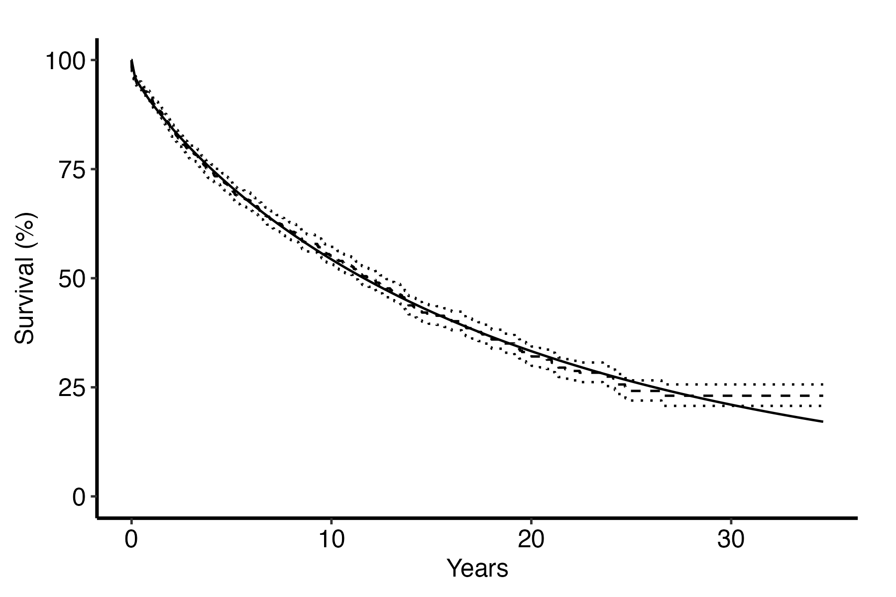

# Analysis report

# Analysis report

Published

2026-11-25 13:08

Code

``` r
SUBJECT <- "dead"
TYPE    <- "question"
.in <- knitr::current_input(dir = TRUE)
suppressPackageStartupMessages(library(hvtiRutilities))
# The study root is the nearest directory above this file holding _study.yml, so
# the report renders the same from the Render button, quarto render, or
# render_job(). The guards in .job_setup() put an unfinished render in a callout,
# so a draft report cannot pass for a final one, and an item whose source job is
# itself a draft carries its own callout.
.job <- hvtiRtemplates:::.job_setup(SUBJECT, TYPE, envir = environment())
.root <- .job$root
set_path <- .job$set_path
.provenance_data <- list()
# The draft banners, if any, and the box under the title, after all the code above.
.job$notice
```

**final** · data: see About this run · rendered by gallery on gallery ·
hvtiRtemplates 1.6.3

## Question

Code

``` r
# Demo: paste the research question from the protocol, word for word. The
# report is judged against this sentence, so do not paraphrase it.
QUESTION <- "Does the early hazard of death differ from the late hazard?"
cat("> ", QUESTION, "\n", sep = "")
```

> Does the early hazard of death differ from the late hazard?

## Item 1: Survival from the parametric fit

Code

``` r
# Demo: name the exhibit as "<job>#<label>".
hvtiRtemplates::ar_item("hz.dead.hz#fig-fit")
```

**Item 1** · `hz.dead.hz#fig-fit`



[Download the figure
(PNG)](https://ehrlinger.github.io/hvtiRtemplates/gallery/reports/assets/74d73c1dc3a006ee69ebef4982f652f5.png)

[The full report of `hz.dead.hz`, in the study
folder](https://ehrlinger.github.io/hvtiRtemplates/gallery/20_distributions/hz.dead.hz.md)

The hazard of the event recorded in dead was modeled as a parametric
multiphase hazard with 2 phases (TemporalHazard 1.3.1), fitted by
maximum likelihood to 725 patients with 406 events.

## Item 2: Parameter estimates

Code

``` r
# Demo: name the exhibit as "<job>#<label>".
hvtiRtemplates::ar_item("hz.dead.hz#tbl-estimates")
```

**Item 2** · `hz.dead.hz#tbl-estimates`

| parameter |   estimate | se_on_r_scale | r_scale |
|:----------|-----------:|--------------:|:--------|
| MUE       |  0.0287956 |     0.6503541 | log     |
| THALF     |  0.0044538 |     2.4642214 | log     |
| NU        |  2.6936482 |     2.3449537 | natural |
| M         | -0.2197872 |     0.4695841 | natural |
| MUL       |  0.0768119 |     0.1712626 | log     |
| ETA       |  0.8800072 |     0.0568175 | natural |

[The full report of `hz.dead.hz`, in the study
folder](https://ehrlinger.github.io/hvtiRtemplates/gallery/20_distributions/hz.dead.hz.md)

The hazard of the event recorded in dead was modeled as a parametric
multiphase hazard with 2 phases (TemporalHazard 1.3.1), fitted by
maximum likelihood to 725 patients with 406 events.

## About this run

## About this run

| Group           | Item           | Value                   |
|:----------------|:---------------|:------------------------|
| Run             | Started        | 2026-11-25 13:08:38 EST |
|                 | Ended          | 2026-11-25 13:08:38 EST |
|                 | Duration       | 0 s                     |
|                 | Status         | final                   |
|                 | Rendered by    | gallery                 |
|                 | Host           | gallery                 |
| Job             | File           | ar.dead.question.qmd    |
|                 | Template       | ar                      |
|                 | Subject        | dead                    |
|                 | Type           | question                |
|                 | hvtiRtemplates | 1.6.3                   |
| Reproducibility | renv           | not active              |
