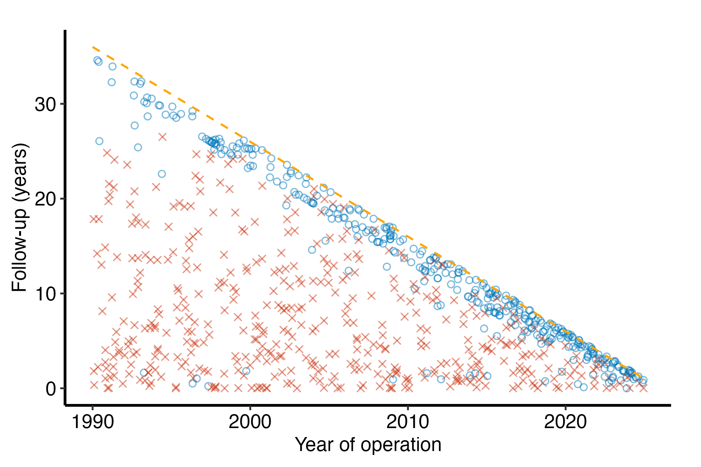
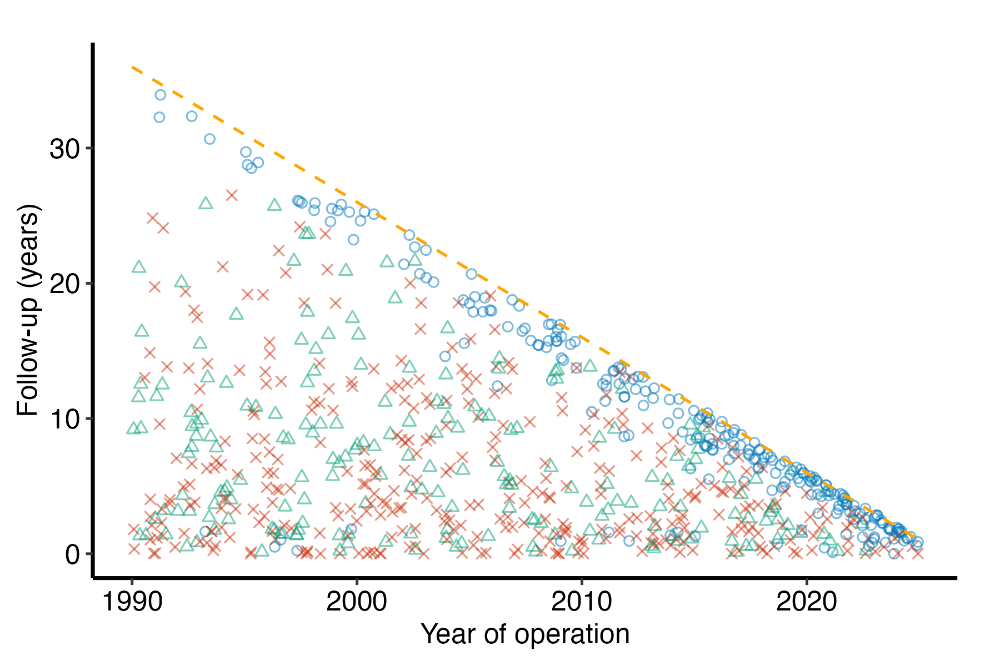
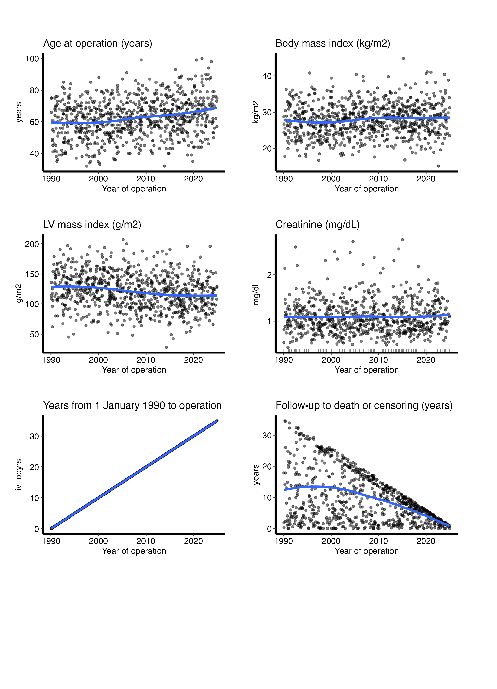

# EDA report

# EDA report

Published

2026-11-03 08:14

Replaces an older EDA report.

A `dc-eda` job is the whole data-checking report over a new build, in
one render: an overview of every column, goodness of follow-up, then
continuous variables, categorical variables as percentages and
categorical variables as counts, each with its table. It is written for
the biostatistician choosing variables for an analysis set, not for a
manuscript.

Each section draws through a package function. The follow-up section is
`dc-gfup`, a job of its own: its figure
(`hvtiPlotR::hv_followup_panels()`) and its tables
(`hvtiRutilities::followup_check()`). Given the same choices it is the
same figure as the standalone job, so this report and that job cannot
disagree about the data. The other three sections draw their pages
through `hvtiPlotR::hv_eda_pages()`.

Code

``` r
# unnumbered: setup, and the box under the title
SUBJECT <- "cohort"
TYPE    <- "eda"
.in <- knitr::current_input(dir = TRUE)
suppressPackageStartupMessages({
  library(hvtiRutilities)
  library(hvtiPlotR)
  library(ggplot2)
})
if (utils::packageVersion("hvtiPlotR") < "2.8.18") {
  stop("This job needs hvtiPlotR >= 2.8.18 for hv_eda_pages(), hv_followup_panels() and the red and blue its captions name; ",
       utils::packageVersion("hvtiPlotR"), " is installed.", call. = FALSE)
}
if (utils::packageVersion("hvtiRutilities") < "1.4.5") {
  stop("This job needs hvtiRutilities >= 1.4.5 for followup_check()'s 15th and 85th percentiles ",
       "and study_abbreviations(); ",
       utils::packageVersion("hvtiRutilities"), " is installed.", call. = FALSE)
}
if (!requireNamespace("patchwork", quietly = TRUE)) {
  stop("This job needs the patchwork package. Install it, then re-render.", call. = FALSE)
}
# Checked by what it has, not its version: the release that adds the house ODS
# list and the one before it can carry the same number until the next bump.
if (!exists(".ods_groups", envir = asNamespace("hvtiRtemplates"), inherits = FALSE)) {
  stop("This job needs an hvtiRtemplates with the house ODS variable list, newer than the ",
       utils::packageVersion("hvtiRtemplates"), " installed. Run hvtiR::update(force = TRUE), then re-render.",
       call. = FALSE)
}
# The study root is the nearest directory above this file holding _study.yml,
# so the job renders the same from the Render button, quarto render, or
# render_job(), at any depth, with no path in this document to edit.
# To render a job you have not finished, leave a chunk out with the chunk
# option skip, giving the reason in quotes, or call hvtiRtemplates::stop_here()
# in a chunk to leave out everything below it. A draft lists each one in a
# callout; a final render refuses them, as it refuses an unresolved marker.
# ?stop_here has more.
.job <- hvtiRtemplates:::.job_setup(SUBJECT, TYPE, envir = environment())
.root <- .job$root
set_path <- .job$set_path
.provenance_data <- list()
# Saves a figure as <name>.png, .pdf and .tiff in this set's graphs/ folder (or `kind`'s),
# under the SAVE_FIGURES and FIGURES study choices.
save_figure <- function(plot, name, width = 6, height = 4, kind = "graphs", linked = FALSE) {
  hvtiRtemplates:::.save_figure(plot, set_path(kind, paste0(name, ".png")), width, height,
                                SAVE_FIGURES, FIGURES, linked)
}
# The draft banners, if any, and the box under the title, after all the code above.
.job$notice
```

**final** · data `built` `built_20261103.parquet`, dated 2026-11-03 ·
rendered by gallery on gallery · hvtiRtemplates 1.5.5

## Study choices

Set the values in this chunk before rendering. Left as they are, they
draw the all-deaths follow-up panel and the study dataset’s columns on
the house ODS list, the variables the SAS ODS tables report.
`VARIABLE_SET <- "all"` draws every column instead. The report is a data
check: its tables and figures may show ranges, so they are not
manuscript figures, and they do not go in a paper as saved.

Code

``` r
# Demo: the registered dataset this job reads ("built" is the study dataset).
# MIGRATE-BEGIN: dc-eda-data
DATASET <- "built"
# MIGRATE-END: dc-eda-data

# Demo: an hvtiRdatabuild analysis set, or NULL to read the whole dataset.
ANALYSIS_SET <- NULL

# Demo: rows to keep, dplyr::filter() style, or NULL to keep every row:
#   WHERE <- quote(age >= 18)
#   WHERE <- rlang::exprs(age >= 18, hx_chf == 1)
WHERE <- NULL

# Demo: the patient identifier. Without "ccfid" the job uses MRN, then eMRN;
# name another column, such as "randid", if the study uses one.
ID <- "patient_id"

# Demo: what makes a row unique; one row per patient unless repeated measures
# add their visit time or date, for example KEY <- c(ID, "iv_echo").
KEY <- ID

# Optional, and needs no edit: NULL reads the cohort alone. To join one
# registered ancillary dataset (echoes, labs), name it in JOIN. The cohort
# above decides the patients, one row each; the joined records of other
# patients are dropped and counted in the data table.
#   JOIN_VARS: the cohort columns each joined row carries; NULL carries all,
#     and a column both datasets have stops, so list only those the job needs.
#   REDUCE: NULL keeps a row per joined record, keyed on that dataset's key;
#     list(rule = "first", by = "echo_date") keeps one row per patient ("last",
#     or "nearest" with to = a cohort date column). WHERE on a joined column
#     filters the records first, so "last" with WHERE echo_type == "TTE"
#     keeps each patient's last TTE. A tie stops: picking one record
#     silently would be a hidden choice; by = c("echo_date", "echo_seq")
#     breaks it. A job that counts or models
#     patients, one row each, needs REDUCE: NULL would count every record.
#   JOIN_KEY: overrides the joined dataset's registered key.
JOIN <- NULL
JOIN_VARS <- NULL
REDUCE <- NULL
JOIN_KEY <- NULL

# Follow-up. These are dc-gfup's choices, and mean what they mean there.
# Demo: the years-since-origin interval to the operation, and that origin. The
# origin differs between studies, and a wrong one slides every point along the
# x-axis without any other symptom, which is why the operation years are
# checked and printed below.
OPYRS <- "iv_opyrs"
ORIGIN_YEAR <- 1990

# Demo: the close date of follow-up, as.Date("YYYY-MM-DD"). NULL estimates it
# as the latest operation date plus follow-up in the data, which is the date
# follow-up is known to reach, not the date it was closed; the report says
# which one it drew.
CLOSE_DATE <- as.Date("2025-12-31")

# Demo: one entry per death panel. `status` is the 1/0 death indicator and
# `time` its follow-up in years. Each panel also gets dc-gfup's tables, over
# the same two columns. A study that ascertains deaths two ways draws both,
# for example
#   systematic = list(status = "deads", time = "iv_deads", title = "Systematic deaths")
PANELS <- list(
  all = list(status = "dead", time = "iv_dead", title = "All deaths")
)

# Demo: optional event panels, one entry per panel. `event` and `time` are the
# event's indicator and interval; `death` and `death_time` the death it
# competes with. A flagged event counts only when it comes strictly before
# death, so ties go to death. list() draws none. For example
#   reop = list(event = "ev_reop", time = "iv_reop", death = "dead",
#               death_time = "iv_dead", label = "Reoperation")
# Competing non-fatal events share one panel when `event`, `time` and `label`
# are vectors, one element per event and at most four; `death` and
# `death_time` stay single. Each patient shows the earliest event before death,
# and a tie between two events goes to the one listed first, so list the event
# that should win a tie first:
#   nonfatal = list(event = c("ev_reop", "ev_stroke"), time = c("iv_reop", "iv_stroke"),
#                   death = "dead", death_time = "iv_dead", label = c("Reoperation", "Stroke"))
EVENTS <- list(reop = list(event = "reop", time = "iv_reop", death = "dead", death_time = "iv_dead", label = "Reoperation"))

# Variables.
# X_VAR is the reference date or year every panel is drawn against, and
# X_LABEL titles that axis. A date column, such as dt_surg, is drawn as a
# decimal calendar year: whole years for the percent and count bars, the point
# in the year for the continuous panels. Any other column is drawn as it is.
# Set both when time 0 is not an operation, such as an enrollment date.
# VARIABLES is NULL to draw the VARIABLE_SET below, or the columns to draw, in page
# order. NULL leaves out X_VAR, EXCLUDE and any column that looks like an
# identifier or a date, and the report lists what it left out; name such a
# column here to draw it anyway. The job's ID is never drawn, even when named
# here. A KEY column beside it, such as a visit time, is left out of NULL but
# drawn when named here, as that column's own distribution; a measure's course
# over visits is a spaghetti plot, drawn by hvtiPlotR::hv_spaghetti, not a page here.
# The follow-up columns are drawn too, like any other column, but the ODS list
# carries only dead and iv_dead: name an event's columns here to draw them.
# A named column that is not in the data stops the render, and the error
# lists every missing name at once.
# GRID_NCOL by GRID_NROW panels make a page, and a page is drawn on the printed
# page, 6.5 by 9 in: two panels across keep each one's title and year axis
# readable at 8 pt, and more than two crowd them.
# SECTIONS is any of "followup", "continuous", "percent" and "count". The
# report keeps this order whatever order they are named in, so the report
# reads the same across studies.
# ALPHA is point transparency, for the follow-up figures and the continuous
# panels: 0.5 lets a dense cohort read as a distribution rather than a blob.
# MIGRATE-BEGIN: dc-eda-variables
X_VAR <- "dt_surg"                 # Demo: the reference date or year column
VARIABLES <- NULL                  # Demo: NULL draws VARIABLE_SET, or name them
EXCLUDE <- character(0)
GRID_NCOL <- 2L
GRID_NROW <- 4L
UNIQUE_LIMIT <- 6L
SECTIONS <- c("followup", "continuous", "percent", "count")
ALPHA <- 0.5
# MIGRATE-END: dc-eda-variables
# Demo: what VARIABLES = NULL draws. "ods" draws the house descriptive list, so
# named because it is every variable the SAS ODS tables (dc.tables.ods.sas)
# report, in their section order: a built dataset carries far more columns than
# anyone wants a page for. Only the listed columns this dataset has are drawn,
# and the report counts them. It also lists this dataset's columns left out, so a
# study's own variables are one name away in VARIABLES. "all" draws every column, as dc-eda did before this choice existed.
# The list ships with the package as extdata/ods-variables.csv, so a study adds to
# VARIABLES rather than editing it. To read it: hvtiRtemplates:::.ods_groups().
# dc-tables carries the same list as its commented GROUPS example.
VARIABLE_SET <- "ods"
X_LABEL <- "Year of operation"     # Demo: the x-axis label, e.g. "Year of enrollment" when time 0 is not an operation

# Demo: NULL draws the house colors through hvtiPlotR::scale_color_hv(): dead
# red, alive blue and non-fatal events green, then reddish purple, olive
# and black, all colorblind safe. Name alive, dead and event to choose your own;
# c(alive = "#377EB8", dead = "#E41A1C", event = "#4DAF4A") is ColorBrewer
# Set1, what these jobs drew before 1.2.3. For competing events, repeat event,
# one color per event in the order EVENTS lists them, as many as the largest
# panel has: c(alive = ..., dead = ..., event = ..., event = ...).
# Each figure caption names these colors, so choosing your own means naming them
# in the caption key too, where the figures are drawn.
COLORS <- NULL

# Demo: the longest label the figure pages and their captions show, in
# characters. Longer labels are shortened so that two labels that differ never
# read the same: a shared heading is abbreviated, then the label is cut and
# marked. Inf shows every label whole. Tables keep full labels, so a reader can
# look up what a shortened one stands for.
LABEL_MAX <- 40

# Demo: this job's own abbreviations, beyond the study's list, as
# c("Phrase" = "Abbrev"); NA drops one the study or group list supplies. NULL
# uses the study's list alone. The study's list is the abbreviations: block in
# _study.yml, over the group default shipped in hvtiRutilities.
ABBREVIATIONS <- NULL

# Each figure is saved to graphs/ as a PNG (for Word), and a PDF and a TIFF (for the publisher).
# SAVE_FIGURES <- FALSE saves none; FIGURES keeps only the figures whose names
# start with one of its entries, e.g. FIGURES <- c("hp-survival"). The names are the
# file names, listed for each template in the templates README.
SAVE_FIGURES <- TRUE
FIGURES <- NULL
```

## Data

Code

``` r
hvtiRutilities::verify_manifest(file.path(.root, "manifest.yaml"))
.cfg <- study_config(start = .root)
job_data <- hvtiRtemplates::read_job_data(.cfg, dataset = DATASET, analysis_set = ANALYSIS_SET,
                                          where = WHERE, id = ID, key = KEY, join = JOIN, join_vars = JOIN_VARS,
                                          reduce = REDUCE, join_key = JOIN_KEY)
d <- job_data$data
.provenance_data <- c(if (exists(".provenance_data")) .provenance_data else list(), list(job_data$provenance),
                      if (!is.null(job_data$provenance_join)) list(job_data$provenance_join))
knitr::kable(job_data$record, col.names = c("Data", ""))
```

| Data                |                                          |
|:--------------------|:-----------------------------------------|
| Source              | dataset `built` (built_20261103.parquet) |
| Rows read           | 800                                      |
| ID                  | `patient_id`                             |
| Identifiers dropped | none                                     |
| Rows kept           | 800 rows on 800 patients                 |

Table 1: The data this job read

Code

``` r
# unnumbered: its child chunk carries its own label and caption
if (!is.null(job_data$attrition)) {
  .fence <- strrep("`", 3)
  cat(knitr::knit_child(text = c(
    paste0(.fence, "{r}"), "#| label: tbl-data-attrition",
    paste0("#| tbl-cap: ", encodeString(paste0("Analysis set `", ANALYSIS_SET, "`: exclusions, in order"), quote = "\"")),
    "knitr::kable(job_data$attrition)", .fence
  ), envir = environment(), quiet = TRUE), sep = "\n")
}
```

Code

``` r
# unnumbered: checks the choices and defines helpers only; its tables and figures are child chunks elsewhere
# The follow-up choices are checked by hv_followup_panels() below; these
# check the variable choices.
column_names <- function(x) is.character(x) && !anyNA(x) && all(nzchar(x)) && !anyDuplicated(x)
if (!column_names(X_VAR) || length(X_VAR) != 1L) stop("X_VAR must name one column.", call. = FALSE)
if (!is.character(X_LABEL) || length(X_LABEL) != 1L || is.na(X_LABEL) || !nzchar(X_LABEL)) {
  stop("X_LABEL must be one piece of text, the x-axis label.", call. = FALSE)
}
if (!is.null(VARIABLES) && (!column_names(VARIABLES) || !length(VARIABLES))) {
  stop("VARIABLES must be NULL or name distinct columns.", call. = FALSE)
}
if (!column_names(EXCLUDE)) stop("EXCLUDE must name distinct columns.", call. = FALSE)
if (!is.character(VARIABLE_SET) || length(VARIABLE_SET) != 1L || !VARIABLE_SET %in% c("ods", "all")) {
  stop("VARIABLE_SET must be \"ods\" or \"all\".", call. = FALSE)
}
positive_whole <- function(x) is.numeric(x) && length(x) == 1L && !is.na(x) && is.finite(x) && x > 0 && x == floor(x)
for (value in list(GRID_NCOL, GRID_NROW, UNIQUE_LIMIT)) {
  if (!positive_whole(value)) stop("Grid dimensions and UNIQUE_LIMIT must be positive whole numbers.", call. = FALSE)
}
all_sections <- c("followup", "continuous", "percent", "count")
if (!column_names(SECTIONS) || !length(SECTIONS) || !all(SECTIONS %in% all_sections)) {
  stop("SECTIONS must be one or more of \"followup\", \"continuous\", \"percent\" and \"count\".", call. = FALSE)
}
if (!is.numeric(ALPHA) || length(ALPHA) != 1L || is.na(ALPHA) || ALPHA < 0 || ALPHA > 1) {
  stop("ALPHA must be one number from 0 to 1.", call. = FALSE)
}
if (!is.numeric(LABEL_MAX) || length(LABEL_MAX) != 1L || is.na(LABEL_MAX) || LABEL_MAX < 4) {
  stop("LABEL_MAX must be one number, at least 4, or Inf to show every label whole.", call. = FALSE)
}
if (!is.null(ABBREVIATIONS) && (!(is.character(ABBREVIATIONS) || is.list(ABBREVIATIONS)) ||
                                  (length(ABBREVIATIONS) && is.null(names(ABBREVIATIONS))))) {
  stop('ABBREVIATIONS must be NULL or name each abbreviation by its phrase, c("Phrase" = "Abbrev").', call. = FALSE)
}
unknown <- setdiff(c(X_VAR, VARIABLES, EXCLUDE), names(d))
if (length(unknown)) {
  stop("Unknown EDA column(s): ", paste(unknown, collapse = ", "), ".",
       if (X_VAR %in% unknown) " Set X_VAR in the study choices to the study's reference date or year column.",
       call. = FALSE)
}
# No identifier is drawn or summarized: the job's ID and KEY columns, which are the
# columns the data step used, so a ccfid, or the MRN it fell back to, is caught
# whatever its case, and any other column .no_values() names. Left out by default,
# they stop the job when named in VARIABLES.
# Direct identifiers (MRN, SSNs, names, contact details) are dropped at read, unless one is the ID. The name rules
# catch other identifier columns and dates: an id or identifier token, such as
# hosp_id, a date token or a _dt suffix, and the names ccfid and patientid,
# which have no "_" before "id"; a bare "id$" would also take carotid and
# steroid. The data rule catches columns that should not be drawn under a name
# nobody listed: dates, and text in which every value differs, once there are
# ten or more of them.
.job_selection <- attr(job_data$record, "selection")
.no_values <- hvtiRtemplates:::.no_values(d, .job_selection$id, .job_selection$key)
hvtiRtemplates:::.refuse_display(X_VAR, .no_values, "X_VAR")
looks_like_id <- function(v) {
  !(v %in% hvtiRtemplates:::.displayable(v, .no_values)$keep) |
    grepl("(^|_)(id|identifier|date|datetime)($|_)|_dt$", v, ignore.case = TRUE) |
    grepl("^(ccf|pat|patient|study|subject|record|case)_?(id|num|no)$|^e?mrn$", v, ignore.case = TRUE) |
    vapply(d[v], function(x) {
      seen <- x[!is.na(x)]
      inherits(x, c("Date", "POSIXt")) ||
        ((is.character(x) || is.factor(x)) && length(seen) >= 10L && !anyDuplicated(seen))
    }, logical(1L))
}
if (is.null(VARIABLES)) {
  candidates <- setdiff(names(d), c(X_VAR, EXCLUDE))
  # The list chooses the continuous, percent and count pages; a follow-up-only
  # report draws none of them, so it neither needs nor checks the list.
  if (VARIABLE_SET == "ods" && any(SECTIONS != "followup")) {
    # The list's order, which is its section order, is the page order.
    ods <- unlist(hvtiRtemplates:::.ods_groups(), use.names = FALSE)
    # Matched whatever the case: a joined dataset's names need not be lowercase.
    on_list <- tolower(candidates) %in% ods
    outside <- candidates[!on_list]
    candidates <- candidates[on_list]
    candidates <- candidates[order(match(tolower(candidates), ods))]
    if (!length(candidates)) {
      stop("None of the house ODS list's columns is in this dataset. Set VARIABLE_SET <- \"all\", or name the ",
           "columns in VARIABLES.", call. = FALSE)
    }
    cat(length(candidates), "of the", length(ods), "columns on the house ODS list are in this dataset.\n")
    if (length(outside)) {
      cat("Not drawn, as columns outside the house ODS list (name them in VARIABLES, or set VARIABLE_SET <- \"all\"):",
          paste(outside, collapse = ", "), "\n")
    }
  }
  left_out <- candidates[looks_like_id(candidates)]
  VARIABLES <- setdiff(candidates, left_out)
  if (length(left_out)) {
    cat("Left out as identifier or date columns (name a date in VARIABLES to draw it; an identifier is never drawn):",
        paste(left_out, collapse = ", "), "\n")
  }
} else {
  VARIABLES <- setdiff(VARIABLES, EXCLUDE)
  hvtiRtemplates:::.refuse_display(VARIABLES, .no_values, "VARIABLES")
  suspect <- looks_like_id(VARIABLES)
  if (any(suspect)) {
    warning("Selected likely identifier or date field(s): ", paste(VARIABLES[suspect], collapse = ", "), call. = FALSE)
  }
}
```

    11 of the 239 columns on the house ODS list are in this dataset.
    Not drawn, as columns outside the house ODS list (name them in VARIABLES, or set VARIABLE_SET <- "all"): patient_id, hx_dm, lvef, reop, iv_reop, vent, icu_hours, male, nonwhite, stroke, mr_grade, discharge, approach, valve_size, valve_type, prior_ops, match_pair, complication, los, log_los, cpb_time, lvedd, lvesd, la_diam, rvsp, e_e, mv_procedure, reint, iv_reint 

Code

``` r
if (!length(VARIABLES)) stop("No EDA variables remain after exclusions.", call. = FALSE)

# The column the pages draw against, named X_LABEL so the axis reads in the
# study's words, in a copy of the data the pages draw from (`d` is left as it
# was read); X_VAR itself is never drawn as a variable. A date becomes a
# decimal calendar year, the year plus the share of it gone by:
# hv_eda_pages() floors a number to whole years for the percent and count
# bars, and the continuous panels keep the decimal. Any other column is drawn
# as it is.
if (X_LABEL %in% setdiff(names(d), X_VAR)) {
  stop("X_LABEL, \"", X_LABEL, "\", is already a column of the data; choose another label.", call. = FALSE)
}
.x <- d[[X_VAR]]
if (inherits(.x, c("Date", "POSIXt"))) {
  .lt <- as.POSIXlt(.x)
  .year <- .lt$year + 1900
  .days <- ifelse((.year %% 4 == 0 & .year %% 100 != 0) | .year %% 400 == 0, 366, 365)
  .x <- .year + .lt$yday / .days
}
VARIABLES <- setdiff(VARIABLES, X_VAR)
.d_eda <- d
.d_eda[[X_LABEL]] <- .x

# Labels come from the dataset; a variable without one is shown by its name.
# Shortened labels stay distinct, using the job's, the study's and the group's
# abbreviations, merged and checked by study_abbreviations().
.abbreviations <- hvtiRutilities::study_abbreviations(.cfg, extra = ABBREVIATIONS)
.labels <- label_map(d, label_max = LABEL_MAX, abbreviations = .abbreviations)
labels <- stats::setNames(.labels$label, .labels$key)
# The abbreviations these variables' labels show, as a key under the section.
# label_map() records which abbreviation each variable's final label shows, so
# a label that says "SP" in its own words and is only cut is not counted as
# using the key's SP; searching the label text could not tell the two apart.
abbreviation_key <- function(vars) {
  used <- attr(.labels, "abbreviations")
  by_key <- attr(.labels, "abbreviations_by_key")
  hit <- used$abbreviation %in% by_key$abbreviation[by_key$key %in% vars]
  if (any(hit)) {
    cat("\nAbbreviations: ", paste(used$abbreviation[hit], used$expansion[hit], sep = " = ", collapse = "; "), ".\n\n",
        sep = "")
  }
}

# Every table and figure below is a chunk of its own, emitted with knit_child(),
# so Quarto numbers it: a loop over panels or pages cannot give one chunk several
# labels. A label is a kind and a key, such as "tbl gfup all cohort".
.fence <- strrep("`", 3)
.seen <- new.env()
.child <- function(label, caption, code) {
  label <- gsub("(^-+|-+$)", "", gsub("[^a-z0-9]+", "-", tolower(label)))
  if (!is.null(.seen[[label]])) stop("Two outputs would share the label ", label, ".", call. = FALSE)
  .seen[[label]] <- TRUE
  .opt <- paste0("#| ", sub("-.*$", "", label), "-cap: ", encodeString(caption, quote = "\""))
  cat(knitr::knit_child(text = c(paste0(.fence, "{r}"), paste0("#| label: ", label), .opt, code, .fence),
                        envir = parent.frame(), quiet = TRUE), sep = "\n")
  cat("\n")
}
# Link each saved figure relative to wherever this document sits. Quarto
# rewrites an absolute path into a broken relative one and then cannot embed
# the image, and a fixed "../graphs" would break for a job kept in a subfolder.
# error = FALSE returns the path unchanged when no relative path exists (two
# Windows drives), so the figure is still saved rather than the render stopping.
figure_link <- function(file) {
  xfun::relative_path(file, if (exists(".in") && !is.null(.in)) dirname(.in) else getwd(), error = FALSE)
}
figure_files <- character(0)
```

## Overview

Every column of the data this report read, in dataset order, with its
type, label and share missing. A column the sections below leave out is
still listed here, unless it looks like an identifier: those are named
below the table and not described.

Code

``` r
# unnumbered: its child chunk carries its own label and caption
# The same rule the sections use, applied whatever VARIABLES says, less its date
# half: a date's share missing is worth seeing, an identifier's is not.
is_date <- vapply(d, inherits, logical(1L), c("Date", "POSIXt")) |
  grepl("(^|_)(date|datetime)($|_)|_dt$", names(d), ignore.case = TRUE)
id_cols <- names(d)[looks_like_id(names(d)) & !is_date]
contents <- hvtiRutilities::proc_contents(d, order = "varnum")
shown <- contents$variables[!contents$variables$variable %in% id_cols, ]
.shown <- shown[, c("variable", "type", "label", "n_unique", "pct_missing")]
.child("tbl overview contents", paste0("Contents: ", nrow(d), " rows, ", ncol(d), " columns"),
       "knitr::kable(.shown, row.names = FALSE)")
```

Code

``` r
knitr::kable(.shown, row.names = FALSE)
```

| variable | type | label | n_unique | pct_missing |
|:---|:---|:---|---:|---:|
| dt_surg | Num | Date of operation | 766 | 0.0 |
| iv_opyrs | Num | Years from 1 January 1990 to operation | 787 | 0.0 |
| age | Num | Age at operation (years) | 65 | 0.0 |
| female | Num | Female | 2 | 0.0 |
| race_grp | Char | Race | 3 | 0.0 |
| bmi | Num | Body mass index (kg/m2) | 190 | 0.0 |
| hx_chf | Num | History of heart failure | 2 | 0.0 |
| hx_dm | Num | Diabetes | 2 | 0.0 |
| nyha_pr | Num | NYHA functional class | 4 | 0.0 |
| lvef | Num | LV ejection fraction (%) | 53 | 0.0 |
| plvmassi | Num | LV mass index (g/m2) | 141 | 0.0 |
| creat_pr | Num | Creatinine (mg/dL) | 147 | 9.4 |
| dead | Num | Death | 2 | 0.0 |
| iv_dead | Num | Follow-up to death or censoring (years) | 777 | 0.0 |
| reop | Num | Reoperation | 2 | 0.0 |
| iv_reop | Num | Follow-up to reoperation (years) | 774 | 0.0 |
| vent | Num | Prolonged ventilation | 2 | 0.0 |
| icu_hours | Num | Hours in intensive care | 82 | 0.0 |
| male | Num | Male | 2 | 0.0 |
| nonwhite | Num | Non-white race | 2 | 0.0 |
| stroke | Char | Postoperative stroke | 2 | 0.0 |
| mr_grade | Char | Postoperative mitral regurgitation grade | 4 | 0.0 |
| discharge | Char | Discharge destination | 3 | 0.0 |
| approach | Char | Surgical or transcatheter replacement | 2 | 0.0 |
| valve_size | Char | Prosthesis size | 3 | 0.0 |
| valve_type | Char | Prosthesis type | 3 | 0.0 |
| prior_ops | Num | Number of prior cardiac operations | 4 | 0.0 |
| match_pair | Num | In a matched pair (simulated) | 2 | 0.0 |
| complication | Num | Major postoperative complication | 2 | 0.0 |
| los | Num | Postoperative length of stay (days) | 19 | 0.0 |
| log_los | Num | Postoperative length of stay (log days) | 19 | 0.0 |
| cpb_time | Num | Cardiopulmonary bypass time (minutes) | 120 | 0.0 |
| lvedd | Num | LV end-diastolic dimension (cm) | 36 | 5.4 |
| lvesd | Num | LV end-systolic dimension (cm) | 40 | 4.6 |
| la_diam | Num | Left atrial diameter (cm) | 32 | 5.8 |
| rvsp | Num | RV systolic pressure (mmHg) | 58 | 4.2 |
| e_e | Num | Mitral E/e’ ratio | 188 | 5.4 |
| mv_procedure | Char | Mitral repair or replacement | 2 | 0.0 |
| reint | Num | Reintervention | 2 | 0.0 |
| iv_reint | Num | Follow-up to reintervention, death or censoring (years) | 775 | 0.0 |

Table 2: Contents: 800 rows, 41 columns

Code

``` r
if (length(id_cols)) cat("Identifier columns, not described:", paste(id_cols, collapse = ", "), "\n")
```

Identifier columns, not described: patient_id

Code

``` r
cat("\n## Goodness of follow-up\n\n")
```

## Goodness of follow-up

Code

``` r
cat("A point below the diagonal is follow-up short of what the close date allows. ",
    "A dead patient's point is where the death was recorded, so it is expected below ",
    "the line; it is the **blue** points drifting below it that need an explanation.\n\n", sep = "")
```

A point below the diagonal is follow-up short of what the close date
allows. A dead patient’s point is where the death was recorded, so it is
expected below the line; it is the **blue** points drifting below it
that need an explanation.

Code

``` r
# unnumbered: its child chunk carries its own label and caption
# hvtiPlotR::hv_followup_panels() checks every panel and event against the data,
# names every missing column at once, refuses a name used twice and the
# wrong-origin mistake, and works out the window the panels share. dc-gfup
# calls it with the same arguments, so these are that job's panels.
fp <- hvtiPlotR::hv_followup_panels(d, opyrs_col = OPYRS, origin_year = ORIGIN_YEAR,
                                    panels = PANELS, events = EVENTS, close_date = CLOSE_DATE)
close_date <- fp$meta$close_date
# Name the edit point a reader can find in this file, not the function's argument.
close_source <- if (is.null(CLOSE_DATE)) fp$meta$close_source else "set in CLOSE_DATE"
# Operations before ORIGIN_YEAR are drawn, left of the diagonal, by an
# hvtiPlotR that counts them in meta$n_opyrs_negative; this row says how many,
# because a build counting from a later origin is a problem to fix there. An
# older hvtiPlotR refuses them instead, so the field is absent and so is the row.
.before <- fp$meta$n_opyrs_negative
.window <- data.frame(
  quantity = c("patients", "operation year missing", if (!is.null(.before)) "operation before origin",
               "first operation", "last operation", "close date", "close date is"),
  value = c(fp$meta$n_obs, fp$meta$n_opyrs_missing, .before, format(fp$meta$first_operation),
            format(fp$meta$study_end), format(close_date), close_source)
)
.child("tbl gfup window", "Operation years and the close date", "knitr::kable(.window, row.names = FALSE)")
```

Code

``` r
knitr::kable(.window, row.names = FALSE)
```

| quantity                | value             |
|:------------------------|:------------------|
| patients                | 800               |
| operation year missing  | 0                 |
| operation before origin | 0                 |
| first operation         | 1990-01-25        |
| last operation          | 2024-12-10        |
| close date              | 2025-12-31        |
| close date is           | set in CLOSE_DATE |

Table 3: Operation years and the close date

Code

``` r
# unnumbered: each child chunk below carries its own label and caption
# Each death panel gets dc-gfup's follow-up table over its own two columns,
# through hvtiRutilities::followup_check(), the function dc-gfup calls. No identifier is
# selected, so the report carries no patient-level column; run dc-gfup to review
# the suspicious rows themselves.
if (exists("COLOURS", inherits = FALSE)) stop("COLOURS is now COLORS: rename it in edit-study-choices ",
                                              "(study-choices in a job made before that rename).", call. = FALSE)
if (!is.null(COLORS) && !(is.character(COLORS) && !anyNA(COLORS) && all(names(COLORS) %in% c("alive", "dead", "event")) &&
                            sum(names(COLORS) == "alive") == 1L && sum(names(COLORS) == "dead") == 1L &&
                            any(names(COLORS) == "event"))) {
  stop("COLORS must be NULL, or name alive and dead once each and event once per competing event.", call. = FALSE)
}
# A panel draws at most four competing events: each needs a shape of its own,
# and the house palette names its colors only up to four.
.n_events <- vapply(EVENTS, function(e) if (is.list(e)) length(e$event) else 0L, integer(1L))
if (any(.n_events > 4L)) {
  stop("An EVENTS entry lists ", max(.n_events), " events; a panel draws at most four.", call. = FALSE)
}
if (!is.null(COLORS) && any(.n_events > sum(names(COLORS) == "event"))) {
  stop("COLORS names ", sum(names(COLORS) == "event"), " event color(s), and an EVENTS entry lists ",
       max(.n_events), " events. Repeat event in COLORS, one color per event.", call. = FALSE)
}
# Dead or Death is the event and Alive or No event the censored level, so
# non-fatal events take the house rule's next colors, green first. With COLORS
# set, the event colors are taken in order, one per event in the panel.
status_colors <- function(levels, labels = stats::setNames(levels, levels)) {
  if (is.null(COLORS)) return(scale_color_hv(event = c("Dead", "Death"), censored = c("Alive", "No event"), labels = labels))
  events <- unname(COLORS[names(COLORS) == "event"])[seq_len(length(levels) - 2L)]
  scale_color_manual(values = stats::setNames(c(COLORS[["alive"]], events, COLORS[["dead"]]), levels), labels = labels)
}
# The statistics dc-gfup's follow-up table shows, total follow-up (sum) included.
.followup_stats <- c("n", "nmiss", "mean", "std", "min", "p15", "median", "p75", "p85", "p90", "max", "sum")
# dc-gfup's follow-up table, one row per interval and patient group, so a panel
# here shows the table that job shows. test-dc-eda.R keeps the two copies equal.
.followup_table <- function(fc, d, event) {
  ev <- d[[event]]
  groups <- c(full = "All patients", event = "Event", censored = "Censored")
  rows <- lapply(names(groups), function(g) {
    m <- fc$means[[g]]
    keep <- switch(g, full = rep(TRUE, nrow(d)), event = !is.na(ev) & ev == 1, censored = !is.na(ev) & ev == 0)
    count <- function(test) vapply(m$variable, function(v) sum(test(d[[v]][keep]), na.rm = TRUE), integer(1L))
    data.frame(interval = m$variable, patients = groups[[g]], n = m$n, missing = m$nmiss,
               negative = count(function(x) x < 0), zero = count(function(x) x == 0),
               mean = m$mean, sd = m$std, min = m$min, p15 = m$p15, median = m$median,
               p75 = m$p75, p85 = m$p85, p90 = m$p90, max = m$max, total = m$sum, row.names = NULL)
  })
  out <- do.call(rbind, rows)
  out[order(match(out$interval, unique(out$interval))), , drop = FALSE]
}
plots <- plot(fp, alpha = ALPHA)
panel_counts <- list()
for (i in seq_len(nrow(fp$data))) {
  row <- fp$data[i, ]
  nm <- row$panel
  panel_counts[[nm]] <- list(drawn = row$n_drawn, excluded = row$n_excluded)
  cat("\n### ", row$title, "\n\n", row$n_drawn, " patients drawn; ", row$n_excluded,
      " missing a column this panel needs.\n\n", sep = "")
  # The caption key names the house colors that COLORS <- NULL draws and the
  # shapes set here, so a study that sets COLORS renames them in .key below.
  if (row$type == "followup") {
    fc <- hvtiRutilities::followup_check(d, event = PANELS[[nm]]$status, followup = PANELS[[nm]]$time,
                                         stats = .followup_stats)
    .followup <- .followup_table(fc, d, PANELS[[nm]]$status)
    .child(paste("tbl gfup", nm, "followup"),
           paste0("Follow-up, ", row$title, ", by patient group: missing, negative and zero values, ",
                  "and the distribution (years)"),
           "knitr::kable(.followup, row.names = FALSE, digits = 3)")
    p <- plots[[nm]] +
      status_colors(c("Alive", "Dead")) +
      scale_shape_manual(values = c(Alive = 1, Dead = 4))
    .key <- "Blue open circles mark patients alive and red crosses patients who died"
  } else {
    # The levels are the panel's own: "No event", one per event in the order
    # EVENTS lists them, and "Death".
    levels <- fp$tables$panels[[nm]]$meta$event_levels
    k <- length(levels) - 2L
    p <- plots[[nm]] +
      status_colors(levels) +
      scale_shape_manual(values = stats::setNames(c(1, c(2, 0, 5, 6)[seq_len(k)], 4), levels))
    .with <- if (k == 1L) "patients with the event" else paste("patients whose first event was", levels[1L + seq_len(k)])
    .key <- paste0("Blue open circles mark patients without ", if (k == 1L) "the event" else "an event", ", ",
                   paste(c("green", "reddish purple", "olive", "black")[seq_len(k)],
                         c("open triangles", "open squares", "open diamonds", "open inverted triangles")[seq_len(k)],
                         .with, collapse = ", "),
                   ", and red crosses patients who died")
  }
  p <- p + labs(x = "Year of operation", y = "Follow-up (years)", color = NULL, shape = NULL) +
    theme_hv_manuscript(base_size = 12)
  file <- save_figure(p, paste0("dc-eda-gfup-", nm), linked = TRUE)
  .link <- figure_link(file)
  .child(paste("fig gfup", nm),
         paste0("Follow-up against year of operation, ", row$title, ". ", .key, " and the dashed orange diagonal ",
                "the longest follow-up possible for each year of operation."),
         "knitr::include_graphics(.link, error = FALSE)")
  figure_files <- c(figure_files, file)
}
```

### All deaths

800 patients drawn; 0 missing a column this panel needs.

Code

``` r
knitr::kable(.followup, row.names = FALSE, digits = 3)
```

| interval | patients | n | missing | negative | zero | mean | sd | min | p15 | median | p75 | p85 | p90 | max | total |
|:---|:---|---:|---:|---:|---:|---:|---:|---:|---:|---:|---:|---:|---:|---:|---:|
| iv_dead | All patients | 800 | 0 | 0 | 0 | 9.479 | 8.087 | 0 | 1.538 | 7.137 | 14.286 | 18.964 | 22.244 | 34.604 | 7583.503 |
| iv_dead | Event | 445 | 0 | 0 | 0 | 7.064 | 6.403 | 0 | 0.957 | 5.022 | 11.120 | 14.135 | 17.266 | 26.513 | 3143.312 |
| iv_dead | Censored | 355 | 0 | 0 | 0 | 12.508 | 8.926 | 0 | 2.987 | 10.221 | 18.923 | 24.694 | 25.908 | 34.604 | 4440.190 |

Table 4: Follow-up, All deaths, by patient group: missing, negative and
zero values, and the distribution (years)

Code

``` r
knitr::include_graphics(.link, error = FALSE)
```



Figure 1: Follow-up against year of operation, All deaths. Blue open
circles mark patients alive and red crosses patients who died and the
dashed orange diagonal the longest follow-up possible for each year of
operation.

### Reoperation

800 patients drawn; 0 missing a column this panel needs.

Code

``` r
knitr::include_graphics(.link, error = FALSE)
```



Figure 2: Follow-up against year of operation, Reoperation. Blue open
circles mark patients without the event, green open triangles patients
with the event, and red crosses patients who died and the dashed orange
diagonal the longest follow-up possible for each year of operation.

Code

``` r
# unnumbered: defines the section helper only; its tables and figures are child chunks
# One section of hv_eda_pages() pages with its table. One categorical table
# serves the percent and the count sections, shown under whichever comes
# first, because a table can carry both columns where a figure needs two.
# Missing values are counted as a level, so a percentage is out of every
# patient, not only those with a value.
titles <- c(continuous = "Continuous variables", percent = "Categorical variables, percent",
            count = "Categorical variables, counts")
# What each panel draws, for the caption: a continuous page has no legend to read it from.
.eda_key <- c(continuous = paste0("Black filled circles mark patients, the solid blue line a LOESS smooth where a variable has ",
                                  "enough distinct values, and gray ticks along the bottom the patients missing the variable."),
              percent = paste("Stacked bars give the share of patients at each reference value, one house color per",
                              "category. The categories are told apart by color alone; the categorical frequency",
                              "table above names them."),
              count = paste("Stacked bars give the number of patients at each reference value, one house color per",
                            "category. The categories are told apart by color alone; the categorical frequency",
                            "table above names them."))
freq_section <- intersect(c("percent", "count"), SECTIONS)[1L]
draw_section <- function(section) {
  sec <- hvtiPlotR::hv_eda_pages(.d_eda, x_col = X_LABEL, section = section, vars = VARIABLES,
                                 labels = labels, unique_limit = UNIQUE_LIMIT)
  cat("\n## ", titles[[section]], " (", sec$meta$n_vars, ")\n\n", sep = "")
  if (!sec$meta$n_vars) {
    cat("No selected variable belongs to this section.\n\n")
    return(invisible(character(0)))
  }
  vars <- sec$data$variable
  if (section == "continuous") {
    stats <- hvtiRutilities::proc_means(d, vars = vars, stats = c("n", "nmiss", "mean", "std", "min",
                                                                  "p15", "median", "p85", "max"))
    .child(paste("tbl eda", section, "summary"), "Continuous variables",
           "knitr::kable(stats, digits = 2, row.names = FALSE)")
  } else if (identical(section, freq_section)) {
    freq <- do.call(rbind, lapply(vars, function(v) {
      f <- hvtiRutilities::proc_freq(d, v, missing = TRUE)
      level <- as.character(f[[1L]])
      data.frame(variable = v, level = ifelse(is.na(level), "(missing)", level),
                 n = f$Frequency, percent = round(f$Percent, 1))
    }))
    .child(paste("tbl eda", section, "frequencies"), "Categorical variables, missing counted",
           "knitr::kable(freq, row.names = FALSE)")
  }
  # The bars carry hover labels in HTML: a page names no categories, so a reader hovers a bar
  # for its category, year and count (John, 2026-10-15). The saved figure is the same either way.
  hover <- section != "continuous" && knitr::is_html_output() && requireNamespace("ggiraph", quietly = TRUE) &&
    "hv_girafe" %in% getNamespaceExports("hvtiPlotR")
  pages <- plot(sec, ncol = GRID_NCOL, nrow = GRID_NROW, alpha = ALPHA, interactive = hover)
  files <- character(0)
  for (i in seq_along(pages)) {
    # A page of its own, the printed page, 6.5 by 9 in: a grid of GRID_NCOL by GRID_NROW panels.
    # 8 pt, not 12, because panels share a row: at 12 a long title and the year labels run
    # past a 3.25 in panel. No legend and no category names, so the bars fill the panel
    # (John, 2026-10-15); the frequency table above names the categories.
    .page <- hvtiRtemplates:::.eda_page_panels(pages[[i]] & scale_fill_hv() & theme_hv_manuscript(base_size = 8))
    file <- save_figure(.page,
                        sprintf("dc-eda-%s-page-%02d", section, i), width = 6.5, height = 9, linked = TRUE)
    on_page <- attr(pages[[i]], "variables")
    cat("\n### ", titles[[section]], ", page ", i, "\n\n", sep = "")
    .link <- figure_link(file)
    .child(paste("fig eda", section, "page", i),
           paste0(titles[[section]], ", page ", i, ": ", paste(labels[on_page], collapse = ", "), ". ", .eda_key[[section]]),
           if (hover) "hvtiPlotR::hv_girafe(.page, width = 6.5, height = 9)" else
             "knitr::include_graphics(.link, error = FALSE)")
    files <- c(files, file)
  }
  abbreviation_key(vars)
  invisible(files)
}
```

Code

``` r
figure_files <- c(figure_files, draw_section("continuous"))
```

## Continuous variables (6)

Code

``` r
knitr::kable(stats, digits = 2, row.names = FALSE)
```

| variable | label | n | nmiss | mean | std | min | p15 | median | p85 | max |
|:---|:---|---:|---:|---:|---:|---:|---:|---:|---:|---:|
| age | Age at operation (years) | 800 | 0 | 62.38 | 12.18 | 32.00 | 49.00 | 63.00 | 75.00 | 100.00 |
| bmi | Body mass index (kg/m2) | 800 | 0 | 27.90 | 4.46 | 15.10 | 23.20 | 27.80 | 32.35 | 44.80 |
| plvmassi | LV mass index (g/m2) | 800 | 0 | 121.03 | 29.41 | 28.00 | 91.00 | 121.00 | 152.00 | 207.00 |
| creat_pr | Creatinine (mg/dL) | 725 | 75 | 1.09 | 0.36 | 0.43 | 0.75 | 1.02 | 1.43 | 2.76 |
| iv_opyrs | Years from 1 January 1990 to operation | 800 | 0 | 17.43 | 9.83 | 0.07 | 5.80 | 17.38 | 29.02 | 34.94 |
| iv_dead | Follow-up to death or censoring (years) | 800 | 0 | 9.48 | 8.09 | 0.00 | 1.54 | 7.14 | 18.96 | 34.60 |

Table 5: Continuous variables

### Continuous variables, page 1

Code

``` r
knitr::include_graphics(.link, error = FALSE)
```



Figure 3: Continuous variables, page 1: Age at operation (years), Body
mass index (kg/m2), LV mass index (g/m2), Creatinine (mg/dL), Years from
1 January 1990 to operation, Follow-up to death or censoring (years).
Black filled circles mark patients, the solid blue line a LOESS smooth
where a variable has enough distinct values, and gray ticks along the
bottom the patients missing the variable.

Code

``` r
figure_files <- c(figure_files, draw_section("percent"))
```

## Categorical variables, percent (5)

Code

``` r
knitr::kable(freq, row.names = FALSE)
```

| variable | level |   n | percent |
|:---------|:------|----:|--------:|
| female   | 0     | 501 |    62.6 |
| female   | 1     | 299 |    37.4 |
| race_grp | Black | 111 |    13.9 |
| race_grp | Other |  58 |     7.2 |
| race_grp | White | 631 |    78.9 |
| nyha_pr  | 1     | 129 |    16.1 |
| nyha_pr  | 2     | 360 |    45.0 |
| nyha_pr  | 3     | 275 |    34.4 |
| nyha_pr  | 4     |  36 |     4.5 |
| hx_chf   | 0     | 557 |    69.6 |
| hx_chf   | 1     | 243 |    30.4 |
| dead     | 0     | 355 |    44.4 |
| dead     | 1     | 445 |    55.6 |

Table 6: Categorical variables, missing counted

### Categorical variables, percent, page 1

Code

``` r
hvtiPlotR::hv_girafe(.page, width = 6.5, height = 9)
```

Figure 4: Categorical variables, percent, page 1: Female, Race, NYHA
functional class, History of heart failure, Death. Stacked bars give the
share of patients at each reference value, one house color per category.
The categories are told apart by color alone; the categorical frequency
table above names them.

Code

``` r
figure_files <- c(figure_files, draw_section("count"))
```

## Categorical variables, counts (5)

### Categorical variables, counts, page 1

Code

``` r
hvtiPlotR::hv_girafe(.page, width = 6.5, height = 9)
```

Figure 5: Categorical variables, counts, page 1: Female, Race, NYHA
functional class, History of heart failure, Death. Stacked bars give the
number of patients at each reference value, one house color per
category. The categories are told apart by color alone; the categorical
frequency table above names them.

## About this run

| Group           | Item             | Value                    |
|:----------------|:-----------------|:-------------------------|
| Run             | Started          | 2026-11-03 08:14:34 EST  |
|                 | Ended            | 2026-11-03 08:14:44 EST  |
|                 | Duration         | 10 s                     |
|                 | Status           | final                    |
|                 | Rendered by      | gallery                  |
|                 | Host             | gallery                  |
| Job             | File             | dc.eda.cohort.eda.qmd    |
|                 | Template         | dc.eda                   |
|                 | Subject          | cohort                   |
|                 | Type             | eda                      |
|                 | hvtiRtemplates   | 1.5.5                    |
| Dataset `built` | Version file     | built_20261103.parquet   |
|                 | Version date     | 2026-11-03               |
|                 | Source file      | built.rds                |
|                 | Rows kept        | 800 rows on 800 patients |
|                 | WHERE            | none                     |
|                 | sha256           | b236a472f1f3             |
|                 | Manifest         | current                  |
| Reproducibility | renv             | not active               |
|                 | renv.lock sha256 | d09f96b6cd21             |
