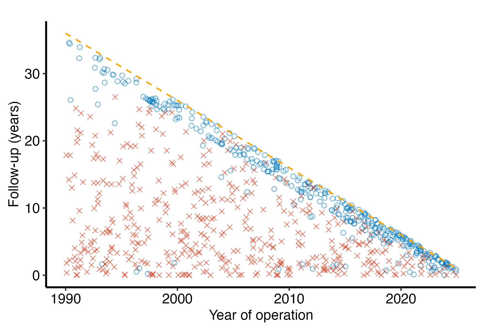
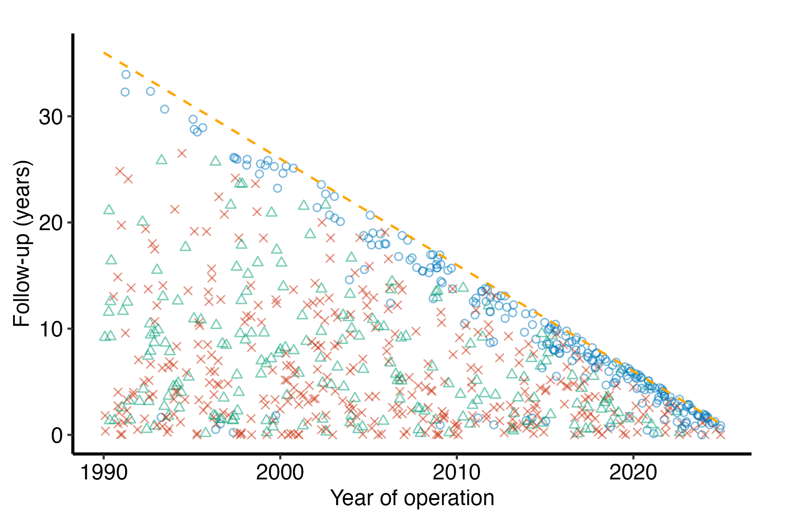

# Goodness of follow-up

# Goodness of follow-up

Published

2026-10-25 18:27

Replaces `descriptive/dc.gfup`.

A `dc-gfup` job checks follow-up before time-related analyses. We
summarize the full cohort and the event and censored subsets, review
missing, negative and zero intervals, then draw the
goodness-of-follow-up figure. Follow-up units must be years. The
potential follow-up, how much follow-up the close date allows, is
computed here from the operation year and the close date.

The tables describe recorded follow-up. The figure measures it against a
close date: every patient is one point, the year of operation across and
the follow-up recorded for them up, blue while alive and red once dead.
The dashed diagonal is the follow-up a patient **could** have had, from
their operation to the close date. A censored patient far below the
diagonal is someone whose follow-up stopped early, and a band of them is
a follow-up problem to settle before any time-related analysis.

The figure is `hvtiPlotR::hv_followup_panels()`, which the EDA report
also calls, so its follow-up panels are these. It was the separate
`dp-gfup` job, since removed in favor of this one.

Code

``` r
# unnumbered: setup, and the box under the title
SUBJECT <- "cohort"
TYPE    <- "eda"
.in <- knitr::current_input(dir = TRUE)
suppressPackageStartupMessages({
  library(hvtiRutilities)
  library(hvtiPlotR)
  library(ggplot2)
})
if (utils::packageVersion("hvtiRutilities") < "1.4.5") {
  stop("This job needs hvtiRutilities >= 1.4.5 for followup_check()'s 15th and 85th percentiles; ",
       utils::packageVersion("hvtiRutilities"), " is installed.", call. = FALSE)
}
if (utils::packageVersion("hvtiPlotR") < "2.8.18") {
  stop("This job needs hvtiPlotR >= 2.8.18 for hv_followup_panels()'s competing events and echo layer, ",
       "and the red and blue its captions name; ", utils::packageVersion("hvtiPlotR"), " is installed.", call. = FALSE)
}
# The study root is the nearest directory above this file holding _study.yml,
# so the job renders the same from the Render button, quarto render, or
# render_job(), at any depth, with no path in this document to edit.
# To render a job you have not finished, leave a chunk out with the chunk
# option skip, giving the reason in quotes, or call hvtiRtemplates::stop_here()
# in a chunk to leave out everything below it. A draft lists each one in a
# callout; a final render refuses them, as it refuses an unresolved marker.
# ?stop_here has more.
.job <- hvtiRtemplates:::.job_setup(SUBJECT, TYPE, envir = environment())
.root <- .job$root
set_path <- .job$set_path
.provenance_data <- list()
# Saves a figure as <name>.png, .pdf and .tiff in this set's graphs/ folder (or `kind`'s),
# under the SAVE_FIGURES and FIGURES study choices.
save_figure <- function(plot, name, width = 6, height = 4, kind = "graphs", linked = FALSE) {
  hvtiRtemplates:::.save_figure(plot, set_path(kind, paste0(name, ".png")), width, height,
                                SAVE_FIGURES, FIGURES, linked)
}
# The draft banners, if any, and the box under the title, after all the code above.
.job$notice
```

**final** · data `built` `built_20261025.parquet`, dated 2026-10-25 ·
rendered by gallery on gallery · hvtiRtemplates 1.5.1

## Study choices

Set the values in this chunk before rendering.

Code

``` r
# Demo: the registered dataset this job reads ("built" is the study dataset).
# MIGRATE-BEGIN: dc-gfup-data
DATASET <- "built"
# MIGRATE-END: dc-gfup-data

# Demo: an hvtiRdatabuild analysis set, or NULL to read the whole dataset.
ANALYSIS_SET <- NULL

# Demo: rows to keep, dplyr::filter() style, or NULL to keep every row:
#   WHERE <- quote(age >= 18)
#   WHERE <- rlang::exprs(age >= 18, hx_chf == 1)
WHERE <- NULL

# Demo: the patient identifier. Without "ccfid" the job uses MRN, then eMRN;
# name another column, such as "randid", if the study uses one.
ID <- "patient_id"

# Demo: what makes a row unique; one row per patient unless repeated measures
# add their visit time or date, for example KEY <- c(ID, "iv_echo").
KEY <- ID

# Optional, and needs no edit: NULL reads the cohort alone. To join one
# registered ancillary dataset (echoes, labs), name it in JOIN. The cohort
# above decides the patients, one row each; the joined records of other
# patients are dropped and counted in the data table.
#   JOIN_VARS: the cohort columns each joined row carries; NULL carries all,
#     and a column both datasets have stops, so list only those the job needs.
#   REDUCE: NULL keeps a row per joined record, keyed on that dataset's key;
#     list(rule = "first", by = "echo_date") keeps one row per patient ("last",
#     or "nearest" with to = a cohort date column). WHERE on a joined column
#     filters the records first, so "last" with WHERE echo_type == "TTE"
#     keeps each patient's last TTE. A tie stops: picking one record
#     silently would be a hidden choice; by = c("echo_date", "echo_seq")
#     breaks it. This job models one row per
#     patient, so a JOIN without REDUCE stops here.
#   JOIN_KEY: overrides the joined dataset's registered key.
JOIN <- NULL
JOIN_VARS <- NULL
REDUCE <- NULL
JOIN_KEY <- NULL

# MIGRATE-BEGIN: dc-gfup-config
EVENT <- "dead"       # Demo: binary event indicator, 1=event and 0=censored
FOLLOWUP <- "iv_dead" # Demo: follow-up interval(s) this job checks, in years
IDENTIFIER <- NULL    # Demo: opt in only for local review
MAX_REVIEW_ROWS <- 25L
# MIGRATE-END: dc-gfup-config
# Demo: optional event-coding cross-tabs, each a vector of column names.
# Missing values are shown. Use list() when no additional checks are needed.
CHECKS <- list(c("dead", "reop"))

# The figure. These are dc-eda's follow-up choices, and mean what they mean there.
# Demo: the years-since-origin interval to the operation, and that origin, a
# calendar year such as 1990. The origin differs between studies, and a wrong
# one slides every point along the x-axis without any other symptom, which is
# why the operation years are checked and printed below.
OPYRS <- "iv_opyrs"
ORIGIN_YEAR <- 1990

# Demo: the close date of follow-up, as.Date("YYYY-MM-DD"). NULL estimates it
# as the latest operation date plus follow-up in the data, which is the date
# follow-up is known to reach, not the date it was closed; the report says
# which one it drew.
CLOSE_DATE <- as.Date("2025-12-31")

# Demo: one entry per death panel. `status` is the 1/0 death indicator and
# `time` its follow-up in years; the default draws the same columns as the
# EVENT and FOLLOWUP defaults above. A study that ascertains deaths two ways draws both,
# for example
#   systematic = list(status = "deads", time = "iv_deads", title = "Systematic deaths")
# A non-fatal event drawn on its own, without death, is a panel too; `levels`
# names its two groups, censored first, in place of Alive and Dead:
#   reop = list(status = "ev_reop", time = "iv_reop", title = "Reoperation",
#               levels = c("No reoperation", "Reoperation"))
# EVENT above must be drawn by one entry here or in EVENTS below, or the
# report's table and its figures describe different events.
PANELS <- list(
  all = list(status = "dead", time = "iv_dead", title = "All deaths")
)

# Demo: optional event panels, one entry per panel. `event` and `time` are the
# event's indicator and interval; `death` and `death_time` the death it
# competes with. A flagged event counts only when it comes strictly before
# death, so ties go to death. list() draws none. For example
#   reop = list(event = "ev_reop", time = "iv_reop", death = "dead",
#               death_time = "iv_dead", label = "Reoperation")
# Competing non-fatal events share one panel when `event`, `time` and `label`
# are vectors, one element per event and at most four; `death` and
# `death_time` stay single. Each patient shows the earliest event before death,
# and a tie between two events goes to the one listed first, so list the event
# that should win a tie first:
#   nonfatal = list(event = c("ev_reop", "ev_stroke"), time = c("iv_reop", "iv_stroke"),
#                   death = "dead", death_time = "iv_dead", label = c("Reoperation", "Stroke"))
EVENTS <- list(reop = list(event = "reop", time = "iv_reop", death = "dead", death_time = "iv_dead", label = "Reoperation"))

# Demo: NULL draws no echoes. Name the column holding each patient's echo
# interval in years, such as "iv_echo" from a JOIN reduced to one echo per
# patient, to mark it on every panel with a gray tick. A patient with no echo
# (NA) gets no tick.
ECHO <- NULL

# Demo: point transparency. 0.5 lets a dense cohort read as a distribution
# rather than a blob; raise it for a small one.
ALPHA <- 0.5

# Demo: NULL draws the house colors through hvtiPlotR::scale_color_hv(): dead
# red, alive blue and non-fatal events green, then reddish purple, olive
# and black, all colorblind safe. Name alive, dead and event to choose your own;
# c(alive = "#377EB8", dead = "#E41A1C", event = "#4DAF4A") is ColorBrewer
# Set1, what these jobs drew before 1.2.3. For competing events, repeat event,
# one color per event in the order EVENTS lists them, as many as the largest
# panel has: c(alive = ..., dead = ..., event = ..., event = ...).
# Each figure caption names these colors, so choosing your own means naming them
# in the caption key too, where the figures are drawn.
COLORS <- NULL

# Each figure is saved to graphs/ as a PNG (for Word), and a PDF and a TIFF (for the publisher).
# SAVE_FIGURES <- FALSE saves none; FIGURES keeps only the figures whose names
# start with one of its entries, e.g. FIGURES <- c("hp-survival"). The names are the
# file names, listed for each template in the templates README.
SAVE_FIGURES <- TRUE
FIGURES <- NULL
```

## Data

Code

``` r
hvtiRutilities::verify_manifest(file.path(.root, "manifest.yaml"))
.cfg <- study_config(start = .root)
job_data <- hvtiRtemplates::read_job_data(.cfg, dataset = DATASET, analysis_set = ANALYSIS_SET,
                                          where = WHERE, id = ID, key = KEY, join = JOIN, join_vars = JOIN_VARS,
                                          reduce = REDUCE, join_key = JOIN_KEY, one_row_per_patient = TRUE)
d <- job_data$data
.provenance_data <- c(if (exists(".provenance_data")) .provenance_data else list(), list(job_data$provenance),
                      if (!is.null(job_data$provenance_join)) list(job_data$provenance_join))
knitr::kable(job_data$record, col.names = c("Data", ""))
```

| Data                |                                          |
|:--------------------|:-----------------------------------------|
| Source              | dataset `built` (built_20261025.parquet) |
| Rows read           | 800                                      |
| ID                  | `patient_id`                             |
| Identifiers dropped | none                                     |
| Rows kept           | 800 rows on 800 patients                 |

Table 1: The data this job read

Code

``` r
# unnumbered: its child chunk carries its own label and caption
if (!is.null(job_data$attrition)) {
  .fence <- strrep("`", 3)
  cat(knitr::knit_child(text = c(
    paste0(.fence, "{r}"), "#| label: tbl-data-attrition",
    paste0("#| tbl-cap: ", encodeString(paste0("Analysis set `", ANALYSIS_SET, "`: exclusions, in order"), quote = "\"")),
    "knitr::kable(job_data$attrition)", .fence
  ), envir = environment(), quiet = TRUE), sep = "\n")
}
```

## Follow-up checks

One row per follow-up interval and patient group: every patient, those
with the event and those censored. A patient with no event status counts
among all patients only, and the report says how many there are. The
15th, 75th, 85th and 90th percentiles and the median are SAS
`QNTLDEF=5`, as `proc_means()` computes them, and `total` is the group’s
follow-up summed, in patient-years, the figure a paper reports as total
follow-up. Suspicious rows have missing event status or at least one
missing, negative or zero interval. The local review prints at most
`MAX_REVIEW_ROWS` of them, in source order, with only the selected
fields. Identifiers stay out until you select one; check the output
before sharing a report that contains an identifier.

Code

``` r
# The statistics the follow-up table shows, total follow-up (sum) included, in
# patient-years; dc-eda carries the same line.
.followup_stats <- c("n", "nmiss", "mean", "std", "min", "p15", "median", "p75", "p85", "p90", "max", "sum")
# The checks are hvtiRutilities::followup_check(), the function the EDA report
# calls too, so the two reports cannot disagree. It checks every choice above
# before computing anything, and names every missing column at once.
fc <- hvtiRutilities::followup_check(d, event = EVENT, followup = FOLLOWUP, identifier = IDENTIFIER,
                                     max_rows = MAX_REVIEW_ROWS, stats = .followup_stats)
cohort_counts <- fc$cohort
review_rows <- fc$review
# followup_check() returns five one-row tables: the group counts, the interval
# checks for all patients, and one proc_means() row per group. This is them as
# one table, a row per interval and group. The counts are each group's n, the
# negative and zero checks are counted within each group, and the summaries are
# proc_means()'s alone, so there is one quantile definition, not two. dc-eda
# carries the same function; test-dc-eda.R keeps the two from drifting.
.followup_table <- function(fc, d, event) {
  ev <- d[[event]]
  groups <- c(full = "All patients", event = "Event", censored = "Censored")
  rows <- lapply(names(groups), function(g) {
    m <- fc$means[[g]]
    keep <- switch(g, full = rep(TRUE, nrow(d)), event = !is.na(ev) & ev == 1, censored = !is.na(ev) & ev == 0)
    count <- function(test) vapply(m$variable, function(v) sum(test(d[[v]][keep]), na.rm = TRUE), integer(1L))
    data.frame(interval = m$variable, patients = groups[[g]], n = m$n, missing = m$nmiss,
               negative = count(function(x) x < 0), zero = count(function(x) x == 0),
               mean = m$mean, sd = m$std, min = m$min, p15 = m$p15, median = m$median,
               p75 = m$p75, p85 = m$p85, p90 = m$p90, max = m$max, total = m$sum, row.names = NULL)
  })
  out <- do.call(rbind, rows)
  out[order(match(out$interval, unique(out$interval))), , drop = FALSE]
}
followup_table <- .followup_table(fc, d, EVENT)
```

Code

``` r
knitr::kable(followup_table, row.names = FALSE, digits = 3)
```

| interval | patients | n | missing | negative | zero | mean | sd | min | p15 | median | p75 | p85 | p90 | max | total |
|:---|:---|---:|---:|---:|---:|---:|---:|---:|---:|---:|---:|---:|---:|---:|---:|
| iv_dead | All patients | 800 | 0 | 0 | 0 | 9.479 | 8.087 | 0 | 1.538 | 7.137 | 14.286 | 18.964 | 22.244 | 34.604 | 7583.503 |
| iv_dead | Event | 445 | 0 | 0 | 0 | 7.064 | 6.403 | 0 | 0.957 | 5.022 | 11.120 | 14.135 | 17.266 | 26.513 | 3143.312 |
| iv_dead | Censored | 355 | 0 | 0 | 0 | 12.508 | 8.926 | 0 | 2.987 | 10.221 | 18.923 | 24.694 | 25.908 | 34.604 | 4440.190 |

Table 2: Follow-up by interval and patient group: missing, negative and
zero values, and the distribution (years)

Code

``` r
# unnumbered: two sentences, printed only when they have something to say
if (cohort_counts$missing_event > 0L) {
  cat(cohort_counts$missing_event, " patient(s) have no event status, so they count among all patients ",
      "but neither the event nor the censored group.\n\n", sep = "")
}
.n_suspicious <- attr(fc, "n_suspicious")
if (.n_suspicious == 0L) {
  cat("No suspicious rows: every patient has an event status, and every interval is present and positive.\n\n")
} else if (.n_suspicious > nrow(review_rows)) {
  cat(.n_suspicious, " suspicious rows; the table shows the first ", nrow(review_rows), ".\n\n", sep = "")
}
```

No suspicious rows: every patient has an event status, and every
interval is present and positive.

The migration report preserves legacy sort orders, date arithmetic and
includes for review; none establishes an equivalent follow-up definition
by itself.

## Operation years and the close date

Code

``` r
# unnumbered: computes the follow-up window; the table chunk below shows it
# hvtiPlotR::hv_followup_panels() checks every panel and event against the data,
# names every missing column at once, refuses a name used twice and the
# wrong-origin mistake, and works out the window the panels share: from
# 1 January of ORIGIN_YEAR, where hv_followup() draws its diagonal, to the last
# operation. The EDA report calls the same function, so its panels are these.
# A refusal does not stop a draft: the tables above are the follow-up check and
# do not depend on the figure, so the refusal is reported where the figure would
# be, and the render carries on. It is also raised as a warning, so a console
# render says so too.
panel_counts <- list()
fp <- tryCatch(
  hvtiPlotR::hv_followup_panels(d, opyrs_col = OPYRS, origin_year = ORIGIN_YEAR,
                                panels = PANELS, events = EVENTS, close_date = CLOSE_DATE,
                                echo_time_col = ECHO),
  error = function(e) e
)
figure_drawn <- !inherits(fp, "error")
if (figure_drawn) {
  close_date <- fp$meta$close_date
  # Name the edit point a reader can find in this file, not the function's argument.
  close_source <- if (is.null(CLOSE_DATE)) fp$meta$close_source else "set in CLOSE_DATE"
} else {
  # A final render (render_job(final = TRUE), which sets HVTI_TEMPLATE_STRICT)
  # is the accepted result, and an accepted follow-up report has its figure.
  if (!tolower(Sys.getenv("HVTI_TEMPLATE_STRICT")) %in% c("", "0", "false", "no")) {
    stop("The goodness-of-follow-up figure was not drawn: ", conditionMessage(fp),
         "\nThis render stops because HVTI_TEMPLATE_STRICT is set; a draft render reports it and carries on.",
         call. = FALSE)
  }
  warning("The goodness-of-follow-up figure was not drawn: ", conditionMessage(fp), call. = FALSE)
  # The box under the title was printed before this was known; the end table says draft.
  hvtiRtemplates:::.run_mark_draft("the goodness-of-follow-up figure was not drawn")
  close_date <- NA
  close_source <- paste("not drawn:", conditionMessage(fp))
}
```

Code

``` r
# Operations before ORIGIN_YEAR are drawn, left of the diagonal, by an
# hvtiPlotR that counts them in meta$n_opyrs_negative; this row says how many,
# because a build counting from a later origin is a problem to fix there. An
# older hvtiPlotR refuses them instead, so the field is absent and so is the row.
.before <- fp$meta$n_opyrs_negative
knitr::kable(data.frame(
  quantity = c("patients", "operation year missing", if (!is.null(.before)) "operation before origin",
               "first operation", "last operation", "close date", "close date is"),
  value = c(fp$meta$n_obs, fp$meta$n_opyrs_missing, .before, format(fp$meta$first_operation),
            format(fp$meta$study_end), format(close_date), close_source)
))
```

| quantity                | value             |
|:------------------------|:------------------|
| patients                | 800               |
| operation year missing  | 0                 |
| operation before origin | 0                 |
| first operation         | 1990-01-25        |
| last operation          | 2024-12-10        |
| close date              | 2025-12-31        |
| close date is           | set in CLOSE_DATE |

Table 3: Operation years and the close date

## Potential follow-up

A patient’s potential follow-up runs from their operation to the close
date: the dashed diagonal in the figures below. A patient who reached
the panel’s event is followed completely, so their potential is the
follow-up recorded. Each panel’s **percent of potential** is the
follow-up recorded over the follow-up possible, summed over its
patients, the “follow-up was 92% complete” a paper reports. Follow-up
recorded past the close date counts only up to it, and the table says
how many patients have any.

Code

``` r
# unnumbered: computes the potential follow-up; the table chunk below shows it
# The operation date is ORIGIN_YEAR's 1 January plus OPYRS years of 365.2425
# days, the arithmetic hv_followup() draws its diagonal with, so the table and
# the diagonal agree.
.potential_row <- function(title, status, time) {
  op <- as.Date(paste0(ORIGIN_YEAR, "-01-01")) + d[[OPYRS]] * 365.2425
  calendar <- pmax(as.numeric(close_date - op) / 365.2425, 0)
  st <- d[[status]]
  observed <- d[[time]]
  keep <- !is.na(st) & !is.na(observed) & !is.na(calendar)
  st <- st[keep]
  observed <- observed[keep]
  calendar <- calendar[keep]
  # Follow-up counts up to the close date, an event's included: one recorded
  # after it is past the close like any other, and complete only up to it.
  recorded <- pmin(observed, calendar)
  possible <- ifelse(st == 1, recorded, calendar)
  past_close <- sum(observed > calendar)
  # No patient with all three columns leaves nothing to sum; the row says so.
  if (!length(observed)) observed <- recorded <- possible <- NA_real_
  data.frame(panel = title, patients = sum(keep), recorded = sum(recorded), possible = sum(possible),
             percent = 100 * sum(recorded) / sum(possible), max_recorded = max(observed),
             max_possible = max(possible), past_close = past_close, row.names = NULL)
}
potential_table <- if (figure_drawn) {
  do.call(rbind, lapply(names(PANELS), function(nm) {
    p <- PANELS[[nm]]
    .potential_row(if (is.null(p$title)) nm else p$title, p$status, p$time)
  }))
}
```

Code

``` r
knitr::kable(potential_table, row.names = FALSE, digits = 1)
```

| panel | patients | recorded | possible | percent | max_recorded | max_possible | past_close |
|:---|---:|---:|---:|---:|---:|---:|---:|
| All deaths | 800 | 7583.5 | 8334.3 | 91 | 34.6 | 35.7 | 0 |

Table 4: Follow-up recorded against follow-up possible by the close
date, per panel (patient-years)

## Goodness of follow-up

A point below the diagonal is follow-up short of what the close date
allows. A dead patient’s point is where the death was recorded, so it is
expected below the line; it is the **blue** points drifting below it
that need an explanation. When `ECHO` names a column, a gray tick marks
each patient’s echo, so a patient followed by echo but not by the
follow-up record shows as a tick above their point.

Code

``` r
# unnumbered: each child chunk below carries its own label and caption
# This document sits in descriptive/ and its figures are written to graphs/
# through set_path(), so the image link is the figure's path relative to this
# document, worked out at render time, as dc-eda's is.
.fence <- strrep("`", 3)
.seen <- new.env()
.child <- function(label, caption, code) {
  label <- gsub("(^-+|-+$)", "", gsub("[^a-z0-9]+", "-", tolower(label)))
  if (!is.null(.seen[[label]])) stop("Two outputs would share the label ", label, ".", call. = FALSE)
  .seen[[label]] <- TRUE
  .opt <- paste0("#| ", sub("-.*$", "", label), "-cap: ", encodeString(caption, quote = "\""))
  cat(knitr::knit_child(text = c(paste0(.fence, "{r}"), paste0("#| label: ", label), .opt, code, .fence),
                        envir = parent.frame(), quiet = TRUE), sep = "\n")
  cat("\n")
}
if (!figure_drawn) {
  cat("\n::: {.callout-warning title=\"The figure was not drawn\"}\n",
      conditionMessage(fp), "\n\nThe tables above do not depend on it. Fix the choice the ",
      "message names, usually `OPYRS` or `ORIGIN_YEAR`, and render again.\n:::\n\n", sep = "")
}
figure_link <- function(file) {
  xfun::relative_path(file, if (exists(".in") && !is.null(.in)) dirname(.in) else getwd(), error = FALSE)
}
if (exists("COLOURS", inherits = FALSE)) stop("COLOURS is now COLORS: rename it in edit-study-choices ",
                                              "(study-choices in a job made before that rename).", call. = FALSE)
if (!is.null(COLORS) && !(is.character(COLORS) && !anyNA(COLORS) && all(names(COLORS) %in% c("alive", "dead", "event")) &&
                            sum(names(COLORS) == "alive") == 1L && sum(names(COLORS) == "dead") == 1L &&
                            any(names(COLORS) == "event"))) {
  stop("COLORS must be NULL, or name alive and dead once each and event once per competing event.", call. = FALSE)
}
# A panel draws at most four competing events: each needs a shape of its own,
# and the house palette names its colors only up to four.
.n_events <- vapply(EVENTS, function(e) if (is.list(e)) length(e$event) else 0L, integer(1L))
if (any(.n_events > 4L)) {
  stop("An EVENTS entry lists ", max(.n_events), " events; a panel draws at most four.", call. = FALSE)
}
if (!is.null(COLORS) && any(.n_events > sum(names(COLORS) == "event"))) {
  stop("COLORS names ", sum(names(COLORS) == "event"), " event color(s), and an EVENTS entry lists ",
       max(.n_events), " events. Repeat event in COLORS, one color per event.", call. = FALSE)
}
# Dead or Death is the event and Alive or No event the censored level, so
# non-fatal events take the house rule's next colors, green first. With COLORS
# set, the event colors are taken in order, one per event in the panel.
status_colors <- function(levels, labels = stats::setNames(levels, levels)) {
  if (is.null(COLORS)) return(scale_color_hv(event = c("Dead", "Death"), censored = c("Alive", "No event"), labels = labels))
  events <- unname(COLORS[names(COLORS) == "event"])[seq_len(length(levels) - 2L)]
  scale_color_manual(values = stats::setNames(c(COLORS[["alive"]], events, COLORS[["dead"]]), levels), labels = labels)
}
# A panel's optional `levels` names its two groups, censored first, for a panel
# whose 1/0 status is not a death.
for (nm in names(PANELS)) {
  lv <- PANELS[[nm]]$levels
  if (!is.null(lv) && !(is.character(lv) && length(lv) == 2L && !anyNA(lv) && all(nzchar(lv)) && !anyDuplicated(lv))) {
    stop("PANELS entry ", nm, ": `levels` must be two distinct names, censored first, such as ",
         "c(\"No reoperation\", \"Reoperation\").", call. = FALSE)
  }
}
# The table above checks EVENT and the figures draw PANELS and EVENTS, set
# apart, so a job can check one event and draw another without a sign of it:
# a reoperation table beside a death figure. The figures must draw EVENT too.
# An EVENTS panel draws its competing death as well as its event.
.drawn_events <- unique(unlist(lapply(EVENTS, function(e) c(e$event, e$death))))
.drawn <- c(unlist(lapply(PANELS, `[[`, "status")), .drawn_events)
if (!EVENT %in% .drawn) {
  .why <- paste0("EVENT is ", EVENT, ", which no figure draws: PANELS draws ",
                 paste(unique(unlist(lapply(PANELS, `[[`, "status"))), collapse = ", "),
                 if (length(EVENTS)) paste0(" and EVENTS ", paste(.drawn_events, collapse = ", ")) else " and EVENTS none",
                 ". Add an EVENTS entry for a non-fatal event, or a PANELS entry, with `levels`, for its two groups.")
  if (!tolower(Sys.getenv("HVTI_TEMPLATE_STRICT")) %in% c("", "0", "false", "no")) {
    stop("The follow-up table and the figures describe different events. ", .why,
         "\nThis render stops because HVTI_TEMPLATE_STRICT is set; a draft render reports it and carries on.",
         call. = FALSE)
  }
  warning("The follow-up table and the figures describe different events. ", .why, call. = FALSE)
  hvtiRtemplates:::.run_mark_draft("the follow-up table and the figures describe different events")
  cat("\n::: {.callout-warning title=\"The table and the figures describe different events\"}\n",
      .why, "\n:::\n\n", sep = "")
}
plots <- if (figure_drawn) plot(fp, alpha = ALPHA) else list()
for (i in seq_len(if (figure_drawn) nrow(fp$data) else 0L)) {
  row <- fp$data[i, ]
  nm <- row$panel
  panel_counts[[nm]] <- list(drawn = row$n_drawn, excluded = row$n_excluded)
  cat("\n### ", row$title, "\n\n", row$n_drawn, " patients drawn; ", row$n_excluded,
      " missing a column this panel needs.", sep = "")
  if (!is.null(ECHO)) cat(" ", fp$tables$panels[[nm]]$meta$n_echo, " with an echo marked.", sep = "")
  cat("\n\n")
  # The caption key names the house colors that COLORS <- NULL draws and the
  # shapes set here, so a study that sets COLORS renames them in .key below.
  if (row$type == "followup") {
    # The plot's groups are Alive and Dead whatever the status; `levels` renames them.
    .lv <- stats::setNames(if (is.null(PANELS[[nm]]$levels)) c("Alive", "Dead") else PANELS[[nm]]$levels,
                           c("Alive", "Dead"))
    p <- plots[[nm]] +
      status_colors(c("Alive", "Dead"), .lv) +
      scale_shape_manual(values = c(Alive = 1, Dead = 4), labels = .lv)
    .key <- if (is.null(PANELS[[nm]]$levels)) {
      "Blue open circles mark patients alive and red crosses patients who died"
    } else {
      paste0("Blue open circles mark ", .lv[["Alive"]], " and red crosses ", .lv[["Dead"]])
    }
  } else {
    # The levels are the panel's own: "No event", one per event in the order
    # EVENTS lists them, and "Death".
    levels <- fp$tables$panels[[nm]]$meta$event_levels
    k <- length(levels) - 2L
    p <- plots[[nm]] +
      status_colors(levels) +
      scale_shape_manual(values = stats::setNames(c(1, c(2, 0, 5, 6)[seq_len(k)], 4), levels))
    .with <- if (k == 1L) "patients with the event" else paste("patients whose first event was", levels[1L + seq_len(k)])
    .key <- paste0("Blue open circles mark patients without ", if (k == 1L) "the event" else "an event", ", ",
                   paste(c("green", "reddish purple", "olive", "black")[seq_len(k)],
                         c("open triangles", "open squares", "open diamonds", "open inverted triangles")[seq_len(k)],
                         .with, collapse = ", "),
                   ", and red crosses patients who died")
  }
  if (!is.null(ECHO)) .key <- paste0(.key, ", gray ticks the follow-up at each patient's echo,")
  p <- p + labs(x = "Year of operation", y = "Follow-up (years)", color = NULL, shape = NULL) +
    theme_hv_manuscript(base_size = 12)
  file <- save_figure(p, paste0("dc-gfup-", nm), linked = TRUE)
  .link <- figure_link(file)
  .child(paste("fig gfup", nm),
         paste0("Follow-up against year of operation, ", row$title, ". ", .key, " and the dashed orange diagonal ",
                "the longest follow-up possible for each year of operation."),
         "knitr::include_graphics(.link, error = FALSE)")
}
```

### All deaths

800 patients drawn; 0 missing a column this panel needs.

Code

``` r
knitr::include_graphics(.link, error = FALSE)
```



Figure 1: Follow-up against year of operation, All deaths. Blue open
circles mark patients alive and red crosses patients who died and the
dashed orange diagonal the longest follow-up possible for each year of
operation.

### Reoperation

800 patients drawn; 0 missing a column this panel needs.

Code

``` r
knitr::include_graphics(.link, error = FALSE)
```



Figure 2: Follow-up against year of operation, Reoperation. Blue open
circles mark patients without the event, green open triangles patients
with the event, and red crosses patients who died and the dashed orange
diagonal the longest follow-up possible for each year of operation.

## Event-coding consistency

Code

``` r
# unnumbered: each child chunk below carries its own label and caption
unknown_checks <- setdiff(unlist(CHECKS, use.names = FALSE), names(d))
if (length(unknown_checks)) {
  stop("Unknown event-check column(s): ", paste(unknown_checks, collapse = ", "), call. = FALSE)
}
.fence <- strrep("`", 3)
.seen <- new.env()
.child <- function(kind, key, caption, code) {
  label <- paste(kind, "checks", gsub("(^-+|-+$)", "", gsub("[^a-z0-9]+", "-", tolower(key))), sep = "-")
  if (!is.null(.seen[[label]])) stop("Two outputs would share the label ", label, ".", call. = FALSE)
  .seen[[label]] <- TRUE
  cat(knitr::knit_child(text = c(paste0(.fence, "{r}"), paste0("#| label: ", label),
                                 paste0("#| ", kind, "-cap: ", encodeString(caption, quote = "\"")), code, .fence),
                        envir = parent.frame(), quiet = TRUE), sep = "\n")
}
for (cc in CHECKS) {
  .check <- as.data.frame(table(d[cc], useNA = "ifany"))
  .child("tbl", paste(cc, collapse = " by "), paste(cc, collapse = " by "), "knitr::kable(.check)")
  cat("\n")
}
```

Code

``` r
knitr::kable(.check)
```

| dead | reop | Freq |
|:-----|:-----|-----:|
| 0    | 0    |  241 |
| 1    | 0    |  359 |
| 0    | 1    |  114 |
| 1    | 1    |   86 |

Table 5: dead by reop

## About this run

| Group           | Item             | Value                    |
|:----------------|:-----------------|:-------------------------|
| Run             | Started          | 2026-10-25 18:27:49 EDT  |
|                 | Ended            | 2026-10-25 18:27:50 EDT  |
|                 | Duration         | 1 s                      |
|                 | Status           | final                    |
|                 | Rendered by      | gallery                  |
|                 | Host             | gallery                  |
| Job             | File             | dc.gfup.cohort.eda.qmd   |
|                 | Template         | dc.gfup                  |
|                 | Subject          | cohort                   |
|                 | Type             | eda                      |
|                 | hvtiRtemplates   | 1.5.1                    |
| Dataset `built` | Version file     | built_20261025.parquet   |
|                 | Version date     | 2026-10-25               |
|                 | Source file      | built.rds                |
|                 | Rows kept        | 800 rows on 800 patients |
|                 | WHERE            | none                     |
|                 | sha256           | b236a472f1f3             |
|                 | Manifest         | current                  |
| Reproducibility | renv             | not active               |
|                 | renv.lock sha256 | d09f96b6cd21             |
