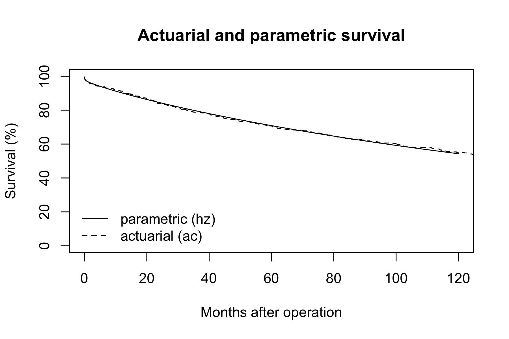
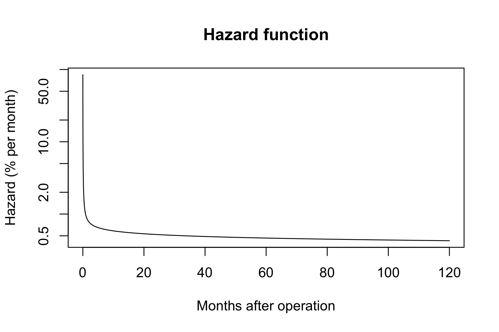
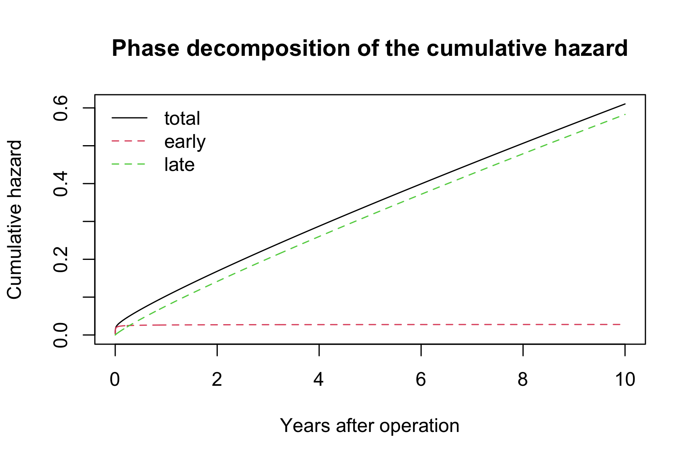

# Nomogram and hazard figures

# Nomogram and hazard figures

Published

2026-10-28 09:19

An `hp` job **reads** its inputs and does not recompute them: the
actuarial life table from the `ac` job and the parametric fit from the
`hz` job, both by set. A job that recomputes its upstream can silently
disagree with it.

Neither the life table nor the fit belongs here, and **nor does SAS
parity** — a parity job borrows the ordinal of the job it checks and
lives in `parity/`.

Code

``` r
SUBJECT <- "dead"
TYPE    <- "hz"
.in <- knitr::current_input(dir = TRUE)
.provenance_artifacts <- list()
suppressPackageStartupMessages({
  library(TemporalHazard)
  library(hvtiRutilities)
})
# The study root is the nearest directory above this file holding _study.yml,
# so the job renders the same from the Render button, quarto render, or
# render_job(), at any depth, with no path in this document to edit.
# Without the guard in .job_setup(), an unedited job renders green over a
# meaningless analysis. In THIS file the unedited reporting grid is a plausible
# one and the unedited figure titles are generic: every number and every curve
# renders, at the wrong horizons and under someone else's labels. A nomogram is
# a table of plausible numbers whether or not its grid is yours -- which is
# exactly why a wrong grid is dangerous rather than merely untidy.
# To render a job you have not finished, leave a chunk out with the chunk
# option skip, giving the reason in quotes, or call hvtiRtemplates::stop_here()
# in a chunk to leave out everything below it. A draft lists each one in a
# callout; a final render refuses them, as it refuses an unresolved marker.
# ?stop_here has more.
.job <- hvtiRtemplates:::.job_setup(SUBJECT, TYPE, envir = environment())
.root <- .job$root
set_path <- .job$set_path
.provenance_data <- list()
# Saves a figure as <name>.png, .pdf and .tiff in this set's graphs/ folder (or `kind`'s),
# under the SAVE_FIGURES and FIGURES study choices.
save_figure <- function(plot, name, width = 6, height = 4, kind = "graphs", linked = FALSE) {
  hvtiRtemplates:::.save_figure(plot, set_path(kind, paste0(name, ".png")), width, height,
                                SAVE_FIGURES, FIGURES, linked)
}

# `hp` both READS and WRITES through this: the upstream `ac.rds` and `hz.rds`
# come from set_path("estimates", ...), and the figures go to
# set_path("graphs", ...). Same key, so a figure can never be filed against a
# different set than the fit it was drawn from.
# The draft banners, if any, and the box under the title, after all the code above.
.job$notice
```

**final** · data: see About this run · rendered by gallery on gallery ·
hvtiRtemplates 1.5.3

## Study choices

Edit these values for this study before rendering.

Code

``` r
# Upstream fit and actuarial estimate to plot.
# Demo: upstream fit and actuarial estimate to plot.
FIT_NAME <- "deterministic"
KM_NAME <- "overall"

# Table horizons and curve limit.
# Demo: reporting and plotting horizons.
years <- c(30 / 365.2425, 3 / 12, 6 / 12, 1:10)   # reporting: the table

t_max <- 10

# The data, rows, identifier, time and event of the hz fit this job plots.
# NULL takes the value hz used; set it only to confirm it. A value set here
# that differs from hz's stops the job rather than plot another cohort.
DATASET <- NULL
ANALYSIS_SET <- NULL
WHERE <- NULL
ID <- NULL
KEY <- NULL
TIME <- NULL
EVENT <- NULL

# Each figure is saved to graphs/ as a PNG (for Word), and a PDF and a TIFF (for the publisher).
# SAVE_FIGURES <- FALSE saves none; FIGURES keeps only the figures whose names
# start with one of its entries, e.g. FIGURES <- c("hp-survival"). The names are the
# file names, listed for each template in the templates README.
SAVE_FIGURES <- TRUE
FIGURES <- NULL
```

## Upstream

Code

``` r
# hp overlays the actuarial estimate with the parametric fit, so it READS both
# upstream artifacts by set rather than recomputing either. A job that
# recomputes its upstream can silently disagree with it.
#
# The checksum of every dataset in manifest.yaml is checked before anything is
# read, so a result can name the data that produced it. It stops on a mismatch.
hvtiRutilities::verify_manifest(file.path(.root, "manifest.yaml"))
.cfg <- study_config(start = .root)
.ac_read <- hvtiRtemplates:::.read_handoff(
  set_path("estimates", "ac.rds"), "actuarial-estimate", .cfg, "the ac job"
)
.hz_read <- hvtiRtemplates:::.read_handoff(
  set_path("estimates", "hz.rds"), "hazard-model", .cfg, "the hz job"
)
.source_identity <- function(records) {
  required <- c("dataset", "path", "bytes", "sha256")
  lapply(records, function(record) {
    if (!is.list(record) || !all(required %in% names(record))) {
      stop("The ac and hz handoffs have incomplete source data lineage. Rebuild both upstream jobs.", call. = FALSE)
    }
    record[required]
  })
}
if (!identical(.source_identity(.ac_read$lineage$data), .source_identity(.hz_read$lineage$data))) {
  stop("The ac and hz handoffs have incompatible source data lineage. Rebuild both from the same source data.",
       call. = FALSE)
}
for (.field in c("analysis", "cohort")) {
  .ac_field <- .ac_read$lineage[[.field]]
  .hz_field <- .hz_read$lineage[[.field]]
  if (is.null(.ac_field) || is.null(.hz_field) || !identical(.ac_field, .hz_field)) {
    stop("The ac and hz handoffs have incompatible ", .field,
         " lineage. Rebuild both with matching analysis choices and cohort.", call. = FALSE)
  }
}
# A start/stop fit has no single covariate row per patient to predict from.
# Stopped first: its selection, carrying START, also differs from ac's.
hvtiRtemplates:::.stop_start_stop_prediction(.hz_read$lineage$selection$start, "hz.rds")
# The life table and the fit must describe the same rows. The data chunk below
# rebuilds hz's rows, so an ac that chose other rows is stopped here.
if (!is.null(.hz_read$lineage$selection) && is.null(.ac_read$lineage$selection)) {
  stop("The ac job's saved output (ac.rds) carries no recorded data selection: it predates the data contract. ",
       "Rerun the ac job with the current template, then rerun this one.", call. = FALSE)
}
if (!is.null(.hz_read$lineage$selection) &&
      !identical(.ac_read$lineage$selection, .hz_read$lineage$selection)) {
  stop("The ac and hz handoffs read different data, rows, time, event or join. Rebuild both with the same ",
       "DATASET, ANALYSIS_SET, WHERE, ID, KEY, TIME, EVENT, JOIN, JOIN_VARS, REDUCE and JOIN_KEY.", call. = FALSE)
}
ac_art <- .ac_read$value
hz_art <- .hz_read$value
.provenance_data <- c(.ac_read$lineage$data, .hz_read$lineage$data)
.provenance_artifacts <- c(
  .ac_read$lineage$artifacts, list(.ac_read$record),
  .hz_read$lineage$artifacts, list(.hz_read$record)
)

# which fit and which life table this job plots.
#
# ⚠️ A STRATIFIED hp job reads the PER-STRATUM fits and never the overall one.
# Getting that backwards does not error -- it draws a plausible figure of the
# wrong thing. Read the SAS job to see which `est.` datasets it opens.
fit <- hz_art[[FIT_NAME]]
km  <- ac_art[[KM_NAME]]

stopifnot(!is.null(fit), !is.null(km))
```

Code

``` r
.up <- hvtiRtemplates:::.read_upstream_job_data(
  .cfg, .hz_read$lineage,
  list(dataset = DATASET, analysis_set = ANALYSIS_SET, where = WHERE, id = ID, key = KEY,
       time = TIME, event = EVENT),
  source = "hz.rds"
)
job_data <- .up$job_data
d <- job_data$data
TIME <- .up$selection$time
EVENT <- .up$selection$event
# The counts hz.rds records, from hz's EXPECTED; a mismatch names both.
hvtiRtemplates:::.check_upstream_cohort(d, .hz_read$lineage, event = EVENT, time = TIME, source = "hz.rds")
.provenance_data <- c(if (exists(".provenance_data")) .provenance_data else list(), list(job_data$provenance),
                      if (!is.null(job_data$provenance_join)) list(job_data$provenance_join))
knitr::kable(job_data$record, col.names = c("Data", ""))
```

| Data                |                                          |
|:--------------------|:-----------------------------------------|
| Source              | dataset `study` (built_20261028.parquet) |
| Rows read           | 800                                      |
| ID                  | `patient_id`                             |
| Identifiers dropped | none                                     |
| `!is.na(creat_pr)`  | removed 75                               |
| Rows kept           | 725 rows on 725 patients                 |

Table 1: The data this job read, as hz read it

## Prediction grids

Code

``` r
t_plot <- exp(seq(-8, log(t_max), length.out = 1000))
```

Code

``` r
# A PARAMETRIC model returns a number at ANY horizon you ask for, including
# horizons no patient was observed to. That is extrapolation from the fitted
# shape, not an estimate supported by data, and nothing in the output marks it.
# So the grid is checked against the actual end of follow-up.
#
# `d` holds the rows hz read, and TIME and EVENT are the columns it fitted.
# BOTH are needed: the bound must be computed over the SAME rows the fit used.
# `hz` drops rows missing either one, so max() over all non-missing times would
# include patients the fit never saw and could OVERSTATE follow-up -- which
# weakens this guard in the one direction that matters, by making it under-warn.
fitted_rows <- !is.na(d[[TIME]]) & !is.na(d[[EVENT]])
cc <- cohort_counts(d, event = EVENT, time = TIME)
maxfup <- max(as.numeric(d[[TIME]][fitted_rows]))

# BOTH horizons are checked. A curve drawn past the end of follow-up is the
# worse of the two: a table row can be read and discounted one row at a time,
# while a line looks continuous and supported for its whole length.
horizons <- data.frame(
  grid             = c("reporting (table)", "plotting (curves)"),
  max_horizon      = c(max(years), t_max),
  end_of_follow_up = maxfup
)
horizons$extrapolating <- horizons$max_horizon > maxfup
knitr::kable(horizons)
# A warning, not a stop: reporting past follow-up is sometimes the deliberate
# point of a figure. The reader needs to be told, not blocked.
for (i in which(horizons$extrapolating)) {
  warning("The ", horizons$grid[i], " grid extends to ",
          format(horizons$max_horizon[i], digits = 4),
          " but follow-up ends at ", format(maxfup, digits = 4),
          ". Points beyond that are extrapolation from the fitted shape, ",
          "not estimates supported by data.", call. = FALSE)
}
```

| grid              | max_horizon | end_of_follow_up | extrapolating |
|:------------------|------------:|-----------------:|:--------------|
| reporting (table) |          10 |           34.604 | FALSE         |
| plotting (curves) |          10 |           34.604 | FALSE         |

Table 2: End of follow-up against the longest horizon on each grid

## Predictions

Two settings must be right or every number below is wrong. Both were
decoded from the SAS `HAZPRED` source during parity work rather than
guessed, and **neither errors when wrong**.

- **`CLEVEL` defaults to `0.68268948`**, which is one standard
  deviation, *not* 95%. It is exactly `pnorm(1) - pnorm(-1)`. The
  published papers say so: *“Uncertainty is expressed by 68% confidence
  limits equivalent to ±1 standard error.”*
- **Survival confidence limits are formed on the `logit` scale.**
  `predict.hazard()` defaults to `"log-log"`, the `survfit` standard, so
  `conf.type = "logit"` must be passed explicitly. Omitting it does not
  error; it silently shifts every confidence limit.

⚠️ **`%kaplan` uses the same ±1 SE convention** — its `T_ALPHA` is `1`,
so the `CL_LOWER`/`CL_UPPER` in the `ac` life table are also a ~68%
band. That matters most in *this* job, because this is where both bands
are drawn on one figure.

The figure is internally consistent — both bands are ~68%. But a reader
who takes either for a 95% interval is reading one **roughly half as
wide as they think**, and that is measured rather than rhetorical: on
the same fit and the same grid, the 95% band is **1.97× the width** of
the SAS-default band.

**Label the coverage wherever these numbers are published.** A default
that is right and unlabeled is one citation away from being wrong.

Code

``` r
CLEVEL <- 0.68268948   # SAS convention, not a study choice. ±1 SD, NOT 95%.
newd   <- data.frame(time = years)

pred_surv <- predict(fit, newdata = newd, type = "survival",
                     se.fit = TRUE, level = CLEVEL, conf.type = "logit")
pred_haz  <- predict(fit, newdata = newd, type = "hazard",
                     se.fit = TRUE, level = CLEVEL)

stopifnot(nrow(pred_surv) == length(years), nrow(pred_haz) == length(years))
```

## Nomogram

The deliverable of this job: survival and hazard with confidence limits
over the reporting grid.

Code

``` r
nomogram <- data.frame(
  years    = years,
  survival = pred_surv$fit,
  surv_lo  = pred_surv$lower,
  surv_hi  = pred_surv$upper,
  hazard   = pred_haz$fit,
  haz_lo   = pred_haz$lower,
  haz_hi   = pred_haz$upper
)
knitr::kable(nomogram, digits = 6)
```

|     years | survival |  surv_lo |  surv_hi |   hazard |   haz_lo |   haz_hi |
|----------:|---------:|---------:|---------:|---------:|---------:|---------:|
|  0.082137 | 0.968953 | 0.961692 | 0.974873 | 0.115089 | 0.095818 | 0.138234 |
|  0.250000 | 0.953569 | 0.945634 | 0.960394 | 0.085335 | 0.075419 | 0.096554 |
|  0.500000 | 0.934770 | 0.926306 | 0.942322 | 0.075643 | 0.067615 | 0.084624 |
|  1.000000 | 0.901943 | 0.892149 | 0.910936 | 0.068457 | 0.062308 | 0.075213 |
|  2.000000 | 0.845112 | 0.832821 | 0.856654 | 0.062539 | 0.058215 | 0.067184 |
|  3.000000 | 0.795206 | 0.781201 | 0.808534 | 0.059442 | 0.055980 | 0.063119 |
|  4.000000 | 0.750135 | 0.735027 | 0.764657 | 0.057369 | 0.054329 | 0.060578 |
|  5.000000 | 0.708883 | 0.693072 | 0.724204 | 0.055822 | 0.052964 | 0.058835 |
|  6.000000 | 0.670822 | 0.654557 | 0.686687 | 0.054595 | 0.051779 | 0.057563 |
|  7.000000 | 0.635512 | 0.618943 | 0.651765 | 0.053581 | 0.050731 | 0.056592 |
|  8.000000 | 0.602622 | 0.585833 | 0.619173 | 0.052720 | 0.049793 | 0.055819 |
|  9.000000 | 0.571893 | 0.554923 | 0.588696 | 0.051973 | 0.048950 | 0.055184 |
| 10.000000 | 0.543112 | 0.525973 | 0.560149 | 0.051315 | 0.048185 | 0.054648 |

Table 3: Survival, hazard and their confidence limits at each horizon

Code

``` r
nomogram_pct <- data.frame(
  years        = years,
  survival_pct = round(100 * pred_surv$fit, 1),
  cl_lower_pct = round(100 * pred_surv$lower, 1),
  cl_upper_pct = round(100 * pred_surv$upper, 1)
)
knitr::kable(nomogram_pct)
```

|      years | survival_pct | cl_lower_pct | cl_upper_pct |
|-----------:|-------------:|-------------:|-------------:|
|  0.0821372 |         96.9 |         96.2 |         97.5 |
|  0.2500000 |         95.4 |         94.6 |         96.0 |
|  0.5000000 |         93.5 |         92.6 |         94.2 |
|  1.0000000 |         90.2 |         89.2 |         91.1 |
|  2.0000000 |         84.5 |         83.3 |         85.7 |
|  3.0000000 |         79.5 |         78.1 |         80.9 |
|  4.0000000 |         75.0 |         73.5 |         76.5 |
|  5.0000000 |         70.9 |         69.3 |         72.4 |
|  6.0000000 |         67.1 |         65.5 |         68.7 |
|  7.0000000 |         63.6 |         61.9 |         65.2 |
|  8.0000000 |         60.3 |         58.6 |         61.9 |
|  9.0000000 |         57.2 |         55.5 |         58.9 |
| 10.0000000 |         54.3 |         52.6 |         56.0 |

Table 4: Survival (%) with 68% confidence limits (plus or minus 1 SD),
not 95%

### What these confidence limits are worth

The `hz` fit runs against a **near-singular Hessian** — check its
`rcond` in the `hz` report. That makes the *marginal* standard errors on
weakly identified shape parameters unstable; in parity work they
differed from SAS by 1.25× to 5.1×.

The confidence limits here nevertheless agreed with SAS to within
0.2%–5% across every grid point, computed from that same covariance
matrix.

Both hold at once because `se(S(t))² = gᵀVg` for the gradient `g` of
survival with respect to the parameters. The marginal variances on the
diagonal of `V` can differ substantially while that quadratic form
agrees, if the two matrices carry compensating correlations — which is
exactly what a near-singular problem produces.

**So the survival band is the trustworthy output of this pipeline, and
the per-parameter standard errors in the `hz` report are not.** State
that wherever these numbers are used.

## Figures

Code

``` r
s_pct  <- 100 * unname(predict(fit, newdata = data.frame(time = t_plot),
                               type = "survival"))
x_plot <- t_plot * 12

draw <- function() {
  plot(NA, xlim = range(x_plot), ylim = c(0, 100),
       xlab = "Months after operation", ylab = "Survival (%)",
       main = "Actuarial and parametric survival")
  lines(x_plot, s_pct, lty = 1)
  # The actuarial estimate is a STEP function; type = "s" rather than a line
  # through the knots, which would draw an estimate nobody computed.
  lines(km$time * 12, 100 * km$survival, lty = 2, type = "s")
  legend("bottomleft", c("parametric (hz)", "actuarial (ac)"),
         lty = c(1, 2), bty = "n")
}
knitr::include_graphics(save_figure(draw, "hp-survival", linked = TRUE))
```



Figure 1: Actuarial and parametric survival after the operation. The
solid black line is the parametric (hz) estimate and the dashed black
step line the actuarial (ac) estimate.

Code

``` r
h_pcpm <- 100 / 12 * unname(predict(fit, newdata = data.frame(time = t_plot),
                                    type = "hazard"))

draw <- function() {
  plot(x_plot, h_pcpm, type = "l", log = "y",
       xlab = "Months after operation", ylab = "Hazard (% per month)",
       main = "Hazard function")
}
knitr::include_graphics(save_figure(draw, "hp-hazard", linked = TRUE))
```



Figure 2: Hazard of the parametric model after the operation. The solid
black line is the parametric hazard, in percent per month on a
logarithmic axis.

### Phase decomposition

`decompose = TRUE` works on the **cumulative** hazard only. Per-phase
survival is not additive, and decomposition is not supported for
`type = "hazard"`. The SAS figure overlays `_earlyh` and `_lateh`, which
are *instantaneous*; this is the nearest supported equivalent, and the
difference is worth stating rather than papering over.

Code

``` r
# predict() returns the decomposition WIDE -- one column per phase plus
# `total` -- so it is reshaped here rather than assumed to arrive long.
dec <- predict(fit, newdata = data.frame(time = t_plot),
               type = "cumulative_hazard", decompose = TRUE)

# Every column except `time` is a component. Derived from what came back rather
# than naming early/late, so a three-phase model needs no edit here.
comp <- setdiff(names(dec), "time")

# The components must sum to `total`, or it is not a decomposition.
if ("total" %in% comp) {
  parts <- setdiff(comp, "total")
  max_gap <- max(abs(rowSums(dec[, parts, drop = FALSE]) - dec$total))
  if (max_gap > 1e-8) {
    stop("The phase components do not sum to the total (largest gap ",
         format(max_gap, digits = 4), "). That is not a decomposition.",
         call. = FALSE)
  }
}

draw <- function() {
  plot(NA, xlim = range(t_plot), ylim = range(unlist(dec[comp])),
       xlab = "Years after operation", ylab = "Cumulative hazard",
       main = "Phase decomposition of the cumulative hazard")
  for (i in seq_along(comp)) {
    lines(dec$time, dec[[comp[i]]], col = i,
          lty = if (comp[i] == "total") 1 else 2)
  }
  legend("topleft", comp, col = seq_along(comp),
         lty = ifelse(comp == "total", 1, 2), bty = "n")
}
knitr::include_graphics(save_figure(draw, "hp-phases", linked = TRUE))
```



Figure 3: Phase decomposition of the cumulative hazard. The solid line
is the total and each dashed line one phase, one color per curve, as in
the legend.

## Save

Code

``` r
# The nomogram is the deliverable, so it is written as CSV as well as printed:
# a table in an HTML report cannot be joined against anything.
write.csv(nomogram, set_path("estimates", "hp-nomogram.csv"), row.names = FALSE)
```

## About this run

| Group | Item | Value |
|:---|:---|:---|
| Run | Started | 2026-10-28 09:19:34 EDT |
|  | Ended | 2026-10-28 09:19:35 EDT |
|  | Duration | 1 s |
|  | Status | final |
|  | Rendered by | gallery |
|  | Host | gallery |
| Job | File | hp.dead.hz.qmd |
|  | Template | hp |
|  | Subject | dead |
|  | Type | hz |
|  | hvtiRtemplates | 1.5.3 |
| Dataset `built` | Version file | built_20261028.parquet |
|  | Version date | 2026-10-28 |
|  | Source file | built.rds |
|  | Rows kept | 725 rows on 725 patients |
|  | WHERE | `!is.na(creat_pr)` |
|  | sha256 | b236a472f1f3 |
|  | Manifest | current |
| Upstream | Handoff | `dead-hz/ac.rds` (actuarial-estimate), rendered 2026-10-28 09:18:56 -0400, data built_20261028.parquet |
|  | Handoff | `dead-hz/hz.rds` (hazard-model), rendered 2026-10-28 09:19:13 -0400, data built_20261028.parquet |
| Reproducibility | renv | not active |
|  | renv.lock sha256 | d09f96b6cd21 |
