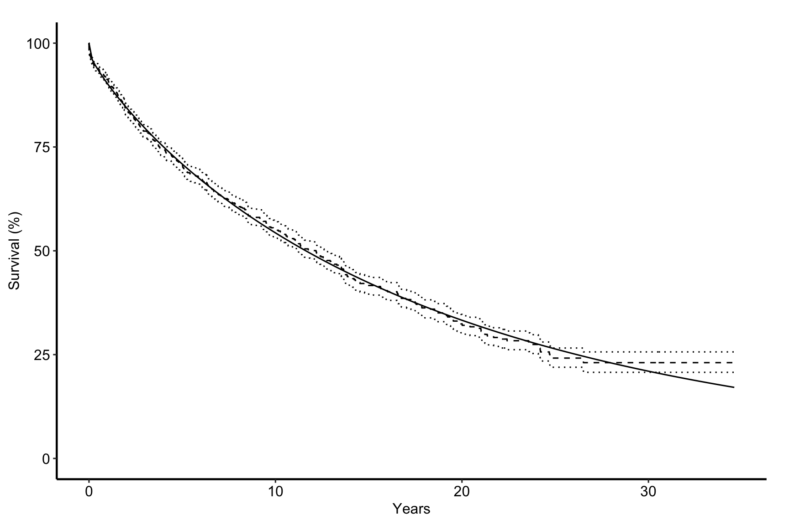

# Multiphase parametric hazard fit

# Multiphase parametric hazard fit

Published

2026-10-29 10:33

An `hz` job produces a parametric fit and persists it. The life table it
is read against is an `ac` job, the figures over it are `hp`, and the
covariate model built on its shape parameters is `hm`; none of those
belong here. **Nor does SAS parity** — a parity job borrows the ordinal
of the job it checks and lives in `parity/`.

Code

``` r
SUBJECT <- "dead_segments"
TYPE    <- "hz"
.in <- knitr::current_input(dir = TRUE)
suppressPackageStartupMessages({
  library(TemporalHazard)
  library(hvtiRutilities)
})
# numDeriv is a Suggests of TemporalHazard, not a hard dependency. Without it,
# interval- or left-censored multiphase fits SILENTLY produce no standard
# errors: the fit succeeds, `converged` is TRUE, and vcov() is simply absent.
# A model reported without uncertainty is not a smaller result, it is a
# different one -- so this is a hard stop rather than a warning.
if (!requireNamespace("numDeriv", quietly = TRUE)) {
  stop("numDeriv is not installed. Interval-censored multiphase fits will ",
       "produce no standard errors, and will not tell you so. Install it ",
       "before reading anything below.", call. = FALSE)
}
# The study root is the nearest directory above this file holding _study.yml,
# so the job renders the same from the Render button, quarto render, or
# render_job(), at any depth, with no path in this document to edit.
# Without the guard in .job_setup(), an unedited job renders green over a
# meaningless analysis. In THIS file the unedited `theta0` is a vector of
# neutral 1s and the unedited `phases` are all-neutral shapes: that is a
# well-formed model, so it fits, converges, reports standard errors and saves an
# .rds for `hp` and `hm` to read. Nothing errors, and nothing in the output says
# the numbers describe no study.
# To render a job you have not finished, leave a chunk out with the chunk
# option skip, giving the reason in quotes, or call hvtiRtemplates::stop_here()
# in a chunk to leave out everything below it. A draft lists each one in a
# callout; a final render refuses them, as it refuses an unresolved marker.
# ?stop_here has more.
.job <- hvtiRtemplates:::.job_setup(SUBJECT, TYPE, envir = environment())
.root <- .job$root
set_path <- .job$set_path
.provenance_data <- list()
# The figures draw with hvtiPlotR. Checked here, before the fit, so a missing
# package stops the render at once rather than after the fit and before the save.
if (!requireNamespace("hvtiPlotR", quietly = TRUE)) stop("This job needs hvtiPlotR for its figures.", call. = FALSE)
# Saves a figure as <name>.png, .pdf and .tiff in this set's graphs/ folder,
# under the SAVE_FIGURES and FIGURES study choices.
save_figure <- function(plot, name, width = 6, height = 4, kind = "graphs", linked = FALSE) {
  hvtiRtemplates:::.save_figure(plot, set_path(kind, paste0(name, ".png")), width, height,
                                SAVE_FIGURES, FIGURES, linked)
}
# An `hz` job ALWAYS persists: `hp` plots what it writes and `hm` fixes its
# shape parameters at these converged values, both by set. The write itself is
# in the `save` chunk at the foot of this file, not here.
# The draft banners, if any, and the box under the title, after all the code above.
.job$notice
```

**final** · data `segments` `segments_20261029.parquet`, dated
2026-10-29 · rendered by gallery on gallery · hvtiRtemplates 1.5.4

## Study choices

Edit these values for this study before rendering.

Code

``` r
# Demo: the registered dataset this job reads ("built" is the study dataset).
DATASET <- "segments"

# Demo: an hvtiRdatabuild analysis set, or NULL to read the whole dataset.
ANALYSIS_SET <- NULL

# Demo: rows to keep, dplyr::filter() style, or NULL to keep every row:
#   WHERE <- quote(age >= 18)
#   WHERE <- rlang::exprs(age >= 18, hx_chf == 1)
WHERE <- quote(!is.na(creat_pr))

# Demo: the patient identifier. Without "ccfid" the job uses MRN, then eMRN;
# name another column, such as "randid", if the study uses one.
ID <- "patient_id"

# Demo: what makes a row unique; one row per patient unless repeated measures
# add their visit time or date, for example KEY <- c(ID, "iv_echo").
KEY <- c(ID, "iv_start")

# Optional, and needs no edit: NULL reads the cohort alone. To join one
# registered ancillary dataset (echoes, labs), name it in JOIN. The cohort
# above decides the patients, one row each; the joined records of other
# patients are dropped and counted in the data table.
#   JOIN_VARS: the cohort columns each joined row carries; NULL carries all,
#     and a column both datasets have stops, so list only those the job needs.
#   REDUCE: NULL keeps a row per joined record, keyed on that dataset's key;
#     list(rule = "first", by = "echo_date") keeps one row per patient ("last",
#     or "nearest" with to = a cohort date column). WHERE on a joined column
#     filters the records first, so "last" with WHERE echo_type == "TTE"
#     keeps each patient's last TTE. A tie stops: picking one record
#     silently would be a hidden choice; by = c("echo_date", "echo_seq")
#     breaks it. This job models one row per
#     patient, so a JOIN without REDUCE stops here.
#   JOIN_KEY: overrides the joined dataset's registered key.
JOIN <- NULL
JOIN_VARS <- NULL
REDUCE <- NULL
JOIN_KEY <- NULL

# Model phases and fixed parameters.
# Demo: phases and the fixed set on each.
phases <- list(
  early = hzr_phase("cdf", t_half = 0.04, nu = 1, m = 1),
  late  = hzr_phase("g3", tau = 1, gamma = 1, alpha = 1, eta = 1,
                    fixed = c("tau", "gamma", "alpha"))
)

# Starting values in the order returned by hzr_theta_names(phases).
# Demo: starting values from the SAS estimates.
theta0 <- c(log(0.05), log(0.04), 1, 1,
            log(0.035), log(1), 1, 1, 1)

# Demo: time, event, and counts from the SAS reference for the rows this job
# analyses. Leave these invalid defaults in place until the job is reconciled.
TIME   <- "iv_dead"

EVENT  <- "dead"

# Optional: NULL for one row per patient. For SAS `lcensor <start>; time <stop>;`,
# the time-varying covariate layout, name the start here and the stop as TIME:
# each row is one segment of a patient's follow-up, and the fit takes
# Surv(START, TIME, EVENT). KEY must then include START, and EXPECTED counts
# rows (segments), as SAS counts observations. hm, hp and hs take START from
# this job. Pointing TIME at the stop and leaving START NULL fits every
# segment from time zero: a different model, which converges without complaint.
START  <- "iv_start"

EXPECTED <- list(n = 1823L, n_events = 406L, n_censored = 1417L)

# Each figure is saved to graphs/ as a PNG (for Word), and a PDF and a TIFF (for the publisher).
# SAVE_FIGURES <- FALSE saves none; FIGURES keeps only the figures whose names
# start with one of its entries, e.g. FIGURES <- c("hz-fit").
SAVE_FIGURES <- TRUE
FIGURES <- NULL
```

## Cohort

Code

``` r
# The checksum of every dataset in manifest.yaml is checked before anything is
# read, so a result can name the data that produced it. It stops on a mismatch.
hvtiRutilities::verify_manifest(file.path(.root, "manifest.yaml"))
.cfg <- study_config(start = .root)
# With START, a patient has a row per segment and KEY must say so.
hvtiRtemplates:::.check_start_settings(START, KEY, JOIN, REDUCE)
job_data <- hvtiRtemplates::read_job_data(.cfg, dataset = DATASET, analysis_set = ANALYSIS_SET,
                                          where = WHERE, id = ID, key = KEY, join = JOIN, join_vars = JOIN_VARS,
                                          reduce = REDUCE, join_key = JOIN_KEY,
                                          one_row_per_patient = is.null(START))
d <- job_data$data
.provenance_data <- c(if (exists(".provenance_data")) .provenance_data else list(), list(job_data$provenance),
                      if (!is.null(job_data$provenance_join)) list(job_data$provenance_join))
knitr::kable(job_data$record, col.names = c("Data", ""))
```

| Data                |                                                |
|:--------------------|:-----------------------------------------------|
| Source              | dataset `segments` (segments_20261029.parquet) |
| Rows read           | 2,014                                          |
| ID                  | `patient_id`                                   |
| Identifiers dropped | none                                           |
| `!is.na(creat_pr)`  | removed 191                                    |
| Rows kept           | 1,823 rows on 725 patients                     |

Table 1: The data this job read

Code

``` r
# unnumbered: its child chunk carries its own label and caption
if (!is.null(job_data$attrition)) {
  .fence <- strrep("`", 3)
  cat(knitr::knit_child(text = c(
    paste0(.fence, "{r}"), "#| label: tbl-data-attrition",
    paste0("#| tbl-cap: ", encodeString(paste0("Analysis set `", ANALYSIS_SET, "`: exclusions, in order"), quote = "\"")),
    "knitr::kable(job_data$attrition)", .fence
  ), envir = environment(), quiet = TRUE), sep = "\n")
}
```

Code

``` r
cc <- cohort_counts(d, event = EVENT, time = TIME)
assert_cohort(d, expected = EXPECTED, event = EVENT, time = TIME)

# A time of zero, a death on the day of operation, leaves the hazard likelihood
# undefined, and the fit below would stop on an optimizer error that names
# neither the time nor the patient. The fix belongs in the dataset build, not
# here: a job reshapes data and never corrects it, and every job reading the
# cohort must see the same follow-up.
# Only rows the cohort counts are checked: a row with no EVENT is not analyzed.
.t <- as.numeric(d[[TIME]])[!is.na(d[[EVENT]])]
.n_zero <- sum(.t == 0, na.rm = TRUE)
.n_neg  <- sum(.t < 0, na.rm = TRUE)
if (.n_zero + .n_neg > 0) {
  stop(TIME, " has ", .n_zero, " time(s) of exactly zero and ", .n_neg, " negative time(s). ",
       "Correct them in the dataset build, not in this job. Move only the zeros to a small positive ",
       "value, such as 0.00025 years as the template gallery does; moving every time up to one day ",
       "ties the early deaths together. A negative time is an error in the data: trace it to its source.",
       call. = FALSE)
}

knitr::kable(data.frame(
  quantity = c("n_analysable", "n_events", "n_censored"),
  n        = c(cc$n, cc$n_events, cc$n_censored)
))
```

| quantity     |    n |
|:-------------|-----:|
| n_analysable | 1823 |
| n_events     |  406 |
| n_censored   | 1417 |

Table 2: Analysable patients, events and censored patients

A rendered report is itself evidence the gate passed. Report the counts
anyway — a gate that passes silently tells the reader nothing about what
it passed on.

**An event flag that is 0/1 in SAS may arrive as `logical`**, because
`read_clinical_data()` infers binary columns as logical while `Surv()`
requires a numeric status. The `as.numeric()` coercions below are not
decoration.

## Model

⚠️ **A SAS hazard fit is always three-phase.** An absent phase sits in
the model at zero rather than being removed, so classify from the sums
table, never from the parameter block — a phase that contributed nothing
still prints nothing.

Code

``` r
# your phases, and the `fixed` set on each.

# The names, IN ORDER, that theta must supply. Read from the package rather
# than written as a literal: the count and the order are properties of the
# phase specification above, and a hand-written vector silently mis-assigns
# every value if the specification changes.
#
# hzr_theta_names() is exported from TemporalHazard 1.2.8 on. This job once
# reached the internal it replaced, which later changed shape and stopped every
# render here, so the floor is checked with a sentence a study author can act on.
if (utils::packageVersion("TemporalHazard") < "1.2.8") {
  stop("This job needs TemporalHazard 1.2.8 or later for hzr_theta_names(), ",
       "which states the order and count of `theta` below. Installed: ",
       utils::packageVersion("TemporalHazard"), ".", call. = FALSE)
}
theta_names <- hzr_theta_names(phases)
theta_table <- data.frame(
  position  = seq_along(theta_names),
  parameter = theta_names
)
knitr::kable(theta_table)
```

| position | parameter        |
|---------:|:-----------------|
|        1 | early.log_mu     |
|        2 | early.log_t_half |
|        3 | early.nu         |
|        4 | early.m          |
|        5 | late.log_mu      |
|        6 | late.log_tau     |
|        7 | late.gamma       |
|        8 | late.alpha       |
|        9 | late.eta         |

Table 3: Position and name of each parameter in theta

⚠️ **`theta` is positional, and the scales are not uniform.** For an
`early` + `late` pair the order is

    early.log_mu, early.log_t_half, early.nu, early.m,
    late.log_mu,  late.log_tau,     late.gamma, late.alpha, late.eta

Note the asymmetry: the late phase logs `mu` and `tau` but carries
`gamma`, `alpha` and `eta` on the natural scale. Wrapping the wrong
element in `log()` produces a fit, not an error.

## Starting values

Code

``` r
# unnumbered: ships no output; the table in the commented Shape B is a diagnostic only
# ---- Shape A: seed from the SAS job's converged estimates -------------------
# your SAS estimates, on their NATURAL scale, wrapped per `theta_names`
# above -- log() for the log-scale positions, bare for the rest.

# ---- Shape B: neutral shapes, data-derived time scale -----------------------
# Demo: delete Shape A above and uncomment this.
#
# ev_times <- sort(as.numeric(d[[TIME]][as.numeric(d[[EVENT]]) == 1]))
# t_half_0 <- as.numeric(stats::quantile(ev_times, 0.25))
# theta0   <- c(log(1), log(t_half_0), 1, 1,
#               log(1), log(1), 1, 1, 1)
# knitr::kable(data.frame(
#   n_events_used = length(ev_times), t_half_start = t_half_0,
#   note = "derived from the data; shapes start neutral at 1"))

if (length(theta0) != length(theta_names)) {
  stop("theta0 has ", length(theta0), " values but the phase specification ",
       "needs ", length(theta_names), ": ",
       paste(theta_names, collapse = ", "), call. = FALSE)
}
```

## Response

Code

``` r
# unnumbered: ships no output; the table in the commented Shape B is a diagnostic only
# ---- Shape A: no interval censoring -----------------------------------------
# SAS `time <t>; event <e>;` maps straight onto Surv(time, status). Nothing
# below needs the interval machinery and `objective = "sas"` does not apply.
# Demo: your time and status variables.
resp <- data.frame(time   = as.numeric(d[[TIME]]),
                   status = as.numeric(d[[EVENT]]))
stopifnot(all(resp$status %in% c(0, 1)), !anyNA(resp$time))

# ---- Shape C: start/stop, for time-varying covariates -----------------------
# No edit here: START in the study choices turns it on. SAS
# `lcensor <start>; time <stop>; event <e>;` maps onto Surv(start, time, status),
# and each row contributes H(stop) - H(start). Shape A's time is the stop.
if (!is.null(START)) {
  resp$start <- as.numeric(d[[START]])
  hvtiRtemplates:::.check_start_stop(resp$start, resp$time, START, TIME)
}

# ---- Shape B: interval-censored ---------------------------------------------
# Demo: delete Shape A above and uncomment this, from SAS's
#   time <upper>; icensor <flag>=<lower>;
# Expressed as Surv(type = "interval2"): an exact event is (t, t), a
# right-censored row is (t, NA), an interval-censored row is (lo, hi).
#
# ⚠️ Do NOT pass the bounds through time_lower/time_upper. time_lower is an
# ENTRY time for left truncation, not an interval bound, and using it that way
# fits a different model without complaining.
#
# status_sas <- ifelse(!is.na(d$<flag>) & d$<flag> == 1, 2,
#               ifelse(d$<event> == 1, 1, 0))
# lo   <- ifelse(status_sas == 2, d$<lower>, d$<upper>)
# hi   <- ifelse(status_sas == 0, NA,        d$<upper>)
# resp <- data.frame(lo = lo, hi = hi)
# knitr::kable(as.data.frame(table(`SAS status` = status_sas)))

# ONE source of truth for the response formula. Every hazard() call below uses
# it, so the Shape A / Shape B choice above is made once and only once. Three
# literal formulas would be three chances to edit two of them -- and while the
# mismatched call usually errors on a missing column, an author who edits all
# three INCONSISTENTLY gets no such warning.
surv_formula <- if (all(c("lo", "hi") %in% names(resp))) {
  if (!is.null(START)) stop("START is set and Shape B replaced the response: this template does not combine ",
                            "interval censoring with start/stop rows.", call. = FALSE)
  Surv(lo, hi, type = "interval2") ~ 1
} else if (!is.null(START)) {
  Surv(start, time, status) ~ 1
} else {
  Surv(time, status) ~ 1
}
```

Code

``` r
# The response build is the step that fails SILENTLY. Get it wrong -- mark an
# interval-censored death as right-censored at its upper bound, the opposite
# claim -- and the fit still converges, on a number that is simply wrong.
#
# So the two event counts are compared here rather than left for the reader to
# compare. A WARNING, not a stop: the cohort gate is defined on its own
# variables, and a study where those legitimately differ from the fitted pair
# should say so here rather than be blocked.
n_fitted <- if ("status" %in% names(resp)) {
  sum(resp$status == 1, na.rm = TRUE)
} else {
  sum(!is.na(resp$hi), na.rm = TRUE)
}
knitr::kable(data.frame(
  source = c("cohort gate", "response as built"),
  n_events = c(cc$n_events, n_fitted)
))
if (!identical(as.integer(n_fitted), as.integer(cc$n_events))) {
  warning("The response carries ", n_fitted, " events but the cohort gate ",
          "counted ", cc$n_events, ". Reconcile before reading the fit.",
          call. = FALSE)
}
```

| source            | n_events |
|:------------------|---------:|
| cohort gate       |      406 |
| response as built |      406 |

Table 4: Events in the cohort gate against events in the response as
built

Code

``` r
# The objective is a log-likelihood. A positive one is impossible: it signals a
# response that was mis-specified rather than a fit. Assert it, instead of
# reporting a plateau as a result.
check_fit <- function(f, label) {
  o <- f$fit$objective
  if (!is.finite(o) || o > 0) {
    stop(label, ": objective is ", o, ", which is not a log-likelihood.",
         call. = FALSE)
  }
  invisible(f)
}
```

## Fit

### Fit 1 — deterministic

The reported fit. One start, from `theta0`, so the result is
reproducible from the file alone.

Code

``` r
# No `condition` in control: SAS's CONDITION= option has no equivalent in
# hazard(), which ignores the element with a warning in the report. The fit
# reports the conditioning of its Hessian afterwards instead, as rcond below.
fit_det <- hazard(surv_formula, data = resp, dist = "multiphase",
                  phases = phases, theta = theta0, fit = TRUE,
                  control = list(conserve = TRUE,
                                 n_starts = 1, maxit = 2000))
check_fit(fit_det, "deterministic")
summary(fit_det)
```

    Multiphase hazard model (2 phases)
      observations: 1823 
      predictors:   0 
      dist:         multiphase 
      phase 1:      early - cdf (early risk)
      phase 2:      late - g3 (late risk)
      engine:       native-r-m2 
      converged:    TRUE 
      gradient:     relative 3.33e-06 (SAS/C requires <= 6.06e-06; met)
      log-lik:      -1503.29 
      Not done in this run: none
      evaluations: fn=6, gr=1

    Coefficients (internal scale):

      Phase: early (cdf)
                   estimate std_error     z_stat      p_value
      log_mu     -3.5475335 0.6503545 -5.4547689 4.903658e-08
      log_t_half -5.4139983 2.4642231 -2.1970406 2.801755e-02
      nu          2.6936482 2.3449563  1.1486987 2.506803e-01
      m          -0.2197872 0.4695844 -0.4680462 6.397515e-01

      Phase: late (g3)
                estimate  std_error    z_stat      p_value
      log_mu  -2.5663963 0.17126260 -14.98515 9.181351e-51
      log_tau  0.0000000         NA        NA           NA
      gamma    1.0000000         NA        NA           NA
      alpha    1.0000000         NA        NA           NA
      eta      0.8800072 0.05681756  15.48830 4.161762e-54

Code

``` r
# There is no logLik() method for class "hazard": the log-likelihood is
# fit$fit$objective.
#
# rcond and pd are read OFF THE FIT rather than recomputed from vcov(): vcov()
# includes every FIXED parameter as an all-NA row and column, and rcond()
# cannot take an NA matrix. The fit's own values are computed on the free
# parameters, which is also what SAS's condition number refers to.
#
# A multiphase fit reports how many times the optimizer evaluated the function
# and its gradient, not an iteration count. Each value is read through .one(),
# so a field a fit does not carry shows as "not reported" rather than changing
# the number of rows and stopping the render.
.one <- function(x, ...) if (length(x) == 1L && !is.na(x)) format(x, ...) else "not reported"
knitr::kable(data.frame(
  quantity = c("log-likelihood", "converged", "function evaluations", "gradient evaluations", "rcond", "pd"),
  value    = c(.one(fit_det$fit$objective, digits = 10), .one(fit_det$fit$converged),
               .one(fit_det$fit$counts["function"]), .one(fit_det$fit$counts["gradient"]),
               .one(fit_det$fit$rcond, digits = 6), .one(fit_det$fit$pd))
))
```

| quantity             | value        |
|:---------------------|:-------------|
| log-likelihood       | -1503.288163 |
| converged            | TRUE         |
| function evaluations | 6            |
| gradient evaluations | 1            |
| rcond                | 1.70357e-05  |
| pd                   | TRUE         |

Table 5: Convergence quantities of the reported fit

### Fit 2 — did the starting point matter?

Code

``` r
# The probes run at n_starts = 1 ON PURPOSE. Multi-start is what makes the
# reported fit robust -- it perturbs around its start until it escapes small
# basins -- which is exactly what would HIDE a second basin from this check. A
# single start goes where its starting point leads, so it is the thing that
# actually finds another optimum if one is there.
#
# Only the FREE positions move. hazard() holds a fixed parameter at the value
# theta gives it, so a probe that moved one would fit a different model, and
# could beat the reported fit without the reported fit being in the wrong
# basin. The held positions are each phase's `fixed` set, plus the shape a g3
# `constraint` derives from the others, which hazard() would replace anyway.
held <- unlist(lapply(names(phases), function(nm) {
  ph <- phases[[nm]]
  derived <- switch(if (is.null(ph$constraint)) "none" else ph$constraint,
                    alpha_gamma_eta = "alpha", eta_gamma = "eta", character(0))
  p <- c(ph$fixed, derived)
  paste0(nm, ".", c(p, paste0("log_", p)))
}))
free <- !(theta_names %in% held)

# Demo: widen or add probes if your model has more phases or free parameters.
# Every row must differ from every other row: a duplicated start is a fit that
# costs time and tests nothing. Move only positions where `free` is TRUE.
probes <- rbind(theta0, theta0 + 0.5 * free, theta0 - 0.5 * free)
if (anyDuplicated(probes)) {
  stop("Two probe rows are identical: that fit costs time and tests nothing.",
       call. = FALSE)
}
.moved <- theta_names[!free][colSums(probes[, !free, drop = FALSE] != rep(theta0[!free], each = nrow(probes))) > 0]
if (length(.moved)) {
  stop("A probe moves a fixed parameter (", paste(.moved, collapse = ", "), "), so it fits a different ",
       "model and its log-likelihood cannot be compared with the reported fit's.", call. = FALSE)
}
```

Code

``` r
probe_ll <- vapply(seq_len(nrow(probes)), function(i) {
  f <- try(hazard(surv_formula, data = resp, dist = "multiphase",
                  phases = phases, theta = probes[i, ], fit = TRUE,
                  control = list(conserve = TRUE,
                                 n_starts = 1, maxit = 2000)), silent = TRUE)
  if (inherits(f, "try-error")) NA_real_ else f$fit$objective
}, numeric(1))
```

    Warning in .hzr_safe_solve(hess_result): Hessian is not positive-definite at
    the optimum; standard errors may be unreliable

    Warning in .hzr_safe_solve(hess_result): Non-positive variance estimates; the
    optimum may not be a proper maximum

    Warning in .hzr_safe_solve(hess_result): Hessian is not positive-definite at
    the optimum; standard errors may be unreliable

    Warning in .hzr_safe_solve(hess_result): Non-positive variance estimates; the
    optimum may not be a proper maximum

Code

``` r
probe_table <- data.frame(
  probe       = seq_len(nrow(probes)),
  logLik      = probe_ll,
  vs_reported = probe_ll - fit_det$fit$objective
)
knitr::kable(probe_table, digits = 6)
```

| probe |    logLik | vs_reported |
|------:|----------:|------------:|
|     1 | -1503.288 |       0e+00 |
|     2 | -1503.288 |      -1e-06 |
|     3 | -1503.288 |       0e+00 |

Table 6: Log-likelihood of each single-start probe fit against the
reported fit

A probe that beats the reported fit means the reported fit is in the
wrong basin, and the starting values need revisiting before anything
below is read.

### Fit 3 — `noconserve` sensitivity

⚠️ **This is a sensitivity, never a parity number.** A SAS `noconserve`
fit is only a conservation reference if it changes conservation *and
nothing else* — and in practice these fits often add a covariate at the
same time, which confounds the two changes.

Code

``` r
fit_nc <- hazard(surv_formula, data = resp, dist = "multiphase",
                 phases = phases, theta = theta0, fit = TRUE,
                 control = list(conserve = FALSE,
                                n_starts = 1, maxit = 2000))
check_fit(fit_nc, "noconserve")
```

Code

``` r
# Sum_i Lambda(t_i) is what `conserve` pins to the event count. Reporting it
# under BOTH settings is the only way a reader can tell "the control did
# nothing" from "the control had almost nothing to do" -- the two are identical
# in the likelihood column and mean opposite things.
sum_lambda <- c(
  sum(predict(fit_det, type = "cumulative_hazard")),
  sum(predict(fit_nc, type = "cumulative_hazard"))
)
conservation <- data.frame(
  conserve   = c(TRUE, FALSE),
  sum_lambda = sum_lambda,
  events     = cc$n_events
)
conservation$excess <- conservation$sum_lambda - conservation$events
knitr::kable(conservation, digits = 6)
```

| conserve | sum_lambda | events |   excess |
|:---------|-----------:|-------:|---------:|
| TRUE     |   627.2238 |    406 | 221.2238 |
| FALSE    |   627.2141 |    406 | 221.2141 |

Table 7: Sum of the cumulative hazard against the event count, with and
without conservation

## Estimates

Code

``` r
cf <- coef(fit_det)

# vcov() returns a scalar NA rather than a matrix when the Hessian could not be
# inverted, so diag() on it errors. That is a result ABOUT the fit, not a bug
# to route around: report it and carry on with what does not need curvature.
V <- vcov(fit_det)
se_available <- is.matrix(V) && nrow(V) == length(cf) && any(is.finite(diag(V)))

# NOTE the brace. At top level `if (a) x` <newline> `else y` is a PARSE ERROR:
# `else` must not start a line outside a block. knitr captures that error into
# the document and carries on, so the chunk "runs" and silently emits nothing.
se <- if (se_available) {
  setNames(sqrt(diag(V)), names(cf))
} else {
  setNames(rep(NA_real_, length(cf)), names(cf))
}

# Demo: map your coefficients to their natural scale, and to the SAS names a
# reader will be comparing against. exp() where R reports a log, identity where
# it already reports the natural value.
est <- data.frame(
  parameter     = c("MUE", "THALF", "NU", "M", "MUL", "ETA"),
  estimate      = c(exp(cf[["early.log_mu"]]), exp(cf[["early.log_t_half"]]),
                    cf[["early.nu"]], cf[["early.m"]],
                    exp(cf[["late.log_mu"]]), cf[["late.eta"]]),
  se_on_r_scale = c(se[["early.log_mu"]], se[["early.log_t_half"]],
                    se[["early.nu"]], se[["early.m"]],
                    se[["late.log_mu"]], se[["late.eta"]]),
  r_scale       = c("log", "log", "natural", "natural", "log", "natural"),
  row.names     = NULL
)
```

Code

``` r
knitr::kable(est, digits = 6)
```

| parameter |  estimate | se_on_r_scale | r_scale |
|:----------|----------:|--------------:|:--------|
| MUE       |  0.028796 |      0.650354 | log     |
| THALF     |  0.004454 |      2.464223 | log     |
| NU        |  2.693648 |      2.344956 | natural |
| M         | -0.219787 |      0.469584 | natural |
| MUL       |  0.076812 |      0.171263 | log     |
| ETA       |  0.880007 |      0.056818 | natural |

Table 8: Parameter estimates on the natural scale, with standard errors
on the fitting scale

Code

``` r
# unnumbered: its child chunk carries its own label and caption
if (!se_available) {
  no_se <- data.frame(
    warning = "The Hessian could not be inverted: NO standard errors are available."
  )
  .fence <- strrep("`", 3)
  cat(knitr::knit_child(text = c(
    paste0(.fence, "{r}"), "#| label: tbl-estimates-no-se",
    "#| tbl-cap: \"Standard errors could not be computed\"", "knitr::kable(no_se)", .fence
  ), envir = environment(), quiet = TRUE), sep = "\n")
}
```

**A caveat that must travel with these standard errors.** Under a
near-singular Hessian — check `rcond` above — the marginal standard
errors on weakly identified shape parameters are unstable while the
fitted curve is not. The data can pin the survival function tightly and
still leave individual shape parameters loose, because
`se(S(t))² = gᵀVg` can be well determined when the diagonal of `V` is
not.

So report per-parameter standard errors with that caveat attached, and
treat the survival curve and its band — computed in the companion `hp`
job — as the quantity that actually reaches a clinician.

## Fit against the data

Code

``` r
# The check to make before hp or hm reads this fit: the curve should run through
# the step function for the whole of follow-up. A curve that leaves the band
# early or late names the phase that is misspecified, which the log-likelihood
# and the estimates above cannot. hp draws the same overlay against the ac life
# table for publication; this one is drawn from the rows fitted here.
# An interval-censored response has no Kaplan-Meier estimate, so its figure
# shows the parametric curve alone.
# The last finite time, as an interval-censored response may code an open upper bound as Inf.
.times <- unlist(resp[intersect(c("time", "lo", "hi"), names(resp))], use.names = FALSE)
.grid <- data.frame(time = seq(0, max(.times[is.finite(.times)]), length.out = 200))
.grid$survival <- 100 * unname(predict(fit_det, newdata = .grid, type = "survival"))
.fig <- ggplot2::ggplot(.grid, ggplot2::aes(x = .data$time, y = .data$survival))
if (!all(c("lo", "hi") %in% names(resp))) {
  # 68%, one standard error either side, as hp and the SAS plots draw it.
  # With START, the product-limit estimate over the segments' risk sets, so
  # each row is at risk from its start and not from zero.
  .km <- if (!is.null(START)) {
    survival::survfit(survival::Surv(start, time, status) ~ 1, data = resp, conf.int = 0.68268948)
  } else {
    survival::survfit(survival::Surv(time, status) ~ 1, data = resp, conf.int = 0.68268948)
  }
  .km <- data.frame(time = c(0, .km$time), survival = 100 * c(1, .km$surv),
                    lower = 100 * c(1, .km$lower), upper = 100 * c(1, .km$upper))
  .fig <- .fig +
    ggplot2::geom_step(data = .km, ggplot2::aes(y = .data$lower), linetype = "dotted", na.rm = TRUE) +
    ggplot2::geom_step(data = .km, ggplot2::aes(y = .data$upper), linetype = "dotted", na.rm = TRUE) +
    ggplot2::geom_step(data = .km, linetype = "dashed")
}
.fig <- .fig +
  ggplot2::geom_line() +
  ggplot2::scale_y_continuous(limits = c(0, 100)) +
  ggplot2::labs(x = "Years", y = "Survival (%)") +
  hvtiPlotR::theme_hv_manuscript(base_size = 12)
save_figure(.fig, "hz-fit")
.fig
```



Figure 1: Parametric survival from the reported fit (solid) over the
Kaplan-Meier estimate (dashed) and its 68% band (dotted).

## Save

Code

``` r
# `hp` plots what this writes and `hm` fixes its shape parameters at these
# values, both by set. A job that persists nothing cannot be chained from.
hz_art <- list(deterministic = fit_det, noconserve = fit_nc,
               phases = phases, theta0 = theta0)
hz_art <- hvtiRtemplates:::.attach_handoff_lineage(
  hz_art,
  data = .provenance_data,
  analysis = list(
    time = list(variable = TIME),
    event = list(variable = EVENT, event = 1L, censored = 0L)
  ),
  cohort = cc,
  # hm, hp and hs rebuild exactly these rows from this record, and take TIME
  # and EVENT from it, so the chain cannot drift from the fit it builds on.
  # START only when set: a selection without one compares identical to ac's.
  selection = c(attr(job_data$record, "selection"), list(time = TIME, event = EVENT),
                if (!is.null(START)) list(start = START))
)
saveRDS(hz_art, set_path("estimates", "hz.rds"))
```

## About this run

| Group              | Item             | Value                      |
|:-------------------|:-----------------|:---------------------------|
| Run                | Started          | 2026-10-29 10:32:58 EDT    |
|                    | Ended            | 2026-10-29 10:33:08 EDT    |
|                    | Duration         | 9 s                        |
|                    | Status           | final                      |
|                    | Rendered by      | gallery                    |
|                    | Host             | gallery                    |
| Job                | File             | hz.dead_segments.hz.qmd    |
|                    | Template         | hz                         |
|                    | Subject          | dead_segments              |
|                    | Type             | hz                         |
|                    | hvtiRtemplates   | 1.5.4                      |
| Dataset `segments` | Version file     | segments_20261029.parquet  |
|                    | Version date     | 2026-10-29                 |
|                    | Source file      | segments.rds               |
|                    | Rows kept        | 1,823 rows on 725 patients |
|                    | WHERE            | `!is.na(creat_pr)`         |
|                    | sha256           | 9590f19806c4               |
|                    | Manifest         | current                    |
| Reproducibility    | renv             | not active                 |
|                    | renv.lock sha256 | d09f96b6cd21               |
