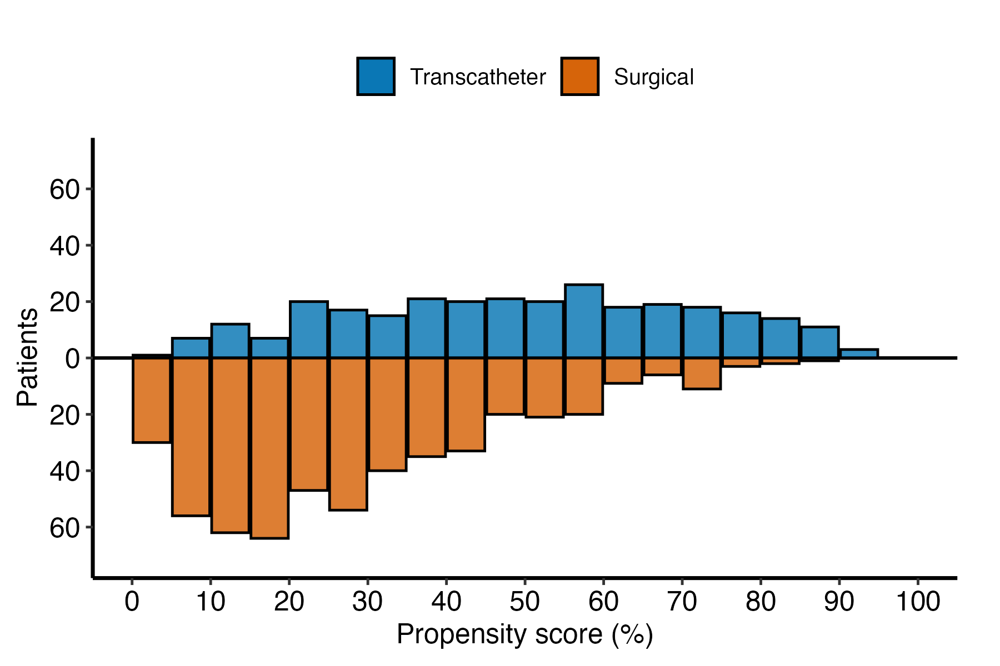
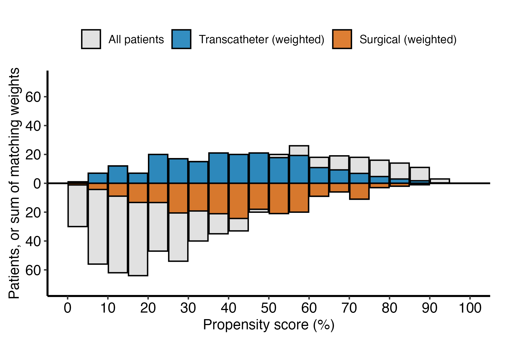

# Mirrored histogram of the propensity score

# Mirrored histogram of the propensity score

Published

2026-10-29 12:44

Draws the propensity score of the treated patients above the axis and of
the controls below it, from the bundle an `lm-propensity_binary` job
saved. This job reads that bundle and never refits the model.

Code

``` r
# unnumbered: setup, and the box under the title
SUBJECT <- "approach"
TYPE    <- "propensity"
.in <- knitr::current_input(dir = TRUE)
.provenance_artifacts <- list()
suppressPackageStartupMessages({
  library(hvtiRutilities)
  library(hvtiPlotR)
  library(ggplot2)
})
# The bundle records its declared treatment levels from hvtiRpropensity 0.1.10.
if (utils::packageVersion("hvtiRpropensity") < "0.2.0") {
  stop("This job needs hvtiRpropensity >= 0.2.0, the package's floor (bundles record their treatment levels from 0.1.10); ",
       utils::packageVersion("hvtiRpropensity"), " is installed.", call. = FALSE)
}
if (utils::packageVersion("hvtiPlotR") < "2.8.9") {
  stop("This job needs hvtiPlotR >= 2.8.9, the version hvtiRtemplates requires; ",
       utils::packageVersion("hvtiPlotR"), " is installed.", call. = FALSE)
}
# The study root is the nearest directory above this file holding _study.yml,
# so the job renders the same from the Render button, quarto render, or
# render_job(), at any depth, with no path in this document to edit.
# To render a job you have not finished, leave a chunk out with the chunk
# option skip, giving the reason in quotes, or call hvtiRtemplates::stop_here()
# in a chunk to leave out everything below it. A draft lists each one in a
# callout; a final render refuses them, as it refuses an unresolved marker.
# ?stop_here has more.
.job <- hvtiRtemplates:::.job_setup(SUBJECT, TYPE, envir = environment())
.root <- .job$root
set_path <- .job$set_path
.provenance_data <- list()
# Saves a figure as <name>.png, .pdf and .tiff in this set's graphs/ folder,
# under the SAVE_FIGURES and FIGURES study choices.
save_figure <- function(plot, name, width = 6, height = 4, kind = "graphs", linked = FALSE) {
  hvtiRtemplates:::.save_figure(plot, set_path(kind, paste0(name, ".png")), width, height,
                                SAVE_FIGURES, FIGURES, linked)
}
# The draft banners, if any, and the box under the title, after all the code above.
.job$notice
```

**final** · data `built` `built_20261029.parquet`, dated 2026-10-29 ·
rendered by gallery on gallery · hvtiRtemplates 1.5.4

## Study choices

Code

``` r
# Demo: the bar width on the 0 to 100 score scale. 5 suits most cohorts; use 10
# for a small one, and 1 for a rare treatment whose scores sit near zero.
BINWIDTH <- 5

# Optional, and needs no edit: the saved bundle. NULL in MODEL_SET is this
# job's own set, where the bundle is when SUBJECT and TYPE match the
# lm-propensity_binary job's. A mirror job in a set of its own names that job's
# set, "<subject>-<type>", for example MODEL_SET <- "treatment-propensity".
MODEL_FILE <- "lm-propensity_binary.rds"
MODEL_SET <- NULL

# Optional, and needs no edit: the group labels. NULL labels each group by its
# treatment level, as the propensity job declared it. To relabel, name both
# levels by the treatment column's own values, as they appear in the data; for
# a 0/1 column that is GROUP_LABELS <- c("0" = "Surgical", "1" = "Transcatheter").
GROUP_LABELS <- c(surgical = "Surgical", transcatheter = "Transcatheter")

# Optional, and needs no edit: a pair-match flag, 1 for a matched patient. NULL
# draws no matched figure. A study whose dataset carries a flag, from a SAS
# match for example, names that column, and DATASET and ID say where to read
# it. The flag is joined onto the bundle's patients by a study-keyed digest of
# ID, so no identifier is kept or printed.
MATCH <- NULL
DATASET <- "built"
ID <- "ccfid"

# Each figure is saved to graphs/ as a PNG (for Word), and a PDF and a TIFF (for the publisher).
# SAVE_FIGURES <- FALSE saves none; FIGURES keeps only the figures whose names
# start with one of its entries, e.g. FIGURES <- c("lp-mirror-weighted"). The names are the
# file names, listed for each template in the templates README.
SAVE_FIGURES <- TRUE
FIGURES <- NULL
```

Code

``` r
# unnumbered: defines the figure helpers and shows nothing
# The figure helpers. Each takes what it draws as an argument, so the tests
# call them on synthetic data.

# The two groups, treated first. hv_mirror_hist()'s help says control first and
# treated above, but the hvtiPlotR 2.8.5 code draws the FIRST level above, so
# treated is passed first and mirror_hist() checks the sign at run time.
# Labeled by the levels the propensity job declared, or by
# GROUP_LABELS, named by those levels.
mirror_groups <- function(meta, labels = NULL) {
  declared <- as.character(meta$treatment_levels)
  treated <- as.character(meta$treated_level)
  if (length(declared) != 2L || anyNA(declared) || length(treated) != 1L || !treated %in% declared) {
    stop("The saved bundle does not declare two treatment levels and the treated one: rebuild it by ",
         "rendering the lm-propensity_binary job with the current template.", call. = FALSE)
  }
  levels <- c(treated, setdiff(declared, treated))
  if (is.null(labels)) return(list(levels = levels, labels = levels))
  if (!is.character(labels) || length(labels) != 2L || anyNA(labels) || is.null(names(labels)) ||
        !setequal(names(labels), declared)) {
    stop("GROUP_LABELS must be NULL or two labels named by the treatment levels, such as c(",
         paste0(declared, " = \"", declared, "\"", collapse = ", "), ").", call. = FALSE)
  }
  list(levels = levels, labels = unname(labels[levels]))
}

# The y-axis limit: the tallest bar on either side, plus a tenth of it and at
# least 1, as hv_mirror_hist() pads. The same limit above and below, so both
# groups are read on one scale.
mirror_limit <- function(y) {
  top <- max(abs(y), 0)
  top + max(1, ceiling(0.1 * top))
}

# One hv_mirror_hist() object. `scores` has one row per patient: score, group,
# weight and matched. The unmatched figure keeps only the all-patient bars.
mirror_hist <- function(scores, kind = c("unmatched", "weighted", "matched"), groups, binwidth) {
  kind <- match.arg(kind)
  args <- list(scores, score_col = "score", group_col = "group", group_levels = groups$levels,
               group_labels = groups$labels, binwidth = binwidth)
  if (identical(kind, "weighted")) {
    args$weight_col <- "weight"
  } else {
    args$match_col <- "matched"
    args$matched_value <- 1L
  }
  mh <- suppressMessages(do.call(hvtiPlotR::hv_mirror_hist, args))
  if (identical(kind, "unmatched")) mh$data <- mh$data[mh$data$layer == "Before", , drop = FALSE]
  # Treated must be above the axis. A different hvtiPlotR may draw the first
  # level below it, and a figure with the groups swapped reads as the opposite.
  if (any(mh$data$y[mh$data$group == groups$labels[1L]] < 0, na.rm = TRUE) ||
        any(mh$data$y[mh$data$group == groups$labels[2L]] > 0, na.rm = TRUE)) {
    stop("hv_mirror_hist() in the installed hvtiPlotR (", utils::packageVersion("hvtiPlotR"), ") draws the ",
         "treated group below the axis: its orientation changed since 2.8.5, which this job was written ",
         "against. Update the job for that hvtiPlotR before drawing the figure.", call. = FALSE)
  }
  mh
}

# The figure: the derived symmetric axis, and a fill that names each layer.
mirror_figure <- function(mh, kind = c("unmatched", "weighted", "matched")) {
  kind <- match.arg(kind)
  limit <- mirror_limit(mh$data$y)
  breaks <- pretty(c(-limit, limit), n = 8)
  mh$meta$lower <- -limit
  mh$meta$upper <- limit
  mh$meta$y_breaks <- breaks[abs(breaks) <= limit]
  labels <- mh$meta$group_labels
  colors <- hvtiPlotR::hv_palette(2L)
  fill <- switch(kind,
    unmatched = c(before_g0 = colors[[1L]], before_g1 = colors[[2L]]),
    weighted = c(before_g0 = "gray85", before_g1 = "gray85", weighted_g0 = colors[[1L]], weighted_g1 = colors[[2L]]),
    matched = c(before_g0 = "gray85", before_g1 = "gray85", matched_g0 = colors[[1L]], matched_g1 = colors[[2L]])
  )
  # The gray all-patient bars are one legend entry, not one a group.
  shown <- if (identical(kind, "unmatched")) names(fill) else names(fill)[-2L]
  names_shown <- switch(kind,
    unmatched = labels,
    weighted = c("All patients", paste(labels, "(weighted)")),
    matched = c("All patients", paste(labels, "(matched)"))
  )
  plot(mh) +
    ggplot2::scale_fill_manual(values = fill, breaks = shown, labels = names_shown, name = NULL) +
    ggplot2::labs(x = "Propensity score (%)",
                  y = if (identical(kind, "weighted")) "Patients, or sum of matching weights" else "Patients") +
    hvtiPlotR::theme_hv_manuscript(base_size = 12) +
    ggplot2::theme(legend.position = "top")
}

# Patients in each group; the sum of the matching weights for the weighted
# figure, and the matched patients for the matched one. Counts only.
mirror_counts <- function(mh, kind = c("unmatched", "weighted", "matched")) {
  kind <- match.arg(kind)
  w <- mh$tables$working
  levels <- mh$meta$group_levels
  out <- data.frame(group = mh$meta$group_labels,
                    patients = vapply(levels, function(g) sum(w$group == g), integer(1L), USE.NAMES = FALSE))
  if (identical(kind, "weighted")) {
    out$weighted <- vapply(levels, function(g) sum(w$weight[w$group == g]), numeric(1L), USE.NAMES = FALSE)
  }
  if (identical(kind, "matched")) {
    out$matched <- vapply(levels, function(g) sum(w$group == g & w$matched == 1L), integer(1L), USE.NAMES = FALSE)
  }
  out
}

# The match flag of each bundle patient, joined by ID digest. `ids` are the
# dataset's identifiers made comparable with the bundle's by .bundle_ids(),
# and `flag` the MATCH column. Returns the 0/1 flag for each bundle patient
# and the two counts the job reports; stops when fewer than half of the
# bundle's patients are in the dataset, when the flag is not coded 0 and 1, or
# when no scored patient has a 1.
mirror_join <- function(bundle_ids, ids, flag) {
  if (anyDuplicated(ids[!is.na(ids)])) {
    stop("The dataset holds a patient more than once, so the match flag cannot be joined one to one: set ",
         "DATASET to a dataset with one row per patient.", call. = FALSE)
  }
  at <- match(bundle_ids, ids, incomparables = NA)
  joined <- !is.na(at)
  if (sum(joined) < length(bundle_ids) / 2) {
    stop("Only ", sum(joined), " of the ", length(bundle_ids), " patients the scores were computed for are in ",
         "the dataset read for MATCH. The dataset is not the cohort the scores came from, or its ID does not ",
         "identify patients as the propensity job's did: check DATASET and ID.", call. = FALSE)
  }
  value <- flag[at]
  if (is.logical(value)) value <- as.integer(value)
  seen <- unique(value[!is.na(value)])
  if (!all(seen %in% c(0, 1))) {
    stop("MATCH must be coded 0 and 1 (or TRUE and FALSE), 1 for a matched patient: the column holds ",
         length(seen), " distinct values for the scored patients, not all 0 or 1. Recode it, or change MATCH ",
         "in edit-study-choices.", call. = FALSE)
  }
  if (!any(value == 1, na.rm = TRUE)) {
    stop("MATCH flags no scored patient as matched (none has a 1): check that MATCH names the pair-match ",
         "flag, with 1 for a matched patient, and that DATASET and ID read the right file.", call. = FALSE)
  }
  # A dataset row with no flag is not a flagged patient, so it is left out of the second count.
  list(
    matched = as.integer(!is.na(value) & value == 1),
    counts = data.frame(
      count = c("Patients with a score and no match flag", "Patients with a match flag and no score"),
      patients = c(sum(is.na(value)), sum(!is.na(ids) & !is.na(flag) & !ids %in% bundle_ids))
    )
  )
}
```

## The saved bundle

Code

``` r
# MODEL_FILE is a file name and MODEL_SET a set name, so neither can reach
# outside the study's estimates.
MODEL_PATH <- hvtiRtemplates:::.handoff_path(MODEL_FILE, MODEL_SET, .root, function(file) set_path("estimates", file),
                                             upstream = "lm-propensity_binary", set_example = "treatment-propensity")
.cfg <- study_config(start = .root)
# A bundle without its lineage stops here with the job to render again.
.model_read <- hvtiRtemplates:::.read_handoff(MODEL_PATH, "propensity-model", .cfg, "the lm-propensity_binary job")
bundle <- .model_read$value
.meta <- bundle$meta
.cols <- c(.meta$id_col, .meta$treatment_col, .meta$score_col, .meta$weight_col)
if (!inherits(bundle, "ps_logistic") || length(.cols) != 4L || !all(.cols %in% names(bundle$data))) {
  stop("The saved bundle is not a binary propensity model with its patients, treatment, score and matching ",
       "weight: rebuild it by rendering the lm-propensity_binary job with the current template.", call. = FALSE)
}
.provenance_data <- .model_read$lineage$data
.provenance_artifacts <- c(.model_read$lineage$artifacts, list(.model_read$record))
```

Code

``` r
# The data are read again as the propensity job read them. The rebuilt read must
# have the same rows, the same patients and the same hash of the study-keyed IDs
# (the same patients) as the bundle's lineage, and the manifest must verify.
hvtiRutilities::verify_manifest(file.path(.root, "manifest.yaml"))
.up <- hvtiRtemplates:::.read_upstream_job_data(
  .cfg, .model_read$lineage, list(), source = MODEL_FILE,
  rerun = "Render the lm-propensity_binary job again with the current template, then this one."
)
job_data <- .up$job_data
.provenance_data <- c(.provenance_data, list(job_data$provenance),
                      if (!is.null(job_data$provenance_join)) list(job_data$provenance_join))
knitr::kable(job_data$record, col.names = c("Data", ""))
```

| Data                |                                          |
|:--------------------|:-----------------------------------------|
| Source              | dataset `study` (built_20261029.parquet) |
| Rows read           | 800                                      |
| ID                  | `patient_id`                             |
| Identifiers dropped | none                                     |
| Rows kept           | 800 rows on 800 patients                 |

Table 1: The data the propensity job read, read again

Code

``` r
# One row per patient: the score, the treatment, the matching weight and the
# patient's ID digest, which only the MATCH join reads.
groups <- mirror_groups(.meta, GROUP_LABELS)
scores <- data.frame(
  id = bundle$data[[.meta$id_col]],
  score = bundle$data[[.meta$score_col]],
  group = as.character(bundle$data[[.meta$treatment_col]]),
  weight = bundle$data[[.meta$weight_col]],
  matched = 0L
)
.bad <- c(`with a missing score` = sum(is.na(scores$score)),
          `with a missing matching weight` = sum(is.na(scores$weight)),
          `with a missing treatment` = sum(is.na(scores$group)),
          `in a group the bundle does not declare` = sum(!is.na(scores$group) & !scores$group %in% groups$levels))
if (any(.bad > 0)) {
  .bad <- .bad[.bad > 0]
  stop("The saved bundle holds ", paste0(.bad, " patient", ifelse(.bad == 1, "", "s"), " ", names(.bad), collapse = ", "),
       "; a mirrored histogram draws only patients with a score, a weight and a declared group. Rebuild it by ",
       "rendering the lm-propensity_binary job with the current template.", call. = FALSE)
}
if (anyDuplicated(scores$id)) {
  stop("The saved bundle holds a patient more than once; a mirrored histogram counts each patient once. ",
       "Rebuild it by rendering the lm-propensity_binary job with the current template.", call. = FALSE)
}
```

Code

``` r
# unnumbered: its child chunk carries its own label and caption
# The flag is joined by a digest of ID under the study key, the digest the
# bundle holds, so this job keeps and prints no identifier. A scored patient
# with no flag is drawn as unmatched and counted, never dropped.
.join <- NULL
if (!is.null(MATCH)) {
  if (!is.character(MATCH) || length(MATCH) != 1L || is.na(MATCH)) {
    stop("MATCH must be NULL or one column name.", call. = FALSE)
  }
  match_data <- hvtiRtemplates::read_job_data(.cfg, dataset = DATASET, id = ID, one_row_per_patient = TRUE)
  match_data$provenance$role <- "match"
  .provenance_data <- c(.provenance_data, list(match_data$provenance))
  .id <- attr(match_data$record, "selection")$id
  # .check_job_columns() reads a setting as formula terms, so "age + sex" and "."
  # would pass it; MATCH is one column.
  if (!MATCH %in% names(match_data$data)) {
    stop("MATCH names a column this dataset does not have: ", MATCH, ". Change MATCH in edit-study-choices.",
         call. = FALSE)
  }
  hvtiRtemplates:::.check_job_columns(match_data$data, MATCH = MATCH)
  if (!identical(tolower(.id), tolower(.meta$id_col))) {
    stop("The dataset read for MATCH identifies patients by `", .id, "`, the bundle by `", .meta$id_col,
         "`: set ID so both use the same identifier.", call. = FALSE)
  }
  .join <- mirror_join(scores$id, hvtiRtemplates:::.bundle_ids(bundle, match_data$data[[.id]], .root),
                       match_data$data[[MATCH]])
  scores$matched <- .join$matched
  .fence <- strrep("`", 3)
  cat(knitr::knit_child(text = c(
    paste0(.fence, "{r}"), "#| label: tbl-match-join",
    "#| tbl-cap: \"The match flag joined onto the scored patients\"",
    "knitr::kable(.join$counts, col.names = c(\"\", \"Patients\"))", .fence
  ), envir = environment(), quiet = TRUE), sep = "\n")
}
```

## Figures

Code

``` r
mh_unmatched <- mirror_hist(scores, "unmatched", groups, BINWIDTH)
file <- save_figure(mirror_figure(mh_unmatched, "unmatched"), "lp-mirror-unmatched", linked = TRUE)
knitr::include_graphics(xfun::relative_path(file, if (!is.null(.in)) dirname(.in) else getwd(), error = FALSE),
                        error = FALSE)
```



Figure 1: Propensity score of each group: treated above the axis,
controls below. Blue bars with a black outline mark the treated group
above the axis and vermillion bars with a black outline the controls
below it.

Code

``` r
knitr::kable(mirror_counts(mh_unmatched, "unmatched"), col.names = c("Group", "Patients"))
```

| Group         | Patients |
|:--------------|---------:|
| Transcatheter |      286 |
| Surgical      |      514 |

Table 2: Patients in each group

Code

``` r
mh_weighted <- mirror_hist(scores, "weighted", groups, BINWIDTH)
file <- save_figure(mirror_figure(mh_weighted, "weighted"), "lp-mirror-weighted", linked = TRUE)
knitr::include_graphics(xfun::relative_path(file, if (!is.null(.in)) dirname(.in) else getwd(), error = FALSE),
                        error = FALSE)
```



Figure 2: Propensity score of each group under the matching weights,
over all patients in gray. Gray bars with a black outline mark all
patients, blue bars the treated group above the axis and vermillion bars
the controls below it, both weighted.

Code

``` r
knitr::kable(mirror_counts(mh_weighted, "weighted"), col.names = c("Group", "Patients", "Sum of matching weights"),
             digits = 1)
```

| Group         | Patients | Sum of matching weights |
|:--------------|---------:|------------------------:|
| Transcatheter |      286 |                   214.8 |
| Surgical      |      514 |                   217.3 |

Table 3: Patients in each group, and the sum of their matching weights

Code

``` r
# unnumbered: its child chunks carry their own labels and captions
if (!is.null(MATCH)) {
  mh_matched <- mirror_hist(scores, "matched", groups, BINWIDTH)
  file <- save_figure(mirror_figure(mh_matched, "matched"), "lp-mirror-matched", linked = TRUE)
  .link <- xfun::relative_path(file, if (!is.null(.in)) dirname(.in) else getwd(), error = FALSE)
  .fence <- strrep("`", 3)
  cat(knitr::knit_child(text = c(
    paste0(.fence, "{r}"), "#| label: fig-mirror-matched",
    "#| fig-cap: \"Propensity score of the matched patients in each group, over all patients in gray. Gray bars with a",
    "#|   black outline mark all patients, blue bars the matched treated patients above the axis and orange",
    "#|   bars the matched controls below it.\"",
    "knitr::include_graphics(.link, error = FALSE)", .fence, "",
    paste0(.fence, "{r}"), "#| label: tbl-mirror-matched",
    "#| tbl-cap: \"Patients in each group, and those matched\"",
    "knitr::kable(mirror_counts(mh_matched, \"matched\"), col.names = c(\"Group\", \"Patients\", \"Matched\"))",
    .fence
  ), envir = environment(), quiet = TRUE), sep = "\n")
}
```

## About this run

| Group | Item | Value |
|:---|:---|:---|
| Run | Started | 2026-10-29 12:44:00 EDT |
|  | Ended | 2026-10-29 12:44:02 EDT |
|  | Duration | 2 s |
|  | Status | final |
|  | Rendered by | gallery |
|  | Host | gallery |
| Job | File | lp.mirror.approach.propensity.qmd |
|  | Template | lp.mirror |
|  | Subject | approach |
|  | Type | propensity |
|  | hvtiRtemplates | 1.5.4 |
| Dataset `built` | Version file | built_20261029.parquet |
|  | Version date | 2026-10-29 |
|  | Source file | built.rds |
|  | Rows kept | 800 rows on 800 patients |
|  | WHERE | none |
|  | sha256 | b236a472f1f3 |
|  | Manifest | current |
| Upstream | Handoff | `approach-propensity/lm-propensity_binary.rds` (propensity-model), rendered 2026-10-29 12:43:50 -0400, data built_20261029.parquet |
| Reproducibility | renv | not active |
|  | renv.lock sha256 | d09f96b6cd21 |
