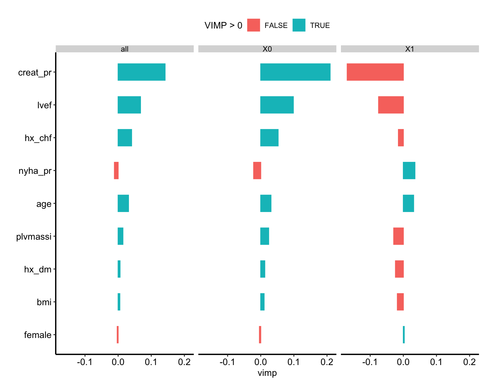
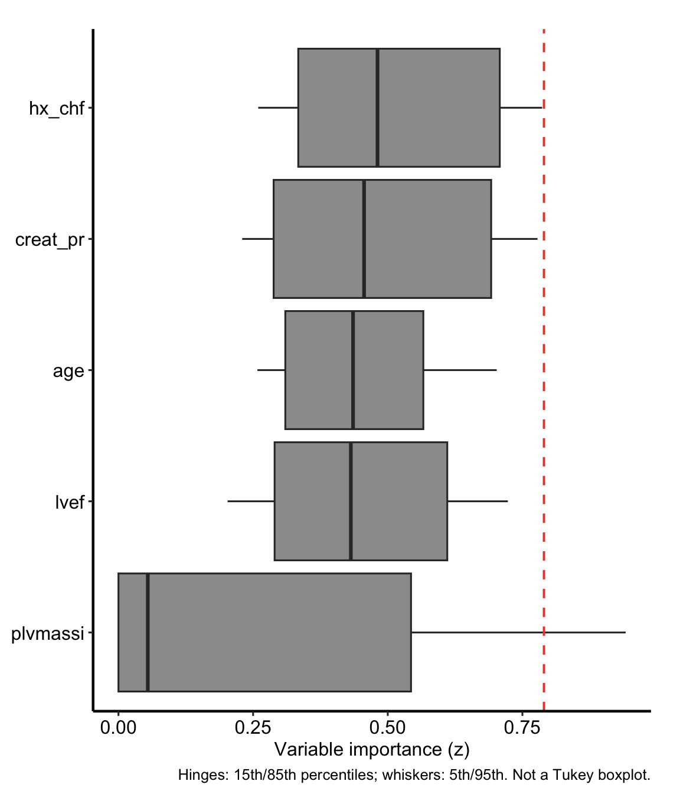
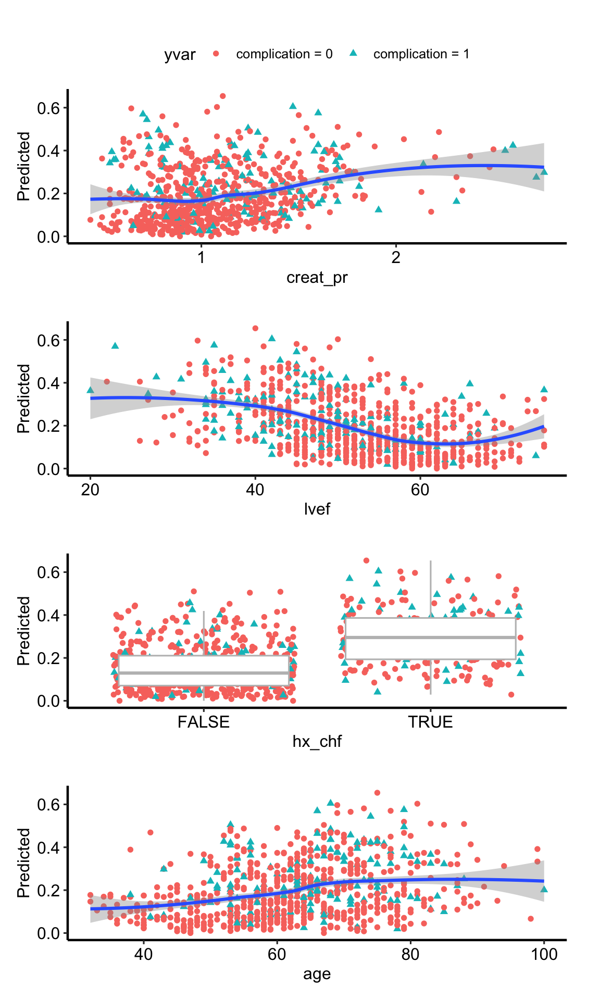
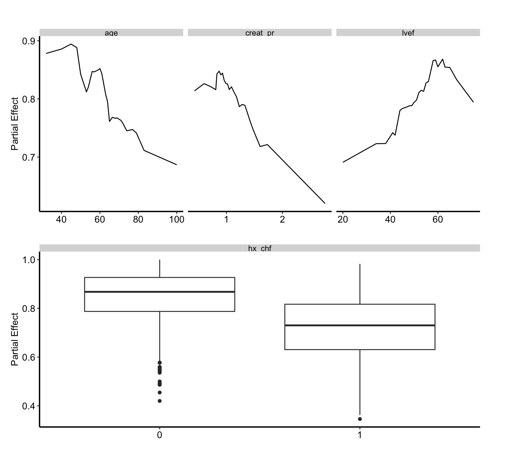
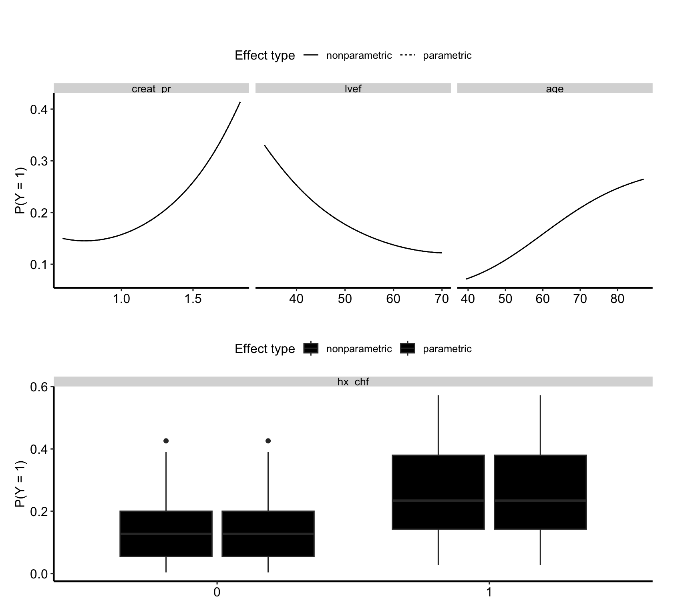

# Random forest classification: explain

# Random forest classification: explain

Published

2026-10-15 09:35

Explains the forest the `rfc-fit` job in this set saved: which
predictors drive it, and how.

An `rfc-explain` job never grows a forest. It reads `rfc.rds`, which the
fit job writes, and rebuilds the training data and the model from the
forest itself. VIMP, minimal depth and the partial-dependence plots all
describe that saved forest and no other; VarPro grows its own forests on
the same training data, so its panel and partial describe forests VarPro
grew, not the saved one. Each expensive step is cached on its own:
changing how many variables get dependence plots recomputes the partials
and nothing else.

Code

``` r
SUBJECT <- "complication"
TYPE    <- "rf"
.in <- knitr::current_input(dir = TRUE)
suppressPackageStartupMessages({
  library(randomForestSRC)
  library(varPro)
  library(ggRandomForests)
  library(hvtiRutilities)
})
# One thread, so a forest reproduces from machine to machine. Left unset,
# randomForestSRC runs on every core its OpenMP build can see, and on a
# multi-core server a varPro cross-validated cutoff changed with the thread
# count with every seed held fixed. Raise it for speed on a large forest, at the
# cost of that guarantee: a cached fit records its seed, data and package
# versions, never the threads it ran on.
options(rf.cores = 1L)
# The versions this template was verified against, end to end, on 2026-09-19.
# Below them a call here can fail or change meaning, and the message would
# arrive mid-render rather than here.
if (utils::packageVersion("randomForestSRC") < "3.7.0") {
  stop("This job needs randomForestSRC >= 3.7.0; ", utils::packageVersion("randomForestSRC"),
       " is installed.\nUpdate it, then re-render.", call. = FALSE)
}
if (utils::packageVersion("ggRandomForests") < "4.0.0") {
  stop("This job needs ggRandomForests >= 4.0.0; ", utils::packageVersion("ggRandomForests"),
       " is installed.\nUpdate it, then re-render.", call. = FALSE)
}
if (utils::packageVersion("varPro") < "3.2.0") {
  stop("This job needs varPro >= 3.2.0; ", utils::packageVersion("varPro"),
       " is installed.\nUpdate it, then re-render.", call. = FALSE)
}
# The study root is the nearest directory above this file holding _study.yml,
# so the job renders the same from the Render button, quarto render, or
# render_job(), at any depth, with no path in this document to edit.
# Without the guard in .job_setup(), an unedited job renders green over a
# meaningless analysis. Here that is dependence plots for a placeholder number
# of variables, which look exactly like a result.
# To render a job you have not finished, leave a chunk out with the chunk
# option skip, giving the reason in quotes, or call hvtiRtemplates::stop_here()
# in a chunk to leave out everything below it. A draft lists each one in a
# callout; a final render refuses them, as it refuses an unresolved marker.
# ?stop_here has more.
.job <- hvtiRtemplates:::.job_setup(SUBJECT, TYPE, envir = environment())
.root <- .job$root
set_path <- .job$set_path
.provenance_data <- list()
# Saves a figure as <name>.png and <name>.pdf in this set's graphs/ folder (or `kind`'s),
# under the SAVE_FIGURES and FIGURES study choices.
save_figure <- function(plot, name, width = 6, height = 4, kind = "graphs", linked = FALSE) {
  hvtiRtemplates:::.save_figure(plot, set_path(kind, paste0(name, ".png")), width, height,
                                SAVE_FIGURES, FIGURES, linked)
}

# `rfc-explain` reads the forest `rfc-fit` wrote in this same set, and caches
# its own work beside it.
# The draft banners, if any, and the box under the title, after all the code above.
.job$notice
```

**final** · data: see About this run · rendered by gallery on gallery ·
hvtiRtemplates 1.4.0

## Study choices

Edit these values for this study before rendering. The outcome and
predictors are not here: they come from the forest.

Code

``` r
# Demo: the fit's selection is used; set any of these only to confirm it.
# NULL takes the value the fit job used.
WHERE <- NULL
ID <- NULL
KEY <- NULL

# Demo: how many variables get dependence plots, ranked by VIMP. The partials
# are the expensive step, so keep this small.
TOP_K <- 4

# Demo: or name the variables yourself. NULL takes the top TOP_K by VIMP.
PARTIAL_VARS <- NULL

# Demo: seed for VIMP, VarPro and the partials. It is part of every cache key.
# cache_fit() seeds R's generator with it before each call, and vimp() and
# varpro() are also handed it as `seed =`, negated as randomForestSRC
# documents. Both halves matter: varpro() draws from R's generator as well as
# from its own seed, so the same seed after a different chunk gave different
# importances.
SEED <- 2026

# Set TRUE after changing a choice above. A cache whose inputs changed stops the
# render instead of returning the old result; TRUE recomputes only the caches
# that are out of date.
REFIT <- FALSE

# Each figure is saved to graphs/ as a PNG (for Word) and a PDF (for the publisher).
# SAVE_FIGURES <- FALSE saves neither; FIGURES keeps only the figures whose names
# start with one of its entries, e.g. FIGURES <- c("hp-survival"). The names are the
# file names, listed for each template in the templates README.
SAVE_FIGURES <- TRUE
FIGURES <- NULL
```

## The forest

Code

``` r
.handoff <- set_path("estimates", "rfc.rds")
if (!file.exists(.handoff)) {
  stop("No forest at ", .handoff, ". Render the rfc-fit job in this set first; ",
       "this job explains that forest and never grows its own.", call. = FALSE)
}
.cfg <- study_config(start = .root)
.forest_read <- hvtiRtemplates:::.read_handoff(.handoff, "forest", .cfg, "the rfc-fit job")
forest <- .forest_read$value
.provenance_data <- .forest_read$lineage$data
.provenance_artifacts <- c(.forest_read$lineage$artifacts, list(.forest_read$record))
if (!identical(forest$family, "class")) {
  stop("rfc.rds holds a '", forest$family, "' forest, not a classification forest.", call. = FALSE)
}
CACHE_DIR <- dirname(.handoff)

# The training data and the model, from the forest rather than re-read. A
# VarPro or partial call on a frame that differs from the fitted one explains a
# model nobody fit. The forest keeps no usable formula (`$formula` is NULL and
# `$call` holds whatever expression the fit job wrote), so the model is rebuilt
# from the outcome names. `xvar` keeps any missing values under na.impute, and
# varpro() drops every patient that has one, so it would describe fewer patients
# than the forest. The values the forest imputed are put back in below, so both
# cover the same patients. (Handing varpro() the forest's `imputed.data` as it
# stands fails: that holds only the imputed patients.)
frame <- cbind(stats::setNames(data.frame(forest$yvar), forest$yvar.names), forest$xvar)
if (!is.null(forest$imputed.data)) {
  frame[forest$imputed.indv, names(forest$imputed.data)] <- forest$imputed.data
}
model <- stats::reformulate(".", response = forest$yvar.names)
```

Code

``` r
# This job reads no data: the forest carries its training rows. The fit job
# recorded how it chose them, and a setting above that differs from the fit's
# stops here rather than describe rows the forest was not grown on.
.sel <- hvtiRtemplates:::.read_upstream_job_data(
  .cfg, .forest_read$lineage, list(where = WHERE, id = ID, key = KEY), read = FALSE, source = "rfc.rds"
)$selection
knitr::kable(data.frame(step = c("ID", "KEY", "WHERE", "Rows"),
                        value = c(.sel$id, paste(.sel$key, collapse = ", "),
                                  if (length(.sel$where_shown)) paste(.sel$where_shown, collapse = "; ") else "none",
                                  .sel$rows)),
             col.names = c("Data", ""))
```

| Data  |            |
|:------|:-----------|
| ID    | patient_id |
| KEY   | patient_id |
| WHERE | none       |
| Rows  | 800        |

Table 1: The data the fit job read

## Importance

Code

``` r
vi <- cache_fit("rfc-vimp", vimp(forest, seed = -abs(SEED)), seed = SEED, dir = CACHE_DIR, refit = REFIT)
# Free size: one row per predictor, and one panel per class.
# The manuscript theme hides the legend and its title, and the caption reads the colors from the legend.
.fig <- plot(gg_vimp(vi)) +
  hvtiPlotR::theme_hv_manuscript(base_size = 12, legend.position = "top", legend.title = ggplot2::element_text())
save_figure(.fig, "rfc-explain-importance", width = 9, height = 7)
.fig
```



Figure 1: Permutation importance of each predictor, overall and for each
class. Horizontal bars give the importance of each predictor, one panel
for the overall forest and one for each class, in one color where the
importance is positive and another where it is not, as in the legend.

Code

``` r
# A classification forest reports importance per class as well as overall;
# the ranking uses the overall column, so no variable is counted twice.
#
# Minimal depth ranks by how near the root a variable first splits, a second
# opinion that needs no permutation. Cheap, so not cached.
imp <- vi$importance[, "all"]
ranked <- names(sort(imp, decreasing = TRUE))
depth <- max.subtree(forest)$order[, 1]
data.frame(variable = ranked,
           vimp = round(imp[ranked], 4),
           min_depth = round(depth[ranked], 2),
           row.names = NULL)
```

      variable    vimp min_depth
    1 creat_pr  0.1417      2.11
    2     lvef  0.0675      1.57
    3   hx_chf  0.0406      1.57
    4      age  0.0313      1.49
    5 plvmassi  0.0144      2.17
    6    hx_dm  0.0057      3.91
    7      bmi  0.0050      2.69
    8   female -0.0027      4.12
    9  nyha_pr -0.0112      3.02

Table 2: Permutation importance and minimal depth of each predictor, in
order of importance

Code

``` r
if (is.null(PARTIAL_VARS)) {
  sel <- head(ranked, TOP_K)
} else {
  # A misspelt name would otherwise fail deep inside the partial call, or be
  # dropped from a plot without a word.
  .unknown <- setdiff(PARTIAL_VARS, forest$xvar.names)
  if (length(.unknown)) {
    stop("PARTIAL_VARS names variable(s) the forest was not grown on: ",
         paste(.unknown, collapse = ", "), call. = FALSE)
  }
  sel <- PARTIAL_VARS
}
```

## VarPro

VarPro is given the forest’s own data. When the fit imputed missing
values (`NA_ACTION` was `"na.impute"`), that is the imputed data, so
VarPro and the forest describe the same patients.

Code

``` r
vp <- cache_fit("rfc-varpro", varpro(model, frame, verbose = FALSE, seed = -abs(SEED)),
                seed = SEED, dir = CACHE_DIR, refit = REFIT)
# Free size: one row per predictor, so the height grows with the list.
.fig <- plot(gg_varpro(vp)) + hvtiPlotR::theme_hv_manuscript(base_size = 12)
save_figure(.fig, "rfc-explain-varpro", height = 7)
.fig
```



Figure 2: VarPro importance of each predictor. Each box spans the 15th
to the 85th percentile of the predictor’s importance, with a line at the
median and whiskers to the 5th and 95th percentiles; blue boxes mark the
predictors VarPro selected, gray boxes the rest, and the dashed red
vertical line the selection cutoff.

## Dependence

Code

``` r
# Marginal: predicted class probability against each variable, as observed.
.gv <- gg_variable(forest)
# plot() reads a factor outcome whose levels are "0" and "1" as TRUE and FALSE
# with as.logical(), which turns the labels into missing values, and ggplot2
# then removes every point. Naming the levels after the outcome avoids that.
.gv$yvar <- factor(.gv$yvar, levels = levels(.gv$yvar), labels = paste0(forest$yvar.names, " = ", levels(.gv$yvar)))
# A loess smooth needs more than a handful of distinct values, so a predictor
# with fewer than six, such as a stage or a grade, is drawn as points alone.
.panels <- lapply(sel, function(v) {
  plot(.gv, xvar = v, smooth = length(unique(stats::na.omit(.gv[[v]]))) > 5) +
    hvtiPlotR::theme_hv_manuscript(base_size = 12, legend.position = "top", legend.title = ggplot2::element_text())
})
# Free size: one stacked panel per selected predictor, 2.5 in each.
# The manuscript theme hides the legend and its title, and the caption reads the points from the legend.
# One legend for the stack: every panel shares the same outcome levels.
.fig <- patchwork::wrap_plots(.panels, ncol = 1) + patchwork::plot_layout(guides = "collect") &
  ggplot2::theme(legend.position = "top")
save_figure(.fig, "rfc-explain-dependence-marginal", height = 2.5 * length(sel))
```

    `geom_smooth()` using method = 'loess' and formula = 'y ~ x'

    Warning: Removed 75 rows containing non-finite outside the scale range
    (`stat_smooth()`).

    Warning: Removed 75 rows containing missing values or values outside the scale range
    (`geom_point()`).

    `geom_smooth()` using method = 'loess' and formula = 'y ~ x'
    `geom_smooth()` using method = 'loess' and formula = 'y ~ x'
    `geom_smooth()` using method = 'loess' and formula = 'y ~ x'

    Warning: Removed 75 rows containing non-finite outside the scale range
    (`stat_smooth()`).
    Removed 75 rows containing missing values or values outside the scale range
    (`geom_point()`).

    `geom_smooth()` using method = 'loess' and formula = 'y ~ x'
    `geom_smooth()` using method = 'loess' and formula = 'y ~ x'

Code

``` r
.fig
```

    `geom_smooth()` using method = 'loess' and formula = 'y ~ x'

    Warning: Removed 75 rows containing non-finite outside the scale range
    (`stat_smooth()`).
    Removed 75 rows containing missing values or values outside the scale range
    (`geom_point()`).

    `geom_smooth()` using method = 'loess' and formula = 'y ~ x'
    `geom_smooth()` using method = 'loess' and formula = 'y ~ x'



Figure 3: Predicted class probability against each selected predictor,
as observed, one panel per predictor. Points are individual patients,
one color and shape per observed outcome level as in the legend; the
blue line is a loess smooth with its gray band, drawn for predictors
with more than five distinct values, and for a categorical predictor the
points are jittered over a gray box plot.

Code

``` r
# Partial: the forest's prediction with every other variable held at its
# observed values.
pd <- cache_fit("rfc-partial", gg_partial_rfsrc(forest, xvar.names = sel),
                seed = SEED, dir = CACHE_DIR, refit = REFIT,
                packages = "randomForestSRC")
# Free size: one panel per predictor.
.fig <- plot(pd) &
  hvtiPlotR::theme_hv_manuscript(base_size = 12)
save_figure(.fig, "rfc-explain-dependence-partial", width = 9, height = 8)
.fig
```



Figure 4: Partial dependence of the forest’s prediction on each selected
predictor, one panel per predictor. Black solid lines trace the partial
effect across a continuous predictor, and dark gray bars give it at each
level of a categorical one.

Code

``` r
# The VarPro partial, computed from the varpro fit.
pv <- cache_fit("rfc-partial-varpro", gg_partial_varpro(object = vp, xvar.names = sel),
                seed = SEED, dir = CACHE_DIR, refit = REFIT)
# Free size: one panel per predictor.
# The manuscript theme hides the legend and its title, and the caption reads the line types from the legend.
.fig <- plot(pv) &
  hvtiPlotR::theme_hv_manuscript(base_size = 12, legend.position = "top", legend.title = ggplot2::element_text())
save_figure(.fig, "rfc-explain-dependence-varpro", width = 9, height = 8)
```

    Warning: Removed 252 rows containing non-finite outside the scale range
    (`stat_boxplot()`).
    Removed 252 rows containing non-finite outside the scale range
    (`stat_boxplot()`).

Code

``` r
.fig
```

    Warning: Removed 252 rows containing non-finite outside the scale range
    (`stat_boxplot()`).



Figure 5: VarPro partial dependence on each selected predictor, one
panel per predictor. For a continuous predictor a black solid line marks
the nonparametric partial effect and a black dashed line the parametric
one, as in the legend; for a categorical predictor black box plots show
the spread of the partial effect at each level.

## About this run

| Group | Item | Value |
|:---|:---|:---|
| Run | Started | 2026-10-15 09:34:51 EDT |
|  | Ended | 2026-10-15 09:35:08 EDT |
|  | Duration | 17 s |
|  | Status | final |
|  | Rendered by | gallery |
|  | Host | gallery |
| Job | File | rfc.explain.complication.rf.qmd |
|  | Template | rfc.explain |
|  | Subject | complication |
|  | Type | rf |
|  | hvtiRtemplates | 1.4.0 |
| Dataset `built` | Version file | built_20261015.parquet |
|  | Registered | 2026-10-15 |
|  | Source file | built.rds |
|  | sha256 | f632480029c1 |
|  | Manifest | current |
| Upstream | Handoff | `complication-rf/rfc.rds` (forest), rendered 2026-10-15 09:34:42 -0400, data built_20261015.parquet |
| Reproducibility | Seed | 2026 |
|  | renv | not active |
