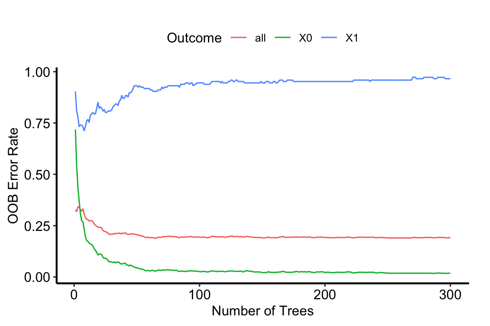
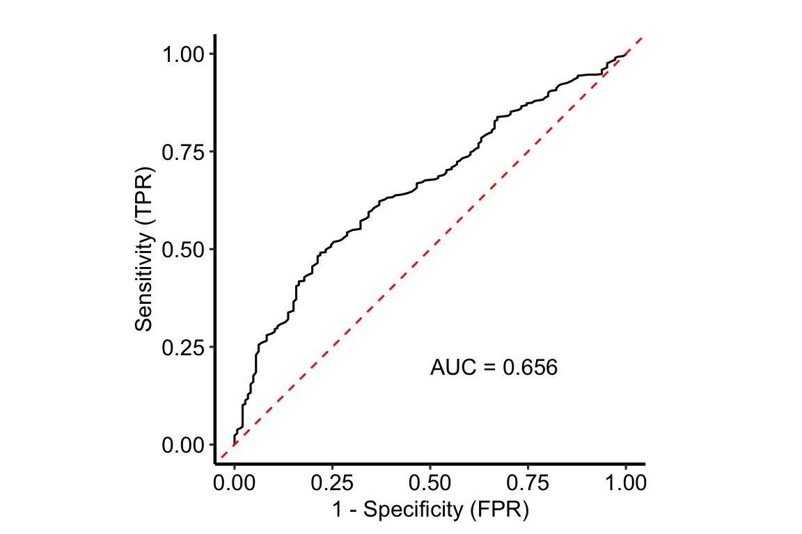

# Random forest classification: fit

# Random forest classification: fit

Published

2026-10-15 21:24

Gallery job on the synthetic cohort: major postoperative complication
(complication, 0/1).

An `rfc-fit` job grows a classification forest and checks that it
learned something: out-of-bag error by number of trees, and the ROC
curve with its AUC. **Importance, VarPro and dependence plots are not
here.** They are the `rfc-explain` job in this same set, which reads the
forest this job saves instead of growing its own, so the explanations
always describe this forest.

Old `rfsrc.*` and `rf.*` jobs map onto three prefixes by outcome, read
from the job’s fit call and not from its name: a survival outcome is
`rfs`, a classification or binary outcome `rfc`, a continuous outcome
`rfr`.

Code

``` r
SUBJECT <- "complication"
TYPE    <- "rf"
.in <- knitr::current_input(dir = TRUE)
suppressPackageStartupMessages({
  library(randomForestSRC)
  library(ggRandomForests)
  library(hvtiRutilities)
})
# One thread, so a forest reproduces from machine to machine. Left unset,
# randomForestSRC runs on every core its OpenMP build can see, and on a
# multi-core server a varPro cross-validated cutoff changed with the thread
# count with every seed held fixed. Raise it for speed on a large forest, at the
# cost of that guarantee: a cached fit records its seed, data and package
# versions, never the threads it ran on.
options(rf.cores = 1L)
# The versions this template was verified against, end to end, on 2026-09-19.
# Below them a call here can fail or change meaning, and the message would
# arrive mid-render rather than here.
if (utils::packageVersion("randomForestSRC") < "3.7.0") {
  stop("This job needs randomForestSRC >= 3.7.0; ", utils::packageVersion("randomForestSRC"),
       " is installed.\nUpdate it, then re-render.", call. = FALSE)
}
if (utils::packageVersion("ggRandomForests") < "4.0.0") {
  stop("This job needs ggRandomForests >= 4.0.0; ", utils::packageVersion("ggRandomForests"),
       " is installed.\nUpdate it, then re-render.", call. = FALSE)
}
# The study root is the nearest directory above this file holding _study.yml,
# so the job renders the same from the Render button, quarto render, or
# render_job(), at any depth, with no path in this document to edit.
# Without the guard in .job_setup(), an unedited job renders green over a
# meaningless analysis. Here that is a forest grown on the template's
# placeholder outcome, predictors and tree count, whose error curve and ROC
# curve look exactly like a result.
# To render a job you have not finished, leave a chunk out with the chunk
# option skip, giving the reason in quotes, or call hvtiRtemplates::stop_here()
# in a chunk to leave out everything below it. A draft lists each one in a
# callout; a final render refuses them, as it refuses an unresolved marker.
# ?stop_here has more.
.job <- hvtiRtemplates:::.job_setup(SUBJECT, TYPE, envir = environment())
.root <- .job$root
set_path <- .job$set_path
.provenance_data <- list()
# Saves a figure as <name>.png, .pdf and .tiff in this set's graphs/ folder (or `kind`'s),
# under the SAVE_FIGURES and FIGURES study choices.
save_figure <- function(plot, name, width = 6, height = 4, kind = "graphs", linked = FALSE) {
  hvtiRtemplates:::.save_figure(plot, set_path(kind, paste0(name, ".png")), width, height,
                                SAVE_FIGURES, FIGURES, linked)
}

# `rfc-fit` writes the forest through this and `rfc-explain` reads it back,
# both by set, so an explanation can never be filed against a different set
# than the forest it explains. The write is the `save` chunk at the foot of
# this file.
# The draft banners, if any, and the box under the title, after all the code above.
.job$notice
```

**final** · data `built` `built_20261015.parquet`, registered 2026-10-15
· rendered by gallery on gallery · hvtiRtemplates 1.4.1

## Study choices

Edit these values for this study before rendering.

Code

``` r
# Demo: the registered dataset this job reads ("built" is the study dataset).
DATASET <- "built"

# Demo: an hvtiRdatabuild analysis set, or NULL to read the whole dataset.
ANALYSIS_SET <- NULL

# Demo: rows to keep, dplyr::filter() style, or NULL to keep every row:
#   WHERE <- quote(age >= 18)
#   WHERE <- rlang::exprs(age >= 18, hx_chf == 1)
WHERE <- NULL

# Demo: the patient identifier. Without "ccfid" the job uses MRN, then eMRN;
# name another column, such as "randid", if the study uses one.
ID <- "patient_id"

# Demo: what makes a row unique; one row per patient unless repeated measures
# add their visit time or date, for example KEY <- c(ID, "iv_echo").
KEY <- ID

# Optional, and needs no edit: NULL reads the cohort alone. To join one
# registered ancillary dataset (echoes, labs), name it in JOIN. The cohort
# above decides the patients, one row each; the joined records of other
# patients are dropped and counted in the data table.
#   JOIN_VARS: the cohort columns each joined row carries; NULL carries all,
#     and a column both datasets have stops, so list only those the job needs.
#   REDUCE: NULL keeps a row per joined record, keyed on that dataset's key;
#     list(rule = "first", by = "echo_date") keeps one row per patient ("last",
#     or "nearest" with to = a cohort date column). WHERE on a joined column
#     filters the records first, so "last" with WHERE echo_type == "TTE"
#     keeps each patient's last TTE. A tie stops: picking one record
#     silently would be a hidden choice; by = c("echo_date", "echo_seq")
#     breaks it. This job models one row per
#     patient, so a JOIN without REDUCE stops here.
#   JOIN_KEY: overrides the joined dataset's registered key.
JOIN <- NULL
JOIN_VARS <- NULL
REDUCE <- NULL
JOIN_KEY <- NULL

# Demo: the outcome to classify. Any coding works: 0/1, "yes"/"no" or a label.
# The read step makes it a factor, which is what makes this a classification
# forest rather than a regression on the codes.
RESPONSE <- "complication"

# Demo: the class whose one-versus-rest ROC curve and AUC this report should
# show. Use its label after RESPONSE becomes a factor: "1" for a 0/1 outcome,
# "yes" for no/yes, or the clinical category of interest for multiclass data.
ROC_CLASS <- "1"

# Demo: the candidate predictors. Name them rather than taking every column: a
# built dataset carries identifiers, dates and derived outcomes, and a forest
# will split on a date that quietly encodes follow-up.
PREDICTORS <- c("age", "female", "bmi", "hx_chf", "hx_dm", "nyha_pr", "lvef", "plvmassi", "creat_pr")

# Demo: forest size and seed. The error-by-trees plot below says whether NTREE
# was enough: a curve still falling at its right edge was not. SEED makes the
# forest reproducible and is part of its cache key. It is used twice, on
# purpose: cache_fit() seeds R's generator with it, and rfsrc() is handed it
# as `seed =`, negated as randomForestSRC documents. Without that
# argument rfsrc() draws a seed from R's generator, so the forest would depend
# on whatever ran before it.
NTREE <- 300
SEED  <- 2026

# Demo: "na.omit" drops a patient missing any predictor; "na.impute" keeps them
# and imputes inside the forest. The classification and regression exemplars
# imputed. Dropping is simpler to report and can shrink the cohort a great deal.
NA_ACTION <- "na.impute"

# Set TRUE after changing a choice above. A cache whose inputs changed stops the
# render instead of returning the old forest; TRUE recomputes only the caches
# that are out of date, so it is safe to leave on while iterating.
REFIT <- FALSE

# Each figure is saved to graphs/ as a PNG (for Word), and a PDF and a TIFF (for the publisher).
# SAVE_FIGURES <- FALSE saves none; FIGURES keeps only the figures whose names
# start with one of its entries, e.g. FIGURES <- c("hp-survival"). The names are the
# file names, listed for each template in the templates README.
SAVE_FIGURES <- TRUE
FIGURES <- NULL
```

## Cohort

Code

``` r
# The checksum of every dataset in manifest.yaml is checked before anything is
# read, so a result can name the data that produced it. It stops on a mismatch.
hvtiRutilities::verify_manifest(file.path(.root, "manifest.yaml"))
.cfg <- study_config(start = .root)
job_data <- hvtiRtemplates::read_job_data(.cfg, dataset = DATASET, analysis_set = ANALYSIS_SET,
                                          where = WHERE, id = ID, key = KEY, join = JOIN, join_vars = JOIN_VARS,
                                          reduce = REDUCE, join_key = JOIN_KEY, one_row_per_patient = TRUE)
d <- job_data$data
.provenance_data <- c(if (exists(".provenance_data")) .provenance_data else list(), list(job_data$provenance),
                      if (!is.null(job_data$provenance_join)) list(job_data$provenance_join))
knitr::kable(job_data$record, col.names = c("Data", ""))
.outcomes <- intersect(RESPONSE, PREDICTORS)
if (length(.outcomes)) {
  stop("Do not include the outcome variable in PREDICTORS: ", .outcomes, ".", call. = FALSE)
}
.duplicated <- unique(PREDICTORS[duplicated(PREDICTORS)])
if (length(.duplicated)) {
  stop("PREDICTORS names a variable more than once: ", paste(.duplicated, collapse = ", "), ".", call. = FALSE)
}
# A forest must not be trained on an identifier. It would split on who a
# patient is, not on what is true of them, and the saved forest keeps its
# training columns, so the identifier would be written into rfc.rds.
.selection <- attr(job_data$record, "selection")
.identifiers <- PREDICTORS[tolower(PREDICTORS) %in% tolower(c(.selection$id, .selection$key))]
if (length(.identifiers)) {
  stop("Do not include the patient identifier or a KEY column in PREDICTORS: ",
       paste(.identifiers, collapse = ", "), ".", call. = FALSE)
}
# Nor may the identifier be the outcome: the forest keeps its outcome column
# too. A KEY column that is not the ID, a visit time say, may be one.
if (any(tolower(RESPONSE) == tolower(.selection$id))) {
  stop("The patient identifier (", .selection$id, ") cannot be an outcome of this job.", call. = FALSE)
}
.missing <- setdiff(c(RESPONSE, PREDICTORS), names(d))
if (length(.missing)) {
  stop("Not in the data this job read: ", paste(.missing, collapse = ", "), call. = FALSE)
}
d <- d[, c(RESPONSE, PREDICTORS), drop = FALSE]

# A forest cannot learn from a patient with no outcome, and na.impute would
# impute one. So the outcome is required whatever NA_ACTION says.
.no_outcome <- is.na(d[[RESPONSE]])
if (any(.no_outcome)) {
  stop(sum(.no_outcome), " patient(s) have no ", RESPONSE, ". Resolve them in the ",
       "dataset build; the forest will not.", call. = FALSE)
}

# A numeric 0/1 outcome grows a REGRESSION forest, whose "probabilities" can
# fall outside 0 and 1 and whose error is a mean squared error. Nothing warns.
d[[RESPONSE]] <- factor(d[[RESPONSE]])
if (!is.character(ROC_CLASS) || length(ROC_CLASS) != 1L || is.na(ROC_CLASS) || !nzchar(ROC_CLASS) ||
      !ROC_CLASS %in% levels(d[[RESPONSE]])) {
  stop("ROC_CLASS must name one observed level of ", RESPONSE, "; ", deparse(ROC_CLASS),
       " is not an observed level. Choose one of: ", paste(levels(d[[RESPONSE]]), collapse = ", "), ".", call. = FALSE)
}
ROC_OUTCOME <- match(ROC_CLASS, levels(d[[RESPONSE]]))

# A forest splits a text column only as a factor, so text predictors are
# converted here, and named, rather than left for the fit to refuse or coerce.
.chr <- PREDICTORS[vapply(d[PREDICTORS], is.character, logical(1L))]
if (length(.chr)) {
  d[.chr] <- lapply(d[.chr], factor)
  cat("Text predictors converted to factors: ", paste(.chr, collapse = ", "), "\n", sep = "")
}
```

| Data                |                                          |
|:--------------------|:-----------------------------------------|
| Source              | dataset `built` (built_20261015.parquet) |
| Rows read           | 800                                      |
| ID                  | `patient_id`                             |
| Identifiers dropped | none                                     |
| Rows kept           | 800 rows on 800 patients                 |

Table 1: The data this job read

Code

``` r
# unnumbered: its child chunk carries its own label and caption
if (!is.null(job_data$attrition)) {
  .fence <- strrep("`", 3)
  cat(knitr::knit_child(text = c(
    paste0(.fence, "{r}"), "#| label: tbl-data-attrition",
    paste0("#| tbl-cap: ", encodeString(paste0("Analysis set `", ANALYSIS_SET, "`: exclusions, in order"), quote = "\"")),
    "knitr::kable(job_data$attrition)", .fence
  ), envir = environment(), quiet = TRUE), sep = "\n")
}
```

Code

``` r
# na.omit drops a patient missing any predictor and na.impute keeps them, so the
# cohort the forest is grown on is said here, before it is.
# randomForestSRC discards a predictor with no values at all and keeps every
# row, so such a column would leave the forest without a word and the table
# below would count every row as dropped. Stop on it instead.
.empty <- PREDICTORS[vapply(d[PREDICTORS], function(x) all(is.na(x)), logical(1L))]
if (length(.empty)) {
  stop("PREDICTORS names a column with no values: ", paste(.empty, collapse = ", "),
       ". Remove it from PREDICTORS.", call. = FALSE)
}
.na_handling <- if (NA_ACTION == "na.impute") "impute" else "drop"
.missing_values <- hvtiRtemplates:::.missing_cases(d, RESPONSE = RESPONSE, PREDICTORS = PREDICTORS, action = .na_handling)
knitr::kable(.missing_values)
```

| Variable | Setting | Missing |
|:---|:---|:---|
| creat_pr | PREDICTORS | 75 |
| Complete cases |  | 800 of 800 rows analyzed; 75 with a missing value imputed |

Table 2: Missing values in the model’s variables

## Forest

Code

``` r
# cache_fit() writes <dir>/<name>.rds and its default dir is the study's
# estimates folder, not this set's, so every call here names the set's.
CACHE_DIR <- dirname(set_path("estimates", "rfc.rds"))
model <- stats::reformulate(".", response = RESPONSE)
# The saved forest keeps this formula, and a formula keeps the environment it
# was made in. That is the global environment in a render, which a saved file
# only refers to; set it, so a job run anywhere else does not write every
# object beside the formula, `job_data` and its patient IDs included, into
# the forest.
environment(model) <- globalenv()
forest <- cache_fit(
  "rfc-forest",
  rfsrc(model, data = d, ntree = NTREE, na.action = NA_ACTION, importance = "none", block.size = 1, seed = -abs(SEED)),
  seed = SEED, dir = CACHE_DIR, refit = REFIT
)
forest
```

                             Sample size: 800
               Frequency of class labels: 0=654, 1=146
                        Was data imputed: yes
                         Number of trees: 300
               Forest terminal node size: 1
           Average no. of terminal nodes: 127.9967
    No. of variables tried at each split: 3
                  Total no. of variables: 9
           Resampling used to grow trees: swor
        Resample size used to grow trees: 506
                                Analysis: RF-C
                                  Family: class
                          Splitting rule: gini *random*
           Number of random split points: 10
                        Imbalanced ratio: 4.4795
                       (OOB) Brier score: 0.1468128
            (OOB) Normalized Brier score: 0.5872512
                               (OOB) AUC: 0.65655502
                          (OOB) Log-loss: 0.46106724
                            (OOB) PR-AUC: 0.26419626
                            (OOB) G-mean: 0.18335266
       (OOB) Requested performance error: 0.19125, 0.01834862, 0.96575342

    Confusion matrix:

              predicted
      observed   0  1 class.error class.freq
             0 642 12      0.0183        654
             1 141  5      0.9658        146

          (OOB) Misclassification rate: 0.19125

    Random-classifier baselines (uniform):
       Brier: 0.25   Normalized Brier: 1   Log-loss: 0.69314718

`importance = "none"` is deliberate. Importance is the explain job’s
work, and cached there on its own, so it can be recomputed without
regrowing the forest.

`block.size = 1` is deliberate too. With importance off, randomForestSRC
records the out-of-bag error only at the last tree, and the error plot
below would be one point. One block per tree gives the curve that shows
whether `NTREE` was large enough.

## Does the forest work?

Code

``` r
# Out-of-bag error by number of trees, overall and per class.
err <- gg_error(forest)
# The manuscript theme hides the legend and its title, and the caption reads the marks from the legend.
.fig <- plot(err) +
  hvtiPlotR::theme_hv_manuscript(base_size = 12, legend.position = "top", legend.title = ggplot2::element_text())
save_figure(.fig, "rfc-fit-diagnostics-error")
.fig
```



Figure 1: Out-of-bag error by number of trees, overall and per class.
Each solid line traces the error rate of one outcome after each
additional tree, the line labeled all being the overall error, one color
per line as in the legend.

Code

``` r
# Out-of-bag one-versus-rest ROC curve, and the area under it, for the class
# named explicitly above. ggRandomForests selects by factor-level position,
# so ROC_OUTCOME maps the study's label to its position instead of letting
# factor ordering decide what this report means.
roc <- gg_roc(forest, which_outcome = ROC_OUTCOME)
.fig <- plot(roc) + hvtiPlotR::theme_hv_manuscript(base_size = 12)
save_figure(.fig, "rfc-fit-diagnostics-roc")
.fig
```



Figure 2: Out-of-bag ROC curve for the chosen class against the rest.
The black solid line is the curve, the red dashed diagonal the line of
no discrimination, and the text in the lower right the area under the
curve.

Code

``` r
auc <- calc_auc(roc)
auc
```

    [1] 0.656356

`gg_brier()` is not here: it supports survival forests only.

Code

``` r
# The product of this job, and what rfc-explain reads. It is separate from the
# cache on purpose: cache_fit() stores a keyed record rather than the bare
# forest, so the cache is this job's internals and this file is its interface.
# The price is the forest on disk twice.
forest <- hvtiRtemplates:::.attach_handoff_lineage(
  forest,
  data = .provenance_data,
  analysis = list(
    outcome = list(
      variable = RESPONSE,
      kind = "classification",
      observed_levels = levels(forest$yvar),
      target_level = ROC_CLASS
    )
  ),
  cohort = list(n = as.integer(length(forest$yvar))),
  # rfc-explain takes the rows, ID and KEY of this fit from this record.
  selection = attr(job_data$record, "selection")
)
saveRDS(forest, set_path("estimates", "rfc.rds"))
```

## About this run

| Group           | Item           | Value                       |
|:----------------|:---------------|:----------------------------|
| Run             | Started        | 2026-10-15 21:23:56 EDT     |
|                 | Ended          | 2026-10-15 21:24:00 EDT     |
|                 | Duration       | 4 s                         |
|                 | Status         | final                       |
|                 | Rendered by    | gallery                     |
|                 | Host           | gallery                     |
| Job             | File           | rfc.fit.complication.rf.qmd |
|                 | Template       | rfc.fit                     |
|                 | Subject        | complication                |
|                 | Type           | rf                          |
|                 | hvtiRtemplates | 1.4.1                       |
| Dataset `built` | Version file   | built_20261015.parquet      |
|                 | Registered     | 2026-10-15                  |
|                 | Source file    | built.rds                   |
|                 | Rows kept      | 800 rows on 800 patients    |
|                 | WHERE          | none                        |
|                 | sha256         | b55bc29fc6a4                |
|                 | Manifest       | current                     |
| Reproducibility | Seed           | 2026                        |
|                 | renv           | not active                  |
