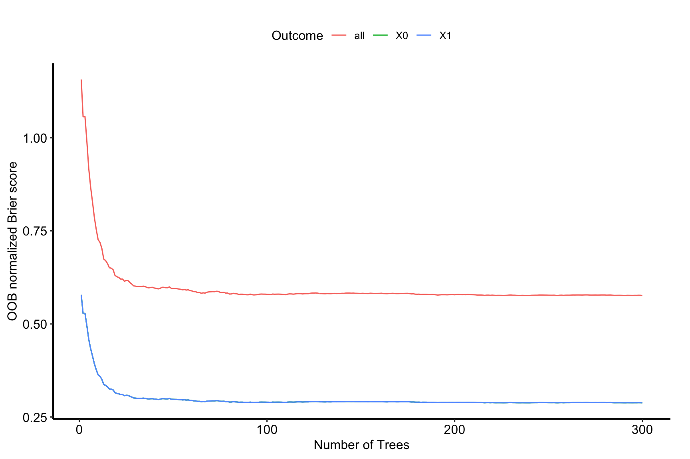
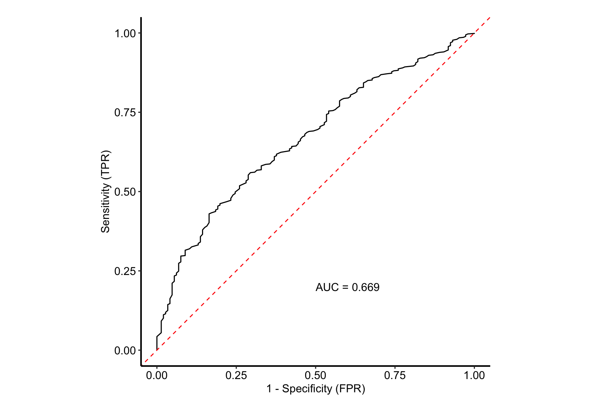
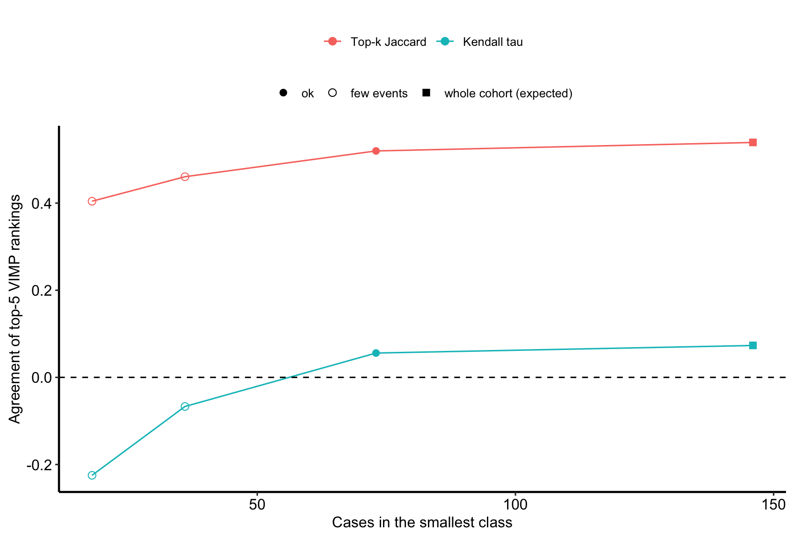
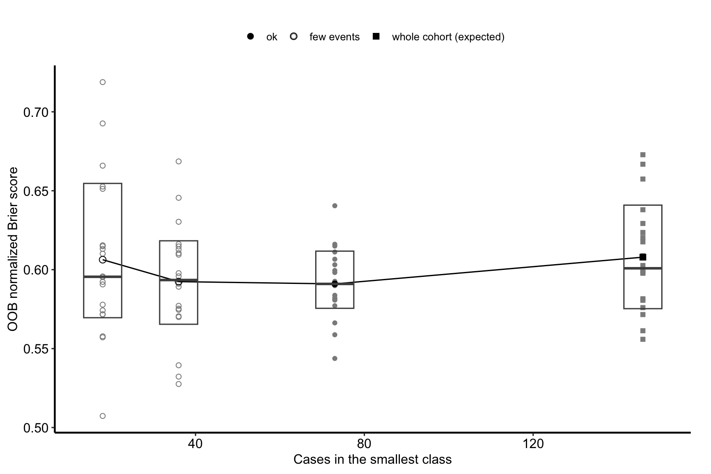

# Random forest classification: fit

# Random forest classification: fit

Published

2026-11-25 13:13

Gallery job on the synthetic cohort: major postoperative complication
(complication, 0/1).

An `rfc-fit` job grows a classification forest and checks that it
learned something: out-of-bag error by number of trees, the ROC curve
with its AUC, and a learning curve that asks whether the cohort is large
enough. **Importance and dependence plots are not here.** They are the
`rfc-explain` job in this same set, which reads the forest this job
saves instead of growing its own, so the explanations always describe
this forest.

Old `rfsrc.*` and `rf.*` jobs map onto three prefixes by outcome, read
from the job’s fit call and not from its name: a survival outcome is
`rfs`, a classification or binary outcome `rfc`, a continuous outcome
`rfr`.

Code

``` r
SUBJECT <- "complication"
TYPE    <- "rf"
.in <- knitr::current_input(dir = TRUE)
suppressPackageStartupMessages({
  library(randomForestSRC)
  library(ggRandomForests)
  library(hvtiRutilities)
})
# One thread, so a forest reproduces from machine to machine. Left unset,
# randomForestSRC runs on every core its OpenMP build can see, and on a
# multi-core server a varPro cross-validated cutoff changed with the thread
# count with every seed held fixed. Raise it for speed on a large forest, at the
# cost of that guarantee: a cached fit records its seed, data and package
# versions, never the threads it ran on.
options(rf.cores = 1L)
# The oldest versions this template works with.
# Below them a call here can fail or change meaning, and the message would
# arrive mid-render rather than here.
if (utils::packageVersion("randomForestSRC") < "3.7.0") {
  stop("This job needs randomForestSRC >= 3.7.0; ", utils::packageVersion("randomForestSRC"),
       " is installed.\nUpdate it, then re-render.", call. = FALSE)
}
# 4.0.1 is the first release with gg_learning() and learning_subsample(), for the
# learning curve.
if (utils::packageVersion("ggRandomForests") < "4.0.1") {
  stop("This job needs ggRandomForests >= 4.0.1; ", utils::packageVersion("ggRandomForests"),
       " is installed.\nUpdate it, then re-render.", call. = FALSE)
}
# The study root is the nearest directory above this file holding _study.yml,
# so the job renders the same from the Render button, quarto render, or
# render_job(), at any depth, with no path in this document to edit.
# Without the guard in .job_setup(), an unedited job renders green over a
# meaningless analysis. Here that is a forest grown on the template's
# placeholder outcome, predictors and tree count, whose error curve and ROC
# curve look exactly like a result.
# To render a job you have not finished, leave a chunk out with the chunk
# option skip, giving the reason in quotes, or call hvtiRtemplates::stop_here()
# in a chunk to leave out everything below it. A draft lists each one in a
# callout; a final render refuses them, as it refuses an unresolved marker.
# ?stop_here has more.
.job <- hvtiRtemplates:::.job_setup(SUBJECT, TYPE, envir = environment())
.root <- .job$root
set_path <- .job$set_path
.provenance_data <- list()
# Saves a figure as <name>.png, .pdf and .tiff in this set's graphs/ folder (or `kind`'s),
# under the SAVE_FIGURES and FIGURES study choices.
save_figure <- function(plot, name, width = 6, height = 4, kind = "graphs", linked = FALSE) {
  hvtiRtemplates:::.save_figure(plot, set_path(kind, paste0(name, ".png")), width, height,
                                SAVE_FIGURES, FIGURES, linked)
}

# `rfc-fit` writes the forest through set_path() and `rfc-explain` reads it back,
# both by set, so an explanation can never be filed against a different set
# than the forest it explains. The write is the `save` chunk at the foot of
# this file.
# The draft banners, if any, and the box under the title, after all the code above.
.job$notice
```

**final** · data `built` `built_20261125.parquet`, dated 2026-11-25 ·
rendered by gallery on gallery · hvtiRtemplates 1.6.3

## Study choices

Edit these values for this study before rendering.

Code

``` r
# Demo: the registered dataset this job reads ("built" is the study dataset).
# A file name, such as "match_set.rds", reads an unregistered file in the datasets folder, as a draft.
DATASET <- "built"

# Demo: an hvtiRdatabuild analysis set, or NULL to read the whole dataset.
ANALYSIS_SET <- NULL

# Demo: rows to keep, dplyr::filter() style, or NULL to keep every row:
#   WHERE <- quote(age >= 18)
#   WHERE <- rlang::exprs(age >= 18, hx_chf == 1)
WHERE <- NULL

# Demo: the patient identifier. If the data has no "ccfid" column, the job uses MRN, then eMRN;
# name another column, such as "randid", if the study uses one.
ID <- "patient_id"

# Demo: what makes a row unique; one row per patient unless repeated measures
# add their visit time or date, for example KEY <- c(ID, "iv_echo").
KEY <- ID

# Optional, and needs no edit: NULL reads the cohort alone. To join one
# registered ancillary dataset (echoes, labs), name it in JOIN. The cohort
# above decides the patients, one row each; the joined records of other
# patients are dropped and counted in the data table.
#   JOIN_VARS: the cohort columns each joined row carries; NULL carries all,
#     and a column both datasets have stops, so list only those the job needs.
#   REDUCE: NULL keeps a row per joined record, keyed on that dataset's key;
#     list(rule = "first", by = "echo_date") keeps one row per patient ("last",
#     or "nearest" with to = a cohort date column). WHERE on a joined column
#     filters the records first, so "last" with WHERE echo_type == "TTE"
#     keeps each patient's last TTE. A tie stops: picking one record
#     silently would be a hidden choice; by = c("echo_date", "echo_seq")
#     breaks it. This job models one row per
#     patient, so a long JOIN without REDUCE stops here.
#   JOIN_KEY: overrides the joined dataset's registered key.
JOIN <- NULL
JOIN_VARS <- NULL
REDUCE <- NULL
JOIN_KEY <- NULL

# Demo: the outcome to classify. Any coding works: 0/1, "yes"/"no" or a label.
# The read step makes it a factor, which is what makes this a classification
# forest rather than a regression on the codes.
RESPONSE <- "complication"

# Demo: the class whose one-versus-rest ROC curve and AUC this report should
# show. Use its label after RESPONSE becomes a factor: "1" for a 0/1 outcome,
# "yes" for no/yes, or the clinical category of interest for multiclass data.
ROC_CLASS <- "1"

# Demo: class imbalance. When the larger of two classes outnumbers the smaller
# by IMBALANCE_RATIO or more, the forest is grown as randomForestSRC's quantile
# classifier (RFQ) and scored by normalized Brier rather than misclassification:
# a forest that always predicts the larger class looks accurate by error rate,
# and its importance ranks variables by how well they predict that class. RFQ
# takes two classes only, so more classes get a warning. 3 is a start, not
# evidence. Inf never grows RFQ. Changing it, or crossing it, needs REFIT.
IMBALANCE_RATIO <- 3

# Demo: the candidate predictors. Name them rather than taking every column: a
# built dataset carries identifiers, dates and derived outcomes, and a forest
# will split on a date that quietly encodes follow-up.
PREDICTORS <- c("age", "female", "bmi", "hx_chf", "hx_dm", "nyha_pr", "lvef", "plvmassi", "creat_pr")

# Demo: forest size and seed. The error-by-trees plot below says whether NTREE
# was enough: a curve still falling at its right edge was not. SEED makes the
# forest reproducible and is part of its cache key. It is used twice, on
# purpose: cache_fit() seeds R's generator with it, and rfsrc() is handed it
# as `seed =`, negated as randomForestSRC documents. Without that
# argument rfsrc() draws a seed from R's generator, so the forest would depend
# on whatever ran before it.
NTREE <- 300
SEED  <- 2026

# The learning curve: is the cohort large enough? It refits the forest on
# subsamples of LEARNING_FRACTIONS of the patients, LEARNING_B times each, plus
# a bootstrap of the whole cohort, and tracks two things against the number of
# patients in the smallest class of RESPONSE: the out-of-bag error, and whether the top LEARNING_TOP_K variables
# by importance agree from one refit to the next (the top one fewer than there are
# predictors, when that is smaller). The second is the bar for rfc-explain, and
# it needs far more smallest-class cases than the first. The refits use a forest of
# their own, LEARNING_NTREE trees, because the curve needs agreement between
# forests rather than one precise forest, and NTREE trees each would multiply the
# cost by NTREE / LEARNING_NTREE. Three fractions and the whole-cohort
# bootstrap, 20 refits each, is 80 forests; it is cached and run by run_job().
LEARNING_FRACTIONS <- c(0.125, 0.25, 0.5)
LEARNING_B         <- 20
LEARNING_TOP_K     <- 5
LEARNING_NTREE     <- 250

# Demo: the recommendation printed under the learning curve. LEARNING_AGREEMENT is
# the agreement, Jaccard and Kendall tau both, that the top variables must reach at
# the rightmost point to call the cohort large enough. 0.8 is a cautious start, not
# evidence: with the top 5, a mean Jaccard of 0.8 needs most refits to share all
# five. MIN_PREDICTORS is the fewest candidate predictors for which a forest is
# worth fitting over a regression model. Both are advice; the job never stops on them.
LEARNING_AGREEMENT <- 0.8
MIN_PREDICTORS     <- 10

# Demo: "na.omit" drops a patient missing any predictor; "na.impute" keeps them
# and imputes inside the forest. The classification and regression exemplars
# imputed. Dropping is simpler to report and can shrink the cohort a great deal.
NA_ACTION <- "na.impute"

# Set TRUE after changing a choice above. A cache whose inputs changed stops the
# render instead of returning the old forest; TRUE recomputes only the caches
# that are out of date, so it is safe to leave on while iterating.
REFIT <- FALSE

# Each figure is saved to graphs/ as a PNG (for Word) and a PDF (for the publisher), and as a TIFF when ragg is installed.
# SAVE_FIGURES <- FALSE saves none; FIGURES keeps only the figures whose names
# start with one of its entries, e.g. FIGURES <- c("rfc-fit-diagnostics"). The names are the
# file names, listed for each template in the templates README.
SAVE_FIGURES <- TRUE
FIGURES <- NULL
```

## Cohort

Code

``` r
# The checksum of every dataset in manifest.yaml is checked before anything is
# read, so a result can name the data that produced it. It stops on a mismatch.
hvtiRutilities::verify_manifest(file.path(.root, "manifest.yaml"))
.cfg <- study_config(start = .root)
job_data <- hvtiRtemplates::read_job_data(.cfg, dataset = DATASET, analysis_set = ANALYSIS_SET,
                                          where = WHERE, id_col = ID, key_cols = KEY, join = JOIN, join_cols = JOIN_VARS,
                                          reduce = REDUCE, join_key_cols = JOIN_KEY, one_row_per_patient = TRUE)
d <- job_data$data
.provenance_data <- c(if (exists(".provenance_data")) .provenance_data else list(), list(job_data$provenance),
                      if (!is.null(job_data$provenance_join)) list(job_data$provenance_join))
knitr::kable(job_data$record, col.names = c("Data", ""))
.outcomes <- intersect(RESPONSE, PREDICTORS)
if (length(.outcomes)) {
  stop("Do not include the outcome variable in PREDICTORS: ", .outcomes, ".", call. = FALSE)
}
.duplicated <- unique(PREDICTORS[duplicated(PREDICTORS)])
if (length(.duplicated)) {
  stop("PREDICTORS names a variable more than once: ", paste(.duplicated, collapse = ", "), ".", call. = FALSE)
}
# A forest must not be trained on an identifier. It would split on who a
# patient is, not on what is true of them, and the saved forest keeps its
# training columns, so the identifier would be written into rfc.rds.
.selection <- attr(job_data$record, "selection")
.identifiers <- PREDICTORS[tolower(PREDICTORS) %in% tolower(c(.selection$id, .selection$key))]
if (length(.identifiers)) {
  stop("Do not include the patient identifier or a KEY column in PREDICTORS: ",
       paste(.identifiers, collapse = ", "), ".", call. = FALSE)
}
# Nor may the identifier be the outcome: the forest keeps its outcome column
# too. A KEY column that is not the ID, a visit time say, may be one.
if (any(tolower(RESPONSE) == tolower(.selection$id))) {
  stop("The patient identifier (", .selection$id, ") cannot be an outcome of this job.", call. = FALSE)
}
.missing <- setdiff(c(RESPONSE, PREDICTORS), names(d))
if (length(.missing)) {
  stop("Not in the data this job read: ", paste(.missing, collapse = ", "), call. = FALSE)
}
d <- d[, c(RESPONSE, PREDICTORS), drop = FALSE]

# A forest cannot learn from a patient with no outcome, and na.impute would
# impute one. So the outcome is required whatever NA_ACTION says.
.no_outcome <- is.na(d[[RESPONSE]])
if (any(.no_outcome)) {
  stop(sum(.no_outcome), " patient(s) have no ", RESPONSE, ". Resolve them in the ",
       "dataset build; the forest will not.", call. = FALSE)
}

# A numeric 0/1 outcome grows a REGRESSION forest, whose "probabilities" can
# fall outside 0 and 1 and whose error is a mean squared error. Nothing warns.
d[[RESPONSE]] <- factor(d[[RESPONSE]])
if (!is.character(ROC_CLASS) || length(ROC_CLASS) != 1L || is.na(ROC_CLASS) || !nzchar(ROC_CLASS) ||
      !ROC_CLASS %in% levels(d[[RESPONSE]])) {
  stop("ROC_CLASS must name one observed level of ", RESPONSE, "; ", deparse(ROC_CLASS),
       " is not an observed level. Choose one of: ", paste(levels(d[[RESPONSE]]), collapse = ", "), ".", call. = FALSE)
}
ROC_OUTCOME <- match(ROC_CLASS, levels(d[[RESPONSE]]))
# randomForestSRC discards a predictor with no values at all and keeps every
# row, so such a column would leave the forest without a word. The missing-values
# table would count every row as dropped, and under na.omit the classes below would
# be counted on no patients. Stop on it here, before either.
.empty <- PREDICTORS[vapply(d[PREDICTORS], function(x) all(is.na(x)), logical(1L))]
if (length(.empty)) {
  stop("PREDICTORS names a column with no values: ", paste(.empty, collapse = ", "),
       ". Remove it from PREDICTORS.", call. = FALSE)
}
# Read before any forest grows: it decides which forest that is. Under na.omit, rfsrc() drops a
# patient missing any predictor itself, so the classes are counted on the patients it keeps.
.balance_rows <- if (NA_ACTION == "na.omit") stats::complete.cases(d[PREDICTORS]) else rep(TRUE, nrow(d))
.balance <- hvtiRtemplates:::.class_balance(d[[RESPONSE]][.balance_rows], IMBALANCE_RATIO)

# A forest splits a text column only as a factor, so text predictors are
# converted here, and named, rather than left for the fit to refuse or coerce.
.chr <- PREDICTORS[vapply(d[PREDICTORS], is.character, logical(1L))]
if (length(.chr)) {
  d[.chr] <- lapply(d[.chr], factor)
  cat("Text predictors converted to factors: ", paste(.chr, collapse = ", "), "\n", sep = "")
}
```

| Data                |                                          |
|:--------------------|:-----------------------------------------|
| Source              | dataset `built` (built_20261125.parquet) |
| Rows read           | 800                                      |
| ID                  | `patient_id`                             |
| Identifiers dropped | none                                     |
| Rows kept           | 800 rows on 800 patients                 |

Table 1: The data this job read

Code

``` r
# unnumbered: its child chunk carries its own label and caption
if (!is.null(job_data$attrition)) {
  .fence <- strrep("`", 3)
  cat(knitr::knit_child(text = c(
    paste0(.fence, "{r}"), "#| label: tbl-data-attrition",
    paste0("#| tbl-cap: ", encodeString(paste0("Analysis set `", ANALYSIS_SET, "`: exclusions, in order"), quote = "\"")),
    "knitr::kable(job_data$attrition)", .fence
  ), envir = environment(), quiet = TRUE), sep = "\n")
}
```

Code

``` r
# na.omit drops a patient missing any predictor and na.impute keeps them, so the
# cohort the forest is grown on is said here, before it is.
.na_handling <- if (NA_ACTION == "na.impute") "impute" else "drop"
.missing_values <- hvtiRtemplates:::.missing_cases(d, RESPONSE = RESPONSE, PREDICTORS = PREDICTORS, action = .na_handling)
knitr::kable(.missing_values)
```

| Variable | Setting | Missing |
|:---|:---|:---|
| creat_pr | PREDICTORS | 75 |
| Complete cases |  | 800 of 800 rows analyzed; 75 with a missing value imputed |

Table 2: Missing values in the model’s variables

## Forest

Code

``` r
# cache_fit() writes <dir>/<name>.rds and its default dir is the study's
# estimates folder, not this set's, so every call here names the set's.
CACHE_DIR <- dirname(set_path("estimates", "rfc.rds"))
model <- stats::reformulate(".", response = RESPONSE)
# The saved forest keeps this formula, and a formula keeps the environment it
# was made in. That is the global environment in a render, which a saved file
# only refers to; set it, so a job run anywhere else does not write every
# object beside the formula, `job_data` and its patient IDs included, into
# the forest.
environment(model) <- globalenv()
# Two calls rather than one with switched arguments, so a balanced outcome keeps the cache key it
# had before the imbalance switch existed. splitrule = "auc" is imbalanced()'s default for RFQ.
forest <- if (.balance$rfq) {
  cache_fit(
    "rfc-forest",
    rfsrc(model, data = d, ntree = NTREE, na.action = NA_ACTION, importance = "none", block.size = 1, seed = -abs(SEED),
          rfq = TRUE, perf.type = "brier", splitrule = "auc"),
    seed = SEED, dir = CACHE_DIR, refit = REFIT
  )
} else {
  cache_fit(
    "rfc-forest",
    rfsrc(model, data = d, ntree = NTREE, na.action = NA_ACTION, importance = "none", block.size = 1, seed = -abs(SEED)),
    seed = SEED, dir = CACHE_DIR, refit = REFIT
  )
}
forest
```

                             Sample size: 800
               Frequency of class labels: 0=654, 1=146
                        Was data imputed: yes
                         Number of trees: 300
               Forest terminal node size: 1
           Average no. of terminal nodes: 128.57
    No. of variables tried at each split: 3
                  Total no. of variables: 9
           Resampling used to grow trees: swor
        Resample size used to grow trees: 506
                                Analysis: RFQ
                                  Family: class
                          Splitting rule: auc *random*
           Number of random split points: 10
                        Imbalanced ratio: 4.4795
                       (OOB) Brier score: 0.14409908
            (OOB) Normalized Brier score: 0.57639631
                               (OOB) AUC: 0.66908068
                          (OOB) Log-loss: 0.45369887
                            (OOB) PR-AUC: 0.28470161
                            (OOB) G-mean: 0.62368793
       (OOB) Requested performance error: 0.57639631, 0.28819816, 0.28819816

    Confusion matrix:

              predicted
      observed   0   1 class.error class.freq
             0 379 275      0.4205        654
             1  48  98      0.3288        146

          (OOB) Misclassification rate: 0.40375

    Random-classifier baselines (uniform):
       Brier: 0.25   Normalized Brier: 1   Log-loss: 0.69314718   PR-AUC: 0.1825

NoteClass imbalance

The classes are 0 654, 1 146, a ratio of 4.5 to 1 between the largest
and smallest, at or past 3 (IMBALANCE_RATIO). A forest scored by
misclassification would reward predicting the larger class every time,
so this forest is randomForestSRC’s quantile classifier (RFQ), and its
error and importance are the normalized Brier score. The explain job’s
importance and intervals use the same score.

`importance = "none"` is deliberate. Importance is the explain job’s
work, and cached there on its own, so it can be recomputed without
regrowing the forest.

`block.size = 1` is deliberate too. With importance off, randomForestSRC
records the out-of-bag error only at the last tree, and the error plot
below would be one point. One block per tree gives the curve that shows
whether `NTREE` was large enough.

## Does the forest work?

Code

``` r
# Out-of-bag error by number of trees, overall and per class.
err <- gg_error(forest)
# The manuscript theme hides the legend and its title, and the caption reads the marks from the legend.
# ggRandomForests labels the axis error rate whatever the forest scored; an RFQ forest scored Brier.
.fig <- plot(err) +
  if (.balance$rfq) ggplot2::labs(y = "OOB normalized Brier score")
.fig <- .fig +
  hvtiPlotR::theme_hv_manuscript(base_size = 12, legend.position = "top", legend.title = ggplot2::element_text())
save_figure(.fig, "rfc-fit-diagnostics-error")
.fig
```



Figure 1: Out-of-bag error by number of trees, overall and per class.
Each solid line traces the normalized Brier score of one outcome after
each additional tree, the line labeled all being the overall error, one
color per line as in the legend.

Code

``` r
# Out-of-bag one-versus-rest ROC curve, and the area under it, for the class
# named explicitly above. ggRandomForests selects by factor-level position,
# so ROC_OUTCOME maps the study's label to its position instead of letting
# factor ordering decide what this report means.
roc <- gg_roc(forest, which_outcome = ROC_OUTCOME)
.fig <- plot(roc) + hvtiPlotR::theme_hv_manuscript(base_size = 12)
save_figure(.fig, "rfc-fit-diagnostics-roc")
.fig
```



Figure 2: Out-of-bag ROC curve for the chosen class against the rest.
The black solid line is the curve, the red dashed diagonal the line of
no discrimination, and the text in the lower right the area under the
curve.

Code

``` r
auc <- calc_auc(roc)
auc
```

    [1] 0.6692849

`gg_brier()` is not here: it supports survival forests only. The table
below computes the Brier score directly.

Code

``` r
# The classification counterpart of variance explained. A patient no tree left
# out has no out-of-bag prediction; both scores leave them out, so the two
# compare the same patients.
.prob <- forest$predicted.oob
.oob <- stats::complete.cases(.prob)
.prob <- .prob[.oob, , drop = FALSE]
# One column per class, 1 in the patient's own class and 0 elsewhere, matched
# to the prediction columns by name rather than by position.
.obs <- outer(as.character(forest$yvar[.oob]), colnames(.prob), "==") * 1
.brier <- mean(rowSums((.prob - .obs)^2))
.share <- colMeans(.obs)
.brier_ref <- sum(.share * (1 - .share))
knitr::kable(data.frame(
  measure = c("Patients with an out-of-bag prediction", "Out-of-bag Brier score", "Brier score of the class shares",
              "Brier skill score", paste0("C statistic (", ROC_CLASS, " against the rest)")),
  # The C statistic is the area under the ROC curve the diagnostics-auc chunk
  # computed, not a second calculation, so the table and figure cannot disagree.
  value = c(paste(sum(.oob), "of", length(.oob)),
            format(signif(c(.brier, .brier_ref, 1 - .brier / .brier_ref, auc), 3)))
))
```

| measure                                | value      |
|:---------------------------------------|:-----------|
| Patients with an out-of-bag prediction | 800 of 800 |
| Out-of-bag Brier score                 | 0.2880     |
| Brier score of the class shares        | 0.2980     |
| Brier skill score                      | 0.0341     |
| C statistic (1 against the rest)       | 0.6690     |

Table 3: Brier skill score. How many patients have an out-of-bag
prediction, the forest’s out-of-bag Brier score, the Brier score of
predicting each class’s share of the cohort for every patient, and the
forest’s skill, one minus their ratio, then the C statistic, the area
under the ROC curve above.

The five rows, in order:

- **Patients with an out-of-bag prediction.** A patient gets one only
  from a tree grown without them. Each tree leaves out about a third of
  the patients, so after *b* trees a patient has none with a chance of
  roughly 0.63 to the power *b*. Both scores below rest on these
  patients alone. When this row is short of the whole cohort, the forest
  has too few trees; raise `NTREE`.
- **Out-of-bag Brier score.** For each patient, the squared differences
  between the forest’s out-of-bag probability for each class and 1 for
  the patient’s own class or 0 for the others, summed over the classes
  and averaged over the patients. It is the mean squared error of the
  probabilities, so it rewards a forest that is confident and right and
  penalizes one that is confident and wrong, which the misclassification
  rate in the error figure does not. 0 is perfect; summed over the
  classes it can reach 2. With two classes it is twice the more familiar
  single-column Brier score, and the skill score below is the same
  either way.
- **Brier score of the class shares.** The Brier score of the simplest
  prediction there is: every patient given each class’s share of these
  patients as its probability. It needs no predictors, so it is the
  baseline the forest must beat. It equals the sum over the classes of
  the share times one minus the share, so a rare outcome makes it small
  and leaves the forest little room to improve on it.
- **Brier skill score.** One minus the second row over the third: the
  share of the baseline’s error the forest removes. It reads like
  variance explained, 1 perfect and 0 no better than the class shares,
  and like it, it is out of bag, so it is not inflated by scoring the
  patients the forest was fit to. It can fall below 0, and when it does
  the forest’s probabilities are worse than the class shares. A forest
  can rank patients well, a high area under the ROC curve, and still
  score low here if its probabilities are poorly calibrated.
- **C statistic.** The area under the ROC curve above, for `ROC_CLASS`
  against the other classes: the chance that a patient chosen at random
  from that class is given a higher probability of it than a patient
  chosen at random from the rest. 0.5 is a coin flip and 1 a perfect
  ordering. With two classes it is Harrell’s C, the same measure
  `rfs-fit` reports for survival. C measures discrimination, the order,
  and the rows above measure accuracy, the probabilities: a forest that
  ranks every patient correctly but gives each a probability far from
  the truth keeps its C and loses Brier skill. Read the two together.

### Is the cohort large enough?

Code

``` r
# One randomForestSRC::subsample() result per fraction and the whole-cohort
# bootstrap last. Each subsample keeps the share of each class of the cohort
# (stratify = TRUE), and learning_subsample() records that, so the count of the
# smallest class in each subsample refit is exact. The bootstrap draws with
# replacement, so its count varies from draw to draw: the count shown for it is
# the cohort's, the expected number in each draw, not an exact one.
# randomForestSRC 3.10.0 crashes R when it double-bootstraps a forest that imputed missing values (na.impute on
# data with any NA); the plain subsamples are safe. So the learning curve first fills the gaps, once, with the main
# forest's imputed values, and its own forests then have nothing to impute. Those values came from the whole cohort,
# outcomes included, so each refit has seen part of the patients it leaves out, and every fraction may be
# optimistic; the table, captions and reading text say so. If the gaps cannot be filled (the forest dropped rows),
# the whole-cohort bootstrap is left out instead and the curve stops at the largest fraction.
.learning_filled <- NA_ACTION == "na.impute" && length(forest$imputed.indv) > 0L && nrow(forest$xvar) == nrow(d)
.d_learn <- d
if (.learning_filled) {
  .d_learn[forest$imputed.indv, names(forest$imputed.data)] <- forest$imputed.data
  message(sprintf(paste0("The learning curve fills the gaps in %d rows once, with the main forest's imputed values. ",
                         "Those were estimated from the whole cohort, so every fraction may be optimistic."),
                  length(forest$imputed.indv)))
}
```

    The learning curve fills the gaps in 75 rows once, with the main forest's imputed values. Those were estimated from the whole cohort, so every fraction may be optimistic.

Code

``` r
.learning_boot <- !(NA_ACTION == "na.impute" && anyNA(.d_learn))
if (!.learning_boot) {
  message("The whole-cohort bootstrap is left out: the forest imputes missing values, and randomForestSRC cannot ",
          "double-bootstrap such a forest. The curve stops at the largest fraction.")
}
# Quoted once, so the check below and cache_fit() read the same call.
# subsample() refits with the forest's own rfq and perf.type, so an RFQ forest's refits are RFQ too.
# Each is assigned straight from quote(), the form the seed check follows to the seeded cache_fit() below.
.learning_code <- quote({
  .lf <- rfsrc(model, data = .d_learn, ntree = LEARNING_NTREE, na.action = NA_ACTION, importance = "permute", seed = -abs(SEED))
  learning_subsample(.lf, fractions = LEARNING_FRACTIONS, replicates = LEARNING_B, bootstrap = .learning_boot)
})
if (.balance$rfq) {
  .learning_code <- quote({
    .lf <- rfsrc(model, data = .d_learn, ntree = LEARNING_NTREE, na.action = NA_ACTION, importance = "permute",
                 seed = -abs(SEED), rfq = TRUE, perf.type = "brier", splitrule = "auc")
    learning_subsample(.lf, fractions = LEARNING_FRACTIONS, replicates = LEARNING_B, bootstrap = .learning_boot)
  })
}
# Refused outside run_job() only when the refits will actually run: a current cache loads, even under REFIT.
if (hvtiRutilities::cache_would_fit("rfc-learning", .learning_code, seed = SEED, dir = CACHE_DIR, refit = REFIT)) {
  hvtiRtemplates::guard_long_fit("rfc-learning", dir = CACHE_DIR,
                                 why = sprintf("the learning curve grows %d forests of %d trees",
                                               (length(LEARNING_FRACTIONS) + .learning_boot) * LEARNING_B, LEARNING_NTREE),
                                 refit = REFIT)
}
learning_fits <- cache_fit("rfc-learning", .learning_code, seed = SEED, dir = CACHE_DIR, refit = REFIT)
# The top-k set must leave at least one predictor out. With k equal to the number
# of predictors every refit has the same set, and the Jaccard agreement is 1 however
# the ranking moves. With a single predictor there is no ranking to agree on, and
# both measures say nothing.
.learning_k <- max(1L, min(as.integer(LEARNING_TOP_K), length(PREDICTORS) - 1L))
if (length(PREDICTORS) < 2L) {
  message("One predictor: there is no importance ranking, so the agreement measures are not informative. ",
          "Read the error curve only.")
}
# With one predictor gg_learning() warns that top_k covers every predictor and leaves the Jaccard agreement NA. The
# message above already says so, and its advice to lower top_k cannot apply, so that one warning is muffled.
learning <- withCallingHandlers(
  gg_learning(learning_fits, top_k = .learning_k, min_events = 50),
  warning = function(w) {
    if (length(PREDICTORS) < 2L && grepl("'top_k'", conditionMessage(w), fixed = TRUE)) invokeRestart("muffleWarning")
  }
)
# The captions and the reading note follow what ran. Without the bootstrap the rightmost point is the largest
# subsample, not the whole cohort; with filled gaps every fraction may be optimistic, not only those above one half.
# In a saved report or an exported figure the console messages above are gone, so this is where a reader learns it.
if (.learning_filled) {
  .learning_note <- paste0("Missing values were filled in once with the forest's imputed values, which were ",
                           "estimated from the whole cohort, outcomes included. Every refit has therefore ",
                           "seen part of the patients it leaves out, so its error and agreement may be ",
                           "optimistic at every fraction, not only above one half.")
} else if (!.learning_boot) {
  .learning_note <- paste0("The whole-cohort bootstrap was left out: the forest imputes missing values that ",
                           "could not be filled in, and randomForestSRC cannot double-bootstrap such a ",
                           "forest. The curve stops at the largest fraction, a subsample.")
} else {
  .learning_note <- ""
}
.learning_right <- if (.learning_boot) paste0(" (for the rightmost point, the whole-cohort bootstrap, drawn ",
                                              "as a square, the cohort's count: the expected number in each ",
                                              "draw)") else ""
.learning_caps <- list(
  tbl = paste(paste0("Learning curve. Error is the mean out-of-bag ", .balance$metric, " of the refits at each ",
                     "fraction; agreement is between the refits' top variables by importance. Smallest class",
                     " counts the patients in the outcome's rarest class."),
              if (.learning_boot) paste0("Fraction 1 is a bootstrap of the whole cohort: its count is the ",
                                         "cohort's, the number expected in each draw, which varies because ",
                                         "the bootstrap draws with replacement."),
              .learning_note),
  stability = paste(sprintf(paste0("Agreement of the top variables by importance between refits, by the ",
                                   "number of cases in the smallest class in each refit%s. A line that is ",
                                   "still rising at the rightmost point means the importance ranking would ",
                                   "change with more patients. Open markers have fewer than 50 cases in the ",
                                   "smallest class; triangles are fractions above one half, where agreement ",
                                   "is optimistic."), .learning_right),
                    paste0("Jaccard runs from 0, no top variable shared, to 1, the same set; Kendall tau ",
                           "from -1, the order reversed, through 0, no relation, to 1, the same order. The dashed line marks 0."),
                    .learning_note),
  error = paste(sprintf(paste0("Out-of-bag ", .balance$metric, " by the number of cases in the smallest class in each ",
                               "refit%s. Gray points are single refits and the black line their mean, each ",
                               "mean drawn in its fraction's marker. Boxes span the 15th to 85th percentile of ",
                               "the refits, with a line at the median. Open markers have fewer than 50 cases ",
                               "in the smallest class, too few for their error to be trusted."), .learning_right),
                .learning_note)
)
```

**What the agreement measures.** Every refit ranks the predictors by
importance, and each pair of refits at a fraction is compared on its top
5 variables. The table and figure show the mean over all pairs. Both
measures are 1 when two refits agree exactly and share the figure’s
axis, but they do not share a floor.

- **Jaccard** asks whether two refits pick the same top variables, in
  any order: the number they share divided by the number in either. It
  runs from 0, no variable in common, to 1, the same set. With the top
  5, a pair sharing 4 of them scores 0.67, 3 scores 0.43, 2 scores 0.25,
  1 scores 0.11.
- **Kendall tau** asks whether two refits put those variables in the
  same order. It is taken over every variable in either top set, ranked
  by each refit’s full importance, so a variable in one top set and not
  the other counts against it. It runs from -1, the order reversed,
  through 0, no relation, to 1, the same order. A tau of 0.6 means about
  80% of pairs of variables fall in the same order in both refits; at or
  below 0 the order is no better than chance.

Code

``` r
.lt <- summary(learning)
# Exact for a stratified subsample; for the bootstrap, and any unstratified draw, the count is the expected one.
.lt_count <- ifelse(.lt$counts == "exact", format(.lt$events), paste(format(.lt$events), "(expected)"))
.lt_caution <- ifelse(.lt$low_events, "few cases", ifelse(.lt$optimistic, "optimistic", ""))
# Filled gaps make every fraction optimistic, so every row says so; the caption says why.
if (.learning_filled) .lt_caution <- ifelse(nzchar(.lt_caution), paste0(.lt_caution, ", imputed"), "imputed")
knitr::kable(
  data.frame(Fraction = .lt$fraction, Patients = .lt$n, `Smallest class` = .lt_count, Refits = .lt$B,
             Error = sprintf("%.3f (SD %.3f)", .lt$error_mean, .lt$error_sd),
             Jaccard = sprintf("%.2f", .lt$jaccard), `Kendall tau` = sprintf("%.2f", .lt$kendall),
             Caution = .lt_caution,
             check.names = FALSE),
  align = "rrrrrrrl"
)
```

| Fraction | Patients | Smallest class | Refits | Error | Jaccard | Kendall tau | Caution |
|---:|---:|---:|---:|---:|---:|---:|:---|
| 0.125 | 99 | 18 | 20 | 0.606 (SD 0.050) | 0.40 | -0.22 | few cases, imputed |
| 0.250 | 199 | 36 | 20 | 0.592 (SD 0.036) | 0.46 | -0.07 | few cases, imputed |
| 0.500 | 400 | 73 | 20 | 0.591 (SD 0.022) | 0.52 | 0.06 | imputed |
| 1.000 | 800 | 146 (expected) | 20 | 0.608 (SD 0.033) | 0.54 | 0.07 | imputed |

Table 4: Learning curve. Error is the mean out-of-bag normalized Brier
score of the refits at each fraction; agreement is between the refits’
top variables by importance. Smallest class counts the patients in the
outcome’s rarest class. Fraction 1 is a bootstrap of the whole cohort:
its count is the cohort’s, the number expected in each draw, which
varies because the bootstrap draws with replacement. Missing values were
filled in once with the forest’s imputed values, which were estimated
from the whole cohort, outcomes included. Every refit has therefore seen
part of the patients it leaves out, so its error and agreement may be
optimistic at every fraction, not only above one half.

Code

``` r
# The dashed line marks 0, Kendall tau's no relation between two orders, and the floor of Jaccard.
.fig <- plot(learning) +
  ggplot2::geom_hline(yintercept = 0, linetype = "dashed") +
  # Two legends, the measures and the markers: side by side they run past a 6.5 inch figure, so they stack.
  hvtiPlotR::theme_hv_manuscript(base_size = 12, legend.position = "top", legend.box = "vertical")
save_figure(.fig, "rfc-fit-learning-stability")
.fig
```



Figure 3: Agreement of the top variables by importance between refits,
by the number of cases in the smallest class in each refit (for the
rightmost point, the whole-cohort bootstrap, drawn as a square, the
cohort’s count: the expected number in each draw). A line that is still
rising at the rightmost point means the importance ranking would change
with more patients. Open markers have fewer than 50 cases in the
smallest class; triangles are fractions above one half, where agreement
is optimistic. Jaccard runs from 0, no top variable shared, to 1, the
same set; Kendall tau from -1, the order reversed, through 0, no
relation, to 1, the same order. The dashed line marks 0. Missing values
were filled in once with the forest’s imputed values, which were
estimated from the whole cohort, outcomes included. Every refit has
therefore seen part of the patients it leaves out, so its error and
agreement may be optimistic at every fraction, not only above one half.

Code

``` r
# A box per fraction, from the 15th to the 85th percentile of its refits, with a line at the median.
.fig <- plot(learning, panel = "error") +
  hvtiRtemplates:::.learning_error_box(learning) +
  hvtiPlotR::theme_hv_manuscript(base_size = 12, legend.position = "top")
# The axis says error rate for any classification forest; an RFQ forest's refits scored Brier.
if (.balance$rfq) .fig <- .fig + ggplot2::labs(y = "OOB normalized Brier score")
save_figure(.fig, "rfc-fit-learning-error")
.fig
```



Figure 4: Out-of-bag normalized Brier score by the number of cases in
the smallest class in each refit (for the rightmost point, the
whole-cohort bootstrap, drawn as a square, the cohort’s count: the
expected number in each draw). Gray points are single refits and the
black line their mean, each mean drawn in its fraction’s marker. Boxes
span the 15th to 85th percentile of the refits, with a line at the
median. Open markers have fewer than 50 cases in the smallest class, too
few for their error to be trusted. Missing values were filled in once
with the forest’s imputed values, which were estimated from the whole
cohort, outcomes included. Every refit has therefore seen part of the
patients it leaves out, so its error and agreement may be optimistic at
every fraction, not only above one half.

**Reading the curve.** The error usually levels off long before the
importance ranking does. A cohort whose error has flattened can still
give a ranking that a second cohort of the same size would not
reproduce. Read the agreement at the whole cohort, and whether the line
is still rising there. How many cases a stable ranking needs depends on
the signal: the weaker the predictors, the more cases in the smallest
class it takes to reach an agreement of 0.8. That 0.8 is a reference
point, not a threshold this job enforces. Agreement at a fraction above
one half is optimistic, because refits that large share most of their
patients, and the whole-cohort point is a bootstrap for that reason.
Missing values were filled in once with the forest’s imputed values,
which were estimated from the whole cohort, outcomes included. Every
refit has therefore seen part of the patients it leaves out, so its
error and agreement may be optimistic at every fraction, not only above
one half. The agreement is between the top variables, so it needs
predictors left out: with 5 or fewer predictors the job compares the top
one fewer than there are.

WarningRecommendation

**Cohort size: not yet.** At the rightmost point, 146 cases in the
smallest class, the top-5 Jaccard is 0.54 and Kendall tau 0.07, against
0.80 (LEARNING_AGREEMENT), and agreement has leveled off. The top
variables change from refit to refit at this cohort size. The forest may
still predict (see the error curve), but its importance ranking and the
partial plots drawn from it are not yet reproducible.

**Predictors: few.** 9 predictors, under 10 (MIN_PREDICTORS). With this
few, a logistic regression on the same predictors is likely as
informative and simpler to report; fit one alongside before relying on
the forest.

Both thresholds are study choices, set under `EDIT:`, not rules. Missing
values were filled in once with the forest’s imputed values, which were
estimated from the whole cohort, outcomes included. Every refit has
therefore seen part of the patients it leaves out, so its error and
agreement may be optimistic at every fraction, not only above one half.

Code

``` r
# The product of this job, and what rfc-explain reads. It is separate from the
# cache on purpose: cache_fit() stores a keyed record rather than the bare
# forest, so the cache is this job's internals and this file is its interface.
# The price is the forest on disk twice.
forest <- hvtiRtemplates:::.attach_handoff_lineage(
  forest,
  data = .provenance_data,
  analysis = list(
    outcome = list(
      variable = RESPONSE,
      kind = "classification",
      observed_levels = levels(forest$yvar),
      target_level = ROC_CLASS
    )
  ),
  cohort = list(n = as.integer(length(forest$yvar))),
  # rfc-explain takes the rows, ID and KEY of this fit from this record.
  selection = attr(job_data$record, "selection")
)
saveRDS(forest, set_path("estimates", "rfc.rds"))
```

## About this run

| Group           | Item           | Value                       |
|:----------------|:---------------|:----------------------------|
| Run             | Started        | 2026-11-25 13:13:47 EST     |
|                 | Ended          | 2026-11-25 13:13:58 EST     |
|                 | Duration       | 10 s                        |
|                 | Status         | final                       |
|                 | Rendered by    | gallery                     |
|                 | Host           | gallery                     |
| Job             | File           | rfc.fit.complication.rf.qmd |
|                 | Template       | rfc.fit                     |
|                 | Subject        | complication                |
|                 | Type           | rf                          |
|                 | hvtiRtemplates | 1.6.3                       |
| Dataset `built` | Version file   | built_20261125.parquet      |
|                 | Version date   | 2026-11-25                  |
|                 | Source file    | built.rds                   |
|                 | Rows kept      | 800 rows on 800 patients    |
|                 | WHERE          | none                        |
|                 | sha256         | d99147a5c095                |
|                 | Manifest       | current                     |
| Reproducibility | Seed           | 2026                        |
|                 | renv           | not active                  |
