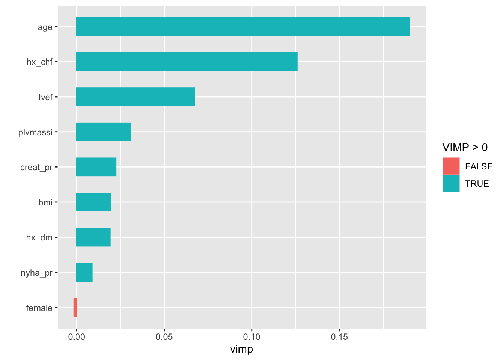
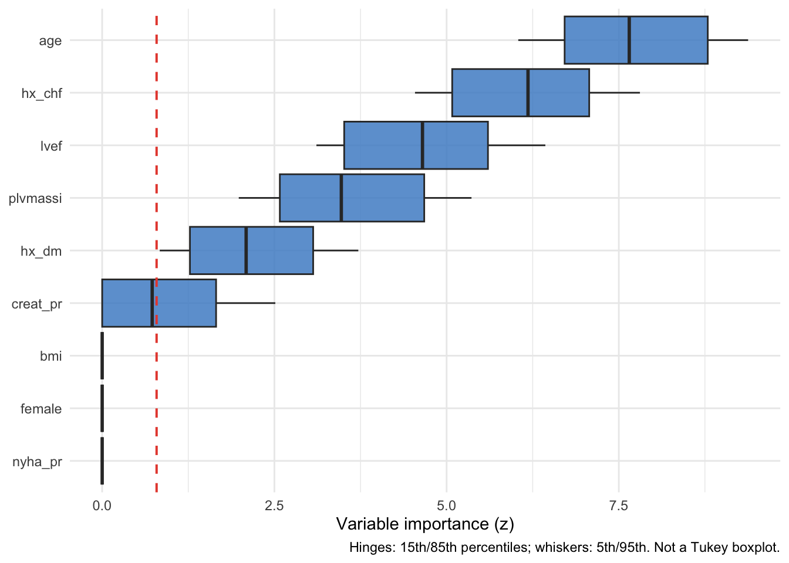
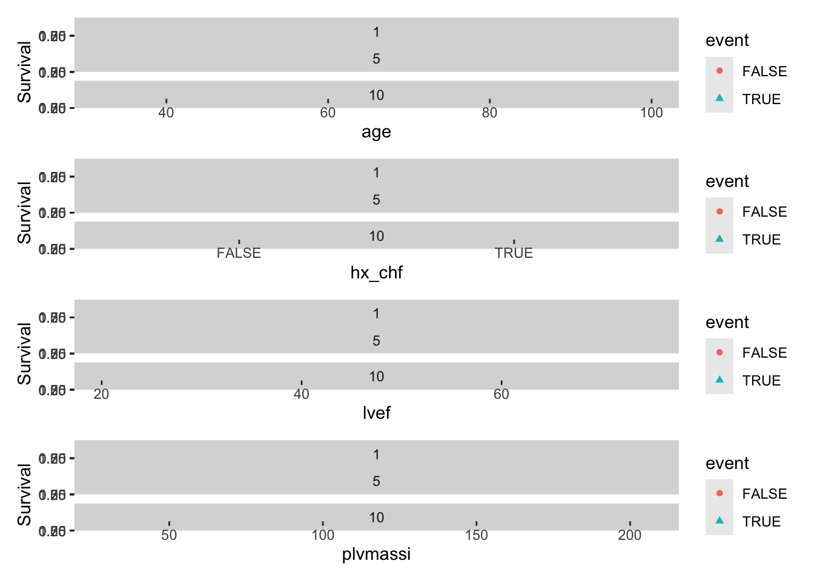
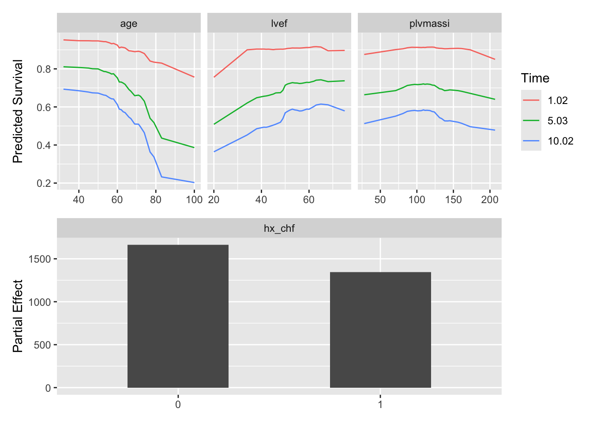
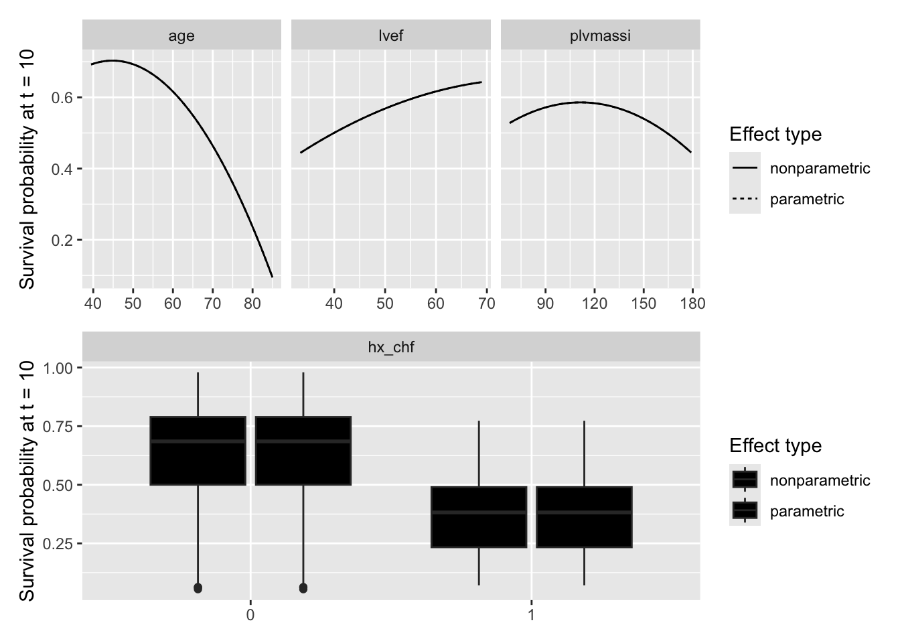

# Random forest survival: explain

# Random forest survival: explain

Published

2026-10-12 16:26

Explains the forest the `rfs-fit` job in this set saved: which
predictors drive it, and how.

An `rfs-explain` job never grows a forest. It reads `rfs.rds`, which the
fit job writes, and rebuilds the training data and the model from the
forest itself. VIMP, minimal depth and the partial-dependence plots all
describe that saved forest and no other; VarPro grows its own forests on
the same training data, so its panel and partial describe forests VarPro
grew, not the saved one. Each expensive step is cached on its own:
changing how many variables get dependence plots recomputes the partials
and nothing else.

Code

``` r
SUBJECT <- "dead"
TYPE    <- "rf"
.in <- knitr::current_input(dir = TRUE)
suppressPackageStartupMessages({
  library(randomForestSRC)
  library(varPro)
  library(ggRandomForests)
  library(hvtiRutilities)
})
# One thread, so a forest reproduces from machine to machine. Left unset,
# randomForestSRC runs on every core its OpenMP build can see, and on a
# multi-core server a varPro cross-validated cutoff changed with the thread
# count with every seed held fixed. Raise it for speed on a large forest, at the
# cost of that guarantee: a cached fit records its seed, data and package
# versions, never the threads it ran on.
options(rf.cores = 1L)
# The versions this template was verified against, end to end, on 2026-09-19.
# Below them a call here can fail or change meaning, and the message would
# arrive mid-render rather than here.
if (utils::packageVersion("randomForestSRC") < "3.7.0") {
  stop("This job needs randomForestSRC >= 3.7.0; ", utils::packageVersion("randomForestSRC"),
       " is installed.\nUpdate it, then re-render.", call. = FALSE)
}
if (utils::packageVersion("ggRandomForests") < "4.0.0") {
  stop("This job needs ggRandomForests >= 4.0.0; ", utils::packageVersion("ggRandomForests"),
       " is installed.\nUpdate it, then re-render.", call. = FALSE)
}
if (utils::packageVersion("varPro") < "3.2.0") {
  stop("This job needs varPro >= 3.2.0; ", utils::packageVersion("varPro"),
       " is installed.\nUpdate it, then re-render.", call. = FALSE)
}
# The study root is the nearest directory above this file holding _study.yml,
# so the job renders the same from the Render button, quarto render, or
# render_job(), at any depth, with no path in this document to edit.
# Without the guard in .job_setup(), an unedited job renders green over a
# meaningless analysis. Here that is dependence plots at placeholder survival
# horizons, drawn in units the study's follow-up may not even use, which look
# exactly like a result.
# To render a job you have not finished, leave a chunk out with the chunk
# option skip, giving the reason in quotes, or call hvtiRtemplates::stop_here()
# in a chunk to leave out everything below it. A draft lists each one in a
# callout; a final render refuses them, as it refuses an unresolved marker.
# ?stop_here has more.
.job <- hvtiRtemplates:::.job_setup(SUBJECT, TYPE, envir = environment())
.root <- .job$root
set_path <- .job$set_path
.provenance_data <- list()
# Saves a figure as <name>.png and <name>.pdf in this set's graphs/ folder (or `kind`'s),
# under the SAVE_FIGURES and FIGURES study choices.
save_figure <- function(plot, name, width = 6, height = 4, kind = "graphs", linked = FALSE) {
  hvtiRtemplates:::.save_figure(plot, set_path(kind, paste0(name, ".png")), width, height,
                                SAVE_FIGURES, FIGURES, linked)
}

# `rfs-explain` reads the forest `rfs-fit` wrote in this same set, and caches
# its own work beside it.
# The draft banners, if any, and the box under the title, after all the code above.
.job$notice
```

**final** · data: see About this run · rendered by gallery on gallery ·
hvtiRtemplates 1.3.1

## Study choices

Edit these values for this study before rendering. The outcome and
predictors are not here: they come from the forest.

Code

``` r
# Demo: the fit's selection is used; set any of these only to confirm it.
# NULL takes the value the fit job used.
WHERE <- NULL
ID <- NULL
KEY <- NULL

# Demo: how many variables get dependence plots, ranked by VIMP. The partials
# are the expensive step, so keep this small.
TOP_K <- 4

# Demo: or name the variables yourself. NULL takes the top TOP_K by VIMP.
PARTIAL_VARS <- NULL

# Demo: survival horizons for the partial plots, in the units of the fit job's
# time variable. The VarPro partial uses the last one.
TIMES <- c(1, 5, 10)

# Demo: seed for VIMP, VarPro and the partials. It is part of every cache key.
# cache_fit() seeds R's generator with it before each call, and vimp() and
# varpro() are also handed it as `seed =`, negated as randomForestSRC
# documents. Both halves matter: varpro() draws from R's generator as well as
# from its own seed, so the same seed after a different chunk gave different
# importances.
SEED <- 2026

# Set TRUE after changing a choice above. A cache whose inputs changed stops the
# render instead of returning the old result; TRUE recomputes only the caches
# that are out of date.
REFIT <- FALSE

# Each figure is saved to graphs/ as a PNG (for Word) and a PDF (for the publisher).
# SAVE_FIGURES <- FALSE saves neither; FIGURES keeps only the figures whose names
# start with one of its entries, e.g. FIGURES <- c("hp-survival"). The names are the
# file names, listed for each template in the templates README.
SAVE_FIGURES <- TRUE
FIGURES <- NULL
```

## The forest

Code

``` r
.handoff <- set_path("estimates", "rfs.rds")
if (!file.exists(.handoff)) {
  stop("No forest at ", .handoff, ". Render the rfs-fit job in this set first; ",
       "this job explains that forest and never grows its own.", call. = FALSE)
}
.cfg <- study_config(start = .root)
.forest_read <- hvtiRtemplates:::.read_handoff(.handoff, "forest", .cfg, "the rfs-fit job")
forest <- .forest_read$value
.provenance_data <- .forest_read$lineage$data
.provenance_artifacts <- c(.forest_read$lineage$artifacts, list(.forest_read$record))
if (!identical(forest$family, "surv")) {
  stop("rfs.rds holds a '", forest$family, "' forest, not a survival forest.", call. = FALSE)
}
CACHE_DIR <- dirname(.handoff)

# The training data and the model, from the forest rather than re-read. A
# VarPro or partial call on a frame that differs from the fitted one explains a
# model nobody fit. The forest keeps no usable formula (`$formula` is NULL and
# `$call` holds whatever expression the fit job wrote), so the model is rebuilt
# from the outcome names. `xvar` keeps any missing values under na.impute, and
# varpro() drops every patient that has one, so it would describe fewer patients
# than the forest. The values the forest imputed are put back in below, so both
# cover the same patients. (Handing varpro() the forest's `imputed.data` as it
# stands fails: that holds only the imputed patients.)
frame <- cbind(forest$yvar, forest$xvar)
if (!is.null(forest$imputed.data)) {
  frame[forest$imputed.indv, names(forest$imputed.data)] <- forest$imputed.data
}
model <- stats::as.formula(paste0("Surv(", forest$yvar.names[1], ", ",
                                  forest$yvar.names[2], ") ~ ."))
```

Code

``` r
# This job reads no data: the forest carries its training rows. The fit job
# recorded how it chose them, and a setting above that differs from the fit's
# stops here rather than describe rows the forest was not grown on.
.sel <- hvtiRtemplates:::.read_upstream_job_data(
  .cfg, .forest_read$lineage, list(where = WHERE, id = ID, key = KEY), read = FALSE, source = "rfs.rds"
)$selection
knitr::kable(data.frame(step = c("ID", "KEY", "WHERE", "Rows"),
                        value = c(.sel$id, paste(.sel$key, collapse = ", "),
                                  if (length(.sel$where_shown)) paste(.sel$where_shown, collapse = "; ") else "none",
                                  .sel$rows)),
             col.names = c("Data", ""))
```

| Data  |            |
|:------|:-----------|
| ID    | patient_id |
| KEY   | patient_id |
| WHERE | none       |
| Rows  | 800        |

Table 1: The data the fit job read

## Importance

Code

``` r
vi <- cache_fit("rfs-vimp", vimp(forest, seed = -abs(SEED)), seed = SEED, dir = CACHE_DIR, refit = REFIT)
.fig <- plot(gg_vimp(vi))
save_figure(.fig, "rfs-explain-importance")
.fig
```



Figure 1: Permutation importance of each predictor

Code

``` r
# Minimal depth ranks by how near the root a variable first splits, a second
# opinion that needs no permutation. Cheap, so not cached.
ranked <- names(sort(vi$importance, decreasing = TRUE))
depth <- max.subtree(forest)$order[, 1]
data.frame(variable = ranked,
           vimp = round(vi$importance[ranked], 4),
           min_depth = round(depth[ranked], 2),
           row.names = NULL)
```

      variable    vimp min_depth
    1      age  0.1897      1.13
    2   hx_chf  0.1258      1.44
    3     lvef  0.0671      1.88
    4 plvmassi  0.0306      2.58
    5 creat_pr  0.0223      3.06
    6      bmi  0.0193      3.34
    7    hx_dm  0.0190      3.44
    8  nyha_pr  0.0087      4.37
    9   female -0.0013      7.63

Table 2: Permutation importance and minimal depth of each predictor, in
order of importance

Code

``` r
if (is.null(PARTIAL_VARS)) {
  sel <- head(ranked, TOP_K)
} else {
  # A misspelt name would otherwise fail deep inside the partial call, or be
  # dropped from a plot without a word.
  .unknown <- setdiff(PARTIAL_VARS, forest$xvar.names)
  if (length(.unknown)) {
    stop("PARTIAL_VARS names variable(s) the forest was not grown on: ",
         paste(.unknown, collapse = ", "), call. = FALSE)
  }
  sel <- PARTIAL_VARS
}
```

## VarPro

VarPro is given the forest’s own data. When the fit imputed missing
values (`NA_ACTION` was `"na.impute"`), that is the imputed data, so
VarPro and the forest describe the same patients.

Code

``` r
vp <- cache_fit("rfs-varpro", varpro(model, frame, verbose = FALSE, seed = -abs(SEED)),
                seed = SEED, dir = CACHE_DIR, refit = REFIT)
.fig <- plot(gg_varpro(vp))
save_figure(.fig, "rfs-explain-varpro")
.fig
```



Figure 2: VarPro importance of each predictor

## Dependence

Code

``` r
# Marginal: predicted survival against each variable, as observed. Cheap.
# A loess smooth needs more than a handful of distinct values, so a predictor
# with fewer than six, such as a stage or a grade, is drawn as points alone.
.gv <- gg_variable(forest, time = TIMES)
.panels <- lapply(sel, function(v) plot(.gv, xvar = v, smooth = length(unique(stats::na.omit(.gv[[v]]))) > 5))
.fig <- patchwork::wrap_plots(.panels, ncol = 1)
save_figure(.fig, "rfs-explain-dependence-marginal")
```

    `geom_smooth()` using method = 'loess' and formula = 'y ~ x'
    `geom_smooth()` using method = 'loess' and formula = 'y ~ x'
    `geom_smooth()` using method = 'loess' and formula = 'y ~ x'
    `geom_smooth()` using method = 'loess' and formula = 'y ~ x'
    `geom_smooth()` using method = 'loess' and formula = 'y ~ x'
    `geom_smooth()` using method = 'loess' and formula = 'y ~ x'

Code

``` r
.fig
```

    `geom_smooth()` using method = 'loess' and formula = 'y ~ x'
    `geom_smooth()` using method = 'loess' and formula = 'y ~ x'
    `geom_smooth()` using method = 'loess' and formula = 'y ~ x'



Figure 3: Predicted survival against each selected predictor, as
observed

Code

``` r
# Partial: the forest's prediction with every other variable held at its
# observed values.
pd <- cache_fit("rfs-partial", gg_partial_rfsrc(forest, xvar.names = sel, partial.time = TIMES),
                seed = SEED, dir = CACHE_DIR, refit = REFIT,
                packages = "randomForestSRC")
.fig <- plot(pd)
save_figure(.fig, "rfs-explain-dependence-partial")
.fig
```



Figure 4: Partial dependence of the forest’s prediction on each selected
predictor

Code

``` r
# The VarPro partial, computed from the varpro fit at the last horizon. Not
# partialpro() then gg_partialpro(): the latter is deprecated, and for a
# survival forest a precomputed partialpro() result carries a survival label
# but not a survival curve.
pv <- cache_fit("rfs-partial-varpro", gg_partial_varpro(object = vp, xvar.names = sel, time = max(TIMES)),
                seed = SEED, dir = CACHE_DIR, refit = REFIT)
.fig <- plot(pv)
save_figure(.fig, "rfs-explain-dependence-varpro")
```

    Warning: Removed 152 rows containing non-finite outside the scale range
    (`stat_boxplot()`).
    Removed 152 rows containing non-finite outside the scale range
    (`stat_boxplot()`).

Code

``` r
.fig
```

    Warning: Removed 152 rows containing non-finite outside the scale range
    (`stat_boxplot()`).



Figure 5: VarPro partial dependence on each selected predictor

## About this run

| Group | Item | Value |
|:---|:---|:---|
| Run | Started | 2026-10-12 16:24:28 EDT |
|  | Ended | 2026-10-12 16:26:06 EDT |
|  | Duration | 1 min 38 s |
|  | Status | final |
|  | Rendered by | gallery |
|  | Host | gallery |
| Job | File | rfs.explain.dead.rf.qmd |
|  | Template | rfs.explain |
|  | Subject | dead |
|  | Type | rf |
|  | hvtiRtemplates | 1.3.1 |
| Dataset `built` | Version file | built_20261012.parquet |
|  | Registered | 2026-10-12 |
|  | Source file | built.rds |
|  | sha256 | 27b97c1d78ec |
|  | Manifest | current |
| Upstream | Handoff | `dead-rf/rfs.rds` (forest), rendered 2026-10-12 16:24:16 -0400, data built_20261012.parquet |
| Reproducibility | Seed | 2026 |
|  | renv | not active |
