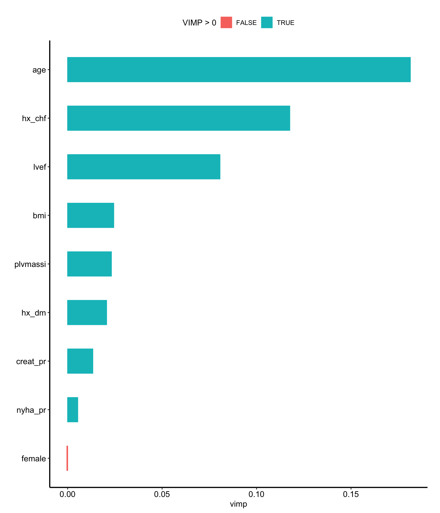
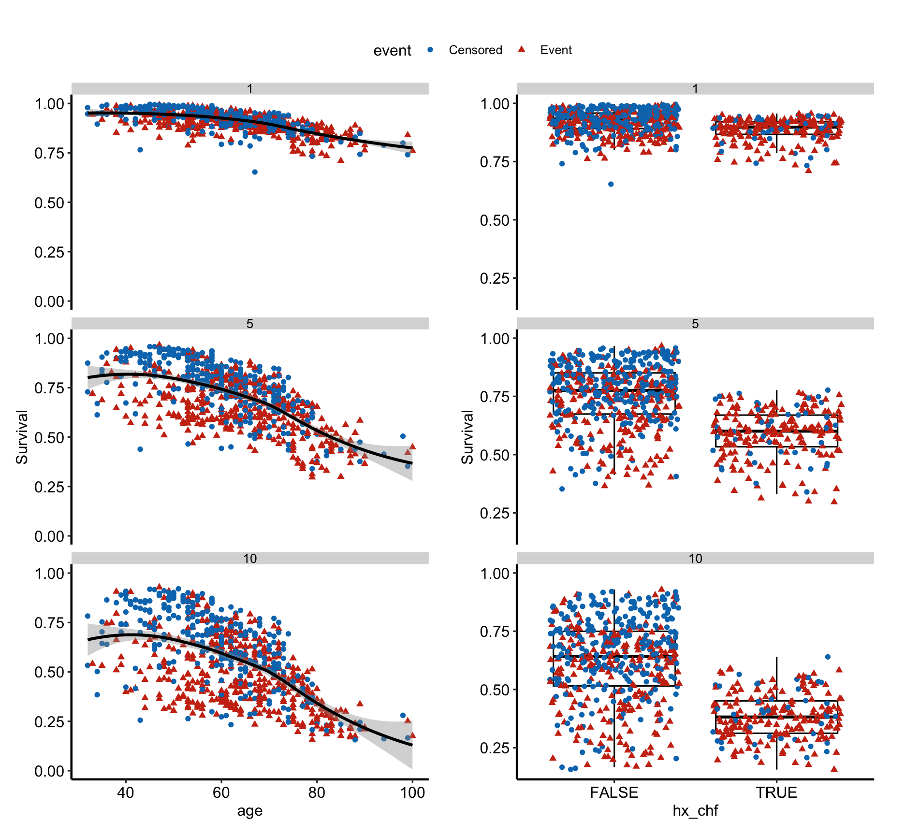
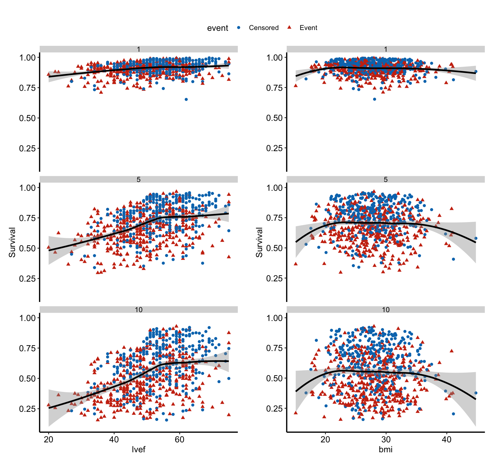
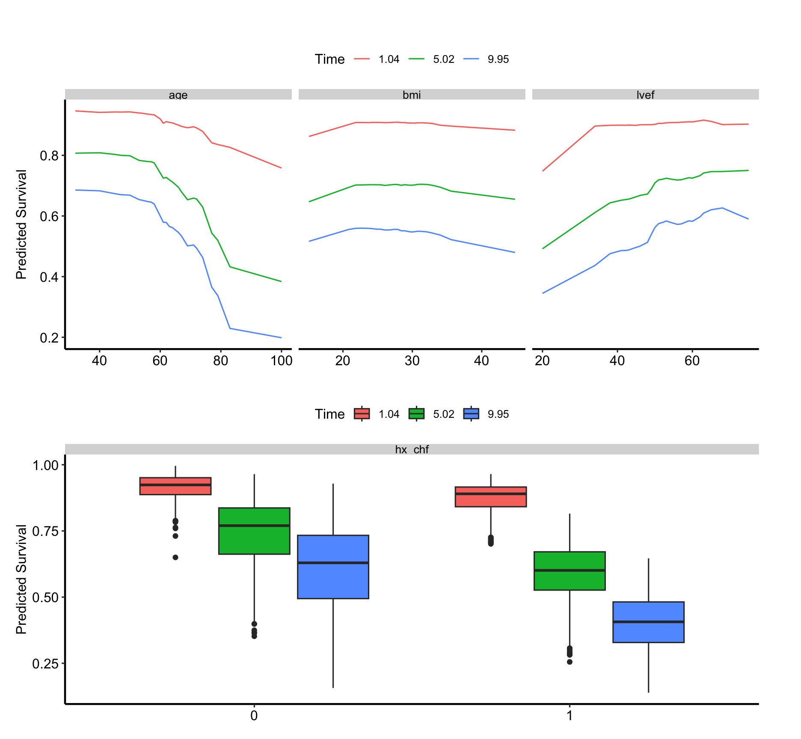

# Random forest survival: explain

# Random forest survival: explain

Published

2026-10-27 15:28

Explains the forest the `rfs-fit` job in this set saved: which
predictors drive it, and how.

An `rfs-explain` job never grows a forest. It reads `rfs.rds`, which the
fit job writes. VIMP, minimal depth and the partial-dependence plots all
describe that saved forest and no other. Each expensive step is cached
on its own: changing how many variables get dependence plots recomputes
the partials and nothing else. For a variable screen and VarPro
partials, use the `vp-fit` and `vp-explain` jobs.

Code

``` r
SUBJECT <- "dead"
TYPE    <- "rf"
.in <- knitr::current_input(dir = TRUE)
suppressPackageStartupMessages({
  library(randomForestSRC)
  library(ggRandomForests)
  library(hvtiRutilities)
})
# One thread, so a forest reproduces from machine to machine. Left unset,
# randomForestSRC runs on every core its OpenMP build can see, and on a
# multi-core server a varPro cross-validated cutoff changed with the thread
# count with every seed held fixed. Raise it for speed on a large forest, at the
# cost of that guarantee: a cached fit records its seed, data and package
# versions, never the threads it ran on.
options(rf.cores = 1L)
# The versions this template was verified against, end to end, on 2026-09-19.
# Below them a call here can fail or change meaning, and the message would
# arrive mid-render rather than here.
if (utils::packageVersion("randomForestSRC") < "3.7.0") {
  stop("This job needs randomForestSRC >= 3.7.0; ", utils::packageVersion("randomForestSRC"),
       " is installed.\nUpdate it, then re-render.", call. = FALSE)
}
if (utils::packageVersion("ggRandomForests") < "4.0.0") {
  stop("This job needs ggRandomForests >= 4.0.0; ", utils::packageVersion("ggRandomForests"),
       " is installed.\nUpdate it, then re-render.", call. = FALSE)
}
if (utils::packageVersion("hvtiPlotR") < "2.8.18") {
  stop("This job needs hvtiPlotR >= 2.8.18 for the red and blue its captions name; ", utils::packageVersion("hvtiPlotR"),
       " is installed.\nUpdate it, then re-render.", call. = FALSE)
}
# The study root is the nearest directory above this file holding _study.yml,
# so the job renders the same from the Render button, quarto render, or
# render_job(), at any depth, with no path in this document to edit.
# Without the guard in .job_setup(), an unedited job renders green over a
# meaningless analysis. Here that is dependence plots at placeholder survival
# horizons, drawn in units the study's follow-up may not even use, which look
# exactly like a result.
# To render a job you have not finished, leave a chunk out with the chunk
# option skip, giving the reason in quotes, or call hvtiRtemplates::stop_here()
# in a chunk to leave out everything below it. A draft lists each one in a
# callout; a final render refuses them, as it refuses an unresolved marker.
# ?stop_here has more.
.job <- hvtiRtemplates:::.job_setup(SUBJECT, TYPE, envir = environment())
.root <- .job$root
set_path <- .job$set_path
.provenance_data <- list()
# Saves a figure as <name>.png, .pdf and .tiff in this set's graphs/ folder (or `kind`'s),
# under the SAVE_FIGURES and FIGURES study choices.
save_figure <- function(plot, name, width = 6, height = 4, kind = "graphs", linked = FALSE) {
  hvtiRtemplates:::.save_figure(plot, set_path(kind, paste0(name, ".png")), width, height,
                                SAVE_FIGURES, FIGURES, linked)
}

# `rfs-explain` reads the forest `rfs-fit` wrote in this same set, and caches
# its own work beside it.
# The draft banners, if any, and the box under the title, after all the code above.
.job$notice
```

**final** · data: see About this run · rendered by gallery on gallery ·
hvtiRtemplates 1.5.2

## Study choices

Edit these values for this study before rendering. The outcome and
predictors are not here: they come from the forest.

Code

``` r
# Demo: the fit's selection is used; set any of these only to confirm it.
# NULL takes the value the fit job used.
WHERE <- NULL
ID <- NULL
KEY <- NULL

# Demo: how many variables get dependence plots, ranked by VIMP. The partials
# are the expensive step, so keep this small.
# With BANDS_B above 0, a bigger TOP_K computes bands only for the new variables, but
# still regrows all BANDS_B subsample forests to do it.
TOP_K <- 4

# Demo: or name the variables yourself. NULL takes the top TOP_K by VIMP.
PARTIAL_VARS <- NULL

# Demo: survival horizons for the partial plots, in the units of the fit job's
# time variable.
TIMES <- c(1, 5, 10)

# Demo: seed for VIMP and the partials. It is part of every cache key.
# cache_fit() seeds R's generator with it before each call, and vimp() is also
# handed it as `seed =`, negated as randomForestSRC documents.
SEED <- 2026

# Demo: subsample forests for the confidence intervals on importance and the
# bands on the partial plots. 0 draws neither.
#   25-50 for a first look at a draft; the bands are rough but show their shape.
#   100 for a report. It is randomForestSRC's default, and enough because the
#   intervals are estimate +/- 1.96 SE: they need a stable SE, not stable tail
#   percentiles, which would take several hundred.
#   200 or more only for 99% intervals, or when a rerun with another SEED moves
#   the band edges by more than you would accept in a figure.
# Cost is about BANDS_B x SUBRATIO fits of the full forest. Submit the job to
# compute them; job_status() shows how many forests are grown and the time left.
BANDS_B <- 0

# Demo: fraction of patients in each subsample. NULL takes randomForestSRC's
# default, exp(-1) (0.37) up to 1000 patients and exp(-1) * sqrt(1000 / n) above,
# so a larger cohort gets a smaller fraction. Leave it NULL unless the check
# below warns.
#   Raise it when a subsample would hold too few events: the job warns below 100.
#   Small subsamples grow shallow forests whose curves are flatter than the full
#   forest's.
#   Keep it at or below 0.5. Subsampling estimates the spread only while each
#   subsample is a small part of the cohort; near 1 every subsample forest is
#   nearly the full forest, and the bands shrink to the forest's own tree-to-tree
#   noise, far narrower than the real uncertainty.
SUBRATIO <- NULL

# Demo: how the partial plots draw their bands. "ribbon" shades a band around
# each continuous curve; "bars" draws an error bar at each grid point instead,
# which reads better in black and white and where curves for several follow-up
# times overlap. Categorical predictors always get error bars.
BAND_STYLE <- "ribbon"

# Demo: with BAND_STYLE <- "bars", where to draw the bars, as a named list of
# values per continuous predictor, e.g. list(age = c(50, 60, 70, 80), lvef = c(30, 50)).
# NULL, or a predictor left out, draws a bar at every grid point. The values
# must lie inside the range of the predictor's partial plot, which can be
# narrower than its observed range; the job stops before growing anything if one
# does not. Changing them only redraws: each subsample curve is read off at
# these values the way the plotted line is drawn, straight between grid points,
# so no forest is regrown.
BAND_AT <- NULL

# Set TRUE after changing a choice above. A cache whose inputs changed stops the
# render instead of returning the old result; TRUE recomputes only the caches
# that are out of date.
REFIT <- FALSE

# Each figure is saved to graphs/ as a PNG (for Word), and a PDF and a TIFF (for the publisher).
# SAVE_FIGURES <- FALSE saves none; FIGURES keeps only the figures whose names
# start with one of its entries, e.g. FIGURES <- c("hp-survival"). The names are the
# file names, listed for each template in the templates README.
SAVE_FIGURES <- TRUE
FIGURES <- NULL
```

## The forest

Code

``` r
.handoff <- set_path("estimates", "rfs.rds")
if (!file.exists(.handoff)) {
  stop("No forest at ", .handoff, ". Render the rfs-fit job in this set first; ",
       "this job explains that forest and never grows its own.", call. = FALSE)
}
.cfg <- study_config(start = .root)
.forest_read <- hvtiRtemplates:::.read_handoff(.handoff, "forest", .cfg, "the rfs-fit job")
forest <- .forest_read$value
.provenance_data <- .forest_read$lineage$data
.provenance_artifacts <- c(.forest_read$lineage$artifacts, list(.forest_read$record))
if (!identical(forest$family, "surv")) {
  stop("rfs.rds holds a '", forest$family, "' forest, not a survival forest.", call. = FALSE)
}
CACHE_DIR <- dirname(.handoff)
```

Code

``` r
# This job reads no data: the forest carries its training rows. The fit job
# recorded how it chose them, and a setting above that differs from the fit's
# stops here rather than describe rows the forest was not grown on.
.sel <- hvtiRtemplates:::.read_upstream_job_data(
  .cfg, .forest_read$lineage, list(where = WHERE, id = ID, key = KEY), read = FALSE, source = "rfs.rds"
)$selection
knitr::kable(data.frame(step = c("ID", "KEY", "WHERE", "Rows"),
                        value = c(.sel$id, paste(.sel$key, collapse = ", "),
                                  if (length(.sel$where_shown)) paste(.sel$where_shown, collapse = "; ") else "none",
                                  .sel$rows)),
             col.names = c("Data", ""))
```

| Data  |            |
|:------|:-----------|
| ID    | patient_id |
| KEY   | patient_id |
| WHERE | none       |
| Rows  | 800        |

Table 1: The data the fit job read

## Importance

Code

``` r
vi <- cache_fit("rfs-vimp", vimp(forest, seed = -abs(SEED)), seed = SEED, dir = CACHE_DIR, refit = REFIT)
# Free size: one row per predictor, so the height grows with the list.
# The manuscript theme hides the legend and its title, and the caption reads the colors from the legend.
.fig <- plot(gg_vimp(vi)) +
  hvtiPlotR::theme_hv_manuscript(base_size = 12, legend.position = "top", legend.title = ggplot2::element_text())
save_figure(.fig, "rfs-explain-importance", height = 7)
.fig
```



Figure 1: VIMP (anti-split importance) of each predictor. Horizontal
bars give the importance of each predictor, in one color where the
importance is positive and another where it is not, as in the legend.

Code

``` r
# Minimal depth ranks by how near the root a variable first splits, a second
# opinion that needs no VIMP calculation. Cheap, so not cached.
ranked <- names(sort(vi$importance, decreasing = TRUE))
depth <- max.subtree(forest)$order[, 1]
data.frame(variable = ranked,
           vimp = round(vi$importance[ranked], 4),
           min_depth = round(depth[ranked], 2),
           row.names = NULL)
```

      variable    vimp min_depth
    1      age  0.1814      1.19
    2   hx_chf  0.1176      1.50
    3     lvef  0.0806      1.76
    4      bmi  0.0244      3.24
    5 plvmassi  0.0232      2.72
    6    hx_dm  0.0206      3.35
    7 creat_pr  0.0133      2.97
    8  nyha_pr  0.0053      4.41
    9   female -0.0004      6.96

Table 2: VIMP (anti-split importance) and minimal depth of each
predictor, in order of importance

Code

``` r
if (is.null(PARTIAL_VARS)) {
  sel <- head(ranked, TOP_K)
} else {
  # A misspelt name would otherwise fail deep inside the partial call, or be
  # dropped from a plot without a word.
  .unknown <- setdiff(PARTIAL_VARS, forest$xvar.names)
  if (length(.unknown)) {
    stop("PARTIAL_VARS names variable(s) the forest was not grown on: ",
         paste(.unknown, collapse = ", "), call. = FALSE)
  }
  sel <- PARTIAL_VARS
}
# Each dependence figure is drawn a page at a time, panels in a grid no larger
# than the printed page (6.5 by 9 in), and each page is a child chunk of its
# own so Quarto numbers it, as dc-eda's pages are. A study's TOP_K or
# PARTIAL_VARS sets how many pages there are; nothing here refuses a count.
.fence <- strrep("`", 3)
.page_child <- function(kind, i, pages, vars, caption) {
  page <- pages[[i]]
  if (length(pages) > 1L) {
    caption <- paste0(caption, " Page ", i, " of ", length(pages), ": ",
                      paste(vars[page$index], collapse = ", "), ".")
  }
  code <- c(paste0(.fence, "{r}"), paste0("#| label: fig-", kind, "-", i),
            paste0("#| fig-cap: ", encodeString(caption, quote = "\"")),
            sprintf("#| fig-width: %g", hvtiRtemplates:::.report_size(page$width)),
            sprintf("#| fig-height: %g", hvtiRtemplates:::.report_size(page$height)), ".fig", .fence)
  cat(knitr::knit_child(text = code, envir = parent.frame(), quiet = TRUE), sep = "\n")
  cat("\n")
}
```

## Dependence

Code

``` r
# unnumbered: each page below is a child chunk with its own label and caption
# Marginal: predicted survival against each variable, as observed. Cheap.
# A loess smooth needs more than a handful of distinct values, so a predictor
# with fewer than six, such as a stage or a grade, is drawn as points alone.
.gv <- gg_variable(forest, time = TIMES)
.panels <- lapply(sel, function(v) {
  .p <- plot(.gv, xvar = v, smooth = length(unique(stats::na.omit(.gv[[v]]))) > 5)
  # The smooth is black: ggRandomForests draws it in ggplot's default blue, which would read as
  # the censored patients. Its `...` reaches the points as well, so the layer is set here.
  for (.l in .p$layers) if (inherits(.l$geom, "GeomSmooth")) .l$aes_params$colour <- "black"
  # Red for the event and blue for censored, as in every house figure: ggRandomForests sets no
  # scale, and ggplot's default would draw the censored patients red.
  .p +
    hvtiPlotR::scale_color_hv(event = "TRUE", censored = "FALSE", labels = c(`FALSE` = "Censored", `TRUE` = "Event")) +
    # The points' shape maps the same column, and takes the same labels so the two keys merge into one.
    ggplot2::scale_shape_discrete(labels = c(`FALSE` = "Censored", `TRUE` = "Event")) +
    hvtiPlotR::theme_hv_manuscript(base_size = 12, legend.position = "top", legend.title = ggplot2::element_text())
})
# The manuscript theme hides the legend and its title, and the caption reads the points from the legend.
# One legend for the stack: every panel shares the same outcome levels.
.cap <- paste("Predicted survival against each selected predictor, as observed, one panel per predictor and",
              "follow-up time. Points are individual patients, red for those who had the event and blue for",
              "those censored, each with its own shape; the black line is a loess smooth",
              "with its gray band, drawn for predictors with more than five distinct values, and for a",
              "categorical predictor the points are jittered over a gray box plot.")
# Free size, paged: one panel per predictor.
.pages <- hvtiRtemplates:::.figure_pages(length(sel), panel_width = 3.25, panel_height = 2 * length(TIMES))
for (.i in seq_along(.pages)) {
  .fig <- patchwork::wrap_plots(.panels[.pages[[.i]]$index], ncol = .pages[[.i]]$ncol) +
    patchwork::plot_layout(guides = "collect") &
    ggplot2::theme(legend.position = "top")
  save_figure(.fig, sprintf("rfs-explain-dependence-marginal-page-%02d", .i),
              width = .pages[[.i]]$width, height = .pages[[.i]]$height)
  .page_child("dependence-marginal", .i, .pages, sel, .cap)
}
```

    `geom_smooth()` using method = 'loess' and formula = 'y ~ x'
    `geom_smooth()` using method = 'loess' and formula = 'y ~ x'
    `geom_smooth()` using method = 'loess' and formula = 'y ~ x'

Code

``` r
.fig
```

    `geom_smooth()` using method = 'loess' and formula = 'y ~ x'



Figure 2: Predicted survival against each selected predictor, as
observed, one panel per predictor and follow-up time. Points are
individual patients, red for those who had the event and blue for those
censored, each with its own shape; the black line is a loess smooth with
its gray band, drawn for predictors with more than five distinct values,
and for a categorical predictor the points are jittered over a gray box
plot. Page 1 of 2: age, hx_chf.

    `geom_smooth()` using method = 'loess' and formula = 'y ~ x'
    `geom_smooth()` using method = 'loess' and formula = 'y ~ x'
    `geom_smooth()` using method = 'loess' and formula = 'y ~ x'
    `geom_smooth()` using method = 'loess' and formula = 'y ~ x'
    `geom_smooth()` using method = 'loess' and formula = 'y ~ x'
    `geom_smooth()` using method = 'loess' and formula = 'y ~ x'

Code

``` r
.fig
```

    `geom_smooth()` using method = 'loess' and formula = 'y ~ x'
    `geom_smooth()` using method = 'loess' and formula = 'y ~ x'



Figure 3: Predicted survival against each selected predictor, as
observed, one panel per predictor and follow-up time. Points are
individual patients, red for those who had the event and blue for those
censored, each with its own shape; the black line is a loess smooth with
its gray band, drawn for predictors with more than five distinct values,
and for a categorical predictor the points are jittered over a gray box
plot. Page 2 of 2: lvef, bmi.

Code

``` r
# unnumbered: each page below is a child chunk with its own label and caption
# Partial: the forest's prediction with every other variable held at its
# observed values.
pd <- cache_fit("rfs-partial", gg_partial_rfsrc(forest, xvar.names = sel, partial.time = TIMES),
                seed = SEED, dir = CACHE_DIR, refit = REFIT,
                packages = "randomForestSRC")
# The manuscript theme hides the legend and its title, and the caption reads the colors from the legend.
.cap <- paste("Partial dependence of the forest's prediction on each selected predictor, one panel per",
              "predictor. Solid lines trace the predicted survival across a continuous predictor, one color",
              "per follow-up time as in the legend, and dark gray bars give the partial effect at each",
              "level of a categorical one.")
# Free size, paged: one facet per predictor, two by two.
.pages <- hvtiRtemplates:::.figure_pages(length(sel), panel_width = 3.25, panel_height = 3, page_height = 6)
for (.i in seq_along(.pages)) {
  .vars <- sel[.pages[[.i]]$index]
  .fig <- plot(hvtiRtemplates:::.partial_subset(pd, .vars)) &
    hvtiPlotR::theme_hv_manuscript(base_size = 12, legend.position = "top", legend.title = ggplot2::element_text())
  save_figure(.fig, sprintf("rfs-explain-dependence-partial-page-%02d", .i),
              width = .pages[[.i]]$width, height = .pages[[.i]]$height)
  .page_child("dependence-partial", .i, .pages, sel, .cap)
}
```

Code

``` r
.fig
```



Figure 4: Partial dependence of the forest’s prediction on each selected
predictor, one panel per predictor. Solid lines trace the predicted
survival across a continuous predictor, one color per follow-up time as
in the legend, and dark gray bars give the partial effect at each level
of a categorical one.

## About this run

| Group | Item | Value |
|:---|:---|:---|
| Run | Started | 2026-10-27 15:28:02 EDT |
|  | Ended | 2026-10-27 15:28:19 EDT |
|  | Duration | 17 s |
|  | Status | final |
|  | Rendered by | gallery |
|  | Host | gallery |
| Job | File | rfs.explain.dead.rf.qmd |
|  | Template | rfs.explain |
|  | Subject | dead |
|  | Type | rf |
|  | hvtiRtemplates | 1.5.2 |
| Dataset `built` | Version file | built_20261027.parquet |
|  | Version date | 2026-10-27 |
|  | Source file | built.rds |
|  | sha256 | b236a472f1f3 |
|  | Manifest | current |
| Upstream | Handoff | `dead-rf/rfs.rds` (forest), rendered 2026-10-27 15:27:40 -0400, data built_20261027.parquet |
| Reproducibility | Seed | 2026 |
|  | renv | not active |
|  | renv.lock sha256 | d09f96b6cd21 |
