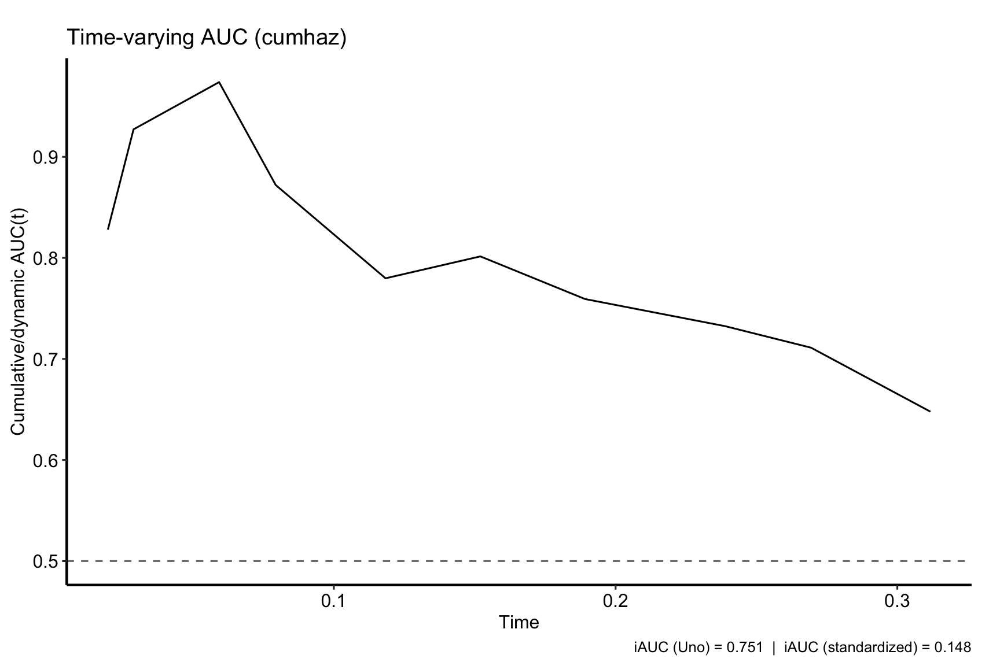
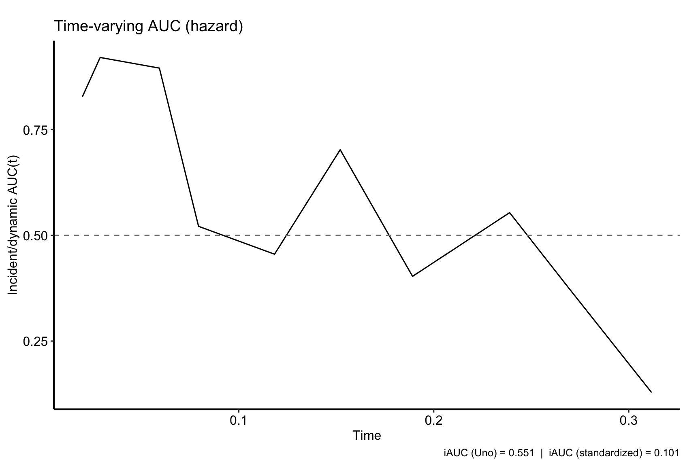
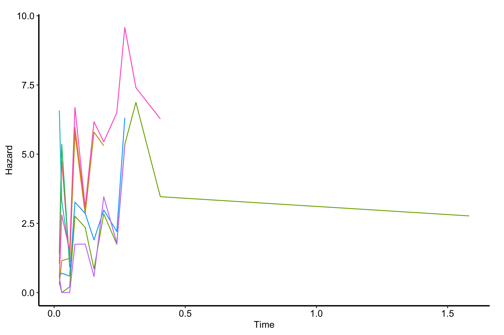
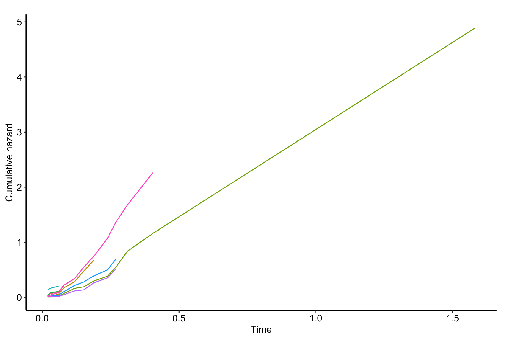
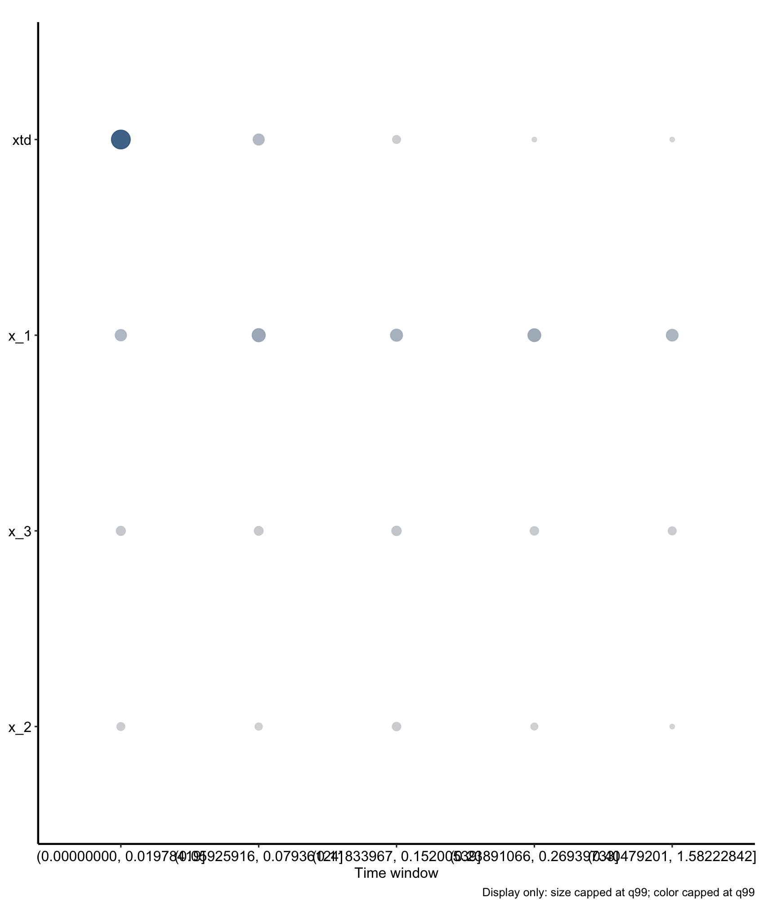

# Random hazard forest: explain

# Random hazard forest: explain

Published

2026-10-29 12:54

Explains the forest the `rhf-fit` job in this set saved: how well it
ranks patients over follow-up, their hazard curves, and which markers
drive it.

Explains the forest the `rhf-fit` job in this set saved.

An `rhf-explain` job never grows a forest. It reads `rhf.rds`, which the
fit job writes, and reports how well the forest separates patients who
have the event from those still at risk, over follow-up; the hazard it
predicts for a sample of patients; and how much each predictor matters,
at several points of follow-up. Each expensive step is cached on its
own. The importance step builds a VarPro cache, `rhf-varpro-cache`,
which later VarPro work on this forest reads instead of building again.

Code

``` r
SUBJECT <- "event"
TYPE    <- "rhf"
.in <- knitr::current_input(dir = TRUE)
suppressPackageStartupMessages({
  library(randomForestRHF)
  library(ggRandomForests)
  library(hvtiRutilities)
})
# One thread, so the VarPro cache reproduces from machine to machine; see rhf-fit.
options(rf.cores = 1L)
# The versions this template was verified against, end to end, on 2026-10-26.
if (utils::packageVersion("randomForestRHF") < "2.1.0") {
  stop("This job needs randomForestRHF >= 2.1.0; ", utils::packageVersion("randomForestRHF"),
       " is installed.\nUpdate it, then re-render.", call. = FALSE)
}
if (utils::packageVersion("ggRandomForests") < "4.0.0") {
  stop("This job needs ggRandomForests >= 4.0.0; ", utils::packageVersion("ggRandomForests"),
       " is installed.\nUpdate it, then re-render.", call. = FALSE)
}
if (utils::packageVersion("hvtiPlotR") < "2.8.18") {
  stop("This job needs hvtiPlotR >= 2.8.18 for the house theme; ", utils::packageVersion("hvtiPlotR"),
       " is installed.\nUpdate it, then re-render.", call. = FALSE)
}
# The study root, the guards and the run record come from .job_setup(); see rhf-fit.
.job <- hvtiRtemplates:::.job_setup(SUBJECT, TYPE, envir = environment())
.root <- .job$root
set_path <- .job$set_path
.provenance_data <- list()
# Saves a figure as <name>.png, .pdf and .tiff in this set's graphs/ folder (or `kind`'s),
# under the SAVE_FIGURES and FIGURES study choices.
save_figure <- function(plot, name, width = 6, height = 4, kind = "graphs", linked = FALSE) {
  hvtiRtemplates:::.save_figure(plot, set_path(kind, paste0(name, ".png")), width, height,
                                SAVE_FIGURES, FIGURES, linked)
}
# `rhf-explain` reads the forest `rhf-fit` wrote in this same set, and caches
# its own results beside it.
.job$notice
```

**final** · data: see About this run · rendered by gallery on gallery ·
hvtiRtemplates 1.5.4

## Study choices

Edit these values for this study before rendering. The outcome and
predictors are not here: they come from the forest.

Code

``` r
# Demo: the fit's selection is used; set any of these only to confirm it.
# NULL takes the value the fit job used.
WHERE <- NULL
ID <- NULL
KEY <- NULL

# Demo: the horizon for AUC(t), in the units of the fit job's interval columns.
# NULL takes randomForestRHF's default, the range of follow-up.
TAU <- NULL

# Demo: how many patients get hazard curves, drawn at random. The forest's
# patients are numbered 1 to n by the fit job, so a curve cannot be asked for by
# study identifier, and the plots carry no legend that could print one.
N_CURVES <- 10

# Demo: the VarPro cache behind importance, at randomForestRHF's defaults. It is
# the slow step at full scale, and smaller values are faster and coarser in a way
# that shows: a predictor no rule tested gets NA. On the first real study, 2,386
# patients and 35 predictors, 30 rules and 20 trees left 13 untested; 150 and 150
# left 6 to 8, and which ones depended on the seed.
MAX_RULES_TREE <- 150
MAX_TREE <- 150

# Demo: importance at this many evenly spaced points of follow-up. A hazard
# forest's importance changes with time, so one number per predictor would hide
# when it matters.
N_TIMES <- 5

# Demo: partial dependence for these predictors, at the importance points above.
# NULL, the default, draws none: it is the slowest step here. Each value on a
# predictor's grid predicts the hazard for PD_N patients over every interval
# they have; on the first real study, 500 trees and 172,000 intervals, that was
# about 2.7 minutes per value.
PD_VARS <- NULL
# Patients drawn from the forest's own training rows, and values per continuous
# predictor, spread from its 5th to its 95th percentile. A 0/1 predictor gets 0
# and 1, and a factor each of its levels.
PD_N <- 300
PD_GRID <- 9
# A point of follow-up is left out of the partial dependence when fewer than
# this many of the PD_N patients are still at risk there.
PD_MIN_RISK <- 20

# Demo: seed for the sample of curves, the VarPro cache and the partial
# dependence sample. It is part of every cache key.
SEED <- 2026

# Set TRUE after changing a choice above. A cache whose inputs changed stops the
# render instead of returning the old result; TRUE recomputes only the caches
# that are out of date.
REFIT <- FALSE

# Each figure is saved to graphs/ as a PNG (for Word), and a PDF and a TIFF (for the publisher).
# SAVE_FIGURES <- FALSE saves none; FIGURES keeps only the figures whose names
# start with one of its entries, e.g. FIGURES <- c("rhf-explain-importance").
SAVE_FIGURES <- TRUE
FIGURES <- NULL
```

## The forest

Code

``` r
.handoff <- set_path("estimates", "rhf.rds")
if (!file.exists(.handoff)) {
  stop("No forest at ", .handoff, ". Render the rhf-fit job in this set first; ",
       "this job explains that forest and never grows its own.", call. = FALSE)
}
.cfg <- study_config(start = .root)
.forest_read <- hvtiRtemplates:::.read_handoff(.handoff, "forest", .cfg, "the rhf-fit job")
forest <- .forest_read$value
.provenance_data <- .forest_read$lineage$data
.provenance_artifacts <- c(.forest_read$lineage$artifacts, list(.forest_read$record))
if (!inherits(forest, "rhf")) {
  stop("rhf.rds does not hold a random hazard forest.", call. = FALSE)
}
CACHE_DIR <- dirname(.handoff)
# Every cache below is built from the forest's patient-level rows, so each is
# written owner-only, as rhf.rds is.
.cache_file <- function(name) file.path(CACHE_DIR, paste0(name, ".rds"))
# A forest grown on rows the fit job repaired is a draft's, and so is every
# explanation of it: a final render stops here.
cat(hvtiRtemplates:::.cp_repair_notice(unlist(.forest_read$lineage$analysis$repair)))
```

Code

``` r
# This job reads no data: the forest carries its training rows. A setting above
# that differs from the fit's stops here.
.sel <- hvtiRtemplates:::.read_upstream_job_data(
  .cfg, .forest_read$lineage, list(where = WHERE, id = ID, key = KEY), read = FALSE, source = "rhf.rds"
)$selection
knitr::kable(data.frame(step = c("ID", "KEY", "WHERE", "Rows"),
                        value = c(.sel$id, paste(.sel$key, collapse = ", "),
                                  if (length(.sel$where_shown)) paste(.sel$where_shown, collapse = "; ") else "none",
                                  .sel$rows)),
             col.names = c("Data", ""))
```

| Data  |                   |
|:------|:------------------|
| ID    | patient_id        |
| KEY   | patient_id, start |
| WHERE | none              |
| Rows  | 471               |

Table 1: The data the fit job read

## Discrimination over follow-up

Code

``` r
# The marker here is a cumulative hazard the trees aggregate on the full time
# grid, not the out-of-bag path chf.oob drawn under Hazard curves, so the AUC and
# those curves are not the same estimate.
auc_cum <- hvtiRtemplates:::.owner_only(.cache_file("rhf-auc-cumulative"), cache_fit(
  "rhf-auc-cumulative",
  auct.rhf(forest, marker = "cumhaz", method = "cumulative", tau = TAU, verbose = FALSE),
  seed = SEED, dir = CACHE_DIR, refit = REFIT
))
.fig <- plot(gg_auct(forest, auct_fit = auc_cum)) + hvtiPlotR::theme_hv_manuscript(base_size = 12)
save_figure(.fig, "rhf-explain-auc-cumulative")
.fig
```



Figure 1: Cumulative AUC(t): how well the predicted cumulative hazard
separates patients who have had the event by time t from those still at
risk. 0.5 is chance.

Code

``` r
auc_inc <- hvtiRtemplates:::.owner_only(.cache_file("rhf-auc-incident"), cache_fit(
  "rhf-auc-incident",
  auct.rhf(forest, marker = "hazard", method = "incident", riskset = "subject", tau = TAU,
           verbose = FALSE),
  seed = SEED, dir = CACHE_DIR, refit = REFIT
))
.fig <- plot(gg_auct(forest, auct_fit = auc_inc)) + hvtiPlotR::theme_hv_manuscript(base_size = 12)
save_figure(.fig, "rhf-explain-auc-incident")
.fig
```



Figure 2: Incident AUC(t): how well the predicted hazard separates
patients who have the event at time t from those still at risk then. 0.5
is chance.

Code

``` r
# Uno's iAUC, not iAUC.std. In randomForestRHF 2.1.0 iAUC.std is wrong when an
# AUC(t) is NA: it drops the NA from the integral but still divides by the whole
# time range, so it reads low.
data.frame(measure = c("Cumulative", "Incident"),
           iAUC = round(c(auc_cum$iAUC.uno, auc_inc$iAUC.uno), 3))
```

         measure  iAUC
    1 Cumulative 0.751
    2   Incident 0.551

Table 2: Integrated AUC over follow-up

## Hazard curves

Code

``` r
# The forest's patients are numbered 1 to n, so the sample says nothing about who
# they are. gg_rhf() labels each curve with its patient. Reading forest$chf.oob
# or forest$hazard.oob directly, note that their rows follow the sorted
# ensemble.id, not the order patients first appear in the data: join by id.
# A forest grown outside this template on the study's own id keeps that id as
# given in forest$id (text, zero-padded, say), while ensemble.id, and so gg_rhf(),
# carries as.integer() of it: join back to study data on as.integer(id).
haz <- gg_rhf(forest, source = "oob")
set.seed(abs(SEED))
.curve_ids <- sort(sample(unique(haz$id), min(N_CURVES, length(unique(haz$id)))))
```

Code

``` r
.fig <- plot(haz, idx = .curve_ids, hazard.only = TRUE) +
  hvtiPlotR::theme_hv_manuscript(base_size = 12, legend.position = "none")
save_figure(.fig, "rhf-explain-hazard")
.fig
```



Figure 3: Out-of-bag predicted hazard over follow-up for a random sample
of patients, one line per patient.

Code

``` r
.fig <- plot(haz, idx = .curve_ids, hazard.only = FALSE) +
  hvtiPlotR::theme_hv_manuscript(base_size = 12, legend.position = "none")
save_figure(.fig, "rhf-explain-chf")
.fig
```



Figure 4: Out-of-bag predicted cumulative hazard over follow-up for the
same patients, one line per patient.

**These paths are not calibrated probabilities.** No check has yet
compared the survival implied by a forest’s predicted hazard with what
happened to the patients. On the first real study it looked badly off:
patients who did not die had path survival near 0.1, because the
predicted hazard spiked to 3 to 10 per year along their paths. Until a
calibration check is done, read a path as relative risk along follow-up,
higher or lower than another patient’s and when, and do not quote a
survival probability from it.

## Importance

Code

``` r
# The cache is the slow step, and its name is fixed on purpose: later VarPro
# work on this forest reads rhf-varpro-cache rather than building it again.
# The cache draws on R's generator, which rhf(seed =) does not cover. cache_fit()
# seeds it with SEED; unseeded, identical reruns on the first real study moved
# importance medians by about 3 and reordered ranks 2 to 6.
hvtiRtemplates::guard_long_fit("rhf-varpro-cache", dir = CACHE_DIR,
                               why = "the VarPro cache walks every rule of every tree at study size", refit = REFIT)
vp_cache <- hvtiRtemplates:::.owner_only(.cache_file("rhf-varpro-cache"), cache_fit(
  "rhf-varpro-cache",
  varpro.cache.rhf(forest, max.rules.tree = MAX_RULES_TREE, max.tree = MAX_TREE, verbose = FALSE),
  seed = SEED, dir = CACHE_DIR, refit = REFIT
))
.time_index <- unique(as.integer(round(seq.int(1L, vp_cache$K, length.out = N_TIMES))))
imp <- hvtiRtemplates:::.owner_only(.cache_file("rhf-importance"), cache_fit(
  "rhf-importance",
  importance.rhf(forest, cache = vp_cache, time.index = .time_index, verbose = FALSE),
  seed = SEED, dir = CACHE_DIR, refit = REFIT
))
.fig <- plot(gg_rhf_importance(forest, importance_fit = imp)) + hvtiPlotR::theme_hv_manuscript(base_size = 12)
save_figure(.fig, "rhf-explain-importance", height = 7)
.fig
```



Figure 5: VarPro importance of each predictor at points across
follow-up.

Code

``` r
as.data.frame(imp)
```

       variable       time time.index                   window      start
    1       xtd 0.01978419          1 (0.00000000, 0.01978419] 0.00000000
    2       x_1 0.01978419          1 (0.00000000, 0.01978419] 0.00000000
    4       x_3 0.01978419          1 (0.00000000, 0.01978419] 0.00000000
    3       x_2 0.01978419          1 (0.00000000, 0.01978419] 0.00000000
    6       x_1 0.07936124          4 (0.05925916, 0.07936124] 0.05925916
    5       xtd 0.07936124          4 (0.05925916, 0.07936124] 0.05925916
    8       x_3 0.07936124          4 (0.05925916, 0.07936124] 0.05925916
    7       x_2 0.07936124          4 (0.05925916, 0.07936124] 0.05925916
    10      x_1 0.15200539          6 (0.11833967, 0.15200539] 0.11833967
    12      x_3 0.15200539          6 (0.11833967, 0.15200539] 0.11833967
    11      x_2 0.15200539          6 (0.11833967, 0.15200539] 0.11833967
    9       xtd 0.15200539          6 (0.11833967, 0.15200539] 0.11833967
    14      x_1 0.26939733          9 (0.23891066, 0.26939733] 0.23891066
    16      x_3 0.26939733          9 (0.23891066, 0.26939733] 0.23891066
    15      x_2 0.26939733          9 (0.23891066, 0.26939733] 0.23891066
    13      xtd 0.26939733          9 (0.23891066, 0.26939733] 0.23891066
    18      x_1 1.58222842         12 (0.40479201, 1.58222842] 0.40479201
    20      x_3 1.58222842         12 (0.40479201, 1.58222842] 0.40479201
    19      x_2 1.58222842         12 (0.40479201, 1.58222842] 0.40479201
    17      xtd 1.58222842         12 (0.40479201, 1.58222842] 0.40479201
             stop    midpoint n.risk n.rules importance
    1  0.01978419 0.009892094    245    1310 4.14133218
    2  0.01978419 0.009892094    245    1310 0.77939241
    4  0.01978419 0.009892094    245    1310 0.34870874
    3  0.01978419 0.009892094    245    1310 0.19191829
    6  0.07936124 0.069310203    135     890 1.26089608
    5  0.07936124 0.069310203    135     890 0.72734812
    8  0.07936124 0.069310203    135     890 0.30455109
    7  0.07936124 0.069310203    135     890 0.11720421
    10 0.15200539 0.135172527    112     794 0.97050885
    12 0.15200539 0.135172527    112     794 0.40026483
    11 0.15200539 0.135172527    112     794 0.25148825
    9  0.15200539 0.135172527    112     794 0.19248935
    14 0.26939733 0.254153994     62     646 1.18221283
    16 0.26939733 0.254153994     62     646 0.26143557
    15 0.26939733 0.254153994     62     646 0.09655036
    13 0.26939733 0.254153994     62     646 0.00000000
    18 1.58222842 0.993510214     34     394 0.87807159
    20 1.58222842 0.993510214     34     394 0.19981972
    19 1.58222842 0.993510214     34     394 0.00000000
    17 1.58222842 0.993510214     34     394 0.00000000

Table 3: VarPro importance of each predictor at each point of follow-up

**NA means untested, not unimportant.** A predictor gets NA when no rule
in the cache split on it, and a larger cache (`MAX_RULES_TREE`,
`MAX_TREE`) tests more of them. A 0 means it was tested and had no
effect. Which predictors go untested depends on the seed, so an NA is no
evidence either way.

**Rank the top tier only once it holds across seeds.** One seed fixes
one cache, and the order below the first predictor or two can move with
it. Before a ranking goes into a report, render this job again with two
or three other `SEED` values and keep the predictors that stay near the
top in every run.

## Partial dependence

ggRandomForests has no partial dependence for a hazard forest yet, so
this job builds it from `predict()`, and only for the predictors named
in `PD_VARS`. For each value on a predictor’s grid, it sets the
predictor to that value on every interval of a sample of patients,
predicts their hazard, and averages it at each importance point over the
patients still at risk there. The hazard at a time depends only on the
interval covering that time, so setting the whole path is the same as
setting the one interval. The curves are marginal: they say nothing
about two predictors acting together.

**Count the exposure before reading a curve.** The table below gives, at
each importance point, the patients at risk, the patient-time and the
deaths, and for a 0/1 or factor predictor each of those for every value.
Patient-time is in the units of the fit’s interval columns, years if
they are in years. A curve at a point with little exposure is decided by
a handful of deaths. On the first real study a rare time-varying 0/1
predictor, intubation, had a hazard ratio between its two values that
flipped from point to point: 13, 0.59, 74, 0.57. It was not look-ahead,
since a refit with the final intervals reset showed the same pattern.
Each point held 0.12 to 0.33 intubated patient-years, with 2, 0, 4 and 0
intubated deaths, and those deaths drew the curve. The direction of such
a predictor should come from a pooled model, such as a `hz` job, not
from these curves.

Code

``` r
# Counted on every patient the forest was grown on, not only the PD_N sample, and
# reported as counts alone: no row here describes one patient.
if (length(PD_VARS)) {
  .absent <- setdiff(PD_VARS, forest$xvar.names)
  if (length(.absent)) {
    stop("PD_VARS names a predictor the forest was not grown on: ", paste(.absent, collapse = ", "), call. = FALSE)
  }
  .train <- data.frame(id = forest$id, forest$yvar, forest$xvar)
  .windows <- imp$window.info
  .exposure <- function(k, var, value) {
    data.frame(variable = var, value = value, time.index = .windows$index, start = .windows$start,
               stop = .windows$stop, t(vapply(seq_len(nrow(.windows)), function(i) {
                 a <- .windows$start[i]
                 b <- .windows$stop[i]
                 overlap <- pmax(0, pmin(.train$stop, b) - pmax(.train$start, a))
                 at <- k & overlap > 0
                 c(patients = length(unique(.train$id[at])), patient_time = sum(overlap[at]),
                   deaths = sum(.train$event[at] == 1 & .train$stop[at] <= b))
               }, numeric(3L))), row.names = NULL)
  }
  pd_exposure <- do.call(rbind, c(
    list(.exposure(rep(TRUE, nrow(.train)), "(all)", "all")),
    lapply(PD_VARS, function(v) {
      x <- .train[[v]]
      values <- if (is.factor(x)) levels(x) else if (all(x %in% c(0, 1))) c("0", "1") else return(NULL)
      do.call(rbind, lapply(values, function(value) .exposure(as.character(x) == value, v, value)))
    })
  ))
  knitr::kable(pd_exposure, digits = c(0, 0, 0, 3, 3, 0, 2, 0))
}
```

Table 4: Exposure at each importance point: patients at risk,
patient-time (in the units of the fit’s interval columns) and deaths, by
value for a 0/1 or factor predictor

Code

``` r
if (length(PD_VARS)) {
  hvtiRtemplates::guard_long_fit("rhf-partial", dir = CACHE_DIR,
                                 why = "each grid value predicts the hazard over every interval of the sample",
                                 refit = REFIT)
  pd <- hvtiRtemplates:::.owner_only(.cache_file("rhf-partial"), cache_fit(
    "rhf-partial",
    local({
      train <- data.frame(id = forest$id, forest$yvar, forest$xvar)
      ids <- sample(unique(train$id), min(PD_N, length(unique(train$id))))
      nd <- train[train$id %in% ids, ]
      do.call(rbind, lapply(PD_VARS, function(v) {
        x <- nd[[v]]
        # A factor keeps its levels, so a factor labeled 0 and 1 is set by level, not by its codes.
        grid <- if (is.factor(x)) levels(x) else if (all(x %in% c(0, 1))) c(0, 1) else
          unique(stats::quantile(x, seq(0.05, 0.95, length.out = PD_GRID), names = FALSE))
        do.call(rbind, lapply(grid, function(g) {
          # [] <- keeps the column's class and levels.
          nd[[v]][] <- g
          h <- predict(forest, nd)$hazard.test[, .time_index, drop = FALSE]
          data.frame(variable = v, level = if (is.factor(x)) g else format(signif(g, 3)), time.index = .time_index,
                     time = forest$time.interest[.time_index], hazard = colMeans(h, na.rm = TRUE),
                     n.risk = colSums(!is.na(h)))
        }))
      }))
    }),
    # predict() dispatches to randomForestRHF's method, which cache_fit() cannot see in the code, so an
    # upgrade of the package would otherwise reuse curves its old version predicted.
    seed = SEED, dir = CACHE_DIR, refit = REFIT, packages = "randomForestRHF"
  ))
  pd <- pd[pd$n.risk >= PD_MIN_RISK, ]
  pd$point <- factor(sprintf("%.2f", pd$time), levels = sprintf("%.2f", sort(unique(pd$time))))
  # Each predictor's values in grid order on a discrete axis, keyed by predictor so two predictors sharing a
  # label do not share a place.
  .key <- paste(pd$variable, pd$level, sep = "\r")
  pd$at <- factor(.key, levels = unique(.key))
  .fig <- ggplot2::ggplot(pd, ggplot2::aes(at, hazard, color = point, group = point)) +
    ggplot2::geom_line() +
    ggplot2::geom_point(size = 1) +
    ggplot2::scale_x_discrete(labels = function(b) sub("^.*\r", "", b)) +
    ggplot2::facet_wrap(~variable, scales = "free_x") +
    ggplot2::labs(x = "Value set on every interval", y = "Mean predicted hazard", color = "Time") +
    hvtiPlotR::theme_hv_manuscript(base_size = 12, legend.position = "top", legend.title = ggplot2::element_text())
  save_figure(.fig, "rhf-explain-partial")
  .fig
}
```

## About this run

| Group | Item | Value |
|:---|:---|:---|
| Run | Started | 2026-10-29 12:54:21 EDT |
|  | Ended | 2026-10-29 12:54:25 EDT |
|  | Duration | 4 s |
|  | Status | final |
|  | Rendered by | gallery |
|  | Host | gallery |
| Job | File | rhf.explain.event.rhf.qmd |
|  | Template | rhf.explain |
|  | Subject | event |
|  | Type | rhf |
|  | hvtiRtemplates | 1.5.4 |
| Dataset `intervals` | Version file | intervals_20261029.parquet |
|  | Version date | 2026-10-29 |
|  | Source file | intervals.rds |
|  | sha256 | f3770c09d63a |
|  | Manifest | current |
| Upstream | Handoff | `event-rhf/rhf.rds` (forest), rendered 2026-10-29 12:54:06 -0400, data intervals_20261029.parquet |
| Reproducibility | Seed | 2026 |
|  | renv | not active |
|  | renv.lock sha256 | d09f96b6cd21 |
