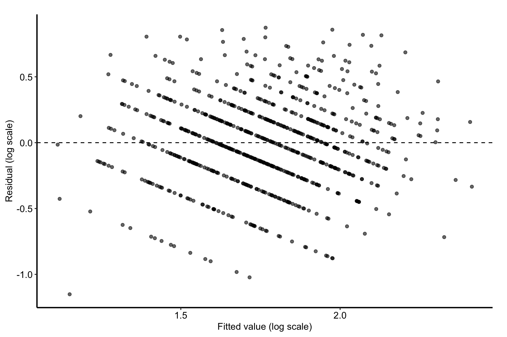
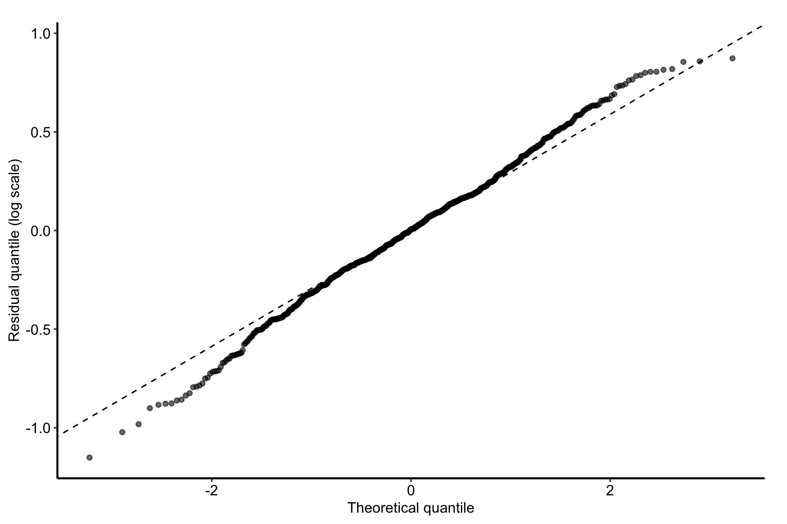

# Linear regression model

# Linear regression model

Published

2026-10-23 13:44

Fits an ordinary least-squares model of a continuous outcome,
untransformed or on the log scale, on one dataset or on stacked multiple
imputations pooled with Rubin’s rules. The report states the formula it
fitted and how to read its coefficients on that scale.

Code

``` r
SUBJECT <- "los"
TYPE    <- "model"
.in <- knitr::current_input(dir = TRUE)
suppressPackageStartupMessages({
  library(hvtiRpropensity)
  library(hvtiRutilities)
  library(ggplot2)
})
if (utils::packageVersion("hvtiRpropensity") < "0.2.0") stop("This template needs hvtiRpropensity >= 0.2.0.", call. = FALSE)
# To render a job you have not finished, leave a chunk out with the chunk
# option skip, giving the reason in quotes, or call hvtiRtemplates::stop_here()
# in a chunk to leave out everything below it. A draft lists each one in a
# callout; a final render refuses them, as it refuses an unresolved marker.
# ?stop_here has more.
.job <- hvtiRtemplates:::.job_setup(SUBJECT, TYPE, envir = environment())
.root <- .job$root
set_path <- .job$set_path
.provenance_data <- list()
# Saves a figure as <name>.png, .pdf and .tiff in this set's graphs/ folder,
# under the SAVE_FIGURES and FIGURES study choices.
save_figure <- function(plot, name, width = 6, height = 4, kind = "graphs", linked = FALSE) {
  hvtiRtemplates:::.save_figure(plot, set_path(kind, paste0(name, ".png")), width, height,
                                SAVE_FIGURES, FIGURES, linked)
}
# The draft banners, if any, and the box under the title, after all the code above.
.job$notice
```

**final** · data `built` `built_20261023.parquet`, registered 2026-10-23
· rendered by gallery on gallery · hvtiRtemplates 1.5.0

Code

``` r
# Demo: the registered dataset this job reads ("built" is the study dataset).
DATASET <- "built"

# Demo: an hvtiRdatabuild analysis set, or NULL to read the whole dataset.
ANALYSIS_SET <- NULL

# Demo: rows to keep, dplyr::filter() style, or NULL to keep every row:
#   WHERE <- quote(age >= 18)
#   WHERE <- rlang::exprs(age >= 18, hx_chf == 1)
WHERE <- NULL

# Demo: the patient identifier. Without "ccfid" the job uses MRN, then eMRN;
# name another column, such as "randid", if the study uses one.
ID <- "patient_id"

# Demo: what makes a row unique; one row per patient unless repeated measures
# add their visit time or date, for example KEY <- c(ID, "iv_echo").
KEY <- ID

# Optional, and needs no edit: NULL reads the cohort alone. To join one
# registered ancillary dataset (echoes, labs), name it in JOIN. The cohort
# above decides the patients, one row each; the joined records of other
# patients are dropped and counted in the data table.
#   JOIN_VARS: the cohort columns each joined row carries; NULL carries all,
#     and a column both datasets have stops, so list only those the job needs.
#   REDUCE: NULL keeps a row per joined record, keyed on that dataset's key;
#     list(rule = "first", by = "echo_date") keeps one row per patient ("last",
#     or "nearest" with to = a cohort date column). WHERE on a joined column
#     filters the records first, so "last" with WHERE echo_type == "TTE"
#     keeps each patient's last TTE. A tie stops: picking one record
#     silently would be a hidden choice; by = c("echo_date", "echo_seq")
#     breaks it. This job models one row per
#     patient, so a JOIN without REDUCE stops here.
#   JOIN_KEY: overrides the joined dataset's registered key.
JOIN <- NULL
JOIN_VARS <- NULL
REDUCE <- NULL
JOIN_KEY <- NULL

# Demo: the continuous outcome, named as the column.
OUTCOME <- "los"
# Demo: the scale the outcome is modeled on. "identity" models it as measured;
# "log" models log(OUTCOME), the usual choice for a skewed outcome such as length
# of stay. A coefficient is then a change in the log, and exp() of it a ratio of
# geometric means, not a difference; the report's reading follows this choice.
RESPONSE_SCALE <- "log"
PREDICTORS <- c("age", "female", "nyha_pr", "hx_chf", "hx_dm", "lvef")
IMPUTATION <- NULL                          # Demo: imputation column, or NULL.
# Stacked imputations repeat each patient once per imputation.
if (!is.null(IMPUTATION)) KEY <- unique(c(KEY, IMPUTATION))

# Each figure is saved to graphs/ as a PNG (for Word), and a PDF and a TIFF (for the publisher).
# SAVE_FIGURES <- FALSE saves none; FIGURES keeps only the figures whose names
# start with one of its entries, e.g. FIGURES <- c("rm-linear-qq").
SAVE_FIGURES <- TRUE
FIGURES <- NULL
```

Code

``` r
# The checksum of every dataset in manifest.yaml is checked before anything is
# read, so a result can name the data that produced it. It stops on a mismatch.
hvtiRutilities::verify_manifest(file.path(.root, "manifest.yaml"))
.cfg <- study_config(start = .root)
job_data <- hvtiRtemplates::read_job_data(.cfg, dataset = DATASET, analysis_set = ANALYSIS_SET,
                                          where = WHERE, id = ID, key = KEY, join = JOIN, join_vars = JOIN_VARS,
                                          reduce = REDUCE, join_key = JOIN_KEY, one_row_per_patient = TRUE,
                                          imputation = IMPUTATION)
job_data$provenance$role <- "training"
if (!is.null(job_data$provenance_join)) job_data$provenance_join$role <- "training"
d <- job_data$data
.provenance_data <- c(if (exists(".provenance_data")) .provenance_data else list(), list(job_data$provenance),
                      if (!is.null(job_data$provenance_join)) list(job_data$provenance_join))
# The identifier column read_job_data() used: MRN or eMRN when there is no ccfid.
.id <- attr(job_data$record, "selection")$id
# The imputation column read_job_data() matched, in the data's own spelling.
IMPUTATION <- attr(job_data$record, "selection")$imputation
knitr::kable(job_data$record, col.names = c("Data", ""))
# A column the study choices name that the data lack stops here, naming the setting to change.
hvtiRtemplates:::.check_job_columns(d, OUTCOME = OUTCOME, PREDICTORS = PREDICTORS)
# RESPONSE_SCALE as a plain "identity" or "log", so the fit, the paragraph on
# reading it and the figures all branch on one value.
RESPONSE_SCALE <- hvtiRtemplates:::.response_scale(RESPONSE_SCALE)
# The model's response on the RESPONSE_SCALE chosen: OUTCOME, or log(OUTCOME).
.response <- hvtiRtemplates:::.response_term(d, OUTCOME, RESPONSE_SCALE)
```

| Data                |                                          |
|:--------------------|:-----------------------------------------|
| Source              | dataset `built` (built_20261023.parquet) |
| Rows read           | 800                                      |
| ID                  | `patient_id`                             |
| Identifiers dropped | none                                     |
| Rows kept           | 800 rows on 800 patients                 |

Table 1: The data this job read

Code

``` r
# unnumbered: its child chunk carries its own label and caption
if (!is.null(job_data$attrition)) {
  .fence <- strrep("`", 3)
  cat(knitr::knit_child(text = c(
    paste0(.fence, "{r}"), "#| label: tbl-data-attrition",
    paste0("#| tbl-cap: ", encodeString(paste0("Analysis set `", ANALYSIS_SET, "`: exclusions, in order"), quote = "\"")),
    "knitr::kable(job_data$attrition)", .fence
  ), envir = environment(), quiet = TRUE), sep = "\n")
}
```

Code

``` r
# The fit drops a row missing any model variable, so the cohort it uses is said here,
# counted within one imputation when the data are multiply imputed.
.missing_values <- hvtiRtemplates:::.missing_cases(d, OUTCOME = .response, PREDICTORS = PREDICTORS,
                                                   imputation = IMPUTATION)
knitr::kable(.missing_values)
```

| Variable       | Setting | Missing                                |
|:---------------|:--------|:---------------------------------------|
| Complete cases |         | 800 of 800 rows analyzed; none dropped |

Table 2: Missing values in the model’s variables

Code

``` r
model_formula <- stats::reformulate(PREDICTORS, response = .response)
fit <- hvtiRpropensity::fit_linear(
  model_formula, d, outcome_col = OUTCOME, id_col = .id, imputation_col = IMPUTATION
)
# The residuals both figures draw, from the first imputation's fit under multiple imputation.
.model <- fit$models[[1L]]
.resid <- stats::na.omit(data.frame(fitted = stats::fitted(.model), residual = stats::residuals(.model)))
# The figures' axes name the scale fitted, so a log-scale residual is not read in the outcome's units.
.scale_label <- if (identical(RESPONSE_SCALE, "log")) " (log scale)" else ""
```

Code

``` r
cat(hvtiRtemplates:::.response_note(model_formula, RESPONSE_SCALE, "outcome"))
```

The model fitted is
`log(los) ~ age + female + nyha_pr + hx_chf + hx_dm + lvef`. The outcome
is modeled on the log scale: a coefficient is the change in the log
outcome for a unit change in a numeric predictor, or against the
reference level of a categorical one, the others held fixed, and exp()
of it is a ratio of geometric means, not a difference.

Code

``` r
knitr::kable(fit$tables$fit_status)
```

| imputation | converged | n_input | n_analyzed | n_excluded |
|-----------:|:----------|--------:|-----------:|-----------:|
|          1 | TRUE      |     800 |        800 |          0 |

Table 3: Fit status of the model

Code

``` r
# R-squared is blank for imputed data on purpose. Rubin's rules pool
# coefficients and their covariance; they define no pooled R-squared, and an
# average of per-imputation values would look authoritative without being so.
knitr::kable(fit$tables$fit_quality)
```

| imputation | df_residual | residual_se | r_squared |
|:-----------|------------:|------------:|----------:|
| 1          |         793 |   0.3369556 | 0.3071257 |

Table 4: Residual standard error and R-squared of each fit

Code

``` r
# A single dataset is inferred on the t with the residual degrees of freedom, as
# PROC REG reports it; imputed data on Rubin's degrees of freedom.
knitr::kable(fit$tables$estimates)
```

| term | estimate | std.error | statistic | df | p.value | conf.low | conf.high | pooled |
|:---|---:|---:|---:|---:|---:|---:|---:|:---|
| (Intercept) | 1.0824144 | 0.1031018 | 10.4985060 | 793 | 0.0000000 | 0.8800298 | 1.2847991 | FALSE |
| age | 0.0146192 | 0.0009828 | 14.8753623 | 793 | 0.0000000 | 0.0126900 | 0.0165484 | FALSE |
| female | -0.0224883 | 0.0246496 | -0.9123189 | 793 | 0.3618781 | -0.0708745 | 0.0258979 | FALSE |
| nyha_pr | 0.0850708 | 0.0152661 | 5.5725185 | 793 | 0.0000000 | 0.0551040 | 0.1150377 | FALSE |
| hx_chf | 0.0532632 | 0.0284479 | 1.8723092 | 793 | 0.0615316 | -0.0025788 | 0.1091052 | FALSE |
| hx_dm | 0.1722656 | 0.0288390 | 5.9733481 | 793 | 0.0000000 | 0.1156557 | 0.2288755 | FALSE |
| lvef | -0.0090783 | 0.0013333 | -6.8090870 | 793 | 0.0000000 | -0.0116954 | -0.0064612 | FALSE |

Table 5: Coefficient estimates of the fitted model

Code

``` r
knitr::kable(fit$tables$covariance)
```

|  | (Intercept) | age | female | nyha_pr | hx_chf | hx_dm | lvef |
|:---|---:|---:|---:|---:|---:|---:|---:|
| (Intercept) | 0.0106300 | -6.15e-05 | -0.0001660 | -0.0005470 | -0.0011185 | -0.0001479 | -9.61e-05 |
| age | -0.0000615 | 1.00e-06 | -0.0000007 | 0.0000005 | 0.0000018 | -0.0000008 | 0.00e+00 |
| female | -0.0001660 | -7.00e-07 | 0.0006076 | 0.0000080 | -0.0000152 | 0.0000111 | -7.00e-07 |
| nyha_pr | -0.0005470 | 5.00e-07 | 0.0000080 | 0.0002331 | -0.0000156 | 0.0000023 | -2.00e-07 |
| hx_chf | -0.0011185 | 1.80e-06 | -0.0000152 | -0.0000156 | 0.0008093 | 0.0000141 | 1.54e-05 |
| hx_dm | -0.0001479 | -8.00e-07 | 0.0000111 | 0.0000023 | 0.0000141 | 0.0008317 | 0.00e+00 |
| lvef | -0.0000961 | 0.00e+00 | -0.0000007 | -0.0000002 | 0.0000154 | 0.0000000 | 1.80e-06 |

Table 6: Covariance matrix of the coefficient estimates

## Figures

Code

``` r
# A funnel or a curve here means the constant-variance or the linearity
# assumption fails, and the standard errors above cannot be trusted as printed.
.fig <- ggplot(.resid, aes(x = fitted, y = residual)) +
  geom_hline(yintercept = 0, linetype = "dashed") +
  geom_point(alpha = 0.6) +
  labs(x = paste0("Fitted value", .scale_label), y = paste0("Residual", .scale_label)) +
  hvtiPlotR::theme_hv_manuscript(base_size = 12)
save_figure(.fig, "rm-linear-residuals")
.fig
```



Figure 1: Residuals against fitted values. Under multiple imputation,
the first imputation’s fit.

Code

``` r
# Heavy tails matter more for prediction intervals than for the coefficients,
# which are robust to non-normal residuals in a large enough cohort.
.fig <- ggplot(.resid, aes(sample = residual)) +
  stat_qq(alpha = 0.6) +
  stat_qq_line(linetype = "dashed") +
  labs(x = "Theoretical quantile", y = paste0("Residual quantile", .scale_label)) +
  hvtiPlotR::theme_hv_manuscript(base_size = 12)
save_figure(.fig, "rm-linear-qq")
.fig
```



Figure 2: Normal Q-Q plot of the residuals. Under multiple imputation,
the first imputation’s fit.

Code

``` r
MODEL_PATH <- set_path("estimates", "rm-linear.rds")
.fit_provenance <- hvtiRtemplates:::.lm_fit_provenance(fit)
fit <- hvtiRtemplates:::.attach_handoff_lineage(
  fit, data = if (exists(".provenance_data")) .provenance_data else list(),
  analysis = .fit_provenance$analysis, cohort = .fit_provenance$cohort,
  selection = attr(job_data$record, "selection")
)
# The saved copy holds a study-keyed digest of each patient ID, never the ID, so the file names no patient.
saveRDS(hvtiRtemplates:::.digest_bundle_ids(fit, .root), MODEL_PATH)
```

## About this run

| Group           | Item             | Value                    |
|:----------------|:-----------------|:-------------------------|
| Run             | Started          | 2026-10-23 13:44:47 EDT  |
|                 | Ended            | 2026-10-23 13:44:49 EDT  |
|                 | Duration         | 2 s                      |
|                 | Status           | final                    |
|                 | Rendered by      | gallery                  |
|                 | Host             | gallery                  |
| Job             | File             | rm.linear.los.model.qmd  |
|                 | Template         | rm.linear                |
|                 | Subject          | los                      |
|                 | Type             | model                    |
|                 | hvtiRtemplates   | 1.5.0                    |
| Dataset `built` | Version file     | built_20261023.parquet   |
|                 | Registered       | 2026-10-23               |
|                 | Source file      | built.rds                |
|                 | Rows kept        | 800 rows on 800 patients |
|                 | WHERE            | none                     |
|                 | sha256           | b236a472f1f3             |
|                 | Manifest         | current                  |
| Reproducibility | renv             | not active               |
|                 | renv.lock sha256 | d09f96b6cd21             |
