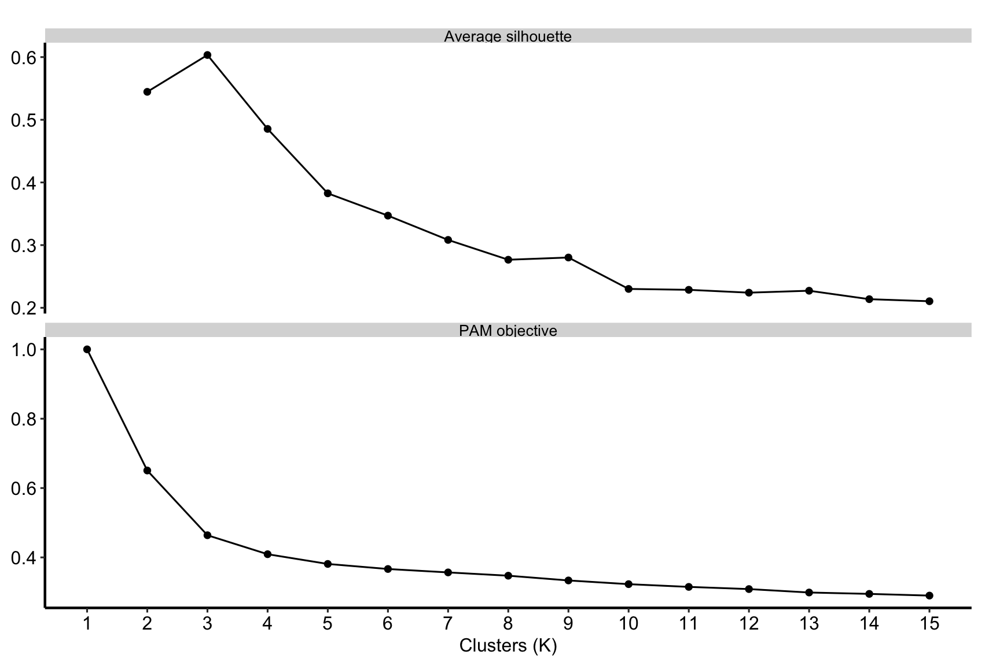
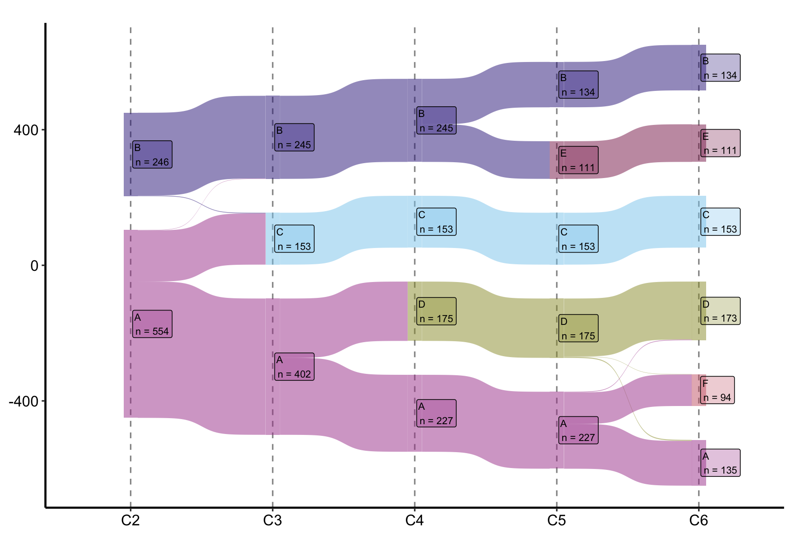
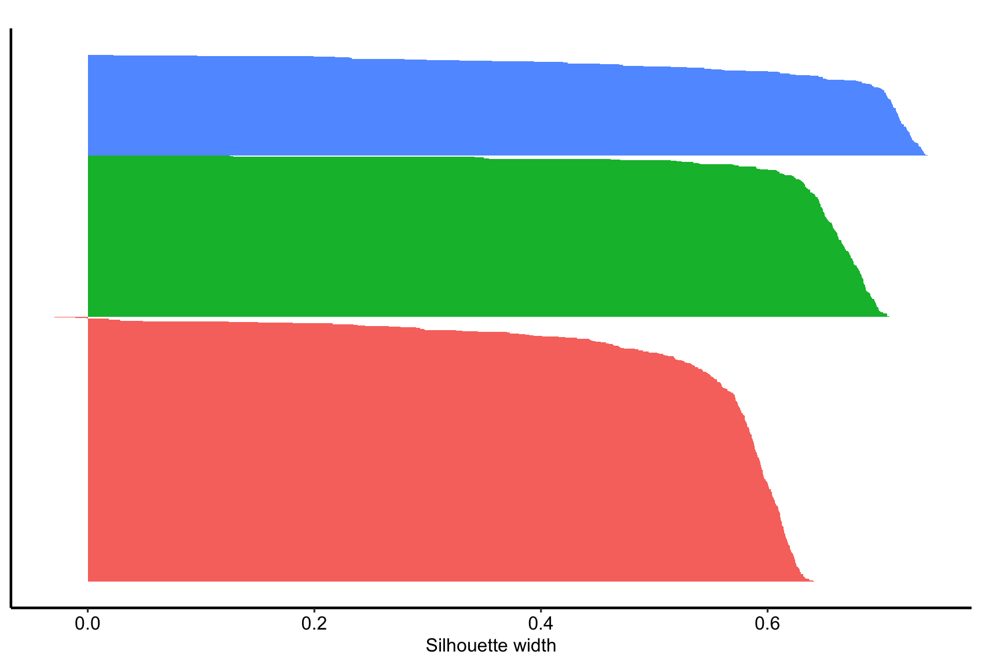
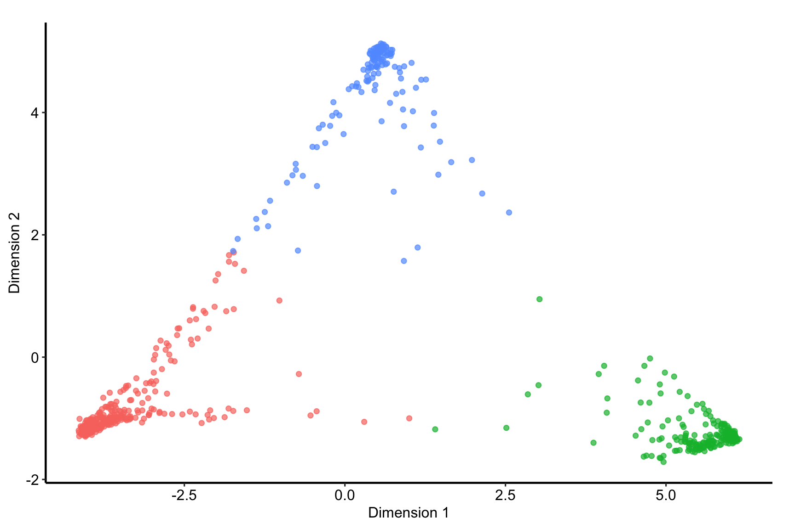

# SID clustering: clusters

# SID clustering: clusters

Published

2026-10-25 18:36

This job turns a `sid-fit` dissimilarity into clusters. It runs PAM
(partitioning around medoids) on the SID distance for each K in a range,
reports what the elbow and the silhouette say about K, and gives every
solution letters that keep their identity as K grows, so cluster A at K
= 4 is recognisably cluster A at K = 5. It never fits the forest: it
reads `sid.rds`, so choosing K and pinning letters cost seconds and can
be repeated freely.

The assignments are written to the study’s datasets folder and
registered, so a later job reads them with `JOIN`: a `dc-tables` job to
describe the clusters, a `vp-fit` job with the cluster as its outcome to
ask which variables separate them.

This template is **in flight**: no study has yet run it end to end.

Code

``` r
SUBJECT <- "echo"
TYPE    <- "sid"
.in <- knitr::current_input(dir = TRUE)
suppressPackageStartupMessages({
  library(cluster)
  library(hvtiPlotR)
  library(hvtiRutilities)
})
# Nothing below is random, but the threads are pinned as in every forest job,
# so a library that does reach for them behaves the same on every machine.
options(rf.cores = 1L, mc.cores = 1L)
# The versions this template was verified against on 2026-10-22.
if (utils::packageVersion("cluster") < "2.1.8") {
  stop("This job needs cluster >= 2.1.8; ", utils::packageVersion("cluster"),
       " is installed.\nUpdate it, then re-render.", call. = FALSE)
}
if (utils::packageVersion("hvtiPlotR") < "2.8.9") {
  stop("This job needs hvtiPlotR >= 2.8.9; ", utils::packageVersion("hvtiPlotR"),
       " is installed.\nUpdate it, then re-render.", call. = FALSE)
}
# To render a job you have not finished, leave a chunk out with the chunk
# option skip, giving the reason in quotes, or call hvtiRtemplates::stop_here()
# in a chunk to leave out everything below it. A draft lists each one in a
# callout; a final render refuses them, as it refuses an unresolved marker.
# ?stop_here has more.
.job <- hvtiRtemplates:::.job_setup(SUBJECT, TYPE, envir = environment())
.root <- .job$root
set_path <- .job$set_path
.provenance_data <- list()
# Saves a figure as <name>.png, .pdf and .tiff in this set's graphs/ folder (or `kind`'s),
# under the SAVE_FIGURES and FIGURES study choices.
save_figure <- function(plot, name, width = 6, height = 4, kind = "graphs", linked = FALSE) {
  hvtiRtemplates:::.save_figure(plot, set_path(kind, paste0(name, ".png")), width, height,
                                SAVE_FIGURES, FIGURES, linked)
}
# The draft banners, if any, and the box under the title, after all the code above.
.job$notice
```

**final** · data: see About this run · rendered by gallery on gallery ·
hvtiRtemplates 1.5.1

## Study choices

Edit these values for this study before rendering.

Code

``` r
# Demo: the solutions to assign letters and draw in the Sankey, smallest K
# first. Letters are carried from each K to the next, so the range must be
# consecutive.
K_RANGE <- 2:6

# Demo: the solution this study reports, one of K_RANGE. Leave NULL for the
# first render: the metrics and sizes below are how K is chosen, and every
# section that needs K is skipped, saying so. A final render needs K. A draft
# render with K = NULL saves clusters = NULL, so a job that reads this set's
# clusters (vt) stops until K is set.
K <- 3

# Demo: letters pinned by hand, by solution and PAM cluster number, such as
#   OVERRIDES <- list(pm4 = c("1" = "B", "2" = "D", "3" = "C", "4" = "A"))
# PAM numbers its clusters arbitrarily, so an override is a domain decision
# written down (which cluster a paper calls A), not a fix. Read the cluster
# numbers from the sizes table. list() lets the lineage rule choose. Overrides
# are keyed on PAM numbers, which sid-fit's forest decides: after a refit they go
# stale, so read the sizes table again before reusing them.
OVERRIDES <- list()

# Demo: optionally, groups made of clusters at K, such as
#   COLLAPSE <- list(Z = c("C", "D", "E"))
# written as an extra column G<K>. Letters not named keep their own letter.
# NULL writes no group column.
COLLAPSE <- NULL

# Demo: a cluster smaller than this at K is flagged. Later per-cluster tables
# and a vp-fit with the cluster as outcome need enough patients in each.
MIN_SIZE <- 20

# Demo: how far the K metrics run. They are drawn beyond K_RANGE on purpose: an
# elbow is only visible with points on both sides of it.
K_METRICS_MAX <- 15

# Each figure is saved to graphs/ as a PNG (for Word), and a PDF and a TIFF (for the publisher).
# SAVE_FIGURES <- FALSE saves none; FIGURES keeps only the figures whose names
# start with one of its entries, e.g. FIGURES <- c("sid-clusters-sankey"). The names are the
# file names, listed for each template in the templates README.
SAVE_FIGURES <- TRUE
FIGURES <- NULL
```

Code

``` r
# Letters that keep their identity across K. The first solution's clusters
# take letters largest first. At each later K, every cluster is the child of
# the previous solution's cluster that contributes most of its patients; the
# largest child of each parent inherits the parent's letter and its siblings
# take fresh ones. An override pins a letter to a PAM cluster number.
# PAM numbers its clusters arbitrarily, so nothing here may depend on those
# numbers: clusters of equal size are ordered by their first patient (row),
# and parents hand out fresh letters in the order of their own letters.
sid_align_labels <- function(mat, overrides = list(), pool = LETTERS) {
  mat <- as.matrix(mat)
  out <- matrix(NA_character_, nrow(mat), ncol(mat), dimnames = list(NULL, colnames(mat)))
  pinned <- function(col, ids) {
    res <- stats::setNames(rep(NA_character_, length(ids)), as.character(ids))
    ov <- overrides[[col]]
    if (is.null(ov)) return(res)
    bad <- setdiff(names(ov), as.character(ids))
    if (length(bad)) {
      stop("OVERRIDES$", col, " names unknown cluster id(s): ", toString(bad), call. = FALSE)
    }
    if (anyDuplicated(ov)) stop("OVERRIDES$", col, " gives one letter to two clusters.", call. = FALSE)
    res[names(ov)] <- ov
    res
  }
  fresh <- function(taken) {
    l <- setdiff(pool, taken)[1]
    if (is.na(l)) stop("Letter pool exhausted: more clusters than letters.", call. = FALSE)
    l
  }
  # Cluster ids of column `x`, largest first, equal sizes by their first row.
  by_size <- function(x, ids = unique(x)) {
    ids <- as.character(ids)
    size <- vapply(ids, function(id) sum(x == id), integer(1))
    first <- vapply(ids, function(id) match(id, x), integer(1))
    ids[order(-size, first)]
  }
  used <- character(0)
  col1 <- as.character(mat[, 1])
  ids <- by_size(col1)
  got <- pinned(colnames(mat)[1], ids)
  for (id in ids) if (is.na(got[id])) got[id] <- fresh(c(used, got))
  used <- unique(c(used, got))
  out[, 1] <- got[col1]
  for (k in seq_len(ncol(mat))[-1]) {
    colk <- as.character(mat[, k])
    tab <- table(out[, k - 1], colk)
    # rownames(tab) are the previous letters, sorted, so a tie between parents
    # goes to the earlier letter whatever PAM's numbering.
    parent <- apply(tab, 2, function(col) rownames(tab)[which.max(col)])
    got <- pinned(colnames(mat)[k], colnames(tab))
    for (p in sort(unique(parent))) {
      kids <- by_size(colk, names(parent)[parent == p])
      # Checked against the whole column: an override may already have given
      # the parent's letter to a cluster of another parent.
      if (!p %in% got) {
        free <- kids[is.na(got[kids])]
        if (length(free)) got[free[1]] <- p
      }
      for (ch in kids) if (is.na(got[ch])) got[ch] <- fresh(c(used, got))
    }
    used <- unique(c(used, got))
    out[, k] <- got[colk]
  }
  out
}

# Groups made of clusters. A letter not in the map keeps its own letter.
sid_collapse <- function(letters, map) {
  if (!is.list(map) || is.null(names(map)) || any(is.na(names(map)) | !nzchar(names(map)))) {
    stop("COLLAPSE must name each group, such as list(Z = c(\"C\", \"D\"))", call. = FALSE)
  }
  named <- unlist(map, use.names = FALSE)
  twice <- unique(named[duplicated(named)])
  if (length(twice)) stop("COLLAPSE has a letter mapped more than once: ", toString(twice), call. = FALSE)
  absent <- setdiff(named, letters)
  if (length(absent)) stop("COLLAPSE names a letter that is not a cluster at K: ", toString(absent), call. = FALSE)
  # A group named for a letter that stays as it is would merge into that cluster.
  clash <- intersect(names(map), setdiff(unique(letters), named))
  if (length(clash)) {
    stop("COLLAPSE has a group name that is also an unmapped cluster at K: ", toString(clash),
         ". Rename the group.", call. = FALSE)
  }
  out <- letters
  for (g in names(map)) out[letters %in% map[[g]]] <- g
  out
}

# cmdscale() returns each axis with an arbitrary sign, so a map can mirror
# between renders. Each axis is turned so that the patient furthest from the
# origin along it is positive. Among patients equally far, the one whose row
# name (the ID digest) sorts first decides, so neither row order nor render
# changes the picture.
sid_mds_signs <- function(xy) {
  key <- if (is.null(rownames(xy))) seq_len(nrow(xy)) else rownames(xy)
  for (j in seq_len(ncol(xy))) {
    far <- which(abs(xy[, j]) == max(abs(xy[, j])))
    if (xy[far[order(key[far])[1]], j] < 0) xy[, j] <- -xy[, j]
  }
  xy
}

# The name a set's clusters are registered under. Dataset names allow only
# [a-z0-9_], and SUBJECT and TYPE may themselves hold "_", so the subject's
# length is written first: (a_b, c) and (a, b_c) would otherwise share one name.
# Names that differ only in case still meet, which the save chunk refuses.
sid_dataset_name <- function(subject, type) {
  paste0("clusters_", nchar(subject), "_", tolower(subject), "_", tolower(type))
}
```

## The dissimilarity

Code

``` r
.handoff <- set_path("estimates", "sid.rds")
if (!file.exists(.handoff)) {
  stop("No SID fit at ", .handoff, ". Render the sid-fit job in this set first; ",
       "this job clusters that fit and never grows its own.", call. = FALSE)
}
.cfg <- study_config(start = .root)
.sid_read <- hvtiRtemplates:::.read_handoff(.handoff, "SID fit", .cfg, "the sid-fit job")
sid <- .sid_read$value
.provenance_data <- .sid_read$lineage$data
.provenance_artifacts <- c(.sid_read$lineage$artifacts, list(.sid_read$record))
D <- stats::as.dist(sid$dist)
# sid.rds names patients by a study-keyed digest of their ID, never the ID. The
# fit's rows are rebuilt from its recorded selection, which checks the rows and
# their key hash, and each rebuilt ID is digested and matched to the distance.
# A reader never creates the key: a new one could not match the digests sid-fit saved.
.key <- tryCatch(hvtiRtemplates:::.study_id_key(.root, create = FALSE), error = function(e) {
  stop("This study's patient-ID key is missing. Restore the study's .hvti/id_key (copying a study loses hidden files); ",
       "rerunning sid-fit would make a new key that no saved result matches.", call. = FALSE)
})
if (!identical(hvtiRtemplates:::.id_key_fingerprint(.key), sid$id_key)) {
  stop("This study's ID key has changed since sid-fit ran, so its patients cannot be matched. Rerun sid-fit.",
       call. = FALSE)
}
.up <- hvtiRtemplates:::.read_upstream_job_data(.cfg, .sid_read$lineage, list(), source = "sid.rds")
job_data <- .up$job_data
.id <- .up$selection$id
.rebuilt <- job_data$data[[.id]]
# The rows were re-read to name the patients, so the data they came from joins
# the record beside what sid.rds already recorded.
.provenance_data <- c(.provenance_data, list(job_data$provenance),
                      if (!is.null(job_data$provenance_join)) list(job_data$provenance_join))
.at_fit <- match(rownames(sid$dist), hvtiRtemplates:::.id_digest(.rebuilt, .key))
if (anyNA(.at_fit)) stop("The rebuilt cohort lacks patients the SID fit clustered; rerun sid-fit.", call. = FALSE)
sid_ids <- .rebuilt[.at_fit]
if (any(diff(K_RANGE) != 1) || min(K_RANGE) < 2L) {
  stop("K_RANGE must be consecutive and start at 2 or more, such as 2:9.", call. = FALSE)
}
# PAM needs fewer clusters than patients. K_RANGE is the author's request and
# stops; K_METRICS_MAX only draws the metrics further out, so it is capped.
if (max(K_RANGE) >= attr(D, "Size")) {
  stop("K_RANGE reaches ", max(K_RANGE), " clusters, but only ", attr(D, "Size"), " patients were clustered. ",
       "Lower K_RANGE.", call. = FALSE)
}
if (!is.null(K) && !K %in% K_RANGE) stop("K = ", K, " is not in K_RANGE (", toString(K_RANGE), ").", call. = FALSE)
# A draft may leave K unset to choose it from the metrics below; a final report
# must name the solution it reports.
if (is.null(K) && hvtiRtemplates:::.strict_render()) {
  stop("K is NULL. Choose it from the metrics in a draft render, then set K in the study choices.", call. = FALSE)
}
cat("Patients:", attr(D, "Size"), " Clustering variables:", toString(sid$vars), "\n")
```

    Patients: 800  Clustering variables: lvedd, lvesd, la_diam, rvsp, e_e, lvef 

## PAM over K

PAM (partitioning around medoids) chooses K patients as centers and
assigns everyone to the nearest one, here by the SID distance itself. It
is deterministic given the distance, so this job needs no seed.

Code

``` r
.ks <- seq_len(min(max(K_RANGE, K_METRICS_MAX), attr(D, "Size") - 1L))
sid_mds <- NULL  # set by fig-mds when K is chosen; defined here so a skipped chunk leaves it NULL
sid_pam <- lapply(.ks, function(k) cluster::pam(D, k))
names(sid_pam) <- paste0("pm", .ks)
sid_metrics <- data.frame(
  k = .ks,
  objective = vapply(sid_pam, function(p) unname(p$objective[["swap"]]), numeric(1)),
  silhouette = vapply(.ks, function(k) if (k == 1L) NA_real_ else sid_pam[[k]]$silinfo$avg.width, numeric(1))
)
sid_metrics$objective <- sid_metrics$objective / sid_metrics$objective[1]
```

## Choosing K

The elbow is the PAM objective, each patient’s distance to its medoid,
relative to one cluster. It always falls as K grows; K is chosen where
the fall levels off, which is read by eye and stated as a judgment. The
average silhouette compares each patient’s distance to its own cluster
with its distance to the nearest other one: near 1 is well separated,
near 0 is on a boundary. Its maximum is one suggestion, not a rule.
Neither says whether the clusters mean anything clinically.

Code

``` r
.long <- rbind(data.frame(k = sid_metrics$k, value = sid_metrics$objective, metric = "PAM objective"),
               data.frame(k = sid_metrics$k, value = sid_metrics$silhouette, metric = "Average silhouette"))
.long <- .long[!is.na(.long$value), ]
.plt_metrics <- ggplot2::ggplot(.long, ggplot2::aes(k, value)) +
  ggplot2::geom_line() + ggplot2::geom_point() +
  ggplot2::facet_wrap(~metric, ncol = 1, scales = "free_y") +
  ggplot2::scale_x_continuous("Clusters (K)", breaks = sid_metrics$k) +
  ggplot2::labs(y = NULL) +
  hvtiPlotR::theme_hv_manuscript(base_size = 12)
save_figure(.plt_metrics, "sid-clusters-metrics", height = 5)
.plt_metrics
```



Figure 1: PAM objective (normalized to K = 1) and average silhouette by
K

Code

``` r
.best <- sid_metrics$k[which.max(sid_metrics$silhouette)]
knitr::kable(transform(sid_metrics, objective = round(objective, 3), silhouette = round(silhouette, 3),
                       note = ifelse(k == .best, "silhouette maximum", "")))
```

|      |   k | objective | silhouette | note               |
|:-----|----:|----------:|-----------:|:-------------------|
| pm1  |   1 |     1.000 |         NA |                    |
| pm2  |   2 |     0.651 |      0.545 |                    |
| pm3  |   3 |     0.464 |      0.603 | silhouette maximum |
| pm4  |   4 |     0.409 |      0.485 |                    |
| pm5  |   5 |     0.381 |      0.383 |                    |
| pm6  |   6 |     0.367 |      0.347 |                    |
| pm7  |   7 |     0.357 |      0.308 |                    |
| pm8  |   8 |     0.347 |      0.277 |                    |
| pm9  |   9 |     0.334 |      0.280 |                    |
| pm10 |  10 |     0.323 |      0.230 |                    |
| pm11 |  11 |     0.315 |      0.229 |                    |
| pm12 |  12 |     0.309 |      0.224 |                    |
| pm13 |  13 |     0.299 |      0.227 |                    |
| pm14 |  14 |     0.295 |      0.214 |                    |
| pm15 |  15 |     0.290 |      0.210 |                    |

Table 1: K metrics; the silhouette maximum is marked

## Letters across K

Code

``` r
.unknown <- setdiff(names(OVERRIDES), paste0("pm", K_RANGE))
if (length(.unknown)) {
  stop("OVERRIDES names solution(s) that are not in K_RANGE: ", toString(.unknown),
       ". Name them pm<K>, such as pm4, for a K in ", toString(K_RANGE), ".", call. = FALSE)
}
.pm <- as.data.frame(lapply(sid_pam[paste0("pm", K_RANGE)], function(p) p$clustering))
.letters <- sid_align_labels(.pm, OVERRIDES)
sid_letters <- data.frame(sid_ids, .letters, check.names = FALSE)
names(sid_letters) <- c(.id, paste0("C", K_RANGE))
.sizes <- do.call(rbind, lapply(K_RANGE, function(k) {
  tab <- table(.letters[, paste0("pm", k)], .pm[[paste0("pm", k)]])
  data.frame(K = k, letter = rownames(tab), pam = colnames(tab)[apply(tab, 1, which.max)],
             n = as.integer(rowSums(tab)))
}))
.shown <- .sizes
.shown$smallest <- ifelse(.sizes$n == stats::ave(.sizes$n, .sizes$K, FUN = min), "smallest at this K", "")
knitr::kable(.shown, row.names = FALSE)
.small <- if (!is.null(K)) .sizes[.sizes$K == K & .sizes$n < MIN_SIZE, ] else .sizes[0, ]
if (nrow(.small)) {
  warning("At K = ", K, ", cluster(s) ", toString(.small$letter), " hold fewer than ", MIN_SIZE, " patients.",
          call. = FALSE)
}
```

|   K | letter | pam |   n | smallest           |
|----:|:-------|:----|----:|:-------------------|
|   2 | A      | 1   | 554 |                    |
|   2 | B      | 2   | 246 | smallest at this K |
|   3 | A      | 1   | 402 |                    |
|   3 | B      | 2   | 245 |                    |
|   3 | C      | 3   | 153 | smallest at this K |
|   4 | A      | 1   | 227 |                    |
|   4 | B      | 2   | 245 |                    |
|   4 | C      | 3   | 153 | smallest at this K |
|   4 | D      | 4   | 175 |                    |
|   5 | A      | 1   | 227 |                    |
|   5 | B      | 5   | 134 |                    |
|   5 | C      | 3   | 153 |                    |
|   5 | D      | 4   | 175 |                    |
|   5 | E      | 2   | 111 | smallest at this K |
|   6 | A      | 2   | 135 |                    |
|   6 | B      | 6   | 134 |                    |
|   6 | C      | 4   | 153 |                    |
|   6 | D      | 1   | 173 |                    |
|   6 | E      | 3   | 111 |                    |
|   6 | F      | 5   |  94 | smallest at this K |

Table 2: Patients per cluster at each K, by letter; pam is the PAM
cluster number the letter was given to

Code

``` r
# In its own chunk because a callout is markdown, which only an asis chunk emits.
if (nrow(.small)) {
  cat("\n::: {.callout-warning}\nAt K = ", K, ", cluster(s) ", toString(.small$letter), " hold fewer than ",
      MIN_SIZE, " patients, too few for per-cluster tables or a vp-fit to say much.\n:::\n", sep = "")
}
```

Code

``` r
# A Sankey needs two or more K to follow patients between.
if (length(K_RANGE) > 1L) {
  .sk <- hvtiPlotR::hv_sankey(sid_letters, cluster_cols = paste0("C", K_RANGE))
  .plt_sankey <- plot(.sk) + hvtiPlotR::theme_hv_manuscript(base_size = 12)
  # The page is 6.5 in wide; the Sankey's columns need its full width.
  save_figure(.plt_sankey, "sid-clusters-sankey", width = 6.5, height = 6)
  .plt_sankey
}
```



Figure 2: How patients move between clusters as K grows

Code

``` r
if (length(K_RANGE) < 2L) {
  cat("\n::: {.callout-note}\nK_RANGE holds one K, so there is no Sankey: it follows patients between solutions.",
      "Widen K_RANGE to compare clusters across K.\n:::\n")
}
```

A cluster that keeps its letter and most of its patients across several
K is stable; one that forms and dissolves between neighboring K is not.

## The solution at K

Code

``` r
# The chunks below are hidden while K is NULL, so this says why the section is empty.
if (is.null(K)) {
  cat("\n::: {.callout-note}\nK is not set yet, so the sections that describe one solution are left out. Choose K",
      "from the metrics and sizes above, then set it in the study choices.\n:::\n")
}
```

Code

``` r
if (!is.null(K)) {
  .at <- sid_letters[[paste0("C", K)]]
  # pam() already computed the widths; they come back ordered by cluster, so put them in the patients' order.
  .w <- sid_pam[[K]]$silinfo$widths
  .sil_d <- data.frame(letter = .at, width = .w[match(rownames(sid$dist), rownames(.w)), "sil_width"])
  .sil_d <- .sil_d[order(.sil_d$letter, -.sil_d$width), ]
  .sil_d$rank <- seq_len(nrow(.sil_d))
  .plt_sil <- ggplot2::ggplot(.sil_d, ggplot2::aes(rank, width, fill = letter)) +
    ggplot2::geom_col(width = 1) + ggplot2::coord_flip() +
    ggplot2::labs(x = NULL, y = "Silhouette width", fill = "Cluster") +
    hvtiPlotR::theme_hv_manuscript(base_size = 12) +
    ggplot2::theme(axis.text.y = ggplot2::element_blank(), axis.ticks.y = ggplot2::element_blank())
  save_figure(.plt_sil, "sid-clusters-silhouette")
  print(.plt_sil)
}
```



Figure 3: Silhouette width of every patient at K, by cluster

Code

``` r
if (!is.null(K)) {
  knitr::kable(do.call(rbind, lapply(split(.sil_d$width, .sil_d$letter), function(w) {
    data.frame(n = length(w), average = round(mean(w), 3), negative = sprintf("%.0f%%", 100 * mean(w < 0)))
  })))
}
```

|     |   n | average | negative |
|:----|----:|--------:|:---------|
| A   | 402 |   0.556 | 1%       |
| B   | 245 |   0.648 | 0%       |
| C   | 153 |   0.655 | 0%       |

Table 3: Average silhouette width and share of negative widths, by
cluster at K

A negative width means a patient is closer to another cluster than to
its own. A cluster with many is poorly separated even when the average
looks acceptable.

Code

``` r
if (!is.null(K)) {
  sid_mds <- sid_mds_signs(stats::cmdscale(D, k = 2))
  .plt_mds <- ggplot2::ggplot(data.frame(x = sid_mds[, 1], y = sid_mds[, 2], letter = .at),
                              ggplot2::aes(x, y, color = letter)) +
    ggplot2::geom_point(alpha = 0.7) +
    ggplot2::labs(x = "Dimension 1", y = "Dimension 2", color = "Cluster") +
    hvtiPlotR::theme_hv_manuscript(base_size = 12)
  save_figure(.plt_mds, "sid-clusters-mds")
  print(.plt_mds)
}
```



Figure 4: Patients placed in two dimensions by classical MDS of the SID
distance, colored by cluster at K

Two dimensions keep only part of the distance, so clusters that overlap
here may still be separate; the silhouette above is the better guide.

## Reading the result

A SID cluster is a region of the clustering variables where patients are
alike, found without any outcome. It is a description, not a diagnosis,
and the letters carry no order. Read the Sankey for stability, the
silhouette for separation, and the sizes for whether a cluster is large
enough to say anything about. To describe the clusters, a `dc-tables`
job joins the registered dataset below; to ask which variables separate
them, a `vp-fit` job takes the cluster at K as a classification outcome.

A job that models one row per patient, such as `vp-fit`, also sets
`REDUCE` to keep the first record by the patient ID; the line to use is
printed in the save section below.

## Save

Code

``` r
# The letters, for any later job to JOIN by the patient ID. Only the ID and
# letters are written: no clustering variable leaves this job.
.csv_name <- paste0(SUBJECT, "-", TYPE, "-clusters.csv")
.dataset <- sid_dataset_name(SUBJECT, TYPE)
# A name already registered to another file or key is not this set's: two sets
# whose names differ only in case meet here. update_manifest() would follow
# that other file and report success on stale letters, so stop instead.
.reg <- .cfg$additional_datasets[[.dataset]]
if (!is.null(.reg) && !identical(.reg$built, .csv_name)) {
  stop("The dataset name `", .dataset, "` is already registered to ", .reg$built, ", not this set's ", .csv_name,
       ". Give this set a subject or type that differs by more than case.", call. = FALSE)
}
if (!is.null(.reg) && !identical(.reg$key, .id)) {
  stop("The dataset `", .dataset, "` is already registered with key ", .reg$key, ", not this set's ID ", .id,
       ". Register it again under the ID, or remove the old entry.", call. = FALSE)
}
.csv_path <- file.path(hvtiRutilities::study_dir("datasets", .root), .csv_name)
# Write to a temporary file in the same folder first, so a failed check below
# never touches a CSV an earlier render already registered. Same folder, so the
# final move is a rename on one file system.
.csv_tmp <- tempfile("sid-clusters-", tmpdir = dirname(.csv_path), fileext = ".csv")
utils::write.csv(sid_letters, .csv_tmp, row.names = FALSE)
# Later jobs read this file back from CSV without column types, so an ID such as
# "0012345" would return as 12345 and match no patient. Read the temporary file
# back as they do and stop, removing only it, if the ID changed.
.reread <- utils::read.csv(.csv_tmp)
if (!identical(as.character(.reread[[.id]]), as.character(sid_letters[[.id]]))) {
  file.remove(.csv_tmp)
  stop("The ID `", .id, "` would not survive as CSV: read back, its values differ (a leading zero or a long number ",
       "is read as a number). No new file was kept and any earlier one is unchanged. Cluster on an ID that reads back ",
       "unchanged, or ask for the ID to be stored without leading zeros.", call. = FALSE)
}
# The solution at K for jobs that read this file rather than the dataset, such
# as vt-explain's stratifier: patients by ID digest, as in sid.rds, never by ID.
sid_clusters <- if (!is.null(K)) {
  out <- data.frame(id = rownames(sid$dist), cluster = as.character(sid_letters[[paste0("C", K)]]))
  if (!is.null(COLLAPSE)) out$group <- as.character(sid_letters[[paste0("G", K)]])
  out
}
.cohort <- list(n = as.integer(attr(D, "Size")))
sid_clusters_handoff <- hvtiRtemplates:::.attach_handoff_lineage(
  list(clusters = sid_clusters, id_key = sid$id_key, pam = sid_pam, metrics = sid_metrics,
       letters = lapply(stats::setNames(paste0("pm", K_RANGE), paste0("pm", K_RANGE)), function(col) {
         tab <- table(.pm[[col]], .letters[, col])
         stats::setNames(colnames(tab)[apply(tab, 1, which.max)], rownames(tab))
       }),
       k = K, overrides = OVERRIDES, collapse = COLLAPSE),
  data = .provenance_data,
  artifacts = .provenance_artifacts,
  cohort = .cohort
)
saveRDS(sid_clusters_handoff, set_path("estimates", "sid-clusters.rds"))
# Only now is the CSV replaced. Order: the .rds first, so a failure there leaves the
# registered CSV as it was; then the move; then the manifest, which records the
# file that is on disk.
if (!isTRUE(file.rename(.csv_tmp, .csv_path))) {
  # rename() fails across file systems or onto a locked file; copy then remove.
  if (!file.copy(.csv_tmp, .csv_path, overwrite = TRUE)) stop("Could not write ", .csv_path, call. = FALSE)
  unlink(.csv_tmp)
}
# register_data() registers a dataset once and stops on a second call. A later
# render records the rewritten file as a new dated version instead, so later
# jobs read the current letters and their manifest check passes.
if (!is.null(.reg)) {
  utils::capture.output(suppressMessages(
    withr::with_dir(.root, hvtiRutilities::update_manifest(dataset = .dataset))
  ))
} else {
  utils::capture.output(suppressMessages(
    hvtiRutilities::register_data(.root, built = .csv_name, dataset = .dataset, role = "named",
                                  population = "SID cluster assignments", kind = "ancillary", key = .id)
  ))
}
```

     [1] "Study: /private/tmp/claude-504/-Users-ehrlinj-Documents-GitHub-hvtiRtemplates/cd7905b7-02af-4ba0-b8ac-2dc917269fb8/scratchpad/gallery-study"
     [2] ""                                                                                                                                           
     [3] "[x] _study.yml — study: Template gallery (synthetic)"                                                                                       
     [4] "[x] renv.lock — renv.lock present"                                                                                                          
     [5] "[x] manifest.yaml — 3 dataset entries verified by checksum"                                                                                 
     [6] "[x] dataset — built.rds, registered as built_20261025.parquet"                                                                              
     [7] "[x] dataset:echo — echo.rds, registered as echo_20261025.parquet"                                                                           
     [8] "[x] dataset:clusters_4_echo_sid — echo-sid-clusters.csv, registered as echo-sid-clusters_20261025.parquet"                                  
     [9] "[!] provenance — 2 of 47 .qmd/.Rmd source names have no provenance sidecar: bd.study.build, sid.clusters.echo.sid"                          
    [10] ""                                                                                                                                           
    [11] "4 .R  |  47 .qmd/.Rmd  |  3 .sas  |  75 provenance sidecars"                                                                                

Code

``` r
cat("Registered `", .dataset, "`: set JOIN <- \"", .dataset, "\" in a later job to use these clusters.\n",
    "A job that models one row per patient also sets REDUCE <- list(rule = \"first\", by = \"", .id, "\").\n",
    sep = "")
```

    Registered `clusters_4_echo_sid`: set JOIN <- "clusters_4_echo_sid" in a later job to use these clusters.
    A job that models one row per patient also sets REDUCE <- list(rule = "first", by = "patient_id").

## About this run

| Group | Item | Value |
|:---|:---|:---|
| Run | Started | 2026-10-25 18:36:08 EDT |
|  | Ended | 2026-10-25 18:36:13 EDT |
|  | Duration | 5 s |
|  | Status | final |
|  | Rendered by | gallery |
|  | Host | gallery |
| Job | File | sid.clusters.echo.sid.qmd |
|  | Template | sid.clusters |
|  | Subject | echo |
|  | Type | sid |
|  | hvtiRtemplates | 1.5.1 |
| Dataset `built` | Version file | built_20261025.parquet |
|  | Version date | 2026-10-25 |
|  | Source file | built.rds |
|  | Rows kept | 800 rows on 800 patients |
|  | WHERE | none |
|  | sha256 | b236a472f1f3 |
|  | Manifest | current |
| Upstream | Handoff | `echo-sid/sid.rds` (SID fit), rendered 2026-10-25 18:35:59 -0400, data built_20261025.parquet |
| Reproducibility | renv | not active |
|  | renv.lock sha256 | d09f96b6cd21 |
