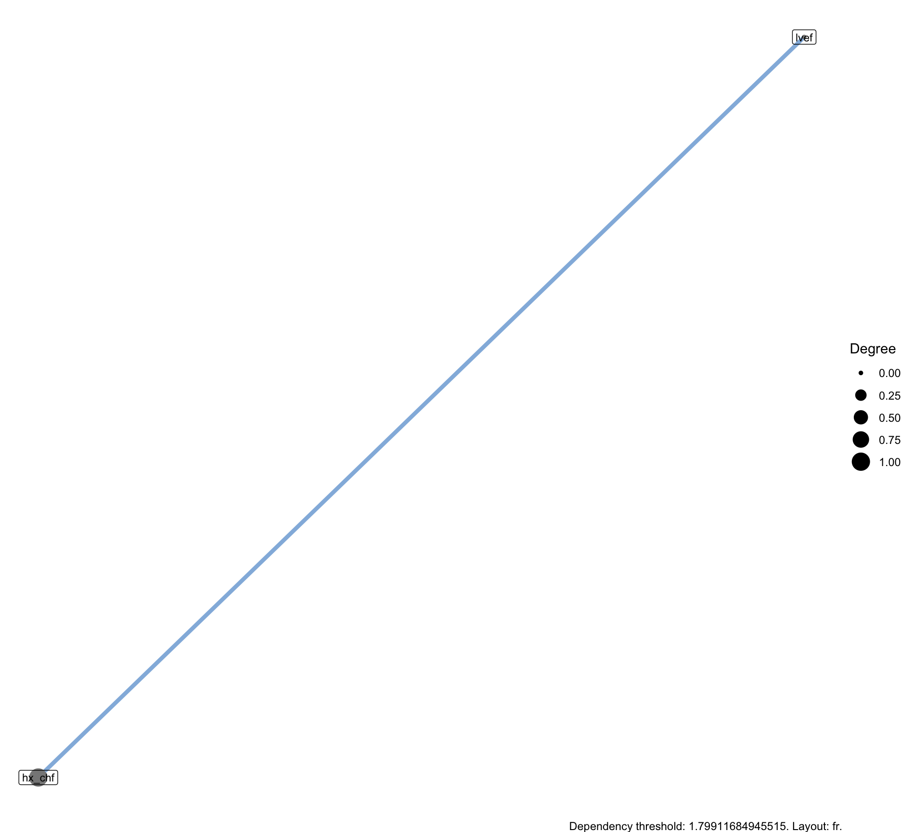
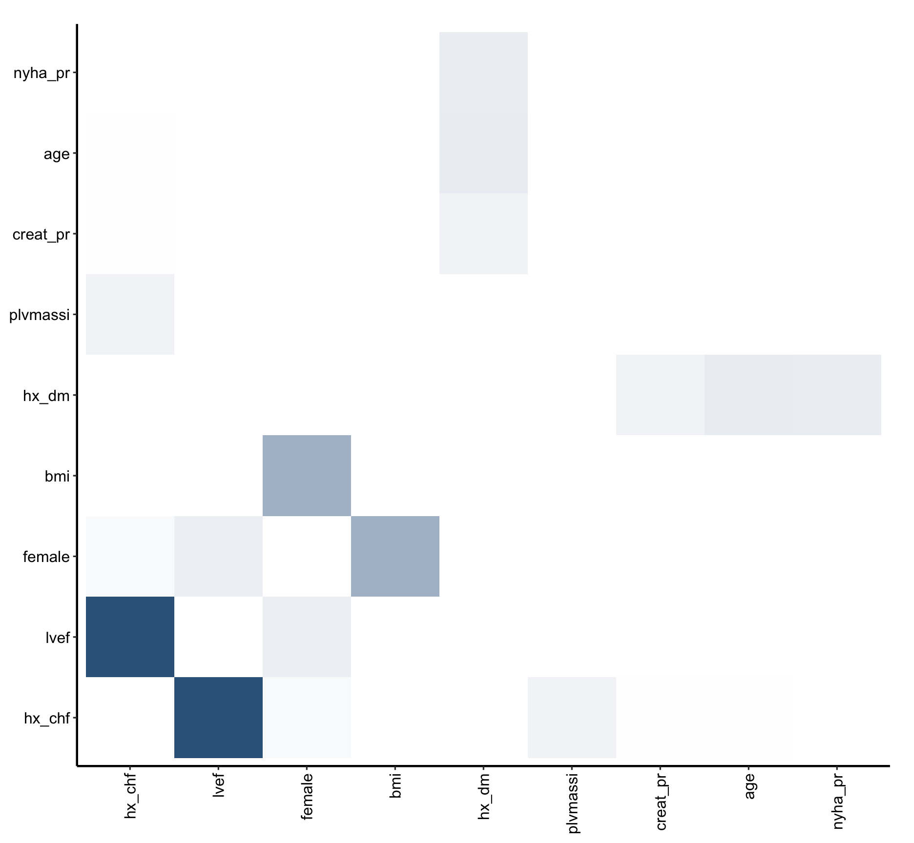

# VarPro: dependence

# VarPro: dependence

Published

2026-10-29 12:53

Gallery job on the synthetic cohort: how the nine preoperative
predictors the rf fits grow on depend on each other, with no outcome
entered.

A `vp-dependence` job asks how the study’s variables depend on each
other. It needs no outcome: unsupervised VarPro (`varPro::uvarpro()`)
grows a forest on the variables alone, and each variable’s release rules
ask which other variables separate the patients a rule picks out. No
other job in the set has to run first.

The job takes three steps. **The forest:** `uvarpro()` on the variables
and on permuted noise copies of them. **The matrix:**
`get.beta.entropy()` fits a lasso for every released variable, and its
coefficients say how strongly each other variable separates that
variable’s contrast. **The graph:** an edge is drawn only where that
strength beats the largest any noise column reached, and the whole thing
is refitted on subsamples to show which edges hold.

This template is **in flight**: it is built from one study’s dependence
analysis, and a second study running it through to its stability section
is what moves it to shipped.

Code

``` r
SUBJECT <- "preop"
TYPE    <- "vp"
.in <- knitr::current_input(dir = TRUE)
suppressPackageStartupMessages({
  library(varPro)
  library(ggRandomForests)
  library(hvtiRutilities)
})
# One thread, so the forest and the lasso reproduce from machine to machine.
# uvarpro() and get.beta.entropy() take no cores argument: rf.cores reaches the
# forest and mc.cores the lasso's workers.
options(rf.cores = 1L, mc.cores = 1L)
# The versions this template was verified against on 2026-10-22. Below them a
# call here can fail or change meaning, and the message would arrive mid-render
# rather than here.
if (utils::packageVersion("randomForestSRC") < "3.7.0") {
  stop("This job needs randomForestSRC >= 3.7.0; ", utils::packageVersion("randomForestSRC"),
       " is installed.\nUpdate it, then re-render.", call. = FALSE)
}
# 3.3.0 records which variable each encoded column came from (xvar.map) and
# aligns sdependent()'s matrix by name; this job relies on both.
if (utils::packageVersion("varPro") < "3.3.0") {
  stop("This job needs varPro >= 3.3.0; ", utils::packageVersion("varPro"),
       " is installed.\nUpdate it, then re-render.", call. = FALSE)
}
if (utils::packageVersion("ggRandomForests") < "4.0.0") {
  stop("This job needs ggRandomForests >= 4.0.0; ", utils::packageVersion("ggRandomForests"),
       " is installed.\nUpdate it, then re-render.", call. = FALSE)
}
# The dependence graph is drawn by ggRandomForests' plot method, which needs ggraph.
if (!requireNamespace("ggraph", quietly = TRUE)) {
  stop("This job needs the ggraph package to draw the dependence graph. Install it, then re-render.", call. = FALSE)
}
# The study root is the nearest directory above this file holding _study.yml,
# so the job renders the same from the Render button, quarto render, or
# render_job(), at any depth, with no path in this document to edit.
# Without the guard in .job_setup(), an unedited job renders green over a
# meaningless analysis. Here that is a graph of the template's placeholder
# variables, which looks exactly like a result.
# To render a job you have not finished, leave a chunk out with the chunk
# option skip, giving the reason in quotes, or call hvtiRtemplates::stop_here()
# in a chunk to leave out everything below it. A draft lists each one in a
# callout; a final render refuses them, as it refuses an unresolved marker.
# ?stop_here has more.
.job <- hvtiRtemplates:::.job_setup(SUBJECT, TYPE, envir = environment())
.root <- .job$root
set_path <- .job$set_path
.provenance_data <- list()
# Saves a figure as <name>.png, .pdf and .tiff in this set's graphs/ folder (or `kind`'s),
# under the SAVE_FIGURES and FIGURES study choices.
save_figure <- function(plot, name, width = 6, height = 4, kind = "graphs", linked = FALSE) {
  hvtiRtemplates:::.save_figure(plot, set_path(kind, paste0(name, ".png")), width, height,
                                SAVE_FIGURES, FIGURES, linked)
}

# `vp-dependence` writes dependence.rds, in the `save` chunk near the foot of
# this file. No job reads it yet.
# The draft banners, if any, and the box under the title, after all the code above.
.job$notice
```

**final** · data `built` `built_20261029.parquet`, dated 2026-10-29 ·
rendered by gallery on gallery · hvtiRtemplates 1.5.4

## Study choices

Edit these values for this study before rendering.

Code

``` r
# Demo: the registered dataset this job reads ("built" is the study dataset).
DATASET <- "built"

# Demo: an hvtiRdatabuild analysis set, or NULL to read the whole dataset.
ANALYSIS_SET <- NULL

# Demo: rows to keep, dplyr::filter() style, or NULL to keep every row:
#   WHERE <- quote(age >= 18)
#   WHERE <- rlang::exprs(age >= 18, hx_chf == 1)
WHERE <- NULL

# Demo: the patient identifier. Without "ccfid" the job uses MRN, then eMRN;
# name another column, such as "randid", if the study uses one.
ID <- "patient_id"

# Demo: what makes a row unique; one row per patient unless repeated measures
# add their visit time or date, for example KEY <- c(ID, "iv_echo").
KEY <- ID

# Optional, and needs no edit: NULL reads the cohort alone. To join one
# registered ancillary dataset (echoes, labs), name it in JOIN. The cohort
# above decides the patients, one row each; the joined records of other
# patients are dropped and counted in the data table.
#   JOIN_VARS: the cohort columns each joined row carries; NULL carries all,
#     and a column both datasets have stops, so list only those the job needs.
#   REDUCE: NULL keeps a row per joined record, keyed on that dataset's key;
#     list(rule = "first", by = "echo_date") keeps one row per patient ("last",
#     or "nearest" with to = a cohort date column). A tie stops: picking one
#     record silently would be a hidden choice. This job reads one row per
#     patient, so a JOIN without REDUCE stops here.
#   JOIN_KEY: overrides the joined dataset's registered key.
JOIN <- NULL
JOIN_VARS <- NULL
REDUCE <- NULL
JOIN_KEY <- NULL

# Demo: the variables whose dependence on each other this job studies. Name
# them rather than taking every column: a built dataset carries identifiers,
# dates and derived outcomes, and dates in particular link to everything.
VARIABLES <- c("age", "female", "bmi", "hx_chf", "hx_dm", "nyha_pr", "lvef", "plvmassi", "creat_pr")

# Demo: optional outcome columns, entered as plain variables to see where the
# outcome sits among them. NULL enters none. A link to an outcome column is
# shared structure, not prediction. A survival outcome enters as two columns,
# the event (0/1) and the time.
OUTCOME <- NULL

# Demo: graded variables to enter as numbers (a grade 0-3, a count). Left as
# factors they are split into 0/1 columns, and the unsupervised forest then
# finds structure almost only between the levels of one factor, which this job
# removes. Unordered categories stay factors.
ORDINAL <- "nyha_pr"

# Demo: how many permuted noise columns to add, split evenly between
# categorical and continuous variables. The largest dependence a noise column
# reaches is the bar an edge must clear.
NOISE_N <- 20

# Demo: the unsupervised forest. Below about 100 trees the noise reaches
# almost as high as a real link, so the bar loses its meaning.
NTREE <- 200

# Demo: the fixed edge cutoff the noise bar is reported beside, and falls back
# to when no noise column earned any weight. 0.25 is varPro's default.
THRESHOLD_FIXED <- 0.25

# Demo: the stability check. REPEATS refits, each on SUBSAMPLE of the patients
# drawn without replacement and with a fresh noise draw. 0 skips it; each
# refit costs one forest and one lasso step.
REPEATS <- 3
SUBSAMPLE <- 0.632

# Demo: the seed. It is part of every cache key, seeds R's generator before
# the forest and again before the lasso, and is handed to uvarpro() as `seed =`.
SEED <- 2026

# Set TRUE after changing a choice above. A cache whose inputs changed stops the
# render instead of returning the old result; TRUE recomputes only the caches
# that are out of date.
REFIT <- FALSE

# Each figure is saved to graphs/ as a PNG (for Word), and a PDF and a TIFF (for the publisher).
# SAVE_FIGURES <- FALSE saves none; FIGURES keeps only the figures whose names
# start with one of its entries, e.g. FIGURES <- c("vp-dependence-graph"). The names are the
# file names, listed for each template in the templates README.
SAVE_FIGURES <- TRUE
FIGURES <- NULL
```

## Data

Code

``` r
# The checksum of every dataset in manifest.yaml is checked before anything is
# read, so a result can name the data that produced it. It stops on a mismatch.
hvtiRutilities::verify_manifest(file.path(.root, "manifest.yaml"))
.cfg <- study_config(start = .root)
job_data <- hvtiRtemplates::read_job_data(.cfg, dataset = DATASET, analysis_set = ANALYSIS_SET,
                                          where = WHERE, id = ID, key = KEY, join = JOIN, join_vars = JOIN_VARS,
                                          reduce = REDUCE, join_key = JOIN_KEY, one_row_per_patient = TRUE)
d <- job_data$data
.provenance_data <- c(if (exists(".provenance_data")) .provenance_data else list(), list(job_data$provenance),
                      if (!is.null(job_data$provenance_join)) list(job_data$provenance_join))
knitr::kable(job_data$record, col.names = c("Data", ""))
.cols <- c(VARIABLES, OUTCOME)
.duplicated <- unique(.cols[duplicated(.cols)])
if (length(.duplicated)) {
  stop("VARIABLES and OUTCOME name a variable more than once: ", paste(.duplicated, collapse = ", "), ".", call. = FALSE)
}
# An identifier would link to nothing but itself, and the saved fit keeps its
# data, so it would be written into dependence.rds.
.selection <- attr(job_data$record, "selection")
.identifiers <- .cols[tolower(.cols) %in% tolower(c(.selection$id, .selection$key))]
if (length(.identifiers)) {
  stop("Do not include the patient identifier or a KEY column: ", paste(.identifiers, collapse = ", "), ".", call. = FALSE)
}
.missing <- setdiff(.cols, names(d))
if (length(.missing)) {
  stop("Not in the data this job read: ", paste(.missing, collapse = ", "), call. = FALSE)
}
.not_listed <- setdiff(ORDINAL, .cols)
if (length(.not_listed)) {
  stop("ORDINAL names variable(s) not in VARIABLES or OUTCOME: ", paste(.not_listed, collapse = ", "), call. = FALSE)
}
d <- d[, .cols, drop = FALSE]
for (.v in ORDINAL) {
  .num <- suppressWarnings(as.numeric(as.character(d[[.v]])))
  if (any(is.na(.num) & !is.na(d[[.v]]))) {
    stop(.v, " is in ORDINAL but has values that are not numbers.", call. = FALSE)
  }
  d[[.v]] <- .num
}
.chr <- .cols[vapply(d[.cols], is.character, logical(1L))]
if (length(.chr)) {
  d[.chr] <- lapply(d[.chr], factor)
  cat("Text variables converted to factors: ", paste(.chr, collapse = ", "), "\n", sep = "")
}
.analysis <- list(kind = "unsupervised", variables = VARIABLES, outcome = OUTCOME)
```

| Data                |                                          |
|:--------------------|:-----------------------------------------|
| Source              | dataset `built` (built_20261029.parquet) |
| Rows read           | 800                                      |
| ID                  | `patient_id`                             |
| Identifiers dropped | none                                     |
| Rows kept           | 800 rows on 800 patients                 |

Table 1: The data this job read

Code

``` r
# unnumbered: its child chunk carries its own label and caption
if (!is.null(job_data$attrition)) {
  .fence <- strrep("`", 3)
  cat(knitr::knit_child(text = c(
    paste0(.fence, "{r}"), "#| label: tbl-data-attrition",
    paste0("#| tbl-cap: ", encodeString(paste0("Analysis set `", ANALYSIS_SET, "`: exclusions, in order"), quote = "\"")),
    "knitr::kable(job_data$attrition)", .fence
  ), envir = environment(), quiet = TRUE), sep = "\n")
}
```

Code

``` r
# uvarpro() drops every patient with a missing value, so the graph would
# describe fewer patients than this report claims. They are dropped here
# instead, and counted, before the fit sees the data.
.empty <- .cols[vapply(d[.cols], function(x) all(is.na(x)), logical(1L))]
if (length(.empty)) {
  stop("VARIABLES or OUTCOME names a column with no values: ", paste(.empty, collapse = ", "),
       ". Remove it.", call. = FALSE)
}
.missing_values <- hvtiRtemplates:::.missing_cases(d, VARIABLES = VARIABLES, OUTCOME = OUTCOME, action = "drop")
d <- d[stats::complete.cases(d), , drop = FALSE]
.cohort <- list(n = as.integer(nrow(d)))
knitr::kable(.missing_values)
```

| Variable       | Setting   | Missing                              |
|:---------------|:----------|:-------------------------------------|
| creat_pr       | VARIABLES | 75                                   |
| Complete cases |           | 725 of 800 rows analyzed; 75 dropped |

Table 2: Missing values in the variables studied

## Noise

Each noise column is a permuted copy of a real variable. It keeps that
variable’s values and loses every link to the other columns, not only to
an outcome, so whatever dependence it shows is what chance alone shows.
The largest weight any noise column reaches is the bar a real edge must
clear.

Code

``` r
# Half the copies come from categorical variables and half from continuous
# ones, as far as each kind allows, so both kinds of column contribute to the
# null. An outcome column entered in OUTCOME is a source like any other: a
# permuted outcome is as much a null as any other permuted column.
#
# The kind rule is varpro_coverage()'s: a factor, text or logical column, or a
# number with at most 5 distinct values, is categorical.
vp_kind <- function(x) {
  if (is.factor(x) || is.character(x) || is.logical(x) || length(unique(stats::na.omit(x))) <= 5L) {
    "categorical"
  } else {
    "continuous"
  }
}
vp_add_noise <- function(d, predictors, n, seed) {
  kinds <- vapply(d[predictors], vp_kind, "")
  pools <- split(predictors, kinds)
  n_cat <- if (length(pools$categorical) && length(pools$continuous)) {
    n %/% 2L
  } else if (length(pools$categorical)) {
    n
  } else {
    0L
  }
  set.seed(abs(seed))
  draw <- function(pool, k) if (k == 0L) character() else pool[sample.int(length(pool), k, replace = k > length(pool))]
  src <- c(draw(pools$categorical, n_cat), draw(pools$continuous, n - n_cat))
  for (i in seq_along(src)) {
    set.seed(abs(seed) + i)
    d[[paste0("noise", i, "_", src[i])]] <- sample(d[[src[i]]])
  }
  d
}
if (NOISE_N < 1) {
  stop("NOISE_N must be at least 1: the edge bar needs noise to beat.", call. = FALSE)
}
if (!(SUBSAMPLE > 0 && SUBSAMPLE < 1)) {
  stop("SUBSAMPLE must be a share between 0 and 1 (0.632 draws 63.2% of the patients).", call. = FALSE)
}
if (REPEATS > 0 && floor(SUBSAMPLE * nrow(d)) < 2) {
  stop("SUBSAMPLE of ", nrow(d), " patients leaves fewer than 2 for a refit. Raise SUBSAMPLE or set REPEATS to 0.", call. = FALSE)
}
# The noise columns are found by the "noise" prefix, so a real variable named
# that way would be judged as noise.
.noisy <- grep("^noise", .cols, value = TRUE)
if (length(.noisy)) {
  stop("Variable(s) whose names start with \"noise\", which this job reserves for its noise columns: ",
       paste(.noisy, collapse = ", "), ". Rename them in the dataset build.", call. = FALSE)
}
d_noise <- vp_add_noise(d, .cols, NOISE_N, SEED)
```

Code

``` r
# The decisions this job makes from the importance matrix, in one chunk of
# their own so they can be checked on a hand-built matrix without a fit.
#
# varPro splits a factor into one 0/1 column per level and records which
# variable each column came from, in attr(fit$x, "xvar.map"). That record is
# read, never guessed from the names: a factor f with a level s beside a
# numeric fs gets a column named fs.1, which belongs to f, and no rule on the
# spelling can tell.
vpd_parent <- function(fit) {
  map <- attr(fit$x, "xvar.map")
  if (is.null(map)) {
    stop("This varPro fit records no xvar.map, so its encoded columns cannot be traced to variables. ",
         "Update varPro to 3.3.0 or later, set REFIT <- TRUE, and re-render.", call. = FALSE)
  }
  map
}
# get.beta.entropy() returns rows only for the variables that formed a
# contrast, so the matrix is padded to square, missing entries 0. A patient is
# only ever one level of a factor, so links between two levels say nothing
# about the data and are zeroed, as gg_udependent() does.
vpd_square <- function(I, parent) {
  nm <- union(rownames(I), colnames(I))
  sq <- matrix(0, length(nm), length(nm), dimnames = list(nm, nm))
  sq[rownames(I), colnames(I)] <- I
  p <- parent[nm]
  same <- outer(p, p, "==")
  same[is.na(same)] <- FALSE
  sq[same] <- 0
  diag(sq) <- 0
  sq
}
# The bar: the largest weight any noise term reached, released (its row) or
# as a predictor (its column). Both are chance. A bar is usable only above 0;
# when no noise earned any weight the fixed threshold stands in, and says so.
vpd_bar <- function(I, noise, fixed) {
  w <- c(I[noise, , drop = FALSE], I[, noise, drop = FALSE])
  w <- w[is.finite(w)]
  if (length(w) && max(w) > 0) list(bar = max(w), from = "noise") else list(bar = fixed, from = "fixed (fallback)")
}
```

## Fit

Code

``` r
# Empty until the stability chunk fills it, which it does only when REPEATS is
# above 0, so a session that ran the job before cannot carry an old result in.
.vpd_stab <- NULL
# cache_fit() writes <dir>/<name>.rds and its default dir is the study's
# estimates folder, not this set's, so every call here names the set's.
CACHE_DIR <- dirname(set_path("estimates", "dependence.rds"))
set.seed(abs(SEED))
# packages = keys each cache on the engine doing the work as well as on
# varPro, which only calls it: randomForestSRC grows the forest and glmnet
# fits the lasso, and an update to either must not reuse an old result.
fit <- cache_fit("vp-dependence", uvarpro(d_noise, ntree = NTREE, seed = -abs(SEED)),
                 seed = SEED, dir = CACHE_DIR, refit = REFIT, packages = "randomForestSRC")
# The lasso step draws its cross-validation folds from R's generator, so it is
# seeded again. pre.filter = FALSE keeps every column: the pre-filter would
# drop the noise the bar is made from, and any outcome column.
set.seed(abs(SEED))
beta_raw <- cache_fit("vp-dependence-beta", get.beta.entropy(fit, pre.filter = FALSE, papply = lapply),
                      seed = SEED, dir = CACHE_DIR, refit = REFIT, packages = "glmnet")
```

## The dependence matrix

Each row of the matrix is a variable VarPro released: its rules pick out
a group of patients, and the lasso asks which other variables separate
that group from the rest. Each entry is how strongly the column’s
variable does.

Code

``` r
.parent <- vpd_parent(fit)
beta <- vpd_square(beta_raw, .parent)
.noise <- startsWith(unname(.parent[rownames(beta)]), "noise") %in% TRUE
bar <- vpd_bar(beta, .noise, THRESHOLD_FIXED)
cat(if (bar$from == "noise") {
  sprintf("The noise bar is %.3g, the largest weight a permuted noise column reached; varPro's fixed cutoff is %.3g.\n",
          bar$bar, THRESHOLD_FIXED)
} else {
  sprintf("No noise column earned any weight, so the fixed cutoff %.3g stands in for the noise bar.\n", THRESHOLD_FIXED)
})
```

The noise bar is 1.8, the largest weight a permuted noise column
reached; varPro’s fixed cutoff is 0.25.

Code

``` r
# The graph holds real variables only. sdependent() keeps an edge at >= its
# threshold, so the noise entry the bar came from would otherwise be drawn.
beta_real <- beta[!.noise, !.noise, drop = FALSE]
# gg_udependent() warns when no edge clears the bar. This report says so in
# its own words below the graph, so that one warning is muffled, by its
# message and nothing else.
vpd_graph <- function(fit, beta, bar) {
  withCallingHandlers(
    gg_udependent(fit, beta.mat = beta, threshold = bar),
    warning = function(w) if (grepl("no edges found", conditionMessage(w), fixed = TRUE)) invokeRestart("muffleWarning")
  )
}
gg <- vpd_graph(fit, beta_real, bar$bar)
signal <- as.character(gg$nodes$variable[gg$nodes$selected])
.linked <- unique(c(gg$edges$variable_from, gg$edges$variable_to))
.unlinked <- setdiff(rownames(beta_real), .linked)
if (length(.unlinked)) {
  cat("\nNo link at the bar, so not drawn (not evidence of independence): ", paste(.unlinked, collapse = ", "), ".\n", sep = "")
}
```

No link at the bar, so not drawn (not evidence of independence): female,
hx_dm, age, bmi, nyha_pr, plvmassi, creat_pr.

Code

``` r
# With no edge there is nothing to draw, and the matrix chunk above has said
# which variables have no link. A blank panel stands in, so the caption still
# has its figure, and it says why.
.fig <- if (nrow(gg$edges) == 0L) {
  ggplot2::ggplot() +
    ggplot2::annotate("text", x = 0, y = 0, label = "No edge clears the bar.") +
    ggplot2::theme_void()
} else {
  plot(gg)
}
save_figure(.fig, "vp-dependence-graph", width = 6.5, height = 6)
.fig
```



Figure 1: Dependence between the variables, at the noise bar. An arrow
runs from a released variable to a variable that helps separate the
patients its rules pick out, and the stronger the link the darker the
arrow; blue variables are the signal set. A variable with no edge at the
bar is not drawn.

Code

``` r
.sym <- pmax(beta_real, t(beta_real))
.ord <- if (nrow(.sym) > 2L) rownames(.sym)[stats::hclust(stats::dist(.sym))$order] else rownames(.sym)
.long <- data.frame(row = rep(rownames(.sym), ncol(.sym)), col = rep(colnames(.sym), each = nrow(.sym)),
                    weight = as.vector(.sym))
.long$row <- factor(.long$row, levels = .ord)
.long$col <- factor(.long$col, levels = .ord)
.out <- .long[.parent[as.character(.long$row)] %in% OUTCOME | .parent[as.character(.long$col)] %in% OUTCOME, ]
.fig <- ggplot2::ggplot(.long, ggplot2::aes(col, row, fill = weight)) +
  ggplot2::geom_tile() +
  ggplot2::geom_tile(data = .out, fill = NA, color = "black", linewidth = 0.3) +
  ggplot2::scale_fill_gradient(low = "white", high = "steelblue4", name = "Weight") +
  ggplot2::labs(x = NULL, y = NULL) +
  hvtiPlotR::theme_hv_manuscript(base_size = 12) +
  ggplot2::theme(axis.text.x = ggplot2::element_text(angle = 90, hjust = 1, vjust = 0.5))
save_figure(.fig, "vp-dependence-heatmap", width = 6.5, height = 6)
.fig
```



Figure 2: Dependence between every pair of variables at any strength,
the larger of the two directions, clustered so related variables sit
together. Outcome columns, if any, are outlined.

## Stability

The graph refitted `REPEATS` times, each on a subsample of the patients
drawn without replacement and with a fresh noise draw, and each judged
against its own noise bar. A share is over `REPEATS`, so a refit that
drops an edge counts against it. An edge drawn in most refits holds up;
one drawn once in a while is the forest’s own noise.

Code

``` r
# Each refit draws its patients and its noise from seeds that move with r
# (abs(SEED) + r, and abs(SEED + r) inside vp_add_noise(), as in vp-fit), and
# is cached on its own, so raising REPEATS computes only the new ones.
if (REPEATS > 0) {
  .runs <- lapply(seq_len(REPEATS), function(r) {
    set.seed(abs(SEED) + r)
    rows <- sort(sample.int(nrow(d), floor(SUBSAMPLE * nrow(d))))
    dr <- vp_add_noise(d[rows, , drop = FALSE], .cols, NOISE_N, SEED + r)
    set.seed(abs(SEED) + r)
    fr <- cache_fit(sprintf("vp-dependence-repeat-%02d", r), uvarpro(dr, ntree = NTREE, seed = -abs(SEED + r)),
                    seed = SEED + r, dir = CACHE_DIR, refit = REFIT, packages = "randomForestSRC")
    set.seed(abs(SEED) + r)
    br <- cache_fit(sprintf("vp-dependence-repeat-%02d-beta", r),
                    get.beta.entropy(fr, pre.filter = FALSE, papply = lapply),
                    seed = SEED + r, dir = CACHE_DIR, refit = REFIT, packages = "glmnet")
    pr <- vpd_parent(fr)
    sq <- vpd_square(br, pr)
    nz <- startsWith(unname(pr[rownames(sq)]), "noise") %in% TRUE
    b <- vpd_bar(sq, nz, THRESHOLD_FIXED)
    real <- sq[!nz, !nz, drop = FALSE]
    g <- vpd_graph(fr, real, b$bar)
    list(bar = b$bar, edges = paste(g$edges$variable_from, g$edges$variable_to, sep = " -> "),
         signal = as.character(g$nodes$variable[g$nodes$selected]))
  })
  # Counted by hand rather than with table(), which names nothing when no refit
  # drew an edge, so an empty result stays a table with no rows.
  .share <- function(x) {
    keys <- sort(unique(as.character(x)))
    list(keys = keys, share = vapply(keys, function(k) sum(x == k), numeric(1L), USE.NAMES = FALSE) / REPEATS)
  }
  .edges <- .share(unlist(lapply(.runs, `[[`, "edges")))
  .sig <- .share(unlist(lapply(.runs, `[[`, "signal")))
  .split <- strsplit(.edges$keys, " -> ", fixed = TRUE)
  .vpd_stab <- list(
    edges = data.frame(from = vapply(.split, `[`, "", 1L), to = vapply(.split, `[`, "", 2L), share = .edges$share),
    signal = data.frame(variable = .sig$keys, share = .sig$share),
    bars = vapply(.runs, `[[`, numeric(1L), "bar")
  )
  .vpd_stab$edges <- .vpd_stab$edges[order(-.vpd_stab$edges$share), ]
  cat(sprintf("The noise bar ranged from %.3g to %.3g across the refits.\n", min(.vpd_stab$bars), max(.vpd_stab$bars)))
  if (!nrow(.vpd_stab$edges)) cat("No edge cleared its refit's bar in any refit.\n")
  knitr::kable(.vpd_stab$edges, digits = 2, row.names = FALSE)
} else {
  cat("Skipped: REPEATS is 0.\n")
}
```

    The noise bar ranged from 1.37 to 2.53 across the refits.

| from   | to   | share |
|:-------|:-----|------:|
| hx_chf | lvef |  0.67 |

Table 3: How often each edge cleared its refit’s noise bar, most often
first

Code

``` r
# Over REPEATS, as the edge table is. Empty when REPEATS is 0.
if (!is.null(.vpd_stab)) {
  knitr::kable(.vpd_stab$signal[order(-.vpd_stab$signal$share), ], digits = 2, row.names = FALSE)
}
```

| variable | share |
|----------|-------|

Table 4: How often each variable was in the signal set across the
refits, most often first

## Reading the result

**An edge is dependence in the data, not a cause.** It says that one
variable helps tell apart the patients another variable’s rules pick
out. Its arrow reads “the variable at the head helps separate the
contrast of the variable at the tail”, which is a statement about how
the data are arranged, not about which variable acts on which.

**A missing variable is not an independent one.** A variable with no
edge at the bar has no link strong enough to beat the noise in this
forest. It may still depend on others more weakly, and the heatmap shows
every pair at any strength.

**The bar is chance, measured in this fit.** It is the largest weight a
permuted copy reached, so it moves with the data and the settings in a
way varPro’s fixed 0.25 does not. Read the stability tables before the
graph: an edge drawn in the full fit but rarely in the refits is a weak
one.

**An outcome among the variables is shared structure.** When `OUTCOME`
is set, an edge to an outcome column says that variable and the outcome
vary together among these patients. It is not a prediction, and nothing
here was fitted to predict the outcome.

Code

``` r
# The product of this job: the fit, the matrix, the bar and what it kept, in
# one file so they cannot drift apart.
vpd_handoff <- hvtiRtemplates:::.attach_handoff_lineage(
  list(fit = fit, beta = beta, bar = bar$bar, bar_from = bar$from, edges = gg$edges, signal = signal,
       stability = .vpd_stab),
  data = .provenance_data, analysis = .analysis, cohort = .cohort,
  selection = attr(job_data$record, "selection")
)
saveRDS(vpd_handoff, set_path("estimates", "dependence.rds"))
```

## About this run

| Group           | Item             | Value                      |
|:----------------|:-----------------|:---------------------------|
| Run             | Started          | 2026-10-29 12:52:29 EDT    |
|                 | Ended            | 2026-10-29 12:53:56 EDT    |
|                 | Duration         | 1 min 26 s                 |
|                 | Status           | final                      |
|                 | Rendered by      | gallery                    |
|                 | Host             | gallery                    |
| Job             | File             | vp.dependence.preop.vp.qmd |
|                 | Template         | vp.dependence              |
|                 | Subject          | preop                      |
|                 | Type             | vp                         |
|                 | hvtiRtemplates   | 1.5.4                      |
| Dataset `built` | Version file     | built_20261029.parquet     |
|                 | Version date     | 2026-10-29                 |
|                 | Source file      | built.rds                  |
|                 | Rows kept        | 800 rows on 800 patients   |
|                 | WHERE            | none                       |
|                 | sha256           | b236a472f1f3               |
|                 | Manifest         | current                    |
| Reproducibility | Seed             | 2026                       |
|                 | renv             | not active                 |
|                 | renv.lock sha256 | d09f96b6cd21               |
