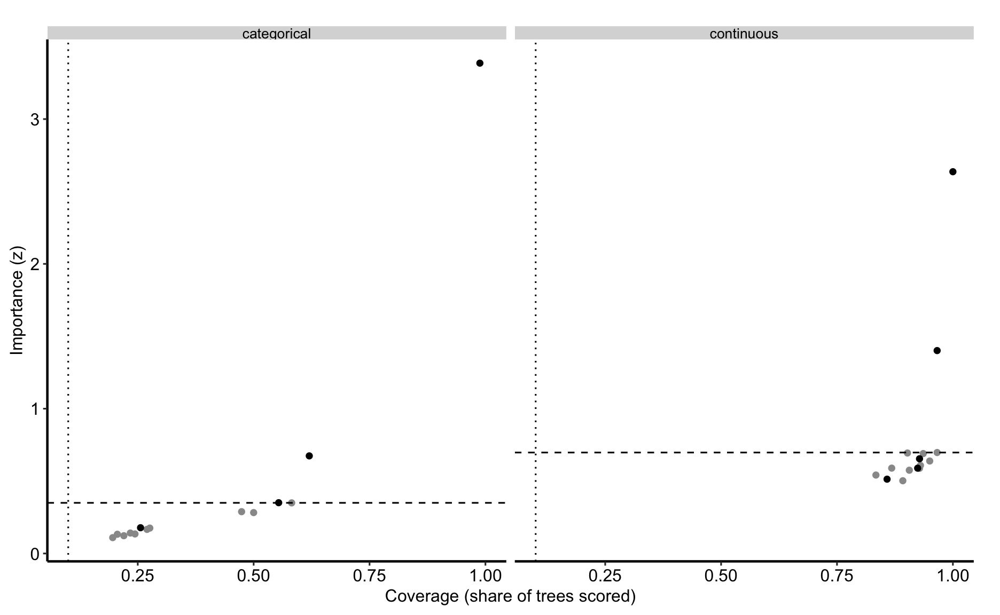
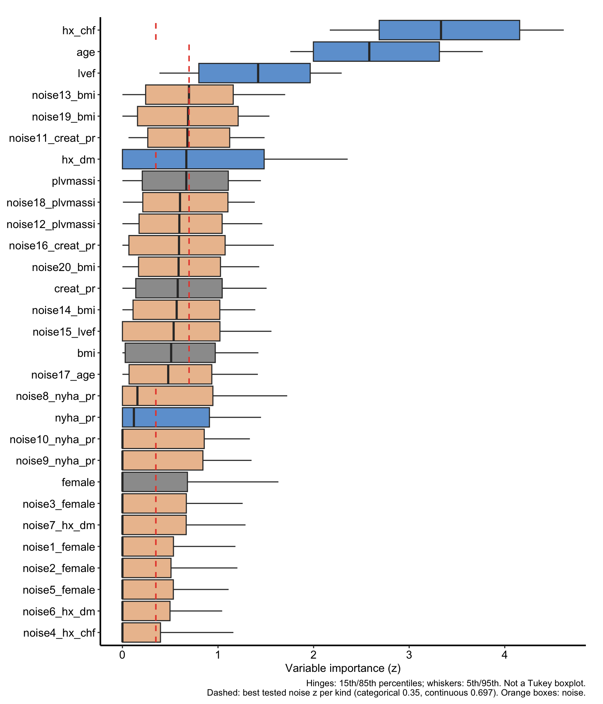
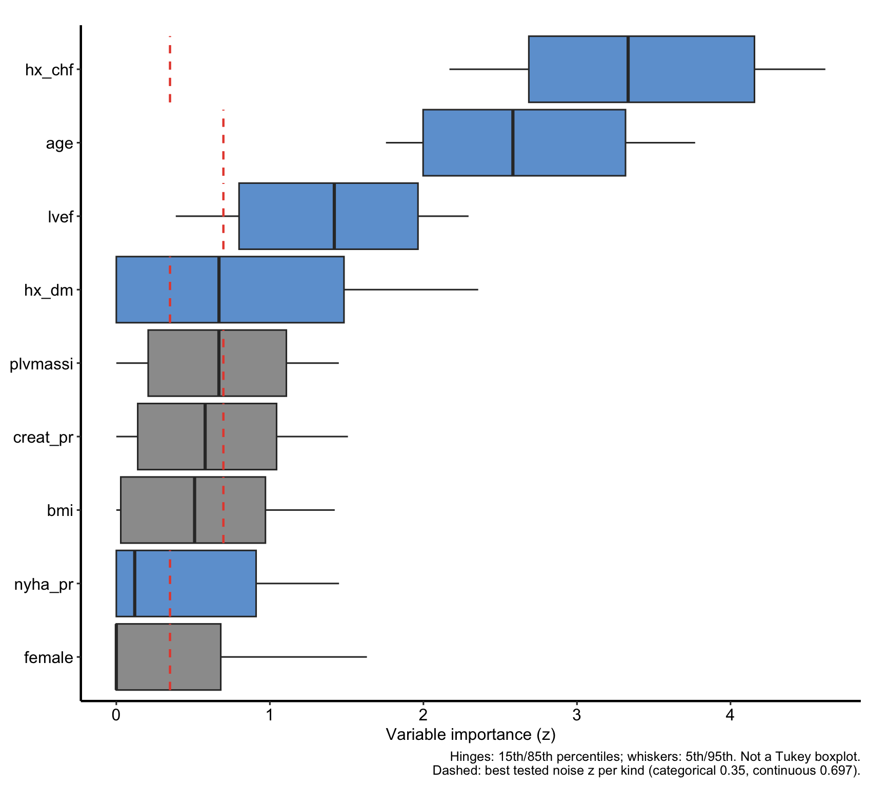

# VarPro: fit

# VarPro: fit

Published

2026-11-25 13:15

Gallery job on the synthetic cohort: a VarPro screen of survival after
operation (iv_dead, dead) on the nine preoperative predictors rfs-fit
grows on.

A `vp-fit` job runs VarPro, a rule-based variable screen, and reports
what it could and could not tell. It needs only the data and an outcome:
VarPro grows its own forests, and no other job in the set has to run
first.

The report answers three questions VarPro’s own importance plot cannot.
**Was each variable tested?** VarPro’s importance z is zero for a
variable tested in fewer than about one tree in ten, so z = 0 means
*untested*, not unimportant. **Does it beat noise?** Permuted copies of
real candidates are added before the fit, and a variable is selected
only when it beats every tested copy of its own kind. **Does the
selection hold?** The screen is refitted on subsamples of the patients
and the share of refits selecting each variable is reported.

The selected set is saved for a later model job. `vp-explain` in this
set draws VarPro’s partial dependence for it, and `vp-individual` its
patient-level gradients.

This template is **in flight**: it is built from one study’s screen, and
a second study running it through to its stability section is what moves
it to shipped.

Code

``` r
SUBJECT <- "dead"
TYPE    <- "vp"
.in <- knitr::current_input(dir = TRUE)
suppressPackageStartupMessages({
  library(varPro)
  library(ggRandomForests)
  library(hvtiRutilities)
})
# One thread, so a fit reproduces from machine to machine. Left unset,
# randomForestSRC, which varPro grows its forests with, runs on every core its
# OpenMP build can see, and on a multi-core server a varPro result changed with
# the thread count with every seed held fixed. mc.cores does the same for
# varPro's own workers, which rf.cores does not reach.
options(rf.cores = 1L, mc.cores = 1L)
# The oldest versions this template works with. Below them a
# call here can fail or change meaning, and the message would arrive mid-render
# rather than here.
if (utils::packageVersion("randomForestSRC") < "3.7.0") {
  stop("This job needs randomForestSRC >= 3.7.0; ", utils::packageVersion("randomForestSRC"),
       " is installed.\nUpdate it, then re-render.", call. = FALSE)
}
if (utils::packageVersion("varPro") < "3.2.0") {
  stop("This job needs varPro >= 3.2.0; ", utils::packageVersion("varPro"),
       " is installed.\nUpdate it, then re-render.", call. = FALSE)
}
if (utils::packageVersion("ggRandomForests") < "4.0.0") {
  stop("This job needs ggRandomForests >= 4.0.0; ", utils::packageVersion("ggRandomForests"),
       " is installed.\nUpdate it, then re-render.", call. = FALSE)
}
# Early 4.0.0 builds carry the same version string and lack varpro_coverage(),
# so the floor above cannot tell them apart. Check the function itself.
if (!"varpro_coverage" %in% getNamespaceExports("ggRandomForests")) {
  stop("This job needs a ggRandomForests that exports varpro_coverage() (4.0.0-rc9 or later).\n",
       "Update it, then re-render.", call. = FALSE)
}
# The same again for the two arguments this job passes, new in 4.0.0-rc12.
if (!"max_untested" %in% names(formals(ggRandomForests::varpro_coverage)) ||
      !"noise" %in% names(formals(ggRandomForests::gg_varpro))) {
  stop("This job needs a ggRandomForests whose varpro_coverage() takes max_untested and whose gg_varpro() takes noise ",
       "(4.0.0-rc12 or later).\nUpdate it, then re-render.", call. = FALSE)
}
# The study root is the nearest directory above this file holding _study.yml,
# so the job renders the same from the Render button, quarto render, or
# render_job(), at any depth, with no path in this document to edit.
# Without the guard in .job_setup(), an unedited job renders green over a
# meaningless analysis. Here that is a screen of the template's placeholder
# outcome and candidates, whose tables look exactly like a result.
# To render a job you have not finished, leave a chunk out with the chunk
# option skip, giving the reason in quotes, or call hvtiRtemplates::stop_here()
# in a chunk to leave out everything below it. A draft lists each one in a
# callout; a final render refuses them, as it refuses an unresolved marker.
# ?stop_here has more.
.job <- hvtiRtemplates:::.job_setup(SUBJECT, TYPE, envir = environment())
.root <- .job$root
set_path <- .job$set_path
.provenance_data <- list()
# Saves a figure as <name>.png, .pdf and .tiff in this set's graphs/ folder (or `kind`'s),
# under the SAVE_FIGURES and FIGURES study choices.
save_figure <- function(plot, name, width = 6, height = 4, kind = "graphs", linked = FALSE) {
  hvtiRtemplates:::.save_figure(plot, set_path(kind, paste0(name, ".png")), width, height,
                                SAVE_FIGURES, FIGURES, linked)
}

# `vp-fit` writes vp.rds, and `vp-explain` and `vp-individual` read it back, all by set.
# The write is the `save` chunk near the foot of this file.
# The draft banners, if any, and the box under the title, after all the code above.
.job$notice
```

**final** · data `built` `built_20261125.parquet`, dated 2026-11-25 ·
rendered by gallery on gallery · hvtiRtemplates 1.6.3

## Study choices

Edit these values for this study before rendering.

Code

``` r
# Demo: the registered dataset this job reads ("built" is the study dataset).
# A file name, such as "match_set.rds", reads an unregistered file in the datasets folder, as a draft.
DATASET <- "built"

# Demo: an hvtiRdatabuild analysis set, or NULL to read the whole dataset.
ANALYSIS_SET <- NULL

# Demo: rows to keep, dplyr::filter() style, or NULL to keep every row:
#   WHERE <- quote(age >= 18)
#   WHERE <- rlang::exprs(age >= 18, hx_chf == 1)
WHERE <- NULL

# Demo: the patient identifier. If the data has no "ccfid" column, the job uses MRN, then eMRN;
# name another column, such as "randid", if the study uses one.
ID <- "patient_id"

# Demo: what makes a row unique; one row per patient unless repeated measures
# add their visit time or date, for example KEY <- c(ID, "iv_echo").
KEY <- ID

# Optional, and needs no edit: NULL reads the cohort alone. To join one
# registered ancillary dataset (echoes, labs), name it in JOIN. The cohort
# above decides the patients, one row each; the joined records of other
# patients are dropped and counted in the data table.
#   JOIN_VARS: the cohort columns each joined row carries; NULL carries all,
#     and a column both datasets have stops, so list only those the job needs.
#   REDUCE: NULL keeps a row per joined record, keyed on that dataset's key;
#     list(rule = "first", by = "echo_date") keeps one row per patient ("last",
#     or "nearest" with to = a cohort date column). A tie stops: picking one
#     record silently would be a hidden choice. This job screens one row per
#     patient, so a long JOIN without REDUCE stops here.
#   JOIN_KEY: overrides the joined dataset's registered key.
JOIN <- NULL
JOIN_VARS <- NULL
REDUCE <- NULL
JOIN_KEY <- NULL

# Demo: the outcome, named one of two ways.
#   A survival screen names TIME and EVENT (coded 1 = event, 0 = censored)
#   and leaves RESPONSE NULL.
#   A classification or regression screen sets TIME and EVENT to NULL and
#   names RESPONSE. A factor, text or 0/1 column screens as classification;
#   any other number as regression.
TIME     <- "iv_dead"
EVENT    <- "dead"
RESPONSE <- NULL

# Demo: the candidate predictors. Name them rather than taking every column: a
# built dataset carries identifiers, dates and derived outcomes, and a screen
# will select a date that quietly encodes follow-up.
PREDICTORS <- c("age", "female", "bmi", "hx_chf", "hx_dm", "nyha_pr", "lvef", "plvmassi", "creat_pr")

# Demo: how many permuted noise columns to add, split evenly between
# categorical and continuous candidates. A variable is selected only when it
# beats every TESTED noise column of its kind, so too few columns make a
# lenient bar. 20 is what the screen behind this template used.
NOISE_N <- 20

# Demo: the share of trees a variable must be scored in to count as tested.
# 0.1 matches varPro's own trimming: below it, z is 0 by construction.
TRIM <- 0.1

# Demo: missing predictor values. varPro removes every patient with a missing
# value and ignores na.action, so the choice is made here, before it runs.
# "na.impute" fills them once by random forest, from the other predictors and
# never from the outcome: imputed values that carried the outcome would let the
# screen rank a predictor on signal the imputation put there. "na.omit" keeps
# complete cases, which is right when missingness itself tracks something the
# model should not see, such as labs collected only in a later surgical era.
# A patient missing the outcome is dropped either way.
NA_ACTION <- "na.impute"
# Demo: the largest share of patients a predictor may be missing in and still
# be imputed. Above it the render stops and names the predictor: an imputation
# that invents most of a column decides the screen's answer for it.
MAX_MISSING <- 0.4

# Demo: the largest share of real candidates that may go untested. Above it the
# render stops, because a screen that tested too little reads like one that
# found no effect. NULL only reports. 0.1 lets the exploration setting pass
# (about 2 of 30 untested in the simulation below) and stops a screen that left
# more than one candidate in ten unexamined, which would otherwise read as having
# found nothing in them. The refits are not held to it: their share tested is
# reported in the stability table.
MAX_UNTESTED <- 0.1

# Demo: varPro's forest. The defaults are the exploration setting, which
# tests as many candidates as it can: no guided split weights, so every
# candidate gets release rules. Under varPro's own defaults a lasso screen
# picks the variables first, and in a known-signal simulation of 30
# candidates it left about 11 tested at 60 events, and 10 at 150.
#
# MTRY must be lowered once the weights are off. varPro then grows its rule
# forest with mtry = Inf, every candidate at every split, and a binary
# predictor, with one cut point against a continuous one's hundreds, was
# split in about 1 tree in 10. NULL takes ceiling(sqrt(p)), p the candidates
# plus noise columns. For 30 candidates that is 6, which tested about 28
# of them and recovered the true signals about as well as the defaults.
# p counts a factor once, though varPro's forest sees a column per level,
# so the share of columns tried at a split is a little below 1 in sqrt(p).
#
# NODESIZE_EXTERNAL applies to a survival screen: varPro first grows a survival
# forest, and its leaves need events in them. NULL takes
# max(10, round(2 * n / events)), about two events per leaf.
#
# MAX_TREE and MAX_RULES_TREE are the trees and rules per tree varPro samples
# for its rules. With roughly 150 events or more, the larger setting below
# raised the z of a rare binary signal from 5.1 to 6.9, and of a weak
# continuous one from 2.8 to 3.8, in that simulation, at about three times the
# time; at 60 events it barely helped. Uncomment its line below the settings
# to use it.
#
# The parsimonious screen is varPro's own defaults. It is a SCREEN, not a
# selection: a guided first forest keeps NVAR columns, noise included, and cuts
# the rest before any rule is built (104 of 154 terms in the screen behind this
# template). A cut variable shows as not eligible below, which is not evidence
# of no effect. Uncomment its line below the settings to run it. On wide data it can
# trip MAX_UNTESTED; set that to NULL only if you mean to report a partial screen.
#
# The simulation is the one in ggRandomForests' varpro-small-data vignette.
NTREE <- 500
MTRY <- NULL
NODESIZE_EXTERNAL <- NULL
MAX_TREE <- 150
MAX_RULES_TREE <- 150
SPLIT_WEIGHT <- FALSE
SPARSE <- FALSE
# Read only when SPLIT_WEIGHT is TRUE.
NVAR <- 30
# The larger setting, for roughly 150 events or more:
# NTREE <- 1000; MAX_TREE <- 1000; MAX_RULES_TREE <- 300
# The parsimonious screen, varPro's own defaults:
# SPLIT_WEIGHT <- TRUE; SPARSE <- TRUE; MTRY <- Inf; NVAR <- 30

# Demo: the stability check. REPEATS refits, each on SUBSAMPLE of the patients
# drawn without replacement and with a fresh noise draw. 0 skips it; it costs
# REPEATS times one fit.
REPEATS <- 5
SUBSAMPLE <- 0.632
# Demo: the selection handed to vp-explain and vp-individual. With REPEATS above 0
# it is every candidate selected in at least SELECT_SHARE of the refits that
# tested it. A variable tested in fewer than MIN_TESTED_SHARE of the refits is
# not examined, so it is neither handed on nor rejected. A single fit's bar is
# the best of a few noise columns, so on a small cohort it moves from one noise
# draw to the next and the full fit alone can keep or drop a variable by chance.
# NA hands on the full fit's selection instead, as REPEATS = 0 does.
SELECT_SHARE <- 0.5
# Demo: the share of the refits that must have tested a variable before their
# vote counts. A refit that did not test a variable says nothing about it, so
# it is left out of that variable's vote; a variable tested in fewer refits than
# this is listed as not examined, and neither handed on nor counted as rejected.
MIN_TESTED_SHARE <- 0.5

# Demo: the seed. It is part of every cache key, seeds R's generator before
# each random step, and is handed to varpro() as `seed =`, negated as
# randomForestSRC documents. Both halves matter: varpro() draws from R's
# generator as well as from its own seed.
SEED <- 2026

# Set TRUE after changing a choice above. A cache whose inputs changed stops the
# render instead of returning the old result; TRUE recomputes only the caches
# that are out of date.
REFIT <- FALSE

# Each figure is saved to graphs/ as a PNG (for Word) and a PDF (for the publisher), and as a TIFF when ragg is installed.
# SAVE_FIGURES <- FALSE saves none; FIGURES keeps only the figures whose names
# start with one of its entries, e.g. FIGURES <- c("vp-fit-coverage"). The names are the
# file names, listed for each template in the templates README.
SAVE_FIGURES <- TRUE
FIGURES <- NULL
```

## Cohort

Code

``` r
# The checksum of every dataset in manifest.yaml is checked before anything is
# read, so a result can name the data that produced it. It stops on a mismatch.
hvtiRutilities::verify_manifest(file.path(.root, "manifest.yaml"))
.cfg <- study_config(start = .root)
job_data <- hvtiRtemplates::read_job_data(.cfg, dataset = DATASET, analysis_set = ANALYSIS_SET,
                                          where = WHERE, id_col = ID, key_cols = KEY, join = JOIN, join_cols = JOIN_VARS,
                                          reduce = REDUCE, join_key_cols = JOIN_KEY, one_row_per_patient = TRUE)
d <- job_data$data
.provenance_data <- c(if (exists(".provenance_data")) .provenance_data else list(), list(job_data$provenance),
                      if (!is.null(job_data$provenance_join)) list(job_data$provenance_join))
knitr::kable(job_data$record, col.names = c("Data", ""))
# One outcome, named one way. A screen given both would have to guess which
# question it was asked.
.survival <- !is.null(TIME) && !is.null(EVENT) && is.null(RESPONSE)
if (!.survival && !(is.null(TIME) && is.null(EVENT) && !is.null(RESPONSE))) {
  stop("Name either TIME and EVENT (a survival screen) or RESPONSE (classification or regression), ",
       "not both and not neither.", call. = FALSE)
}
.outcome <- c(TIME, EVENT, RESPONSE)
.outcomes <- intersect(.outcome, PREDICTORS)
if (length(.outcomes)) {
  stop("Do not include outcome variable(s) in PREDICTORS: ", paste(.outcomes, collapse = ", "), ".", call. = FALSE)
}
.duplicated <- unique(PREDICTORS[duplicated(PREDICTORS)])
if (length(.duplicated)) {
  stop("PREDICTORS names a variable more than once: ", paste(.duplicated, collapse = ", "), ".", call. = FALSE)
}
# A screen must not be handed an identifier. It would select who a patient is,
# not what is true of them, and the saved fit keeps its data, so the
# identifier would be written into vp.rds.
.selection <- attr(job_data$record, "selection")
.identifiers <- PREDICTORS[tolower(PREDICTORS) %in% tolower(c(.selection$id, .selection$key))]
if (length(.identifiers)) {
  stop("Do not include the patient identifier or a KEY column in PREDICTORS: ",
       paste(.identifiers, collapse = ", "), ".", call. = FALSE)
}
if (any(tolower(.outcome) == tolower(.selection$id))) {
  stop("The patient identifier (", .selection$id, ") cannot be an outcome of this job.", call. = FALSE)
}
.missing <- setdiff(c(.outcome, PREDICTORS), names(d))
if (length(.missing)) {
  stop("Not in the data this job read: ", paste(.missing, collapse = ", "), call. = FALSE)
}
d <- d[, c(.outcome, PREDICTORS), drop = FALSE]

# A screen cannot learn from a patient with no outcome. Such a patient is dropped and counted in the
# missing-values table below, not refused here, so the checks that follow read the observed values only.
if (.survival) {
  # randomForestSRC reads a status above 1 as a competing event, so a 1/2
  # coding, which survival::Surv() accepts, would screen a competing-risks
  # outcome without a word. Refuse it here instead.
  # Read on the patients with both TIME and EVENT: one missing either is dropped below, whatever its EVENT holds.
  .event_seen <- d[[EVENT]][!is.na(d[[TIME]]) & !is.na(d[[EVENT]])]
  if (!all(.event_seen %in% c(0, 1))) {
    stop(EVENT, " must be coded 0 and 1 (1 = event); found ",
         paste(sort(unique(.event_seen)), collapse = ", "), ".", call. = FALSE)
  }
  .family <- "survival"
} else {
  .y <- d[[RESPONSE]]
  .y_seen <- .y[!is.na(.y)]
  if (is.character(.y) || is.logical(.y) || is.factor(.y) || (is.numeric(.y) && all(.y_seen %in% c(0, 1)))) {
    # varPro screens a factor outcome as classification and a number as
    # regression, so a 0/1 outcome left numeric would be screened as a
    # continuous one. It is converted here, and the report says so.
    if (!is.factor(.y)) {
      d[[RESPONSE]] <- factor(.y)
      cat(RESPONSE, "converted to a factor: screened as classification.\n")
    }
    .family <- "classification"
  } else if (is.numeric(.y)) {
    .family <- "regression"
  } else {
    stop(RESPONSE, " is neither a number, text nor a factor, so it cannot be screened.", call. = FALSE)
  }
}
.analysis <- if (.survival) {
  list(time = list(variable = TIME), event = list(variable = EVENT, event = 1L, censored = 0L))
} else {
  list(outcome = list(variable = RESPONSE, kind = if (.family == "classification") "classification" else "continuous"))
}

# A forest splits a text column only as a factor, so text predictors are
# converted here, and named, rather than left for the fit to refuse or coerce.
.chr <- PREDICTORS[vapply(d[PREDICTORS], is.character, logical(1L))]
if (length(.chr)) {
  d[.chr] <- lapply(d[.chr], factor)
  cat("Text predictors converted to factors: ", paste(.chr, collapse = ", "), "\n", sep = "")
}
```

| Data                |                                          |
|:--------------------|:-----------------------------------------|
| Source              | dataset `built` (built_20261125.parquet) |
| Rows read           | 800                                      |
| ID                  | `patient_id`                             |
| Identifiers dropped | none                                     |
| Rows kept           | 800 rows on 800 patients                 |

Table 1: The data this job read

Code

``` r
# unnumbered: its child chunk carries its own label and caption
if (!is.null(job_data$attrition)) {
  .fence <- strrep("`", 3)
  cat(knitr::knit_child(text = c(
    paste0(.fence, "{r}"), "#| label: tbl-data-attrition",
    paste0("#| tbl-cap: ", encodeString(paste0("Analysis set `", ANALYSIS_SET, "`: exclusions, in order"), quote = "\"")),
    "knitr::kable(job_data$attrition)", .fence
  ), envir = environment(), quiet = TRUE), sep = "\n")
}
```

Code

``` r
# varPro removes every patient with a missing value, so the screen would
# describe fewer patients than this report claims. NA_ACTION settles them here.
# The imputation runs once, before the noise columns are added and before the
# refits draw their patients, so the refits subsample the same completed data
# and the stability vote holds no imputation noise.
NA_ACTION <- match.arg(NA_ACTION, c("na.impute", "na.omit"))
if (!(is.numeric(MAX_MISSING) && length(MAX_MISSING) == 1L && !is.na(MAX_MISSING) && MAX_MISSING > 0 && MAX_MISSING <= 1)) {
  stop("MAX_MISSING must be a single share in (0, 1].", call. = FALSE)
}
.empty <- PREDICTORS[vapply(d[PREDICTORS], function(x) all(is.na(x)), logical(1L))]
if (length(.empty)) {
  stop("PREDICTORS names a column with no values: ", paste(.empty, collapse = ", "),
       ". Remove it from PREDICTORS.", call. = FALSE)
}
.miss <- hvtiRtemplates:::.vp_missing(d, PREDICTORS, outcome = c(TIME, EVENT, RESPONSE), na_action = NA_ACTION,
                                      max_missing = MAX_MISSING)
d <- .miss$d
if (!nrow(d)) {
  stop("No patient is left: every one is missing the outcome (TIME, EVENT or RESPONSE) or, under na.omit, a predictor.",
       call. = FALSE)
}
if (anyNA(d[PREDICTORS])) {
  # Bound first so the cache keys the predictors alone: a change to an outcome column must not stale it.
  .to_impute <- d[PREDICTORS]
  # impute() fills a logical column as a number, so a yes/no predictor would come back as 0.496 and be screened as
  # continuous. It is imputed as a factor and turned back into TRUE/FALSE, so the screen sees the same type either way.
  .lgl <- names(.to_impute)[vapply(.to_impute, is.logical, logical(1L))]
  .to_impute[.lgl] <- lapply(.to_impute[.lgl], factor)
  .imputed <- cache_fit("vp-fit-impute", randomForestSRC::impute(data = .to_impute, ntree = 250, verbose = FALSE),
                        seed = SEED, dir = dirname(set_path("estimates", "vp.rds")), refit = REFIT,
                        packages = "randomForestSRC")
  # impute() removes a row with no observed predictor; a silent loss is what this chunk exists to stop.
  if (nrow(.imputed) != nrow(d)) {
    stop(nrow(d) - nrow(.imputed), " patient(s) have no observed predictor and cannot be imputed. ",
         "Remove them in the dataset build.", call. = FALSE)
  }
  .imputed[.lgl] <- lapply(.imputed[.lgl], function(x) as.logical(as.character(x)))
  d[PREDICTORS] <- .imputed[PREDICTORS]
}
if (anyNA(d[PREDICTORS])) stop("Predictors still hold missing values after NA_ACTION; varPro would drop them.", call. = FALSE)
.missing_values <- .miss$table
.cohort <- c(list(n = as.integer(nrow(d))), .miss$cohort)
if (.survival) {
  .cohort$n_events <- as.integer(sum(d[[EVENT]] == 1))
  .cohort$n_censored <- as.integer(sum(d[[EVENT]] == 0))
}
cat(attr(.missing_values, "rule"), "\n\n")
```

    Missing predictor values were imputed once by random forest, without the outcome, before the screen. 

Code

``` r
knitr::kable(.missing_values)
```

| Row                      | Count   |
|:-------------------------|:--------|
| Supplied                 | 800     |
| Outcome missing, dropped | 0       |
| Missing: creat_pr        | 75 (9%) |
| Imputed: creat_pr        | 75 (9%) |
| Used                     | 800     |

Table 2: Patients supplied, missing values, and patients used

## Noise

Code

``` r
# Each noise column is a permuted copy of a real candidate: it keeps that
# candidate's values and loses any link to the outcome, so whatever importance
# it earns is what chance alone earns. Half the copies come from categorical
# candidates and half from continuous ones, as far as each kind allows,
# because a variable is judged against noise of its own kind.
#
# The kind rule is varpro_coverage()'s: a factor, text or logical column, or a
# number with at most 5 distinct values, is categorical.
vp_kind <- function(x) {
  if (is.factor(x) || is.character(x) || is.logical(x) || length(unique(stats::na.omit(x))) <= 5L) {
    "categorical"
  } else {
    "continuous"
  }
}
vp_add_noise <- function(d, predictors, n, seed) {
  kinds <- vapply(d[predictors], vp_kind, "")
  pools <- split(predictors, kinds)
  n_cat <- if (length(pools$categorical) && length(pools$continuous)) {
    n %/% 2L
  } else if (length(pools$categorical)) {
    n
  } else {
    0L
  }
  set.seed(abs(seed))
  draw <- function(pool, k) if (k == 0L) character() else pool[sample.int(length(pool), k, replace = k > length(pool))]
  src <- c(draw(pools$categorical, n_cat), draw(pools$continuous, n - n_cat))
  for (i in seq_along(src)) {
    set.seed(abs(seed) + i)
    d[[paste0("noise", i, "_", src[i])]] <- sample(d[[src[i]]])
  }
  d
}
if (NOISE_N < 1) {
  stop("NOISE_N must be at least 1: the selection rule needs noise to beat.", call. = FALSE)
}
if (!(SUBSAMPLE > 0 && SUBSAMPLE < 1)) {
  stop("SUBSAMPLE must be a share between 0 and 1 (0.632 draws 63.2% of the patients).", call. = FALSE)
}
.tested_ok <- is.numeric(MIN_TESTED_SHARE) && length(MIN_TESTED_SHARE) == 1L && !is.na(MIN_TESTED_SHARE)
if (!(.tested_ok && MIN_TESTED_SHARE > 0 && MIN_TESTED_SHARE <= 1)) {
  stop("MIN_TESTED_SHARE must be a single share in (0, 1].", call. = FALSE)
}
.share_bad <- "SELECT_SHARE must be NA or a share above 0 and at most 1 (0.5 keeps what most refits select)."
if (length(SELECT_SHARE) != 1) {
  stop(.share_bad, call. = FALSE)
}
# NaN is NA to is.na(), so it is ruled out by name: only a deliberate NA opts out of the vote.
.share_na <- is.na(SELECT_SHARE) && !is.nan(SELECT_SHARE)
.share_ok <- is.numeric(SELECT_SHARE) && !is.na(SELECT_SHARE) && SELECT_SHARE > 0 && SELECT_SHARE <= 1
if (!(.share_na || .share_ok)) {
  stop(.share_bad, call. = FALSE)
}
if (REPEATS > 0 && floor(SUBSAMPLE * nrow(d)) < 2) {
  stop("SUBSAMPLE of ", nrow(d), " patients leaves fewer than 2 for a refit. Raise SUBSAMPLE or set REPEATS to 0.", call. = FALSE)
}
# The coverage table finds noise by the "noise" prefix, so a real candidate
# named that way would be judged as noise.
.noisy <- grep("^noise", PREDICTORS, value = TRUE)
if (length(.noisy)) {
  stop("Candidate(s) whose names start with \"noise\", which this job reserves for its noise columns: ",
       paste(.noisy, collapse = ", "), ". Rename them in the dataset build.", call. = FALSE)
}
d_noise <- vp_add_noise(d, PREDICTORS, NOISE_N, SEED)
model <- if (.survival) {
  stats::as.formula(paste0("Surv(", TIME, ", ", EVENT, ") ~ ."))
} else {
  stats::as.formula(paste0(RESPONSE, " ~ ."))
}
# The saved fit keeps this formula, and a formula keeps the environment it was
# made in; set it, so a job run anywhere else does not write every object
# beside the formula, `job_data` and its patient IDs included, into vp.rds.
environment(model) <- globalenv()
```

## Fit

Code

``` r
# The selection rule. A real variable is selected when it is tested and its z
# beats every TESTED noise column of its kind. varPro's own cutoff (z > 0.79)
# does not carry from one fit to another, because z shrinks as more variables
# share each tree; noise in the same fit shrinks with it.
#
# The categorical bar needs care. Categorical noise is rarely tested, and when
# it is it almost always scores z = 0 (in the repeats of the screen behind this template: none
# tested in 20 of 40, all zero in 18). A bar of 0 lets any tested categorical
# variable through, so a categorical bar of 0, or one with no categorical
# noise tested, is replaced by the continuous bar. The continuous bar is the
# stricter one, since continuous noise picks up split-point bias, so the rule
# errs toward missing a real categorical effect rather than admitting a false
# one. A continuous bar is never borrowed: when no continuous noise sets a bar
# above 0, no continuous variable is selected, because nothing calibrates it.
# The table names the bar each variable was judged against.
vp_judge <- function(cov) {
  # varpro_coverage() brings its own noise_cut and selected; this rule replaces both, so one bar remains.
  cov$noise_cut <- NULL
  noise <- cov$noise & cov$tested
  # A bar is usable only above 0: noise that scores 0 bars nothing.
  bar_of <- function(k) {
    z <- cov$z[noise & cov$kind == k]
    z <- z[!is.na(z)]
    if (length(z) && max(z) > 0) max(z) else NA_real_
  }
  bar_cont <- bar_of("continuous")
  bar_cat <- bar_of("categorical")
  fallback <- is.na(bar_cat) && !is.na(bar_cont)
  if (fallback) bar_cat <- bar_cont
  cov$bar <- ifelse(cov$kind == "categorical", bar_cat, bar_cont)
  cov$bar_from <- ifelse(cov$kind == "categorical", if (fallback) "continuous (fallback)" else "categorical", "continuous")
  cov$bar_from[is.na(cov$bar)] <- "no usable noise bar"
  cov$selected <- !cov$noise & cov$tested & (cov$z > cov$bar) %in% TRUE
  cov
}

# The coverage of each variable, judged as MAX_UNTESTED judges it. varpro_coverage(by = "variable") pools a factor's
# levels, so a factor whose levels each fell below TRIM can pass as tested with every level's z trimmed to 0. Here a
# factor's trees, coverage and tested are those of its best single level. A second, identically seeded call gets the
# levels, because the first returns only the pooled row. It repeats the rule extraction, for each refit too.
vp_coverage <- function(f, seed, max_untested = NULL) {
  set.seed(seed)
  # vp_judge() replaces varpro_coverage()'s own selection, which reads an empty noise check as "select every tested
  # row", so its warning about that case would mislead here: vp_judge() selects nothing then, and says so.
  cov <- withCallingHandlers(
    ggRandomForests::varpro_coverage(f, by = "variable", trim = TRIM, max.tree = f$rf$ntree, noise = "^noise",
                                     max_untested = max_untested),
    warning = function(w) {
      if (grepl("no noise variable was tested", conditionMessage(w), fixed = TRUE)) invokeRestart("muffleWarning")
    }
  )
  set.seed(seed)
  terms <- ggRandomForests::varpro_coverage(f, by = "term", trim = TRIM, max.tree = f$rf$ntree)
  cov$n_trees <- as.integer(tapply(terms$n_trees, terms$variable, max)[cov$variable])
  cov$coverage <- as.vector(tapply(terms$coverage, terms$variable, max)[cov$variable])
  cov$tested <- cov$n_trees > 0 & cov$coverage >= TRIM
  cov[order(-cov$coverage), ]
}

# The refits' vote. A refit that did not test a variable is no evidence about it,
# so its share selected is over the refits that tested it, and a variable tested
# in fewer than min_tested_share of them is not examined: no vote either way.
vp_vote <- function(stab, repeats, min_tested_share) {
  n_tested <- tapply(stab$tested, stab$variable, sum)
  n_selected <- tapply(stab$selected, stab$variable, sum)[names(n_tested)]
  out <- data.frame(
    variable = names(n_tested),
    share_tested = as.vector(n_tested) / repeats,
    share_selected = ifelse(as.vector(n_tested) > 0, as.vector(n_selected) / pmax(1, as.vector(n_tested)), NA_real_),
    row.names = NULL
  )
  out$examined <- out$share_tested >= min_tested_share
  out[order(-out$share_selected, -out$share_tested, na.last = TRUE), ]
}
```

Code

``` r
# cache_fit() writes <dir>/<name>.rds and its default dir is the study's
# estimates folder, not this set's, so every call here names the set's.
CACHE_DIR <- dirname(set_path("estimates", "vp.rds"))
# The settings the full fit and every refit share; the study choices say why.
.p <- ncol(d_noise) - length(.outcome)
.mtry <- if (is.null(MTRY)) ceiling(sqrt(.p)) else MTRY
.max_tree <- min(MAX_TREE, NTREE)
# A survival screen's leaf size follows the events of the patients it is given,
# so a refit on a subsample gets its own.
vp_nodesize_external <- function(data) {
  if (!.survival) return(NULL)
  if (!is.null(NODESIZE_EXTERNAL)) return(NODESIZE_EXTERNAL)
  # max(1, ...): a refit with no events would otherwise ask for leaves of infinite size.
  max(10, round(2 * nrow(data) / max(1, sum(data[[EVENT]] == 1))))
}
# The leaf size is worked out before each cache_fit() and handed in as a value.
# cache_fit() keys the code's own variables, not what a helper reads inside it,
# so a call to vp_nodesize_external() in the code would not see NODESIZE_EXTERNAL
# change, and a changed choice would reload the old fit even with REFIT <- TRUE.
.nodesize_external <- vp_nodesize_external(d_noise)
fit <- cache_fit(
  "vp-fit",
  varpro(model, d_noise, ntree = NTREE, nvar = NVAR, split.weight = SPLIT_WEIGHT, sparse = SPARSE, mtry = .mtry,
         nodesize.external = .nodesize_external, max.tree = .max_tree, max.rules.tree = MAX_RULES_TREE,
         verbose = FALSE, cores = 1L, seed = -abs(SEED)),
  seed = SEED, dir = CACHE_DIR, refit = REFIT
)
```

## Coverage

Every candidate, and whether VarPro could test it. A variable is
**eligible** when VarPro built release rules for it; one that is not was
cut by the split weights or `NVAR` before any rule was built. It is
**tested** when it was scored in at least `TRIM` of the trees, a factor
by its best single level; below that its z is 0 by construction, which
is no evidence of no effect. It is **selected** when it is tested and
its z beats the bar named in the last columns.

Code

``` r
# varpro_coverage() samples release rules, so it is seeded too.
cov <- vp_judge(vp_coverage(fit, abs(SEED), max_untested = MAX_UNTESTED))
.real <- cov[!cov$noise, ]
knitr::kable(data.frame(
  variable = .real$variable, kind = .real$kind, eligible = .real$eligible, trees = .real$n_trees,
  coverage = round(.real$coverage, 3), z = round(.real$z, 3), tested = .real$tested,
  bar = round(.real$bar, 3), judged_against = .real$bar_from, selected = .real$selected
))
```

| variable | kind | eligible | trees | coverage | z | tested | bar | judged_against | selected |
|:---|:---|:---|---:|---:|---:|:---|---:|:---|:---|
| age | continuous | TRUE | 500 | 1.000 | 2.637 | TRUE | 0.697 | continuous | TRUE |
| hx_chf | categorical | TRUE | 494 | 0.988 | 3.386 | TRUE | 0.350 | categorical | TRUE |
| lvef | continuous | TRUE | 483 | 0.966 | 1.401 | TRUE | 0.697 | continuous | TRUE |
| plvmassi | continuous | TRUE | 464 | 0.928 | 0.654 | TRUE | 0.697 | continuous | FALSE |
| creat_pr | continuous | TRUE | 462 | 0.924 | 0.589 | TRUE | 0.697 | continuous | FALSE |
| bmi | continuous | TRUE | 429 | 0.858 | 0.513 | TRUE | 0.697 | continuous | FALSE |
| hx_dm | categorical | TRUE | 310 | 0.620 | 0.674 | TRUE | 0.350 | categorical | TRUE |
| nyha_pr | categorical | TRUE | 277 | 0.554 | 0.351 | TRUE | 0.350 | categorical | TRUE |
| female | categorical | TRUE | 128 | 0.256 | 0.178 | TRUE | 0.350 | categorical | FALSE |

Table 3: Coverage, importance and selection of each candidate, most
covered first

Code

``` r
# A candidate varPro dropped from its data altogether, a constant column say,
# is counted as a candidate and nothing more.
knitr::kable(data.frame(
  step = c("Candidates", "Eligible", "Tested", "Selected", "Noise columns", "Noise tested"),
  variables = c(length(PREDICTORS), sum(.real$eligible), sum(.real$tested), sum(.real$selected),
                sum(cov$noise), sum(cov$noise & cov$tested))
))
```

| step          | variables |
|:--------------|----------:|
| Candidates    |         9 |
| Eligible      |         9 |
| Tested        |         9 |
| Selected      |         5 |
| Noise columns |        20 |
| Noise tested  |        20 |

Table 4: How the candidates become the selected set

Code

``` r
.plot_cov <- cov[cov$eligible & !is.na(cov$z), ]
.plot_cov$source <- ifelse(.plot_cov$noise, "noise", "real")
.bars <- unique(.plot_cov[!is.na(.plot_cov$bar), c("kind", "bar")])
.fig <- ggplot2::ggplot(.plot_cov, ggplot2::aes(x = coverage, y = z, color = source)) +
  ggplot2::geom_point() +
  ggplot2::geom_hline(data = .bars, ggplot2::aes(yintercept = bar), linetype = "dashed") +
  ggplot2::geom_vline(xintercept = TRIM, linetype = "dotted") +
  ggplot2::facet_wrap(~kind) +
  ggplot2::scale_color_manual(values = c(noise = "gray60", real = "black")) +
  ggplot2::labs(x = "Coverage (share of trees scored)", y = "Importance (z)") +
  hvtiPlotR::theme_hv_manuscript(base_size = 12)
save_figure(.fig, "vp-fit-coverage", width = 6.5)
.fig
```



Figure 1: Importance against coverage for every eligible variable, one
panel per kind. Black points are real candidates and gray points
permuted noise; the dashed horizontal line is the bar a real variable
must beat and the dotted vertical line the coverage below which a
variable is untested.

Code

``` r
# Free size: one row per variable, so the height grows with the list.
# Scored on every tree, as the coverage table is: left to its default,
# gg_varpro() samples MAX_TREE of them, and the figure would disagree with the table.
# Its noise bar is vp_judge()'s but for one case: categorical noise that all scores
# 0 sets its bar at 0 and selects every tested categorical variable. So the table's
# bar replaces it, and one bar remains. Its warnings repeat what the table says.
set.seed(abs(SEED))
.gv <- withCallingHandlers(
  gg_varpro(fit, max.tree = fit$rf$ntree, trim = TRIM, noise = "^noise"),
  warning = function(w) {
    if (grepl("noise variable was tested", conditionMessage(w), fixed = TRUE)) invokeRestart("muffleWarning")
  }
)
# By kind, since the figure lists a factor's levels where the table lists the factor.
.at <- match(.gv$imp$kind, cov$kind)
.gv$imp$noise_cut <- cov$bar[.at]
.gv$imp$noise_ref <- ifelse(is.na(cov$bar[.at]), NA_character_, sub(" .*", "", cov$bar_from[.at]))
.gv$imp$selected <- !.gv$imp$noise & .gv$imp$tested & (.gv$imp$z > .gv$imp$noise_cut) %in% TRUE
# No usable bar selects nothing, and draws at 0, as gg_varpro() draws an empty noise check.
.gv$imp$noise_cut[is.na(.gv$imp$noise_cut)] <- 0
.fig <- plot(.gv) + hvtiPlotR::theme_hv_manuscript(base_size = 12)
# The plot's caption reads a missing bar as noise that was never tested. Noise that was tested and all scored 0 has
# no bar either, so say what the table says.
.fig$labels$caption <- gsub("(\\w+) 0, no noise tested", "\\1: no usable noise bar, nothing selected", .fig$labels$caption)
save_figure(.fig, "vp-fit-varpro", height = 7)
.fig
```



Figure 2: VarPro’s own importance plot, noise columns included. Each box
spans the 15th to the 85th percentile of a variable’s per-tree
importance, with a line at the median and whiskers to the 5th and 95th
percentiles; the dashed red ticks are the bar each variable must beat,
the same bar as the table above. A factor’s levels are drawn separately.

Code

``` r
# The noise has done its work once it has set the bars, so this figure keeps the
# real variables that were tested and drops the rest. Each row keeps its bar and
# its selection from the figure above, so the two never disagree.
.gvs <- .gv
.gvs$imp <- .gvs$imp[!.gvs$imp$noise & .gvs$imp$tested, , drop = FALSE]
.gvs$imp$variable <- droplevels(.gvs$imp$variable)
.gvs$stats <- .gvs$stats[.gvs$stats$variable %in% .gvs$imp$variable, , drop = FALSE]
.gvs$stats$variable <- factor(.gvs$stats$variable, levels = levels(.gvs$imp$variable))
# A partial screen (MAX_UNTESTED <- NULL) can leave no real variable tested, and an
# empty plot would still caption bars it does not draw.
if (nrow(.gvs$imp) == 0L) {
  cat("No real variable was tested, so the screen has nothing to show.\n")
} else {
  .fig <- plot(.gvs) + hvtiPlotR::theme_hv_manuscript(base_size = 12)
  # Its caption names the orange noise boxes, which are gone from this figure.
  .fig$labels$caption <- sub(" Orange boxes: noise.", "", .fig$labels$caption, fixed = TRUE)
  .fig$labels$caption <- gsub("(\\w+) 0, no noise tested", "\\1: no usable noise bar, nothing selected",
                              .fig$labels$caption)
  # Not "vp-fit-varpro-screened": FIGURES keeps a figure by prefix, and
  # "vp-fit-varpro" would then keep both.
  save_figure(.fig, "vp-fit-screened", height = 6)
  .fig
}
```



Figure 3: The importance plot after the noise screen: the same boxes and
bars as the figure above, with the noise columns and the untested
variables removed. Blue boxes beat the dashed bar of their kind and are
selected; gray boxes did not.

## Stability

The screen refitted `REPEATS` times, each on a subsample of the patients
drawn without replacement and with a fresh noise draw. A variable
selected in most refits holds up; one selected once in a while is the
screen’s own noise. A refit that did not test a variable says nothing
about it, so the share is taken over the refits that did test it. When
`SELECT_SHARE` is set, the variables selected in at least that share of
those refits are the set this job hands on, in place of the full fit’s.
A variable tested in fewer than `MIN_TESTED_SHARE` of the refits has too
few votes to count either way, so it is listed apart as not examined.

Code

``` r
# Each refit is cached on its own, so raising REPEATS computes only the new
# ones. Redrawing the noise alone would hold the patients fixed and understate
# how much the selection moves, so each refit also draws its patients.
.stab <- data.frame(r = integer(), variable = character(), selected = logical(), tested = logical())
if (REPEATS > 0) {
  # Refit r's patients and noise. Drawing them is cheap and seeded, so they are drawn once to ask which
  # refits the cache lacks and again to fit, and come out the same both times.
  .repeat_data <- function(r) {
    set.seed(abs(SEED) + r)
    rows <- sort(sample.int(nrow(d), floor(SUBSAMPLE * nrow(d))))
    vp_add_noise(d[rows, , drop = FALSE], PREDICTORS, NOISE_N, SEED + r)
  }
  # The cache keys on this code as written, so it must not change: a refit cached by an earlier copy of this
  # job then still loads.
  .repeat_code <- quote(
    varpro(model, dr, ntree = NTREE, nvar = NVAR, split.weight = SPLIT_WEIGHT, sparse = SPARSE, mtry = .mtry,
           nodesize.external = .nodesize_external, max.tree = .max_tree, max.rules.tree = MAX_RULES_TREE,
           verbose = FALSE, cores = 1L, seed = -abs(SEED + r))
  )
  .todo <- vapply(seq_len(REPEATS), function(r) {
    dr <- .repeat_data(r)
    .nodesize_external <- vp_nodesize_external(dr)
    hvtiRutilities::cache_would_fit(sprintf("vp-repeat-%02d", r), .repeat_code, seed = SEED + r, dir = CACHE_DIR,
                                    refit = REFIT)
  }, logical(1L))
  # Each refit that fits is reported to job_status() and the render log as done of total, with an estimate of
  # what is left. Refits read from the cache are not counted. Outside a render the reporter is NULL.
  .tick <- .job$progress("refit")
  .stab <- do.call(rbind, lapply(seq_len(REPEATS), function(r) {
    dr <- .repeat_data(r)
    .nodesize_external <- vp_nodesize_external(dr)
    fr <- cache_fit(sprintf("vp-repeat-%02d", r), .repeat_code, seed = SEED + r, dir = CACHE_DIR, refit = REFIT)
    if (.todo[r] && !is.null(.tick)) .tick(sum(.todo[seq_len(r)]), sum(.todo))
    cr <- vp_judge(vp_coverage(fr, abs(SEED) + r))
    cr <- cr[!cr$noise, ]
    data.frame(r = r, variable = cr$variable, selected = cr$selected, tested = cr$tested)
  }))
  .per <- tapply(.stab$selected, .stab$r, sum)
  cat("Selected per refit: ", min(.per), " to ", max(.per), " variables.\n", sep = "")
  .freq <- vp_vote(.stab, REPEATS, MIN_TESTED_SHARE)
  .unexamined <- .freq$variable[!.freq$examined]
  if (length(.unexamined)) {
    cat("Not examined in the refits (tested in fewer than ", MIN_TESTED_SHARE * 100, "% of them): ",
        paste(.unexamined, collapse = ", "), ".",
        if (is.na(SELECT_SHARE)) " The full fit's selection is handed on, so this is a note on its stability.\n"
        else " Neither handed on nor rejected.\n", sep = "")
  }
  if (!is.na(SELECT_SHARE)) {
    .keep <- .freq$variable[.freq$examined & (.freq$share_selected >= SELECT_SHARE) %in% TRUE]
    cat("Handed to vp-explain, selected in at least ", SELECT_SHARE * 100, "% of the refits that tested them: ",
        if (length(.keep)) paste(.keep, collapse = ", ") else "none", ".\n", sep = "")
  }
  knitr::kable(.freq, digits = 2, row.names = FALSE)
} else {
  cat("Skipped: REPEATS is 0.\n")
}
```

    Selected per refit: 4 to 4 variables.
    Handed to vp-explain, selected in at least 50% of the refits that tested them: age, hx_chf, lvef, hx_dm.

| variable | share_tested | share_selected | examined |
|:---------|-------------:|---------------:|:---------|
| age      |            1 |            1.0 | TRUE     |
| hx_chf   |            1 |            1.0 | TRUE     |
| lvef     |            1 |            1.0 | TRUE     |
| hx_dm    |            1 |            0.8 | TRUE     |
| plvmassi |            1 |            0.2 | TRUE     |
| bmi      |            1 |            0.0 | TRUE     |
| creat_pr |            1 |            0.0 | TRUE     |
| female   |            1 |            0.0 | TRUE     |
| nyha_pr  |            1 |            0.0 | TRUE     |

Table 5: How often each candidate was tested, and selected when tested,
across the refits

## Reading the result

**Missing values.** With `NA_ACTION <- "na.impute"`, missing predictor
values were imputed once by random forest (`randomForestSRC::impute()`,
250 trees) from the other predictors, never from the outcome, before the
noise columns were added and before the stability refits drew their
patients. A predictor missing in more than `MAX_MISSING` of the patients
is refused, not filled. Patients missing the outcome were excluded. With
`"na.omit"`, every patient missing a predictor was excluded instead. The
table of missing values above gives the counts either way.

**Untested is not unimportant.** VarPro scores a variable by a trimmed
mean of its importance in each tree, and a tree with no usable rule for
the variable counts as zero. A variable tested in fewer than `TRIM` of
the trees therefore scores exactly 0. A variable that is not eligible
was never tested at all. Neither is evidence of no effect; the variable
was not examined. Read z beside coverage: a z of 0 with low coverage
means untested.

**Tested is not the same as detectable.** With few events, a real effect
can be tested and still score z of about 0. In a simulation with 60
events in 1,900 patients, a binary predictor present in 10% of them,
with a hazard ratio of 2.7, was tested in about 8% of trees with every
candidate tried at each split and in 12% to 25% with 6 tried, and scored
z below 0.3 in every such fit. Before reading a z of 0 for a rare binary
predictor as no effect, count the events among the patients who have it:
a handful of events cannot move a forest.

**A stand-in scores like the real thing.** A variable correlated with a
true signal shares its splits and earns importance it would not have on
its own. In the same simulation, a noise variable correlated 0.7 with a
signal scored z above 0 in 15 of 16 fits, and above the signal itself in
2. The noise columns here are permuted, so they cannot catch this; check
the correlations among the selected set before naming one of them the
cause.

**Selected means it beat chance in this fit.** The bar is the best score
any tested noise column of the same kind reached. A categorical variable
is held to the continuous bar whenever categorical noise sets no bar of
its own, which makes the rule strict for categorical variables.

**This is a screen, not a selection.** It keeps everything it could not
rule out, and its settings matter. The default here is the exploration
setting: no guided split weights, so every candidate gets rules, and
`MTRY` lowered so binary candidates are split. The parsimonious screen,
varPro’s own defaults, lets guided split weights and `NVAR` decide which
variables are examined at all. A selection would also need the two
settings, the stability above, and ideally cross-validation to agree.
Read the stability table before the coverage table: a variable selected
in the full fit but rarely in the refits is a weak candidate, and by
default it is not handed on. A variable the refits did not examine is
listed separately: that is no evidence either way, not a rejection. The
refits each see `SUBSAMPLE` of the patients, so they have less power
than the full fit; a share near `SELECT_SHARE` is a vote on the edge,
not a failure.

Code

``` r
# The product of this job, and what vp-explain and vp-individual read: the fit, its judged
# coverage and the selected set, in one file, so they cannot drift apart. It is
# separate from the cache on purpose: cache_fit() stores a keyed record, so the
# cache is this job's internals and this file is its interface. `family` is
# informational: vp-explain reads the family from the fit itself. The selected
# set is the refits' vote when there are refits and SELECT_SHARE is set, else
# the full fit's own.
.selected_by <- if (REPEATS > 0 && !is.na(SELECT_SHARE)) "refits" else "full fit"
.selected <- if (.selected_by == "refits") .keep else .real$variable[.real$selected]
vp_handoff <- hvtiRtemplates:::.attach_handoff_lineage(
  list(fit = fit, coverage = cov, selected = .selected, selected_by = .selected_by, family = .family,
       not_examined = as.character(.real$variable[!.real$tested]),
       not_examined_refits = if (REPEATS > 0) as.character(.freq$variable[!.freq$examined]) else character()),
  data = .provenance_data,
  analysis = .analysis,
  cohort = .cohort,
  # vp-explain and vp-individual take the rows, ID and KEY of this screen from this record.
  selection = attr(job_data$record, "selection")
)
saveRDS(vp_handoff, set_path("estimates", "vp.rds"))
```

## About this run

| Group           | Item           | Value                    |
|:----------------|:---------------|:-------------------------|
| Run             | Started        | 2026-11-25 13:14:42 EST  |
|                 | Ended          | 2026-11-25 13:15:46 EST  |
|                 | Duration       | 1 min 4 s                |
|                 | Status         | final                    |
|                 | Rendered by    | gallery                  |
|                 | Host           | gallery                  |
| Job             | File           | vp.fit.dead.vp.qmd       |
|                 | Template       | vp.fit                   |
|                 | Subject        | dead                     |
|                 | Type           | vp                       |
|                 | hvtiRtemplates | 1.6.3                    |
| Dataset `built` | Version file   | built_20261125.parquet   |
|                 | Version date   | 2026-11-25               |
|                 | Source file    | built.rds                |
|                 | Rows kept      | 800 rows on 800 patients |
|                 | WHERE          | none                     |
|                 | sha256         | d99147a5c095             |
|                 | Manifest       | current                  |
| Reproducibility | Seed           | 2026                     |
|                 | renv           | not active               |
