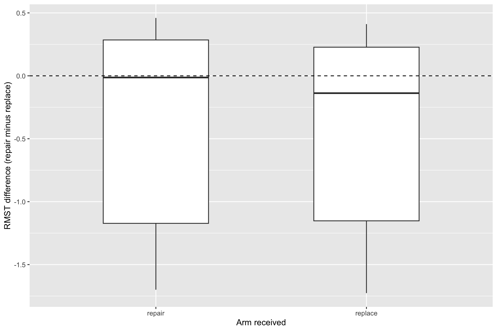
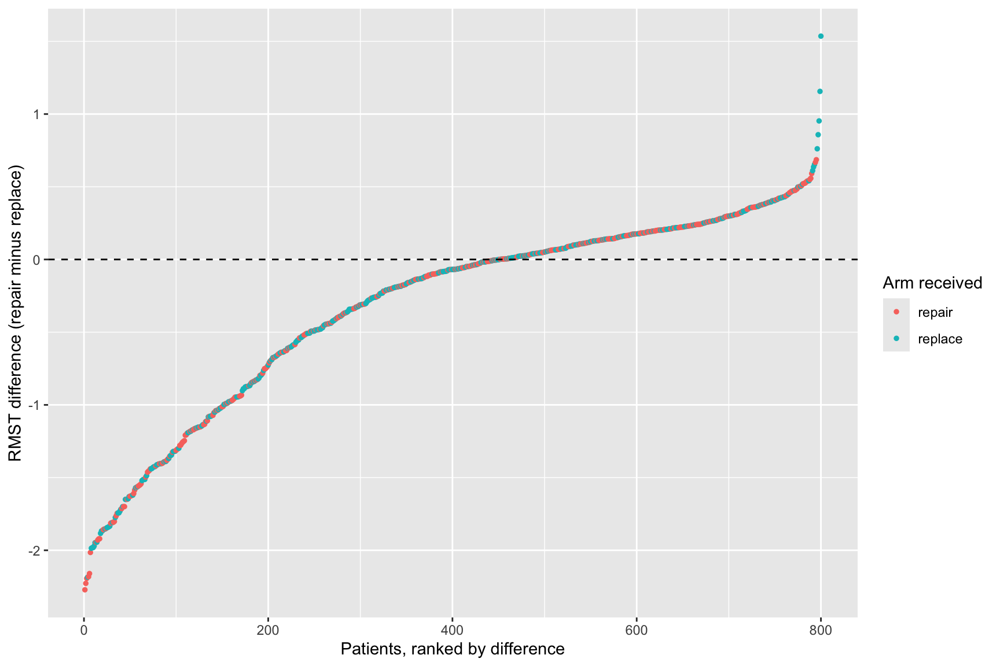
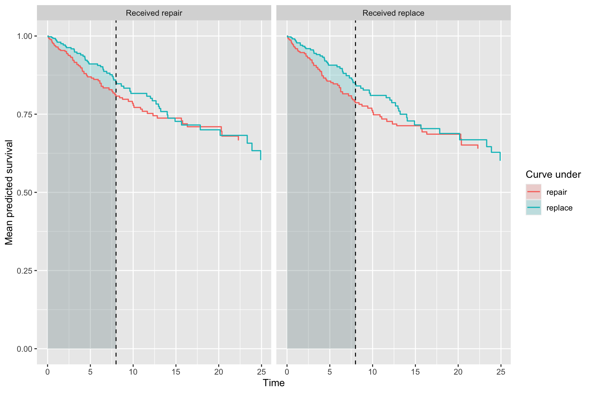
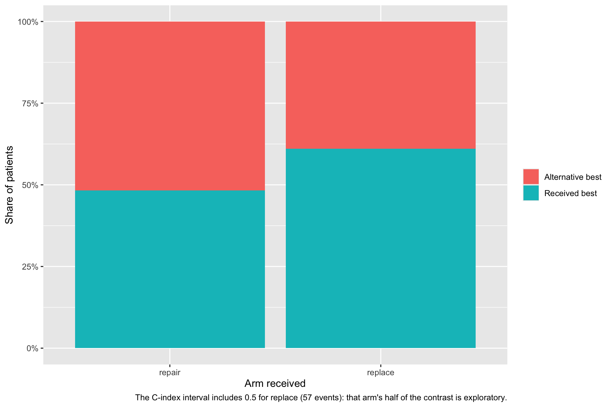
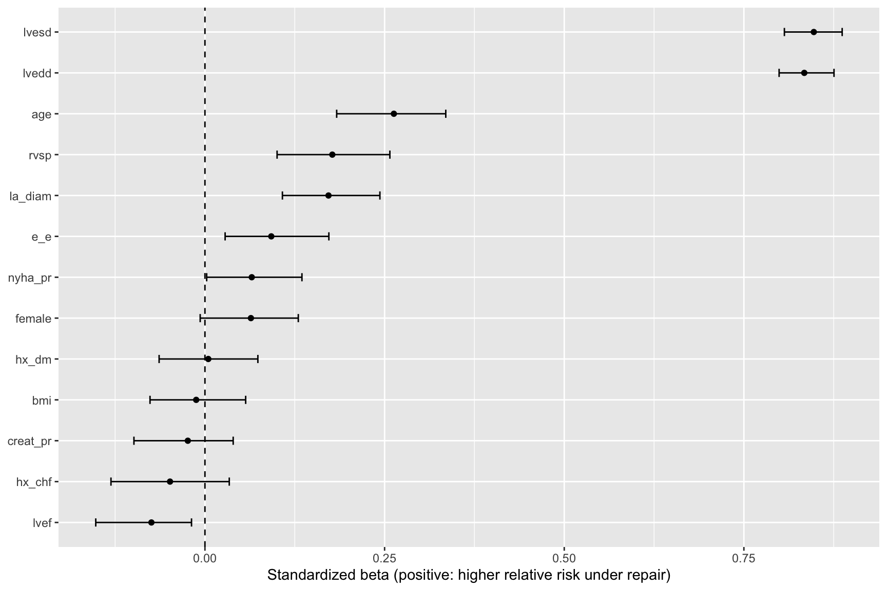

# Virtual twins: explain

# Virtual twins: explain

Published

2026-10-25 18:36

Explains the `vt-fit` job in this set: which patients the twins say
repair suits, stratified by the echo-phenotype clusters.

A `vt-explain` job reads the virtual twins a `vt-fit` job in this set
saved and shows what they say. Each patient has two predicted survival
curves, one per arm, and the difference in restricted mean survival time
(RMST) between them at `HORIZON` is the patient’s estimated effect of
the treatment. This job shows that difference by arm, ranks the patients
by it, and counts how many patients each eligibility rule keeps.

A `vt-explain` job never grows a forest. It reads `vt.rds`, so every
figure describes exactly the forests the fit job judged. The difference
is a model estimate for each patient, not an observed outcome.

This template is **in flight**, with `vt-fit`.

Code

``` r
SUBJECT <- "reint"
TYPE    <- "vt"
.in <- knitr::current_input(dir = TRUE)
suppressPackageStartupMessages({
  library(hvtiPlotR)
  library(hvtiRpropensity)
  library(hvtiRutilities)
  library(ggplot2)
})
# One thread, so a bootstrap reproduces from machine to machine.
options(rf.cores = 1L, mc.cores = 1L)
# The versions this template was verified against on 2026-10-22. Below them a
# call here can fail or change meaning, and the message would arrive mid-render
# rather than here.
for (.floor in list(c("hvtiRpropensity", "0.2.0"), c("hvtiPlotR", "2.8.9"))) {
  if (utils::packageVersion(.floor[1]) < .floor[2]) {
    stop("This job needs ", .floor[1], " >= ", .floor[2], "; ", utils::packageVersion(.floor[1]),
         " is installed.\nUpdate it, then re-render.", call. = FALSE)
  }
}
# The study root is the nearest directory above this file holding _study.yml,
# so the job renders the same from the Render button, quarto render, or
# render_job(), at any depth, with no path in this document to edit.
# Without the guard in .job_setup(), an unedited job renders green over a
# meaningless analysis.
# To render a job you have not finished, leave a chunk out with the chunk
# option skip, giving the reason in quotes, or call hvtiRtemplates::stop_here()
# in a chunk to leave out everything below it. A draft lists each one in a
# callout; a final render refuses them, as it refuses an unresolved marker.
# ?stop_here has more.
.job <- hvtiRtemplates:::.job_setup(SUBJECT, TYPE, envir = environment())
.root <- .job$root
set_path <- .job$set_path
.provenance_data <- list()
# Saves a figure as <name>.png, .pdf and .tiff in this set's graphs/ folder (or `kind`'s),
# under the SAVE_FIGURES and FIGURES study choices.
save_figure <- function(plot, name, width = 6, height = 4, kind = "graphs", linked = FALSE) {
  hvtiRtemplates:::.save_figure(plot, set_path(kind, paste0(name, ".png")), width, height,
                                SAVE_FIGURES, FIGURES, linked)
}

# `vt-explain` reads the fit `vt-fit` wrote in this same set.
# The draft banners, if any, and the box under the title, after all the code above.
.job$notice
```

**final** · data: see About this run · rendered by gallery on gallery ·
hvtiRtemplates 1.5.1

## Study choices

Edit these values for this study before rendering. The arms, outcome and
horizon are not here: they come from the fit.

Code

``` r
# Demo: NULL, a column of the data, or list(set = "<subject>-<type>") naming a
# sid-clusters set whose clusters stratify the result (add column = "group" for
# its collapsed groups). Strata are never a model
# covariate: they are built from what the forests already use.
STRATIFY <- list(set = "echo-sid")
BOOT <- 200
GAIN_MIN <- 0                               # Demo: a twin must favor the other arm by more than this, in TIME's units.

# Each figure is saved to graphs/ as a PNG (for Word), and a PDF and a TIFF (for the publisher).
# SAVE_FIGURES <- FALSE saves none; FIGURES keeps only the figures whose names
# start with one of its entries, e.g. FIGURES <- c("vt-explain-contrast"). The names are the
# file names, listed for each template in the templates README.
SAVE_FIGURES <- TRUE
FIGURES <- NULL
```

## The fit

Code

``` r
.handoff <- set_path("estimates", "vt.rds")
if (!file.exists(.handoff)) {
  stop("No fit at ", .handoff, ". Render the vt-fit job in this set first; this job explains that fit and ",
       "never grows its own.", call. = FALSE)
}
.cfg <- study_config(start = .root)
.vt_read <- hvtiRtemplates:::.read_handoff(.handoff, "twins", .cfg, "the vt-fit job")
.vt <- .vt_read$value
.provenance_data <- .vt_read$lineage$data
.provenance_artifacts <- c(.vt_read$lineage$artifacts, list(.vt_read$record))
ARMS <- .vt$settings$arms
HORIZON <- .vt$settings$horizon
# The sign of a beta: log_rr is the log of the risk under the first arm over the risk under the second.
.beta_sign <- paste0("A positive beta: the characteristic goes with a higher relative risk of the event by ", HORIZON,
                     " under ", ARMS[1], " than under ", ARMS[2], ".")
.beta_cap_tbl <- paste("Standardized beta for each characteristic.", .beta_sign,
                       "unestimable: bootstrap resamples in which the characteristic did not vary.")
.beta_cap_fig <- paste("Standardized association of each characteristic with the estimated effect, by overlap-weighted",
                       "regression.", .beta_sign, "Bars, where drawn, are the 2.5th to 97.5th percentile over bootstrap",
                       "resamples of patients.")
r <- .vt$rmst
# A patient who received neither arm has no_arm TRUE and arm NA. `received` is the label figures
# and tables group by, so an arm that is really named "none" stays apart from them.
r$received <- ifelse(r$no_arm, "No arm", r$arm)
.no_elig_note <- "No patient is in distribution under the combined rule; see the eligibility tables."
# Named `.eligible`, never `.in`: `.in` is setup's source path, which the provenance chunk needs.
.eligible <- r$elig
```

Code

``` r
# The one read of patient data in this job. It repeats the fit's own
# read_job_data() call from the settings vt-fit saved, so a named dataset,
# analysis set, filter, join or stacked imputation gives the same patients and
# values the forests saw.
.s <- .vt$settings
# The study key is checked first, so a mismatch stops this job before any read.
.id_key <- hvtiRtemplates:::.study_id_key(.root, create = FALSE)
if (!identical(.s$id_key, hvtiRtemplates:::.id_key_fingerprint(.id_key))) {
  stop("vt.rds was digested under a different study key. Re-render vt-fit.", call. = FALSE)
}
# The checksum of every dataset in manifest.yaml is checked before anything is read.
hvtiRutilities::verify_manifest(file.path(.root, "manifest.yaml"))
.jd <- hvtiRtemplates::read_job_data(.cfg, dataset = .s$read$dataset, analysis_set = .s$read$analysis_set,
                                     where = .s$read$where, id = .s$id, key = .s$read$key, join = .s$read$join,
                                     join_vars = .s$read$join_vars, reduce = .s$read$reduce,
                                     join_key = .s$read$join_key, one_row_per_patient = TRUE,
                                     imputation = .s$imputation)
.d_all <- .jd$data
if (!is.null(.s$imputation)) .d_all <- .d_all[.d_all[[.s$imputation]] == .s$imputation_use, , drop = FALSE]
.provenance_data <- c(.provenance_data, list(.jd$provenance), if (!is.null(.jd$provenance_join)) list(.jd$provenance_join))
# The datasets read now must be the ones vt-fit recorded: their checksums are in its lineage.
.sha_now <- c(.jd$provenance$sha256, .jd$provenance_join$sha256)
.sha_fit <- unlist(lapply(.vt_read$lineage$data, function(x) x$sha256))
if (length(setdiff(.sha_now, .sha_fit))) {
  stop("The dataset changed since vt-fit ran. Re-render vt-fit.", call. = FALSE)
}
# vt.rds holds ID digests, so the data are digested with the same study key.
.d_all[[.s$id]] <- hvtiRtemplates:::.id_digest(.d_all[[.s$id]], .id_key)
.d_all <- .d_all[.d_all[[.s$id]] %in% r$ID, , drop = FALSE]
```

## The contrast

Patients in distribution, under the combined eligibility rule. A
positive difference favors the first arm.

Code

``` r
.pct <- function(x) {
  q <- stats::quantile(x, c(0.05, 0.15, 0.5, 0.85, 0.95), names = FALSE)
  data.frame(ymin = q[1], lower = q[2], middle = q[3], upper = q[4], ymax = q[5])
}
.e <- r[.eligible, ]
if (!nrow(.e)) {
  cat(.no_elig_note, "\n")
} else {
  .fig <- ggplot(.e, aes(x = received, y = diff)) +
    stat_summary(fun.data = .pct, geom = "boxplot", width = 0.5) +
    geom_hline(yintercept = 0, linetype = "dashed") +
    labs(x = "Arm received", y = paste0("RMST difference (", ARMS[1], " minus ", ARMS[2], ")"))
  save_figure(.fig, "vt-explain-contrast")
  .fig
}
```



Figure 1: The estimated RMST difference by the arm patients received.
Box: 15th to 85th percentile; whiskers: 5th to 95th; line: median. A
positive difference favors the first arm.

Code

``` r
if (!nrow(.e)) {
  cat(.no_elig_note, "\n")
} else {
  .rk <- .e[order(.e$diff), ]
  .rk$rank <- seq_len(nrow(.rk))
  .fig <- ggplot(.rk, aes(x = rank, y = diff, color = received)) +
    geom_point(size = 1) +
    geom_hline(yintercept = 0, linetype = "dashed") +
    labs(x = "Patients, ranked by difference", y = paste0("RMST difference (", ARMS[1], " minus ", ARMS[2], ")"),
         color = "Arm received")
  save_figure(.fig, "vt-explain-ranking")
  .fig
}
```



Figure 2: Every patient in distribution, ranked by the estimated RMST
difference and colored by the arm received.

Code

``` r
.mc <- .vt$curves[.vt$curves$ID %in% r$ID[.eligible], ]
if (!nrow(.mc)) {
  cat(.no_elig_note, "\n")
} else {
  .mc$received <- r$received[match(.mc$ID, r$ID)]
  .mc <- stats::aggregate(surv ~ received + arm_of_curve + time, data = .mc, FUN = mean)
  # hv_rmst_curves() wants right-continuous steps that start at time 0 with surv 1.
  .mc <- do.call(base::rbind, lapply(split(.mc, list(.mc$received, .mc$arm_of_curve), drop = TRUE), function(x) {
    base::rbind(data.frame(received = x$received[1L], arm_of_curve = x$arm_of_curve[1L], time = 0, surv = 1), x[order(x$time), ])
  }))
  .mc$facet <- paste("Received", .mc$received)
  .mc$arm <- .mc$arm_of_curve
  .fig <- plot(hvtiPlotR::hv_rmst_curves(.mc, tau = HORIZON, facet = "facet", arm = "arm")) +
    labs(x = "Time", y = "Mean predicted survival", color = "Curve under", fill = "Curve under")
  save_figure(.fig, "vt-explain-twin-curves")
  .fig
}
```



Figure 3: Mean predicted survival under each arm’s forest, for patients
in distribution, by the arm they received. The shaded area to the
horizon is the restricted mean survival time.

Code

``` r
.rb <- r[.eligible & !r$no_arm, ]
.own <- ifelse(.rb$arm == ARMS[1], .rb[[paste0("rmst_", ARMS[1])]], .rb[[paste0("rmst_", ARMS[2])]])
.alt <- ifelse(.rb$arm == ARMS[1], .rb[[paste0("rmst_", ARMS[2])]], .rb[[paste0("rmst_", ARMS[1])]])
.rb$best <- ifelse(.own >= .alt, "Received best", "Alternative best")
# An arm whose forest does not discriminate (C-index interval including 0.5)
# makes its half of every contrast exploratory; say so on the figure.
# The out-of-bag C-index vt-fit computed and saved, not recomputed here.
.weak <- .vt$settings$performance
.weak <- .weak[which(.weak$lower <= 0.5), ]
.note <- if (nrow(.weak)) {
  paste0("The C-index interval includes 0.5 for ", paste0(.weak$arm, " (", .weak$events, " events)", collapse = ", "),
         ": that arm's half of the contrast is exploratory.")
}
if (!nrow(.rb)) {
  cat(.no_elig_note, "\n")
} else {
  .fig <- ggplot(.rb, aes(x = arm, fill = best)) +
    geom_bar(position = "fill") +
    scale_y_continuous(labels = scales::percent) +
    labs(x = "Arm received", y = "Share of patients", fill = NULL, caption = .note)
  save_figure(.fig, "vt-explain-received-best")
  .fig
}
```



Figure 4: In each arm, the share of patients in distribution whose own
arm’s predicted RMST is the larger.

## Eligibility rules

How the contrast changes with the rule that decides which patients it
summarizes. The combined rule is the one used above.

Code

``` r
.rules <- c(sub("^elig_", "", grep("^elig_", names(r), value = TRUE)))
.sens <- do.call(base::rbind, lapply(c("combined", .rules), function(rule) {
  keep <- if (rule == "combined") r$elig else r[[paste0("elig_", rule)]]
  do.call(base::rbind, lapply(split(r[keep, ], r$received[keep]), function(x) {
    q <- stats::quantile(x$diff, c(0.15, 0.5, 0.85), names = FALSE)
    data.frame(rule = rule, arm = x$received[1L], kept = nrow(x), p15 = q[1], median = q[2], p85 = q[3],
               favor_first = mean(x$diff > 0))
  }))
}))
knitr::kable(.sens, digits = 2, row.names = FALSE)
```

| rule       | arm     | kept |   p15 | median |  p85 | favor_first |
|:-----------|:--------|-----:|------:|-------:|-----:|------------:|
| combined   | repair  |  412 | -1.17 |  -0.01 | 0.29 |        0.48 |
| combined   | replace |  388 | -1.15 |  -0.14 | 0.23 |        0.39 |
| gower      | repair  |  412 | -1.17 |  -0.01 | 0.29 |        0.48 |
| gower      | replace |  388 | -1.15 |  -0.14 | 0.23 |        0.39 |
| sid        | repair  |  412 | -1.17 |  -0.01 | 0.29 |        0.48 |
| sid        | replace |  388 | -1.15 |  -0.14 | 0.23 |        0.39 |
| propensity | repair  |  411 | -1.17 |  -0.01 | 0.29 |        0.48 |
| propensity | replace |  385 | -1.15 |  -0.14 | 0.23 |        0.38 |
| none       | repair  |  412 | -1.17 |  -0.01 | 0.29 |        0.48 |
| none       | replace |  388 | -1.15 |  -0.14 | 0.23 |        0.39 |

Table 1: The RMST difference under each eligibility rule: patients kept,
median with 15th and 85th percentiles, and the share favoring the first
arm

## Strata

Whether the contrast differs between groups of patients the forests did
not see as groups. A stratifier is never a model covariate; it only
splits the result.

Code

``` r
.strata <- NULL
# The sid clusters are read through this function so a test can supply its own.
if (!exists(".vt_read_sid")) {
  .vt_read_sid <- function(p) hvtiRtemplates:::.read_handoff(p, "SID clusters", .cfg, "the sid job")
}
if (is.list(STRATIFY)) {
  .sid_path <- file.path(dirname(dirname(.handoff)), STRATIFY$set, "sid-clusters.rds")
  if (!file.exists(.sid_path)) stop("No sid clusters at ", .sid_path, ". Render sid-clusters first.", call. = FALSE)
  .sid_strata <- .vt_read_sid(.sid_path)
  if (!identical(.sid_strata$value$id_key, .vt$settings$id_key)) {
    stop("The sid clusters at ", .sid_path, " were digested under a different study key from vt.rds.", call. = FALSE)
  }
  .cl <- .sid_strata$value$clusters
  if (is.null(.cl)) stop("The sid set has no clusters yet: set K in sid-clusters and render it.", call. = FALSE)
  # "cluster" (the letter at the chosen K) unless STRATIFY names "group", the
  # collapsed groups sid-clusters writes when COLLAPSE is set.
  .col <- if (is.null(STRATIFY$column)) "cluster" else STRATIFY$column
  if (!.col %in% names(.cl)) {
    stop("The sid clusters have no column \"", .col, "\" (they have ", paste(names(.cl), collapse = ", "), ").", call. = FALSE)
  }
  .strata <- data.frame(ID = as.character(.cl$id), stratum = as.character(.cl[[.col]]))
  # The clustering defines the strata, so the report names it and its data.
  .provenance_data <- c(.provenance_data, .sid_strata$lineage$data)
  .provenance_artifacts <- c(.provenance_artifacts, .sid_strata$lineage$artifacts, list(.sid_strata$record))
} else if (is.character(STRATIFY)) {
  if (!STRATIFY %in% names(.d_all)) stop(STRATIFY, " is not in the data the fit read.", call. = FALSE)
  .strata <- data.frame(ID = .d_all[[.vt$settings$id]], stratum = as.character(.d_all[[STRATIFY]]))
}
```

Code

``` r
if (is.null(.strata)) {
  cat("No stratifier chosen (STRATIFY is NULL).\n")
} else if (!any(.eligible)) {
  cat(.no_elig_note, "\n")
} else {
  .sr0 <- r[.eligible & !r$no_arm, c("ID", "arm", "diff")]
  .sr <- merge(.sr0, .strata, by = "ID")
  if (nrow(.sr) < nrow(.sr0)) cat(nrow(.sr0) - nrow(.sr), "eligible patients have no stratum and are not shown.\n\n")
  cat("Patients by stratum and arm received:\n\n")
  print(knitr::kable(as.data.frame.matrix(table(.sr$stratum, .sr$arm))))
  .cells <- split(.sr, list(.sr$stratum, .sr$arm), drop = TRUE)
  .st <- do.call(base::rbind, lapply(.cells, function(x) {
    data.frame(stratum = x$stratum[1L], arm = x$arm[1L], n = nrow(x),
               median = if (nrow(x) >= 5L) stats::median(x$diff) else NA_real_,
               favor_first = mean(x$diff > 0))
  }))
  rownames(.st) <- NULL
  knitr::kable(.st, digits = 2, row.names = FALSE)
}
```

Patients by stratum and arm received:

|     | repair | replace |
|:----|-------:|--------:|
| A   |    203 |     199 |
| B   |    119 |     126 |
| C   |     90 |      63 |

| stratum | arm     |   n | median | favor_first |
|:--------|:--------|----:|-------:|------------:|
| A       | repair  | 203 |   0.07 |        0.59 |
| B       | repair  | 119 |  -1.19 |        0.00 |
| C       | repair  |  90 |   0.22 |        0.88 |
| A       | replace | 199 |  -0.01 |        0.48 |
| B       | replace | 126 |  -1.08 |        0.01 |
| C       | replace |  63 |   0.25 |        0.87 |

Table 2: The RMST difference by stratum and arm received, patients in
distribution. A median is shown only where a cell holds at least 5
patients.

## What goes with the difference

Code

``` r
vt_overlap_weights <- function(ps_data, ids, id, arm, arms, score = "prob_t") {
  at <- match(ids, as.character(ps_data[[id]]))
  e <- ps_data[[score]][at]
  ifelse(ps_data[[arm]][at] == arms[1], 1 - e, e)
}
```

Code

``` r
# Each patient's log relative risk at HORIZON, scaled by its SD, regressed on one
# characteristic at a time with overlap weights (Ishwaran and Blackstone, 2025).
# The forests are fixed; only patients are resampled.
.lr <- r[.eligible & !r$no_arm, c("ID", "log_rr")]
.lr_dropped <- sum(!is.finite(.lr$log_rr))
if (.lr_dropped) {
  cat(.lr_dropped, " eligible patient(s) have a risk of 0 under an arm, so no relative risk, and are left out of the betas.\n\n",
      sep = "")
}
.bx <- merge(.lr[is.finite(.lr$log_rr), ],
             .d_all[c(.vt$settings$id, .vt$predictors$names)], by.x = "ID", by.y = .vt$settings$id)
.ps <- .vt$eligibility$ps
# Overlap (ATO) weights, computed here: ps_forest()'s own weight column is the
# Li-Greene MATCHING weight, which targets a different estimand (ATM). With e
# the out-of-bag probability of ARMS[1], a patient on ARMS[1] weighs 1 - e and
# one on ARMS[2] weighs e (Li, Morgan and Zaslavsky 2018).
.bx$w <- vt_overlap_weights(.ps$data, .bx$ID, .vt$settings$id, .vt$settings$arm, ARMS)
# A patient the fit could not score (no predictor observed) has no propensity weight; like a
# nonfinite log_rr, they are dropped and counted, never a stop.
.no_w <- is.na(.bx$w)
if (any(.no_w)) {
  cat(sum(.no_w), " eligible patient(s) have no propensity weight, and are left out of the betas.\n\n", sep = "")
  .bx <- .bx[!.no_w, , drop = FALSE]
}
# A response that does not vary cannot be associated with anything, and dividing by its SD would
# fill every beta with NaN. Say so and let the betas read NA.
.sd_y <- if (nrow(.bx) > 1L) stats::sd(.bx$log_rr) else NA_real_
.beta_fit <- is.finite(.sd_y) && .sd_y > 1e-8
if (!nrow(.bx)) {
  cat(.no_elig_note, "\n\n")
} else if (!.beta_fit) {
  cat("The estimated effect does not vary across patients, so no association can be estimated.\n\n")
}
.bx$y <- if (.beta_fit) .bx$log_rr / .sd_y else rep(NA_real_, nrow(.bx))
# Each characteristic becomes ONE numeric column, fixed on the full sample before
# any resampling: a number is standardized with the full-sample mean and SD; a
# factor becomes 1 for its most common non-reference level, 0 for the reference
# (its first level) and NA for every other level, so the regression compares
# those two levels alone and drops the rest as missing. A resample then regresses on the same
# column, so the coefficient means the same thing in every resample, and a
# resample in which that column does not vary is unestimable: it gives NA and
# is counted, never an error.
.design <- lapply(.vt$predictors$names, function(v) {
  xv <- .bx[[v]]
  if (is.numeric(xv)) return(list(x = (xv - mean(xv, na.rm = TRUE)) / stats::sd(xv, na.rm = TRUE), label = v))
  # The fit's own levels, kept even when no patient here carries one, so the
  # column is the same whatever this sample happens to hold.
  if (!is.factor(xv)) xv <- factor(xv)
  ref <- levels(xv)[1L]
  cnt <- table(xv)[levels(xv)[-1L]]
  lev <- names(cnt)[order(-as.numeric(cnt), seq_along(cnt))][1L]
  list(x = ifelse(xv == lev, 1, ifelse(xv == ref, 0, NA_real_)), label = paste0(v, ": ", lev, " vs ", ref))
})
.beta_one <- function(y, x, w) {
  ok <- !is.na(x) & !is.na(y)
  if (length(unique(x[ok])) < 2L) return(NA_real_)
  unname(stats::coef(stats::lm(y[ok] ~ x[ok], weights = w[ok]))[2L])
}
.betas <- data.frame(variable = vapply(.design, `[[`, "", "label"),
                     beta = vapply(.design, function(z) .beta_one(.bx$y, z$x, .bx$w), numeric(1L)),
                     lower = NA_real_, upper = NA_real_, unestimable = NA_integer_)
if (BOOT > 0 && .beta_fit) {
  set.seed(.vt$settings$seed)
  .boot <- replicate(BOOT, {
    i <- sample.int(nrow(.bx), replace = TRUE)
    vapply(.design, function(z) .beta_one(.bx$y[i], z$x[i], .bx$w[i]), numeric(1L))
  })
  .boot <- matrix(.boot, nrow = length(.design))
  .betas$lower <- apply(.boot, 1L, stats::quantile, 0.025, na.rm = TRUE)
  .betas$upper <- apply(.boot, 1L, stats::quantile, 0.975, na.rm = TRUE)
  .betas$unestimable <- rowSums(is.na(.boot))
}
print(knitr::kable(.betas, digits = 2, row.names = FALSE))
```

| variable |  beta | lower | upper | unestimable |
|:---------|------:|------:|------:|------------:|
| age      |  0.26 |  0.18 |  0.34 |           0 |
| female   |  0.06 | -0.01 |  0.13 |           0 |
| bmi      | -0.01 | -0.08 |  0.06 |           0 |
| hx_chf   | -0.05 | -0.13 |  0.03 |           0 |
| hx_dm    |  0.00 | -0.06 |  0.07 |           0 |
| nyha_pr  |  0.07 |  0.00 |  0.13 |           0 |
| lvef     | -0.07 | -0.15 | -0.02 |           0 |
| creat_pr | -0.02 | -0.10 |  0.04 |           0 |
| lvedd    |  0.83 |  0.80 |  0.88 |           0 |
| lvesd    |  0.85 |  0.81 |  0.89 |           0 |
| la_diam  |  0.17 |  0.11 |  0.24 |           0 |
| rvsp     |  0.18 |  0.10 |  0.26 |           0 |
| e_e      |  0.09 |  0.03 |  0.17 |           0 |

Table 3: Standardized beta for each characteristic. A positive beta: the
characteristic goes with a higher relative risk of the event by 8 under
repair than under replace. unestimable: bootstrap resamples in which the
characteristic did not vary.

Code

``` r
.bp <- .betas[is.finite(.betas$beta), ]
if (!nrow(.bp)) {
  cat("No beta could be estimated, so there is nothing to draw.\n")
} else {
  .bp$variable <- factor(.bp$variable, levels = .bp$variable[order(.bp$beta)])
  .fig <- ggplot(.bp, aes(x = beta, y = variable)) +
    geom_vline(xintercept = 0, linetype = "dashed") +
    geom_point()
  if (BOOT > 0) .fig <- .fig + geom_errorbar(aes(xmin = lower, xmax = upper), width = 0.2, orientation = "y")
  .fig <- .fig + labs(x = paste0("Standardized beta (positive: higher relative risk under ", ARMS[1], ")"), y = NULL)
  save_figure(.fig, "vt-explain-betas")
  .fig
}
```



Figure 5: Standardized association of each characteristic with the
estimated effect, by overlap-weighted regression. A positive beta: the
characteristic goes with a higher relative risk of the event by 8 under
repair than under replace. Bars, where drawn, are the 2.5th to 97.5th
percentile over bootstrap resamples of patients.

## Who might benefit from the other arm

Code

``` r
if (!any(.eligible)) cat(.no_elig_note, "\n\n")
.gain <- ifelse(r$arm %in% ARMS[1], -r$diff, ifelse(r$arm %in% ARMS[2], r$diff, NA))
.is_ben <- .eligible & !r$no_arm & (.gain > GAIN_MIN) %in% TRUE
.benefit <- r[.is_ben, ]
.future <- r[.eligible & r$no_arm, ]
# An exact tie (diff == 0) favors neither arm; it must not fall to ARMS[2].
.future$favors <- ifelse(.future$diff > 0, ARMS[1], ifelse(.future$diff < 0, ARMS[2], "neither"))
cat("Patients whose twin favors the other arm:\n\n")
```

Code

``` r
print(knitr::kable(as.data.frame(table(received = .benefit$arm))))
```

Code

``` r
# Their characteristics beside the rest of their arm: median (IQR) for a number, percent for a factor.
# Factor levels come from the whole cohort, so a level absent from one group reads 0%.
.sumry <- function(x) {
  do.call(base::rbind, lapply(.vt$predictors$names, function(v) {
    xv <- x[[v]]
    if (is.numeric(xv)) {
      q <- stats::quantile(xv, c(0.25, 0.5, 0.75), na.rm = TRUE, names = FALSE)
      data.frame(variable = v, value = sprintf("%.2f (%.2f to %.2f)", q[2], q[1], q[3]))
    } else {
      lv <- levels(factor(.d_all[[v]]))
      tb <- 100 * prop.table(table(factor(xv, levels = lv)))
      data.frame(variable = paste0(v, ": ", names(tb)), value = sprintf("%.0f%%", tb))
    }
  }))
}
.ben_tab <- do.call(base::rbind, lapply(ARMS, function(a) {
  ids <- r$ID[r$arm %in% a & .eligible]
  hit <- ids %in% .benefit$ID
  if (!any(hit)) return(NULL)
  dd <- .d_all[match(ids, .d_all[[.vt$settings$id]]), , drop = FALSE]
  s1 <- .sumry(dd[hit, , drop = FALSE])
  s0 <- .sumry(dd[!hit, , drop = FALSE])
  data.frame(arm = a, variable = s1$variable, other_arm_favored = s1$value, rest = s0$value[match(s1$variable, s0$variable)])
}))
if (!is.null(.ben_tab)) {
  cat("Characteristics of those patients beside the rest of the arm:\n\n")
  print(knitr::kable(.ben_tab, row.names = FALSE))
}
```

Code

``` r
cat("Patients with no arm, by the arm their twin favors:\n\n")
```

Code

``` r
print(knitr::kable(as.data.frame(table(favors = .future$favors))))
```

Patients whose twin favors the other arm:

| received | Freq |
|:---------|-----:|
| repair   |  213 |
| replace  |  151 |

Characteristics of those patients beside the rest of the arm:

| arm     | variable | other_arm_favored      | rest                   |
|:--------|:---------|:-----------------------|:-----------------------|
| repair  | age      | 65.00 (55.00 to 72.00) | 56.00 (49.00 to 62.00) |
| repair  | female   | 0.00 (0.00 to 1.00)    | 0.00 (0.00 to 1.00)    |
| repair  | bmi      | 28.20 (24.30 to 31.40) | 27.50 (24.95 to 30.65) |
| repair  | hx_chf   | 0.00 (0.00 to 0.00)    | 0.00 (0.00 to 1.00)    |
| repair  | hx_dm    | 0.00 (0.00 to 0.00)    | 0.00 (0.00 to 0.00)    |
| repair  | nyha_pr  | 2.00 (2.00 to 3.00)    | 2.00 (2.00 to 3.00)    |
| repair  | lvef     | 52.00 (45.00 to 59.00) | 51.00 (43.00 to 60.00) |
| repair  | creat_pr | 1.00 (0.82 to 1.30)    | 1.04 (0.84 to 1.33)    |
| repair  | lvedd    | 6.10 (5.10 to 6.50)    | 4.80 (4.50 to 5.00)    |
| repair  | lvesd    | 4.80 (3.25 to 5.20)    | 3.00 (2.70 to 3.20)    |
| repair  | la_diam  | 4.40 (3.90 to 4.70)    | 4.10 (3.80 to 4.90)    |
| repair  | rvsp     | 40.00 (32.00 to 47.00) | 35.00 (27.25 to 50.00) |
| repair  | e_e      | 12.30 (9.67 to 14.70)  | 11.55 (8.50 to 16.90)  |
| replace | age      | 60.00 (55.00 to 65.00) | 69.00 (61.00 to 75.00) |
| replace | female   | 0.00 (0.00 to 1.00)    | 0.00 (0.00 to 1.00)    |
| replace | bmi      | 28.20 (25.40 to 30.80) | 27.80 (24.90 to 30.30) |
| replace | hx_chf   | 0.00 (0.00 to 1.00)    | 0.00 (0.00 to 1.00)    |
| replace | hx_dm    | 0.00 (0.00 to 0.00)    | 0.00 (0.00 to 1.00)    |
| replace | nyha_pr  | 2.00 (2.00 to 3.00)    | 2.00 (2.00 to 3.00)    |
| replace | lvef     | 52.00 (45.00 to 58.00) | 53.00 (46.00 to 59.00) |
| replace | creat_pr | 0.99 (0.82 to 1.24)    | 1.04 (0.86 to 1.25)    |
| replace | lvedd    | 4.90 (4.50 to 5.10)    | 5.90 (5.00 to 6.40)    |
| replace | lvesd    | 3.10 (2.80 to 3.30)    | 4.50 (3.20 to 5.10)    |
| replace | la_diam  | 4.10 (3.70 to 4.90)    | 4.30 (3.73 to 4.70)    |
| replace | rvsp     | 34.50 (28.00 to 49.75) | 37.50 (31.00 to 46.00) |
| replace | e_e      | 11.10 (8.80 to 17.30)  | 11.50 (8.43 to 14.10)  |

Patients with no arm, by the arm their twin favors:

| Freq |
|------|

Table 4: Patients in distribution whose twin favors the arm they did not
receive, by more than GAIN_MIN

## Reading the result

- **Out of distribution.** A patient far from every patient on the arm a
  twin borrows its curve from gets a prediction the forest has no data
  to support. Those patients are flagged by the fit’s eligibility rules
  and left out of every summary here; the sensitivity table shows how
  much that choice moves the answer.
- **An arm whose interval includes 0.5.** Where the C-index interval of
  an arm’s forest includes 0.5, that forest does not rank patients
  better than chance, so its half of every difference is exploratory.
  The received-best figure says so when it applies.
- **A model estimate, not an observed outcome.** The difference is a
  prediction for each patient from two forests; no patient was observed
  on both arms. A stratum or a “might benefit” count describes the
  model, not what would have happened.
- **The check.** A design-based contrast, `hvtiRpropensity::ps_rmst()`,
  uses the observed outcomes and the propensity score and does not
  depend on the forests. Compare the twins’ overall difference against
  it before reading more into a subgroup.
- **The standardized betas** are one-at-a-time, overlap-weighted
  associations with the estimated effect. They say which characteristics
  the twins’ effect tracks, not which cause it. A positive beta: the
  characteristic goes with a higher relative risk of the event by 8
  under repair than under replace. An interval resting on many fewer
  than `BOOT` resamples (see `unestimable`) is unreliable.
- **Imputation.** The fit stacked no imputations.

## About this run

| Group | Item | Value |
|:---|:---|:---|
| Run | Started | 2026-10-25 18:36:35 EDT |
|  | Ended | 2026-10-25 18:36:38 EDT |
|  | Duration | 4 s |
|  | Status | final |
|  | Rendered by | gallery |
|  | Host | gallery |
| Job | File | vt.explain.reint.vt.qmd |
|  | Template | vt.explain |
|  | Subject | reint |
|  | Type | vt |
|  | hvtiRtemplates | 1.5.1 |
| Dataset `built` | Version file | built_20261025.parquet |
|  | Version date | 2026-10-25 |
|  | Source file | built.rds |
|  | Rows kept | 800 rows on 800 patients |
|  | WHERE | none |
|  | sha256 | b236a472f1f3 |
|  | Manifest | current |
| Upstream | Handoff | `echo-sid/sid.rds` (SID fit), rendered not recorded |
|  | Handoff | `reint-vt/vt.rds` (twins), rendered 2026-10-25 18:36:18 -0400, data built_20261025.parquet |
|  | Handoff | `echo-sid/sid-clusters.rds` (SID clusters), rendered 2026-10-25 18:36:08 -0400, data built_20261025.parquet |
| Reproducibility | renv | not active |
|  | renv.lock sha256 | d09f96b6cd21 |
